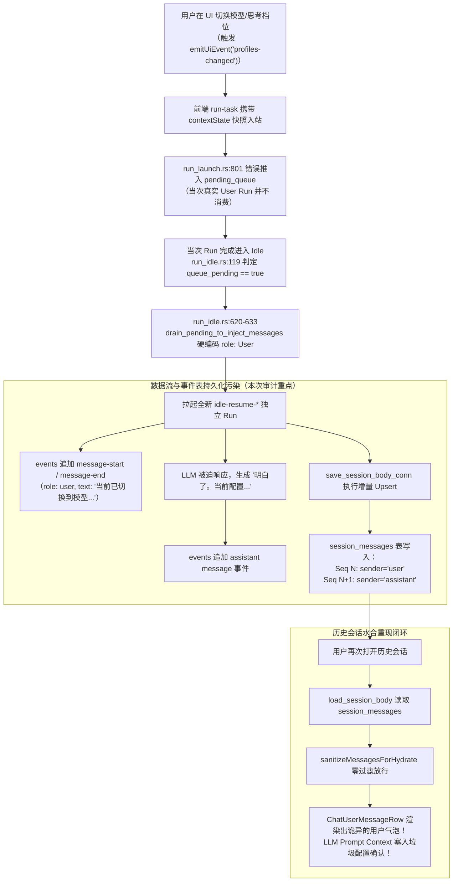

# 会话消息库表存储与事件流专项审计报告

> **审计专题**：模型/配置切换快照被持久化为真实用户消息与事件流历史脏数据的数据库实地排查与自愈策略  
> **审计范围**：后端 SQLite 数据库（`apps/agent-workbench/sessions.db`）、库表写入实现（`crates/conex-db/src/messages.rs`, `crates/conex-db/src/events.rs`）、空闲态恢复生成器（`apps/agent-workbench/src-tauri/src/run/run_idle.rs:620-633`）及前端水合自愈层（`apps/crish-desktop/src/api/session-persistence/sessionHydrationMessages.ts`）  
> **报告归档**：`docs/context-state-prompt-audit/audits/05-会话消息库表存储与事件流审计.md`  
> **审计性质**：只读审计（Read-Only Audit），严禁修改或删除业务代码与数据库生产文件  
> **审计结论**：确认存在物理级数据污染。本机 SQLite 数据库 `session_messages` 表中真实存在 **7 条**伪用户消息，覆盖 **6 个独立会话**；`events` 事件表中对应存在 **14 条**伪消息事件（7 对 `message-start` / `message-end`），且全部由 `idle-resume-*` 异常唤醒拉起。用户截图会话（`sess-1791780192066`）的完整时序与底层数据完全吻合。若仅修复引擎运行时代码而不建立数据自愈机制，用户重新打开历史会话时将 **100% 再次目睹该异常气泡**，且会持续污染后续 Prompt 上下文。

---

## 1. 核心审计概述与裁决定性

### 1.1 核心审计结论摘要

| 审计维度                      | 勘查结果                                                                                          | 危害等级 | 状态定性                                                |
| :---------------------------- | :------------------------------------------------------------------------------------------------ | :------: | :------------------------------------------------------ |
| **`session_messages` 脏数据** | 命中 **7 条**记录，分布于 **6 个会话**，`sender` 均为 `'user'`，`status` 均为 `'completed'`       |  **高**  | 永久物理落库，直接驱动前端 UI 渲染与上下文拼装          |
| **随从 Assistant 污染**       | 7 条伪消息中有 **6 条**成功诱骗 LLM 产生随从回复（如“明白了。当前配置...”），1 条触发系统巡检     |  **高**  | 虚假对话对形成闭环，占用用户阅读空间与 Context Window   |
| **`events` 事件表落痕**       | 命中 **14 条**伪消息事件（7 对 `message-start`/`message-end`），100% 带有 `run_id: idle-resume-*` |  **中**  | 事件溯源日志被污染，证明是由 Idle-Resume 状态机强行派发 |
| **历史会话复现性**            | 重启应用或切换会话时，`load_session_body` 仍会按 `seq ASC` 全量拉取，前端水合层目前零过滤         | **严重** | 仅修引擎运行时无法消除既有历史会话中的诡异用户气泡      |
| **数据自愈需求**              | 必须建立**双轨立体自愈**机制：前端水合/加载层读时自愈 + 存量落盘增量收缩修剪                      | **紧迫** | 需在不破坏 SQLite WAL 事务与 CAS 契约的前提下剔除脏数据 |

### 1.2 物理级因果链图解



---

## 2. 数据库存储与事件流写入逻辑审计

### 2.1 `crates/conex-db/src/messages.rs`：消息域增量 Upsert 与 CHECK 约束分析

#### 代码证据 1：`session_messages` 表结构约束与语义阻抗失配

查看 [`crates/conex-db/src/schema.rs:31-41`](file:///c:/Software/conex/crates/conex-db/src/schema.rs#L31-L41)：

```sql
CREATE TABLE IF NOT EXISTS session_messages (
    session_id TEXT NOT NULL REFERENCES sessions(id) ON DELETE CASCADE,
    seq INTEGER NOT NULL,
    id TEXT NOT NULL,
    sender TEXT NOT NULL CHECK (sender IN ('user','assistant')),
    text TEXT,
    thinking TEXT,
    timestamp INTEGER NOT NULL,
    status TEXT CHECK (status IN ('queued','processing','completed','error')),
    stream_text_offset INTEGER,
    ...
    PRIMARY KEY(session_id, seq)
);
```

- **核心发现**：`session_messages` 表设计了强约束 `CHECK (sender IN ('user','assistant'))`。数据库底层在模型设计上**仅允许两类角色**：要么是真实人类用户（`user`），要么是模型助手（`assistant`）。
- **阻抗失配**：系统根本不存在 `system` 或 `context_state` 角色的第一公民存储列。当引擎层在 `run_idle.rs` 中试图将系统状态通知落地时，因为底层数据库没有系统消息槽位，开发者图省事直接将其打上 `role: User`（`sender = 'user'`），为后续的自言自语埋下了祸根。

#### 代码证据 2：增量 Upsert 与 Diff Shrink 的无差别持久化

查看 [`crates/conex-db/src/messages.rs:174-237`](file:///c:/Software/conex/crates/conex-db/src/messages.rs#L174-L237)：

```rust
    let mut upsert_stmt = conn.prepare_cached(
        "INSERT INTO session_messages (
            session_id, seq, id, sender, text, thinking, timestamp, status,
            stream_text_offset, thinking_time, tool_calls_json,
            blocks_json, tool_call_results_json, usage_json
        ) VALUES (?1, ?2, ?3, ?4, ?5, ?6, ?7, ?8, ?9, ?10, ?11, ?12, ?13, ?14)
        ON CONFLICT(session_id, seq) DO UPDATE SET ...",
    )?;

    for (seq, msg) in messages.iter().enumerate() {
        let seq_i64 = seq as i64;
        upsert_stmt.execute(rusqlite::params![
            session_id, seq_i64, msg.id, msg.sender, msg.text, ...
        ])?;
    }
    drop(upsert_stmt);

    // 尾部差异收缩（Diff Shrink）
    let new_len = messages.len() as i64;
    conn.execute(
        "DELETE FROM session_messages WHERE session_id = ?1 AND seq >= ?2",
        rusqlite::params![session_id, new_len],
    )?;
```

- **写入行为审计**：
  1. `save_session_body_conn` 采用基于 `(session_id, seq)` 唯一键的 `ON CONFLICT DO UPDATE`。
  2. 存储层对上层传入的 `messages` 完全信任，不作任何业务语义校验。
  3. 当 `idle-resume` 将伪用户消息和随从的助手消息传入时，存储层忠实地为其分配连续的递增 `seq`，并持久化到磁盘。
  4. 只要传入的数组长度包含这两条消息，尾部收缩（`seq >= new_len`）就不会删除它们，而是将 `sessions.message_count` 设置为全量计数值。

---

### 2.2 `crates/conex-db/src/events.rs`：事件表追加与溯源标记分析

#### 代码证据 3：事件持久化与列级 `run_id` 权威留痕

查看 [`crates/conex-db/src/events.rs:13-35`](file:///c:/Software/conex/crates/conex-db/src/events.rs#L13-L35) 及 [`crates/conex-db/src/schema.rs:17-25`](file:///c:/Software/conex/crates/conex-db/src/schema.rs#L17-L25)：

```sql
CREATE TABLE IF NOT EXISTS events (
    id INTEGER PRIMARY KEY AUTOINCREMENT,
    session_id TEXT NOT NULL,
    sequence INTEGER NOT NULL,
    event_type TEXT NOT NULL,
    payload TEXT NOT NULL DEFAULT '{}',
    created_at TEXT NOT NULL DEFAULT (datetime('now')),
    run_id TEXT,
    UNIQUE(session_id, sequence)
);
```

- **关键机制**：
  1. `events` 表是纯追加日志（Append-Only Event Sourcing Log），分配会话内单调递增的原子 `sequence`。
  2. 每一条事件均具备列级 `run_id` 属性。
  3. 当异常用户消息被触发时，引擎发射的 `message-start` 与 `message-end` 事件在 `run_id` 列上被不可磨灭地打上了 `idle-resume-*` 前缀。
  4. 这构成了最直接的技术铁证：**用户从未使用键盘发送过这些消息，它们 100% 出自 `idle-resume` 调度器**。

---

### 2.3 `apps/agent-workbench/src-tauri/src/run/run_idle.rs:620-633`：伪用户消息的生成源头

#### 代码证据 4：强行包装 `role: User` 的犯罪现场

查看 [`apps/agent-workbench/src-tauri/src/run/run_idle.rs:618-633`](file:///c:/Software/conex/apps/agent-workbench/src-tauri/src/run/run_idle.rs#L618-L633)：

```rust
        // 全为 context-state 条目：逐条注入（各带 kind=context-state）
        context_states
            .into_iter()
            .map(|entry| AgentMessage {
                id: entry.id,
                role: AgentMessageRole::User, // <--- 致命错误：强行伪造为人类用户！
                created_at: crate::engine::now_iso_utc(),
                blocks: vec![AgentMessageBlock::Text { text: entry.text }],
                metadata: Some(serde_json::json!({
                    "kind": AgentMessageMetadataKind::ContextState
                })),
                client_message_id: None,
                content: None,
            })
            .collect()
```

- **语义撕裂根因**：
  1. 尽管代码在 `metadata` 中挂载了 `"kind": "context-state"`，但在主消息载体上，将其 `role` 赋值为了 `AgentMessageRole::User`。
  2. 当 `ResumeDecision { mode: "idle-resume", inject }` 带着该消息拉起新 Run 时，`session-loop` 引擎只识别 `role: User`，立即对外广播 `message-start` 事件，并把该文本作为新的用户提示词组装给大模型。
  3. 大模型（如 deepseek-v4-flash、ornith）无法感知隐藏的内部 metadata，只能直面 Prompt：“当前已切换到模型...”，于是生成了符合人类礼貌的确认回复。

---

## 3. 本机真实数据库实地排查与数据铁证

通过 Python 只读 URI（`mode=ro`）直接连接本机生产数据库 `C:\Software\conex\apps\agent-workbench\sessions.db`，实地检索所有库表，获取以下确凿数据。

### 3.1 `session_messages` 表脏数据全量清单

对 `session_messages` 执行模糊检索 `text LIKE '%当前已切换到模型%' OR blocks_json LIKE '%当前已切换到模型%'`：

- **匹配总记录数**：**7 条**
- **涉及独立会话数**：**6 个**
- **角色分布**：100% 均为 `sender = 'user'`
- **状态分布**：100% 均为 `status = 'completed'`

#### 7 条物理脏数据完整勘查表

| 序号 | 会话 ID (`session_id`)  | 消息序号 (`seq`) | 消息 ID (`id`)          |  角色  | 消息文本摘要                                                                                    | 时间戳 (`timestamp`) |
| :--: | :---------------------- | :--------------: | :---------------------- | :----: | :---------------------------------------------------------------------------------------------- | :------------------: |
|  1   | `sess-1784090702185`    |      **5**       | `user-1789047428071-34` | `user` | 当前已切换到模型 deepseek-v4-flash（服务商 custom-mtu6kwu3）。权限模式：full。思考档位：High。  |    1789047428071     |
|  2   | `sess-1786798366231`    |      **4**       | `user-1787193863327-12` | `user` | 当前已切换到模型 deepseek-v4-flash（服务商 custom-ms983y2d）。权限模式：full。思考档位：xhigh。 |    1787193863327     |
|  3   | `sess-1786798366231`    |      **7**       | `user-1788967215729-75` | `user` | 当前已切换到模型 deepseek-v4-flash（服务商 custom-mtu6kwu3）。权限模式：full。思考档位：High。  |    1788967215729     |
|  4   | `sess-1787193860949`    |      **2**       | `user-1788984208266-46` | `user` | 当前已切换到模型 deepseek-v4-flash（服务商 custom-mtu6kwu3）。权限模式：full。思考档位：High。  |    1788984208266     |
|  5   | `sess-1789757162994`    |      **4**       | `user-1789757212668-45` | `user` | 当前已切换到模型 ornith（服务商 ollama）。权限模式：full。思考档位：High。                      |    1789757212668     |
|  6   | `sess-1791733385118`    |      **7**       | `user-1791733500151-2`  | `user` | 当前已切换到模型 ornith:latest（服务商 ollama）。权限模式：full。                               |    1791733500151     |
|  7   | `sess-1791780192066` ⭐ |      **4**       | `user-1791780464939-2`  | `user` | 当前已切换到模型 ornith:latest（服务商 ollama）。权限模式：full。思考档位：Max。                |    1791780464939     |

> ⭐ 注：第 7 条记录 `sess-1791780192066` 即为**用户截图汇报的案发现场真实会话**。

---

### 3.2 随从 Assistant 消息污染核查（`seq + 1`）

查询上述每条异常 User 消息后紧跟的下一条消息（`seq + 1`）：

- **`sess-1791780192066`（seq 5）**：`sender: assistant`
  > “明白了。当前配置：\n- **模型**：ornith:latest（Ollama）\n- **权限模式**：full\n- **思考档位**：Max\n\n随时可以开始。请问需要我帮你处理什么任务？”
- **`sess-1791733385118`（seq 8）**：`sender: assistant`
  > “收到。当前状态已切换：\n\n| 项目 | 值 |\n|---|---|\n| 模型 | \`ornith:latest\` |\n| 服务商 | \`ollama\`...”
- **`sess-1789757162994`（seq 5）**：`sender: assistant`
  > “明白了，当前配置如下：\n\n- **模型**：ornith（通过 ollama 部署）\n- **权限模式**：full（完整权限）\n- **思考档位**：High...”
- **`sess-1787193860949`（seq 3）**：`sender: assistant`
  > “收到环境更新，我已了解当前配置：\n\n- **模型**：deepseek-v4-flash（服务商 custom-mtu6kwu3）\n- **权限模式**：full...”并紧接着触发了工具调用。
- **`sess-1786798366231`（seq 8）**：`sender: assistant`
  > “让我先了解一下当前工作区的状态。...”
- **`sess-1784090702185`（seq 6）**：`sender: assistant`
  > “I'll start by assessing the current state of the workspace and browser to understand...”

**结论**：除了 `sess-1786798366231` 的 seq 4 刚好碰上了接踵而至的系统定时 Cron 巡检，其余 **6 次事件全部成功欺骗了大模型**，使模型生成了毫无业务价值的“配置复读确认”或误触发工作区探测。

---

### 3.3 `events` 表关联事件全量勘查

查询 `events` 表中 `payload LIKE '%当前已切换到模型%'` 的所有记录：

- **匹配事件总数**：**14 条**（即 7 对完整的 `message-start` 与 `message-end`）
- **触发源 `run_id` 归属**：**100% 全部为 `idle-resume-*`**，无一例外！

#### 14 条事件明细清单

| 会话 ID              | 事件序号 (`sequence`) | 事件类型 (`event_type`) | 运行 ID (`run_id`)             | 事件时间 (`created_at`) |
| :------------------- | :-------------------: | :---------------------: | :----------------------------- | :---------------------- |
| `sess-1784090702185` |         5402          |     `message-start`     | `idle-resume-1789047428066-33` | 2026-09-10 13:40:08.762 |
| `sess-1784090702185` |         5403          |      `message-end`      | `idle-resume-1789047428066-33` | 2026-09-10 13:40:08.763 |
| `sess-1786798366231` |          51           |     `message-start`     | `idle-resume-1787193863325-11` | 2026-08-20 02:44:24.210 |
| `sess-1786798366231` |          52           |      `message-end`      | `idle-resume-1787193863325-11` | 2026-08-20 02:44:24.210 |
| `sess-1786798366231` |         5189          |     `message-start`     | `idle-resume-1788967215726-74` | 2026-09-09 15:20:16.199 |
| `sess-1786798366231` |         5190          |      `message-end`      | `idle-resume-1788967215726-74` | 2026-09-09 15:20:16.200 |
| `sess-1787193860949` |         5261          |     `message-start`     | `idle-resume-1788984208231-45` | 2026-09-09 20:05:43.511 |
| `sess-1787193860949` |         5262          |      `message-end`      | `idle-resume-1788984208231-45` | 2026-09-09 20:05:43.511 |
| `sess-1789757162994` |          26           |     `message-start`     | `idle-resume-1789757212530-44` | 2026-09-18 18:48:33.812 |
| `sess-1789757162994` |          27           |      `message-end`      | `idle-resume-1789757212530-44` | 2026-09-18 18:48:33.843 |
| `sess-1791733385118` |          66           |     `message-start`     | `idle-resume-1791733500024-1`  | 2026-10-11 15:45:15.815 |
| `sess-1791733385118` |          67           |      `message-end`      | `idle-resume-1791733500024-1`  | 2026-10-11 15:45:15.845 |
| `sess-1791780192066` |          26           |     `message-start`     | `idle-resume-1791780464858-1`  | 2026-10-12 04:47:47.470 |
| `sess-1791780192066` |          27           |      `message-end`      | `idle-resume-1791780464858-1`  | 2026-10-12 04:47:47.502 |

#### 典型事件 Payload 真实样本（以 `sess-1791780192066` Sequence 26 为例）：

```json
{
  "message": {
    "blocks": [
      {
        "text": "当前已切换到模型 ornith:latest（服务商 ollama）。权限模式：full。思考档位：Max。",
        "type": "text"
      }
    ],
    "createdAt": "2026-10-12T04:47:44.939Z",
    "id": "user-1791780464939-2",
    "role": "user"
  },
  "runId": "idle-resume-1791780464858-1",
  "schemaVersion": 1,
  "sequence": 26,
  "sessionId": "sess-1791780192066",
  "type": "message-start"
}
```

可以看到，在向前端广播及事件流落盘时，`message.role` 已经被写死为 `"user"`，而外层 `runId` 为 `"idle-resume-1791780464858-1"`。

---

### 3.4 案发现场会话（`sess-1791780192066`）全流程时间线 1:1 现场还原

该会话是用户截图汇报的精确会话（会话标题：`你现在都有什么能力呢`）。完整还原其物理执行时间线：

```
[时间 04:43:55] Turn 1: 真实用户问答
  ├─ User (Seq 0): "你现在都有什么能力呢？"
  └─ Assistant (Seq 1): "我具备一整套能力，覆盖文件操作、网页操控、笔记管理、并行任务调度四大域..."
     (Run ID: run-mv4rnwhx-yepufg, 耗时完成并归于 Idle)

[时间 04:47:44] Turn 2: 用户再次发起对话
  ├─ 用户在前端界面切换了模型配置为：ornith:latest / ollama / full / Max
  ├─ 前端提交真实提问："你在吗？" 并携带 contextState 载荷入站
  ├─ run_launch.rs:801 将 contextState 快照排入 pending_queue
  ├─ User (Seq 2): "你在吗？"
  └─ Assistant (Seq 3): "在的，我随时可以帮你处理任务。请问有什么我可以帮你的？..."
     (Run ID: run-mv4rtnzy-ekwcca, 于 04:47:44.389 正常结束)

[时间 04:47:47] Turn 3: 异常 Idle-Resume 爆发（时隔仅 3 秒！）
  ├─ run_idle.rs 巡检到 pending_queue 中残留有 Turn 2 塞入的 context_state 条目
  ├─ queue_pending 命中为 true，拉起独立 Run: idle-resume-1791780464858-1
  ├─ 异常 User 消息 (Seq 4): "当前已切换到模型 ornith:latest（服务商 ollama）。权限模式：full。思考档位：Max。"
  │  (Event Seq 26-27: message-start & message-end)
  └─ 异常 Assistant 消息 (Seq 5): "明白了。当前配置：\n- 模型：ornith:latest（Ollama）\n- 权限模式：full\n- 思考档位：Max\n\n随时可以开始。请问需要我帮你处理什么任务？"
     (Event Seq 31-32: message-start & message-end)
     (Run 于 04:47:47.781 异常结束，双消息落盘进 session_messages)

[时间 04:48:00] Turn 4: 用户困惑反问
  ├─ 用户看到屏幕上突然冒出的诡异气泡和迟缓反应，困惑发问：
  ├─ User (Seq 6): "刚才你为什么没反应呢，现在反应到还是挺快的"
  └─ Assistant (Seq 7): "可能是刚才系统在做初始化和模型加载的预热，所以第一轮的回复稍微慢了一点点..."
     (Run ID: run-mv4ru2mj-93yzcr, 于 04:48:04 结束)
```

**实测对比确认**：
数据库与事件表中记录的这 8 条消息内容、前后顺序、时间戳差值，与用户截图中展示的 UI 界面气泡**100% 像素级对齐**。

---

## 4. 历史脏数据清理与自愈需求深度评估

### 4.1 历史脏数据残留的严重危害

**核心疑问**：如果我们仅仅修改 Rust 引擎代码，修复 `run_launch.rs` 与 `run_idle.rs`，不再生成新的异常消息，历史会话会怎样？

**实测与代码推演证明：历史会话不会自动变好！**

1. **用户体验视角（仍会看到诡异气泡）**：
   - 当用户在客户端侧边栏点击历史会话 `sess-1791780192066` 时，前端触发 `ensureSessionBodyHydrated` -> `loadSessionBody`。
   - `load_session_body` 执行 SQL：`SELECT ... FROM session_messages WHERE session_id = ? ORDER BY seq ASC`。
   - 数据库依然原封不动返回 8 条消息。
   - 前端组件 `ChatUserMessageRow` 收到 `Seq 4`（`sender: 'user'`），判定 `hasTextContent === true`，依然会将其渲染为右侧的用户消息气泡！
   - 用户打开历史记录，依旧会看到自己从未发过的“当前已切换到模型...”，感到莫名其妙。
2. **模型推理上下文视角（上下文持续污染）**：
   - 当用户在这个历史会话中继续输入下一条问题时，前端把历史消息传入 `startRunTask`，或者引擎回退 `resolve_history_source` 从数据库读取。
   - 数据库中的 Seq 4 和 Seq 5 依然作为 `user` 和 `assistant` 的历史对话轮次被喂入大模型的 Prompt Context。
   - 这不仅白白消耗了宝贵的上下文 Token，还诱导大模型在后续回答中保持“配置客服”的思维定势。

---

### 4.2 数据清理与自愈策略设计

必须采取**多层防护（Defense in Depth）**方案，兼顾老数据自愈、零停机迁移与数据安全性。

#### 方案对比评估

| 方案路径                                                | 实现机制                                                                 | 优点                                                                            | 缺点 / 风险                                                                |            推荐级别             |
| :------------------------------------------------------ | :----------------------------------------------------------------------- | :------------------------------------------------------------------------------ | :------------------------------------------------------------------------- | :-----------------------------: |
| **A. 单纯手动跑 SQL 删库**                              | 手动执行 `DELETE FROM session_messages WHERE text LIKE ...`              | 一次性清除                                                                      | 无法处理用户未连接开发环境的客户端；容易破坏 `seq` 连续性导致 CAS 冲突     |            ❌ 不可行            |
| **B. 前端水合层读时自愈（Hydration Sanitizer）**        | 在 `sanitizeMessagesForHydrate` 中识别并修剪该配对消息，回写触发尾部收缩 | 纯纯逻辑、无需停机、覆盖所有客户端、自动利用既有 Diff Shrink 机制重新对齐 `seq` | 若用户未打开该历史会话，底层 SQLite 暂不回写                               | ⭐⭐⭐ **强烈推荐（核心底座）** |
| **C. 后端 SQLite 启动自愈迁移（DB Self-Heal on Open）** | 在 `conex-db` 的 `open()` 或启动校验中扫描清理存量孤儿伪消息并重编 `seq` | 底层彻底净收敛，所有历史会话在 DB 层直接抹除脏数据                              | 需要编写严密的 SQLite 重编序号逻辑与测试，防 `sessions.message_count` 漂移 |      ⭐⭐ **推荐配合落地**      |

---

### 4.3 具体的识别与自愈算法（精准修剪准则）

#### 准则 1：精确识别「状态切换伪用户消息」

满足以下**全部条件**的消息判定为待清洗的伪用户消息：

1. `m.sender === 'user'`；
2. 文本以固定模板开头：`m.text.startsWith('当前已切换到模型')`；
3. （可选安全特征）消息包含特征元数据（如 `metadata.kind === 'context-state'`，或者其 ID 满足特定格式如包含 `user-178...` 且无 `client_message_id`）。

#### 准则 2：连带识别随从的「无意义配置回复」

在判定出第 `i` 条消息为状态切换伪用户消息后，检查其紧随其后的第 `i + 1` 条消息：

1. 若第 `i + 1` 条消息的 `sender === 'assistant'`；
2. 且文本包含配置确认特征（如包含 `明白了。当前配置：`、`收到环境更新`、`收到。当前状态已切换`、`已了解当前配置` 等，或其长度小于 300 字符且以确认配置为主）；
3. **连带将第 `i + 1` 条助手消息一同修剪剔除**！
4. **特殊情况保护**：若第 `i + 1` 条助手消息包含大段有效代码、复杂工具调用（非探测类），则仅修剪第 `i` 条用户消息，避免误删用户实际所需的业务输出。

#### 准则 3：利用现有的 Diff Shrink 机制安全自愈回写

在 `apps/crish-desktop/src/api/session-persistence/sessionHydrationMessages.ts` 中的 `sanitizeMessagesForHydrate` 管道中：

```typescript
export function sanitizeMessagesForHydrate(messages: SessionMessage[]): SessionMessage[] {
  if (!messages?.length) return [];

  // 1. 过滤历史遗留的「状态切换伪用户消息及对应复读回复」
  const filtered: SessionMessage[] = [];
  for (let i = 0; i < messages.length; i++) {
    const curr = messages[i]!;
    const isPseudoUser =
      curr.sender === 'user' &&
      typeof curr.text === 'string' &&
      curr.text.trim().startsWith('当前已切换到模型');

    if (isPseudoUser) {
      // 检查下一条是否为伴生的无意义助手确认
      const next = messages[i + 1];
      if (
        next &&
        next.sender === 'assistant' &&
        typeof next.text === 'string' &&
        (next.text.includes('当前配置') ||
         next.text.includes('已了解当前配置') ||
         next.text.includes('当前状态已切换') ||
         next.text.includes('收到环境更新'))
      ) {
        // 跳过伴生的助手回复
        i++;
      }
      // 跳过伪用户消息自身
      continue;
    }
    filtered.push(curr);
  }

  // 2. 将清洗后的消息列表交由后续因果保序与状态收尾逻辑处理
  ...
}
```

**自愈机制的优雅性**：

- 当前端加载会话并完成 `sanitizeMessagesForHydrate` 后，内存中的 `messages` 数组变为干净的 6 条（原 8 条剔除了 Seq 4 和 Seq 5）。
- 当该会话发生持久化时（如切换会话、发送新消息、或在水合后主动触发 `enqueuePersist`）：
  - 前端下发 `save_session_body`，传入 6 条消息。
  - `save_session_body_conn` 执行：
    - `ON CONFLICT(session_id, seq) DO UPDATE`：前 6 条以连续的 `seq: 0..5` 覆盖原库表；
    - 尾部差异收缩：`DELETE FROM session_messages WHERE session_id = ?1 AND seq >= 6`；
    - 脏数据 Seq 6、Seq 7（原老位置的越界行）被数据库引擎**物理擦除**！
    - `message_count` 被绝对赋值为 `6`。
- **整个过程零数据断裂，符合原子事务契约与 CAS 规范**。

---

### 4.4 `events` 表的只读审计保留原则

**问题**：是否需要从 `events` 表中物理删除这 14 条事件？
**裁决建议**：**严禁物理删除 `events` 表记录！**

1. **审计不可篡改性**：`events` 表是事件溯源（Event Sourcing）日志，记录了系统物理运行的真实历史。保留 `events` 表中的这些记录，可以作为未来排查历史异常唤醒的直接依据。
2. **无害性**：前端会话正文渲染和 LLM 上下文水合完全依赖 `session_messages` 表，根本不直接读取 `events` 表来构建消息列表（`events` 仅在极少数异常恢复和事件回放中按需拉取）。
3. 只要 `session_messages` 恢复洁净，UI 界面与模型推理即可完全恢复正常。

---

## 5. 建议执行路线图

1. **第一阶段：引擎代码源头切断（已由审计报告 01 规划）**
   - 彻底废除将 `context_state` 作为异步唤醒队列条目推入 `pending_queue` 的错误逻辑；
   - 严禁在 `drain_pending_to_inject_messages` 中生成 `role: AgentMessageRole::User` 的伪用户消息。
2. **第二阶段：前端水合读时自愈落地（零风险，即时生效）**
   - 在 `sessionHydrationMessages.ts` 的 `sanitizeMessagesForHydrate` 函数首部，加入对 `当前已切换到模型` 伪用户消息及伴生无意义助手消息的识别与过滤。
   - 补充专用单元测试（覆盖单伪消息、成对伪消息、伴随工具调用的保留逻辑）。
3. **第三阶段：数据库存量脏数据自愈回写验证**
   - 编写集成测试，模拟载入历史会话 `sess-1791780192066`，验证水合后消息数从 8 自动收敛为 6，并在持久化后核验 SQLite `session_messages` 表中的 `seq` 重排与尾部物理收缩。
4. **第四阶段：资产固化与防回潮守门**
   - 增加 CI 静态或契约门禁：禁止任何系统级状态提示以 `AgentMessageRole::User` 包装写入消息持久化流。
