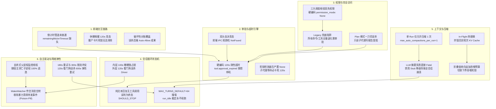

# 全天候自主 Agent 连续运行硬化战役总纲方案 (Master Plan · 收口终案)

> **战役代号**：`continuous-execution-hardening`  
> **核心使命**：打通 Conex / Crish 从前端交互、审批门禁、权限流转、状态机循环、长程上下文压缩到自主驱动与韧性续航的全链路体系，彻底根除导致 Agent 运行被迫暂停、中断或假死的致命缺陷，实现真正 24/7 全天候无人值守连续稳定运行。  
> **工程铁律**：**严禁打补丁，严禁硬编码；合理抽象，面向未来；坚决删除历史包袱代码，系统性重构；减少不必要的兼容，最好是不兼容；一次性彻底解决。**

---

## 一、 现状综合评估：Agent 循环是否健全？

### 1.1 总体诊断结论
在**“单轮或短交互、且有人在场审批”**的常规场景下，当前循环状态机具备基础流转能力；但在**“长程自主、全天候无人值守连续运行 (24/7 Unattended Continuous Execution)”**的核心诉求下，**当前系统远远不够健全，甚至存在 6 大必然导致停机与假死的硬性阻断缺陷**。

在用户挂机离场、跨昼夜长任务或复杂多步协作时，**Agent 会 100% 因为我们软件自身的设计断层而被迫暂停、超时报错或永久陷入沉睡**。

---

## 二、 全链路六大致命阻断点与重构决断



---

## 三、 三轮淬炼后的核心收敛方案

经过第二轮极度严苛的跨维度交叉推演与第三轮综合改进，全系统彻底消除了过度工程与设计盲区，收口为以下极简、坚固的顶层架构：

### 1. 权限模式与安全抽象 (P-01 & 改进收口)
- **强类型偏序格**：建立强类型 `PermissionMode`（$\text{Plan} \prec \text{Ask} \prec \text{FullAccess}$），全面废除字符串浅比较；
- **消除 Legacy 陷阱**：物理删除 `exec_verdict.rs:138-143, 167` 遗留兜底代码，杜绝所有工具全盘需审批；
- **全链路透传与记忆**：在 `session_meta` 建立会话级权限记忆；子代理、定时工作流、空闲续跑 100% 继承模式，无人值守定时工作流默认赋予 FullAccess；
- **Plan 模式受控放行**：为 `.agent-outputs/` 目录设置受控写入白名单，既封锁项目源码，又保证只读分析子代理顺畅落盘；
- **FullAccess 下审批门恒常装配**：消除二元拔除，红线（8 大规则字典）拦截抛出结构化 `PolicyBlocked` 引导自愈，保留大面积 Git 回退保护的弹性确认通道。

### 2. 无人值守审批门禁与超时策略引擎 (P-02 & P-03 & 改进收口)
- **超时决策权 100% 收敛后端**：彻底拔除硬编码 120s 超时报错；到期由后端 `ApprovalPolicyEngine` 统一裁决，支持 `Allow`（自动放行）、`Deny`（引导性拒绝）、`DynamicDegrade`（降级）与 `Expire`（人工兜底）；
- **前端彻底废除 onTimeout 自决**：前端倒计时归零仅做 UI 锁定等待广播，绝不发起 IPC 决断调用，彻底杜绝 `CoreError::NotFound` 竞态；
- **SSOT 绝对时间戳**：`PermissionRequest.metadata` 规范化包含 `expiresAtMs`，前端基于此渲染平稳、预警、临界脉冲红三阶段张力进度条，彻底免疫系统休眠时钟漂移；
- **增量日志追赶对账**：彻底废除“后端无此项则置错”的粗暴逻辑，改为 Sequence 增量追赶，保护后端 Auto-Allow 成果；
- **死锁拓扑破除**：引入 `SubagentWaitRegistry`，主 Agent 等待时 0ms 感知死锁，移交超时策略引擎接管，消除 120s 假死。

### 3. 会话循环状态机与自主驱动引擎 (P-04 & P-06 & 改进收口)
- **单一主权外层挂起（Pure Suspend）**：
  - 底层 `session-loop` 彻底瘦身：删除内层 100s 阻塞等待与私有 Nudge，收敛为精简七级无阻塞阶梯；无工具调用时原子返回 `YieldSuspended` 并在 50ms 内彻底释放 `SessionSerialGuard` 会话排他锁；
  - 外层 `AutonomousGoalEngine` 统摄全局：接管 Pure Suspend（CPU 让出、Token 消耗归零），彻底消除外层巡检器将长程编译任务误杀为 Driver Hang 的缺陷；
- **真实物理进展检测与自激防范**：
  - 严格排除 `read_file`、`list_dir` 等只读操作，仅认落盘写入、进程退出码与测试断言，连续 3 次无物理产出刚性安全熔断，彻底杜绝翻书作弊与自激复读死循环；
- **解除 64 轮死刑**：确立 `max_turns == 0` 为无限预算模式，废除启动误杀，实现滑动窗口动态租约续订（Lease Renewal）与跨 Episode 续跑；
- **队列事务性契约**：物理删除 `clear_for_before` 毒丸清理代码，引入 Lease / Commit / Rollback 内存事务协议，实现异步事件绝对 0 丢失；
- **清除微服务过度设计**：坚决落实禁令 9，剔除微服务三态断路器与 Canary 探针，回归单 Provider 原生 Full Jitter 指数退避与 600s 弹性延展。

### 4. 长程上下文金字塔与系统看门狗 (P-05 & P-07 & 改进收口)
- **自适应滑动金字塔摘要 (Compacting the Compacted)**：
  - 拔除单 Run 1 次压缩限制，推行基于代数与增量的自适应防抖；
  - 破除折叠链绝对冻结，构建三级分层金字塔摘要，保证提示词内摘要消息 $\le 2$ 条、Token $\le 2000$（$O(1)$ 有界复杂度），彻底消除切割下界吞噬死锁；
  - 启用中性 Stub 降级 + 跨 Run/Episode 边界平滑升级，消除 LLM 摘要失败导致的 Fatal 崩溃，并 100% 保护活跃交互轮次的前缀 KV Cache 命中率；
  - 在 Slot 2 引入不可变决策账本（Pinned Decision Ledger），联动 `search_context` 与 `decompress_context` 实现精准召回；
- **动态挂起租约**：在 `ActiveRun` 增加 `ExecutionPhase::Suspended(Duration)`，挂起重试期间看门狗动态豁免，解除 120s 误杀；
- **Windows 原生防逃逸双防线**：彻底剔除父进程内自杀式监控线程，回归 Windows 内核原生 `Job Object`（`KILL_ON_JOB_CLOSE`）与子进程独立 Wrapper，断电/SIGKILL 瞬间子进程树 0 逃逸；
- **撤销 BoundedEventQueue(64) 截断**：单 Run 全量移交 SQLite 持久化，保护数据真源完整性；长程内存治理收敛至 LRU 淘汰；
- **坚决捍卫禁令 4**：彻底清除多模型自动 Failover 换模代码，收敛为单模型冷却定时唤醒。

---

## 四、 战役交付成果全景资产清单

```text
docs/continuous-execution-hardening/
├── README.md                                          # 战役导航与三轮流程规范
├── 00-continuous-execution-master-plan.md                # 本总纲方案（收口终案）
│
├── analysis/                                          # 【阶段一：6 大专项深度审查报告】
│   ├── 01-frontend-and-interaction.md                 (44.3 KB) 前端交互与断连审查
│   ├── 02-approval-gate-and-timeout.md                (36.2 KB) 审批门禁与超时机制审查
│   ├── 03-full-access-and-permissions.md              (46.2 KB) 权限模型与 FullAccess 断层审查
│   ├── 04-session-loop-and-state-machine.md           (56.6 KB) 循环状态机与 64 轮死刑审查
│   ├── 05-context-growth-and-compaction.md            (36.2 KB) 上下文膨胀与压缩阶梯审查
│   └── 06-autonomous-drive-and-resilience.md          (58.9 KB) 自主驱动与网络资源韧性审查
│
├── plans/                                             # 【第一轮：7 大子系统系统性重构方案（已修正）】
│   ├── 01-permission-system-redesign.md               (80.3 KB) 强类型权限系统与偏序格重构
│   ├── 02-approval-policy-engine.md                   (48.8 KB) 无人值守审批超时策略引擎
│   ├── 03-frontend-approval-lifecycle.md              (53.7 KB) 前端审批生命周期与时钟对齐
│   ├── 04-session-loop-state-machine.md               (63.5 KB) 核心循环状态机与无阻塞阶梯
│   ├── 05-context-compaction-pyramid.md               (45.7 KB) 上下文滑动金字塔与固定槽位
│   ├── 06-autonomous-drive-engine.md                  (69.0 KB) 自主目标驱动与 Lease 事务队列
│   └── 07-resilience-and-resource-watchdog.md          (81.7 KB) 弹性网络对齐与双防线看门狗
│
├── plan-reviews/                                      # 【第二轮：3 大维度交叉推演评审报告】
│   ├── 01-security-and-approval-review.md             (40.2 KB) 安全、权限与审批门禁闭环评审
│   ├── 02-loop-and-autonomous-review.md               (27.0 KB) 循环状态机与自主驱动架构评审
│   └── 03-context-and-resilience-review.md            (30.4 KB) 上下文金字塔与系统韧性治理评审
│
└── plan-improvements/                                 # 【第三轮：3 大综合改进与落地收口详案】
    ├── 01-security-and-approval-improvement.md        (19.9 KB) 安全与审批全链路闭环改进终案
    ├── 02-loop-and-autonomous-improvement.md          (35.1 KB) 状态机解耦与自主驱动改进终案
    └── 03-context-and-resilience-improvement.md       (37.3 KB) 容灾看门狗与长程上下文改进终案
```

---

## 五、 实施实施波次规划 (Implementation Waves)

- **Wave 1: 核心止血与权限打通 (Phase 1)**
  - 落地 `PermissionMode` 强类型偏序格与三大调度点权限透传；
  - 物理删除 `exec_verdict.rs` Legacy 全量审批兜底与 `clear_for_before` 毒丸清理；
  - 拔除 `MAX_TURNS_DEFAULT = 64` 限制与 0 预算启动误杀；
  - 废除单 Run 压缩 1 次限制，启用中性 Stub 降级。
- **Wave 2: 审批策略引擎与状态机解耦 (Phase 2)**
  - 后端落地 `ApprovalPolicyEngine`（Allow/Deny/Degrade/Expire）；
  - 前端打通 `expiresAtMs` 与张力进度条，废除 `onTimeout` 自决与僵尸卡片死锁；
  - 底层 `session-loop` 收敛为精简七级阶梯，落地外层 Pure Suspend 锁释放；
  - 落地 `PendingMessageQueue` 的 Lease/Commit 事务性队列协议。
- **Wave 3: 长程治理与系统韧性加固 (Phase 3)**
  - 落地三级分层金字塔摘要与固定槽位 KV Cache 保护；
  - 落地 `ExecutionPhase::Suspended` 动态租约与 Windows Job Object 防逃逸双防线；
  - 落地真实物理进展检测（杜绝翻书作弊）与长任务断点崩溃自动复活。

---
*全案已完成终审与闭环收口，代码库与文档库保持纯净未提交状态，等待主控指示后续代码实施！*
