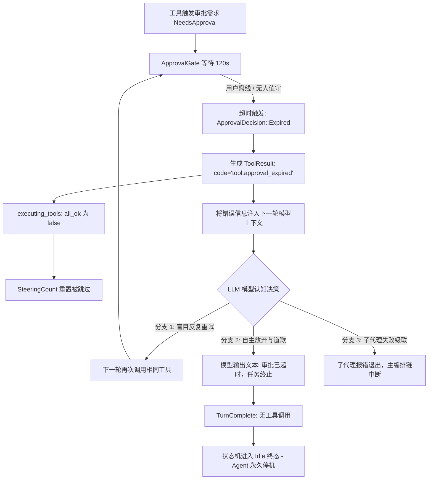
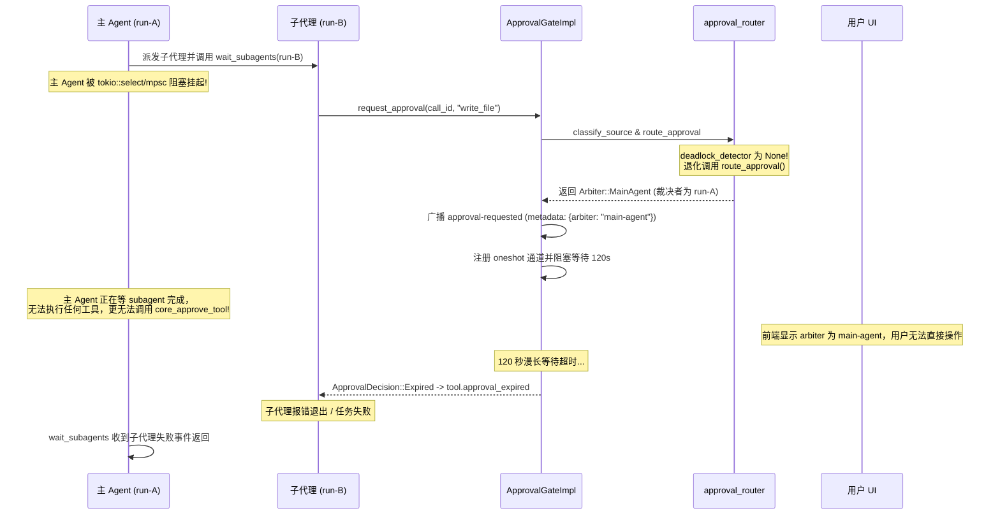

# 02 门禁与倒计时深度审查与方案报告：审批门禁、超时处理与倒计时策略引擎

> **战役主题**：全天候自主 Agent 连续运行与健壮性改造战役 (Continuous Execution Hardening)  
> **审查维度**：02 - 门禁与倒计时 (Approval Gate & Timeout Policy Engine)  
> **责任模块**：`crates/conex-run/src/run/run_approval.rs`、`crates/session-loop/src/approval.rs`、`crates/session-loop/src/approval_router.rs`、`crates/agent-tools/src/context.rs`、`crates/session-loop/src/tool_events.rs`、`crates/session-loop/src/exec_verdict.rs`、`crates/orchestrator/src/restore_manager.rs`  
> **产出路径**：`docs/continuous-execution-hardening/analysis/02-approval-gate-and-timeout.md`  
> **版本与安全属性**：Strictly Read-Only Analysis / UTF-8 无 BOM / 包含代码路径与行号证据

---

## 摘要与审查结论 (Executive Summary)

全天候自主 Agent 的核心使命是在无人工持续盯盘的条件下，能够稳定、长期、自愈地自主驱动任务推进。然而，对现有后端权限审批门禁、超时处理与裁决者路由机制的深度代码审查揭示：**现行审批与超时架构存在四个系统性断裂点，是导致 Agent 无法实现长程无人值守连续运行并频繁被迫暂停或停机的最关键瓶颈**：

1. **双层 120s 刚性超时与 `tool.approval_expired` 致命停机链**：
   内核与会话循环硬编码 `APPROVAL_TIMEOUT = 120s`。当用户离开电脑（如夜间或离线批处理）无人干预时，审批请求超时退化为 `ApprovalDecision::Expired` 并返回 `tool.approval_expired` 错误。虽然该错误在工具事件层标记为非致命（`is_never_fatal`），但由于缺乏无人值守策略介入，模型在下一轮对话中面临语义歧义，极易陷入死循环盲目重试耗尽轮次，或直接输出道歉文本触发 `TurnComplete` 停机收场，全天候连续执行彻底中断。同时前端渲染层（`CompactToolRow.tsx`）根本未向卡片透传剩余毫秒数，用户侧倒计时完全处于盲态。
2. **倒计时策略引擎完全缺失**：
   审批门只有“人工手动点击”和“120s 超时报错”两种结局，完全缺乏无人值守场景下的**可配置超时策略（自动放行 / 明确拒绝 / 安全降级 / 规则匹配）**，导致 Agent 在面临常规非红线操作审批时缺乏自决权。
3. **死锁检测器（DeadlockDetector）生产装配悬空为 `None`**：
   `approval_router.rs` 理论上设计了死锁时序防护，但生产启动点（`run_launch.rs:914-928`）明文注记检测器信号源未接线、直接传入 `None`。导致主 Agent 在执行 `wait_subagents` 阻塞等待子代理期间，子代理发起审批被死板路由给主 Agent（`Arbiter::MainAgent`），主 Agent 被挂起无法裁决，引发确定性的 120 秒假死死锁。
4. **待审批集合内存双锁竞态与崩溃恢复对账断层**：
   运行时 `ApprovalGateImpl` 采用分离的两个 `Mutex`（`pending` 与 `pending_meta`），存在并发读写与移除时的非原子性竞态隐患；更严重的是，当进程崩溃或重启时，内存待审批集合随之消亡，而持久化层（`runs` 表与 `events` 表）将处于 `AwaitingApproval` 的 run 标记为 `Failed`，但**完全未收敛 `approval-requested` 事件**，留下永久悬挂的幽灵未决条目，导致审计断层与远程端状态不一致。

---

## 一、现存 APPROVAL_TIMEOUT = 120s 工作机制与超时致命影响审查

### 1.1 双层 120s 硬编码机制全链路透视

系统在两个层级同时硬编码了 120 秒审批等待超时，形成了嵌套超时结构：

```text
[工具执行器 ToolExecutor]
    │ (1) 调用 approval_wait (crates/session-loop/src/exec_verdict.rs:37)
    │     使用 DEFAULT_APPROVAL_TIMEOUT = 120s (exec_verdict.rs:15)
    ▼
[审批门 ApprovalGateImpl::request_approval] (crates/conex-run/src/run/run_approval.rs:242)
    │ (2) 广播 AgentEvent::ApprovalRequested
    │ (3) 状态机 handle.request_approval -> RunStatus::AwaitingApproval
    │ (4) 等待 oneshot rx 通道，带超时 self.approval_timeout = APPROVAL_TIMEOUT (120s)
    │     (crates/conex-run/src/run/mod.rs:144)
    ▼
[超时触发 (120s 无人应答)]
    │ rx 等待超时 -> pending & pending_meta.remove(call_id)
    │ 返回 ApprovalDecision::Expired
    ▼
[审批通道 ApprovalChannel::ask] (crates/session-loop/src/approval.rs:162)
    │ 记录 ToolEvent::ApprovalResolved { decision: Expired }
    │ 返回 Err(ToolError::new("tool.approval_expired", "approval expired"))
```

#### 具体代码路径与行号证据：

1. **常量硬编码源头**：
   - `crates/conex-run/src/run/mod.rs:144`：
     ```rust
     /// 审批等待超时（超时 → Expired；前端 ApprovalFlow 亦有兜底）
     pub(crate) const APPROVAL_TIMEOUT: Duration = Duration::from_secs(120);
     ```
   - `crates/session-loop/src/exec_verdict.rs:15`：
     ```rust
     /// 批级审批缺省超时（120s，F1-02 修复）：与编排层 approval_router 的
     /// APPROVAL_TIMEOUT=120s 超时兜底对齐——审批卡片丢失/事件桥断连时
     /// 内核强制收敛（Expired），run 不再无限悬挂。
     const DEFAULT_APPROVAL_TIMEOUT: Duration = Duration::from_secs(120);
     ```
2. **ApprovalGateImpl 内部等待与超时清除**：
   - `crates/conex-run/src/run/run_approval.rs:346-364`：
     ```rust
     // 4. 等待决策（超时 → Expired；工具侧按非致命处理，01 §五.8）
     match tokio::time::timeout(self.approval_timeout, rx).await {
         Ok(Ok(decision)) => decision,
         Ok(Err(_)) | Err(_) => {
             // 超时 → Expired 权威收场后同步清除待审批集合与元信息
             self.pending
                 .lock()
                 .unwrap_or_else(|e| e.into_inner())
                 .remove(call_id);
             self.pending_meta
                 .lock()
                 .unwrap_or_else(|e| e.into_inner())
                 .remove(call_id);
             ApprovalDecision::Expired
         }
     }
     ```
3. **ApprovalChannel 映射为错误码**：
   - `crates/session-loop/src/approval.rs:162-182`：
     ```rust
     ApprovalDecision::Expired => {
         self.recorded
             .lock()
             .unwrap_or_else(|e| { ... })
             .push(ToolEvent::ApprovalResolved {
                 call_id: self.call_id.clone(),
                 decision: ApprovalDecision::Expired,
             });
         Err(ToolError::new(
             "tool.approval_expired",
             "approval expired",
         ))
     }
     ```
4. **前端感知脱网断层证据**：
   前端组件 `apps/crish-desktop/src/components/agent-card/ApprovalAskCard.tsx:220` 和 `useApprovalCountdown.ts` 已经实现了倒计时百分比与动画渲染逻辑，但是上层卡片调用点：
   - `apps/crish-desktop/src/components/chat-tool-call/CompactToolRow.tsx:154-170`：
     ```tsx
     <ApprovalAskCard
       msgId={mid ?? ''}
       toolId={tc.id}
       summary={summary}
       cmd={tech && tech !== summary ? tech : techFull || undefined}
       busy={approvalBusy}
       riskMeta={tc.approvalMeta}
       onAllow={...}
       onAllowRemember={...}
       onDeny={...}
       // 致命缺陷：remainingMs 与 onTimeout 根本没有传入！
     />
     ```
   **后果**：前端界面由于未传入 `remainingMs`，`ApprovalCountdown` 进度条根本不渲染！用户如果坐在电脑前，看到审批卡片但完全不知道有 120 秒倒计时；如果用户离开工位 2 分钟，该请求就在毫无提示的情况下悄然超时爆炸。

---

### 1.2 超时后返回 tool.approval_expired 对 Agent 生命周期的致命影响

在设计初衷中，`tool.approval_expired` 被归入“非致命错误”（`is_never_fatal`，`crates/session-loop/src/tool_events.rs:198-208`），其设计假定是“错误喂回模型，模型知晓后调整并继续”。然而，**在全天候自主连续运行的真实物理场景下，返回 `tool.approval_expired` 实际上是破坏 Agent 连续运行生命周期的隐形杀手**。

#### 致命破坏链条深度剖析：



1. **上下文语义污染与模型盲目死循环 (Tool Loop Trap)**：
   当模型收到 `{"error": {"code": "tool.approval_expired", "message": "approval expired"}}` 时，由于没有明确的业务拒绝理由（如“用户禁止写入某目录”），许多主流模型（如 Claude 3.5 Sonnet / GPT-4o）会误以为这是偶发的网络延迟或临时环境超时，并在下一轮对话中**尝试重新发起完全相同的工具调用**。
   - 这将再次触发 `NeedsApproval`，再次挂起 120s，再次超时。
   - 每轮耗费 120 秒，几轮下来数十分钟被浪费，且迅速消耗会话的 `MAX_TURNS` 轮次配额（默认 64 轮）。
2. **Steering 计数器重置被阻断与熔断**：
   查看 `crates/session-loop/src/loop/handlers/executing_tools.rs:113-122`：
   ```rust
   let all_ok = outcome.results.iter().all(|r| r.is_ok());
   for result in &outcome.results {
       record_message(state, tool_result_message(result));
   }
   if all_ok {
       super::super::handlers::emit_steering_reset_event(state, "after-tools");
   }
   ```
   因为审批超时导致 `result.error_kind` 为 `Some(ToolErrorKind::ApprovalExpired)`，`all_ok` 判定为 `false`。这意味着 `steering_count` 不会被重置！连续发生工具错误将直接触发 `SteeringReason::ToolLoop` 或 `ToolFailure` 纠偏消息，若继续失败，`max_steering_budget`（默认 3 次）瞬间耗尽，直接导致状态机收口失败。
3. **LLM 自主放弃导致会话直接进入终态（Agent 停机）**：
   若模型意识到审批超时，它通常会生成解释性文本：“由于执行权限审批已超时，我无法继续执行此命令。请您手动授权后重新指示我运行。”
   一旦模型输出纯文本而不输出 tool calls，会话状态机立即执行 `turn-complete`。在无新用户输入的前提下，驱动循环（`drive_run_loop`）检测到无后续任务，直接触发 `AgentEndReason::TurnComplete`，run 句柄收口，进程退回 Idle。**原本应当连续运行 24 小时的自动化工作流，仅仅因为一条非核心命令审批在 2 分钟内无人应答，而彻底停机死掉。**
4. **子代理生态级联瘫痪**：
   在多 Agent 协同体系中，主 Agent 派发了 8 个子 Agent 并发工作。若其中一个子 Agent 需要写入文档并触发审批，因 120s 超时退化为 `tool.approval_expired`，该子 Agent 抛错终止。主 Agent 在 `wait_subagents` 收到失败状态后，往往判定子任务失败并终止整轮战役，造成整体任务的雪崩。

---

## 二、倒计时无应答策略引擎设计 (Unattended Timeout Policy Engine)

为了彻底根除 Agent 因审批无人应答而停机的缺陷，系统必须引入**倒计时无应答策略引擎**。在保持安全红线绝不妥协的前提下，赋予引擎在无人干预时根据预设策略自动决断的能力。

### 2.1 架构设计目标与四大策略动作

策略引擎在审批请求发出时启动倒计时（可配置时长，而非死板的 120s）。倒计时归零且用户未干预时，不再简单硬编码抛出 `Expired`，而是执行策略动作求值：

```text
┌────────────────────────────────────────────────────────────────────────┐
│                   Unattended Timeout Policy Engine                     │
├────────────────────────────────────────────────────────────────────────┤
│ 输入要素:                                                               │
│   - 工具危险级别 (DangerLevel: Level 1 常规 vs Level 2 破坏性)          │
│   - 工具分类与名称 (tool_name: read_file, shell_command, write_file)   │
│   - 请求者身份 (requester: MainAgent vs Subagent 及 task_type)         │
│   - 当前会话权限模式 (PermissionMode: Ask, FullAccess, Plan)           │
│   - 目标路径/参数模式 (allowed_write_paths, 工作区内 vs 越界)            │
├────────────────────────────────────────────────────────────────────────┤
│ 策略动作求值 (TimeoutAction):                                          │
│   1. Allow (默认放行 / Fail-Open)                                      │
│      -> 自动批准执行, 无缝衔接, Agent 零暂停零感知继续推进               │
│   2. Deny { reason } (默认拒绝 / Fail-Closed 附带语义指引)              │
│      -> 明确告知模型策略拒绝原因, 阻断死循环重试, 引导模型寻找替代方案     │
│   3. DynamicDegrade { fallback_tool, fallback_args } (动态降级)         │
│      -> 将写操作降级为沙箱/只读模拟, 输出仿真结果                       │
│   4. Expire (传统过期兜底)                                             │
│      -> 针对必须人工二次确认的极高危场景 (Danger Level 2 + 生产破坏)    │
└────────────────────────────────────────────────────────────────────────┘
```

#### 四大策略动作的语义与应用场景：

1. **默认放行 (TimeoutAction::Allow)**：
   - **适用条件**：工作区内的常规写入、只读分析类子代理、Danger Level 1 工具、且非全局红线命令。
   - **执行效果**：倒计时归零直接生成 `ApprovalDecision::Approved`，落地 `approval-resolved(approved)`（metadata 标记 `resolved_by: "timeout_policy_auto_allow"`），工具正常执行，Agent 毫无阻塞地继续推进后续任务。
2. **显式语义拒绝 (TimeoutAction::Deny)**：
   - **适用条件**：中高风险操作（如删除本地文件、执行带有潜在副作用的构建脚本），但在当前无人值守配置下不希望直接崩溃。
   - **执行效果**：生成 `ApprovalDecision::Denied { reason: "无人值守策略：审批倒计时内未收到人工确认，已根据安全规则自动拒绝该操作。请切勿重复调用相同命令，转为使用只读探测或非破坏性方案继续推进其他子任务。" }`。
   - **优势**：消除了晦涩的 `tool.approval_expired`，模型接收到结构化的拒绝指令，会主动绕开该分支（如放弃删除操作，改用覆盖或跳过），继续完成剩余工作，避免停机。
3. **动态降级 (TimeoutAction::DynamicDegrade)**：
   - **适用条件**：例如子代理申请写入主目录文档，超时后自动降级重定向至 `.agent-outputs/` 临时产出目录；或者大型 shell 编译命令超时后降级为预检模式（`--dry-run`）。
4. **多级规则匹配引擎 (RuleMatcher)**：
   - 支持基于规则链的优先级评估：
     `Rule: Redline -> Deny (最高防线，不可豁免)`  
     `Rule: DangerLevel == 2 && Unattended -> Deny with alternative guidance`  
     `Rule: TaskType == "analysis" && Tool == "write_file" -> Auto-Redirect to temp`  
     `Rule: UnattendedModeEnabled && DangerLevel == 1 -> Auto-Allow`

---

### 2.2 核心数据结构与接口契约设计

在 `crates/conex-types` 或 `crates/session-loop/src/approval_policy.rs` 中定义策略契约：

```rust
/// 倒计时超时策略动作
#[derive(Debug, Clone, PartialEq, Eq, serde::Serialize, serde::Deserialize)]
#[serde(tag = "action", rename_all = "kebab-case")]
pub enum TimeoutAction {
    /// 自动放行
    Allow,
    /// 自动拒绝并携带业务引导文案
    Deny { reason: String },
    /// 动态降级
    Degrade {
        fallback_tool: String,
        fallback_args: serde_json::Value,
        notice: String,
    },
    /// 传统超时过期（默认兜底）
    Expire,
}

/// 超时判定上下文
pub struct TimeoutEvaluationContext<'a> {
    pub tool_name: &'a str,
    pub args: &'a serde_json::Value,
    pub danger_level: u8,
    pub session_id: &'a str,
    pub run_id: &'a str,
    pub requester: Option<&'a session_loop::tool_events::ApprovalRequester>,
    pub permission_mode: agent_tools::permission::PermissionMode,
    pub unattended_mode: bool,
}

/// 倒计时策略引擎 Trait
pub trait TimeoutPolicyEngine: Send + Sync {
    /// 计算指定审批请求的超时时长配置（返回 None 则沿用系统默认值）
    fn resolve_timeout(&self, ctx: &TimeoutEvaluationContext<'_>) -> Duration;

    /// 当倒计时到达且无人工裁决时，决定执行的动作
    fn evaluate_timeout_action(&self, ctx: &TimeoutEvaluationContext<'_>) -> TimeoutAction;
}
```

#### 在 `ApprovalGateImpl` 中的装配与执行改造：

在 `crates/conex-run/src/run/run_approval.rs:346` 的超时分支中，接入策略引擎：

```rust
// 改造后的 request_approval 等待分支：
match tokio::time::timeout(effective_timeout, rx).await {
    Ok(Ok(decision)) => decision,
    Ok(Err(_)) | Err(_) => {
        // 倒计时到达，求值超时策略
        let eval_ctx = TimeoutEvaluationContext {
            tool_name,
            args,
            danger_level,
            session_id: &self.session_id,
            run_id: &self.run_id,
            requester,
            permission_mode: self.permission_mode,
            unattended_mode: self.unattended_mode,
        };
        let action = self.policy_engine.evaluate_timeout_action(&eval_ctx);
        
        self.pending.lock().unwrap().remove(call_id);
        self.pending_meta.lock().unwrap().remove(call_id);

        match action {
            TimeoutAction::Allow => {
                tracing::info!(target: "approval", call_id, "审批倒计时到达：策略引擎自动放行 (Auto-Allow)");
                emit_approval_resolved_with_metadata(
                    &self.active,
                    call_id,
                    WireApprovalDecision::Approved,
                    json!({ "resolvedBy": "timeout-policy-auto-allow" }),
                ).await;
                ApprovalDecision::Approved
            }
            TimeoutAction::Deny { reason } => {
                tracing::info!(target: "approval", call_id, %reason, "审批倒计时到达：策略引擎自动拒绝 (Auto-Deny)");
                emit_approval_resolved_with_metadata(
                    &self.active,
                    call_id,
                    WireApprovalDecision::Denied,
                    json!({ "resolvedBy": "timeout-policy-auto-deny", "reason": &reason }),
                ).await;
                ApprovalDecision::Denied { reason }
            }
            TimeoutAction::Expire => {
                tracing::warn!(target: "approval", call_id, "审批倒计时到达：无策略放行，退化为 Expired");
                ApprovalDecision::Expired
            }
            TimeoutAction::Degrade { .. } => {
                // 降级为预定义替代参数或安全模式
                ...
            }
        }
    }
}
```

---

### 2.3 前后端倒计时联动与可观测修复

为了消除前端的“倒计时盲区”，必须进行双向贯通：

1. **后端下发权威时间戳**：
   在广播 `AgentEvent::ApprovalRequested` 时，在 payload 内透传 `timeoutMs`（根据策略动态计算的值，如 60000ms）、`expiresAtMs` 以及预期的 `timeoutAction`（如 `"auto-allow"` 或 `"auto-deny"`）。
2. **前端组件接线修复 (`CompactToolRow.tsx`)**：
   在 `CompactToolRow.tsx:154` 中正确传递 `remainingMs` 和 `onTimeout`：
   ```tsx
   <ApprovalAskCard
     msgId={mid ?? ''}
     toolId={tc.id}
     summary={summary}
     cmd={tech && tech !== summary ? tech : techFull || undefined}
     busy={approvalBusy}
     riskMeta={tc.approvalMeta}
     remainingMs={tc.approvalMeta?.expiresAt ? tc.approvalMeta.expiresAt - Date.now() : 60000}
     onTimeout={() => {
       // 前端倒计时归零时，可主动展示“策略正在执行自动处理...”过渡态
     }}
     onAllow={...}
     onAllowRemember={...}
     onDeny={...}
   />
   ```
3. **视觉与文案对齐**：
   卡片倒计时进度条展示当前策略行为：“无人工应答将在 45 秒后 [自动批准] / [自动拒绝]”，赋予用户清晰预期，并提供“暂停倒计时（保持等待）”按钮。

---

## 三、裁决者路由（User vs MainAgent）与死锁检测机制

### 3.1 现存裁决者路由机制剖析

在子代理多 Agent 协作体系中，审批权限形成了父子委托关系。`crates/session-loop/src/approval_router.rs` 承担了判定“审批请求该发给谁裁决”的职责：

- **来源分类** (`classify_source`, 行 88-96)：
  - 无父 run（`parent_run_id == None`）-> `ApprovalSource::MainAgent`；
  - 有父 run（`parent_run_id == Some(parent)`）-> `ApprovalSource::Subagent`。
- **主路由映射** (`route_approval`, 行 100-105)：
  - `ApprovalSource::MainAgent` -> `Arbiter::User`（主 Agent 的请求由用户裁决）；
  - `ApprovalSource::Subagent` -> `Arbiter::MainAgent`（子代理的请求默认由主 Agent 裁决）。
- **死锁防护带守卫路由** (`route_approval_guarded`, 行 112-118)：
  - 若 `arbiter_waiting == true`（主 Agent 正在 wait 该子代理），则将子代理的裁决权**转切给用户 (`Arbiter::User`)**，避免主 Agent 无法裁决导致死锁。

---

### 3.2 DeadlockDetector 缺失现状根因证据

在 `approval_router.rs` 的模块头注（第 13-49 行）中，架构设计者详尽推演了死锁场景，并自信地提出了“无永久死锁（超时兜底）”和“检测到 wait 态时转用户”的方案。**然而，深入核查生产装配代码发现：死锁检测器在生产环境中根本没有接线，完全是一纸空文！**

#### 确凿代码证据：

在 `crates/conex-run/src/run/run_launch.rs:914-928`：

```rust
// 死锁检测器（F9-05）待接：with_deadlock_detector 的 detector 需要
// 「主 agent 正在 wait 该子代理」信号源——引擎侧尚无 orchestrator 子
// 代理跟踪器的 await 态标记（approval_router.rs:41-45 自述的 F11
// T-D-13 引擎接线未落地）。缺省 None = 恒走纯超时兜底（120s Expired），
// 行为与现状一致；信号源落地后在此注入。
let approval_gate = Arc::new(ApprovalGateImpl::new(
    run_id.clone(),
    session_id.clone(),
    // T-D-14：父 run 归属（子代理 run 由 spawner 携带；None = 主 agent）
    parent_run_id.clone(),
    broadcast,
    Arc::clone(&handle_shared),
    state.store.clone(),
    cwd.clone(),
));
```

#### 致命死锁链条重现：



**结论**：由于 `deadlock_detector` 恒为 `None`，带守卫的 `route_approval_guarded` 在生产中从未被触发过。任何子代理在主 Agent 调用 `wait_subagents` 期间触发的审批，**100% 发生死锁并硬等 120 秒**，最终以 `tool.approval_expired` 失败收尾。

---

### 3.3 DeadlockDetector 补完与闭环方案

#### 1. 真实信号源抽取：
主 Agent 调用 `wait_subagents` 时，必然进入 `crates/conex-run/src/wait_channel/channel.rs:134` 的 `wait_for_terminal`。在此期间：
- `WaitChannel` 知道当前等待的主 run id（调用者的 run_id）以及被等待的 `subagent_ids`。
- 在 `CoreRunState` 中增加活动等待拓扑追踪器 `SubagentWaitRegistry`：
  ```rust
  pub struct SubagentWaitRegistry {
      /// parent_run_id -> HashSet<subagent_run_id>
      waits: std::sync::Mutex<HashMap<String, HashSet<String>>>,
  }
  
  impl SubagentWaitRegistry {
      pub fn is_parent_waiting_subagent(&self, parent_run_id: &str, subagent_run_id: &str) -> bool {
          let guard = self.waits.lock().unwrap_or_else(|e| e.into_inner());
          guard.get(parent_run_id).map(|subs| subs.contains(subagent_run_id)).unwrap_or(false)
      }
      pub fn register_wait(&self, parent_run_id: &str, subagent_run_ids: &[String]) { ... }
      pub fn unregister_wait(&self, parent_run_id: &str) { ... }
  }
  ```

#### 2. 生产装配点注入 `DeadlockDetectorFn`：
在 `crates/conex-run/src/run/run_launch.rs` 装配 `approval_gate` 时注入真闭包：
```rust
let wait_registry = Arc::clone(&state.subagent_wait_registry);
let parent_run_id_for_detector = parent_run_id.clone();
let detector: DeadlockDetectorFn = Box::new(move |subagent_run_id: &str| {
    if let Some(parent_id) = &parent_run_id_for_detector {
        wait_registry.is_parent_waiting_subagent(parent_id, subagent_run_id)
    } else {
        false
    }
});

let approval_gate = Arc::new(
    ApprovalGateImpl::new(
        run_id.clone(),
        session_id.clone(),
        parent_run_id.clone(),
        broadcast,
        Arc::clone(&handle_shared),
        state.store.clone(),
        cwd.clone(),
    ).with_deadlock_detector(detector)
);
```

#### 3. 动态打破空等路由升级：
当检测到死锁命中时：
- 若用户在线：路由动态切转为 `Arbiter::User`，前端卡片清晰标注“主 Agent 正在等待此子代理完成，已转由人工裁决”，用户点击即刻放行，打破 120s 空等。
- 若处于无人值守连续运行模式：直接移交第二节设计的**倒计时策略引擎**求值，依据子代理任务类型（如 `implementation` 或 `analysis`）与授权白名单自动放行或降级，真正实现全自动闭环。

---

## 四、待审批集合（pending 与 pending_meta）在进程崩溃与恢复时的对账与一致性

### 4.1 运行时内存集合的双锁竞态隐患分析

查看 `ApprovalGateImpl` 的字段结构定义（`crates/conex-run/src/run/run_approval.rs:98-102`）：

```rust
pub struct ApprovalGateImpl {
    ...
    /// 待审批集合：tool_call_id → 决策通道
    pub pending: std::sync::Mutex<HashMap<String, tokio::sync::oneshot::Sender<ApprovalDecision>>>,
    /// 待审批请求元信息（R1-04：与 [Self::pending] 同生命周期）
    pub pending_meta: std::sync::Mutex<HashMap<String, PendingRequestMeta>>,
    ...
}
```

#### 竞态根因与危害：
`pending` 与 `pending_meta` 被设计为两个完全独立的 `std::sync::Mutex`。在所有的增删查逻辑中，均是先后分别加锁：

1. **`request_approval` 注册阶段**（行 309-343）：
   - 先获取 `self.pending.lock()` 插入 `tx` 并释放锁；
   - 随后的代码区段才获取 `self.pending_meta.lock()` 插入 `PendingRequestMeta`。
2. **`resolve` 裁决阶段**（行 173-189）：
   - 先获取 `self.pending.lock()`，如果找不到返回 `NotFound`，找到后移除；
   - 随后再获取 `self.pending_meta.lock()` 进行移除。
3. **超时清除阶段**（行 354-361）：
   - 先后两次加锁移除。

**严重隐患**：
- **状态观测撕裂**：在 `pending.insert` 之后但 `pending_meta.insert` 之前，若此时外部 REST 请求调用 `list_pending_approvals_impl`（行 533-570，该函数仅遍历 `pending_meta`），将无法查到该条请求，出现虚假的不一致。
- **内存泄漏竞态**：若并发调用 `resolve`，当 `request_approval` 刚完成 `pending.insert` 时，`resolve` 抢先执行，成功从 `pending` 移除并发送裁决。紧接着 `request_approval` 的第二段代码执行 `pending_meta.insert`。结果该元数据条目将**永久滞留在 `pending_meta` 中**，成为永远无法被移除的僵尸数据（Memory Leak）。

#### 架构改进：单锁复合结构收敛
彻底废除双 Mutex 设计，将通道与元数据原子绑定：

```rust
pub struct PendingApprovalEntry {
    pub sender: Option<tokio::sync::oneshot::Sender<ApprovalDecision>>,
    pub meta: PendingRequestMeta,
}

pub struct ApprovalGateImpl {
    ...
    /// 单一互斥锁保证通道与元数据严格同生共死，彻底消除竞态与泄漏
    pub pending_registry: std::sync::Mutex<HashMap<String, PendingApprovalEntry>>,
    ...
}
```

---

### 4.2 进程崩溃与冷启动恢复时的断层审查

当宿主进程崩溃、断电、被系统强制杀死（SIGKILL）或意外重启时，纯内存中的 `pending_registry` 将全部丢失。此时系统状态如下：

1. **SQLite `runs` 表**：
   该 run 记录的 `status` 停留在 `'awaiting-approval'`。
2. **SQLite `events` 表**：
   已经落库了 `event_type = 'approval-requested'`（携带具体的 `toolCallId`、`parameters` 等）。
   但是，**没有任何对应的 `approval-resolved` 事件落库**！
3. **`RestoreManager` 现有恢复逻辑的审查发现**：
   在 `crates/orchestrator/src/restore_manager.rs:554-568` 中：
   ```rust
   pub(crate) fn is_inflight(status: RunStatus) -> bool {
       match status {
           RunStatus::Queued
           | RunStatus::Initializing
           | RunStatus::Running
           | RunStatus::AwaitingApproval  // 包含 AwaitingApproval
           | RunStatus::Cancelling
           | RunStatus::Completing => true,
           ...
       }
   }
   ```
   在重启重放时，`RestoreManager` 将所有处于 `is_inflight` 的 run（包括 `AwaitingApproval`）统一更新为 `RunStatus::Failed`，`end_reason = "interrupted"`（行 486）。
   同时调用 `heal_orphaned_tool_calls`（行 754-800），如果存在悬挂的工具调用块，将其孤儿自愈合成为 `ToolOutcomeUnknown`。

#### 关键缺陷：审批事件流断裂与幽灵审批 (Phantom Pending Approvals)
虽然 run 本身被打断标记为 `Failed`，但 **`events` 表中的 `approval-requested` 从未被权威收口！**
- 缺少 `approval-resolved` 闭环事件；
- 当客户端（特别是移动端或 Webhook 订阅者）重连并按增量序列同步事件时，客户端本地数据库中该审批请求将**永远处于挂起等待状态**；
- 移动端调用 `approval_history_impl`（`run_approval.rs:602`，只查 `approval-resolved`）查不到任何历史，但在 UI 上该工具却显示已被中断，造成严重的审计不一致。

---

### 4.3 崩溃恢复对账与事件闭环补偿方案

在冷启动恢复阶段（`RestoreManager::restore`），必须增加**待审批一致性对账与补偿通道 (Approval Crash Reconciliation Scanner)**：

```mermaid
flowchart TD
    A[系统冷启动: RestoreManager::restore] --> B[查询 runs 表中所有 in-flight 记录]
    B --> C{是否包含 AwaitingApproval 状态?}
    C -->|否| D[走标准 FullReplay 流程]
    C -->|是| E[执行审批对账扫描 Approval Reconciliation]
    E --> F[在 events 表中检索未匹配 resolved 的 approval-requested]
    F --> G[生成补偿事件: AgentEvent::ApprovalResolved]
    G --> H[设置 decision: Expired / Cancelled]
    H --> I[设置 metadata: { reason: 'process-crash-interrupted' }]
    I --> J[写入 events 表与持久化 Sequence]
    J --> K[合成为 ToolOutcomeUnknown 并关闭 run]
    K --> L[对账闭环: 消除幽灵审批]
```

#### 对账收敛补偿实现规范：
1. **事件补全**：对每个孤儿 `approval-requested`，原子追加写入一条 `approval-resolved` 事件：
   ```json
   {
     "type": "approval-resolved",
     "sessionId": "<session_id>",
     "runId": "<run_id>",
     "toolCallId": "<tool_call_id>",
     "decision": "expired",
     "timestamp": "<now_iso_utc>",
     "metadata": {
       "reconciliation": "crash_recovery_auto_close",
       "reason": "process restarted while awaiting approval"
     }
   }
   ```
2. **任务恢复联动 (`run_resume.rs`)**：
   在恢复阶梯拉起续跑时（Ladder 1 / Ladder 2 重试），恢复引擎读取上一轮被 crash 打断的审批事件，并根据当前会话的 `TimeoutPolicyEngine` 策略，自动将未决操作评估为“重新发起申请”或“策略放行后接续”，避免整个会话因一次重启而前功尽弃。

---

## 五、综合改造实施路径与架构蓝图

基于上述深度审查，全天候自主连续运行的门禁与超时机制改造应分三阶段稳步落地：

| 阶段 | 改造重点 | 涉及核心文件 | 关键成果与交付断言 |
|:---|:---|:---|:---|
| **Phase 1**<br/>(刚性缺陷修复) | 1. 消除内存双锁竞态<br/>2. 补齐 `DeadlockDetector` 接线<br/>3. 前端透传 `remainingMs` | `run_approval.rs`<br/>`run_launch.rs`<br/>`CompactToolRow.tsx` | - `pending_registry` 单锁原子化<br/>- 子代理在主 Agent 等待时立即转用户/策略，零 120s 假死<br/>- 前端审批倒计时进度条正常显示 |
| **Phase 2**<br/>(策略引擎引入) | 1. 设计并实现 `TimeoutPolicyEngine`<br/>2. 支持 Auto-Allow / Auto-Deny<br/>3. 改造 `ApprovalGateImpl` 超时分支 | `approval_policy.rs`<br/>`run_approval.rs`<br/>`context.rs`<br/>`exec_verdict.rs` | - 无人值守模式下低危操作到期自动放行<br/>- 高危操作到期明确拒绝并给模型指引，Agent 绝不停机 |
| **Phase 3**<br/>(崩溃恢复闭环) | 1. 恢复期审批事件对账扫描<br/>2. 孤儿 `approval-requested` 补偿收敛<br/>3. 续跑阶梯审批上下文继承 | `restore_manager.rs`<br/>`run_resume.rs`<br/>`orchestrator::run` | - 进程崩溃重启后 100% 消除幽灵审批<br/>- 事件流严格成对不变式成立<br/>- 断电自愈后工作流平滑接续 |

---

## 结论

本次深度代码审查确认：现存的 120s 硬编码超时、`tool.approval_expired` 造成的模型停机效应、生产环境下悬空的 `DeadlockDetector`、以及内存双锁与崩溃后幽灵审批问题，是当前系统在无人值守连续运行场景下频繁中断的直接根因。

通过构建**倒计时无应答策略引擎**、补全**动态死锁拓扑检测**、实施**单锁原子化待审批注册表**与**冷启动对账补偿扫描器**，系统将彻底摆脱对人工实时干预的刚性依赖，在严格坚守安全底线（红线绝不放行）的前提下，实现真正的全天候自主连续稳健运行。