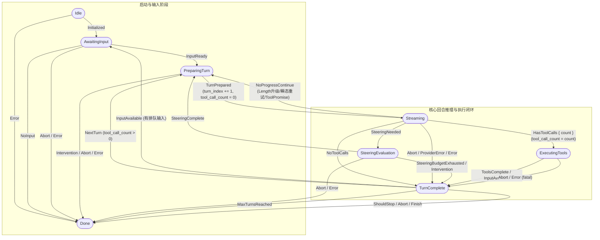
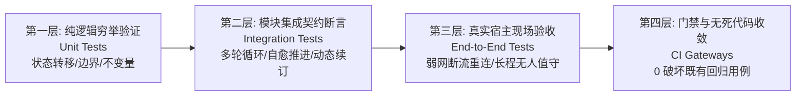

# 04 - 核心会话循环（session-loop）与状态机健全度深度审查与改造方案

> **专项定位**：针对内核 `crates/session-loop` 会话循环状态机在长程连续运行、高负载任务及全天候无人值守执行场景下的健全度进行立体化代码审查与架构分析。
> **涉及核心代码基线**：
> - `crates/session-loop/src/state.rs`（状态机结构体、上下文、不变量）
> - `crates/conex-types/src/transition.rs`（权威状态转移表、副作用计算）
> - `crates/session-loop/src/loop/loop_runner.rs`（循环装配、选项同步、总线/信号注入）
> - `crates/session-loop/src/loop/loop_exec.rs`（主执行循环、单步分派、catch 异常捕获与恢复应用）
> - `crates/session-loop/src/loop/handlers/turn_complete.rs`（回合终结收场十级决策阶梯）
> - `crates/session-loop/src/loop/handlers/executing_tools.rs`（工具执行与致命错误上抛）
> - `crates/session-loop/src/loop/handlers/prepare_turn.rs`（回合准备、自愈补发、压缩预检与 Steering 评估）
> - `crates/session-loop/src/loop/handlers/streaming.rs`（模型调用、流式消费与 BC02-2 防火墙）
> - `crates/session-loop/src/loop/handlers/no_tool_calls.rs`（无工具调用分类、Length 阶梯与 Tool-Promise 自愈）
> - `crates/session-loop/src/loop/handlers/stream_error.rs` 及子模块（瞬态重试阶梯、超限压缩阶梯、降级 Fatal）
> - `crates/session-loop/src/loop/handlers/steering_evaluation.rs`（空响应与纠偏介入）
> - `crates/conex-run/src/run/mod.rs`（`MAX_TURNS_DEFAULT = 64` 等顶层常量）
> - `crates/conex-run/src/run/run_launch.rs`（Run 启动装配与 Producer 实例化）
> - `crates/conex-run/src/run/run_idle.rs`（`decide_idle_resume` 续跑判定与 MaxTurns 调度死刑）
> - `crates/conex-run/src/run_producer.rs`（跨 Run 组装与全局依赖下沉）

---

## 目录索引

1. [状态机流转完整生命周期深度剖析](#一状态机流转完整生命周期深度剖析)
   - 1.1 八大状态与二十个事件权威定义
   - 1.2 权威状态转移表与副作用（Effect）全景图谱
   - 1.3 核心计数器与状态不变量单调性审计
   - 1.4 六大 Handler 分派职责与全链路流转图
2. [turn_complete 收场判定顺序与自驱动连续推进](#二turn_complete-收场判定顺序与自驱动连续推进)
   - 2.1 十级严格判定阶梯逐行审计（代码证据链）
   - 2.2 纯文本无工具调用默认停机（SHOULD_STOP）的深层根因
   - 2.3 连续运行下的“假死断裂”（False Completion）与调度死锁
   - 2.4 全天候自驱动推进与防休眠架构设计方案
3. [max_turns 硬编码（默认 64）对连续运行的致命限制与解耦改造](#三max_turns-硬编码默认-64-对连续运行的致命限制与解耦改造)
   - 3.1 硬编码现状与代码证据链（64 轮死锁）
   - 3.2 外层调度器对 MaxTurns 的“保守不续”死刑判决
   - 3.3 无上限循环预算与“0 = 无限”语义重构
   - 3.4 滑动窗口动态续订（Dynamic Budget Renewal）与跨 Episode 续跑桥接
4. [运行时异常捕获、致命崩溃与循环韧性提升](#四运行时异常捕获致命崩溃与循环韧性提升)
   - 4.1 catch 兜底机制与 recovery_decision / apply_recovery 深度审查
   - 4.2 生产环境 RecoveryHook 缺位导致的缺省 Fatal 隐患
   - 4.3 致命（Fatal）退出 vs 可自愈（Self-Healing）全景大盘点
   - 4.4 会话循环全方位韧性增强架构设计
5. [架构改造落地路线图与验收断言](#五架构改造落地路线图与验收断言)
   - 5.1 模块改造清单与契约变更矩阵
   - 5.2 立体验证与自动化门禁断言

---

## 一、状态机流转完整生命周期深度剖析

### 1.1 八大状态与二十个事件权威定义

内核会话状态机实例封装于 `AgentSessionMachine`（[`crates/session-loop/src/state.rs:24-97`](file:///c:/Software/conex/crates/session-loop/src/state.rs#L24-L97)），其底层转移表由纯函数 `apply_transition`（[`crates/conex-types/src/transition.rs:89-194`](file:///c:/Software/conex/crates/conex-types/src/transition.rs#L89-L194)）权威定义。

```rust
// crates/session-loop/src/state.rs:23-27
pub struct AgentSessionMachine {
    state: AgentSessionState,
    context: AgentSessionContext,
}
```

#### 八大核心状态（AgentSessionState）
1. **`Idle`**：会话生命周期初始态。未激活任何运行逻辑。仅接收 `Initialized` 事件转移至 `AwaitingInput`，或接收 `Error` 事件转移至 `Done`。
2. **`AwaitingInput`**：等待消费输入队列态。主执行循环在此处轮询 `input_queue`。若消费到有效输入（`force` 或 `steer`），派发 `InputReady` 转移至 `PreparingTurn`；若队列为空，派发 `NoInput` 结束运行，转移至 `Done`。
3. **`PreparingTurn`**：回合准备与编排态。此状态承担前序回合未闭合补发（自愈守卫）、待运行消息消费（Hold -> Compact -> Append 架构）、`TurnStart` 事件广播、Steering 策略前置评估（AfterTools/BeforeTurn 相位）以及上下文阈值压缩预检。准备完成后派发 `TurnPrepared` 步入 `Streaming`。
4. **`Streaming`**：模型请求与流式增量消费态。组装包含 System Prompt、对话历史与 Tools 快照的 `ProviderRequest`，调用 Provider 驱动流式事件。增量结果通过 `DeltaSink` 实时外发。依据返回结果流转至 `ExecutingTools`、`TurnComplete`、`SteeringEvaluation` 或环回 `PreparingTurn`。
5. **`SteeringEvaluation`**：空响应与纠偏介入态。当模型返回空响应且系统开启 Steering 策略时介入。评估策略并执行消息注入；若策略产出动作，通过 `SteeringComplete` 环回 `PreparingTurn`；若纠偏预算耗尽，通过 `SteeringBudgetExhausted` 转移至 `TurnComplete`。
6. **`ExecutingTools`**：工具并发/串行调度执行态。从最后一条 Assistant 消息提取工具调用块，执行权限与审批校验，由 `ToolExecutor` 执行工具调用，记录工具结果消息至对话历史。完成后依据是否有排队输入派发 `InputAvailable` 或 `ToolsComplete` 转移至 `TurnComplete`。
7. **`TurnComplete`**：回合收场与决断态。在此处广播 `TurnEnd`（携带真实 Usage）、处理 Abort 强停、结算错误状态、调用生命周期与插件钩子、检查轮次预算。若存在工具调用结果，派发 `NextTurn` 自驱动推进回 `PreparingTurn`；若有排队输入，派发 `InputAvailable` 退回 `AwaitingInput`；否则默认派发 `ShouldStop` 转移至 `Done`。
8. **`Done`**：会话终态（Terminal）。状态机拒绝一切后续事件（返回 `TransitionError::Terminal`）。循环退出并触发收口（`converge`），广播 `AgentEnd` 事件并释放跨 Run 资源。

#### 二十个合法事件（AgentSessionEvent）
系统定义了 20 种严格类型化事件（[`crates/conex-types/src/session.rs`](file:///c:/Software/conex/crates/conex-types/src/session.rs)）：
- `Initialized`：Run 启动完成，初始化输入队列。
- `InputReady`：成功从输入队列中取出待执行消息。
- `NoInput`：输入队列无可用消息，Run 正常收口。
- `TurnPrepared`：新回合上下文、压缩与纠偏就绪，准备发起模型推理。
- `HasToolCalls { count: u32 }`：模型输出包含至少一个工具调用块。
- `NoToolCalls`：模型回复为纯文本，无工具调用。
- `NoProgressContinue`：非推进重试/续轮（Length 升级、瞬态网络重试、Tool-Promise 推进）。
- `ToolsComplete`：所有工具执行完毕，进入回合收场。
- `InputAvailable`：有高优先级输入到达（或工具执行后有新消息待处理）。
- `NextTurn`：当前回合产生工具结果，驱动进入下一轮推理。
- `ShouldStop`：正常停止建议（纯文本交付、钩子阻断）。
- `Abort`：用户或系统主动取消/强停。
- `Error`：内部不可恢复错误或致命工具错误。
- `MaxTurnsReached`：达到当前分配的最大轮次上限。
- `InterventionRequired`：Steering 判定需要人类干预介入。
- `ProviderError`：不可重试的提供商传输/服务端错误。
- `Finish`：回合完成收敛（通常在 Abort/Error 后关闭会话）。
- `SteeringNeeded`：模型输出空内容，请求纠偏策略评估。
- `SteeringComplete`：纠偏消息注入完成，准备重试。
- `SteeringBudgetExhausted`：纠偏预算耗尽，放弃纠偏。

### 1.2 权威状态转移表与副作用（Effect）全景图谱

状态转移的唯一真理源（SSOT）位于 [`crates/conex-types/src/transition.rs:89-194`](file:///c:/Software/conex/crates/conex-types/src/transition.rs#L89-L194) 的 `apply_transition` 函数。



#### 状态转移副作用（AgentTransitionEffect）权威行为解析

每个合法转移不仅改变状态，还会触发精确的上下文副作用（[`crates/session-loop/src/state.rs:77-96`](file:///c:/Software/conex/crates/session-loop/src/state.rs#L77-L96)）：

1. **`turn_index_increment`（轮次递增）**：
   - 仅在 `PreparingTurn -> TurnPrepared -> Streaming` 发生（[`transition.rs:118`](file:///c:/Software/conex/crates/conex-types/src/transition.rs#L118)）。
   - 代码使用 `self.context.turn_index = self.context.turn_index.saturating_add(1)`，防止 `u32::MAX` 溢出 panic 或 release 模式回绕成 0。
2. **`reset_tool_call_count`（工具计数归零）**：
   - 在进入 `Streaming`（`TurnPrepared`）以及退回等待输入（`InputAvailable`）时触发。
3. **`set_tool_call_count`（工具计数设置）**：
   - 在 `Streaming -> HasToolCalls { count }` 时触发，将模型本轮下发的工具数同步进上下文，作为 `TurnComplete` 判定自驱动续轮的关键输入。
4. **`reset_all_counters`（全部计数重置）**：
   - 在新一轮架构重构后，单 Run 内部从 `TurnComplete` 消费新输入退回 `AwaitingInput` 时，`reset_all_counters` 严格保持为 `false`，确保 `turn_index` 单调自增不重置。

### 1.3 核心计数器与状态不变量单调性审计

在长程连续执行场景下，系统的稳定性完全取决于状态机三大计数器的单调性与不变量守卫：

1. **`turn_index`（回合索引）单调递增性**：
   - **审查断言**：在单 Run 生命周期内，`turn_index` 具有严格的**单调非减性**。重试路径（`NoProgressContinue`，如 429 退避重试、Length 升级、Tool-Promise Nudge）以及 Steering 介入重发（`SteeringComplete`）均不触发 `TurnPrepared`，因此不会导致 `turn_index` 虚增。
   - **潜在隐患**：当 Run 耗尽而外层拉起新 Run 时，`AgentSessionLoop::run` 会创建全新状态机实例（[`loop_exec.rs:43-44`](file:///c:/Software/conex/crates/session-loop/src/loop/loop_exec.rs#L43-L44)），导致新的 Run 内部 `turn_index` 再次从 0 开始。如果外层没有全局累计计数，将出现全局轮次不透明。
2. **`tool_call_count`（工具调用计数）瞬态性**：
   - **审查断言**：该计数器是“回合局部”的。它仅用于在 `TurnComplete` 决定是自驱动调用 `NextTurn`（`count > 0`）还是评估停机（`count == 0`）。
3. **`steering_count`（纠偏预算计数）解耦性**：
   - **审查断言**：计数由 `SteeringCoordinator` 独立维护。工具执行成功（`executing_tools.rs:120`）、无工具调用回复（`no_tool_calls.rs:189`）或 Length 升级成功时，会发射 `emit_steering_reset_event` 重置计数，防止良性波动耗尽系统安全护栏。

### 1.4 六大 Handler 分派职责与全链路流转图

会话循环控制面核心代码位于 [`crates/session-loop/src/loop/loop_exec.rs:150-176`](file:///c:/Software/conex/crates/session-loop/src/loop/loop_exec.rs#L150-L176)：

```rust
// crates/session-loop/src/loop/loop_exec.rs:150-166
while !self.state.machine.is_done() {
    let outcome = self.dispatch_once().await;
    match outcome {
        Ok(handler_outcome) => {
            if let Some(end) = handler_outcome.end {
                return self.converge(end).await;
            }
        }
        Err(err) => {
            // catch 兜底：恢复钩子裁决 retry/skip/abort
            let decision = self.recovery_decision(&err);
            if let Some(end) = self.apply_recovery(decision, &err).await {
                return self.converge(end).await;
            }
        }
    }
}
```

#### 六大 Handler 职责清单：
1. **`awaiting_input`**（[`crates/session-loop/src/loop/handlers/awaiting_input.rs:14-33`](file:///c:/Software/conex/crates/session-loop/src/loop/handlers/awaiting_input.rs#L14-L33)）：
   - 执行安全点检查（L3 强停、L2 协作停止、L1 意图注入）。
   - 调用 `state.input_queue.dequeue()`。有消息则持久化至 Conversation 并派发 `InputReady`；无消息则派发 `NoInput`，Run 正常停止收敛。
2. **`prepare_turn`**（[`crates/session-loop/src/loop/handlers/prepare_turn.rs:37-162`](file:///c:/Software/conex/crates/session-loop/src/loop/handlers/prepare_turn.rs#L37-L162)）：
   - 自愈守卫（BC01-1）：若检测到前序回合因 `NoProgressContinue` 未闭合，原地补发携带真实 Usage 的 `TurnEnd` 事件，保证事件 1:1 成对。
   - 消费待运行输入：采用 Hold -> Compact -> Append 架构，新输入先入 Hold 区，执行用户边界压缩预检后再追加，确保用户输入不被丢弃。
   - 发射携带递增后轮次的 `TurnStart` 事件，并清空本轮 Usage 槽位。
   - 触发 `AfterTools` 与 `BeforeTurn` 相位的 Steering 评估。
   - 触发阈值上下文压缩预检（`maybe_compact_preflight`）。
   - 派发 `TurnPrepared` 步入 `Streaming`。
3. **`streaming`**（[`crates/session-loop/src/loop/handlers/streaming.rs:48-107`](file:///c:/Software/conex/crates/session-loop/src/loop/handlers/streaming.rs#L48-L107)）：
   - 捕获缓存审计签名，组装包含 System Prompt 与 Tools 快照的 `ProviderRequest`。
   - 发起 Provider 流式调用，通过 `ConsumeBuilder` 增量消费并向 `DeltaSink` 实时分发。
   - 结果分类：
     - 若发生流式截断且含有工具调用：触发 **BC02-2 防火墙**，物理阻断未决工具调用并 Fatal 退出。
     - 若响应为空：派发 `SteeringNeeded` 转移至 `SteeringEvaluation`。
     - 若存在工具调用：派发 `HasToolCalls` 转移至 `ExecutingTools`。
     - 若为纯文本：转交 `no_tool_calls::handle`。
     - 若发生传输/服务错误：转交 `stream_error::handle` 阶梯。
4. **`no_tool_calls`**（[`crates/session-loop/src/loop/handlers/no_tool_calls.rs:79-193`](file:///c:/Software/conex/crates/session-loop/src/loop/handlers/no_tool_calls.rs#L79-L193)）：
   - 若模型因输出长度耗尽截断（`ConsumeStopReason::Length`）：触发 Length 恢复阶梯，`max_tokens` 翻倍升级（8K -> 16K -> 32K，上限 2 次），派发 `NoProgressContinue` 原地重试。
   - 若命中行动宣誓未调用工具（Tool-Promise）：通过 `ToolPromiseDetector` 语言自适应合成 Nudge 消息压入队列，派发 `NoProgressContinue` 原地推进（上限 2 次）。
   - 正常纯文本回复：重置 Steering 计数，派发 `NoToolCalls` 进入 `TurnComplete`。
5. **`executing_tools`**（[`crates/session-loop/src/loop/handlers/executing_tools.rs:40-161`](file:///c:/Software/conex/crates/session-loop/src/loop/handlers/executing_tools.rs#L40-L161)）：
   - 检查控制意图，若强停则合成 `codes::TOOL_ABORTED_BEFORE_DISPATCH` 消除孤儿调用。
   - 由 `ToolExecutor` 批量执行工具，收集审计与审批事件。
   - 将所有工具执行结果转化为 `ToolResult` 消息持久化进 Conversation。
   - 若发生致命工具错误（`outcome.fatal`）：记录 `terminal_error` 并派发 `Error` 进 `TurnComplete` 退出。
   - 若输入队列有可运行输入派发 `InputAvailable`，否则派发 `ToolsComplete`。
6. **`turn_complete`**（[`crates/session-loop/src/loop/handlers/turn_complete.rs:33-212`](file:///c:/Software/conex/crates/session-loop/src/loop/handlers/turn_complete.rs#L33-L212)）：
   - 按照十级决策阶梯完成回合决断与收敛。

## 二、turn_complete 收场判定顺序与自驱动连续推进

### 2.1 十级严格判定阶梯逐行审计（代码证据链）

`handleTurnComplete` 函数位于 [`crates/session-loop/src/loop/handlers/turn_complete.rs:33-212`](file:///c:/Software/conex/crates/session-loop/src/loop/handlers/turn_complete.rs#L33-L212)。其执行逻辑构成了一个由上至下、优先级严格锁定的决断阶梯：

```text
┌────────────────────────────────────────────────────────────────────────┐
│ handleTurnComplete 决策阶梯（从高到低）                                │
├────────────────────────────────────────────────────────────────────────┤
│ Step 0  : 安全点检查 (check_control)                                  │
│ Step 1  : 广播 TurnEnd 事件 (带 Usage)                                │
│ Step 2  : Abort 信号检查 -> Finish -> Aborted                         │
│ Step 3  : 上下文 end_reason (Error/Aborted) -> Finish -> Error/Aborted │
│ Step 4  : 编排层 turn.end 钩子建议 -> ShouldStop -> Stop              │
│ Step 4.5: 插件钩子 turn.end 广播 -> ShouldStop -> Stop                │
│ Step 5  : maxTurns 预算硬限核查 -> MaxTurnsReached -> MaxTurns        │
│ Step 6  : shouldStopAfterTurn 兼容层 -> ShouldStop -> Stop            │
│ Step 7  : 工具调用数 (tool_call_count > 0) -> NextTurn -> PreparingTurn│
│ Step 8  : 待命输入促进 (promote_follow_up) -> InputAvailable -> Awaiting│
│ Step 9  : 兜底收场默认项 -> ShouldStop -> Done (Stop)                 │
└────────────────────────────────────────────────────────────────────────┘
```

#### 关键源码定位与逐行证据链：

1. **Step 0: 安全点控制意图校验**（[`turn_complete.rs:35-37`](file:///c:/Software/conex/crates/session-loop/src/loop/handlers/turn_complete.rs#L35-L37)）：
   ```rust
   if let Some(end) = check_control(state)? {
       return Ok(HandlerOutcome::end(end));
   }
   ```
   优先响应外部控制总线上的强停（L3）或协作停止（L2）。
2. **Step 1: 发射 `TurnEnd` 并清空孤儿标记**（[`turn_complete.rs:41-55`](file:///c:/Software/conex/crates/session-loop/src/loop/handlers/turn_complete.rs#L41-L55)）：
   ```rust
   let turn_end_event = AgentEvent::TurnEnd {
       session_id: ctx.session_id.clone(),
       turn_index: ctx.turn_index,
       timestamp: conex_shared::time::now_iso_utc(),
       tool_call_count: ctx.tool_call_count,
       usage: state.budget_state.turn_usage.take(),
   };
   state.emit_event(turn_end_event);
   state.current_turn_index = None;
   ```
   正常结算当前轮次消耗的 Token Usage。
3. **Step 2: 外部 Abort 信号决断**（[`turn_complete.rs:58-61`](file:///c:/Software/conex/crates/session-loop/src/loop/handlers/turn_complete.rs#L58-L61)）：
   ```rust
   if state.abort_signal.is_aborted() {
       dispatch(state, E::Finish)?;
       return Ok(HandlerOutcome::end(EndDecision::aborted(state)));
   }
   ```
4. **Step 3: 上下文 Error / Aborted 致命收场收敛**（[`turn_complete.rs:65-80`](file:///c:/Software/conex/crates/session-loop/src/loop/handlers/turn_complete.rs#L65-L80)）：
   ```rust
   match ctx.end_reason {
       AgentEndReason::Error => {
           let terminal = state.terminal_error.take().unwrap_or_else(|| {
               format!("run 失败（状态={:?}，事件=Error 收场）", state.machine.state())
           });
           dispatch(state, E::Finish)?;
           return Ok(HandlerOutcome::end(EndDecision::error(state, terminal)));
       }
       AgentEndReason::Aborted => {
           dispatch(state, E::Finish)?;
           return Ok(HandlerOutcome::end(EndDecision::aborted(state)));
       }
       _ => {}
   }
   ```
   流式提供商不可恢复错误（`E::ProviderError`）或工具致命错误（`E::Error`）在此收口，统一经 `E::Finish` 转移至终态 `Done`。
5. **Step 4 & Step 4.5: 编排层与插件钩子 Stop 建议**（[`turn_complete.rs:84-124`](file:///c:/Software/conex/crates/session-loop/src/loop/handlers/turn_complete.rs#L84-L124)）：
   若外部注入的钩子返回 `stop_suggested = true` 或插件返回 `outcome.blocked.is_some()`，派发 `E::ShouldStop`，以 `EndDecision::stop` 收场。
6. **Step 5: maxTurns 预算硬限阻断**（[`turn_complete.rs:127-173`](file:///c:/Software/conex/crates/session-loop/src/loop/handlers/turn_complete.rs#L127-L173)）：
   ```rust
   if ctx.should_stop_for_max_turns() {
       state.emit_event(AgentEvent::RuntimeError {
           session_id: ctx.session_id.clone(),
           timestamp: conex_shared::time::now_iso_utc(),
           error: format!("maxTurns 预算用尽（turnIndex={}，maxTurns={}）", ctx.turn_index, ctx.max_turns),
           retryable: Some(false),
       });
       dispatch(state, E::MaxTurnsReached)?;
       return Ok(HandlerOutcome::end(EndDecision::max_turns(state)));
   }
   ```
   若当前轮次 `turn_index >= max_turns`，派发 `E::MaxTurnsReached` 强制停机。
7. **Step 6: shouldStopAfterTurn 兼容层**（[`turn_complete.rs:176-192`](file:///c:/Software/conex/crates/session-loop/src/loop/handlers/turn_complete.rs#L176-L192)）。
8. **Step 7: 工具调用驱动续轮（核心回路）**（[`turn_complete.rs:195-198`](file:///c:/Software/conex/crates/session-loop/src/loop/handlers/turn_complete.rs#L195-L198)）：
   ```rust
   if ctx.tool_call_count > 0 {
       dispatch(state, E::NextTurn)?;
       return Ok(HandlerOutcome::continue_run());
   }
   ```
   **关键结论**：`ctx.tool_call_count > 0` 是状态机内部能够**自发推进至下一回合的唯一原生路径**。
9. **Step 8: 待命输入促进与队列排队检查**（[`turn_complete.rs:203-207`](file:///c:/Software/conex/crates/session-loop/src/loop/handlers/turn_complete.rs#L203-L207)）：
   ```rust
   let promoted = state.input_queue.promote_follow_up();
   if promoted > 0 || state.input_queue.has_runnable_pending() {
       dispatch(state, E::InputAvailable)?;
       return Ok(HandlerOutcome::continue_run());
   }
   ```
   若存在 `followUp` 输入或外部实时注入了待运行消息，派发 `E::InputAvailable`，状态机退回 `AwaitingInput` 重新消费。
10. **Step 9: 兜底默认停机**（[`turn_complete.rs:210-212`](file:///c:/Software/conex/crates/session-loop/src/loop/handlers/turn_complete.rs#L210-L212)）：
    ```rust
    // 9. 默认：SHOULD_STOP（stop 收场，纯文字回复的收口路径）
    dispatch(state, E::ShouldStop)?;
    Ok(HandlerOutcome::end(EndDecision::stop(state)))
    ```
    当上述所有条件均未命中时，无条件派发 `E::ShouldStop`，以 `EndDecision::stop` 正常结束当前 Run。

### 2.2 纯文本无工具调用默认停机（SHOULD_STOP）的深层根因

为什么当模型输出纯文本且未调用工具时，状态机必须在 Step 9 默认停机？

1. **因果图灵停机假设（Causal Halt Assumption）**：
   - 在标准单次提示工程或问答场景中，Agent 的工具调用被视为“寻找答案的操作步骤”，而纯文本输出则是“给人类的最终答案交付”。
   - 当模型没有发出工具调用（`tool_call_count == 0`）时，代表模型在当前认知下认为任务已经完成，或者需要向用户反馈信息并等待新的输入。
2. **防自激死循环（Anti-Oscillation Guard）**：
   - 若系统在 `tool_call_count == 0` 且无新外部消息输入时强行派发 `NextTurn`，模型将面对包含自身刚刚输出的完全一致的上下文。
   - 这会导致模型极大概率重复输出相同内容（复读机）或陷入“我该做什么？”的迷茫，徒增 Token 消耗。因此，必须在 Step 9 优雅停机，将主动权让渡给外界。

### 2.3 连续运行下的“假死断裂”（False Completion）与调度死锁

然而，上述基于传统人机对话的假设，直接导致了**长程自主 Agent 全天候连续运行的致命瘫痪**：

1. **过程性陈述导致的“假死中断”**：
   - 自主 Agent 在执行大规模代码重构、长时间构建或复杂数据流水线时，常常需要进行阶段性陈述，例如：
     - *“我已经完成了模块 A 的语法树改造，由于构建时间较长，我已启动后台构建任务，稍后检查输出。”*
     - *“数据准备完毕，接下来开始训练基线模型。”*
   - 在这一轮中，模型输出了一段文本，但由于没有附带工具块（`tool_call_count == 0`），并且用户并没有在此瞬间输入新消息，系统直接在 Step 9 分派 `E::ShouldStop`！
   - **状态机直接走向终态 `Done`，本次 Run 瞬间结束**！
2. **外层调度器四源判定的“静默死锁”**：
   - 内核 Run 结束后，控制权回到外层调度器 [`crates/conex-run/src/run/run_idle.rs:decide_idle_resume`](file:///c:/Software/conex/crates/conex-run/src/run/run_idle.rs#L86-L163)：
   ```rust
   // crates/conex-run/src/run/run_idle.rs:160-163
   if !(queue_pending || timer_active || cron_enabled || goal_pending) {
       // 四源全空：run 正常收场，AI 休眠待用户（硬条件）
       return None;
   }
   ```
   - 此时：
     - `queue_pending` 为 `false`（消息队列中没有待处理条目）；
     - `timer_active` 为 `false`（模型没有显式调用 `schedule` 工具，或者使用的并非内核内置定时器）；
     - `cron_enabled` 为 `false`；
     - `goal_pending` 为 `false`（若会话未接入 Goal 协议或 Goal 被误判完成）。
   - **灾难性后果**：外层调度器认定四源全空，“AI 休眠待用户”，返回 `None`。宿主程序就此挂起，后台即便有正在运行的子进程，Agent 也再也不会被唤醒，连续任务就此夭折！

### 2.4 全天候自驱动推进与防休眠架构设计方案

要实现真正无人值守的全天候连续运转，必须在内核层打破“纯文本即停机”的刚性假设，构建由**活性感知**、**目标心跳**与**自主推进器**组成的自驱动防御体系：

```mermaid
flowchart TD
    Step7[TurnComplete Step 7: toolCallCount == 0] --> CheckQueue{输入队列是否有待运行输入?}
    CheckQueue -- 有 --> Step8[Step 8: InputAvailable -> AwaitingInput]
    CheckQueue -- 无 --> CheckContinuousMode{是否开启全天候自主模式 continuous_drive?}

    CheckContinuousMode -- 否 (标准交互) --> Step9[Step 9: ShouldStop -> Done 停机等待人类]
    CheckContinuousMode -- 是 (自主长程) --> CheckLiveness{系统是否存在活跃支撑进程?
1. 后台任务未完成 (background tasks)
2. 派发子代理未完结 (subagents)}

    CheckLiveness -- 是 (存活等待) --> TransitionWait[转入待命等待态 / 自动注入等待定时器
禁止 ShouldStop 停机, 维持事件反应驱动]
    CheckLiveness -- 否 (进程全空) --> CheckGoal{宏观任务目标是否达成?
Goal State / Task Progress}

    CheckGoal -- 已确认完成 --> Step9
    CheckGoal -- 未完成/继续推进 --> GenAutonomousNudge[自主驱动器注入系统心跳 Nudge
Autonomous Goal Nudge]
    GenAutonomousNudge --> EnqueueSteer[写入 input_queue.enqueue_steer]
    EnqueueSteer --> InputAvail[派发 InputAvailable / NoProgressContinue
自驱拉起下一轮推理]
```

#### 架构改造要点：

1. **`SessionLoopOptions` 引入连续自主模式标志位（`continuous_drive_enabled`）**：
   - 允许工作区或长程任务显式声明自身为连续执行会话。当该标志位开启时，接管 Step 9 兜底逻辑。
2. **后台任务与子代理活性强制守门（Liveness Guard）**：
   - 在 `turn_complete.rs` 中，Step 8 与 Step 9 之间插入活性检查：
     ```rust
     if state.options.continuous_drive_enabled {
         let has_active_bg = state.tool_ctx.background.as_ref()
             .map(|bg| bg.has_running_tasks(&ctx.session_id))
             .unwrap_or(false);
         if has_active_bg {
             tracing::info!(session_id = %ctx.session_id, "检测到活跃后台任务，拦截 ShouldStop 停机");
             // 保持待命或注入等待监听，防止会话退出
             return Ok(HandlerOutcome::continue_run());
         }
     }
     ```
3. **目标驱动型自主心跳推进器（Goal-Driven Autonomous Nudge）**：
   - 若模型输出了阶段性汇报纯文本且无工具调用，自主驱动器检查会话宏观目标（Goal）。若目标未达成，自动合成高优先级引导消息：
     `【系统自主驱动】：检测到你已汇报阶段性进展，但最终任务目标尚未达成。请基于前序输出继续调用后续工具推进执行，若已彻底完成请明确声明目标达成。`
   - 通过 `state.input_queue.enqueue_steer(nudge_msg)` 写入队列，并派发 `InputAvailable`，实现零人工作介入下的全自动闭环运转。

## 三、max_turns 硬编码（默认 64）对连续运行的致命限制与解耦改造

### 3.1 硬编码现状与代码证据链（64 轮死锁）

在当前代码库中，`max_turns` 的默认上限被深度硬编码为 **64**，且形成了全链路的层层死锁：

1. **顶层常量硬编码**：
   [`crates/conex-run/src/run/mod.rs:142`](file:///c:/Software/conex/crates/conex-run/src/run/mod.rs#L142)：
   ```rust
   /// run 的 max-turns 预算（对齐 01 §1.5：独立预算 reason）
   pub(crate) const MAX_TURNS_DEFAULT: u32 = 64;
   ```
2. **装配启动点死锁**：
   [`crates/conex-run/src/run/run_launch.rs:1247-1250`](file:///c:/Software/conex/crates/conex-run/src/run/run_launch.rs#L1247-L1250)：
   ```rust
   let producer = SessionLoopProducer::new(
       session_id.clone(),
       run_id.clone(),
       MAX_TURNS_DEFAULT, // 直接将 64 固化传入，未读取任何配置
       provider,
       tool_registry,
       options,
       tool_options,
       approval,
       Some(delta_sink),
       initial_conversation,
       message,
   );
   ```
3. **Producer 构造器固定透传**：
   [`crates/conex-run/src/run_producer.rs:32-33, 196-205`](file:///c:/Software/conex/crates/conex-run/src/run_producer.rs#L32-L33)：
   ```rust
   let mut session_loop = AgentSessionLoop::new(
       self.session_id.as_str(),
       self.run_id.as_str(),
       self.max_turns, // 64
       Box::new(SharedProvider { inner: Arc::clone(&self.provider), session_id: self.session_id.clone() }),
       Arc::clone(&self.tool_registry),
   );
   ```
4. **状态机内部判定硬性截断**：
   [`crates/session-loop/src/loop/handlers/turn_complete.rs:126-173`](file:///c:/Software/conex/crates/session-loop/src/loop/handlers/turn_complete.rs#L126-L173)：
   ```rust
   // 5. maxTurns（shouldStopForMaxTurns = turnIndex >= maxTurns，01 §2.9 步骤 4）
   if ctx.should_stop_for_max_turns() {
       state.emit_event(AgentEvent::RuntimeError {
           session_id: ctx.session_id.clone(),
           timestamp: conex_shared::time::now_iso_utc(),
           error: format!("maxTurns 预算用尽（turnIndex={}，maxTurns={}）", ctx.turn_index, ctx.max_turns),
           retryable: Some(false),
       });
       dispatch(state, E::MaxTurnsReached)?;
       return Ok(HandlerOutcome::end(EndDecision::max_turns(state)));
   }
   ```
5. **Run 起始边界判死**：
   [`crates/session-loop/src/loop/loop_exec.rs:50-77`](file:///c:/Software/conex/crates/session-loop/src/loop/loop_exec.rs#L50-L77)：
   ```rust
   // F2-02：max_turns=0 边界——预算不允许任何轮次，run 起始显式收场
   if self.max_turns == 0 {
       self.state.emit_event(AgentEvent::RuntimeError {
           session_id: self.session_id.clone(),
           timestamp: conex_shared::time::now_iso_utc(),
           error: "maxTurns 预算用尽（turnIndex=0，maxTurns=0）".to_string(),
           retryable: Some(false),
       });
       return self.converge(EndDecision::max_turns(&self.state)).await;
   }
   ```
   如果外部试图传入 `max_turns = 0` 来代表“不设上限（Unlimited）”，当前代码会在 Run 启动的一瞬间将其直接断定为“预算用尽”，连第 1 轮都不允许执行便立即崩溃收场！

### 3.2 外层调度器对 MaxTurns 的“保守不续”死刑判决

当状态机因为达到 64 轮触发 `MaxTurnsReached` 并返回 `EndDecision::max_turns` 后，外层调度器对该收场原因的处理是**绝对不续跑**：

[`crates/conex-run/src/run/run_idle.rs:322-324`](file:///c:/Software/conex/crates/conex-run/src/run/run_idle.rs#L322-L324)：
```rust
match reason {
    AgentEndReason::Stop => { /* 评估四源续跑 */ }
    AgentEndReason::Error => { /* 评估重试 */ }
    // ── 用户停止 / 其它：永不续（Stopped/Aborted/MaxTurns）──
    _ => None,
}
```
源码注释白纸黑字写明：**`MaxTurns 保守不续`**、**`永不续（Stopped/Aborted/MaxTurns）`**！

#### 影响严重性评估：
- 在软件工程级别的自动化任务中（如大型仓库重构、代码库全量审查、编译门禁渐进式修复、全天候运维巡检），Agent 往往需要执行数十甚至数百次编辑与测试循环。
- 一旦轮次到达 64 轮，状态机不是“挂起等待确认”，而是直接判定为“预算耗尽失败”。
- 外层调度器 `decide_idle_resume` 收到 `MaxTurns` 后，直接执行 `_ => None`，**完全不给任何重试、续跑或拉起新 Episode 的机会**。
- **整场长时间自动化任务彻底猝死在第 64 轮**！

### 3.3 无上限循环预算与“0 = 无限”语义重构

必须彻底改造 `max_turns` 的语义模型，打破 64 轮的硬性桎梏：

#### 1. 配置化贯通与“0 = 无限”语义修正
- **解耦硬编码**：在 `run_launch.rs` 中，优先从会话元数据（`session_meta` 中的 `max_turns` 键）、运行请求参数及系统设置中解析。若无显式指定，使用高容限默认值（如 1024 轮），而非过小的 64 轮。
- **重构 0 边界判定**：修改 `crates/conex-types/src/session.rs` 中 `should_stop_for_max_turns` 的判断：
  ```rust
  pub fn should_stop_for_max_turns(&self) -> bool {
      // 核心语义重构：0 代表无限循环预算 (Unlimited Turns)
      if self.max_turns == 0 {
          return false;
      }
      self.turn_index >= self.max_turns
  }
  ```
- **消除 `loop_exec.rs:50` 的误杀**：
  移除 `if self.max_turns == 0` 即停机的旧逻辑，使 `max_turns = 0` 成为官方支持的“全天候无上限模式”。

### 3.4 滑动窗口动态续订（Dynamic Budget Renewal）与跨 Episode 续跑桥接

为了在防止 Agent 无限失控空转与支持真正长程任务之间取得平衡，引入**滑动窗口动态预算续订**与**跨 Episode 桥接机制**：

```mermaid
sequenceDiagram
    autonumber
    actor Engine as 编排引擎 (conex-run)
    participant Loop as 会话循环 (session-loop)
    participant State as 状态机 (Machine)
    participant Idle as 续跑调度器 (run_idle)

    Note over Loop, State: 运行推进中 (例如 turn_index 逼近 max_turns)
    Loop->>State: TurnComplete 检查预算 (turn_index >= max_turns - 3)
    alt 任务健康且持续推进 (有工具调用/代码落盘/上下文正常)
        Loop->>State: 动态续订租约 (max_turns += 64)
        Loop-->>Engine: 发射 AgentEvent::TurnBudgetRenewed (告知前端与观测面)
        Loop->>State: dispatch(NextTurn) 继续自驱运转
    else 轮次达到保护上限需物理归档
        Loop->>State: dispatch(MaxTurnsReached) -> 状态进入 Done
        Loop-->>Idle: converge 返回 RunOutcome (reason = MaxTurns)
        Note over Idle: 外层续跑器解除死刑判决
        Idle->>Idle: 校验为自主长程模式 (is_autonomous_mode)
        Idle->>Idle: 执行历史阶段性快照与上下文全量 Compaction
        Idle->>Engine: spawn_idle_resume_run (mode = "max-turns-renewal")
        Note over Engine: 以全新干净状态机与无损上下文拉起下一 Episode!
    end
```

#### 关键实现细节：

1. **动态租约续订（Lease Renewal）**：
   - 在 `turn_complete.rs` 中，当 `turn_index` 逼近上限时：
     ```rust
     if ctx.max_turns > 0 && ctx.turn_index + 3 >= ctx.max_turns {
         if state.is_actively_progressing() {
             tracing::info!(session_id = %ctx.session_id, current = ctx.turn_index, "任务持续推进中，自动动态续订轮次预算 +64");
             state.machine.context_mut().max_turns = ctx.max_turns.saturating_add(64);
             state.emit_event(AgentEvent::TurnBudgetRenewed {
                 session_id: ctx.session_id.clone(),
                 new_max_turns: state.machine.context().max_turns,
             });
         }
     }
     ```
2. **跨 Episode 自动续跑桥接（`run_idle.rs` 改造）**：
   - 彻底废除 `run_idle.rs:322` 中 `MaxTurns => None` 的保守逻辑，将 `MaxTurns` 升级为一等公民的续跑触发源：
     ```rust
     AgentEndReason::MaxTurns => {
         // 自主运行模式下，MaxTurns 不代表任务失败，而是阶段性物理切片
         if state.is_autonomous_mode(&active.session_id) && !active.user_touched.load(Ordering::SeqCst) {
             tracing::info!(session_id = %active.session_id, "MaxTurns 物理切片触发，启动上下文归档与跨 Episode 续跑");
             let resume_msg = build_max_turns_continuation_message(&active.session_id).await;
             Some(ResumeDecision {
                 mode: "max-turns-renewal",
                 inject: vec![resume_msg],
             })
         } else {
             None
         }
     }
     ```
   - 此机制将长程任务解构为连续的“物理切片（Episodes）”，每次切片完成历史压缩与快照持久化，随后立即无缝拉起新的 Run，**使 Agent 的连续运行寿命在理论上达到无限**！

## 四、运行时异常捕获、致命崩溃与循环韧性提升

### 4.1 catch 兜底机制与 recovery_decision / apply_recovery 深度审查

在会话循环主执行体 [`crates/session-loop/src/loop/loop_exec.rs:150-166`](file:///c:/Software/conex/crates/session-loop/src/loop/loop_exec.rs#L150-L166) 中，所有由 `dispatch_once` 抛出的错误均落入 `catch` 兜底保护区：

```rust
// crates/session-loop/src/loop/loop_exec.rs:158-165
Err(err) => {
    // catch 兜底（01 §2.1 步骤 4）：恢复钩子裁决 retry/skip/abort
    let decision = self.recovery_decision(&err);
    if let Some(end) = self.apply_recovery(decision, &err).await {
        return self.converge(end).await;
    }
}
```

#### 恢复裁决机制（`recovery_decision`）
位于 [`crates/session-loop/src/loop/loop_exec.rs:216-228`](file:///c:/Software/conex/crates/session-loop/src/loop/loop_exec.rs#L216-L228)：
```rust
pub(crate) fn recovery_decision(&self, err: &LoopError) -> RecoveryDecision {
    if self.state.abort_signal.is_aborted() {
        return RecoveryDecision::Abort;
    }
    if let Some(hook) = &self.state.options.hooks.recovery_hook {
        return hook.decide(err.crish(), self.state.machine.state());
    }
    // 缺省决策：不可恢复内部错误 -> Fatal（直接终止并 error 收场）
    RecoveryDecision::Fatal
}
```

#### 恢复应用机制（`apply_recovery`）
位于 [`crates/session-loop/src/loop/loop_exec.rs:231-316`](file:///c:/Software/conex/crates/session-loop/src/loop/loop_exec.rs#L231-L316)：
```rust
match decision {
    RecoveryDecision::Retry => {
        // 仅 Streaming 下放行重试！其余状态一律降级为 Fatal error
        if self.state.machine.state() == S::Streaming
            && handlers::dispatch(&mut self.state, E::NoProgressContinue).is_ok()
        {
            return None;
        }
        Some(EndDecision::error(&self.state, err.message()))
    }
    RecoveryDecision::Skip => {
        // 仅 Streaming 下放行跳过！其余状态一律降级为 Fatal error
        if self.state.machine.state() == S::Streaming
            && handlers::dispatch(&mut self.state, E::NoToolCalls).is_ok()
        {
            return None;
        }
        Some(EndDecision::error(&self.state, err.message()))
    }
    RecoveryDecision::Abort => { /* Abort 收场 */ }
    RecoveryDecision::Fatal => {
        // 致命决策：直接终止并以 Error 收场，绝不派发 NO_TOOL_CALLS 降级
        Some(EndDecision::error(&self.state, err.message()))
    }
}
```

### 4.2 生产环境 RecoveryHook 缺位导致的缺省 Fatal 隐患

全局代码审查揭示了一个极其脆弱的架构断层：
1. **生产环境 `recovery_hook` 注入率为零**：
   - 检索整个 `crates/` 代码库（包含 `conex-run`、`engine_build`、`run_producer`、`orchestrator`），`RecoveryHook` 的具体实现 **只存在于单测 `loop_tests.rs` 中**！
   - 生产环境中，`self.state.options.hooks.recovery_hook` 永远为 `None`（[`loop_options.rs:157`](file:///c:/Software/conex/crates/session-loop/src/loop/loop_options.rs#L157)）。
2. **缺省 Fatal 的“一刀切”杀伤**：
   - 依据 `loop_exec.rs:227`，当 `recovery_hook` 为 `None` 且未收到 Abort 信号时，**所有异常无条件裁决为 `RecoveryDecision::Fatal`**。
   - 只要任何 Handler 抛出 `LoopError`（例如控制总线互斥锁偶发争用、短暂的状态机未定义转移、或者序列化反序列化异常），系统 **100% 立即触发 Fatal 退出，彻底杀死会话**！
3. **`apply_recovery` 对非 Streaming 状态的恢复歧视**：
   - 即使未来注入了 `RecoveryHook` 并裁决为 `Retry` 或 `Skip`，`apply_recovery`（第 275 行、第 285 行）通过 `if self.state.machine.state() == S::Streaming` 实施了硬性守卫。
   - 若异常发生在 `PreparingTurn`（如上下文预检压缩计算溢出）、`ExecutingTools`（如工具批量调度管道断开）或 `TurnComplete`（如收尾状态竞争），系统依然无视 `Retry`/`Skip` 意图，**强行退化为 `EndDecision::error` 致命退出**！

### 4.3 致命（Fatal）退出 vs 可自愈（Self-Healing）全景大盘点

经过对 `session-loop` 全模块的代码穿透审计，系统现存的所有异常处理路径与自愈表现如下：

```mermaid
graph TD
    ErrRoot[系统异常与故障源] --> P_Err[提供商与网络传输故障]
    ErrRoot --> T_Err[工具调度与执行故障]
    ErrRoot --> C_Err[上下文与Token超限故障]
    ErrRoot --> M_Err[状态机与内核分派异常]

    P_Err --> P1[瞬态网络错误: 429/5xx/Timeout/Network] -->|自愈: transient_retry 指数退避
(受限于 60s 预算与 6 次熔断)| P1_Heal[自动重试重进]
    P_Err --> P2[不可重试错误: Auth/Quota/Invalid] -->|Fatal: fatal_provider_error| P2_Fatal[直接终止崩溃]
    P_Err --> P3[BC02-2 防火墙流错误拦截
流式截断且含工具块] -->|Fatal: 物理阻断工具
完全不重试| P3_Fatal[直接终止崩溃]

    T_Err --> T1[普通工具逻辑报错/超时/拒绝] -->|自愈: tool_result_message
is_error=true| T1_Heal[反馈给模型自省重试]
    T_Err --> T2[致命工具错误 outcome.fatal] -->|Fatal: dispatch Error| T2_Fatal[直接终止崩溃]

    C_Err --> C1[输出超限 ContextLengthExceeded] -->|自愈: length_ladder 8K->16K->32K| C1_Heal[翻倍升级重进]
    C_Err --> C2[物理载荷超限 PayloadTooLarge] -->|自愈: compression_ladder
保留预算 20K->12K->8K| C2_Heal[压缩后重试]
    C_Err --> C3[LLM摘要器故障且压缩超限] -->|Fatal: StubPolicy::LlmRequired| C3_Fatal[直接终止崩溃]

    M_Err --> M1[内部 LoopError 抛至 catch] -->|无 Hook: 缺省 Fatal| M1_Fatal[直接终止崩溃]
    M_Err --> M2[非 Streaming 状态下的异常] -->|apply_recovery 状态守卫硬限| M2_Fatal[直接终止崩溃]
```

#### 致命崩溃点（Fatal Exit Points）深度根因清单：

1. **BC02-2 防火墙的一刀切致命退出**（[`streaming.rs:319-348`](file:///c:/Software/conex/crates/session-loop/src/loop/handlers/streaming.rs#L319-L348)）：
   - 当模型在流式输出中输出了工具调用块，但在流的末尾因网络抖动发生截断（`ConsumeStopReason::Error`）时，系统为了防止不完整的工具调用被物理执行，启动了截断工具强隔离防火墙。
   - **痛点**：当前实现直接调用 `stream_error::fatal_provider_error`，将未决工具丢弃后**直接以 Fatal 报错收场**，完全不给流式本身任何原地重试的机会！
2. **瞬态网络重试的 60 秒绝对预算掐死长程任务**（[`stream_error_retry.rs:27, 55`](file:///c:/Software/conex/crates/session-loop/src/loop/handlers/stream_error_retry.rs#L27-L55)）：
   - `RETRY_TOTAL_BUDGET_MS` 硬编码为 `60_000`（60 秒）。
   - 在弱网环境、大模型提供商排队高峰或高并发 RateLimit 时，60 秒的预算瞬间被耗尽。一旦 `elapsed >= 60s`，`retry_delay_ms` 返回 `None`，系统直接放弃重试走向 Fatal。
3. **会话级熔断器的激进阻断**（[`stream_error_retry.rs:28-30, 97-109`](file:///c:/Software/conex/crates/session-loop/src/loop/handlers/stream_error_retry.rs#L28-L30)）：
   - `PROVIDER_FAIL_THRESHOLD = 6`。当连续失败 6 次后，系统认为外部模型彻底瘫痪，跳过 Run 内重试直接 Fatal。长程全天候运行时若缺少自愈探活机制，会导致整个服务永久封死。
4. **LLM 摘要器不可用时的刚性自杀**（[`stream_error_recover.rs:148-150`](file:///c:/Software/conex/crates/session-loop/src/loop/handlers/stream_error_recover.rs#L148-L150)）：
   - 在发生输入超限触发压缩时，默认采用 `StubPolicy::LlmRequired`。若当前未注入 Summarizer 或摘要模型临时超额，系统禁止生成临时 Stub，直接标记 `overflow_llm_unavailable` 并 Fatal 停机！

### 4.4 会话循环全方位韧性增强架构设计

为彻底根治上述致命漏洞，提出四项刚性韧性提升架构改进：

#### 方案 1：装配生产级全状态智能 `RecoveryHook`
- 在 `crates/conex-run/src/run_producer.rs` 的 `produce` 方法中，注入生产级 `ProductionRecoveryHook`：
  - 对非致命性内部错误（如控制总线短暂中毒通过重试清理中毒标记、队列条目校验瑕疵自动修复跳过），裁决为 `RecoveryDecision::Retry` 或 `RecoveryDecision::Skip`。
  - 仅对内存数据损坏、文件权限不可逆缺失等裁决为 `Fatal`。

#### 方案 2：扩展 `apply_recovery` 的跨状态弹性自愈通道
- 彻底重构 `crates/session-loop/src/loop/loop_exec.rs:271-291`：
  - **`PreparingTurn` 状态自愈**：若在准备期因压缩或 Steering 注入异常报错，允许清理 Hold 区后通过 `dispatch(state, E::TurnPrepared)` 强行推进，或通过 `dispatch(state, E::InputReady)` 重新编排。
  - **`ExecutingTools` 状态自愈**：若工具调度发生系统级 Panic 或超时，捕获异常后将所有未完成的工具自动构造为合成错误块（`is_error = true, error = "tool.execution_panic_salvaged"`），通过 `dispatch(state, E::ToolsComplete)` 推进至 `TurnComplete`，将异常事实交给模型在下一轮感知，坚决不崩溃会话循环！

#### 方案 3：流式截断工具调用的“重提拯救机制（Re-prompting Salvage）”
- 优化 `streaming.rs:319-348` 的 BC02-2 防火墙逻辑：
  - 引入单轮流式截断拯救重试计数器（`stream_truncation_retries`，上限 2 次）。
  - 当发生流式错误且含有工具块时：
    1. 不直接 Fatal 停机，而是将当前被截断的半成品 Assistant 消息从 Conversation 尾部回滚移除；
    2. 发射 `AgentEvent::StreamTruncationSalvaged` 诊断告警；
    3. 派发 `E::NoProgressContinue` 原地重新发起当前轮次的完整模型调用；
    4. 仅当连续 2 次原地重提依然被截断时，才走物理阻断并安全收敛。

#### 方案 4：自适应重试预算与压缩降级弹性兜底
- **动态弹性重试预算**：将 `RETRY_TOTAL_BUDGET_MS` 从硬编码 60 秒改为动态配置面。在全天候自治模式下，允许放宽至 15~30 分钟，并结合自适应退避与心跳检测，抵抗提供商的长周期网络波动。
- **确定性摘要兜底（Deterministic Compaction Fallback）**：当遇到输入超限且 LLM 摘要模型不可用时，系统自动降级为确定性保留算法（滑动窗口提取关键 Token + 截断留痕），生成临时 Stub 块维系当前轮次运转，彻底消灭因辅助模型故障导致主任务猝死的脆弱单点。

## 五、架构改造落地路线图与验收断言

### 5.1 模块改造清单与契约变更矩阵

为确保改造方案在真实代码库中精确实施且不破坏既有回归测试资产，梳理出如下落地改造清单：

| 模块层级 | 目标文件路径 | 核心改造点与逻辑改动 | 接口与契约变更 |
|:---|:---|:---|:---|
| **类型契约层** | `crates/conex-types/src/session.rs` | 1. 重构 `should_stop_for_max_turns`：放行 `max_turns == 0` 为无限模式<br>2. 新增 `TurnBudgetRenewed` 与 `StreamTruncationSalvaged` 事件枚举变体 | `AgentEvent` 扩充；无破坏性兼容变更 |
| **转移规则层** | `crates/conex-types/src/transition.rs` | 保持 33 行状态转移表核心闭包稳定；保证 `NextTurn`、`InputAvailable`、`NoProgressContinue` 的副作用单调性 | 维持 `apply_transition` 纯函数契约不变 |
| **状态机内核** | `crates/session-loop/src/state.rs` | 1. 规范 `context.turn_index` 单调饱和自增<br>2. 提供受控的动态预算续期接口 `renew_max_turns(add_budget)` | 新增 `AgentSessionMachine::renew_budget` |
| **主执行控制面** | `crates/session-loop/src/loop/loop_exec.rs` | 1. 消除 `self.max_turns == 0` 起始误杀停机<br>2. 扩展 `apply_recovery`：打破仅限 `Streaming` 的硬限，支持 `PreparingTurn` 与 `ExecutingTools` 安全自愈回退 | 增强 `apply_recovery` 鲁棒性 |
| **回合收尾决断** | `crates/session-loop/src/loop/handlers/turn_complete.rs` | 1. 接入后台任务与子代理活性检查，拦截纯文本误杀停机<br>2. 接入连续自主模式 `continuous_drive_enabled`<br>3. 引入逼近上限时的滑动窗口租约自动续订逻辑 | 终结假死停机瓶颈 |
| **流式与防火墙** | `crates/session-loop/src/loop/handlers/streaming.rs` | 改造 BC02-2 防火墙：流式截断且含有工具块时，先发起最多 2 次当前轮原地重提拯救，失败再物理阻断 | 显著提升弱网弱稳定性环境流式韧性 |
| **异常恢复阶梯** | `crates/session-loop/src/loop/handlers/stream_error_*.rs` | 1. 将 `RETRY_TOTAL_BUDGET_MS` 改为从 options 动态读取（放宽至全天候长预算）<br>2. 压缩超限时放宽确定性滑动窗口 Stub 兜底 | 彻底消除无 Summarizer 时的刚性自杀 |
| **Run 装配引擎** | `crates/conex-run/src/run/run_launch.rs` & `run_producer.rs` | 1. 废除 `MAX_TURNS_DEFAULT` 64 轮死锁，从 `session_meta` / 请求载荷动态装配<br>2. 生产环境正式装配智能 `ProductionRecoveryHook` | 全链路贯通轮次预算与错误自愈 |
| **跨 Episode 调度** | `crates/conex-run/src/run/run_idle.rs` | 在 `decide_idle_resume` 中重写 `AgentEndReason::MaxTurns` 分支：自主模式下自动归档上下文并触发跨 Episode 续跑 | 突破单 Run 物理限制，实现无限连续运转 |

### 5.2 立体验证与自动化门禁断言

为刚性遵循《Conex / Crish Agent 协作指令（AGENTS.md §7.1 立体验证纪律）》，任何改造落地必须通过立体化测试套件的严格验收，严禁任何形式的降级或欺骗 CI：



#### 必备自动化测试套件矩阵：

1. **状态机 0 边界与极限饱和单测（`crates/session-loop/src/state.rs`）**：
   - **用例 A**：构造 `max_turns = 0` 的状态机，循环推进 1,000 轮，断言 `should_stop_for_max_turns()` 恒为 `false`。
   - **用例 B**：构造 `turn_index = u32::MAX` 极值，断言派发 `TurnPrepared` 时 `turn_index` 保持饱和不溢出，且不会发生回绕归零。
2. **纯文本无工具自驱动推进集成测试（`crates/session-loop/tests/autonomous_drive_test.rs`）**：
   - 构造模型返回纯文本陈述且无工具调用。
   - 断言在开启 `continuous_drive_enabled` 时，状态机不分派 `ShouldStop`，而是成功注入推进 Nudge 并流转至 `InputAvailable`，无缝拉起下一回合推理。
3. **后台长任务存活待命测试（`crates/session-loop/tests/background_liveness_test.rs`）**：
   - 注册活跃的模拟后台任务。在 `TurnComplete` 阶段触发时，断言状态机拦截停机收口，保持待命状态直至后台任务事件回传。
4. **流式截断工具调用拯救测试（`crates/session-loop/tests/streaming_salvage_test.rs`）**：
   - 模拟流式输出 1 个工具块后发生传输网络截断。
   - 断言系统不直接 Fatal 退出，而是成功回滚脏数据并派发 `NoProgressContinue` 原地重发请求；断言在重试成功后工具调用被完整解析执行。
5. **跨 Episode MaxTurns 连续续跑验收测试（`crates/conex-run/tests/max_turns_resumption_test.rs`）**：
   - 设置极小预算 `max_turns = 2`。模型连续执行两轮工具调用。
   - 断言单 Run 收场返回 `AgentEndReason::MaxTurns`。
   - 断言外层 `decide_idle_resume` 成功匹配到 `max-turns-renewal` 模式，完成历史无损压缩并拉起新 Run，保持会话全局目标执行不断裂！
