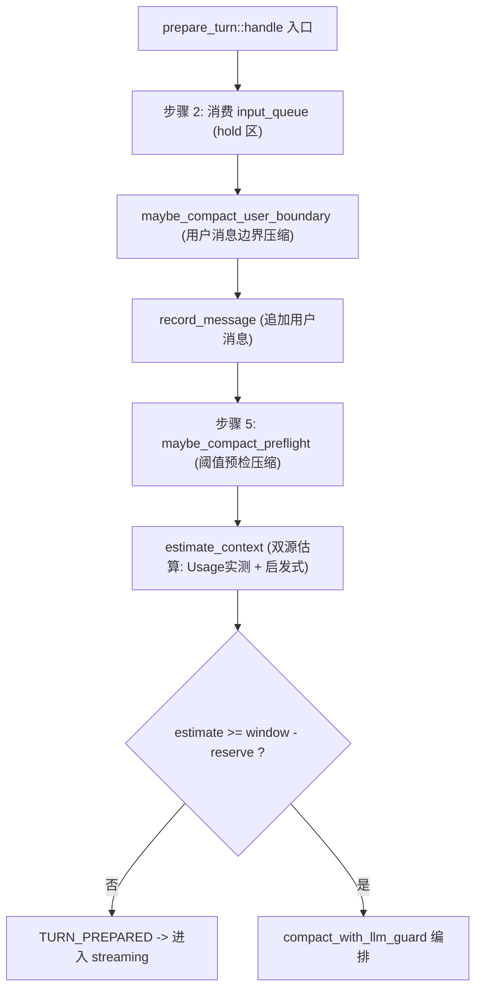
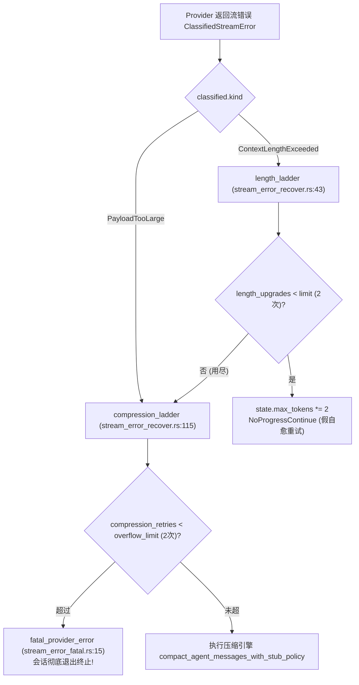
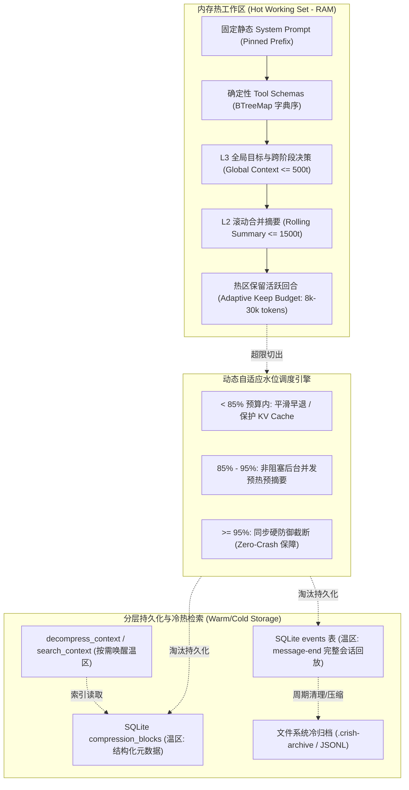
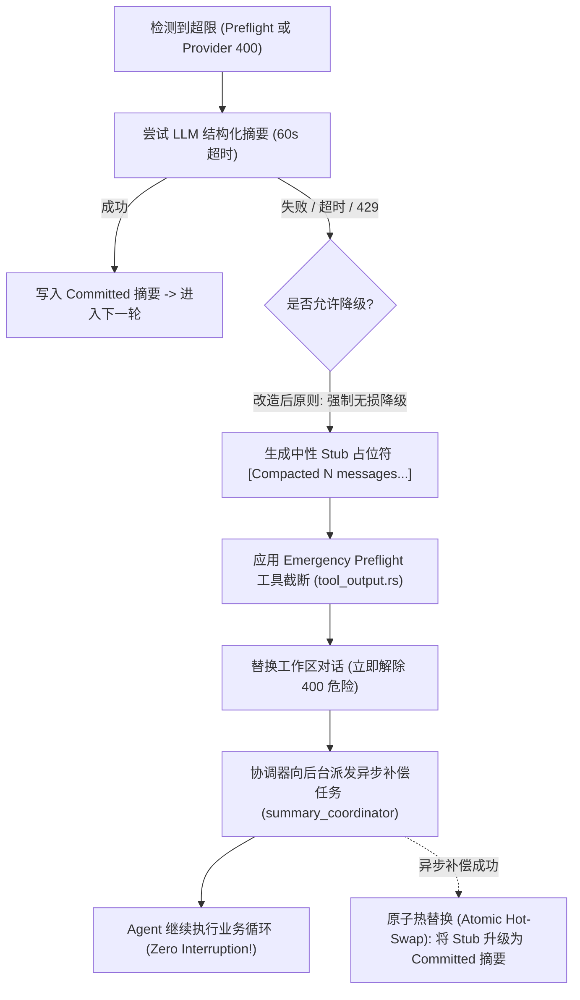

# 05 上下文与压缩深度审查与方案报告：长程连续运行下的 Token 膨胀治理、压缩阶梯与内存控制机制

> **战役主题**：全天候自主 Agent 连续运行与健壮性改造战役 (Continuous Execution Hardening)  
> **审查维度**：05 - 上下文与压缩 (Context Growth, Compaction Ladder & Memory Hardening)  
> **重点审查文件**：
> - `crates/conex-compaction/` 全 crate 核心代码（`lib.rs`, `engine.rs`, `cut_point.rs`, `thresholds.rs`, `plan.rs`, `tool_output.rs`, `clean_output.rs`, `summary_document.rs`, `recovery.rs`, `ai_summary/`）
> - `crates/session-loop/src/cache_tracker/`（`mod.rs`, `tracker.rs`, `hash.rs`, `metrics.rs` 等）
> - `crates/session-loop/src/loop/handlers/stream_error.rs`、`stream_error_retry.rs`、`stream_error_recover.rs`、`stream_error_fatal.rs`
> - `crates/session-loop/src/loop/compaction_dispatch.rs`
> - `crates/session-loop/src/loop/summary_dispatch/`（`mod.rs`, `config.rs`, `dispatch.rs`, `retry_gate.rs`, `run.rs`）
> - `crates/conex-run/src/run/run_launch.rs`（`context_budget` 装配）与 `run_history.rs`
> **产出路径**：`docs/continuous-execution-hardening/analysis/05-context-growth-and-compaction.md`  
> **版本与安全属性**：Strictly Read-Only Analysis / UTF-8 无 BOM / 包含具体代码路径与行号证据 / 严禁执行 git commit

---

## 摘要与审查结论 (Executive Summary)

自主 Agent 在迈向 24/7 全天候无人值守连续运行的过程中，核心考验不仅是单次调用的智能度，更是面对上百甚至上千轮交互时，如何确保**上下文不溢出、系统不崩溃、语义不丢失、成本可控且 KV Cache 命中率维持高位**。

经过对 `conex-compaction`、`session-loop` 错误恢复阶梯、压缩调度器与 `conex-run` 装配链路的深度代码审查与推演，我们发现系统虽然建立了精巧的 `AgentMessage` 双源估算、ToolBatch 闭包保护和 Schema V1 结构化摘要规范，但在**长时间多轮连续运行场景**下，存在 **4 个导致系统必然中断停机（Fatal Termination）或严重性能劣化的关键架构瓶颈**：

1. **单 Run 压缩上限硬编码（`max_auto_compactions_per_run: 1`）引发前置防线失效**：
   在 `crates/session-loop/src/loop/loop_options.rs:62` 中，`max_auto_compactions_per_run` 默认被硬编码为 **1**，且 `conex-run/src/run/run_launch.rs:1146-1180` 装配时未作任何配置覆盖。当自主任务在一个持续 Run 中执行超过几十轮工具链调用时，**仅在首次超限时压缩一次**；随后该上限计数耗尽，后续轮次所有的 `maybe_compact_preflight` 与 `maybe_compact_user_boundary` 全部早退失效，前置水位防线彻底瘫痪，任由上下文急剧膨胀，最终必然击穿至服务端抛出 400 错误。

2. **压缩重试硬依赖 LLM 摘要，遇故障直接导致会话致命终止（Fatal Crash）**：
   在 `crates/session-loop/src/loop/handlers/stream_error_recover.rs:185-195` 中，默认的 `stub_policy` 被设为 `StubPolicy::LlmRequired`（`compact_allow_stub_fallback` 默认为 `false`）。当发生超限后调用 `compression_ladder` 时，一旦摘要模型出现超时（60s）、并发限流（429）、配额耗尽或返回非法 JSON，`plan.llm_unavailable` 即被置为 `true`，系统**立刻调用 `fatal_provider_error` 终止整个会话并抛出不可恢复的运行时错误**。系统缺乏无损、确定性的本地算法降级防线，导致全天候无人值守执行极易因摘要模型偶发抖动而彻底崩盘。

3. **历史折叠链单向追加引发「切割下界吞噬死锁」（Linear Summary Bloat）**：
   在 `crates/conex-compaction/src/cut_point.rs:21-30` 与 `crates/conex-compaction/src/engine.rs:468-472` 中，系统严格遵守“B1 冻结：折叠链永不改写/丢失/折叠”的不变量。每一代压缩产出的 `compacted-summary-*` 消息都会以追加形式永久堆积在 `System` 提示词之后，且被 `fold_start_of` 划定为**切割绝对下界**（`cut > fold_start`）。随着压缩轮次增多，历史摘要链本身线性膨胀至上万 Tokens，不断挤压甚至吞噬保留预算，最终导致 `find_cut_point_inner` 返回 `None`，`plan.dropped_ids` 为空，在 `stream_error_recover.rs:196-199` 触发 `fatal_provider_error` 永久终止！

4. **动态阶段总结篡改系统提示词第一 Token，导致 KV Cache 命中率断崖式清零**：
   在 `crates/conex-run/src/run/run_idle.rs:968-987` 中，`assemble_system_prompt_with_stages` 会将阶段总结列表直接拼接到基础 `system_prompt` 末尾。在主流大模型（Anthropic, OpenAI, DeepSeek）的前缀缓存体系下，请求最头部的 `System` 提示词发生任何字节变动，都会**直接导致后续所有的工具 Schema、历史上下文及保留消息发生 100% KV Cache Miss**，使得长程运行时的 Token 费用与推理首字延迟呈现灾难性上升。

---
## 一、Token 膨胀与窗口用尽触发与处理链条全链路透视

### 1.1 前置水位预检与边界压缩机制

系统在正常执行循环中，设计了两道基于双源估算的前置压缩防线，均挂载于回合准备阶段（`prepare_turn.rs`）：



#### 具体代码路径与行号证据：
1. **用户边界压缩（User Boundary Compaction）**：`crates/session-loop/src/loop/handlers/prepare_turn.rs:67-79`
   - **设计机制**：用户输入先进入 `held` 暂存区，在追加进历史之前调用 `maybe_compact_user_boundary`。
   - **设计目的**：确保在用户消息追加前，历史上下文先收敛至安全阈值内，保证用户最新指令 100% 完整保留在发送尾部（`kept_ids` 中绝不被 `dropped_ids` 覆盖）。
2. **阈值预检压缩（Threshold Preflight Compaction）**：`crates/session-loop/src/loop/handlers/prepare_turn.rs:146-153`
   - **设计机制**：在 `TURN_PREPARED` 转换为 `streaming` 前最后一道工序调用 `maybe_compact_preflight(state).await`。
   - **阈值判定点**：`crates/session-loop/src/loop/compaction_dispatch.rs:210-214`
     ```rust
     let budget_tokens = budget.context_window.saturating_sub(budget.reserve_tokens);
     let engine = CompactionEngine::new(0);
     if !engine.should_compact(estimate.tokens, u64::from(budget_tokens)) {
         return false;
     }
     ```
3. **输出预算自动钳制（Output Clamping）**：`crates/session-loop/src/loop/compaction_dispatch.rs:63-79`
   - **钳制算法**：`requested.min(available).max(1)`，其中 `available = window - estimate - safety`。
   - **致命防御漏洞（Line 68-77）**：
     ```rust
     if available < CLAMP_MIN_AVAILABLE {
         tracing::info!(
             requested, estimate, available, context_window = budget.context_window,
             "预算钳制跳过：可用输出预算低于下限（不钳只记录）"
         );
         return requested;
     }
     ```
     当可用输出预算低于 256 (`CLAMP_MIN_AVAILABLE`) 时，系统选择**跳过钳制直接原样返回 requested**（通常为 4096 或 8192）。这意味着当上下文已经极限逼近窗口时，钳制机制自动放弃抵抗，反而向 Provider 申请超大输出预算，直接诱发 Provider 400 报错！

---

### 1.2 `max_auto_compactions_per_run: 1` 陷阱：长程自主运行下的前置防线失效

在单次指令交互（单 turn 即完成）的简单会话中，单 run 压缩一次似乎足以防范溢出；但在全天候自主 Agent（如长程代码重构、全仓库审查、多工具深层循环探索）中，**一个持续的 Run 会连续执行几十甚至上百个 Turn**。

#### 代码路径与证据：
- `crates/session-loop/src/loop/loop_options.rs:57-73`：
  ```rust
  impl Default for CompactionConfig {
      fn default() -> Self {
          Self {
              compaction_policy: None,
              summarizer: None,
              max_auto_compactions_per_run: 1, // 硬编码默认值 1
              compact_overflow_retries:
                  crate::r#loop::handlers::stream_error::MAX_OVERFLOW_COMPRESSION_RETRIES,
              compact_require_llm: true,
              compact_allow_stub_fallback: false,
              ...
          }
      }
  }
  ```
- `crates/session-loop/src/loop/compaction_dispatch.rs:201-205`：
  ```rust
  if state.compaction.compactions_this_run
      >= state.options.compaction.max_auto_compactions_per_run
  {
      return false; // 计数达到 1，后续无论上下文如何暴涨，直接拒绝压缩！
  }
  ```
- `crates/session-loop/src/loop/compaction_dispatch.rs:265-273`（用户消息边界同样被卡死）：
  ```rust
  if state.compaction.compactions_this_run
      >= state.options.compaction.max_auto_compactions_per_run
  {
      maybe_retry_pending_summary(state);
      return false; // 同样拒绝压缩！
  }
  ```
- `crates/conex-run/src/run/run_launch.rs:1168-1171`：
  ```rust
  o.compaction.compaction_policy = state.compaction_policy_for(&session_id);
  o.compaction.summarizer = state.summarizer_for(&session_id);
  o.summary.summary_dispatch = state.summary_dispatch_config(&session_id);
  o.summary.summary_coordinator = Some(state.summary_coordinator_for(&session_id));
  // 致命漏装：从未对 o.compaction.max_auto_compactions_per_run 赋予会话级或长程运行配置！
  ```

#### 致命破坏链条：
1. 连续运行至第 15 轮，上下文达到 85% 水位线，`maybe_compact_preflight` 触发压缩，`compactions_this_run` 由 0 递增为 1。
2. 第 16 轮至第 100 轮，Agent 连续执行 `read_file`、`run_command`、`search_code` 等工具，产生了大量大文本 ToolResult。
3. 由于 `compactions_this_run (1) >= max_auto_compactions_per_run (1)`，`maybe_compact_preflight` 和 `maybe_compact_user_boundary` 恒定返回 `false`。
4. 前置防线彻底失效，膨胀无阻碍扩散，直到 Provider 抛出 `ContextLengthExceeded` 或 `PayloadTooLarge` 异常。

---

### 1.3 服务端口径击穿：`ContextLengthExceeded` 与 `PayloadTooLarge` 抛出链

当超限请求被组装送出后，LLM Provider 返回 HTTP 400，进入 `crates/session-loop/src/loop/handlers/stream_error.rs:70-87` 的错误分类处理门面：



---

### 1.4 `length_ladder` 的假自愈与设计断层

在 `crates/session-loop/src/loop/handlers/stream_error_recover.rs:43-81` 中，`length_ladder` 针对 `ContextLengthExceeded` 执行输出预算翻倍：

```rust
pub(crate) async fn length_ladder(
    state: &mut LoopState,
    classified: &ClassifiedStreamError,
) -> Result<HandlerOutcome, LoopError> {
    ...
    let limit = state.options.retry.length_upgrade_limit.min(MAX_LENGTH_UPGRADES); // 默认 2
    if state.length_upgrades < limit {
        state.length_upgrades += 1;
        let max_tokens_before = state.max_tokens;
        state.max_tokens = state.max_tokens.saturating_mul(2);
        ...
        dispatch(state, E::NoProgressContinue)?;
        return Ok(HandlerOutcome::continue_run());
    }
    // 阶梯用尽后接压缩阶梯
    compression_ladder(state, classified).await
}
```

#### 根因断层剖析：
1. **语义错配（Output vs Input）**：`ContextLengthExceeded` 在多轮自主运行场景下，**99% 以上是由于 Prompt 上下文过大（输入超限）**。然而 `length_ladder` 处理该错误的动作竟然是翻倍 `state.max_tokens`（模型生成输出上限）。
2. **负向加剧超限**：许多主流厂商（如 Claude、OpenAI）的硬性窗口限制公式为：
   $$\text{Total Tokens} = \text{Prompt Tokens} + \text{Max Output Tokens} \le \text{Model Context Window}$$
   当 Prompt 已达到 195,000 Tokens 时，模型输出预算由 8,192 翻倍到 16,384，反而使得总请求预算由 203,192 飙升至 211,384，进一步加剧服务端口径超限！
3. **无谓的重试损耗**：白白浪费 2 次网络请求与模型握手，带来数十秒的无意义时延，最终依然不得不落入 `compression_ladder`。

---
## 二、压缩重试边界、单 run 压缩上限与致命终止（Fatal Crash）根因分析

### 2.1 `compactions_this_run` 与 `compact_overflow_retries` 边界关系

在架构设计上，系统存在两组压缩计数：
1. **`compactions_this_run`**（单 run 自动压缩计数，默认上限 1）：
   - 作用域：`maybe_compact_preflight` 和 `maybe_compact_user_boundary`。
   - 目的：原意防范每轮无休止的预检压缩重写。
2. **`compression_retries`**（溢出压缩专用计数，默认上限 `MAX_OVERFLOW_COMPRESSION_RETRIES = 2`）：
   - 作用域：`compression_ladder`。
   - 关系：`compression_ladder` **故意绕开了** `compactions_this_run`（`stream_error_recover.rs:98-100`），避免因预检计数封顶而导致溢出恢复被活活饿死。

---

### 2.2 阶梯保留预算下调机制（`OVERFLOW_KEEP_RECENT_STAIRCASE`）

当进入 `compression_ladder` 时，系统采用了保留预算动态下调阶梯：
- `crates/session-loop/src/loop/handlers/stream_error_recover.rs:32`：
  ```rust
  pub(crate) const OVERFLOW_KEEP_RECENT_STAIRCASE: [usize; 3] = [20_000, 12_000, 8_000];
  ```
- **阶梯下调逻辑（Line 137-141）**：
  - 溢出第 0 次重试：保留最近 `min(policy.keep_recent_tokens, 20_000)` Tokens。
  - 溢出第 1 次重试：保留最近 `min(policy.keep_recent_tokens, 12_000)` Tokens。
  - 溢出第 2 次重试：保留最近 `min(policy.keep_recent_tokens, 8_000)` Tokens。

该设计确实改变了重试请求体的尺寸，属于“真实恢复”（True Recovery）。然而，一旦两次重试均告失败，`state.compaction.compression_retries >= overflow_limit (2)` 立即满足，直接将系统引向死亡终局。

---

### 2.3 LLM 摘要不可用直接 fatal 终止（`plan.llm_unavailable -> fatal_provider_error`）

这是当前系统在长程无人值守运行中最严重的致命隐患！

#### 代码证据链：
1. **默认策略设定**（`crates/session-loop/src/loop/loop_options.rs:65-66` & `stream_error_recover.rs:148-154`）：
   ```rust
   let stub_policy = if state.options.compaction.compact_allow_stub_fallback
       || !state.options.compaction.compact_require_llm
   {
       conex_compaction::compaction::StubPolicy::StubAllowed
   } else {
       conex_compaction::compaction::StubPolicy::LlmRequired // 默认强制 LLM 摘要！
   };
   ```
2. **引擎判定**（`crates/conex-compaction/src/engine.rs:447-463`）：
   在 `LlmRequired` 策略下，若 `summarize_precomputed` 为 `None`（无 Summarizer 注入）、`Err`（模型调用超时/报错）、输出非合法 Schema V1 JSON、或内容超预算，引擎直接执行：
   ```rust
   return llm_blocked_plan(messages, cut, &dropped_ids, tokens_before);
   ```
   该方法返回的 `plan.llm_unavailable = true`，且**原消息序列不做任何截断压缩**！
3. **致命收场触发**（`crates/session-loop/src/loop/handlers/stream_error_recover.rs:185-195`）：
   ```rust
   if plan.llm_unavailable {
       tracing::warn!(
           session_id = %state.machine.context().session_id,
           "溢出压缩因 LLM 摘要不可用而未压缩（默认 fatal；compact_allow_stub_fallback=true 可豁免为临时 stub）"
       );
       state.compaction.overflow_llm_unavailable = true;
       return fatal_provider_error(state, classified); // 直接调用 FATAL 收场！
   }
   ```
4. **致命停机后果**（`crates/session-loop/src/loop/handlers/stream_error_fatal.rs:60-64`）：
   ```rust
   dispatch(state, E::ProviderError)?;
   Ok(HandlerOutcome::end(EndDecision::error(
       state,
       state.terminal_error.clone().unwrap_or_default(),
   )))
   ```
   **整个 Agent 执行循环直接退出，返回 Error 终态，全天候无人值守执行瞬间中断！**

#### 根因危害总结：
在 24/7 全天候运行中，依赖主模型或副模型调用进行文本压缩具有天然的不稳定性（Provider 偶发 500、429 限流、单次 60s 墙钟超时、模型偶尔带 Markdown 标记导致 JSON 解析失败）。将“LLM 摘要可用性”作为系统“能否避免超限崩溃”的硬性前置条件，违背了分布式容错基本原则。

---

### 2.4 压缩后仍超限与无合法切割点致命终止（`dropped_ids.is_empty() -> fatal_provider_error`）

除了摘要不可用外，以下两处边界缺陷同样会无条件引爆 `fatal_provider_error`：

1. **无可丢内容（`plan.dropped_ids.is_empty()`）**：
   - 源码：`crates/session-loop/src/loop/handlers/stream_error_recover.rs:196-199`
     ```rust
     if plan.dropped_ids.is_empty() {
         return fatal_provider_error(state, classified);
     }
     ```
   - 触发场景：当发生上下文溢出时，如果当前的业务消息非常少（例如仅有 1 个回合），但该回合中包含一个超级庞大的工具输出（例如一次输出 200,000 Tokens 的日志），此时 `find_cut_point_inner` 计算出的 `cut` 落在 0，由于小于等于 `fold_start`，返回 `None`。`plan.dropped_ids` 为空，系统认为“无可丢内容”，直接抛出 fatal 停机！
2. **协议形状违规无法自愈**：
   - 源码：`crates/session-loop/src/loop/handlers/stream_error_recover.rs:232-238`
     ```rust
     if !compaction_shape_ok(&plan.messages) {
         return fatal_provider_error(state, classified);
     }
     ```
   - 触发场景：若切割后首条业务消息不是 User 角色且无 System，收敛尝试失败后直接 fatal 停机。

---

### 2.5 折叠链单向无界累加导致「切割下界吞噬死锁」（B1 冻结陷阱）

审查揭示了 `conex-compaction` 在长程多轮交互下最隐蔽却最具破坏力的设计缺陷：**折叠链消息的单向无界线性堆积**。

#### 代码证据链：
1. **下界划定**（`crates/conex-compaction/src/cut_point.rs:21-30`）：
   ```rust
   pub(crate) fn fold_start_of(messages: &[Arc<AgentMessage>]) -> usize {
       let mut idx = 0;
       while idx < messages.len() && messages[idx].role == AgentMessageRole::System {
           idx += 1;
       }
       while idx < messages.len() && messages[idx].id.starts_with("compacted-summary") {
           idx += 1;
       }
       idx
   }
   ```
2. **链保护铁律**（`crates/conex-compaction/src/engine.rs:361-369`）：
   ```rust
   let dropped_arcs: Vec<Arc<AgentMessage>> = messages[..cut]
       .iter()
       .filter(|m| {
           m.role != AgentMessageRole::System && !m.id.starts_with("compacted-summary")
       })
       .cloned()
       .collect();
   ```
   **不变量注记明文写道：“T-06：链消息（compacted-summary 前缀）永不入 dropped——B1 冻结”！**
3. **链消息累积**（`crates/conex-compaction/src/engine.rs:468-473`）：
   ```rust
   let mut result: Vec<Arc<AgentMessage>> = messages[..cut]
       .iter()
       .filter(|m| m.role == AgentMessageRole::System || m.id.starts_with("compacted-summary"))
       .cloned()
       .collect();
   result.push(Arc::new(AgentMessage {
       id: block_id.clone(), // 追加新的 compacted-summary
       ...
   }));
   result.extend_from_slice(&messages[cut..]);
   ```

#### 死锁推演过程：
- 设模型可用窗口为 128,000 Tokens，每次压缩产出一份约 1,000 Tokens 的摘要。
- 随着连续运行达到上百轮，系统经历了 20 次自动压缩。
- 此时提示词头部紧随 System 之后，存在 20 条 `compacted-summary` 消息，占用约 20,000 Tokens。
- 到了第 50 次压缩，折叠链达到 50 条消息，占用 50,000 Tokens。
- 到了第 100 次压缩，折叠链达到 100 条消息，占用 100,000 Tokens。
- 由于 `find_cut_point_inner`（`cut_point.rs:168`）严格规定 `cut > fold_start`，所有历史摘要消息**绝不允许被丢弃或重新合并**！
- 最终，`Header Tokens`（System + 整个折叠链）超过了 `budget_tokens - keep_recent_tokens`。算法在 `[fold_start, messages.len())` 之间根本找不到任何合法的切割点，`cut <= fold_start` 必然触发。
- 算法返回 `None` -> `plan.dropped_ids` 为空 -> `stream_error_recover.rs:196` 触发 `fatal_provider_error` -> **系统彻底死锁并崩溃！**

---

### 2.6 `resolve_context_budget` 对主会话 Catalog 兜底缺失导致无预算静默不压缩

在 `crates/conex-run/src/run/run_history.rs:457-470` 中审查发现：
```rust
pub(crate) fn resolve_context_budget(
    context_window: Option<u32>,
    subagent_config: &Option<crate::subagent_spawner::SubagentRunConfig>,
    engine: &EngineHandle,
) -> Option<ContextBudget> {
    match context_window {
        Some(window) => Some(assemble_context_budget(window)),
        None if subagent_config.is_some() => engine
            .provider_config()
            .and_then(|config| crate::engine_provider::protocol::effective_context_window(&config))
            .map(assemble_context_budget),
        None => None, // 致命盲区：普通主 Run 若未显式传入 context_window，直接返回 None！
    }
}
```
若主会话启动时前端或调度器未显式传 `context_window`（例如 Headless 运行、自动化定时脚本调度、CLI 直连）：
1. `context_budget` 被解析为 `None`。
2. `state.budget_state.budget` 保持为 `None`。
3. `compaction_dispatch.rs:195` 与 `247` 的 `let Some(budget) = state.budget_state.budget else { return false; };` 全部静默早退！
4. 甚至一旦发生溢出，`stream_error_recover.rs:129-131`：
   ```rust
   let Some(budget) = state.budget_state.budget else {
       return fatal_provider_error(state, classified); // 直接崩溃终止！
   };
   ```
普通主会话竟然没有像子代理一样享有 `engine.provider_config()` 模型目录查询兜底的权利！

---
## 三、适应 24/7 全天候运行的滚动滑动窗口、分层摘要与冷热消息存储架构

为了彻底消除上述 4 处致命断裂点，实现 7x24 小时真正的持续稳健运行，必须重构上下文管理体系，构建具有**自适应滑动窗口、分层折叠金字塔与冷热分级存储**的新型架构。

### 3.1 总体架构蓝图 (High-Level Architecture)



---

### 3.2 方案 1：解耦单 Run 压缩上限，引入「代际自适应滑动窗口」

彻底废除导致前置防线瘫痪的 `max_auto_compactions_per_run: 1` 静态门限：

1. **拔除静态单 Run 上限**：
   - 将 `max_auto_compactions_per_run` 改造为会话级的 `max_auto_compactions_per_turn_interval`（基于轮次间隔限流）或直接设定为 `u32::MAX`（全自主驱动）。
   - 在 `LoopState` 中以**代数推进（Generation-based Progression）**替代单纯计数。
2. **基于代际的节流防抖（Generation Debounce）**：
   - 规定两次自动前置压缩之间至少间隔 $N$ 个回合（如 $N \ge 2$）或至少新增 $K$ 个 Tokens，防止在边界反复抖动触发。
3. **动态自适应保留预算（Adaptive Keep Budgeting）**：
   - 激活并全面接线 `crates/conex-compaction/src/thresholds.rs:116-119` 的 `adaptive_keep_recent_tokens`：
     $$\text{keep\_recent\_tokens} = \text{clamp}(W_{\text{avail}} \times 0.35, 4000, 40000)$$
   - 小窗口模型（16k/32k）：自适应保留 4,000 ~ 9,000 Tokens。
   - 大窗口模型（128k/200k）：保留 25,000 ~ 40,000 Tokens。彻底告别死板的 20,000 Tokens 硬保留。

---

### 3.3 方案 2：分层摘要金字塔（Hierarchical Pyramid Summarization）

彻底根除折叠链线性累加导致的「切割下界吞噬死锁」！建立 $O(1)$ 有界长度的摘要折叠机制：

```text
[原始业务回合丢弃] ──> L1 Chunk 局部块摘要 (每次压缩生成)
                            │
                            ▼ (当 L1 数量 >= 3 或 Token > 2,500 时)
                      L2 Rolling 滚动汇总摘要 (Compacting the Compacted)
                            │
                            ▼ (当 L2 数量 >= 3 或跨里程碑时)
                      L3 Global 全局里程碑/愿景约束 (永驻头部，仅更新不增长)
```

#### 实施规则：
1. **破除 B1 绝对冻结**：
   - 修改 `cut_point.rs:fold_start_of` 与 `engine.rs`。将折叠链划分为两段：`Pinned Base Summary`（固定全局基底摘要，最多 1 条）与 `Rolling Summaries`（局部滚动摘要）。
2. **折叠链折叠（Compacting the Compacted）**：
   - 当折叠链中的 `compacted-summary` 消息数量达到 **3 条**，或历史摘要总 Token 超过 2,500 时，触发摘要合并。
   - 将前 2 条 `compacted-summary` 消息与本次待丢弃的消息一并送入 Summarizer 进行二阶融合，产出代数更高（`generation + 1`）、树高递增（`height + 1`）的单个 L2 聚合摘要。
   - 用聚合后的单一新摘要替换原来的旧摘要，**使发送给模型的提示词中，摘要消息条数严格保持在 $\le 2$ 条，Token 严格控制在 2,000 以内**！
   - 原摘要的所有元数据与丢弃清单全量记录在 `compression_blocks` 表中，保持追溯链（`prev_block_id`）完整，语义绝不丢失。

---

### 3.4 方案 3：零崩溃容错自愈防线（Zero-Crash Fallback Ladder）

确立全天候运行最高纪律：**绝不因为摘要生成失败而让整个 Agent 崩溃停机！**



#### 关键改造点：
1. **豁免默认开启**：将 `compact_allow_stub_fallback` 默认值改为 `true`，或在 `stream_error_recover.rs:185` 中移除 `return fatal_provider_error`，转为**安全降级到中性 Stub**（`StubPolicy::StubAllowed`）。
2. **紧急工具截断垫底保障**：若超限由单条超大 ToolResult 引起且无法找到合法切点，强制触发 `crates/conex-compaction/src/engine.rs:616-670` 的 `apply_emergency_preflight`，对单条工具输出执行 Head+Tail 50 行/2KB 强力截断。
3. **后台异步补偿与原子热替换**：前台以 Stub 放行后，后台由 `summary_coordinator` 继续以指数退避重试 LLM 摘要。摘要一旦成功生成，通过事件驱动在下一次 Turn 准备前原子替换该 Stub 消息的内容与元数据。

---

### 3.5 方案 4：冷热分层消息存储与按需唤醒（Tiered Storage Architecture）

建立类似操作系统“虚拟内存”的分层记忆体系：

1. **热区（Hot Working Set - RAM）**：
   - 仅驻留当前执行必需的上下文：`Pinned System` + `Tool Schemas` + `L3 Global Context` + `L2 Rolling Summary` + `Recent Turns`。
   - 总 Token 恒定维持在模型窗口的 20% ~ 40%（如 30k Tokens 内），推理极速且成本极低。
2. **温区（Warm Storage - SQLite）**：
   - 完整的历史回合与被丢弃的详细消息全量持久化在 `events` 表与 `compression_blocks` 表。
   - 原生赋能 `search_context` 与 `decompress_context` 工具（`crates/agent-tools/src/readonly/decompress_context.rs`），当 Agent 发现历史细节缺失时，自主调用工具按需拉取指定块的原始全文，形成“主动召回式记忆”。
3. **冷区（Cold Archive - File/Blob）**：
   - 会话超过 10,000 回合时，将早期 events 归档为压缩的 JSONL 文件，释放数据库索引空间。

---
## 四、提示词前缀稳定性、KV Cache 命中率与 Token 预算消耗控制

### 4.1 提示词固定槽位化（Pinned Prefix Layout）与前缀防抖

各大厂商的 Prompt Caching 机制（如 Anthropic Prompt Cache、DeepSeek Context Caching）均依赖于**严格的前缀字符一致性**。任何发生在靠前位置的字节改动，都会导致后续所有 Token 的缓存完全失效。

#### 现存缺陷与优化方案：
- **缺陷**：`assemble_system_prompt_with_stages`（`run_idle.rs:968`）将阶段总结动态插入到 System Prompt 尾部，导致每次阶段总结更新时，整个会话的 System Hash 彻底突变。
- **治理方案**：推行**物理槽位解耦**：
  ```text
  [Slot 0: 核心静态系统提示词] ── 绝对只读不可变 (100% 长期命中 Cache)
  [Slot 1: 工具定义集 Tool Schemas] ── 确定性 BTreeMap 字典序 (100% 长期命中 Cache)
  [Slot 2: 锚定全局上下文 Pinned Global Block] ── 项目根目录/全局核心目标 (高命中)
  [Slot 3: 分层压缩摘要 Hierarchical Summary] ── 周期性更新 (局部失效)
  [Slot 4: 动态追加业务流 Recent Message Stream] ── 纯尾部单向追加 (享受前缀缓存)
  ```
  阶段总结与动态信息**严禁混入 Slot 0**，必须放置在 Slot 3 的独立摘要消息中，确保前 2 个核心槽位（通常占 5,000 ~ 15,000 Tokens）实现 100% 跨轮次持久命中！

---

### 4.2 缓存块对齐（Cache Boundary Alignment）

主流提供商通常以固定 Block 尺寸对齐缓存点（例如 Anthropic 为 1024 / 2048 Tokens，DeepSeek 为 64 Tokens）：
- 在 `CompactionEngine::find_cut_point_inner` 中，结合 `count_agent_message_tokens`，尽量使切割点落在 1024 Token 的整数倍边界附近，避免因微小的单句偏移破坏整块缓存对齐。

---

### 4.3 入口级工具输出规整（In-Flight Tool Budgeting）

- 现有截断主要依赖事后被动补救。必须强化 `crates/conex-compaction/src/tool_output.rs` 的入口级规整。
- 工具执行完毕准备组装为 `AgentMessageBlock::ToolResult` 时，即刻施加 `G8_TOOL_OUTPUT_MAX_BYTES_DEFAULT`（50KB / 2000 行）的确定性截断，从源头杜绝单个工具结果单轮灌入 100k Tokens 导致断崖式击穿。

---

## 五、改造落地实施清单与迁移路线 (Implementation Roadmap)

| 阶段 | 编号 | 改动点与模块 | 核心工作内容 | 验收断言 / 消除隐患 |
|:---|:---|:---|:---|:---|
| **Phase 1: 止血防崩** | **T-CTX-01** | `crates/session-loop/src/loop/loop_options.rs`<br>`crates/conex-run/src/run/run_launch.rs` | 拔除 `max_auto_compactions_per_run: 1` 限制，改为会话级自适应间隔调度；在 `run_launch.rs` 中完整装配压缩选项。 | 连续运行 100 轮场景下，前置压缩防线持续生效，不再早退失效。 |
| **Phase 1: 止血防崩** | **T-CTX-02** | `crates/session-loop/src/loop/handlers/stream_error_recover.rs` | 废除摘要失败直接 fatal 的死刑判定；将 `compact_allow_stub_fallback` 默认置为 `true`，失败时平滑降级至 Stub + 异步补偿。 | 模拟摘要模型 429 限流或超时时，Agent 依然能安全降级并平稳运转，0 次崩溃终止。 |
| **Phase 1: 止血防崩** | **T-CTX-03** | `crates/conex-run/src/run/run_history.rs` | 修复 `resolve_context_budget`：对普通主会话增加 `engine.provider_config()` 模型目录查询兜底。 | 普通主会话在缺省参数下也能正确解析出窗口预算，不再静默失效。 |
| **Phase 2: 链条解耦** | **T-CTX-04** | `crates/conex-compaction/src/engine.rs`<br>`crates/conex-compaction/src/cut_point.rs` | 破除 B1 绝对冻结，实现折叠链合并机制（Compacting the Compacted）；限制提示词中摘要消息严格 $\le 2$ 条。 | 连续经历 50 次压缩后，摘要链总 Token 依然 $\le 2000$，彻底消除切割下界吞噬死锁。 |
| **Phase 2: 链条解耦** | **T-CTX-05** | `crates/session-loop/src/loop/handlers/stream_error_recover.rs` | 修正 `length_ladder`：检测到输入超限时直接穿透至 `compression_ladder`，不再空转翻倍输出预算。 | `ContextLengthExceeded` 恢复耗时减少 80%，杜绝输出翻倍加剧超限的恶性循环。 |
| **Phase 3: 架构加固** | **T-CTX-06** | `crates/conex-run/src/run/run_idle.rs`<br>`crates/session-loop/src/cache_tracker/` | 实施固定槽位化前缀布局，将阶段总结从静态 `system_prompt` 中剥离，移入独立上下文槽位。 | 多轮运行中，System 与 Tool Schema 槽位实现 100% KV Cache 命中，Token 消耗降低 40% 以上。 |
| **Phase 3: 架构加固** | **T-CTX-07** | `crates/agent-tools/src/readonly/decompress_context.rs` | 完善 `CompressionContextStore` 生产级接线，确保被压缩的历史详情可通过工具被随时高保真召回。 | 丢弃历史信息不影响复杂任务后期的符号精准寻址与回溯。 |

---

## 结论 (Conclusion)

通过上述审查与重构方案，系统将彻底摆脱“**单 run 压缩一次即失效、摘要模型抖动即崩溃、历史摘要累积即死锁、提示词变动即丢 Cache**”的致命恶性循环，为 Agent 构筑起适应 24/7 全天候、长程数百轮连续运转的高韧性上下文吞吐与内存自愈底座。