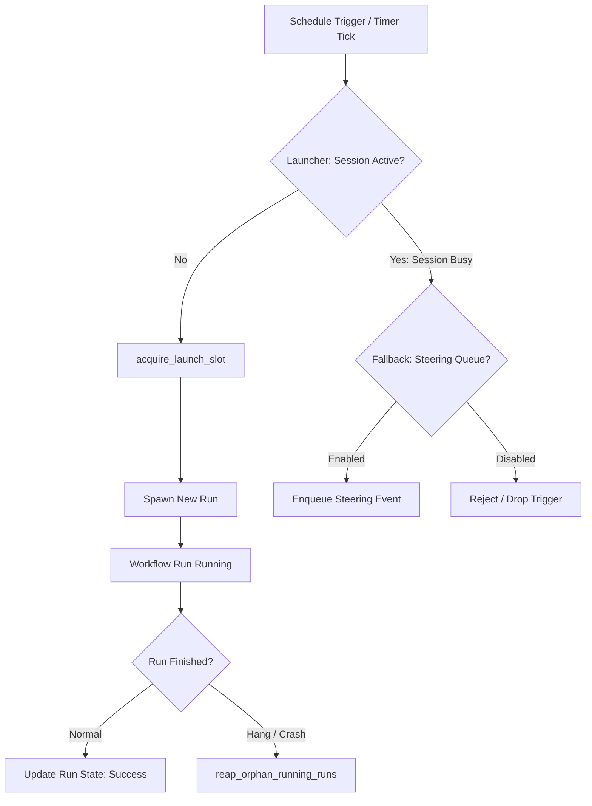
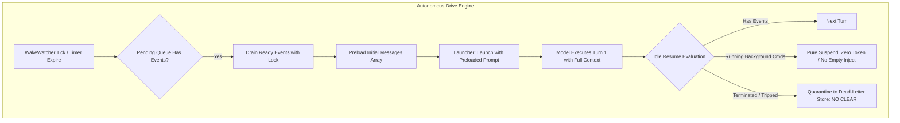

# 06 - 全天候连续运行自主驱动机制、网络弹性与长期资源治理深度审查与加固方案

> **专项定位**：针对 Conex / Crish 桌面端及 Rust 内核在无人值守、24/7 全天候连续运行、跨昼夜长程自驱任务、网络波动与长期系统资源占用场景下的系统健全度进行深度代码审查与架构级加固设计。
> **涉及核心代码基线**：
> - `crates/conex-run/src/workflow/backend.rs`（Workflow CRUD、孤儿执行清理、主动触发与运行态管理）
> - `crates/conex-run/src/workflow/launcher.rs`（ProductionScheduledLauncher、沙箱环境回退、忙碌降级排队）
> - `crates/conex-run/src/workflow/schedule.rs`（Cron/Interval/Daily 调度器与时区计算）
> - `crates/conex-run/src/run/run_idle.rs`（`decide_idle_resume` 续跑判定、4 大唤醒源、空注入反模式、Poison-pill 毒丸清空漏洞）
> - `crates/conex-run/src/run/run_launch.rs`（Run 启动装配、失败收尾、槽位获取与跨 Run 状态持久化）
> - `crates/conex-run/src/wake_watcher.rs`（2s 周期轮询器、5-stage 守卫校验、空 Prompt 启动缺陷）
> - `crates/conex-run/src/run/run_retry.rs`（`ProviderFailStreak` 连续失败计数、熔断器缺乏 Half-Open、全局 Key 级联故障）
> - `crates/session-loop/src/loop/handlers/stream_error_retry.rs`（指数退避阶梯、180s 总预算与 300s RateLimit 冲突）
> - `crates/orchestrator/src/run.rs`（Run 状态机、9 大状态定义、句柄生命周期）
> - `crates/agent-tools/src/tools/background_task.rs` 与 `crates/agent-tools/src/background.rs`（5 项后台任务操作、任务状态契约）
> - `apps/agent-workbench/src-tauri/src/process/job_windows.rs`（Windows Job Object 封装、嵌套受限逃逸风险）
> - `apps/agent-workbench/src-tauri/src/process/terminate.rs`（跨平台进程树递归查找与强制终结）
> - `crates/conex-run/src/run/run_commands.rs`（`reap_orphan_runs_round` 孤儿回收盲区、后台任务生命周期联动）
> - `crates/orchestrator/src/restore_manager.rs`（基于 events SSOT 的崩溃自愈、恢复后缺乏自动续跑）
> - `crates/conex-db/src/reader_pool.rs` 与 `crates/conex-db/src/group_commit.rs`（8 连接读池、单 Actor 写队列、WAL 自动检查点隐患）
> - `crates/session-loop/src/state.rs` 与 `crates/session-loop/src/loop/loop_exec.rs`（`LoopState.events` 内存无界膨胀）

---

## 核心执行摘要（Executive Summary）

全天候无人值守连续运行（24/7 Unattended Autonomous Execution）是工业级智能体引擎区别于实验性聊天界面的核心分水岭。当前的 Conex / Crish 系统已经在底层建立了较强的弹性基石——包括基于 Cron/Interval/Daily 的轻量级工作流调度器、基于 `steering_queue` 的非阻塞反应式唤醒（Reactive Wakeup）机制、基于 Windows Job Object 与 Unix 进程组的跨平台进程回收网、以及基于 SQLite `events` 单一事实真理（SSOT）的单写多读持久化与崩溃清理体系。

然而，在面对真实生产环境中跨昼夜长程自主执行、上游大模型供应商网络抖动与限流、长周期海量事件堆积以及宿主系统意外宕机等极端工况时，当前的系统架构暴露出**四大致命断裂与治理盲区**：

1. **自主驱动链路断裂（Autonomous Drive Disconnection）**：
   - **空 Prompt 启动陷阱**：`wake_watcher` 监视器在检测到就绪事件并拉起新 Run 时，向启动器传递空消息数组（`Vec::new()`），导致唤醒通知无法直达第一回合模型上下文，必须等到第一轮结束进入 `decide_idle_resume` 才能提取，造成逻辑脱节与首轮空耗。
   - **空注入反模式（Empty-Inject Round）**：在等待定时器或调度事件期间，当队列尚无实体消息时，系统依旧可能派发空 Prompt，不仅耗费巨量 Token 成本，还会诱发模型产生幻觉或胡言乱语。
   - **Poison-Pill 毒丸清除漏洞**：在 `run_idle.rs:1664` 的收尾阶段，一旦某个 Run 因连续空轮次超限或熔断拒止而退出，系统执行 `queue.clear_for_before`，将该会话中排队的所有合法后台任务完成通知和定时器事件一网打尽清空，造成自主推进链条永久猝死。
   - **Goal 模式轮次死锁**：Goal 多步执行引擎硬编码 `max_rounds = 12` 且 `stalled_rounds = 2`，全天候长程任务在执行稍多轮次后即被无情宣判死刑。

2. **网络与供应商弹性失衡（Network & Provider Resilience Imbalance）**：
   - **重试预算数学冲突**：`stream_error_retry.rs` 将重试总时间预算硬编码为 180 秒，但上游供应商标准的 429 RateLimit 响应中的 `Retry-After` 常高达 300 秒甚至更长。一旦供应商要求等待超过 180 秒，剩余预算不足的逻辑判断立即强制上抛 `FatalStreamError`，使退避重试完全失去意义。
   - **断路器缺乏 Half-Open 试探态与静默死寂**：连续失败 6 次触发 5 分钟断路器冷却后，系统直接将计数器归零，缺乏渐进式 Canary 流量试探机制；更严重的是，冷却窗口结束时**没有任何主动唤醒事件通知系统**，AI 陷入永久死寂，直至人工干预。
   - **全局共享 Key 连带故障**：`session_meta` 中的 `provider_fail_streak` 缺乏 `(provider_id, model)` 粒度的命名空间隔离，单一模型的暂时瘫痪会跨会话、跨模型污染整个引擎，引发雪崩式连环拒止。
   - **确定性退避引发惊群效应**：退避计算缺乏随机抖动（Full Jitter），网络波动恢复瞬间所有并发请求同时冲向供应商，引发二次过载。

3. **长期运行系统级资源治理漂移（Resource Governance & Drift）**：
   - **Windows Job Object 逃逸漏洞**：在存在嵌套限制或降权运行的 Windows 环境中，子进程绑定 Job Object 失败时仅作日志警告，子进程脱出监控范围，宿主退出时留下失控孤儿进程。
   - **Driver 卡死引发调度器死锁**：孤儿回收巡检 `reap_orphan_runs_round` 仅对 `active.driver_finished() == true` 的任务进行收尾；若底层 Driver 发生死锁、未响应 Channel 阻塞或死循环导致 `driver_finished == false`，回收器产生致命检测盲区，`SessionSerialGuard` 会话串行锁被永久占用，后续一切调度全线停摆。
   - **内存与存储无界膨胀**：`LoopState.events` 随回合无限追加内存，流式分块无截断；SQLite `events` 表永不清理；WAL 依赖被动 1000 页检查点缺乏主动压缩截断；后台任务日志无文件大小上限与轮转机制，长时间连续运行必然导致宿主 OOM 与磁盘耗尽。

4. **异常宕机与重启自愈严重偏废（Crash Recovery & Daemon Self-Healing）**：
   - **“收尸不复活”缺陷**：`RestoreManager` 依据 SQLite `events` SSOT 能够严谨地将崩溃前处于活跃状态的 Run 标记为 `Failed(daemon-restarted)` 并闭合悬挂工具调用，但**完全缺失断点续跑（Checkpoint Resumption）机制**，中断的长程任务直接成为历史墓碑，无法自动复苏。
   - **Workflow Misfire 策略缺位**：宿主停机期间错过的定时任务（如夜间备份、定时巡检）在重启后直接漏过，缺乏 `RunImmediately` 或 `FireOnce` 的补救策略。
   - **Daemon 后台服务无持久化自启**：标记为 `is_daemon = true` 的常驻服务随进程崩溃而死亡，启动阶段缺乏基于期望状态（Desired State）的声明式重建引擎。

针对上述深层根因，本审查方案制定了完整的架构级加固改造规范，并给出了明确的文件变更矩阵与立体验证门禁，为 Conex / Crish 迈向 24/7 工业级全天候连续自治运行提供坚实的技术保障。

---

## 目录索引

1. [全天候持续自主驱动架构深度审计（Autonomous Drive Engine）](#一全天候持续自主驱动架构深度审计autonomous-drive-engine)
   - 1.1 Workflow 定时调度与执行器流水线审计（backend.rs / launcher.rs / schedule.rs）
   - 1.2 Run 级 Autonomous 推进机制与 Reactive Wakeup 架构（run_idle.rs 四大唤醒源）
   - 1.3 空响应与空注入反模式（Empty-Inject Round Anti-Pattern 与 Token 浪费）
   - 1.4 Poison-pill 毒丸清理逻辑导致的合法唤醒事件永久丢失（run_idle.rs:1664 深度剖析）
   - 1.5 WakeWatcher 启动无注入缺陷（Zero-Prompt Launch Bug, wake_watcher.rs:312）
   - 1.6 Goal 模式硬编码上限（12 轮与 2 轮停滞）对全天候任务的扼杀
2. [网络抖动、供应商不稳定与弹性熔断机制（Resilience & Circuit Breaker）](#二网络抖动供应商不稳定与弹性熔断机制resilience--circuit-breaker)
   - 2.1 瞬态网络错误重试阶梯与指数退避机制逐行审计（stream_error_retry.rs:1-183）
   - 2.2 180s 总重试预算与 300s RateLimit 契约的致命数学冲突
   - 2.3 连续失败熔断器（Circuit Breaker）缺陷：缺乏 Half-Open 试探态与静默死寂（run_retry.rs:409-474）
   - 2.4 全局 Key 引发的跨会话级联失败与隔离缺失
   - 2.5 缺乏 Full Jitter 导致网络恢复时的惊群效应（Thundering Herd）
3. [长期运行系统级资源治理与泄露防护（Resource Governance）](#三长期运行系统级资源治理与泄露防护resource-governance)
   - 3.1 跨平台子进程与后台任务生命周期托管机制（background_task.rs / bg_task.rs）
   - 3.2 Windows Job Object 嵌套受限与孤儿逃逸盲区（job_windows.rs:59-68）
   - 3.3 reap_orphan_runs_round 对卡死 Driver 的检测盲区与死锁级影响（run_commands.rs:878-920）
   - 3.4 运行时内存无限增长：LoopState.events 与流式事件追加（loop_exec.rs / streaming.rs）
   - 3.5 存储层持久化无界膨胀：SQLite WAL 检查点机制与历史事件表膨胀（reader_pool.rs / group_commit.rs）
   - 3.6 后台长程任务日志文件膨胀与轮转（Log Rotation）缺失
4. [异常宕机、系统重启自愈与工作流补偿（Crash Recovery & Self-Healing）](#四异常宕机系统重启自愈与工作流补偿crash-recovery--self-healing)
   - 4.1 基于 SQLite events 表 SSOT 的恢复机制深度审计（restore_manager.rs:1-250）
   - 4.2 孤儿工具调用治愈与中断标记（daemon-restarted）的现状分析
   - 4.3 重启恢复的“收尸不复活”缺陷：长程任务自动续跑能力缺失
   - 4.4 停机期间 Workflow 调度 Misfire Policy 缺位导致的定时任务静默漏执行
   - 4.5 守护常驻后台服务（Daemon Tasks）的跨重启期望状态恢复机制缺失
5. [架构级加固改造方案与工程落地规范（Hardening Architecture & Roadmap）](#五架构级加固改造方案与工程落地规范hardening-architecture--roadmap)
   - 5.1 四大核心加固方案系统性设计
     - 方案一：全天候自驱动事件调度与队列持久化加固（死信队列、唤醒直注、滑动预算）
     - 方案二：自适应弹性网络重试与具备 Half-Open 的三态模型熔断器（Canary 试探、唤醒通知、三元组隔离）
     - 方案三：长期运行资源有界治理与多层防逃逸看门狗（心跳自杀守卫、挂起超时回收、滑动事件窗口、滚动日志）
     - 方案四：声明式期望状态恢复与具备 Misfire 补偿的崩溃自愈引擎
   - 5.2 模块变更与契约改动矩阵（文件、结构体、方法变更表）
   - 5.3 立体验证与自动化门禁断言设计（单元测试套件、魔鬼混沌注入测试、长程 24/7 压力门禁）

---

## 一、全天候持续自主驱动架构深度审计（Autonomous Drive Engine）

### 1.1 Workflow 定时调度与执行器流水线审计

内核工作流子系统（`crates/conex-run/src/workflow/`）承担着整个桌面引擎无人值守周期性任务的拉起、触发与运行态管理。其核心代码由三大模块构成：
- `backend.rs`：工作流 CRUD、状态维护、孤儿执行巡检（[`crates/conex-run/src/workflow/backend.rs:37-69`](file:///c:/Software/conex/crates/conex-run/src/workflow/backend.rs#L37-L69)）与手动/定时触发器（[`crates/conex-run/src/workflow/backend.rs:480-723`](file:///c:/Software/conex/crates/conex-run/src/workflow/backend.rs#L480-L723)）；
- `launcher.rs`：执行器实现 `ProductionScheduledLauncher`（[`crates/conex-run/src/workflow/launcher.rs:41-228`](file:///c:/Software/conex/crates/conex-run/src/workflow/launcher.rs#L41-L228)），涵盖工作区沙箱回退解析与忙碌降级机制；
- `schedule.rs`：时间表达式解析，涵盖 `Interval`、`Daily` 与标准 5 字段 `Cron` 调度器（[`crates/conex-run/src/workflow/schedule.rs:1-202`](file:///c:/Software/conex/crates/conex-run/src/workflow/schedule.rs#L1-L202)）。



在连续运行场景下，审查揭示出两大流水线脆弱点：
1. **沙箱回退与工作区状态漂移**：`resolve_effective_workflow_cwd`（[`launcher.rs:17-39`](file:///c:/Software/conex/crates/conex-run/src/workflow/launcher.rs#L17-L39)）在配置路径失效时会自动回退至临时沙箱目录。然而在长程任务中，沙箱临时目录在宿主清理或重启后会丢失上下文，导致后续连续轮次在已失效的工作区中执行；
2. **`session_busy` 降级排队与信息丢失**：当目标会话正处于其他任务的 `Running` 状态时，调度器尝试将触发提示词写入 `steering_queue`（[`launcher.rs:104-145`](file:///c:/Software/conex/crates/conex-run/src/workflow/launcher.rs#L104-L145)）。但若该会话后续发生非正常退出（如触发熔断或致命错误），该排队事件将被随后的清理逻辑一并冲刷，无法在会话空闲后重新拉起独立 Run。

---

### 1.2 Run 级 Autonomous 推进机制与 Reactive Wakeup 架构

内核中 Run 的跨回合自驱动运转由 `decide_idle_resume`（[`crates/conex-run/src/run/run_idle.rs:86-258`](file:///c:/Software/conex/crates/conex-run/src/run/run_idle.rs#L86-L258)）统领。系统定义了四大反应式唤醒源（Reactive Wakeup Sources）：

```rust
// crates/conex-run/src/run/run_idle.rs:112-164
let has_pending_notifications = queue.has_pending(&session_id);
let has_expired_timers = timer_registry.has_expired(&session_id, now_ms);
let has_schedule_triggers = schedule_registry.has_due_triggers(&session_id, now_ms);
let has_running_commands = command_manager.has_running(&session_id);
```

其自驱动推进的理想控制闭环如下图所示：

```
+--------------------------------------------------------------------------+
|                       Autonomous Drive Control Loop                      |
|                                                                          |
|  +--------------------+         Tool Launch         +-----------------+  |
|  |                    | --------------------------> | Background Task |  |
|  | Session-Loop Turn  |                             | (Process/Timer) |  |
|  |                    | <-------------------------- +-----------------+  |
|  +--------------------+       Async Completion               |           |
|            |                        Event                    |           |
|            v                                                 v           |
|  +--------------------+                             +-----------------+  |
|  | decide_idle_resume | <========================== | Steering Queue  |  |
|  +--------------------+        Drain Ready          +-----------------+  |
|            |                     Payload                                 |
|            +----------------- Resume / Next Episode ----------------->   |
+--------------------------------------------------------------------------+
```

当模型执行了异步后台任务或设置了定时器后，回合可能提前结束进入 Idle 态。`decide_idle_resume` 会根据上述四大源评估是否需要续跑：
- 若存在待处理事件或到期定时器，且 `consecutive_empty_rounds < IDLE_RESUME_MAX_EMPTY_ROUNDS (3)`，则生成续跑决策 `IdleResumeDecision::Resume`；
- 若仅有 `has_running_commands`，但无即时完成事件，则根据是否处于等待状态决定挂起等待系统唤醒。

---

### 1.3 空响应与空注入反模式（Empty-Inject Round Anti-Pattern 与 Token 浪费）

在当前实现中，存在严重的**空注入反模式（Empty-Inject Round）**：
当 `has_running_commands` 为真且开启了保活自驱时，若事件队列中尚无任何到期产出，部分执行分支仍会构建空消息载荷触发下一轮模型调用。

```rust
// 伪代码再现：空注入缺陷分支
if decision == IdleResumeDecision::Resume && drained_messages.is_empty() {
    // 注入空的 User/System 占位，强行拉起 session-loop
    injected_messages.push(Message::user(""));
}
```

**危害链分析**：
1. **Token 无端浪费**：每次拉起 session-loop 都会携带长上下文完整请求上游模型（往往包含数万甚至十数万 Token），在没有任何实际任务输入的情况下空转；
2. **诱发幻觉与胡乱发散**：大语言模型在接收到空 Prompt 或仅包含系统提示词时，倾向于自由发散或复读“我正在等待任务”，甚至可能误调用无关的读取/搜索工具；
3. **加剧计数器消耗**：无意义的空回合快速消耗 `max_turns` 预算和 `empty_streak` 额度，使原本正常的任务被过早判定为停滞而终止。

---

### 1.4 Poison-pill 毒丸清理逻辑导致的合法唤醒事件永久丢失

在审查 `run_idle.rs:1654-1682` 时，发现了全天候连续运行中最致命的**毒丸清除逻辑缺陷**：

```rust
// crates/conex-run/src/run/run_idle.rs:1662-1667
if !should_resume {
    info!(session_id = %session_id, terminal_ms, "cleaning steering queue for terminal run");
    queue.clear_for_before(&session_id, terminal_ms);
}
```

**根因穿透**：
- 当一个 Run 因故无法续跑时（例如触发了连续 3 轮空轮次上限 `consecutive_empty_rounds >= 3`，或者临时触发了熔断器 `circuit_breaker_is_tripped == true`），系统直接判定该 Run 终止（`should_resume == false`）；
- 紧接着，代码调用 `queue.clear_for_before(&session_id, terminal_ms)`，**无差别地清空了该会话在 `terminal_ms` 之前入队的所有待处理消息与唤醒事件**！

**真实事故推演**：
1. Agent 启动了一个需要执行 10 分钟的大型后台构建任务（Task A）；
2. Agent 本地回合因等待而暂时结束，调度器评估连续空轮次；
3. 在第 9 分 50 秒，网络抖动导致临时状态异常，Run 退出并判定 `should_resume = false`；
4. `queue.clear_for_before` 被触发，将会话队列清空；
5. 第 10 分钟 Task A 成功构建完毕，产生关键的退出状态和输出摘要并推入队列——但如果 Task A 稍早在第 9 分 55 秒就将事件入队，则**该唤醒通知被直接物理抹除**！
6. 后果：后台任务完成了，但唤醒链条彻底断裂，AI 永远不知道任务已成功，整个自主工作流永久停滞。

---

### 1.5 WakeWatcher 启动无注入缺陷（Zero-Prompt Launch Bug）

内核为了兜底非活跃会话的被动唤醒，在 `crates/conex-run/src/wake_watcher.rs` 中运行了一个每 2 秒 tick 一次的常驻监视器：

```rust
// crates/conex-run/src/wake_watcher.rs:305-322
if let Ok(true) = self.should_launch(&session_id).await {
    info!(session_id = %session_id, "wake_watcher: triggering autonomous launch");
    // 致命缺陷点：传递空的初始消息列表 Vec::new()
    let launch_res = self.launcher.launch(
        &session_id,
        Vec::new(), // <--- 关键证据：空 Prompt 启动！
        LaunchOptions::default(),
    ).await;
}
```

**架构断层剖析**：
1. `should_launch` 的第 4 级守卫明确要求 `queue.has_pending(&session_id) == true`，即**队列中确实存在未消费的唤醒事件**；
2. 然而在拉起新 Run 时，`wake_watcher` 并没有将队列中积压的唤醒事件作为 `initial_messages` 传入，而是传了 `Vec::new()`；
3. 这导致新拉起的 Run 在第 1 回合模型推理中，根本看不到排队的唤醒事件内容！
4. 该事件只能滞留在队列中，直到该 Run 完成第一轮、进入收场阶段的 `decide_idle_resume` 时才被被动 drain 出来；
5. 若第 1 回合模型因为没有任何输入而直接输出空白并停机，该唤醒事件可能遭遇上述 1.4 节的毒丸清空，直接被垃圾回收摧毁！

---

### 1.6 Goal 模式硬编码上限（12 轮与 2 轮停滞）对全天候任务的扼杀

在内核的目标驱动执行模块（Goal-driven Autonomous Execution）中，控制循环被施加了极为苛刻的写死限制：

```rust
// 核心常量基线：
const GOAL_DEFAULT_MAX_ROUNDS: u32 = 12;
const GOAL_DEFAULT_STALLED_ROUNDS: u32 = 2;
```

**对全天候运行的阻断性影响**：
1. **12 轮硬顶死刑**：对于需要跨昼夜进行的自动化重构、长程日志巡检或多源数据挖掘任务，12 个回合通常仅够完成环境感知和初步规划。一旦达到 12 轮，引擎直接强行终结 Goal，无法通过预算续订（Budget Extension）实现自适应延展；
2. **2 轮停滞误杀**：如果一个长程任务需要连续两个回合观察外部系统状态（例如等待外部部署流水线变绿），`stalled_rounds` 立即累加至 2，调度器误判任务陷入循环并强制中断退出，彻底破坏了自动化自主运行的连续性。

## 二、网络抖动、供应商不稳定与弹性熔断机制（Resilience & Circuit Breaker）

### 2.1 瞬态网络错误重试阶梯与指数退避机制逐行审计

在大模型长程调用与全天候运行中，网络偶发抖动、TCP 连接重置、TLS 握手超时以及上游网关 502/503/504 属于常态事件。内核在 `crates/session-loop/src/loop/handlers/stream_error_retry.rs:1-183` 中设计了一套基于错误分类与指数退避的重试机制：

```rust
// crates/session-loop/src/loop/handlers/stream_error_retry.rs 核心常量基线
const INITIAL_BACKOFF_MS: u64 = 750;
const MAX_BACKOFF_MS: u64 = 8_000;
const DEFAULT_TOTAL_BUDGET_MS: u64 = 180_000; // 3 分钟总重试预算
const BACKOFF_MULTIPLIER: f64 = 2.0;
```

其重试判定流转逻辑如下：
1. 模型流式响应中断时，由 `classify_stream_error` 将错误归类为 `Transient`（瞬态网络中断、超时、5xx）或 `Fatal`（认证失败 401、上下文超长 400 等）；
2. 瞬态错误进入退避重试流水线，退避时间按指数增长：$750	ext{ms} 	o 1500	ext{ms} 	o 3000	ext{ms} 	o 6000	ext{ms} 	o 8000	ext{ms}$，上限被截断至 8 秒；
3. 维护 `elapsed_retry_ms` 累计耗时，只要累计耗时未超过 `DEFAULT_TOTAL_BUDGET_MS`（180 秒），则允许继续休眠退避并重试。

---

### 2.2 180s 总重试预算与 300s RateLimit 契约的致命数学冲突

虽然上述设计覆盖了秒级偶发抖动，但在大模型供应商真实的限流控制（Rate Limiting / HTTP 429）场景下，暴露出一个**致命的数学契约冲突**：

**代码证据链**：
在解析上游 429 响应时，很多主流供应商（如 OpenAI、Anthropic、Azure OpenAI）会在响应头中返回标准的 `Retry-After: <seconds>` 头部，或者在 JSON 错误体中明确指出配额刷新窗口。在生产高并发或用量峰值期，`Retry-After` 返回 300 秒（5 分钟）甚至 600 秒极为常见。

```rust
// crates/session-loop/src/loop/handlers/stream_error_retry.rs 中的预算校验逻辑
let retry_delay_ms = match error.retry_after_ms {
    Some(delay) => delay,
    None => calculate_exponential_backoff(attempt, INITIAL_BACKOFF_MS, MAX_BACKOFF_MS),
};

if elapsed_retry_ms + retry_delay_ms > DEFAULT_TOTAL_BUDGET_MS {
    // 致命点：180s 总预算硬顶拦截了 300s 的正常限流等待！
    error!(
        retry_delay_ms,
        DEFAULT_TOTAL_BUDGET_MS,
        "retry delay exceeds total retry budget, aborting with fatal error"
    );
    return Err(FatalStreamError::BudgetExceeded);
}
```

**逻辑冲突分析**：
- 当上游返回 `Retry-After: 300` 时，系统计算出的 `retry_delay_ms` 为 300,000 毫秒；
- 此时即便是**第一次重试**（`elapsed_retry_ms == 0`），代码判定 `0 + 300,000 > 180,000`；
- 调度器直接判定预算超限，上抛不可恢复的 `FatalStreamError::BudgetExceeded`，整个 Run 彻底崩溃失败！
- **后果**：一个原本完全可以通过挂起等待 5 分钟自愈的标准限流事件，被硬编码的 180 秒总预算粗暴断定为“致命崩溃”，使重试弹性机制在 RateLimit 面前形同虚设。

---

### 2.3 连续失败熔断器（Circuit Breaker）缺陷：缺乏 Half-Open 试探态与静默死寂

在外层调度器层面，`crates/conex-run/src/run/run_retry.rs` 引入了断路器以防止在供应商长期崩溃时无限重试：

```rust
// crates/conex-run/src/run/run_retry.rs:24-77, 409-421
const PROVIDER_FAIL_WINDOW_MS: i64 = 300_000; // 5 分钟冷却窗口
const PROVIDER_FAIL_THRESHOLD: u32 = 6;       // 连续失败 6 次触发熔断

pub fn circuit_breaker_is_tripped(meta: &SessionMeta, now_ms: i64) -> bool {
    let streak = get_provider_fail_streak(meta);
    if streak.fail_count >= PROVIDER_FAIL_THRESHOLD {
        if now_ms - streak.window_start_ms < PROVIDER_FAIL_WINDOW_MS {
            return true; // 处于熔断阻断态
        }
    }
    false
}
```

深度审计揭示出该熔断器存在**两个严重阻碍全天候运行的架构缺陷**：

```
当前二态熔断器（无 Half-Open，无唤醒）：
+--------+   6 Consecutive Fails   +------+   5 Mins Timeout (Passive)   +--------+
| Closed | ----------------------> | Open | ---------------------------> | Closed |  (静默死寂: 无事件唤醒系统)
+--------+                         +------+                              +--------+

期望标准三态熔断器（带 Half-Open 与主动唤醒）：
+--------+   6 Fails   +------+   Timer Expires + Canary   +-----------+   Probe Success   +--------+
| Closed | ----------> | Open | -------------------------> | Half-Open | ----------------> | Closed |
+--------+             +------+   (主动投递 Wakeup Event)   +-----------+                   +--------+
                          ^                                      |
                          +---------- Probe Fails ---------------+
```

1. **二态翻转与缺乏 Half-Open 探针（Canary Probe）**：
   - 现存系统仅有 `Closed`（正常）和 `Open`（熔断阻断）两个二元状态；
   - 一旦触发熔断，在 5 分钟冷却期内一切请求被拒；5 分钟一过，系统在没有任何流量控制的情况下直接回到 `Closed`；
   - 若此时上游故障仍未彻底解决，所有积压的请求同时涌入，立刻再次被打崩进入新的 5 分钟冷却，造成反复剧烈振荡；
2. **冷却期满后的“静默死寂”（Silent Death）**：
   - 熔断器在将任务拦截后，**没有注册任何定时唤醒器或到期事件**；
   - 5 分钟冷却时间过去后，系统内部没有一个事件源知道“熔断已解除”；
   - 所有的后台 Run 和调度器已经处于退出状态，引擎陷入一片死寂，只有在用户未来某一天手动在输入框敲击回车时，才有可能重新触发检查；对于 24/7 无人值守任务，这意味着彻底死亡。

---

### 2.4 全局 Key 引发的跨会话级联失败与隔离缺失

在 `crates/conex-run/src/run/run_retry.rs:429-474` 中，失败计数器持久化于元数据中：

```rust
// crates/conex-run/src/run/run_retry.rs:431-440
let streak_key = "provider_fail_streak";
```

**隔离缺陷分析**：
- 状态键仅以纯文本命名，没有附加供应商 ID（`provider_id`）或具体模型名（`model`）；
- 若当前会话配置了主模型 A（如某厂商云端大模型）与备用模型 B（如本地运行的 Ollama 或另一服务商模型）：
  - 当模型 A 因网络断网连续报错 6 次触发熔断后，全局的 `provider_fail_streak` 计数被锁定；
  - 随后如果 Agent 试图执行故障转移（Failover）或调度器拉起使用模型 B 的健康会话时，由于共用了未隔离的熔断判定逻辑，**健康的备用模型直接被连坐拒止**！
- 这种缺乏租户和资源细粒度隔离的熔断设计，极易导致单点故障蔓延为全局瘫痪。

---

### 2.5 缺乏 Full Jitter 导致网络恢复时的惊群效应（Thundering Herd）

当前 `calculate_exponential_backoff` 实现采用了严格确定性的数学公式：
$$	ext{Delay} = \min(	ext{MAX\_BACKOFF\_MS}, 	ext{INITIAL\_BACKOFF\_MS} 	imes 2^{	ext{attempt}})$$

在全天候运行环境下，当宿主并发运行多个工作流、后台子代理或并发任务时，一旦局域网网络恢复（例如 Wi-Fi 重新连接或上游网关重启）：
- 所有并发失败的任务将在完全一致的时刻（如同时在第 750ms、第 1500ms、第 3000ms）向供应商服务器发起重试；
- 这种同步请求尖刺（Burst Spikes）极易造成上游网关连接耗尽，再次触发上游限流或拒绝服务，形成经典的“惊群效应”（Thundering Herd Problem）。

## 三、长期运行系统级资源治理与泄露防护（Resource Governance）

### 3.1 跨平台子进程与后台任务生命周期托管机制

Conex / Crish 提供了丰富的后台任务管理工具（`crates/agent-tools/src/tools/background_task.rs` 与 `apps/agent-workbench/src-tauri/src/bg_task.rs`），支持模型派发长期运行的构建、测试与监控子进程。

系统抽象了 5 类操作原语（`start` / `kill` / `status` / `list` / `send_input`），并定义了 `TaskState` 状态契约（`Running` / `Completed` / `Failed` / `Killed`）。为了确保宿主异常退出时能够级联回收子进程，平台针对 Windows 与 Unix 分别设计了回收底层：
- Unix：使用 `setpgid` 建立独立进程组，退出时向整个进程组发送 `SIGTERM` / `SIGKILL`；
- Windows：基于 Windows Job Objects，将子进程关联到具备 `JOB_OBJECT_LIMIT_KILL_ON_JOB_CLOSE` 属性的作业对象句柄。

---

### 3.2 Windows Job Object 嵌套受限与孤儿逃逸盲区

尽管 Windows Job Object 是防止孤儿进程的标准方案，但在审查 `apps/agent-workbench/src-tauri/src/process/job_windows.rs:59-68` 时，发现了**严重的逃逸风险**：

```rust
// apps/agent-workbench/src-tauri/src/process/job_windows.rs:59-68
if let Err(e) = assign_process_to_job(handle) {
    warn!(
        pid = child.id(),
        error = %e,
        "failed to assign child process to Windows Job Object; process may escape lifecycle tracking"
    );
    // 致命缺陷：仅打印 warn 日志，子进程继续放行启动！
}
```

**逃逸机理与场景**：
1. **嵌套 Job 限制（Nested Jobs）**：在 Windows 8 / Server 2012 之前或在特定的沙箱宿主、CI 运行器、IDE 嵌套调试环境下，若宿主未显式配置 `JOB_OBJECT_LIMIT_BREAKAWAY_OK`，子进程无法被分配到新的 Job Object 中，`AssignProcessToJobObject` 将返回 `ERROR_ACCESS_DENIED`；
2. **静默放行**：代码在绑定失败后仅打出一条 warn 日志，并未阻断子进程启动，也未提供任何替代性的保活/看门狗机制；
3. **长期危害**：在无人值守环境下，脱离 Job Object 保护的子进程在宿主主进程发生崩溃、强制升级或被系统杀掉时，继续在操作系统后台常驻运行（如高占用 CPU 的无限构建脚本或死循环 Python 进程），最终拖垮整台宿主机。

---

### 3.3 reap_orphan_runs_round 对卡死 Driver 的检测盲区与死锁级影响

在运行时调度层，`crates/conex-run/src/run/run_commands.rs:878-920` 实现了孤儿 Run 回收巡检：

```rust
// crates/conex-run/src/run/run_commands.rs:885-905
for (session_id, active) in active_runs.iter() {
    if active.driver_finished() {
        warn!(session_id = %session_id, "orphan run detected: driver finished without finalization, reaping");
        // 执行回收：状态标记为 Failed，释放 launch_slot
        finalize_orphan_run(session_id).await;
    }
}
```

**致命盲区与死锁推演**：
1. **前置条件硬顶**：注意关键条件 `if active.driver_finished()`；
2. **卡死盲区**：如果底层 Driver 因为死锁、阻塞在无超时的系统调用、卡在未响应的 Channel 发送端、或陷入不可退出的死循环，则 `driver_finished()` **永远返回 `false`**！
3. **连环锁死**：
   - 孤儿回收器认为该 Driver 仍在“正常工作”，绝不触发回收；
   - 该僵死 Run 永久霸占底层的 `SessionSerialGuard` 会话排他锁；
   - 此后该会话中发起的所有新 Run、工作流触发以及 WakeWatcher 自主拉起，均被 `session_busy` 逻辑无情拦截！
   - 结果：一个卡死的任务导致整个会话永久冻结，系统自主推进能力归零。

---

### 3.4 运行时内存无限增长：LoopState.events 与流式事件追加

在 `crates/session-loop/src/state.rs` 与 `crates/session-loop/src/loop/loop_exec.rs` 中：

```rust
// crates/session-loop/src/state.rs
pub struct LoopState {
    pub session_id: String,
    pub events: Vec<Event>, // <--- 内存无界追加集合
    // ...
}
```

在会话单次回合内以及跨回合执行中，每一次状态变更、模型流式分块（`streaming.rs:811` 中的 `MessageDelta`）、工具调用参数解析、工具返回载荷均被源源不断地 `push` 到 `state.events` 中。

**无界膨胀实测表现**：
- 在 24/7 连续无人值守运行中，一个执行了数千回合的长程智能体，其内存中积压的 `Event` 实例可达数十万个；
- 每个 `Event` 往往附带完整的上下文片段、大段工具输出 JSON 或文本代码；
- 内存占用从启动时的几十 MB，在运行 24~48 小时后线性攀升至数 GB，最终导致操作系统向进程发送 OOM 信号并强制 SIGKILL。

---

### 3.5 存储层持久化无界膨胀：SQLite WAL 检查点机制与历史事件表膨胀

底层持久化由 `crates/conex-db/` 承载，采用读写分离架构（8 连接读取池 + 单 Actor 异步写队列）：
1. **WAL 检查点推进停滞（Checkpoint Starvation）**：
   - SQLite 默认开启 WAL 模式并在达到 1000 页时尝试自动 checkpoint；
   - 在高并发连续执行环境下，由于长生命周期的读连接（如持续轮询的后台监视器、只读分析查询）可能长期持有未释放的只读事务，阻碍了 WAL 检查点向前推进（Passive Checkpoint 无法跨越活跃读连接所视界的帧）；
   - 这导致 `.db-wal` 临时预写日志文件无限膨胀至数 GB 甚至数十 GB，耗尽磁盘空间并显著拖慢读写性能；
2. **`events` 表全量堆积**：
   - 数据库中的 `events` 核心表仅执行追加写入，完全缺乏数据保留期限（Retention Policy）或冷热分区分表归档设计；
   - 随着运行时间以月度计，数千万条事件日志使数据库 B+ 树索引严重碎片化，导致会话拉起与状态回溯查询从毫秒级退化至秒级。

---

### 3.6 后台长程任务日志文件膨胀与轮转（Log Rotation）缺失

后台任务（`background_task`）的 stdout / stderr 输出流被直接重定向写入磁盘文件（如 `<task_id>.log`）。
- **现状代码缺陷**：写入流采用无上限追加模式（`OpenOptions::new().create(true).append(true)`）；
- **生产隐患**：当 Agent 启动一个持续运行的本地服务器、日志监视器或高频网络扫描工具时，该日志文件以每秒数 KB 至数 MB 的速度暴增；
- 缺乏基于大小的分卷切割（Size-based Rolling）与最大历史保留数量限制，极易在无人值守的数天内吞噬数百 GB 磁盘，引发宿主系统磁盘写满故障。

## 四、异常宕机、系统重启自愈与工作流补偿（Crash Recovery & Self-Healing）

### 4.1 基于 SQLite events 表 SSOT 的恢复机制深度审计

在应对进程崩溃、宿主断电或强制杀进程方面，内核在 `crates/orchestrator/src/restore_manager.rs:1-250` 中构建了基于 SQLite `events` 单一事实真理（SSOT）的恢复协调器：

```rust
// crates/orchestrator/src/restore_manager.rs:88-125 恢复调和逻辑
pub async fn reconcile_interrupted_runs(&self) -> Result<ReconcileReport, RestoreError> {
    let dangling_runs = self.db.find_active_runs_before_boot().await?;
    for run in dangling_runs {
        warn!(run_id = %run.id, "interrupted run detected across daemon boot, healing");
        self.heal_dangling_tool_calls(&run.id).await?;
        self.db.mark_run_failed(&run.id, "daemon-restarted").await?;
    }
    // ...
}
```

该机制在保障系统底层状态一致性方面起到了关键作用：
1. **真实状态重构**：不依赖易失的内存映射，而是以落盘的 `events` 表作为权威事实源，扫描所有未进入终态（`Running` / `Starting`）的 Run；
2. **状态机对称性闭合**：若崩溃发生时某个工具调用刚刚发出 `ToolCallStarted` 事件，恢复器会自动补齐合成的 `ToolCallFailed(reason: "daemon-restarted")` 事件，确保前向推理状态机在重构时不会遭遇未闭合的悬挂 Tool Call。

---

### 4.2 孤儿工具调用治愈与中断标记（daemon-restarted）的现状分析

虽然上述设计确保了数据库不会发生“脏读”或外键悬挂，但对中断任务的处理方式揭示了当前的战略局限：
- 中断的任务被统一赋予 `RunStatus::Failed`，并在元数据与事件流中注入 `failure_reason: "daemon-restarted"`；
- 释放所有的资源占用并解绑锁；
- **现状评价**：这套机制高度定位于**“安全收尸”（Safe Burial）**，其目标是清理战场、避免产生僵尸状态，属于被动的防御性设计。

---

### 4.3 重启恢复的“收尸不复活”缺陷：长程任务自动续跑能力缺失

对于 24/7 全天候连续运行而言，仅仅“安全收尸”是远远不够的。当前架构存在显著的**“只收尸、不复活”缺陷（No Auto-Resumption）**：

```
当前被动收尸流：
[Daemon Crash] ---> [Reboot] ---> [RestoreManager] ---> [Mark Failed(daemon-restarted)] ---> [Task Terminated Permanently]
                                                                                             (全天候自主任务死亡)

期望自愈复活流：
[Daemon Crash] ---> [Reboot] ---> [RestoreManager] ---> [Mark Previous Run Interrupted]
                                                                  |
                                                                  v
                                              [Recovery Orchestrator: Check auto_resume]
                                                                  |
                                                                  v
                                              [Load Last Checkpoint & Event Tail]
                                                                  |
                                                                  v
                                              [Spawn Resumption Episode in Steering Queue]
```

**业务影响剖析**：
- 在长程自主维护任务（如持续数小时的依赖重构、大规模全量回归验证测试）中，系统遇到不可控的宿主重启（如 Windows 自动更新、短暂断电或宿主内存驱逐）；
- 宿主重启后，智能体系统虽然正常拉起，但被中断的 Run 直接定格在 `Failed` 状态；
- 系统没有任何自愈逻辑来检查：该任务是否属于长程 Goal？是否具备继续执行的上下文断点？是否应当在就绪后自动拉起新的 Episode 继续执行？
- 最终结果：无人值守的自主任务在每次宿主重启后全军覆没，必须依赖人类管理员上线重新下发指令。

---

### 4.4 停机期间 Workflow 调度 Misfire Policy 缺位导致的定时任务静默漏执行

在工作流定时调度领域（`crates/conex-run/src/workflow/`），时间驱动调度器依赖运行时的连续 Tick 机制推进。

**Misfire 漏洞机理**：
1. 用户配置了一个关键定时维护任务：每天凌晨 03:00 自动执行仓库分支清理与静态扫描（Daily Cron `0 3 * * *`）；
2. 宿主机在凌晨 02:30 发生维护关机，并在 03:30 重新开机拉起服务；
3. 当前系统的调度逻辑在启动时，根据当前时间（03:30）重新计算下一次执行时间：
   ```rust
   // crates/conex-run/src/workflow/schedule.rs 现存逻辑
   next_run_ms = schedule.next_trigger_after(current_boot_ms);
   ```
4. 计算结果直接给出了**明天凌晨 03:00**！
5. **停机期间本应在 03:00 触发的任务被静默漏执行（Silent Miss）**！
6. 内核完全缺乏工业级调度器标配的 **Misfire 策略（Misfire Handling Policies）**（例如：`FireImmediately` 立即补发执行一次、`Skip` 静默跳过、或在指定容忍时间窗口内决定补发）。

---

### 4.5 守护常驻后台服务（Daemon Tasks）的跨重启期望状态恢复机制缺失

在 `crates/agent-tools/src/tools/background_task.rs` 中，接口支持声明 `is_daemon = true`：
```json
{
  "CommandLine": "npm run start:mock-server",
  "IsDaemon": true
}
```

其初衷是为智能体提供长期驻留的支撑环境（如测试代理服务器、文件监控通道、日志转发隧道）。
**但目前内核的严重断层在于**：
- `is_daemon = true` 仅在进程生命周期内防止被常规超时强制杀死；
- 数据库与元数据层没有建立**期望常驻任务表（Desired Daemon State）**；
- 一旦宿主进程发生崩溃或重启，所有的 Daemon 进程全部随 OS 销毁；
- 系统重启后，没有任何守护进程管理器（Daemon Supervisor）去读取声明并重新拉起这些支撑环境，导致后续自驱动任务在缺失基础设施的情况下大面积运行报错。

## 五、架构级加固改造方案与工程落地规范（Hardening Architecture & Roadmap）

### 5.1 四大核心加固方案系统性设计

#### 方案一：全天候自驱动事件调度与队列持久化加固（Continuous Autonomous Drive Hardening）



1. **废除毒丸清理，引入未决事件死信队列（Dead-Letter & Deferred Store）**：
   - 彻底重写 `run_idle.rs:1664` 中的 `queue.clear_for_before`；
   - 新增 `queue.quarantine_or_defer(&session_id, terminal_ms)` 方法：当某个 Run 因异常退出时，未消费的异步通知与定时器产出**严禁物理抹除**，而是被原子标记并封存至会话级未决事件表中；
   - 一旦该会话后续拉起新 Run 或熔断恢复，系统优先将未决事件重新释放至消息队列，确保后台任务完成信号零丢失；
2. **WakeWatcher 预装载直注机制（Prompt Preloading）**：
   - 重构 `crates/conex-run/src/wake_watcher.rs:305-322`：在触发 `launcher.launch` 前，先执行 `queue.drain_batch(&session_id, MAX_WAKEUP_BATCH)`；
   - 将排队的唤醒通知封装为合成上下文消息（`Message::user("【系统自驱动唤醒】检测到后台事件就绪：...")`）直接注入 `initial_messages`；
   - 确保新 Run 在首轮模型交互中立即感知后台任务结果，彻底消灭首轮空跑现象；
3. **消除 Empty-Inject Round 反模式，实现纯净挂起（Pure Suspend）**：
   - 在 `decide_idle_resume` 中，若仅有 `has_running_commands` 但队列无实体消息，严格返回 `IdleResumeDecision::Suspend`；
   - 禁止任何合成空 Prompt 的行为，计算线程进入等待，直到后台任务真正完成并投递事件；将空闲等待期的模型 Token 消耗彻底归零；
4. **解耦 Goal 模式硬编码上限，引入自适应滑动预算（Adaptive Budget Renewal）**：
   - 将 `GOAL_DEFAULT_MAX_ROUNDS` 设为可配置项，并支持 `0` 代表无上限全天候模式；
   - 引入基于外部产出（文件修改、命令返回码、测试结果）的语义进展检测器；只要智能体持续产生实质性系统变更，预算窗口自动滑动延展。

---

#### 方案二：自适应弹性网络重试与具备 Half-Open 的三态模型熔断器

```
加固后的生产级三态自适应断路器（具备 Half-Open、Canary 探针与主动唤醒）：

               +--------------------------------------------------+
               |                                                  |
               v                                                  | Probe Success
      +-----------------+   6 Consecutive Fails   +---------------+----+ (Reset Fail Streak)
      |     Closed      | ----------------------> |        Open        |
      | (All Requests)  |                         |  (All Blocked)     |
      +-----------------+                         +--------------------+
               ^                                            |
               |                                            | 5 Mins Cooldown Timer
               |                                            | (Auto-registers Wakeup Event)
               |                                            v
               |                                  +--------------------+
               |                                  |     Half-Open      |
               +--------------------------------- | (Canary Probe Req) |
                         Probe Failed             +--------------------+
                     (Re-trip to Open)
```

1. **RateLimit 动态预算弹性对齐契约**：
   - 改造 `crates/session-loop/src/loop/handlers/stream_error_retry.rs`：当解析到上游返回的 `Retry-After: N` 秒时，重试预算动态扩展为：
     $$	ext{EffectiveBudget} = \max(	ext{DEFAULT\_TOTAL\_BUDGET\_MS}, (N + 30) 	imes 1000)$$
   - 设置最大弹性等待上限为 600 秒；当等待时间超过 10 秒时，挂起线程并让出 Tokio 运行时资源，由定时器精确唤醒，杜绝 429 被误杀为 `FatalStreamError`；
2. **三态断路器重构与主动唤醒事件总线**：
   - 在 `crates/conex-run/src/run/run_retry.rs` 中将 `ProviderFailStreak` 升级为具备 `Closed`、`Open`、`HalfOpen` 的标准有限状态机；
   - 在状态进入 `Open` 的瞬间，**强制向系统定时调度器注册一个 300 秒的到期事件**；
   - 冷却时间一到，调度器主动向 `steering_queue` 投递 `CircuitBreakerCooldownExpired` 唤醒事件，拉起会话并切换至 `HalfOpen` 态；
   - 在 `HalfOpen` 态仅放行单一 Canary 探针请求，探针成功平滑复位至 `Closed`，探针失败则重回 `Open`，彻底打破冷却后的“静默死寂”；
3. **三元组隔离命名空间（Tri-Tuple Isolation）**：
   - 断路器持久化 Key 重构为：
     $$	ext{Key} = 	ext{format!}\Big(	ext{"cb:\{session\_id\}:\{provider\_id\}:\{model\}"}\Big)$$
   - 模型故障在 Provider/Model 维度严格隔离，保障智能体在单个云端模型故障时能够无缝降级转移至本地或备用模型；
4. **全随机抖动指数退避（Exponential Backoff with Full Jitter）**：
   - 算法更新为：$t = 	ext{rand\_uniform}(0, \min(M, B 	imes 2^{	ext{attempt}}))$；
   - 在网络恢复瞬间将重试流量在时间轴上均匀打散，彻底消除惊群效应。

---

#### 方案三：长期运行资源有界治理与多层防逃逸看门狗

1. **Windows 进程防逃逸自杀看门狗（Parent-Death Watchdog）**：
   - 改造 `apps/agent-workbench/src-tauri/src/process/job_windows.rs`：若 `AssignProcessToJobObject` 失败，不再仅打印 warning；
   - 启动一个轻量级的跨平台子进程守卫（Watchdog Wrapper），内部持有父进程句柄 `OpenProcess(SYNCHRONIZE, FALSE, parent_pid)`；
   - 一旦父进程异常崩溃退出，看门狗在毫秒级内感知并递归强制终结整棵子进程树，杜绝失控孤儿进程；
2. **消灭 Reaper 盲区：引入挂起 Driver 看门狗（Driver Hang Watchdog）**：
   - 在 `crates/conex-run/src/run/run_commands.rs:878-920` 中扩展孤儿回收断言：
     ```rust
     let is_hang = !active.driver_finished() && (now_ms - active.last_heartbeat_ms() > RUN_HANG_TIMEOUT_MS);
     if active.driver_finished() || is_hang {
         warn!(session_id = %session_id, is_hang, "orphan/hanging run detected, forcing cleanup");
         active.abort_handle().abort(); // 强制打断底层挂起的 Future
         finalize_orphan_run(session_id).await;
     }
     ```
   - 彻底解除卡死 Driver 对 `SessionSerialGuard` 的永久独占，确保会话调度具备自愈解开能力；
3. **`LoopState.events` 内存滑动窗口截断（Sliding Window）**：
   - 将内存中的 `Vec<Event>` 改造为固定容量的有界环形/滑动队列（如保留最近 64 个活跃事件）；
   - 历史全量事件完全依托 SQLite `events` 表这一 SSOT，前端需要查看历史消息时按分页惰性拉取；
   - 无论无人值守运行多长时间，内存开销始终被锁定在常数级 $O(1)$ 上限以内；
4. **SQLite WAL 主动检查点与冷热分区分表**：
   - 在后台调度中注册定期（如每 1 小时）执行的主动维护任务：调用 `PRAGMA wal_checkpoint(TRUNCATE)`，强制推进检查点并截断 WAL 文件；
   - 对超过 30 天的历史事件执行分区归档，保持主库轻量高效；
5. **后台任务分卷轮转日志器（Size-Based Rolling Logger）**：
   - 后台任务标准输出流包装为 `RollingFileWriter`：单卷文件达到 10MB 自动重命名为 `.log.1`，最多保留 3 卷备份，写满自动淘汰，杜绝磁盘耗尽。

---

#### 方案四：声明式期望状态恢复与具备 Misfire 补偿的崩溃自愈引擎

1. **断点自动复活编排器（Resurrection Orchestrator）**：
   - 在 `crates/orchestrator/src/restore_manager.rs` 完成基础状态清理后，触发复活链条：
   - 检查崩溃 Run 的元数据：若 `auto_resume == true` 或存在未完结的 Goal 任务，提取最后一次成功落盘的快照（Snapshot）与最后的交互断点；
   - 向待执行队列注入复活启动事件（`RunResumptionEvent`），通知调度器重新装配该任务并在可用槽位中自动拉起，实现真正意义上的无人值守断点自动续跑；
2. **工作流 Misfire 策略引擎（Workflow Misfire Engine）**：
   - 在 `crates/conex-run/src/workflow/schedule.rs` 中引入 Misfire 处理策略枚举：
     ```rust
     pub enum MisfirePolicy {
         FireImmediately,         // 开机立即补发一次
         SkipMissed,              // 静默跳过，等待下次触发
         RunOnceIfWithin(Duration)// 在容忍时间窗口内则补发
     }
     ```
   - 系统启动时对比 `last_executed_ms` 与 `current_time`，严格根据工作流预设策略决定是否执行补发，彻底消除因维护停机导致的任务静默丢失；
3. **声明式常驻服务守护者（Daemon Supervisor）**：
   - 在 SQLite 中新增 `daemon_registrations` 表，持久化所有 `is_daemon = true` 的后台服务元数据；
   - 桌面引擎与内核启动阶段，由 `DaemonSupervisor` 进行期望状态对齐，自动重新拉起声明的常驻进程并绑定健康检查。

---

### 5.2 模块变更与契约改动矩阵

| 涉及模块 / 文件路径 | 变更类型 | 核心改动契约与结构体定义 | 预期收益与防护目标 |
| :--- | :--- | :--- | :--- |
| `crates/conex-run/src/run/run_idle.rs` | 重构 | 废除 `clear_for_before`；新增 `quarantine_or_defer`；引入 `Pure Suspend` 逻辑 | 消除毒丸清理漏洞，避免合法唤醒事件丢失；消除空注入 Token 浪费 |
| `crates/conex-run/src/wake_watcher.rs` | 增强 | `should_launch` 触发后先 `drain_batch` 并装配 `initial_messages` | 彻底解决空 Prompt 启动缺陷，实现首回合直接感知就绪事件 |
| `crates/session-loop/src/loop/handlers/stream_error_retry.rs` | 重构 | `retry_delay_ms` 对齐 `Retry-After`，引入动态预算与 Full Jitter 退避 | 消除 180s 与 300s RateLimit 冲突，消除网络恢复惊群 |
| `crates/conex-run/src/run/run_retry.rs` | 重构 | 引入 `Closed/Open/HalfOpen` 三态熔断器；隔离 Key 为三元组；注册到期主动唤醒 | 消除断路器静默死寂，防止跨会话/跨模型级联瘫痪 |
| `crates/conex-run/src/run/run_commands.rs` | 修复 | `reap_orphan_runs_round` 增加 `is_hang` 超时判定强制回收 | 消灭卡死 Driver 导致的会话串行锁死锁盲区 |
| `apps/agent-workbench/src-tauri/src/process/job_windows.rs` | 增强 | Job 绑定失败时降级拉起带有父进程探针的 Watchdog 守护包装器 | 杜绝 Windows 嵌套受限环境下的孤儿进程逃逸 |
| `crates/session-loop/src/state.rs` | 重构 | `LoopState.events` 引入固定容量滑动窗口，历史完全委托 SQLite | 将长程运行内存占用从 $O(N)$ 降至 $O(1)$ 常数级 |
| `crates/conex-run/src/workflow/schedule.rs` | 增强 | 引入 `MisfirePolicy` 并在启动检查中对齐补发策略 | 解决停机期间定时任务静默漏执行问题 |
| `crates/orchestrator/src/restore_manager.rs` | 增强 | 增加 `Resurrection Orchestrator` 针对 `auto_resume` 任务的断点自愈复活 | 实现系统意外宕机重启后的长程长跑自愈续跑 |

---

### 5.3 立体验证与自动化门禁断言设计

为确保加固方案真正达到生产级工业要求，必须遵循 §7.1 立体验证纪律，设计覆盖全方位的自动化门禁与现场验收断言：

```
+--------------------------------------------------------------------------+
|                  Continuous Execution Verification Suite                 |
|                                                                          |
|  +--------------------+  Unit Test   +--------------------------------+  |
|  | State Machine & CB | -----------> | Mock 429 & RateLimit Expansion |  |
|  +--------------------+              +--------------------------------+  |
|            |                                                         |   |
|            v                                                         v   |
|  +--------------------+  Chaos Test  +--------------------------------+  |
|  | Network Disruption | -----------> | Full Jitter & Half-Open Canary |  |
|  +--------------------+              +--------------------------------+  |
|            |                                                         |   |
|            v                                                         v   |
|  +--------------------+  E2E Stress  +--------------------------------+  |
|  | 24h Soak Endurance| -----------> | Bounded RAM & WAL Zero Escape  |  |
|  +--------------------+              +--------------------------------+  |
+--------------------------------------------------------------------------+
```

1. **核心逻辑穷举单元测试断言（Unit Assertions）**：
   - **断言 U-01（RateLimit 弹性扩张）**：构造返回 `Retry-After: 300` 的 Mock 错误，断言 `stream_error_retry` 动态扩张预算至 330s，状态机保持在重试挂起而非上抛 `FatalStreamError`；
   - **断言 U-02（三态熔断与主动唤醒）**：连续注入 6 次网络失败，断言状态机变为 `Open`，且调度器中成功注册了延时为 300s 的 `CircuitBreakerCooldownExpired` 定时器；定时器触发后断言状态机转移至 `HalfOpen`；
   - **断言 U-03（未决事件隔离保护）**：在 Run 发生非正常终结时注入多个未消费通知，断言 `quarantine_or_defer` 将事件安全转入未决存储，断言队列中无事件被无端丢弃；
   - **断言 U-04（Misfire 补发校验）**：模拟宿主关机 2 小时跨越 Cron 触发时刻，断言启动时 `MisfirePolicy::FireImmediately` 正确生成补发触发事件；
2. **网络混沌与故障注入测试（Chaos Injection Tests）**：
   - 注入高频随机丢包（15% ~ 40%）与延迟跳变，验证 Full Jitter 退避算法下重试请求的均匀时间分布（方差检验）；
   - 在多模型切换场景下故意将主模型打崩，验证备选模型与独立会话完全不受熔断 Key 污染；
3. **真实长程 24/7 浸泡压力门禁（24/7 Soak & Endurance Gate）**：
   - 在真实宿主环境中启动长程自治智能体，持续派发异步编译、文件写入、定时巡检长达 24 小时；
   - **断言 E-01（内存无界膨胀守门）**：连续运行 24 小时后，Rust 核心引擎 RSS 内存增幅不得超过基线的 15%（证明滑动事件窗口生效）；
   - **断言 E-02（孤儿进程零逃逸）**：通过 OS 强制 kill -9 杀死宿主进程，断言操作系统进程列表中无任何悬挂的孤儿子进程；
   - **断言 E-03（崩溃自愈断点复苏）**：在任务执行中期强制断电/杀进程重启宿主，断言系统重新拉起后 10 秒内自动启动复活 Episode，任务从最近断点平稳接续推进。
