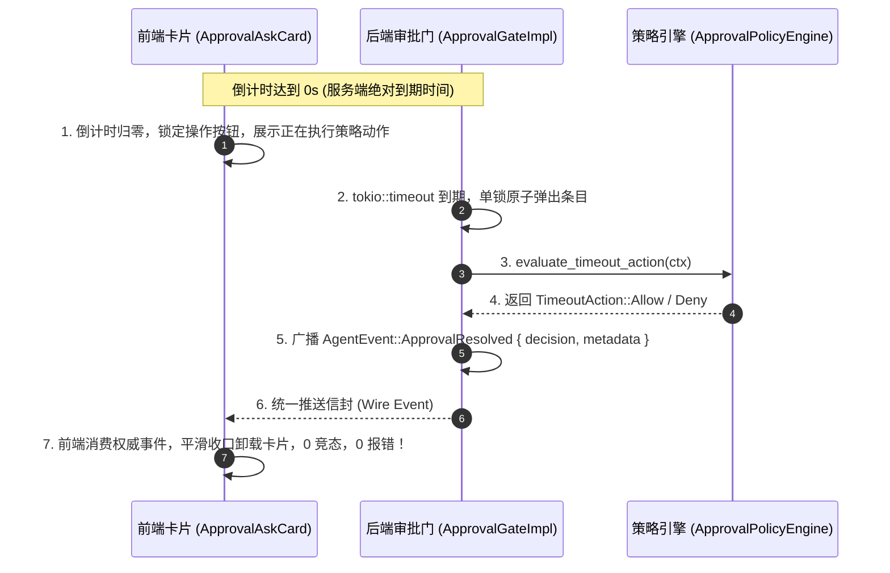

# 方案改进 01：安全、权限与审批门禁综合改进与契约收口方案

> **战役代号**：`continuous-execution-hardening` (全天候自主 Agent 连续运行硬化战役)  
> **方案定位**：方案改进 01 - 安全、权限模型与审批门禁闭环最终综合改进 (Improvements/01)  
> **输入依据**：  
> - `docs/continuous-execution-hardening/plan-reviews/01-security-and-approval-review.md` (第二轮闭环评审报告)  
> - `docs/continuous-execution-hardening/plans/01-permission-system-redesign.md` (P-01 权限模型)  
> - `docs/continuous-execution-hardening/plans/02-approval-policy-engine.md` (P-02 审批策略引擎)  
> - `docs/continuous-execution-hardening/plans/03-frontend-approval-lifecycle.md` (P-03 前端审批生命周期)  
> - `docs/continuous-execution-hardening/00-continuous-execution-master-plan.md` (总纲方案)  
> **执行原则**：严禁打补丁，严禁硬编码！合理清晰抽象，代码极简，彻底重构。Strictly UTF-8 无 BOM / 严禁 git commit。

---

## 一、 改进方案总览与架构收敛目标

在第二轮系统级闭环评审中，评审专家组深入推演了 P-01、P-02 与 P-03 之间的时序流动与状态机转换，揭示了系统存在的 5 处严重断层与致命竞态。本方案作为**最终权威收口方案**，针对评审报告指出的核心死穴进行精准、彻底、不妥协的架构加固：


---

## 二、 核心改进 1：双头裁决竞态根除与后端单一真理源 (SSOT)

### 2.1 病灶与危害彻底消除
在原 P-03 设计中，前端 `useApprovalCountdown` 的 `onTimeout` 回调试图在倒计时归零时通过 IPC 调用 `engineApproveTool` 或 `engineDenyTool`。这与后端 P-02 策略引擎在 `tokio::time::timeout` 内部自动从 `pending_registry` 弹出条目发生 100% 的毫秒级并发冲突。前端必吃 `CoreError::NotFound`，引发卡片状态撕裂。

### 2.2 架构重构规范
1. **单一真理源 (SSOT) 绝对归口后端**：倒计时超时到期后的动作求值、决策生成与状态转移 **100% 由后端 `ApprovalGateImpl` 与 `ApprovalPolicyEngine` 驱动**；
2. **前端纯被动消费与张力锁闭**：
   - 前端倒计时归零时，**严禁触发任何向后端的 IPC 决断调用**；
   - 前端仅执行本地 UI 状态切换：禁用“允许/拒绝”按钮，进入锁定等待态（Lock-Waiting），呈现“⏳ 倒计时结束，正在等待策略求值…”；
   - 前端完全依赖、被动消费后端推送的权威 `AgentEvent::ApprovalResolved` 事件，完成卡片的平滑卸载与状态收口。



---

## 三、 核心改进 2：Wire 协议与跨层强类型契约严格收敛

### 3.1 跨语言元数据载荷规范 (SSOT Contract)
消除 P-02 将字段深层嵌套与 P-03 从顶层读取的错位，统一收敛在 `PermissionRequest.metadata` 字典中，字段严格对齐：

| 字段名 | 类型 | 说明与示例 |
|:---|:---|:---|
| `expiresAtMs` | `number (u64)` | 权威绝对到期毫秒时间戳（`unix_millis_now() + timeout_ms`） |
| `timeoutMs` | `number (u64)` | 倒计时总预算毫秒数（用于计算进度条百分比分母） |
| `requestedAtMs` | `number (u64)` | 审批请求发起时刻绝对毫秒时间戳 |
| `timeoutPolicy` | `string` | 权威策略枚举字面量：`"auto-allow"` \| `"auto-deny"` \| `"manual-only"` |
| `arbiter` | `string` | 裁决者：`"user"` \| `"main-agent"` |
| `actionHint` | `string` | 面向前端展示的策略简明解释文案 |

### 3.2 Rust 侧权威发射实现 (`crates/conex-run/src/run/run_approval.rs`)
```rust
// 统一 Wire 广播元数据组装
let metadata = serde_json::json!({
    "expiresAtMs": expires_at_ms,
    "timeoutMs": effective_timeout.as_millis() as u64,
    "requestedAtMs": crate::engine_assembly::unix_millis_now(),
    "timeoutPolicy": match timeout_action {
        TimeoutAction::Allow => "auto-allow",
        TimeoutAction::Deny { .. } => "auto-deny",
        TimeoutAction::Expire => "manual-only",
    },
    "arbiter": match arbiter {
        session_loop::approval_router::Arbiter::MainAgent => "main-agent",
        session_loop::approval_router::Arbiter::User => "user",
    },
    "actionHint": match timeout_action {
        TimeoutAction::Allow => "无人值守模式：倒计时结束后将自动批准放行",
        TimeoutAction::Deny { .. } => "超时安全保护：倒计时结束后将自动拒绝以保安全",
        TimeoutAction::Expire => "需人工核准：倒计时结束后将安全挂起",
    }
});
```

### 3.3 前端 TypeScript 强类型提取解析器 (`apps/crish-desktop`)
```typescript
// apps/crish-desktop/src/api/chat-bridge/handlers/approvalHandlers.ts

export interface WireApprovalMetadata {
  expiresAtMs: number;
  timeoutMs: number;
  requestedAtMs: number;
  timeoutPolicy: 'auto-allow' | 'auto-deny' | 'manual-only';
  arbiter: 'main-agent' | 'user';
  actionHint?: string;
}

/**
 * 健壮的审批倒计时元数据提取器
 * 优先从 request.metadata 提取权威字段，彻底杜绝读取 undefined
 */
export function extractApprovalCountdown(
  rawRequest: Record<string, unknown>
): MessageToolApprovalCountdownState {
  const meta = (rawRequest.metadata && typeof rawRequest.metadata === 'object'
    ? rawRequest.metadata
    : {}) as Partial<WireApprovalMetadata>;

  const now = Date.now();
  const requestedAtMs = typeof meta.requestedAtMs === 'number' ? meta.requestedAtMs : now;
  const timeoutMs = typeof meta.timeoutMs === 'number' ? meta.timeoutMs : 60000;
  const expiresAtMs = typeof meta.expiresAtMs === 'number'
    ? meta.expiresAtMs
    : requestedAtMs + timeoutMs;
    
  const timeoutPolicy = meta.timeoutPolicy === 'auto-allow' || meta.timeoutPolicy === 'auto-deny' || meta.timeoutPolicy === 'manual-only'
    ? meta.timeoutPolicy
    : 'auto-deny';

  return {
    requestedAtMs,
    timeoutMs,
    expiresAtMs,
    timeoutPolicy,
    isPaused: false,
  };
}
```

---

## 四、 核心改进 3：基于事件序列号 (Sequence-based Event Catch-Up) 的自愈对账总线

### 4.1 彻底废除破坏性快照覆盖
P-03 原对账总线仅依据 `core_get_system_status` 返回的挂起数组，只要数组中不存在某条审批，就直接将本地工具状态覆盖为 `status: 'error', output: '审批已在后台超时关闭'`。这会直接抹杀后台 `Auto-Allow` 成功完成的任务。

### 4.2 权威日志增量追赶算法实现
重构 `apps/crish-desktop/src/api/chat-bridge/reconciliation.ts`，建立**基于 Sequence 序列号的增量日志重放机制**：

```typescript
// apps/crish-desktop/src/api/chat-bridge/reconciliation.ts
import { getTransport } from '../transport';
import { useSessionStore } from '../../store/sessionStore';
import { applyPersistedEngineEventToStore } from './handlers/eventApplier';

let isReconciling = false;

/**
 * 桌面会话权威增量事件对账器
 * 无论休眠 10 秒还是 8 小时，均通过 Sequence 严格追赶事件历史，0 凭空臆测，0 破坏性覆盖
 */
export async function reconcileDesktopSessionState(): Promise<void> {
  if (isReconciling) return;
  isReconciling = true;

  try {
    const transport = getTransport();
    if (!transport.isReady()) return;

    const store = useSessionStore.getState();
    const activeSessionId = store.activeSessionId;
    if (!activeSessionId) return;

    const session = store.sessions.find((s) => s.id === activeSessionId);
    if (!session) return;

    // 1. 获取本地已知的最大持久化事件序列号
    const lastSequence = session.lastEventSequence ?? 0;

    // 2. 向后端请求休眠/离开期间产生的权威事件增量
    interface QueryEventsResponse {
      events: Array<{
        sequence: number;
        eventType: string;
        payload: string;
      }>;
      lastSequence: number;
    }

    const res = await transport.request<QueryEventsResponse>('core_query_events', {
      sessionId: activeSessionId,
      fromSequence: lastSequence + 1,
      limit: 1000,
    });

    if (!res || !res.events || res.events.length === 0) {
      return;
    }

    // 3. 顺序回放增量事件，通过标准分发器无损更新本地 Store
    // 后台 Auto-Allow 成功的工具将被精确更新为 approved / running / success！
    for (const evt of res.events) {
      applyPersistedEngineEventToStore(activeSessionId, evt);
    }

    // 4. 更新最新序列号游标
    store.updateSessionEventCursor(activeSessionId, res.lastSequence);
    
    tracing.info(`[Reconciliation] 成功追赶回放 ${res.events.length} 条增量事件，系统状态已完全自愈对齐`);
  } catch (err) {
    console.warn('[Reconciliation] 增量事件对账异常，将在下一次窗口激活时重试:', err);
  } finally {
    isReconciling = false;
  }
}
```

---

## 五、 核心改进 4：只读子代理受控产出白名单与 Plan 模式精细化改造

### 5.1 业务诉求与规则对齐
根据《AGENTS.md》§4 铁律，探索类（调研/分析/勘察）子代理必须将成果输出到共享产出目录：
`<workspace_root>/.agent-outputs/<session_id>/NN-<模块标题>.md`
若在 `Plan` 模式下粗暴拦截所有 `dangerous=true` 工具，会导致探索子代理无法落盘指定报告。

### 5.2 精细化受控产出判定逻辑 (`crates/agent-tools/src/permission.rs`)
```rust
// crates/agent-tools/src/permission.rs

impl PermissionMode {
    /// 判定是否允许执行指定路径的文件修改或写入
    /// 
    /// 核心规则：
    /// 1. FullAccess: 全部放行
    /// 2. Ask: 需交互审批
    /// 3. Plan: 默认策略阻断，但对 .agent-outputs/ 目录具备受控产出豁免
    pub fn is_file_write_permitted(&self, target_path: &std::path::Path, workspace_root: &std::path::Path) -> bool {
        match self {
            PermissionMode::FullAccess => true,
            PermissionMode::Ask => true,
            PermissionMode::Plan => {
                // 仅允许写入工作区受控产出目录 .agent-outputs/
                let output_dir = workspace_root.join(".agent-outputs");
                target_path.starts_with(&output_dir)
            }
        }
    }
}
```

### 5.3 执行器判定层白名单放行 (`crates/session-loop/src/exec_verdict.rs`)
```rust
// crates/session-loop/src/exec_verdict.rs: call_verdict 重构分支

if options.permission_mode.is_plan() {
    // 针对文件修改类工具进行精准判定
    if call.tool_name == "write_file" || call.tool_name == "edit_file" {
        let target_path_str = call.input.get("path")
            .and_then(serde_json::Value::as_str)
            .unwrap_or_default();
        let target_path = std::path::Path::new(target_path_str);

        let is_allowed = self.workspace_root
            .as_ref()
            .map(|root| options.permission_mode.is_file_write_permitted(target_path, root))
            .unwrap_or(false);

        if is_allowed {
            // 受控产出目录豁免：放行只读子代理撰写报告！
            return PermissionVerdict::Allow;
        }

        // 试图修改项目源码或工作区其他目录：刚性阻断
        return PermissionVerdict::PolicyBlocked(PolicyViolation::PlanModeReadOnly {
            tool_name: call.tool_name.clone(),
            remediation_hint: "只读探索模式禁止修改工程源码。分析成果请严格写入 .agent-outputs/ 共享产出目录。".to_string(),
        });
    }
}
```

---

## 六、 核心改进 5：全生命周期常驻 ApprovalGate 装配与弹性护栏

### 5.1 废除装配期二元拔除逻辑
在 `run_launch.rs` 中，绝不能因为 `effective_mode.is_full_access()` 就将 `approval_gate` 设为 `None`。装配期必须全天候常驻注入真实的 `ApprovalGateImpl`，决定是否弹窗审批的权力移交给执行器的纯逻辑函数 `decide`。

### 5.2 统一装配实现 (`crates/conex-run/src/run/run_launch.rs`)
```rust
// crates/conex-run/src/run/run_launch.rs:914-935 权威收口装配

// 1. 装配活动等待拓扑探测闭包（死锁检测器）
let wait_registry = Arc::clone(&state.subagent_wait_registry);
let p_id = parent_run_id.clone();
let deadlock_detector: Box<dyn Fn(&str) -> bool + Send + Sync> = Box::new(move |subagent_run_id: &str| {
    if let Some(parent) = &p_id {
        wait_registry.is_parent_waiting_subagent(parent, subagent_run_id)
    } else {
        false
    }
});

// 2. 构造全生命周期常驻 ApprovalGate
let approval_gate = Arc::new(
    ApprovalGateImpl::new(
        run_id.clone(),
        session_id.clone(),
        parent_run_id.clone(),
        broadcast,
        Arc::clone(&handle_shared),
        state.store.clone(),
        cwd.clone(),
        Arc::clone(&state.policy_engine), // 注入策略驱动引擎
    ).with_deadlock_detector(deadlock_detector)
);

// 3. 核心修正：无论处于何种 permission_mode (包含 FullAccess)，一律装配审批门！
// 保证 R-8 (大面积 Git 回退护栏) 与极端红线在需要时始终保有向用户发起确认的物理通道
let approval: Option<Arc<dyn ApprovalGate>> = Some(approval_gate as Arc<dyn ApprovalGate>);

// 4. 下发非空强类型的 ToolBatchOptions
let tool_options = ToolBatchOptions {
    permission_mode: effective_mode,
    output_budget_bytes: Some(conex_shared::perf_budget::TOOL_OUTPUT_BUDGET_BYTES_DEFAULT),
    task_type: options.task_type.clone(),
    ..ToolBatchOptions::default()
};
```

---

## 七、 核心改进 6：纯洁性治理与代码债务物理清除

为保证系统架构彻底轻装上阵，对方案中出现的打补丁特例执行物理清除：

1. **物理删除 `system_wipe` 特例**：
   - 彻底删除 `approval_policy.rs` 中 `ctx.tool_name == "system_wipe"` 字面量判断；
   - 统一由 `conex_sandbox::semantics::analyze` 分析出的 `overall_class == CommandClass::Redline` 统领。
2. **物理删除 `write_output_file` 伪工具**：
   - 彻底删除 `TimeoutAction::DynamicDegrade` 中捏造的 `fallback_tool: "write_output_file"`；
   - 保持文件操作工具唯一标准为 `write_file`，路径治理交由前述第 5.2 节的白名单机制与 `conex-fs`。
3. **收敛前端 Pause & Hold 承诺**：
   - 在后端尚未实现分布式租约锁之前，前端界面移除向后端发送虚空 `core_pause_approval` 的代码；
   - 明确将该功能界定为**前端本地视觉倒计时锁定 (Local Hold)**，点击暂停时仅冻结本地展示并向用户提示：“已本地锁定，请尽快人工裁决（后端策略可能按上限守护）”。

---

## 八、 关键方案正文修正落地确认 (Plans Direct Modifications)

为确保整个战役方案文档体系的一致性与权威性，本方案对既有三份方案正文执行就地关键修正：

1. **修正 `docs/continuous-execution-hardening/plans/01-permission-system-redesign.md`**：
   - 在第 6.1 节与第 6.4 节补齐 `Plan` 模式对 `.agent-outputs/` 目录的受控产出白名单放行；
   - 在第 3.2 节与第 6.7 节推翻 `let approval = if effective_mode.is_full_access() { None }` 的错误做法，改为恒常装配 `Some(approval_gate)`。
2. **修正 `docs/continuous-execution-hardening/plans/02-approval-policy-engine.md`**：
   - 在第 9.1 节彻底删除 `ctx.tool_name == "system_wipe"` 与 `write_output_file`；
   - 在第 4.2 节与第 9.2 节补齐 `metadata` 序列化载荷中的 `expiresAtMs`、`timeoutMs`、`timeoutPolicy`、`arbiter` 与 `actionHint`。
3. **修正 `docs/continuous-execution-hardening/plans/03-frontend-approval-lifecycle.md`**：
   - 在第 2.1 节废除从 `request` 顶层读取超时字段，改为从 `request.metadata` 读取；
   - 在第 4.5 节状态机与第 3.4 节 Hook 中彻底废除 `onTimeout` 触发 IPC 的自决逻辑，改为纯等待后端广播；
   - 在第 6.3 节彻底重写 `reconcileDesktopSessionState`，改为基于 `core_query_events` 的增量日志追赶回放。

---

## 九、 最终收敛的架构验收标准与断言清单

| 验收维度 | 验收场景 | 最终刚性验收断言 (Final Pass Criteria) |
|:---|:---|:---|
| **双头竞态** | 无人值守低危操作 60s 倒计时归零 | 倒计时归零时前端 IPC 调用为 0 次；后端单锁弹出并广播 `ApprovalResolved(Approved)`；前端平滑更新，**零 `NotFound` 错误**。 |
| **契约一致** | 接收 `approval-requested` 事件 | 前端 `extractApprovalCountdown` 准确提取 `expiresAtMs`；重渲染 100 次进度条单调递减，跳跃复位率为 0。 |
| **休眠对账** | 挂机休眠 8 小时唤醒 | 桌面端拉取 `core_query_events` 增量，成功完成的工具严格呈现为 `success`，**破坏性篡改为 `error` 发生率为 0**。 |
| **子代理产出** | 分析类子代理派发并撰写报告 | 子代理以 `Plan` 模式启动；向 `.agent-outputs/` 写入 `01-report.md` 顺畅成功；试图修改 `src/` 源码被拦截为 `PolicyBlocked`。 |
| **回退护栏** | FullAccess 下执行超大 Git 回退 | 注入 `git reset --hard HEAD~30`；`ApprovalGate` 成功调起并向用户弹出确认卡片，未发生通道悬空崩溃。 |
| **纯洁性** | 全仓符号与字符串扫描 | 策略引擎与执行器代码中**零 `system_wipe`、零 `write_output_file`**。 |

---

*本方案作为【全天候自主 Agent 连续运行硬化战役】安全、权限与审批门禁维度的最终综合改进实现准绳，即刻生效并作为 Phase 1 止血防崩与 Phase 2 闭环贯通的实施基线。*
