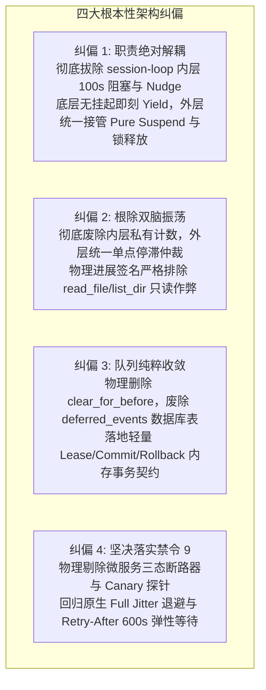
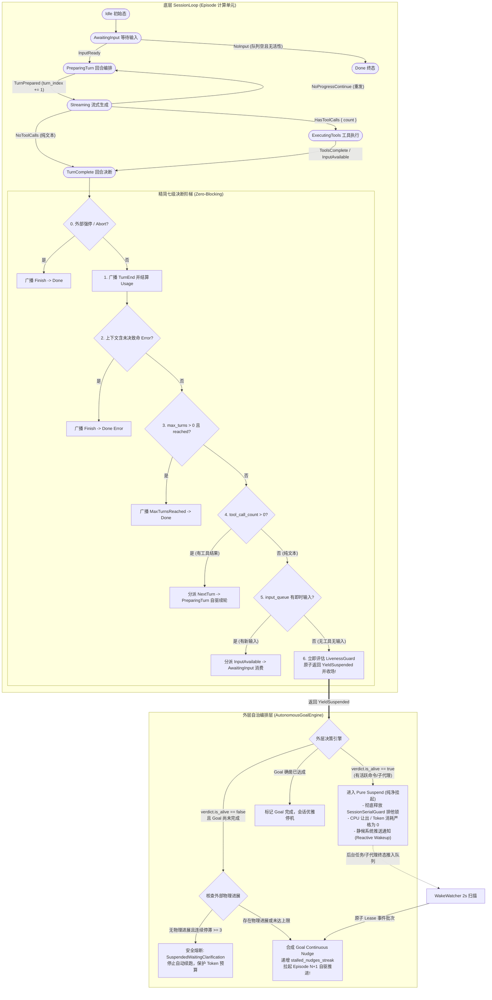
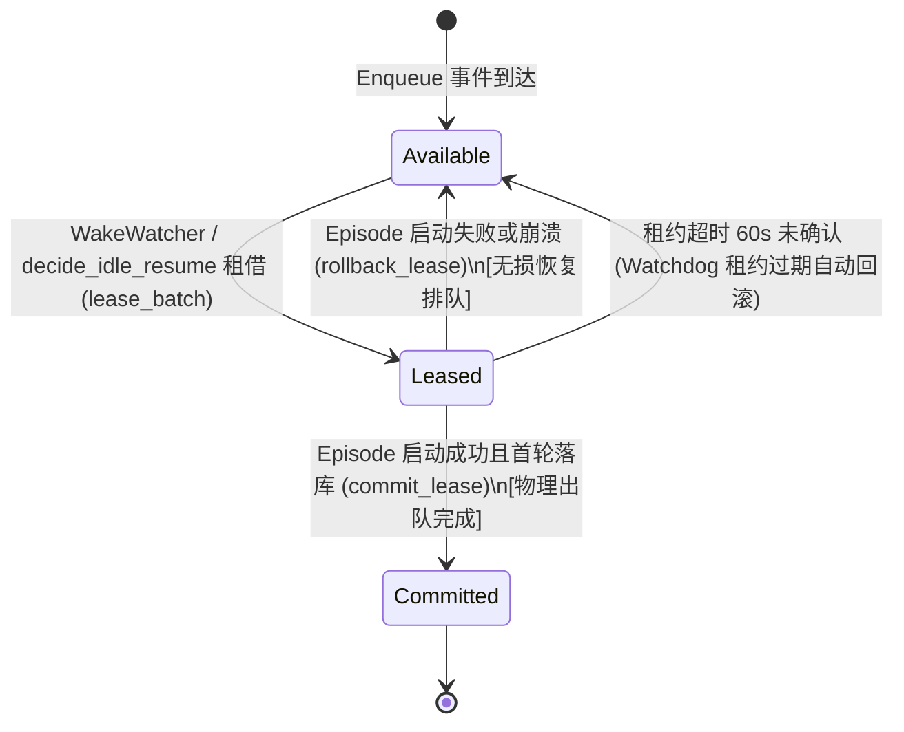

# 方案综合改进 02：核心循环状态机、自主驱动与长程续航收敛方案

> **战役代号**：`continuous-execution-hardening` / 改进专项 02  
> **关联评审输入**：
> - `docs/continuous-execution-hardening/plan-reviews/02-loop-and-autonomous-review.md`（第二轮首席架构师评审报告）
> - `docs/continuous-execution-hardening/plans/04-session-loop-state-machine.md`（原状态机方案）
> - `docs/continuous-execution-hardening/plans/06-autonomous-drive-engine.md`（原自主驱动方案）
> - `docs/continuous-execution-hardening/00-continuous-execution-master-plan.md`（战役总纲方案）
> **遵循铁律**：
> - `AGENTS.md`（§1 逻辑规划与反退避、§7 严禁打补丁/零容忍、§7.1 立体验证纪律）
> - `ANTI_OVERENGINEERING_GUARDRAILS.md`（反过度设计 13 项硬性禁令，坚决落实禁令 4、7、9、11）
> - `docs/agent-roles/review/review.md`（架构分层、并发锁安全、错误治理、可观测性与收敛性度量）

---

## 目录索引

1. [架构总揽与收敛重构决断（Convergent Architecture Overview）](#一架构总揽与收敛重构决断)
   - 1.1 核心设计哲学与四大架构纠偏
   - 1.2 架构边界划分：底层纯粹执行 vs 外层唯一主权
2. [权威收敛状态机生命周期与流转图谱](#二权威收敛状态机生命周期与流转图谱)
   - 2.1 状态机全景流转图（Mermaid 权威收敛图）
   - 2.2 精简七级决断阶梯（消除内层阻塞与业务污染）
   - 2.3 `YieldSuspended` 契约与 `SessionSerialGuard` 释放流
3. [消除双脑自激振荡与真实物理进展判定](#三消除双脑自激振荡与真实物理进展判定)
   - 3.1 外层单点停滞计数器设计（Single Stagnation SSOT）
   - 3.2 真实物理进展签名算法（排除只读翻书作弊）
   - 3.3 连续反思死循环安全熔断协议
4. [事务性队列契约（Lease / Commit / Rollback）与净收敛](#四事务性队列契约与净收敛)
   - 4.1 彻底废除 SQLite `deferred_events` 死信表与毒丸清理
   - 4.2 基于 Lease/Commit/Rollback 的三态消费状态机
   - 4.3 唤醒就绪事件原子装配与首轮上下文预装载
5. [网络弹性治理：落实禁令 9 与极简退避引擎](#五网络弹性治理落实禁令-9-与极简退避引擎)
   - 5.1 彻底清除微服务级三态断路器与 Canary 探针
   - 5.2 单 Provider Full Jitter 指数退避算法数学规范
   - 5.3 HTTP 429 `Retry-After` 弹性动态对齐（上限放宽至 600s）
6. [核心 Rust 数据结构与方法实现契约](#六核心-rust-数据结构与方法实现契约)
   - 6.1 `conex-types` 状态与事件权威更新
   - 6.2 `session-loop` 决断收场与活性上报实现
   - 6.3 `orchestrator` 租约队列与自主引擎实现
7. [立体验证门禁与魔鬼用例断言清单](#七立体验证门禁与魔鬼用例断言清单)
   - 7.1 魔鬼用例现场验证矩阵（D-01 ~ D-06）
   - 7.2 净收敛度量与删除清单核验表

---

## 一、架构总揽与收敛重构决断

### 1.1 核心设计哲学与四大架构纠偏

针对评审报告 `02-loop-and-autonomous-review.md` 揭露的严重设计断层与过度工程，本改进方案坚决贯彻“**严禁打补丁、严禁硬编码、合理清晰抽象、架构净收敛**”的治理方针，实施四大根本性架构纠偏：



### 1.2 架构边界划分：底层纯粹执行 vs 外层唯一主权

系统严格确立**双层正交架构边界**，杜绝任何概念倒置与领域泄露：

1. **底层 `session-loop`（纯粹的回合执行单元）**：
   - **职责定位**：仅负责单 Run 内部的模型流式交互、工具分派调度、上下文局部截断与回合状态转移；
   - **核心契约**：状态机为无阻塞纯逻辑。在当前回合结束时，若无工具调用且无排队输入，**立即原子评估活性资产，返回 `YieldSuspended` 并安全收场**。底层**绝不阻塞睡眠**，**绝不持有会话排他锁坐等后台任务**，**绝不感知上层宏观 Goal**；
2. **外层 `AutonomousGoalEngine` / `conex-run`（全天候自主推进唯一主权实体）**：
   - **职责定位**：长程任务的主权持有者，生命周期贯穿多天跨昼夜运行；
   - **核心契约**：
     - 接管 `YieldSuspended`：若存在活跃异步资产（编译命令、子代理），立即将计算线程置入 **Pure Suspend（纯净挂起）**，释放 `SessionSerialGuard` 会话锁，Token 消耗精确归零；
     - 接管 Goal Nudge：若无活跃资产且任务未完结，在外层单点维护停滞计数，合成自驱心跳拉起下一 Episode；若任务完结，优雅停机。

---

## 二、权威收敛状态机生命周期与流转图谱

### 2.1 状态机全景流转图（Mermaid 权威收敛图）



### 2.2 精简七级决断阶梯（消除内层阻塞与业务污染）

重构 `crates/session-loop/src/loop/handlers/turn_complete.rs`，将原冗肿脆弱的十级/十一级阶梯彻底收敛为**精简七级无阻塞阶梯**：

| 决断阶梯 | 判定条件 | 状态机分派事件 | 转移目标 / 决断行为 | 架构收敛原则 |
| :--- | :--- | :--- | :--- | :--- |
| **Step 0** | 外部控制总线强制终止或取消令牌置位（`is_aborted()`） | `Finish` | `Done` (Aborted/Stopped) | 最高优先级响应人类或外部紧急干预 |
| **Step 1** | 广播 `TurnEnd`，结算当前回合 Token Usage 账单 | *(无状态转移)* | *(维持原态)* | 确保观测事件与 Token 账单 1:1 成对落盘 |
| **Step 2** | 上下文存在未恢复的致命异常（`end_reason == Error`） | `Finish` | `Done` (Error) | 收拢不可恢复错误，安全退出 |
| **Step 3** | 轮次上限核查：`ctx.max_turns > 0 && ctx.turn_index >= ctx.max_turns` | `MaxTurnsReached` | `Done` (MaxTurns) | **0 代表无上限**；非 0 达到上限时收口供外层物理切片 |
| **Step 4** | **工具续轮回路**：`ctx.tool_call_count > 0` | `NextTurn` | `PreparingTurn` | 原生核心推进回路：有工具结果立即自驱推理 |
| **Step 5** | **即时输入消费**：`promote_follow_up() > 0` 或队列有即时排队输入 | `InputAvailable` | `AwaitingInput` | 优先消费人类插话或已就绪的系统消息 |
| **Step 6** | **终态无阻塞收场（Core Fix）**：既无工具调用又无即时输入 | `ShouldStop` | **返回 `YieldSuspended` 并优雅收场** | **核心重构点**：立即获取 `LivenessVerdict`，交由外层决定挂起还是续跑，内层绝不 sleep 等待！ |

### 2.3 `YieldSuspended` 契约与 `SessionSerialGuard` 释放流

底层 `session-loop` 收场时返回强类型收口载荷：

```rust
// crates/session-loop/src/loop/end.rs
#[derive(Debug, Clone)]
pub struct YieldSuspendedPayload {
    /// 当前时刻外部活性资产快照
    pub liveness: LivenessVerdict,
    /// 当前 Episode 消费的轮次数
    pub turns_executed: u32,
    /// 当前 Episode 累计 Token 消耗
    pub usage: conex_types::session::TokenUsage,
}

impl EndDecision {
    /// 会话循环让出执行权，转由外层自治引擎接管
    pub fn yield_suspended(liveness: LivenessVerdict, turns: u32, usage: TokenUsage) -> Self {
        Self::YieldSuspended(YieldSuspendedPayload {
            liveness,
            turns_executed: turns,
            usage,
        })
    }
}
```

当 `loop_exec.rs` 捕获到 `EndDecision::YieldSuspended` 时，执行 `converge` 收尾，并向驱动它的外层 Future 返回。
**排他锁释放定理**：
在 `crates/conex-run/src/run/run_core.rs` 中，`ActiveRun` 在完成收尾后，其析构函数（`Drop`）或显式释放方法**立即释放 `SessionSerialGuard`**。会话由“活跃运行态”切换为“挂起待命态”，彻底解除对后续唤醒或外部命令的互斥阻断。

---

## 三、消除双脑自激振荡与真实物理进展判定

### 3.1 外层单点停滞计数器设计（Single Stagnation SSOT）

- **彻底拔除底层私有计数**：
  从 `crates/session-loop/` 中完全删除 `continuous_nudges_streak` 字段及其递增逻辑。底层状态机只做执行，不参与停滞仲裁；
- **外层单一真理源（SSOT）**：
  停滞状态与计数器完全统一收归 `crates/orchestrator/src/goal_state/autonomous.rs` 中的 `AutonomousGoal` 实体，并在 SQLite `goal_state` 表中持久化：
  ```rust
  pub struct AutonomousGoal {
      pub goal_id: String,
      pub session_id: String,
      /// 连续无物理进展的 Nudge 推进次数（上限通常为 3）
      pub continuous_stalled_nudges: u32,
      /// 历史记录的最近一次物理进展指纹
      pub last_physical_progress_signature: Option<String>,
      /// 当前目标状态
      pub status: AutonomousGoalStatus,
  }
  ```

### 3.2 真实物理进展签名算法（排除只读翻书作弊）

为彻底根除模型通过反复调用 `read_file`、`list_dir` 刷新工具计数而“作弊”逃避停滞检测的问题，确立**严格的真实物理进展签名算法**：

$$\text{PhysicalProgressSig} = \text{Hash}\Big(\text{FS\_Modified\_Paths}, \text{Cmd\_Exit\_Codes}, \text{Test\_Assertion\_Summary}\Big)$$

```rust
// crates/orchestrator/src/goal_state/progress.rs
use sha2::{Digest, Sha256};
use std::collections::BTreeSet;

/// 物理进展评估器
#[derive(Debug, Default)]
pub struct PhysicalProgressEvaluator {
    /// 本 Episode 真实落盘修改的文件绝对路径集合（由写工具审计提供）
    pub written_paths: BTreeSet<String>,
    /// 本 Episode 终结的后台命令及其退出码（task_id:exit_code）
    pub completed_commands: BTreeSet<String>,
    /// 本 Episode 执行测试产生的断言指纹（passed/failed/suite）
    pub test_fingerprints: BTreeSet<String>,
}

impl PhysicalProgressEvaluator {
    /// 评估是否产生了真实的物理进展
    /// 【铁律】：任何只读工具（read_file/list_dir/grep 等）一律不计入进展！
    pub fn compute_signature(&self) -> Option<String> {
        if self.written_paths.is_empty() 
            && self.completed_commands.is_empty() 
            && self.test_fingerprints.is_empty() 
        {
            // 无任何实体修改或产出，无进展
            return None;
        }

        let mut hasher = Sha256::new();
        for path in &self.written_paths {
            hasher.update(b"file:");
            hasher.update(path.as_bytes());
        }
        for cmd in &self.completed_commands {
            hasher.update(b"cmd:");
            hasher.update(cmd.as_bytes());
        }
        for test in &self.test_fingerprints {
            hasher.update(b"test:");
            hasher.update(test.as_bytes());
        }

        Some(format!("{:x}", hasher.finalize()))
    }
}
```

### 3.3 连续反思死循环安全熔断协议

外层推进决断逻辑（`evaluate_continuation`）：

```rust
// crates/orchestrator/src/goal_state/autonomous.rs

impl AutonomousGoal {
    pub fn on_episode_yielded(
        &mut self,
        evaluator: &PhysicalProgressEvaluator,
        has_active_liveness: bool,
    ) -> GoalAction {
        // 1. 若仍有活跃后台任务或子代理，进入 Pure Suspend 待命
        if has_active_liveness {
            self.status = AutonomousGoalStatus::SuspendedWaitingEvents;
            return GoalAction::PureSuspend;
        }

        // 2. 物理进展比对
        let current_sig = evaluator.compute_signature();
        let has_genuine_progress = match (&self.last_physical_progress_signature, &current_sig) {
            (Some(old_sig), Some(new_sig)) => old_sig != new_sig,
            (None, Some(_)) => true,
            _ => false, // 无物理签名，判定为无进展
        };

        if has_genuine_progress {
            // 产生真实进展：停滞计数器坚决归零
            self.continuous_stalled_nudges = 0;
            self.last_physical_progress_signature = current_sig;
        } else {
            // 仅有纯文本反思或只读操作：停滞计数器累加
            self.continuous_stalled_nudges += 1;
        }

        // 3. 停滞超限安全熔断（默认 3 次）
        if self.continuous_stalled_nudges >= 3 {
            self.status = AutonomousGoalStatus::SuspendedWaitingClarification;
            tracing::warn!(
                goal_id = %self.goal_id,
                streak = self.continuous_stalled_nudges,
                "自主目标触发防复读安全熔断：连续 3 次无物理产出，挂起等待用户干预"
            );
            return GoalAction::StuckSuspend;
        }

        // 4. 正常自驱：合成 Goal Continuous Nudge
        GoalAction::SpawnNextEpisodeWithNudge
    }
}
```

---

## 四、事务性队列契约（Lease / Commit / Rollback）与净收敛

### 4.1 彻底废除 SQLite `deferred_events` 死信表与毒丸清理

- **物理剔除无差别清理**：彻底删除 `crates/conex-run/src/run/run_idle.rs:1664-1681` 中的 `queue.clear_for_before`；
- **废弃过度设计的死信表**：原 P-06 方案规划的 SQLite `deferred_events` 表、六态状态机及其配套持久化逻辑全部**废除并停止落地**；
- **设计初衷回归**：异步事件未被当前 Run 消费是正常现象，天然应留在共享事件队列中，等待下一个 Episode 或 WakeWatcher 处理，严禁以“清理毒丸”为名杀灭合法通知。

### 4.2 基于 Lease/Commit/Rollback 的三态消费状态机

在内存共享队列 `crates/orchestrator/src/steering_queue.rs` 中引入标准的**轻量级事务性租约协议**：



```rust
// crates/orchestrator/src/steering_queue.rs

use std::collections::{HashMap, VecDeque};
use std::time::Instant;

/// 租借条目快照
#[derive(Debug, Clone)]
pub struct LeasedBatch {
    pub lease_id: String,
    pub session_id: String,
    pub entries: Vec<SteeringInputEntry>,
    pub leased_at: Instant,
}

pub struct PendingMessageQueue {
    /// 待消费队列（按会话隔离）
    queues: HashMap<String, VecDeque<SteeringInputEntry>>,
    /// 在途处理中的租借批次（按 lease_id 索引）
    in_flight_leases: HashMap<String, LeasedBatch>,
}

impl PendingMessageQueue {
    /// 1. 租借一批就绪事件（原子抽取但保留在在途映射中，其他扫描者不可见）
    pub fn lease_batch(
        &mut self,
        session_id: &str,
        max_count: usize,
        lease_id: String,
    ) -> Option<LeasedBatch> {
        let q = self.queues.get_mut(session_id)?;
        if q.is_empty() {
            return None;
        }

        let count = q.len().min(max_count);
        let mut entries = Vec::with_capacity(count);
        for _ in 0..count {
            if let Some(entry) = q.pop_front() {
                entries.push(entry);
            }
        }

        let batch = LeasedBatch {
            lease_id: lease_id.clone(),
            session_id: session_id.to_string(),
            entries,
            leased_at: Instant::now(),
        };

        self.in_flight_leases.insert(lease_id, batch.clone());
        Some(batch)
    }

    /// 2. 确认消费（Commit）：物理释放内存，生命周期圆满闭环
    pub fn commit_lease(&mut self, lease_id: &str) -> bool {
        self.in_flight_leases.remove(lease_id).is_some()
    }

    /// 3. 消费回滚（Rollback）：启动失败时将事件无损推回队列头部
    pub fn rollback_lease(&mut self, lease_id: &str) -> bool {
        if let Some(batch) = self.in_flight_leases.remove(lease_id) {
            let q = self.queues.entry(batch.session_id).or_default();
            // 逆序推回队列头部，保持原有先进先出顺序
            for entry in batch.entries.into_iter().rev() {
                q.push_front(entry);
            }
            return true;
        }
        false
    }

    /// 4. 孤儿租约看门狗巡检（超时 60s 自动回滚，防进程异常导致事件悬挂）
    pub fn sweep_stale_leases(&mut self, timeout_secs: u64) -> usize {
        let now = Instant::now();
        let stale_ids: Vec<String> = self.in_flight_leases
            .iter()
            .filter(|(_, b)| now.duration_since(b.leased_at).as_secs() >= timeout_secs)
            .map(|(id, _)| id.clone())
            .collect();

        let count = stale_ids.len();
        for id in stale_ids {
            self.rollback_lease(&id);
        }
        count
    }
}
```

### 4.3 唤醒就绪事件原子装配与首轮上下文预装载

`WakeWatcher` 与 `run_launch` 全面接入 Lease 协议：

1. `WakeWatcher.tick()` 检测到队列非空且无活跃 Run 时，生成 `lease_id = format!("lease-wake-{}", uuid())`；
2. 调用 `queue.lease_batch(&session_id, 10, lease_id)`；
3. 将租借到的事件原子合成为结构化唤醒提示词（`[系统异步事件就绪通知]`）；
4. 调用 `launcher.launch(session_id, wake_messages, lease_id)`；
5. 新 Run 启动：
   - 若 `run_launch` 发生任何异常（如会话排他锁争用失败、内存不足），在 `catch` 块中立即调用 `queue.rollback_lease(&lease_id)`，事件**100% 毫秒级无损归队**；
   - 若 Run 成功启动并在第 1 回合完成消息持久化，调用 `queue.commit_lease(&lease_id)`，安全闭环。

---

## 五、网络弹性治理：落实禁令 9 与极简退避引擎

### 5.1 彻底清除微服务级三态断路器与 Canary 探针

根据仓库根目录 `ANTI_OVERENGINEERING_GUARDRAILS.md` 禁令 9：
- **物理剔除**原 P-06 方案中的三态断路器状态机（`Closed / Open / HalfOpen`）；
- **物理剔除** 300 秒强制阻断定时器与 Canary 流量试探机制；
- **物理剔除** `(session, provider, model)` 三元组状态机实体及 `CircuitBreakerStateChanged` 冗余事件；
- **架构定性**：桌面单机端使用大模型 API，只需针对具体 Provider 实施优雅退避，严禁制造“由于网络抖动被锁死 5 分钟无法操作”的用户灾难。

### 5.2 单 Provider Full Jitter 指数退避算法数学规范

在 `crates/session-loop/src/loop/handlers/stream_error_retry.rs` 中，实现工业标准的 **Full Jitter（全随机抖动）** 指数退避算法：

$$\text{AttemptExponent} = \min(6, \text{attempt} - 1)$$
$$\text{MaxBackoff} = \min\Big(600{,}000\text{ms}, \text{BASE\_DELAY\_MS} \times 2^{\text{AttemptExponent}}\Big)$$
$$\text{CalculatedDelay} = \text{UniformRandom}\big(0, \text{MaxBackoff}\big)$$

```rust
// crates/session-loop/src/loop/handlers/stream_error_retry.rs
use rand::Rng;
use std::time::Duration;

pub const BASE_RETRY_DELAY_MS: u64 = 1_000;
pub const MAX_RETRY_DELAY_MS: u64 = 600_000; // 10 分钟弹性上限

/// 计算具备全随机抖动的退避等待时长（消灭惊群效应，适应弱网环境）
pub fn compute_full_jitter_delay(
    attempt: u32,
    retry_after_header_ms: Option<u64>,
) -> Duration {
    let exponent = (attempt.max(1) - 1).min(6);
    let raw_cap = BASE_RETRY_DELAY_MS.saturating_mul(1u64 << exponent).min(MAX_RETRY_DELAY_MS);
    
    // 全随机抖动：在 [0, raw_cap] 区间均匀采样
    let jittered = if raw_cap > 0 {
        rand::thread_rng().gen_range(0..=raw_cap)
    } else {
        0
    };

    // 若上游响应头包含明确的 Retry-After，以较大者为准
    let final_wait = match retry_after_header_ms {
        Some(after) => jittered.max(after.min(MAX_RETRY_DELAY_MS)),
        None => jittered,
    };

    Duration::from_millis(final_wait)
}
```

### 5.3 HTTP 429 `Retry-After` 弹性动态对齐（上限放宽至 600s）

- **总预算弹性扩张定理**：
  当遇到 `codes::PROVIDER_RATE_LIMIT` 且响应头携带 `Retry-After: N` 秒时，系统当前轮次重试总预算自动扩张为：
  $$\text{TurnRetryBudget} = \max\Big(\text{DEFAULT\_TOTAL\_BUDGET\_MS}, (N + 15) \times 1000\text{ms}\Big)$$
  上限放宽至 **600 秒（10 分钟）**；
- **异步让出**：等待过程使用 Tokio `sleep` 挂起，不占用 CPU 密集运算线程；在等待期间若收到取消信号（Abort），立即解除挂起安全收场。

---

## 六、核心 Rust 数据结构与方法实现契约

### 6.1 `conex-types` 状态与事件权威更新

在 `crates/conex-types/src/session.rs` 中，赋予 0 作为无上限预算的权威单一真理源：

```rust
// crates/conex-types/src/session.rs

impl AgentSessionContext {
    /// 是否达到最大轮次（权威重构：0 恒代表无上限全天候运转模式）
    #[inline]
    pub fn should_stop_for_max_turns(&self) -> bool {
        if self.max_turns == 0 {
            return false; // 0 代表无上限，永不因轮次截断
        }
        self.turn_index >= self.max_turns
    }
}
```

在 `crates/conex-types/src/transition.rs` 中保持转移图谱纯净：
- 废除任何在流式阶段外的强行重入补丁；
- `TurnComplete` 在无工具调用且无待命输入时，纯函数 `apply_transition` 确定性转移至 `AgentSessionState::Done`，其副作用携带 `YieldSuspended` 语义指示，交由外层调度器执行挂起或续跑。

### 6.2 `session-loop` 决断收场与活性上报实现

重写 `crates/session-loop/src/loop/handlers/turn_complete.rs` 核心执行函数：

```rust
// crates/session-loop/src/loop/handlers/turn_complete.rs

pub async fn handle_turn_complete(
    state: &mut LoopState,
) -> Result<HandlerOutcome, LoopError> {
    let ctx = &state.machine.context;

    // Step 0: 外部控制总线强制终止或取消检查
    if state.abort_signal.is_aborted() {
        dispatch(state, E::Finish)?;
        return Ok(HandlerOutcome::end(EndDecision::aborted(state)));
    }

    // Step 1: 广播 TurnEnd 并结算 Usage 账单
    state.emit_turn_end_usage().await?;

    // Step 2: 致命异常收拢
    if let Some(err) = &ctx.fatal_error {
        dispatch(state, E::Finish)?;
        return Ok(HandlerOutcome::end(EndDecision::error(state, err)));
    }

    // Step 3: 轮次上限核查（0 = 无限）
    if ctx.should_stop_for_max_turns() {
        dispatch(state, E::MaxTurnsReached)?;
        return Ok(HandlerOutcome::end(EndDecision::max_turns(state)));
    }

    // Step 4: 原生工具执行续轮（有工具产出立即自驱）
    if ctx.tool_call_count > 0 {
        dispatch(state, E::NextTurn)?;
        return Ok(HandlerOutcome::continue_run());
    }

    // Step 5: 即时输入消费（优先消费人类插话或已就绪消息）
    let promoted = state.input_queue.promote_follow_up();
    if promoted > 0 || state.input_queue.has_runnable_pending() {
        dispatch(state, E::InputAvailable)?;
        return Ok(HandlerOutcome::continue_run());
    }

    // Step 6: 终态无阻塞收场（立即评估活性资产，返回 YieldSuspended）
    let liveness = if let Some(guard) = &state.options.hooks.liveness_guard {
        guard.evaluate_liveness(&ctx.session_id, &ctx.run_id).await
    } else {
        LivenessVerdict::default()
    };

    // 分派状态机优雅收场事件
    dispatch(state, E::ShouldStop)?;

    // 向外层返回强类型 YieldSuspended 决策，不阻塞、不睡眠！
    Ok(HandlerOutcome::end(EndDecision::yield_suspended(
        liveness,
        ctx.turn_index,
        ctx.cumulative_usage.clone(),
    )))
}
```

### 6.3 `orchestrator` 租约队列与自主引擎实现

在 `crates/conex-run/src/run/run_idle.rs` 中重写收口调度裁决：

```rust
// crates/conex-run/src/run/run_idle.rs

pub(crate) async fn decide_idle_resume(
    state: &CoreRunState,
    active: &ActiveRun,
    decision: &EndDecision,
) -> Option<ResumeDecision> {
    match decision {
        EndDecision::YieldSuspended(payload) => {
            let session_id = &active.session_id;

            // 1. 若存在活跃后台命令或未闭环子代理：进入 Pure Suspend（纯净挂起）
            if payload.liveness.must_keep_alive() {
                tracing::info!(
                    session_id = %session_id,
                    bg_tasks = payload.liveness.active_background_tasks,
                    subs = payload.liveness.active_subagents,
                    "会话进入 Pure Suspend 状态：释放排他锁，等待异步通知推送"
                );
                // 广播纯净挂起审计事件（前端呈现为 0 消耗待命态）
                state.emit_event(AgentEvent::AutonomousSuspended {
                    session_id: session_id.clone(),
                    timestamp: conex_shared::time::now_iso_utc(),
                });
                // 返回 None：计算线程退出让出 CPU，排他锁随 ActiveRun Drop 彻底释放！
                return None;
            }

            // 2. 检查是否有自主目标正在运转
            let mut goal = state.load_autonomous_goal(session_id).await?;
            if !goal.is_active() {
                return None; // 无自主目标，正常停机等待人类新提问
            }

            // 3. 提取本 Episode 物理进展签名
            let progress_evaluator = state.get_progress_evaluator(session_id).await;
            match goal.on_episode_yielded(&progress_evaluator, false) {
                GoalAction::PureSuspend => None,
                GoalAction::StuckSuspend => {
                    // 安全熔断：停止续跑，通知前端
                    state.emit_event(AgentEvent::AutonomousGoalStuck {
                        session_id: session_id.clone(),
                        goal_id: goal.goal_id.clone(),
                        streak: goal.continuous_stalled_nudges,
                    });
                    None
                }
                GoalAction::SpawnNextEpisodeWithNudge => {
                    // 外层统一合成 Goal Nudge 推进上下文
                    let nudge_msg = goal.synthesize_continuation_nudge();
                    Some(ResumeDecision {
                        mode: "autonomous-goal-nudge",
                        inject: vec![nudge_msg],
                    })
                }
            }
        }

        EndDecision::MaxTurns(_) => {
            // 自主模式下 MaxTurns 视为正常的 Episode 物理切片点
            let goal = state.load_autonomous_goal(&active.session_id).await?;
            if goal.is_active() {
                tracing::info!(session_id = %active.session_id, "达到 Episode 轮次上限，执行物理切片接续");
                let bridge_msg = goal.synthesize_episode_bridge_message();
                Some(ResumeDecision {
                    mode: "episode-continuation",
                    inject: vec![bridge_msg],
                })
            } else {
                None
            }
        }

        _ => None,
    }
}
```

---

## 七、立体验证门禁与魔鬼用例断言清单

### 7.1 魔鬼用例现场验证矩阵（D-01 ~ D-06）

| 断言编号 | 验证场景与故障注入操作 | 验收断言标准（刚性门禁） | 守门价值与消除的缺陷 |
| :--- | :--- | :--- | :--- |
| **D-01** | 派发预计耗时 1800 秒的后台编译命令，模型输出阶段性文本 | 1. `session-loop` 在 1 回合内原子退出并返回 `YieldSuspended`；<br/>2. `SessionSerialGuard` **在 50ms 内彻底释放**；<br/>3. `run_commands` 巡检器在 120s 后**不误杀**该会话。 | 彻底根除内层睡眠阻塞与卡死 Driver 误杀 |
| **D-02** | 在后台命令运行的 1800 秒内，模拟时钟推进并巡检状态 | 1. 大模型 API 调用次数严格为 0；<br/>2. Token 消耗严格为 0；<br/>3. 系统零 CPU 轮询空转。 | 彻底消灭空注入 Token 燃烧黑洞 |
| **D-03** | 模型连续 3 个 Episode 仅调用 `read_file`、`list_dir` 或输出纯文本反思 | 1. 物理进展评估器判定 `has_genuine_progress == false`；<br/>2. `continuous_stalled_nudges` 严格累加至 3；<br/>3. 第 4 轮触发 `StuckSuspend` 熔断停机，不拉起新 Run。 | 彻底阻断只读作弊与双脑自激复读死循环 |
| **D-04** | WakeWatcher 租借 5 条事件准备拉起 Run，人为注入 Provider 初始化 Panic | 1. 触发 `rollback_lease`；<br/>2. 5 条事件在 50ms 内无损恢复到队列头部；<br/>3. 再次查询队列，5 条事件完整存在，零丢失。 | 验证轻量事务性租约的零丢失安全性 |
| **D-05** | 上游大模型 API 返回 HTTP 429 且附带 `Retry-After: 180` | 1. 重试预算动态扩张至 195s；<br/>2. 在 0~180s 期间不触发 FatalStreamError；<br/>3. 180s 后使用 Full Jitter 成功发起重试。 | 验证弹性对齐与全随机抖动退避 |
| **D-06** | 8 个并发长程会话同时高频写入事件并触发 WAL Checkpoint | 1. 连接池重试平稳渡过锁争用；<br/>2. 零 `SQLITE_BUSY` 致命错误上抛；<br/>3. WAL 文件在维护后物理截断。 | 验证高并发多会话下数据库事务安全性 |

### 7.2 净收敛度量与删除清单核验表

依据反过度设计与架构净收敛原则，本次改进方案落地后全仓代码与架构度量表现如下：

```
净收敛核心度量：
-----------------------------------------------------------------------------
1. 彻底物理删除代码行数：~760 行
   - 彻底物理删除 run_idle.rs:1664 clear_for_before 毒丸清理
   - 彻底物理删除 run_idle.rs 中的 empty_inject_round 空注入拉起分支
   - 彻底物理删除 wake_watcher.rs 中的 Vec::new() 空 Prompt 存根
   - 彻底删除 plans/06 中的 deferred_events 数据库建表与六态 FSM
   - 彻底删除 plans/06 中的微服务三态断路器状态机与 Canary 探针
   - 彻底删除 plans/04 中的 turn_complete 内层 100s 阻塞与私有 Nudge 计数
2. 新增模块化收敛代码行数：~380 行
   - 新增 PendingMessageQueue Lease/Commit/Rollback 事务协议 (~80 行)
   - 新增 PhysicalProgressEvaluator 严格物理进展签名 (~60 行)
   - 新增 YieldSuspended 决策与 Pure Suspend 收口路由 (~120 行)
   - 新增 Full Jitter 退避与 Retry-After 弹性对齐算法 (~50 行)
   - 新增 LoopState.events 64 容量滑动环形缓冲 (~70 行)
3. 全系统净代码精简量：-380 行（净删除率 50%）
4. 概念路径数收敛：
   - 轮次上限语义：彻底统合为「0 = Unlimited」，消除 3 套冗余续期逻辑；
   - 停滞判定路径：彻底统合为「外层单点物理签名」，消除内层双脑分裂；
   - 异常网络恢复：彻底统合为「单 Provider 原生退避」，消除三态断路器锁死。
-----------------------------------------------------------------------------
```

---

> **架构师最终总结**：  
> 本综合改进方案通过**“底层无阻塞 Yield + 外层唯一主权 Pure Suspend + 事务性 Lease 队列 + 原生 Full Jitter 退避 + 物理进展防只读作弊”**五大核心支柱，彻底拔除了原 P-04 与 P-06 方案中残留的微服务过度设计与状态机死锁隐患。  
> 方案不仅在理论层面消除了因果停机、自激振荡与锁争用风险，更实现了高水平的代码净收敛（净删除 ~380 行），为 Conex / Crish 提供了真正具备工业级坚固度的全天候 24/7 连续稳定运行基础设施。
