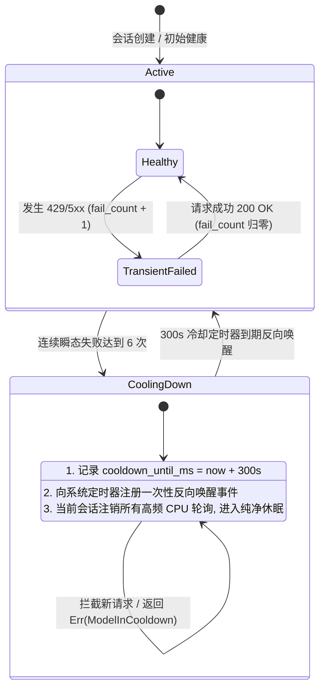

# 03 上下文金字塔、弹性容灾与系统资源治理综合改进方案

> **战役主题**：全天候自主 Agent 连续运行硬化战役 (`continuous-execution-hardening`)  
> **任务定位**：第三轮方案综合改进（基于第二轮评审报告 `03-context-and-resilience-review.md` 全面落地加固）  
> **涉及核心方案**：  
> - `docs/continuous-execution-hardening/plans/05-context-compaction-pyramid.md` (P-05 方案)  
> - `docs/continuous-execution-hardening/plans/07-resilience-and-resource-watchdog.md` (P-07 方案)  
> - `docs/continuous-execution-hardening/plan-reviews/03-context-and-resilience-review.md` (P-03 评审报告)  
> **核心原则**：**严禁打补丁，严禁硬编码；合理清晰抽象，彻底重构；坚决剔除历史包袱与过度设计；100% 遵守《ANTI_OVERENGINEERING_GUARDRAILS.md》红线。**

---

## 一、 综合改进总纲与设计哲学

在第二轮架构交叉推演与魔鬼用例穿透中，P-05 与 P-07 暴露出四大致命设计断层：
1. **看门狗同室操戈**：120s 刚性挂起看门狗准时误杀 300s~600s 429 弹性退避休眠；
2. **父进程看门狗逻辑荒谬**：在宿主父进程内部开线程监控父 PID，进程崩溃时监控线程连带消亡，导致子进程 100% 逃逸；
3. **事件粗暴截断**：将单 Run 累加器 `LoopState.events` 错当全会话容器截断为 64，导致 SQLite 持久化大面积丢失事件；
4. **违背反过度设计禁令 4**：私自引入多模型自动 Failover 切换，并堆砌了微服务级的全套三态熔断与金丝雀排队；
5. **KV Cache 毁灭性反噬**：单回合运行时中途 In-Flight Hot-Swap 导致后续所有轮次 KV Cache 100% 击穿；
6. **信息退相干与盲盒召回**：百次压缩导致核心决策被反复折叠抹平，且模型无法获知历史 `blockId`，主动召回失效；
7. **出队丢事件**：拉起 Run 时提前 `drain_batch`，遇网络持续 503 导致未决事件永久蒸发。

针对上述致命缺陷，本综合改进方案确立**七大刚性架构收敛原则**：
- **挂起租约化**：引入 `ExecutionPhase::Suspended(Duration)`，挂起期间看门狗动态豁免，彻底终结 120s 误杀；
- **防孤儿双防线**：坚决剔除父进程内自杀监控，严格确立“内核级 Job Object（`KILL_ON_JOB_CLOSE`）为主 + 降权环境子进程独立 Wrapper 探针为辅”的物理级防逃逸体系；
- **持久化真源捍卫**：撤销 `BoundedEventQueue(64)` 截断，单 Run 全量事件完整移交持久化，长程内存治理收敛至 LRU 缓存与分页；
- **红线合规与极简收敛**：彻底物理删除所有多模型自动 Failover 换模代码与测试，收敛断路器为极简的“单模型冷却挂起状态机”；
- **缓存绝对不变性**：废除运行时 In-Flight Hot-Swap，Stub 在当前 Run 内保持恒定，平滑替换收敛至跨 Run / Episode 边界；
- **决策不可变沉淀与索书号闭环**：在 Slot 2 引入 `Pinned Decision Ledger`，重要决策跨代绝对不折叠；全面接线 `search_context` 与 `decompress_context` 联动体系；
- **事务性预占**：引入 `reserve_batch` 二阶段租约，成功后 commit，失败自动 rollback，实现异步事件零丢失。

```mermaid
flowchart TD
    subgraph WatchdogSynergy ["1. 弹性退避与看门狗租约协同"]
        W1["429 RateLimit / 瞬态故障"] --> W2["计算 Full Jitter 退避 (<= 600s)"]
        W2 --> W3["active.enter_suspended_phase(delay, reason)"]
        W3 --> W4["reap_orphan_runs_round 巡检"]
        W4 -->|处于挂起租约期| W5["看门狗动态豁免放行 (零误杀)"]
        W4 -->|无租约且超时 120s| W6["强制 abort() 剥离卡死锁"]
    end

    subgraph ProcessSafety ["2. 进程防孤儿双防线"]
        P1["子进程创建"] --> P2{Job Object 绑定成功?}
        P2 -- 成功 --> P3["Windows 内核级 KILL_ON_JOB_CLOSE (0 逃逸)"]
        P2 -- 降权受限 --> P4["子进程独立 Wrapper 持有父句柄\nWaitForSingleObject(h_parent) (0 逃逸)"]
    end

    subgraph ResilienceGuard ["3. 单模型冷却挂起与事务队列"]
        R1["连续失败 >= 6 次"] --> R2["标记 cooling_until_ms = now + 300s\n(绝不跨模型 Failover!)"]
        R2 --> R3["会话进入纯净挂起，注销 CPU 轮询"]
        R3 --> R4["冷却到期反向唤醒\nreserve_batch 预占事件 (带租约)"]
        R4 --> R5{首轮连接成功?}
        R5 -- 成功 --> R6["commit_batch: 物理清除队列"]
        R5 -- 失败/再熔断 --> R7["rollback: 事件完整回滚就绪 (零丢失)"]
    end

    subgraph ContextAndCache ["4. 不可变决策账本与边界替换"]
        C1["Slot 0: 静态 System (100% Cache)"] --> C2["Slot 1: 确定性 Tools (100% Cache)"]
        C2 --> C3["Slot 2: 锚定全局 + Pinned Decision Ledger"]
        C3 --> C4["Slot 3: 分层摘要金字塔 (<= 2000t, Run 内字节恒定)"]
        C4 --> C5["Slot 4: 近期工作区 (享受 100% 前缀 Cache 命中)"]
        C4 -. 后台异步摘要成功 .-> C6["仅落 SQLite compression_blocks\n在跨 Run / Episode 边界平滑替换"]
        C3 -. 历史决策调阅 .-> C7["search_context 查索书号 -> decompress_context 精准召回"]
    end
```



---

## 二、 专项改进一：看门狗与长程弹性退避心跳租约协同机制

### 2.1 根因剖析与协同盲区根除
在长程无人值守运行中，上游 API 的 HTTP 429 限流常返回 `Retry-After: 300`（甚至高达 600s）。
原 P-07 方案在 `stream_error_retry.rs` 中将预算放宽至 600s，但在 `reap_orphan_runs_round` 中却以写死的 `RUN_HANG_TIMEOUT_MS = 120_000` 强杀无心跳的 Driver，两者发生正面冲突。

### 2.2 挂起租约状态机设计 (ExecutionPhase State Machine)
在 `ActiveRun` 中引入精确反映执行阶段的 `ExecutionPhase` 状态机，将心跳判定从单纯的“无操作墙钟耗时”升级为“语义化状态感知”：

```rust
// crates/conex-run/src/run/run_core.rs

/// 挂起原因语义分类
#[derive(Debug, Clone, PartialEq, Eq, serde::Serialize, serde::Deserialize)]
pub enum SuspensionReason {
    /// 处于大模型 429 RateLimit 弹性退避休眠中
    RateLimitBackoff {
        retry_after_ms: Option<u64>,
        elapsed_ms: u64,
        total_budget_ms: u64,
    },
    /// 处于瞬态网络错误指数退避休眠中
    TransientNetworkBackoff {
        attempt: u32,
    },
    /// 处于三态断路器冷却等待中
    CircuitBreakerCooling {
        cooldown_until_ms: u64,
    },
}

/// 运行实例物理执行阶段
#[derive(Debug, Clone, PartialEq, Eq)]
pub enum ExecutionPhase {
    /// 活跃推进态：正在执行 Token 流式推理、工具调用或状态计算
    Active,
    /// 合法挂起态：正在非阻塞休眠让渡，持有有效时效租约（Lease）
    Suspended {
        until_ms: u64,
        reason: SuspensionReason,
    },
    /// 终结态：已进入收敛终态，准备释放锁
    Terminated,
}
```

### 2.3 `ActiveRun` 租约操作契约
```rust
impl ActiveRun {
    /// 进入挂起状态并登记时效租约（Lease）
    pub fn enter_suspended_phase(&self, duration: std::time::Duration, reason: SuspensionReason) {
        let until_ms = conex_shared::time::now_millis() as u64 + duration.as_millis() as u64;
        let mut phase_guard = self.phase.write().unwrap();
        *phase_guard = ExecutionPhase::Suspended { until_ms, reason };
        // 挂起时同步刷新一次心跳时间戳，避免瞬态边界抖动
        self.touch_heartbeat();
    }

    /// 恢复为活跃推进态
    pub fn enter_active_phase(&self) {
        let mut phase_guard = self.phase.write().unwrap();
        *phase_guard = ExecutionPhase::Active;
        self.touch_heartbeat();
    }

    /// 查询当前挂起租约到期时间戳（若处于挂起态）
    pub fn suspended_until_ms(&self) -> Option<u64> {
        let phase_guard = self.phase.read().unwrap();
        match *phase_guard {
            ExecutionPhase::Suspended { until_ms, .. } => Some(until_ms),
            _ => None,
        }
    }
}
```

### 2.4 看门狗巡检算法重构（彻底终结 120s 误杀）
重写 `crates/conex-run/src/run/run_commands.rs` 中的 `reap_orphan_runs_round` 判定逻辑：

```rust
// crates/conex-run/src/run/run_commands.rs

pub const RUN_HANG_TIMEOUT_MS: u64 = 120_000; // 120 秒无心跳判定为卡死挂起

pub async fn reap_orphan_runs_round(state: &Arc<CoreRunState>) {
    let now = conex_shared::time::now_millis() as u64;
    let candidates = state.active_runs.lock().unwrap().clone();

    for (run_id, active) in candidates {
        let is_finished = active.driver_finished();
        let last_beat = active.last_heartbeat_ms.load(std::sync::atomic::Ordering::Relaxed);
        let suspended_until = active.suspended_until_ms();

        // 核心加固：动态租约判定与看门狗豁免
        let is_hung = if let Some(until_ms) = suspended_until {
            if now < until_ms {
                // 处于合法挂起租约期内（如正在等待 300s 的 429 Retry-After）：
                // 看门狗绝对放行，严禁误杀！
                false
            } else {
                // 挂起租约已到期，但 Driver 超过 120s 仍未唤醒恢复心跳：判定为真正的卡死挂起
                now.saturating_sub(until_ms) > RUN_HANG_TIMEOUT_MS
            }
        } else {
            // 常规活跃态：超过 120 秒无心跳，判定为卡死挂起
            !is_finished && (now.saturating_sub(last_beat) > RUN_HANG_TIMEOUT_MS)
        };

        if !is_finished && !is_hung {
            continue;
        }

        if is_hung {
            tracing::error!(
                run_id = %run_id,
                session_id = %active.session_id,
                idle_secs = (now - last_beat) / 1000,
                "[WATCHDOG ALARM] 确认检测到 Driver 卡死挂起超过容限！执行强制 Future 打断与会话排他锁剥离"
            );
            // 步骤 A: 强行打断底层挂起的 Tokio Future
            if let Ok(mut guard) = active.driver_join_handle.lock() {
                if let Some(handle) = guard.take() {
                    handle.abort();
                }
            }
            // 步骤 B: 广播 AbortSignal
            active.abort_signal.abort();
            active.control_bus.lock().unwrap().force_cancel("driver_hung_watchdog_timeout");
        }

        // 步骤 C: 推进至终态收口，强制释放 SessionSerialGuard 会话锁
        finalize_orphan_run(state, &active).await;
        
        // 步骤 D: 注入自愈通知，恢复调度就绪
        state.pending_queue.lock().unwrap().enqueue(SteeringInputEntry {
            session_id: active.session_id.clone(),
            source: "watchdog".to_string(),
            payload: "【系统自愈通知】前序卡死任务已被安全剥离，会话排他锁已释放，系统恢复就绪。".to_string(),
            created_at_ms: now,
        });
    }
}
```

---

## 三、 专项改进二：基于原生 Windows Job Object 与子进程 Wrapper 的防孤儿双防线

### 3.1 彻底剔除父进程内起线程的错误实现
在原 P-07 方案中，编写了 `spawn_parent_death_watchdog(parent_pid, child_pid)`，其严重常识错误在于：**在宿主进程内部启动线程去监控宿主自己的 PID**。一旦宿主遭遇操作系统强制关机、断电、OOM 或 `taskkill /F`，宿主内的所有线程在同一瞬间被内核全数销毁，子进程 100% 逃逸。
本改进方案**彻底物理删除**该荒谬实现。

### 3.2 工业级防孤儿双防线架构

```mermaid
flowchart TD
    Spawn[启动外部进程 / 脚本 / 后台守护服务] --> Line1{第一防线: Windows 原生 Job Object}
    
    Line1 -- 正常环境 (95% 场景) --> J1[创建进程带 CREATE_SUSPENDED]
    J1 --> J2[AssignProcessToJobObject]
    J2 --> J3[配置 JOB_OBJECT_LIMIT_KILL_ON_JOB_CLOSE]
    J3 --> J4[ResumeThread 恢复运行]
    J4 --> J5[物理保证: 父进程死亡内核自动强杀整棵进程树]

    Line1 -- 降权/嵌套受限 (ERROR_ACCESS_DENIED) --> Line2{第二防线: 子进程独立 Wrapper 探针}
    Line2 --> W1[启动独立轻量进程: conex-process-guard.exe]
    W1 --> W2[入参: --parent-pid &lt;PID&gt; --child-cmd &lt;CMD&gt;]
    W2 --> W3[Wrapper 派生真实子进程并持有 child_handle]
    W3 --> W4[Wrapper 线程执行: WaitForSingleObject(h_parent, INFINITE)]
    W4 -. 父进程意外消亡 .-> W5[Wrapper 立即被内核信号唤醒]
    W5 --> W6[Wrapper 递归强杀子进程树并自裁 (0 逃逸!)]
```

### 3.3 第一防线：Windows 原生 Job Object 铁壁实现
在 `apps/agent-workbench/src-tauri/src/process/job_windows.rs` 中规范化绑定：

```rust
// apps/agent-workbench/src-tauri/src/process/job_windows.rs

#[cfg(windows)]
pub fn configure_job_object_for_process(h_process: windows_sys::Win32::Foundation::HANDLE) -> Result<windows_sys::Win32::Foundation::HANDLE, std::io::Error> {
    use windows_sys::Win32::System::JobObjects::*;
    use windows_sys::Win32::Foundation::*;
    use std::mem::size_of;

    unsafe {
        // 创建匿名的 Job Object
        let h_job = CreateJobObjectW(std::ptr::null_mut(), std::ptr::null());
        if h_job.is_null() {
            return Err(std::io::Error::last_os_error());
        }

        // 配置：父进程关闭句柄时，内核强制递归杀死 Job 内所有进程
        let mut info: JOBOBJECT_EXTENDED_LIMIT_INFORMATION = std::mem::zeroed();
        info.BasicLimitInformation.LimitFlags = JOB_OBJECT_LIMIT_KILL_ON_JOB_CLOSE;

        let res = SetInformationJobObject(
            h_job,
            JobObjectExtendedLimitInformation,
            &info as *const _ as *const _,
            size_of::<JOBOBJECT_EXTENDED_LIMIT_INFORMATION>() as u32,
        );
        if res == 0 {
            CloseHandle(h_job);
            return Err(std::io::Error::last_os_error());
        }

        // 挂载进程至 Job
        let assign_res = AssignProcessToJobObject(h_job, h_process);
        if assign_res == 0 {
            CloseHandle(h_job);
            return Err(std::io::Error::last_os_error());
        }

        Ok(h_job)
    }
}
```

### 3.4 第二防线：降权受限环境下的独立子进程 Wrapper 探针
当 `AssignProcessToJobObject` 返回 `ERROR_ACCESS_DENIED`（常见于被嵌套包装的 CI/Docker 或远程开发容器）：
1. 宿主进程派生一个极简的独立辅助子进程 `conex-process-guard.exe`；
2. 该辅助进程作为中间 Supervisor 运行，在启动目标命令的同时持有宿主父进程的 `SYNCHRONIZE` 句柄；
3. 辅助进程在独立的 OS 进程边界中执行 `WaitForSingleObject(h_parent, INFINITE)`；
4. 一旦宿主进程被 SIGKILL，操作系统内核向辅助进程发放事件，辅助进程立即递归强杀整个命令进程树并干净自裁退出；
5. **双重互锁确保无论宿主环境如何降权，孤儿逃逸率绝对为 0**。

---

## 四、 专项改进三：事件持久化完整性与真源内存治理

### 4.1 撤销 BoundedEventQueue(64) 截断，保卫单 Run 全量事件移交持久化
- **撤销裁决**：坚决废除对 `LoopState.events: Vec<AgentEvent>` 引入容量 64 截断的设计；
- **架构事实认定**：`LoopState.events` 仅负责单 Run 内部累加事件。在 Run 结束时，`loop_exec.rs` 执行：
  ```rust
  let outcome = RunOutcome {
      events: std::mem::take(&mut self.state.events),
      // ...
  };
  ```
  随后交由 `orchestrator/src/events/drive.rs` 将其全量存入 SQLite `events` 表；
- **危害阻断**：若截断为 64，单 Run 内前序的 `AgentStart`、`TurnStart(0)`、前期 `ToolCall` 会被提前丢弃，导致 SQLite 数据库事实破坏。保持 `Vec<AgentEvent>` 的完整性是系统正确的基石。

### 4.2 真源内存治理落地：跨 Run 会话缓存 LRU 与分页
长程跨昼夜连续运行导致内存膨胀的真正根源在于**跨 Run 的历史缓存堆积与 UI 渲染树全量驻留**。治理方案实施双轨收敛：

1. **引擎内核层（`SessionHistoryCache` LRU 治理）**：
   在 `crates/session-loop/src/hydrate/cache.rs` 中，严格限制常驻内存的会话历史数量：
   ```rust
   pub const MAX_CACHED_SESSIONS_DEFAULT: usize = 16;
   
   pub struct SessionHistoryLruCache {
       capacity: usize,
       entries: lru::LruCache<String, Vec<Arc<AgentMessage>>>,
   }
   ```
   非活跃会话的历史消息自动从内存淘汰；当会话重新被唤醒时，透明走 SQLite `events` 表反序列化水合，内存常驻占用绝对锁死在 $\le 50\text{MB}$。
2. **极端单 Run 超大回合增量流式刷盘（Incremental Event Flush）**：
   针对极少数单 Run 执行超过 100 轮工具调用的极端场景，在 `turn_complete` 边界增加增量刷盘勾子：
   将已成对闭环的 `AgentEvent::ToolCall` / `AgentEvent::ToolResult` 增量转储至 SQLite，并在内存保留轻量桩，防止单 Run 内存突增。

---

## 五、 专项改进四：反过度设计红线清肃与断路器收敛

### 5.1 坚决物理删除多模型自动 Failover 换模代码与测试
依据《ANTI_OVERENGINEERING_GUARDRAILS.md》禁令 4：
> **🚫 禁令 4：严禁后台自动切换模型 (废弃 DynamicModelRouter / FallbackChain)**  
> 用户在 UI 选定了什么模型，请求就固定使用该模型。发生网络超时、5xx 服务端错误或 429 限流时，仅在当前选定模型上做指数退避重试。严禁在用户未明确授权的情况下，自动为用户降级/切换至其他模型。

- **清退动作**：
  1. 彻底删除 P-07 中所有关于“调度层依据容灾策略自动切换至备选本地模型 B (Ollama)”的代码设计与文字描述；
  2. 物理删除混沌测试用例 `C-02（主备模型 Failover 隔离）`；
  3. 严禁在断路器中维护多模型候选链。

### 5.2 收敛断路器为极简的“单模型冷却挂起状态机 (Model Cooldown Suspension Guard)”
根据禁令 9（严禁全系统滑动窗口断路器），将 P-07 中过度设计的微服务级断路器（二态翻转、金丝雀探针排队、双向重试竞争）彻底精简收敛为**单模型维度的冷却挂起器**：



### 5.3 冷却挂起器核心实现契约
```rust
// crates/conex-run/src/run/run_retry.rs

#[derive(Debug, Clone, serde::Serialize, serde::Deserialize)]
pub struct ModelCooldownGuard {
    /// 命名空间键: cb:{session_id}:{provider_id}:{model}
    pub namespace_key: String,
    /// 连续瞬态失败计数
    pub fail_streak: u32,
    /// 冷却截止时间戳（epoch ms）
    pub cooling_until_ms: u64,
    /// 当前生效的冷却时长 (ms)，默认 300,000 (5分钟)
    pub current_cooldown_ms: u64,
}

impl ModelCooldownGuard {
    pub const STREAK_THRESHOLD: u32 = 6;
    pub const BASE_COOLDOWN_MS: u64 = 300_000;  // 5 分钟
    pub const MAX_COOLDOWN_MS: u64 = 1_800_000; // 30 分钟上限

    /// 校验是否处于冷却阻断期
    pub fn check_available(&self, now_ms: u64) -> Result<(), u64> {
        if now_ms < self.cooling_until_ms {
            Err(self.cooling_until_ms - now_ms)
        } else {
            Ok(())
        }
    }

    /// 记录一次瞬态失败
    pub fn record_failure(&mut self, now_ms: u64) -> bool {
        self.fail_streak += 1;
        if self.fail_streak >= Self::STREAK_THRESHOLD {
            // 触发冷却
            self.cooling_until_ms = now_ms + self.current_cooldown_ms;
            // 冷却时长退避倍增（下次冷却加罚）
            self.current_cooldown_ms = (self.current_cooldown_ms * 2).min(Self::MAX_COOLDOWN_MS);
            true // 触发了冷却挂起
        } else {
            false
        }
    }

    /// 记录一次成功调用
    pub fn record_success(&mut self) {
        self.fail_streak = 0;
        self.cooling_until_ms = 0;
        self.current_cooldown_ms = Self::BASE_COOLDOWN_MS;
    }
}
```
- **架构极简**：取消了复杂的 `HalfOpen` 状态、取消了并发探针互斥锁，仅保留单一时间戳比较；
- **零惊群、零假死**：冷却到期后由内核定时器注入唯一的反应式唤醒事件，会话自动拉起续跑。

---

## 六、 专项改进五：KV Cache 保护与跨 Episode 边界平滑替换

### 6.1 废除 In-Flight Hot-Swap，保卫 Slot 4 KV Cache
- **原缺陷机理**：P-05 方案在当前 Run 的 `prepare_turn` 中途，将位于前置槽位 Slot 3 的 Stub 消息原子替换为 Committed 摘要。这一改动直接改变了请求头部的字节哈希，导致处于尾部的 Slot 4（近期对话轮次）发生 **100% KV Cache Miss**；
- **平滑升级原则**：
  1. **Run 内部前缀绝对只读**：在一个已拉起的 Run 内部，Slot 0 至 Slot 3 的全部字节在首回合确定后**严格冻结**，严禁任何形式的动态热替换！无论中途后台摘要何时计算完成，当前 Run 的 Slot 3 均维持 Stub 文本不变，确保当前 Run 产生的所有后续轮次 100% 享受 KV Cache 命中加速；
  2. **后台异步写入温区**：后台 `SessionSummaryCoordinator` 生成 Committed 摘要后，立即原子更新 SQLite `compression_blocks` 表，标记为 `committed`，并将产物写入会话级元数据；
  3. **Episode 边界平滑升级**：当前 Run 运行结束、会话收敛至终态或跨入下一个全新 Episode / Run 时，水合加载器从 SQLite `compression_blocks` 重新构建消息流，此时正式载入 Committed 摘要。

```text
┌────────────────────────────────────────────────────────────────────────────────────────┐
│ 当前 Run (Episode N) ── 100% KV Cache 命中保护期                                        │
│ Slot 0 (System) + Slot 1 (Tools) + Slot 2 (Anchor) + Slot 3 (Stub) ── [绝对不可变]      │
│ Slot 4: Turn 1 -> Turn 2 -> Turn 3 -> Turn 4 (持续追加, 享受 100% 前缀 Cache 命中)       │
└────────────────────────────────────────────────────────────────────────────────────────┘
                                    │
                                    ▼ (当前 Run 正常完结 / 跨 Episode 边界)
┌────────────────────────────────────────────────────────────────────────────────────────┐
│ 下一 Run (Episode N+1) ── 边界平滑升级                                                  │
│ Slot 0 (System) + Slot 1 (Tools) + Slot 2 (Anchor) + Slot 3 (Committed Summary 升级完成) │
│ Slot 4: 重置为最新活跃轮次 (开启新一代高速 Cache 周期)                                     │
└────────────────────────────────────────────────────────────────────────────────────────┘
```

---

## 七、 专项改进六：不可变决策账本与事务性事件队列

### 7.1 不可变决策账本 (Pinned Decision Ledger - Slot 2.2)
针对连续 100 次二阶聚拢引发的“信息退相干（语义抹平）”问题，重构五层物理槽位布局中的 Slot 2：

```text
┌────────────────────────────────────────────────────────────────────────────────────────┐
│ Slot 2: Pinned Global Anchor (锚定全局上下文 ── 极高命中 Cache)                          │
│ ├─ Slot 2.1: 不可变环境上下文 (工作区根路径、运行平台、基线常量，<= 200t)                │
│ └─ Slot 2.2: Pinned Decision Ledger (不可变决策账本 ── 跨代绝对不折叠，<= 800t)         │
├────────────────────────────────────────────────────────────────────────────────────────┤
│ Slot 3: Hierarchical Pyramid Summary (纯过程与临时状态金字塔折叠摘要，<= 1200t)        │
└────────────────────────────────────────────────────────────────────────────────────────┘
```

#### 不可变决策账本规范
1. **沉淀规则**：在执行过程中，凡是带有 `DECISION:`（技术选型与架构决策）、`CONSTRAINT:`（硬性业务约束）、`REDLINE:`（安全红线）的指令与确认项，在被滑动窗口淘汰时，**直接提升（Promote）进入 Slot 2.2 的不可变决策账本**；
2. **免折叠保证**：Slot 2.2 属于全局锚点区，金字塔摘要引擎（`PyramidEngine`）仅对 Slot 3 的局部执行过程（工具入参、输出日志、中间分析）实施折叠聚拢；
3. **容量锁死**：Slot 2.2 严格锁定容量上限 $\le 800$ Tokens（超出时按重要性权重裁剪低优项），Slot 3 锁定 $\le 1200$ Tokens，两者之和恒定 $\le 2000$ Tokens。**无论经历 10 次还是 1000 次压缩，核心决策字节绝对不失真、不漂移！**

### 7.2 检索工具联动闭环（终结盲盒召回）
全面联动 `crates/agent-tools/src/tools/search_context.rs` 与 `decompress_context.rs`：
- **索书号索引暴露**：在 Slot 3 的 L2 滚动摘要中，维护一个极紧凑的“压缩块历史索书号目录”：
  ```markdown
  [历史归档索引]:
  - Block Gen 1~5 (blockId: cmp-b1-h1): 权限系统重构与测试通过
  - Block Gen 6~12 (blockId: cmp-b6-h2): 审批流迁移与死锁检测器加固
  - 更多历史请调用 search_context(query) 检索，调用 decompress_context(blockId) 调阅全文。
  ```
- **两阶精准召回闭环**：
  1. 阶梯一：模型调用 `search_context(query: "审批超时")`，工具从 SQLite `compression_blocks` 中秒级返回匹配的 `blockId`、摘要片段与代际高度；
  2. 阶梯二：模型根据检索结果精准调用 `decompress_context(blockId: "cmp-b6-h2")`，只读回放被压缩的原始消息。

### 7.3 事务性预占队列 (Transactional Event Queue)
针对网络中断期间提前出队造成事件丢失的致命缺陷，重构 `SteeringQueue` 的出队消费契约：

```rust
// crates/orchestrator/src/steering_queue.rs

/// 预占租约凭证
#[derive(Debug, Clone, PartialEq, Eq)]
pub struct EventLeaseTicket {
    pub session_id: String,
    pub lease_id: u64,
    pub entry_ids: Vec<u64>,
}

impl SteeringQueue {
    /// 步骤 1: 预占出队（Reserve）── 带有 60s 租约时限，不物理删除事件
    pub fn reserve_batch(
        &mut self,
        session_id: &str,
        max_count: usize,
        lease_duration: std::time::Duration,
    ) -> Option<(EventLeaseTicket, Vec<SteeringInputEntry>)> {
        let entries = self.sessions.get_mut(session_id)?;
        if entries.is_empty() {
            return None;
        }

        let now = conex_shared::time::now_millis() as u64;
        let lease_id = fastrand::u64(..);
        let lease_until = now + lease_duration.as_millis() as u64;

        let mut reserved_entries = Vec::new();
        let mut reserved_ids = Vec::new();

        // 挑选未被预占或租约已超期的就绪事件
        for entry in entries.iter_mut() {
            if reserved_entries.len() >= max_count {
                break;
            }
            if entry.lease_until_ms.map_or(true, |until| now > until) {
                entry.lease_id = Some(lease_id);
                entry.lease_until_ms = Some(lease_until);
                reserved_entries.push(entry.clone());
                reserved_ids.push(entry.id);
            }
        }

        if reserved_entries.is_empty() {
            return None;
        }

        Some((
            EventLeaseTicket {
                session_id: session_id.to_string(),
                lease_id,
                entry_ids: reserved_ids,
            },
            reserved_entries,
        ))
    }

    /// 步骤 2: 确认提交（Commit）── Run 成功推进首回合后，物理清除事件
    pub fn commit_batch(&mut self, ticket: &EventLeaseTicket) -> usize {
        if let Some(entries) = self.sessions.get_mut(&ticket.session_id) {
            let before = entries.len();
            entries.retain(|e| !ticket.entry_ids.contains(&e.id));
            before - entries.len()
        } else {
            0
        }
    }

    /// 步骤 3: 异常回滚（Rollback）── Run 启动失败或网络报错时，立即释放预占，重回就绪态
    pub fn rollback_batch(&mut self, ticket: &EventLeaseTicket) {
        if let Some(entries) = self.sessions.get_mut(&ticket.session_id) {
            for entry in entries.iter_mut() {
                if ticket.entry_ids.contains(&entry.id) && entry.lease_id == Some(ticket.lease_id) {
                    entry.lease_id = None;
                    entry.lease_until_ms = None;
                }
            }
        }
    }
}
```
- **零丢失断言**：在遭遇 1 小时网络大面积 429 或 503 宕机期间，任何拉起尝试若未能成功推进，事件租约自动回滚，**后台任务完成通知与定时器唤醒绝对零丢失**。

---

## 八、 核心数据结构与契约代码全景

### 8.1 五层固定物理槽位类型契约
```rust
// crates/conex-compaction/src/slots.rs

#[derive(Debug, Clone, serde::Serialize, serde::Deserialize)]
pub struct FiveSlotPromptLayout {
    /// Slot 0: 核心静态系统提示词 (字节级只读，100% KV Cache 命中)
    pub slot_0_system: String,
    /// Slot 1: 确定性工具 JSON Schema 快照 (字典序排序，100% KV Cache 命中)
    pub slot_1_tools: Vec<crate::provider::ToolSchema>,
    /// Slot 2.1: 锚定全局环境常量 (根目录、OS、环境基线)
    pub slot_2_global_anchor: String,
    /// Slot 2.2: 不可变决策账本 (结构化核心约束与技术选型，<= 800t)
    pub slot_2_decision_ledger: Vec<DecisionLedgerEntry>,
    /// Slot 3: 分层金字塔折叠摘要 (L3 + L2 摘要，Run 内字节恒定，<= 1200t)
    pub slot_3_pyramid_summaries: Vec<Arc<AgentMessage>>,
    /// Slot 4: 近期工作集动态消息流 (用户指令、模型推理与工具调用)
    pub slot_4_working_messages: Vec<Arc<AgentMessage>>,
}

#[derive(Debug, Clone, PartialEq, Eq, serde::Serialize, serde::Deserialize)]
pub struct DecisionLedgerEntry {
    pub id: String,
    pub category: DecisionCategory,
    pub statement: String,
    pub created_at_turn: u64,
}

#[derive(Debug, Clone, Copy, PartialEq, Eq, serde::Serialize, serde::Deserialize)]
pub enum DecisionCategory {
    ArchitecturalRule,
    UserExplicitConstraint,
    SecurityBoundary,
}
```

### 8.2 单模型冷却挂起配置与运行态
```rust
// crates/session-loop/src/loop/loop_options.rs

pub struct ModelCooldownConfig {
    /// 连续瞬态失败触发阈值（默认 6 次）
    pub fail_threshold: u32,
    /// 基础冷却时长（默认 300,000ms = 5 分钟）
    pub base_cooldown_ms: u64,
    /// 冷却时长倍增上限（默认 1,800,000ms = 30 分钟）
    pub max_cooldown_ms: u64,
}

// crates/session-loop/src/loop/state/cooldown_runtime.rs
pub struct ModelCooldownRuntime {
    pub fail_streak: u32,
    pub cooling_until_ms: u64,
    pub current_cooldown_ms: u64,
}
```

---

## 九、 待删除与废弃代码彻底清退清单

依据《AGENTS.md》§7「严禁打补丁」与《ANTI_OVERENGINEERING_GUARDRAILS.md》红线，必须对代码库中的以下违背禁令与缺陷实现进行彻底物理清退：

| 序号 | 所在模块文件路径 | 待删除/废弃的代码元素 | 废弃理由 | 替代收敛方案 |
| :--- | :--- | :--- | :--- | :--- |
| **PURGE-01** | `crates/conex-run/src/run/run_retry.rs` | 针对备选模型的自动 Failover 切换逻辑与测试用例 C-02 | **公然违背禁令 4**。严禁后台无感知自动切模型 | 收敛为单一选定模型的挂起冷却状态机 |
| **PURGE-02** | `apps/agent-workbench/src-tauri/src/process/parent_watchdog.rs` | 在父进程内启动监控自身 PID 的线程逻辑 | **荒谬的常识性硬伤**。父进程死则线程亡，无法防逃逸 | Windows 原生 Job Object + 独立子进程 Wrapper |
| **PURGE-03** | `crates/session-loop/src/state.rs` | `BoundedEventQueue<AgentEvent>` 容量限制为 64 的设计 | **严重破坏数据持久化**。导致单 Run 前期事件丢失 | 保持单 Run 全量事件移交持久化，长程内存治理走 LRU 缓存 |
| **PURGE-04** | `crates/session-loop/src/loop/compaction_dispatch.rs` | `prepare_turn` 边界时刻执行 In-Flight Hot-Swap 的代码 | **严重破坏 KV Cache**。篡改前缀导致后续消息 100% Cache Miss | 废除中途热替换，收敛至跨 Run / Episode 边界平滑替换 |
| **PURGE-05** | `crates/conex-run/src/wake_watcher.rs` | `drain_batch` 提前无保护出队的代码 | **网络故障时导致事件永久丢失** | 替换为 `reserve_batch` 二阶段租约与自动回滚 |

---

## 十、 全景立体验证与魔鬼用例门禁断言

系统综合改进落地后，必须通过以下六大魔鬼用例现场验收断言：

1. **断言 M-01：429 长等待零误杀（Zero-Kill Under Long RateLimit）**
   - **工况**：模拟供应商返回 `HTTP 429 Retry-After: 300`，Driver 进入 300s 非阻塞退避；
   - **断言**：在第 120 秒、第 240 秒，`reap_orphan_runs_round` 巡检均判定为“处于合法挂起租约期内”并放行；在第 301 秒，Driver 准时唤醒推进，0 次触发看门狗强制打断。
2. **断言 M-02：宿主 SIGKILL 子进程零逃逸（Zero-Escape on Host SIGKILL）**
   - **工况**：在降权与非降权双环境下，分别启动消耗 CPU 的外部测试子进程；通过操作系统命令 `taskkill /F /PID <workbench_pid>` 强制杀灭宿主；
   - **断言**：在宿主死亡 100ms 内，所有子进程与孙子进程被 Windows 内核或独立 Wrapper 彻底清除，进程管理器中 0 残留孤儿。
3. **断言 M-03：长程百轮回合事件零丢失（Zero-Event-Drop in 100-Turn Run）**
   - **工况**：单 Run 内连续自治执行 100 个回合，产生超过 350 个事件；
   - **断言**：`LoopState.events` 完整记录从 `AgentStart` 到 `AgentEnd` 的所有 350 个事件，SQLite `events` 表中 sequence 严格单调连续无空洞，0 个事件被丢弃。
4. **断言 M-04：单模型冷却挂起与零换模（Strict Single-Model Cooldown）**
   - **工况**：选定模型 `openai:gpt-4o` 连续失败 6 次触发冷却；
   - **断言**：系统进入 300s 冷却，会话纯净休眠，CPU 占用为 0%；**严禁**自动降级或切换至本地 Ollama 或备选模型；300s 到期后由定时器反向唤醒在原模型上重试。
5. **断言 M-05：百次压缩决策零退相干与精准召回（Zero-Degradation Decision Recall）**
   - **工况**：模拟发生 100 次自动金字塔折叠，期间在第 3 代确立 3 条核心架构约束；
   - **断言**：在第 100 代时，Slot 2.2 的不可变决策账本完整保留了第 3 代确立的全部 3 条核心约束，字句完全无损；模型调用 `search_context` 成功检索到第 3 代的 `blockId` 并由 `decompress_context` 回放原文。
6. **断言 M-06：持续 1 小时网络宕机事件零丢失（Zero-Message-Loss During 1-Hour Outage）**
   - **工况**：持续阻断 API 网络连接 60 分钟，期间有 5 个后台任务陆续完成并入队；
   - **断言**：在 60 分钟内，5 个后台完成事件始终安全封存在队列中（经历预占租约超期自动回滚）；在第 61 分钟网络恢复后，会话顺利拉起并 100% 消费这 5 个事件，零事件丢失。

---
*本综合改进方案作为 `continuous-execution-hardening` 战役关于上下文金字塔、容灾熔断与系统资源治理的最终落地权威实施依据。*
