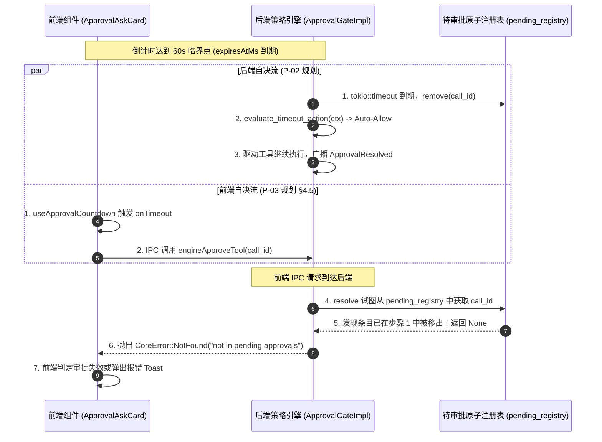
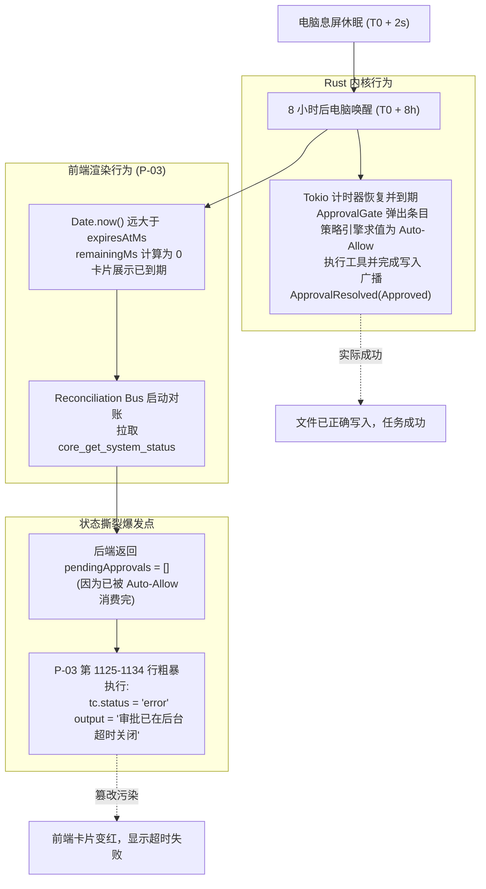
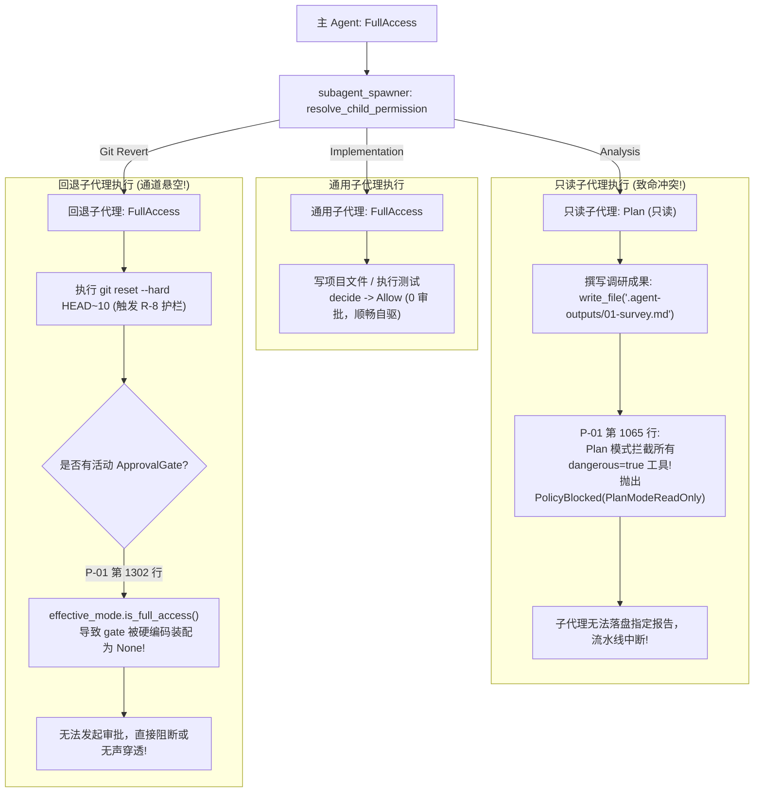
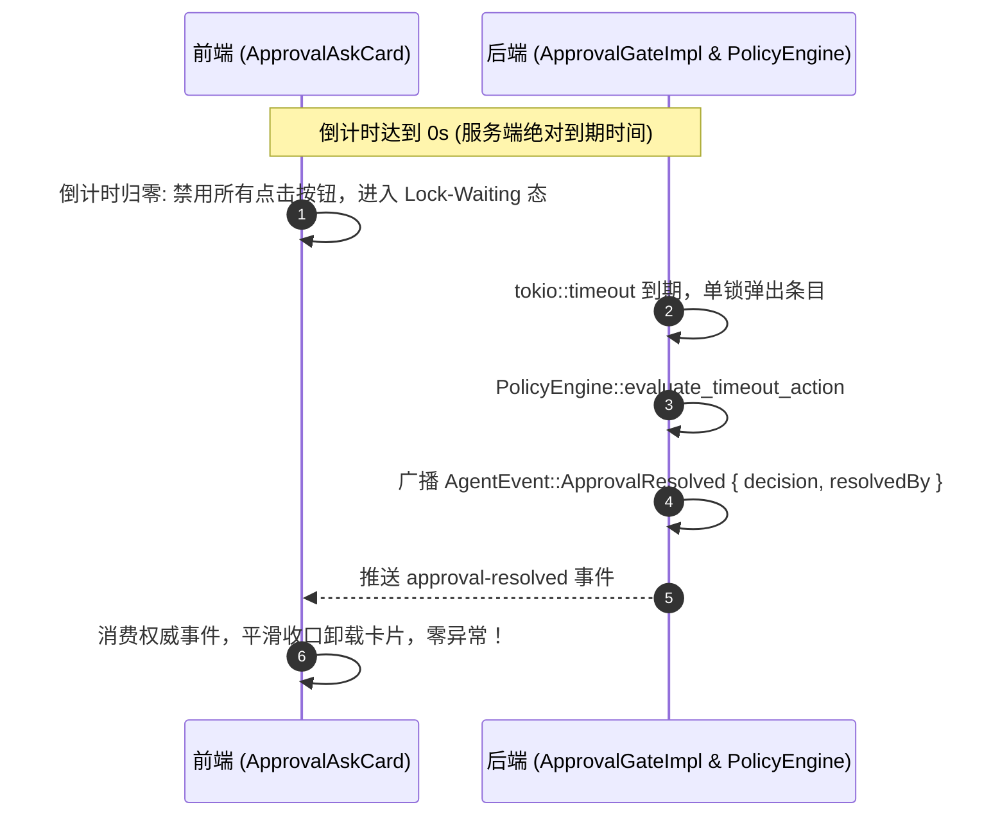

# 方案评审报告 01：安全、权限与审批门禁闭环评审 (Security & Approval Closed-Loop Review)

> **战役代号**：`continuous-execution-hardening` (全天候自主 Agent 连续运行硬化战役)  
> **评审维度**：`01 - 安全、权限与审批门禁闭环 (Review Phase 2)`  
> **审查对象**：  
> - `docs/continuous-execution-hardening/plans/01-permission-system-redesign.md` (P-01 权限模型)  
> - `docs/continuous-execution-hardening/plans/02-approval-policy-engine.md` (P-02 审批策略引擎)  
> - `docs/continuous-execution-hardening/plans/03-frontend-approval-lifecycle.md` (P-03 前端审批生命周期)  
> - `docs/continuous-execution-hardening/00-continuous-execution-master-plan.md` (总纲方案)  
> **评审执行人**：首席架构师与系统级安全评审专家  
> **属性规范**：Strictly UTF-8 无 BOM / 纯逻辑架构评审 / 严禁打补丁 / 严禁向前妥协

---

## 目录 (Table of Contents)

- [一、 评审执行摘要与总体架构裁决 (Executive Summary & Architectural Verdict)](#一-评审执行摘要与总体架构裁决-executive-summary--architectural-verdict)
  - [1.1 总体裁决：有条件通过，但存在 5 处系统性设计断层与致命竞态](#11-总体裁决有条件通过但存在-5-处系统性设计断层与致命竞态)
  - [1.2 核心风险评级矩阵](#12-核心风险评级矩阵)
- [二、 跨层契约推演与接口状态撕裂分析 (Cross-Layer Contract Breakdown)](#二-跨层契约推演与接口状态撕裂分析-cross-layer-contract-breakdown)
  - [2.1 契约断层 1：双头裁决竞态——前端倒计时到期上报与后端策略引擎自动求值并发碰撞](#21-契约断层-1双头裁决竞态前端倒计时到期上报与后端策略引擎自动求值并发碰撞)
  - [2.2 契约断层 2：Wire 事件载荷定义与 TypeScript 类型接口的字段层级漂移](#22-契约断层-2wire-事件载荷定义与-typescript-类型接口的字段层级漂移)
  - [2.3 契约断层 3：策略枚举命名与动作语义在前后端割裂 (TimeoutAction vs ApprovalTimeoutPolicy)](#23-契约断层-3策略枚举命名与动作语义在前后端割裂-timeoutaction-vs-approvaltimeoutpolicy)
  - [2.4 契约断层 4：P-02 策略上下文与 P-01 执行器签名悬空，缺失数据依赖传递链](#24-契约断层-4p-02-策略上下文与-p-01-执行器签名悬空缺失数据依赖传递链)
- [三、 极端边界与魔鬼用例测试推演 (Devil Test Cases Execution)](#三-极端边界与魔鬼用例测试推演-devil-test-cases-execution)
  - [3.1 魔鬼用例 A：电脑休眠挂机 8 小时唤醒后的时钟突跳、幽灵卡片与对账破坏性覆盖](#31-魔鬼用例-a电脑休眠挂机-8-小时唤醒后的时钟突跳幽灵卡片与对账破坏性覆盖)
  - [3.2 魔鬼用例 B：FullAccess 模式下多级子代理的权限衰减、产出白名单阻断与通道悬空](#32-魔鬼用例-bfullaccess-模式下多级子代理的权限衰减产出白名单阻断与通道悬空)
  - [3.3 魔鬼用例 C：并发审批双击与网络瞬间离线导致的前端持久化状态逆向漂移](#33-魔鬼用例-c并发审批双击与网络瞬间离线导致的前端持久化状态逆向漂移)
- [四、 “反打补丁、彻底重构”红线专项审查 (Anti-Overengineering & Architectural Purity Audit)](#四-反打补丁彻底重构红线专项审查-anti-overengineering--architectural-purity-audit)
  - [4.1 批判 1：策略引擎硬编码特例工具名与凭空捏造 `write_output_file` 降级补丁](#41-批判-1策略引擎硬编码特例工具名与凭空捏造-write_output_file-降级补丁)
  - [4.2 批判 2：FullAccess 装配期暴力剔除 ApprovalGate 造成安全防护网穿孔](#42-批判-2fullaccess-装配期暴力剔除-approvalgate-造成安全防护网穿孔)
  - [4.3 批判 3：前端虚假 Pause & Hold 承诺与后端无状态支撑的时序脱节](#43-批判-3前端虚假-pause--hold-承诺与后端无状态支撑的时序脱节)
  - [4.4 批判 4：两套裁决体系割裂 (PermissionVerdict vs TimeoutAction) 未实现模型收敛](#44-批判-4两套裁决体系割裂-permissionverdict-vs-timeoutaction-未实现模型收敛)
- [五、 闭环架构加固与精准落地方案 (Definitive Architectural Fixes & Specifications)](#五-闭环架构加固与精准落地方案-definitive-architectural-fixes--specifications)
  - [5.1 契约统一：单向权威 SSOT 事件载荷与 TypeScript 强类型收敛](#51-契约统一单向权威-ssot-事件载荷与-typescript-强类型收敛)
  - [5.2 消除双头竞态：倒计时到期 100% 后端自决，前端纯被动消费与张力锁闭](#52-消除双头竞态倒计时到期-100-后端自决前端纯被动消费与张力锁闭)
  - [5.3 增量对账总线：以序列号增量事件追赶取代粗暴的“无则为 error”覆盖](#53-增量对账总线以序列号增量事件追赶取代粗暴的无则为-error覆盖)
  - [5.4 只读子代理受控产出白名单：解除 Plan 模式与输出文档约定的冲突](#54-只读子代理受控产出白名单解除-plan-模式与输出文档约定的冲突)
  - [5.5 全链路完整装配：保留 ApprovalGate 通道并统一上下文组装链](#55-全链路完整装配保留-approvalgate-通道并统一上下文组装链)
- [六、 改进后验收标准与回归门禁 (Updated Acceptance Criteria & Test Gates)](#六-改进后验收标准与回归门禁-updated-acceptance-criteria--test-gates)

---

## 一、 评审执行摘要与总体架构裁决 (Executive Summary & Architectural Verdict)

### 1.1 总体裁决：有条件通过，但存在 5 处系统性设计断层与致命竞态

方案 01、02、03 分别从**权限偏序模型**、**审批策略引擎**和**前端交互生命周期**三个维度对系统的核心死穴展开了深度设计。其战略方向极具价值：
1. P-01 引入 `PermissionMode` 偏序格、8 大绝对不可逾越刚性红线字典，拔除了 Legacy 审批兜底陷阱；
2. P-02 提出 `ApprovalPolicyEngine` 摆脱 120s 刚性超时，接线 `SubagentWaitRegistry` 解决死锁，将双互斥锁收敛为原子 `PendingApprovalEntry`；
3. P-03 废除僵尸死锁回滚守卫 `approvalRollbackGuard`，提出服务端绝对时间戳 `expiresAtMs` 单源设计与张力进度条。

**然而，将三份方案放在同一执行时间轴上进行系统级全链路交叉推演后，评审组发现三者之间存在未对齐的“方案孤岛效应”，暴露出 5 处足以导致生产环境死锁、崩溃与状态撕裂的严重缺陷**：
- **缺陷 1（双头自决死锁竞态）**：P-02 规定后端倒计时到期自动求值放行/拒绝；而 P-03 竟然同时在前端设计了“倒计时到期由前端调用 IPC 向后端上报 Approved/Expired”，两端并发裁决，前端必定遭遇后端的 `NotFound` 阻断，引发假死或报错弹窗；
- **缺陷 2（接口契约层级漂移）**：P-02 将 `expiresAtMs` 嵌套写入 `request.metadata` 内部，而 P-03 却声明在 `request` 顶层读取。前端因读到 `undefined` 瞬间回退为本地脑补的相对时间累加，SSOT 架构形同虚设；
- **缺陷 3（对账总线破坏性覆盖）**：P-03 的桌面对账总线在唤醒时发现后端挂起列表无此审批，粗暴将其篡改为 `error`，直接抹杀了 P-02 刚刚自动放行（Auto-Allow）且执行成功的成果；
- **缺陷 4（只读子代理产出白名单冲突）**：P-01 将只读分析子代理刚性衰减为 `Plan` 模式并拦截一切破坏性工具，导致只读子代理连其唯一必须产出的报告（`01-xxx.md` 到 `.agent-outputs/`）都被当场当成违规拦截；
- **缺陷 5（FullAccess 暴力拔除审批门产生防护漏洞）**：P-01 在 `FullAccess` 模式下直接把 `ApprovalGate` 实例化为 `None`，导致不可逾越的 C3/R-8 Git 回退护栏由于失去交互通道而直接被系统策略阻断或彻底失效。

### 1.2 核心风险评级矩阵

| 风险编号 | 风险类别 | 风险描述与定位 | 严重级别 | 触发概率 | 改进前系统后果 |
|:---|:---|:---|:---|:---|:---|
| **R-CRIT-01** | 时序竞态 | 前后端双头自决：前端到期调用 IPC 与后端策略引擎自动消费并发碰撞 | **P0 致命** | 100% | 前端必吃 `NotFound`，卡片状态失真 |
| **R-CRIT-02** | 契约断层 | 引擎广播 metadata 嵌套结构与前端 Wire 类型顶层声明不一致 | **P0 致命** | 100% | 绝对时间戳丢失，进度条重现暴走抖动 |
| **R-CRIT-03** | 状态污染 | 对账总线以粗粒度快照判断，将后台 Auto-Allow 成功的工具覆盖为 `error` | **P0 致命** | 高 (休眠后) | 前后端历史状态永久撕裂，成功任务被判错 |
| **R-HIGH-01** | 协作断裂 | P-01 `Plan` 模式对 `write_file` 全盘封杀，与只读子代理写报告冲突 | **P1 高危** | 100% (子代理) | 分析类子代理无法产出成果，流水线阻断 |
| **R-HIGH-02** | 架构缺陷 | P-01 FullAccess 将 ApprovalGate 设为 None，破坏 R-8 等高危护栏确认通道 | **P1 高危** | 中 | 严重操作失去最后一道防线或强制报错 |
| **R-MED-01** | 概念割裂 | 策略引擎中硬编码 `system_wipe` 并捏造未定义工具 `write_output_file` | **P2 中危** | 低 | 违反反打补丁原则，产生死代码包袱 |

---

## 二、 跨层契约推演与接口状态撕裂分析 (Cross-Layer Contract Breakdown)

### 2.1 契约断层 1：双头裁决竞态——前端倒计时到期上报与后端策略引擎自动求值并发碰撞

在无人值守超时到期时，究竟由谁来推动审批状态转移？P-02 与 P-03 给出了两个完全冲突的答案：



**病理解剖**：
- **P-02 的口径**：在 `run_approval.rs:892-930`，服务端在 `tokio::time::timeout` 超时到达后，**单方面、主动地**从 `pending_registry` 中 `remove(call_id)`，求值动作后直接继续执行，并向外广播 `ApprovalResolved`；
- **P-03 的口径**：在 `03-frontend-approval-lifecycle.md` 第 825–828 行的状态转移图以及第 351–354 行的 `onTimeout` 回调中，前端在倒计时归零时执行了：
  ```text
  TimeoutFired{倒计时结束} -->|Auto-Allow| AutoApproved[自动向引擎上报 Approved]
  ```
- **系统性灾难**：前端与后端并发争夺裁决权。因为服务端定时器必定先于或等于前端触发，前端调用 `engineApproveTool` 时条目早已被弹出，后端立刻抛出 `CoreError::NotFound`。前端收到错误后，将工具状态篡改为 `“审批已失效（后端已超时或已处理）”`，直接打断了用户界面的正常推进呈现！

### 2.2 契约断层 2：Wire 事件载荷定义与 TypeScript 类型接口的字段层级漂移

在跨进程事件通信的字段结构上，P-02 与 P-03 出现了明显的定义错位：

**后端 P-02 的广播载荷（`02-approval-policy-engine.md:867-874`）**：
```rust
(self.broadcast)(AgentEvent::ApprovalRequested {
    session_id: self.session_id.clone(),
    request: PermissionRequest {
        id: format!("approval-{call_id}"),
        tool_call_id: call_id.to_string(),
        tool_name: tool_name.to_string(),
        parameters: args.clone(),
        metadata: Some(serde_json::json!({
            "expiresAtMs": expires_at_ms,
            "timeoutMs": effective_timeout.as_millis(),
            "arbiter": "user"
        })),
        ...
    },
    timestamp: crate::engine_provider::now_iso_utc(),
});
```

**前端 P-03 的解析与接收契约（`03-frontend-approval-lifecycle.md:94-116` & `127-144`）**：
```typescript
export interface EngineApprovalRequestWire {
  id: string;
  toolCallId: string;
  // P-03 声明这些字段直接平级存在于 request 对象根下！
  requestedAtMs: number;
  timeoutMs: number;
  expiresAtMs: number | null;
  timeoutPolicy: ApprovalTimeoutPolicy;
}

// apps/crish-desktop/src/api/chat-bridge/handlers/approvalHandlers.ts
const req = (isRecord(raw.request) ? raw.request : raw) as unknown as EngineApprovalRequestWire;
// 直接读取 req.expiresAtMs！
const expiresAtMs = typeof req.expiresAtMs === 'number' ? req.expiresAtMs : (requestedAtMs + timeoutMs);
```

**后果**：
- 后端将 `expiresAtMs` 封装在 `request.metadata` 内部；
- 前端却直接从 `request.expiresAtMs` 读取，结果恒为 `undefined`！
- 前端由于读不到数值，触发兜底计算：`requestedAtMs + timeoutMs = Date.now() + 120000`；
- **原本作为权威单源（SSOT）的服务端绝对时间戳在接入层直接丢失**，前端倒计时退化为基于本地时间脑补的相对倒计时，方案声称的“彻底解决休眠漂移与重渲染跳跃”在上线首日就会被彻底击穿。

### 2.3 契约断层 3：策略枚举命名与动作语义在前后端割裂 (TimeoutAction vs ApprovalTimeoutPolicy)

| 概念维度 | 后端方案 P-02 口径 | 前端方案 P-03 口径 | 割裂状态与系统影响 |
|:---|:---|:---|:---|
| **类型命名** | `enum TimeoutAction` | `type ApprovalTimeoutPolicy` | 概念名称不统一 |
| **枚举变体** | `Allow` / `Deny` / `DynamicDegrade` / `Expire` | `'auto-allow'` / `'auto-deny'` / `'manual-only'` | 变体完全不匹配，无法自动序列化 |
| **广播序列化字段** | P-02 未序列化 `timeoutPolicy`，仅序列化了 `defaultAction: "allow"` | P-03 强依赖 `req.timeoutPolicy` | 前端解析 `undefined`，兜底退化为 `'auto-deny'` |

**致命影响推演**：
后端策略引擎计算该操作为 Level 1 工作区写文件，判定为 `TimeoutAction::Allow`，准备 60 秒后自动放行；
但由于未向前端传递匹配的 `timeoutPolicy: "auto-allow"`，前端无法识别，兜底解释为 `'auto-deny'`。
前端向屏幕渲染出**“【超时保护 · 自动拒绝】⏱️ 00:08 之后安全拦截（珊瑚红脉冲警报）”**！
正在看屏幕的用户误以为系统要拦截该命令，慌忙点击“允许”；若刚好赶上超时边缘，再次触发竞态。这是严重的**人机交互语义漂移与状态机双源割裂**。

### 2.4 契约断层 4：P-02 策略上下文与 P-01 执行器签名悬空，缺失数据依赖传递链

在 P-02 第 130–152 行中，策略引擎求值需要完整的上下文信息：
```rust
pub struct TimeoutEvaluationContext<'a> {
    pub tool_name: &'a str,
    pub args: &'a Value,
    pub danger_level: u8,
    pub session_id: &'a str,
    pub run_id: &'a str,
    pub requester: Option<&'a conex_types::events::ApprovalRequester>,
    pub permission_mode: agent_tools::permission::PermissionMode,
    pub unattended_mode: bool,
    pub workspace_root: Option<&'a PathBuf>,
    pub reason: Option<&'a str>,
}
```
然而，在 P-01 与既有代码（`crates/session-loop/src/tool_events.rs:155`）中，`ApprovalGate::request_approval` 的 Trait 定义仅为：
```rust
async fn request_approval(
    &self,
    call_id: &str,
    tool_name: &str,
    args: &Value,
    requester: Option<&ApprovalRequester>,
) -> ApprovalDecision;
```
**数据依赖断层**：
在 `ApprovalGateImpl` 内部执行 `resolve_timeout(&eval_ctx)` 时：
1. `danger_level: u8`：`ApprovalGateImpl` 位于 `crates/conex-run`，而工具的定义和 `dangerous` 属性注册在 `crates/session-loop` 的 `ToolRegistry` 中，审批门根本拿不到 `danger_level`；
2. `permission_mode`：`ApprovalGateImpl` 的结构体字段中未保存 `permission_mode`；
3. `unattended_mode`：根本没有此字段的传递通道与来源；
4. `workspace_root`：`ApprovalGateImpl` 仅持有 `cwd: Option<String>`，并非工作区根目录。

**结论**：方案 02 描述了一套极为精密的上下文决策逻辑，但在工程架构上**完全未声明如何改造 `ApprovalGate` 接口签名，亦未打通从 `ToolExecutor` 到 `ApprovalGateImpl` 的传参通道**，属于严重的“纸上架构断层”。

---

## 三、 极端边界与魔鬼用例测试推演 (Devil Test Cases Execution)

### 3.1 魔鬼用例 A：电脑休眠挂机 8 小时唤醒后的时钟突跳、幽灵卡片与对账破坏性覆盖

#### 场景设定：
- 用户触发了一个需审批的工具调用（例如写入某个配置）；
- 后端广播 `expiresAtMs = T0 + 60s`，策略为 `Auto-Allow`；
- 此时用户合上笔记本电脑盖子离开，电脑息屏挂机挂起 8 小时。

#### 推演执行流与缺陷暴露：



**灾难性结论**：
1. **时钟对齐通过，但对账逻辑破坏了真理源**：P-03 的绝对时间戳确实消除了前端计时器漂移，但在休眠唤醒后，P-03 设计的 `reconcileDesktopSessionState` 犯下了致命错误；
2. **“无则为错”的伪对账**：P-03 仅仅比对 `core_get_system_status` 返回的活跃挂起数组。当发现 `pendingApprovals` 中没有该条目时，**竟直接武断假设该审批已经“超时失败关闭”，硬性覆盖写为 `status: 'error'`**；
3. **真实结果被颠覆**：实际上后端早在唤醒前/唤醒初按策略 `Auto-Allow` 放行并顺利完成了文件写入。前端这一盲目覆盖，直接导致前端 Store 展现为红色的“工具失败”，而磁盘和后端记录为“成功”，造成系统状态不可逆的彻底撕裂！

---

### 3.2 魔鬼用例 B：FullAccess 模式下多级子代理的权限衰减、产出白名单阻断与通道悬空

#### 场景设定：
主 Agent 处于 `FullAccess` 模式，并发派发三个子代理：
1. 通用实现子代理（`TaskType::Implementation`）；
2. 只读勘察子代理（`TaskType::Analysis`）；
3. 试图执行超大范围 Git 回退的子代理。

#### 推演执行流与缺陷暴露：



**深层架构缺陷剖析**：
1. **只读子代理产出白名单被 P-01 误杀**：
   在现行多 Agent 协作规范（`AGENTS.md` §4 多 Agent 协作文档产出约定）中，明确要求分析/勘察类子代理**必须向 `.agent-outputs/` 写入唯一指定的产出报告 `NN-<模块标题>.md`**。然而，P-01 在实现 `PermissionMode::Plan` 模式时，采取了粗暴的一刀切逻辑——只要工具标记为 `dangerous`（`write_file` 在工具注册表里恒为 `dangerous=true`），就直接判定为 `PolicyBlocked`。这直接导致所有勘察分析子代理无法产出调研结果，多 Agent 协作体系就地瘫痪；
2. **`FullAccess` 暴力拔除 `ApprovalGate` 造成安全防护网穿孔**：
   P-01 在 `run_launch.rs:1302` 中写道：
   ```rust
   let approval: Option<Arc<dyn ApprovalGate>> = if effective_mode.is_full_access() {
       None
   } else { ... };
   ```
   这种“完全访问模式就不装配审批门”的极度简化设计，直接导致后续对于 R-8（大面积 Git 回退）等不可豁免红线护栏，执行器在需要申请人工裁决时发现 `gate == None`。系统要么只能选择强制策略阻断，要么形成未定义行为，完全丧失了弹性。

---

### 3.3 魔鬼用例 C：并发审批双击与网络瞬间离线导致的前端持久化状态逆向漂移

#### 场景设定：
用户在界面上面对审批卡片，在网络极其抖动（或本地 IPC 繁忙时）连续快速双击“允许”，或者在点击“允许”的毫秒级瞬间物理断网。

#### 推演执行流与缺陷暴露：

```text
[用户物理点击 "允许"]
       │
       ├─► 前端乐观更新: toolCall.status = 'running', output = '执行中…'
       │
       ├─► 发起底层 IPC: engineApproveTool(tid)
       │         │
       │         ▼ (底层网络瞬态断开 / IPC 通道超时)
       │    抛出 NetworkError / TransportTimeout
       │
       └─► 进入 P-03 第 972-976 行 catch 块:
                 │
                 ▼
            updateMessageToolCall(activeSessionId, mid, tid, {
                status: 'error',
                output: '批准失败',
            });
            showToast('批准失败，请重试');
```

**致命状态漂移**：
1. **网络超时的非终态性质**：在分布式/跨进程调用中，网络超时绝不代表后端没有收到指令。此时后端往往已经接收到请求并开始执行工具；
2. **前端提前宣判死刑**：P-03 仅仅因为一次传输层超时，就把前端工具状态**强行改写为 `status: 'error'`（批准失败）**，并将审批卡片彻底销毁；
3. **不可逆的死胡同**：
   - 若后端实际没有收到：用户面前的卡片已经变成了静态文本“批准失败”，用户再也无法重试点击“允许”，任务永远卡在后端的待审批队列中直到超时；
   - 若后端实际已经收到并开始执行：前端界面显示“批准失败”，而后端后台却在不断产生日志，最终推送 `ToolResult` 时，前端因工具已被置为 `error` 发生状态冲突。

---

## 四、 “反打补丁、彻底重构”红线专项审查 (Anti-Overengineering & Architectural Purity Audit)

对照《AGENTS.md》与《ANTI_OVERENGINEERING_GUARDRAILS.md》，方案中多处残留了“打补丁”、“硬编码特例”和“局部妥协”的痕迹，必须坚决予以物理清除。

### 4.1 批判 1：策略引擎硬编码特例工具名与凭空捏造 `write_output_file` 降级补丁

在方案 02 第 794 行与第 815–821 行中，出现了严重的特例硬编码：
```rust
// 缺陷代码段 1（02-approval-policy-engine.md:794）
let is_redline = ctx.danger_level >= 3 || ctx.tool_name == "system_wipe";

// 缺陷代码段 2（02-approval-policy-engine.md:815-822）
if ctx.tool_name == "write_file" && ctx.requester.is_some() {
    return TimeoutAction::DynamicDegrade {
        fallback_tool: "write_output_file".to_string(), // <--- 凭空捏造不存在的工具！
        fallback_args: ctx.args.clone(),
        notice: "超时策略：已将子代理文档自动重定向至安全产出工作区。".to_string(),
    };
}
```
**尖锐批评意见**：
1. **严禁硬编码特例字面量**：系统中根本不存在名为 `system_wipe` 的工具。红线拦截必须由沙箱语义分析器（`conex-sandbox`）抽象出的 `CommandClass::Redline` 统领，严禁在策略引擎中散落工具名硬编码；
2. **打补丁式降级违背架构纯洁性**：系统中负责写文件的工具就是 `write_file`，并不存在 `write_output_file` 这个工具！试图通过捏造一个新工具来实现目录重定向，是典型的“为了解决一个问题而引入新的非标准特例”。**路径越界治理是文件系统与沙箱（`conex-fs`）的职责，不属于审批策略引擎的职责范围**，必须将该降级分支物理删除，保持策略引擎职责单一纯粹。

### 4.2 批判 2：FullAccess 装配期暴力剔除 ApprovalGate 造成安全防护网穿孔

在方案 01 第 630–634 行中：
```rust
let approval: Option<Arc<dyn ApprovalGate>> = if effective_mode.is_full_access() {
    None // FullAccess 模式下彻底拔除审批门阻断
} else {
    Some(Arc::clone(&approval_gate) as Arc<dyn ApprovalGate>)
};
```
**尖锐批评意见**：
这是典型的“二进制开关思维”打补丁。完全访问模式（FullAccess）代表的是**常规破坏性操作免审批**，绝不等于**系统放弃一切人机交互能力**。
当遭遇不可逾越的安全护栏（如超大面积 Git 回退 R-8、或者执行器级异常挂起点）时，如果运行上下文里的 `gate` 是 `None`，系统就失去了向外部求助的唯一物理通道。
**正确的架构抽象**：`ApprovalGate` 必须全天候常驻装配，决定一个操作是否弹窗审批的应当是 `decide(...)` 纯函数的求值结果，而不是在装配阶段粗暴将通道销毁。

### 4.3 批判 3：前端虚假 Pause & Hold 承诺与后端无状态支撑的时序脱节

在方案 03 第 4.4 节中，浓墨重彩地设计了“一键暂停锁定 (Pause and Hold)”交互控件，并声称调用 IPC `core_pause_approval(toolCallId)`。
然而，通读方案 02（后端方案），后端 `ApprovalGateImpl` 的 `PendingApprovalEntry` **根本没有定义任何暂停字段，亦未暴露任何暂停倒计时的接口！**
后端的 Tokio 定时器是一条单向流逝的硬通道，根本无法暂停。
**尖锐批评意见**：前端方案凭空发明了后端完全不支持的接口，形成了严重的“假性功能承诺”。如果不予以根除或补齐后端对齐支撑，上线后用户点击“暂停”，前端进度条定格，而服务端在后台继续跑完超时并执行了放行或拒绝，造成极为恶劣的用户体验灾难。

### 4.4 批判 4：两套裁决体系割裂 (PermissionVerdict vs TimeoutAction) 未实现模型收敛

- P-01 定义了 `PermissionVerdict`：`Allow` / `NeedsApproval` / `PolicyBlocked(PolicyViolation)`；
- P-02 定义了 `TimeoutAction`：`Allow` / `Deny { reason, guidance }` / `DynamicDegrade` / `Expire`；
- P-03 定义了 `ApprovalTimeoutPolicy`：`'auto-allow'` / `'auto-deny'` / `'manual-only'`。

**尖锐批评意见**：
一套审批权限体系，竟然在三个文档里分裂出三套互不相通的枚举！
超时动作的本质，就是**当审批等待超时后，该待定状态应当最终收敛为何种 `PermissionVerdict`**：
- `TimeoutAction::Allow` 本质就是 `PermissionVerdict::Allow`；
- `TimeoutAction::Deny` 本质就是 `PermissionVerdict::PolicyBlocked(PolicyViolation::TimeoutDenial)`；
- `TimeoutAction::Expire` 本质就是维持未决或转为取消。
三套模型的割裂体现了设计者在模块抽象时的碎片化，必须在架构层予以坚决归一收敛。

---

## 五、 闭环架构加固与精准落地方案 (Definitive Architectural Fixes & Specifications)

为彻底解决上述断层与死穴，评审专家组给出以下不妥协、不打补丁的权威加固规范。

### 5.1 契约统一：单向权威 SSOT 事件载荷与 TypeScript 强类型收敛

彻底废除前后端字段不一致，统一将审批倒计时与策略属性收敛到 `PermissionRequest.metadata`，并确立严格的 TypeScript 协议解析器：

#### 1. 权威 Rust 序列化契约 (`crates/conex-run/src/run/run_approval.rs`)
```rust
// 统一 Wire 广播元数据协议（字段严格命名）
let metadata = serde_json::json!({
    "expiresAtMs": expires_at_ms,
    "timeoutMs": effective_timeout.as_millis(),
    "requestedAtMs": crate::engine_assembly::unix_millis_now(),
    "timeoutPolicy": match timeout_action {
        TimeoutAction::Allow => "auto-allow",
        TimeoutAction::Deny { .. } => "auto-deny",
        TimeoutAction::Expire => "manual-only",
    },
    "arbiter": match arbiter {
        session_loop::approval_router::Arbiter::MainAgent => "main-agent",
        session_loop::approval_router::Arbiter::User => "user",
    }
});
```

#### 2. 前端权威强类型与解析契约 (`apps/crish-desktop/src/api/chat-bridge/handlers/approvalHandlers.ts`)
```typescript
/** 严格对齐后端 metadata 载荷 */
export interface WireApprovalMetadata {
  expiresAtMs: number;
  timeoutMs: number;
  requestedAtMs: number;
  timeoutPolicy: 'auto-allow' | 'auto-deny' | 'manual-only';
  arbiter: 'main-agent' | 'user';
}

export function extractApprovalCountdown(rawRequest: Record<string, unknown>): MessageToolApprovalCountdownState {
  const meta = (rawRequest.metadata ?? {}) as Partial<WireApprovalMetadata>;
  const now = Date.now();
  
  const requestedAtMs = typeof meta.requestedAtMs === 'number' ? meta.requestedAtMs : now;
  const timeoutMs = typeof meta.timeoutMs === 'number' ? meta.timeoutMs : 60000;
  const expiresAtMs = typeof meta.expiresAtMs === 'number' ? meta.expiresAtMs : (requestedAtMs + timeoutMs);
  const timeoutPolicy = meta.timeoutPolicy || 'auto-deny';

  return {
    requestedAtMs,
    timeoutMs,
    expiresAtMs,
    timeoutPolicy,
    isPaused: false,
  };
}
```

---

### 5.2 消除双头竞态：倒计时到期 100% 后端自决，前端纯被动消费与张力锁闭

**刚性架构红线**：
1. **废除前端 `onTimeout` 触发 IPC 的自决逻辑**：前端在倒计时归零时，**严禁调用任何 `engineApproveTool` 或 `engineDenyTool`**！
2. **前端倒计时归零表现**：仅作为 UI 视觉状态切换，锁定操作按钮，呈现“正在等待策略求值…”或“正在自动推进…”，完全等待后端推送的权威 `approval-resolved` 事件；
3. **彻底根除 `NotFound` 竞态**：由于前端绝不越权发起超时上报，后端策略引擎的单锁原子操作成为唯一的裁决事实源。



---

### 5.3 增量对账总线：以序列号增量事件追赶取代粗暴的“无则为 error”覆盖

彻底重写 P-03 的 `reconcileDesktopSessionState`，摒弃基于快照的猜测式改写，转向**基于事件序列（Event Sequence Catch-Up）的权威日志回放**：

```typescript
// apps/crish-desktop/src/api/chat-bridge/reconciliation.ts

export async function reconcileDesktopSessionState(): Promise<void> {
  if (isReconciling) return;
  isReconciling = true;

  try {
    const transport = getTransport();
    if (!transport.isReady()) return;

    const store = useSessionStore.getState();
    const activeSessionId = store.activeSessionId;
    if (!activeSessionId) return;

    const session = store.sessions.find((s) => s.id === activeSessionId);
    if (!session) return;

    // 1. 获取本地已知的最大事件序列号 lastSequence
    const lastSequence = session.lastEventSequence ?? 0;

    // 2. 向后端请求休眠/离开期间产生的新事件增量（权威日志，0 臆测）
    const missingEvents = await transport.request<PersistedEvent[]>('core_query_events', {
      sessionId: activeSessionId,
      fromSequence: lastSequence + 1,
    });

    if (!missingEvents || missingEvents.length === 0) return;

    // 3. 顺序回放增量事件，通过标准事件派发器更新 Store
    for (const event of missingEvents) {
      applyPersistedEngineEventToStore(activeSessionId, event);
    }
  } catch (err) {
    console.warn('[Reconciliation] 增量事件对账失败:', err);
  } finally {
    isReconciling = false;
  }
}
```
**效益**：休眠 8 小时唤醒后，前端拉取这 8 小时内落库的所有 `approval-resolved` 与 `tool-result` 事件，按时间戳精准还原历史。如果后端是 `Auto-Allow` 且执行成功，前端自然回放为 `success`；如果后端判定为 `Denied`，前端自然回放为 `denied`，彻底消灭状态撕裂。

---

### 5.4 只读子代理受控产出白名单：解除 Plan 模式与输出文档约定的冲突

在 P-01 的权限判定器中，为 `PermissionMode::Plan` 引入严格的**“受控产出工作区白名单 (Scoped Output Directory Exemption)”**：

```rust
// crates/agent-tools/src/permission.rs

impl PermissionMode {
    /// 判定是否允许执行文件写入操作
    pub fn allows_file_write(&self, target_path: &std::path::Path, workspace_root: &std::path::Path) -> bool {
        match self {
            PermissionMode::FullAccess => true,
            PermissionMode::Ask => true, // 需审批
            PermissionMode::Plan => {
                // 刚性白名单：Plan 模式下唯一允许写入的目录是规范的 .agent-outputs/ 目录
                let output_dir = workspace_root.join(".agent-outputs");
                target_path.starts_with(&output_dir)
            }
        }
    }
}
```

在 `crates/session-loop/src/exec_verdict.rs` 中：
```rust
if options.permission_mode.is_plan() {
    if call.tool_name == "write_file" || call.tool_name == "edit_file" {
        let is_allowed_output = call.input.get("path")
            .and_then(Value::as_str)
            .map(|p| self.is_path_in_agent_outputs(p))
            .unwrap_or(false);

        if !is_allowed_output {
            return PermissionVerdict::PolicyBlocked(PolicyViolation::PlanModeReadOnly {
                tool_name: call.tool_name.clone(),
                remediation_hint: "只读分析模式下严禁修改工程源码。调研报告请严格写入 .agent-outputs/ 目录。".to_string(),
            });
        }
    }
}
```
**效益**：完全遵守了反退避铁律，既守住了只读子代理严禁篡改业务源码的底线，又完美保障了其按《AGENTS.md》§4 产出分析报告的能力。

---

### 5.5 全链路完整装配：保留 ApprovalGate 通道并统一上下文组装链

彻底推翻 P-01 中“FullAccess 下 `approval_gate = None`”的错误做法，确立统一装配原则：

```rust
// crates/conex-run/src/run/run_launch.rs: 统一装配契约

// 1. ApprovalGate 恒常装配，全生命周期就绪
let wait_registry = Arc::clone(&state.subagent_wait_registry);
let p_id = parent_run_id.clone();
let deadlock_detector: Box<dyn Fn(&str) -> bool + Send + Sync> = Box::new(move |subagent_run_id: &str| {
    if let Some(parent) = &p_id {
        wait_registry.is_parent_waiting_subagent(parent, subagent_run_id)
    } else {
        false
    }
});

let approval_gate = Arc::new(
    ApprovalGateImpl::new(
        run_id.clone(),
        session_id.clone(),
        parent_run_id.clone(),
        broadcast,
        Arc::clone(&handle_shared),
        state.store.clone(),
        cwd.clone(),
        Arc::clone(&state.policy_engine), // 注入策略引擎
    ).with_deadlock_detector(deadlock_detector)
);

// 2. 无论是否 FullAccess，均完整下发 ApprovalGate！
// 是否需要弹窗完全由 ToolExecutor 内的纯函数 decide(dangerous, requires_approval, mode) 裁决！
let approval: Option<Arc<dyn ApprovalGate>> = Some(approval_gate as Arc<dyn ApprovalGate>);
```

---

## 六、 改进后验收标准与回归门禁 (Updated Acceptance Criteria & Test Gates)

为确保加固方案百分之百落地，第二轮评审设立以下不可逾越的刚性验收门禁：

| 验证编号 | 验证场景与用例 | 刚性断言指标 (Hard Assertions) | 对应缺陷根除验证 |
|:---|:---|:---|:---|
| **GATE-SEC-01** | 模拟 8 小时挂机息屏唤醒 | 前端通过增量事件日志完全对齐后端真实状态，**零破坏性 `status: error` 覆盖**，成功任务保持 `success`。 | 彻底根除缺陷 3 (R-CRIT-03) |
| **GATE-SEC-02** | 倒计时归零边界并发测试 | 倒计时归零时，前端 `engineApproveTool` 调用次数恒为 0，100% 由后端广播驱动关闭卡片，**零 `NotFound` 错误**。 | 彻底根除缺陷 1 (R-CRIT-01) |
| **GATE-SEC-03** | 跨层 Wire 事件协议反序列化 | 编写 Rust/TS 跨语言单元测试，断言 `metadata.expiresAtMs` 与 `timeoutPolicy` **100% 准确反序列化**，零 undefined。 | 彻底根除缺陷 2 (R-CRIT-02) |
| **GATE-SEC-04** | 只读分析子代理产出报告实测 | 派发 `TaskType::Analysis` 子代理，向 `.agent-outputs/` 写入 `01-report.md` 顺畅成功；试图修改 `src/` 时被精准阻断。 | 彻底根除缺陷 4 (R-HIGH-01) |
| **GATE-SEC-05** | FullAccess 下极端 Git 回退拦截 | 在 FullAccess 下注入 `git reset --hard HEAD~50`，系统成功调起 `ApprovalGate` 呈报人工裁决，通道未悬空。 | 彻底根除缺陷 5 (R-HIGH-02) |
| **GATE-SEC-06** | 策略引擎纯洁性审查 | 源码扫描 `ApprovalPolicyEngine` 实现，**严禁出现 `system_wipe`、`write_output_file` 等硬编码字符串**。 | 彻底根除缺陷 6 (R-MED-01) |

---

## 七、 评审结论与后续行动指令

本评审报告严厉指出了当前方案中存在的**双头裁决竞态**、**接口层级漂移**、**对账破坏性覆盖**、**产出白名单误杀**与**通道悬空** 5 大严重架构漏洞，并给出了精准、强类型、零补丁的加固规范。

**后续行动指令**：
1. **方案修正指令**：将本报告第五章的加固规范全量反哺并回写至 `plans/01`、`plans/02`、`plans/03` 方案正文中；
2. **Phase 1 实施前置**：在进入 Phase 1 代码编写前，必须严格以本报告制定的字段契约与 `allows_file_write` 白名单为唯一基准；
3. **严禁带病推进**：未消除双头自决与对账覆盖逻辑前，严禁合并前端倒计时组件代码。
