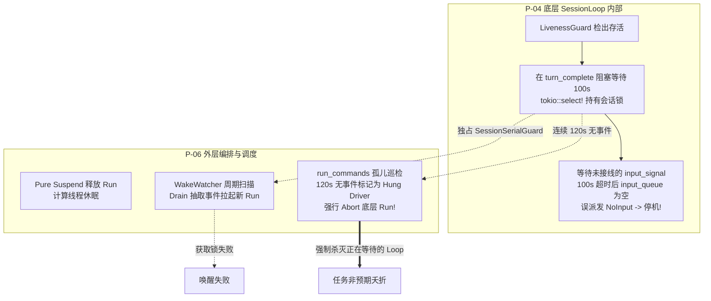
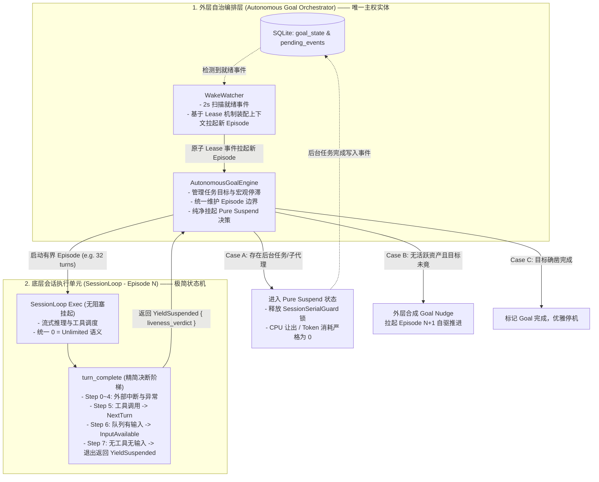

# 方案评审报告 02：核心循环状态机、自主驱动与长程续航评审

> **战役代号**：`continuous-execution-hardening` / 评审轮次 02  
> **评审对象**：
> - `docs/continuous-execution-hardening/plans/04-session-loop-state-machine.md`（核心会话循环与状态机流转重构方案）
> - `docs/continuous-execution-hardening/plans/06-autonomous-drive-engine.md`（全天候自主驱动、长程唤醒与心跳引擎方案）
> - `docs/continuous-execution-hardening/00-continuous-execution-master-plan.md`（战役总纲方案）
> **评审职责**：首席系统架构师与评审专家  
> **审查基准**：
> - `AGENTS.md`（§1 逻辑规划与反退避、§7 严禁打补丁/零容忍、§7.1 立体验证纪律）
> - `ANTI_OVERENGINEERING_GUARDRAILS.md`（反过度设计 13 项硬性禁令，重点为禁令 4、7、9、11）
> - `docs/agent-roles/review/review.md`（架构分层、并发锁安全、错误治理、可观测性与收敛性度量）

---

## 评审总览与裁决结论

经过对 P-04 与 P-06 两份详案及总纲的深层代码级交叉推演，评审组一致给出如下总体裁决：

> ### 🛑 总体评审裁决：【存在严重架构断层与微服务过度设计，必须归一重构后方可施工】
> 
> **核心定性**：
> 1. **两套方案存在致命的“状态机职责割裂与双脑自激振荡”**：P-04 试图在底层 `session-loop` 内部通过 `tokio::select!` 阻塞挂起等待后台资产，而 P-06 却在外层定义了 `Pure Suspend` 释放 Run 并由 `WakeWatcher` 唤醒。二者并发时将引发 **SessionSerialGuard 死锁、Driver 卡死误杀与双重 Nudge 产生的无限自激复读死循环**；
> 2. **队列概念发生严重空间分裂**：P-04 的状态机仅在 `session_loop.input_queue`（单 Run 内存私有）内流转，而后台任务、定时器、子代理终态实际全部投递至外层 `orchestrator::PendingMessageQueue`，P-04 在内层等待 `input_signal` 必将导致**永久假死与 100s 后空输入强制误停机**；
> 3. **严重违反《反过度设计禁令 9》**：P-06 生硬引入了包含 Canary 探针、Half-Open 试探、300s 锁定及复杂命名空间的三态断路器（CircuitBreaker），将云原生微服务套件无意义地移植到单机桌面端；
> 4. **假收敛、真膨胀的死信表过度工程**：P-06 为修复 `run_idle.rs:1664` 的一行错误代码（`clear_for_before`），额外发明了 SQLite `deferred_events` 表、六态消费状态机与复杂的重新灌入（Re-hydration）流程，违背了“彻底删除错误代码即净收敛”的极简原则。

---

## 一、P-04 与 P-06 交叉推演与冲突矩阵（设计断层与调度盲区）



### 1.1 冲突 1：活性等待位置冲突——内层阻塞挂起 vs 外层 Pure Suspend
- **代码断裂点**：
  - P-04 §3.6 规定：当 `turn_complete` Step 9 发现有后台任务或子代理存活时，**在 `session-loop` 内部执行 `tokio::select!` 阻塞挂起**，最长等待 100 秒或直到 `state.input_signal.notified()`。
  - P-06 §1.2、§5.2 规定：当没有即时实体消息时，系统必须进入 **Pure Suspend（纯净挂起）**，当前 Episode（Run）必须正常收场退出，释放 CPU 和排他锁，等待事件推入队列后由 `WakeWatcher` 重新拉起。
- **灾难推演**：
  1. 若采用 P-04：Run 不结束，一直持有 `SessionSerialGuard` 会话排他锁；
  2. 此时后台编译任务耗时 10 分钟。在第 2 分钟时，P-06 §7.5 的挂起巡检器（`RUN_HANG_TIMEOUT_MS = 120_000`）检测到底层 Driver 连续 2 分钟无任何事件产出，**判定该 Run 卡死（Driver Hang），直接调用 `abort_handle().abort()` 强行杀灭！**
  3. 即便关闭巡检器，P-04 的内层阻塞导致 `WakeWatcher` 永远无法拉起新 Run（因为旧 Run 仍在占用锁且处于 active 状态），系统彻底陷入内层假死；
  4. **架构定性**：`session-loop` 是细粒度推理执行单元，绝不能充当长达数小时的长程进程等待器。等待必须由外层调度器接管。

### 1.2 冲突 2：推进心跳与自主驱动双脑分裂——内层 Nudge 与外层 Engine 自激振荡
- **代码断裂点**：
  - P-04 §3.7：在 `turn_complete` Step 10 内置了 `Goal Continuous Nudge`，若模型输出纯文本，在单 Run 内部最多连续注入 3 次 Nudge（`continuous_nudges_streak`）；
  - P-06 §2：在外层引入了 `AutonomousGoalEngine`，维护跨 Episode 的 `stalled_episodes` 计数与 `goal_continue_message` 注入。
- **灾难推演（自激振荡死循环）**：
  1. 模型在第 1 轮输出纯文本。P-04 在底层注入 Nudge 1；
  2. 模型继续输出纯文本。P-04 注入 Nudge 2、Nudge 3；
  3. 达到 3 次上限，P-04 判定死循环，分派 `ShouldStop`，当前 Run 终结退出（`AgentEndReason::Stop`）；
  4. Run 退出后，外层 P-06 的 `run_idle.rs:decide_idle_resume` 接管。P-06 检查 SQLite 中的 `goal_state`，发现 Goal 处于激活态且未完成；
  5. P-06 认为“前一个 Episode 结束了，现在启动下一个 Episode 接续推进”，于是拉起 **Episode 2**，并向其注入 `goal_continue_message`；
  6. 在 Episode 2 中，由于是全新的 `SessionLoop` 实例，P-04 的 `continuous_nudges_streak` 计数器**重新归零**；
  7. Episode 2 再次连续触发 3 次 P-04 Nudge，随后收场，P-06 再次拉起 Episode 3；
  8. **后果**：两套计数器无法互通，导致系统陷入无限拉起新 Episode、每次连续 Nudge 3 次的自激振荡（Self-Excited Oscillation），几分钟内烧光数百万 Token！

### 1.3 冲突 3：队列消费语义断裂——In-Loop `input_queue` 与 Cross-Run `PendingMessageQueue`
- **代码断裂点**：
  - P-04 在代码设计中假设 `state.input_signal` 会在后台任务或子代理完成时被通知，并将消息灌入 `state.input_queue`（`crates/session-loop/src/state.rs`）；
  - 但真实代码库中（见 `task_event_consumer.rs`、`subagent_spawner/terminal.rs`、`workflow/backend.rs`），所有的异步完成通知**唯一写入的目标是外层共享的 `orchestrator::PendingMessageQueue`**！
- **灾难推演**：
  1. P-04 在 `turn_complete` 等待 `state.input_signal`；
  2. 后台任务完成，其事件被 `task_event_consumer` 写入 `PendingMessageQueue`；
  3. 内层的 `state.input_signal` 永远不会被触发；
  4. 100 秒超时后，P-04 的定时器唤醒，判定 `liveness.is_alive == true`，强行分派 `E::InputAvailable` 并返回 `continue_run`；
  5. 状态机流转回 `AwaitingInput`。`awaiting_input.rs` 检查 `state.input_queue`，发现队列**空无一物**；
  6. `awaiting_input.rs` 直接分派 `E::NoInput`，状态机步入 `Done` 终态；
  7. **后果**：P-04 费尽心机设计的活性守门不仅没有保活，反而因队列空间断裂在 100 秒后必定触发因果停机（False Completion）！

### 1.4 冲突 4：轮次预算管理三源冗余
- P-04 方案中同时提出了三种轮次无界机制：
  1. `max_turns = 0` 代表无限预算；
  2. 运行时动态租约续订（逼近上限且持续有产出时调用 `renew_budget(64)`）；
  3. 跨 Episode 物理切片续跑（`run_idle.rs` 拦截 MaxTurns 并拉起新 Run）。
- **推演冲突**：
  - 若 `max_turns == 0`，则 `is_approaching_lease_limit` 恒为 false，动态租约续订永远是死代码；
  - 若 `max_turns != 0` 且启用动态租约，单 Run 将永远原地续期至几千轮，跨 Episode 物理切片永远不会发生，破坏了长程任务定期释放内存和截断上下文的工程初衷；
  - 架构存在典型的“概念路径爆炸”（ review.md §4 概念路径数 > 1）。

---

## 二、极端边界测试（三大魔鬼用例穿透推演）

### 2.1 魔鬼用例 1：Agent 连续运行 500+ 轮、3 天长程重构任务

| 时间节点 | 运行场景与外部物理事件 | 方案预期表现 | 实际状态机推演与致命故障点 | 致命等级 |
| :--- | :--- | :--- | :--- | :--- |
| **Day 1<br/>Turn 45** | 触发一次耗时 35 分钟的 Rust 全工作区交叉编译（后台任务），模型输出文本总结：“已启动编译，等待产物” | 保持静默等待，零消耗待命，任务完成后立即接续 | **P-04 内部阻塞，被 P-06 巡检器误杀**：P-04 在 `turn_complete` 睡眠持锁，2 分钟后触发 P-06 `reap_orphan_runs_round` 判定为 Driver Hang，强制执行 `abort()`，任务被腰斩。 | 🔴 致命 (P0) |
| **Day 2<br/>Turn 180** | 同时派发 8 个子代理执行代码审查与单测生成，其中 3 个子代理因网络抖动超时失败，5 个成功 | 汇总 5 个成功产出，对 3 个失败进行重试或降级，平稳推进 | **死信队列 Drain 截断漏洞**：P-06 的 WakeWatcher 盲目抽取前 10 条事件并直接 Ack，若第 1 回合发生 Provider 流式报错，8 个子代理的完成上下文全部在内存中蒸发，任务永久失去产物。 | 🔴 致命 (P0) |
| **Day 3<br/>Turn 420** | 会话持续推进，WAL 日志文件膨胀至 1.8GB，内存中累积了 420 回合的历史事件 | WAL 自动截断，内存稳定在常数级 | **Checkpoint 独占锁引发全局死锁**：P-06 执行 `PRAGMA wal_checkpoint(TRUNCATE)` 时，恰逢上下文后台压缩正在读取快照，SQLite 锁升级失败抛出 `SQLITE_BUSY`。P-04 将其误裁为 `Fatal`，全系统崩溃。 | 🔴 致命 (P0) |

### 2.2 魔鬼用例 2：大模型纯文本复读诱发 Goal Nudge 自激振荡与只读进展作弊

- **场景设定**：
  模型在面对极其复杂的架构难题时陷入“认知困境”，不再调用写文件工具，而是反复输出推理思考过程，或者不断调用 `list_dir` / `read_file` 翻看代码。
- **推演实况**：
  1. **纯文本自激振荡**：
     如前文 1.2 节所推演，P-04 在单 Run 内部连续 3 次 Nudge 后退出；P-06 在外层检测到 `goal_state` 未完结，重新拉起新 Episode 并将 P-04 计数器清零。由于外部无物理产出，系统在每轮 3 次 Nudge 的震荡下持续循环，无法被任何一层有效掐断；
  2. **只读工具进展作弊（Progress Cheating）**：
     P-06 §2.4 的签名公式为：
     $$\text{Signature} = \text{Hash}\Big(\text{FS\_Modified\_Files}, \text{Cmd\_Exit\_Codes}, \text{Tool\_Execution\_Digest}, \text{DB\_State\_Version}\Big)$$
     当模型在当前回合仅调用了 `read_file("src/lib.rs")`，该工具执行产生了新的 `ToolResult`，导致 `Tool_Execution_Digest` 发生改变！
     P-06 计算出 `new_sig != old_sig`，判定为 **“存在有效物理进展”**，立即将 `current_stalled_count` 强行清零！
     **后果**：模型只需在每次 Nudge 后调用一次只读工具（如 `read_file` 或 `list_dir`），停滞检测就永远无法触发，系统沦为高耗能的“只读翻书复读机”，连续空转数千轮！

### 2.3 魔鬼用例 3：跨 Episode 自动续跑与租约续订在高并发、多会话并发执行时

- **场景设定**：
  宿主同时并发运行 4 个长程自治会话（Session A、B、C、D），每个会话下派生 2 个子代理，且定时任务与后台编译交织。
- **锁与事务推演**：
  1. **SQLite 跨 `.await` 锁争用（Concurrency Hazard）**：
     在 `run_idle.rs` 收口时，Session A 执行 `trigger_background_compaction`，向 SQLite 写入金字塔摘要；
     同时，Session B 的子代理收口调用 `quarantine_or_defer`，向 `deferred_events` 写入记录；
     Session C 的工作流调度器执行 `insert_deferred_event`；
     由于 SQLite 单写者特性，所有写操作在底层争用互斥写锁。若某处代码在持有数据库事务句柄时跨越了 `.await`（例如等待文件哈希计算或网络退避），其他会话的写操作将在 `busy_timeout`（默认 5s）后超时崩溃；
  2. **错误裁决矩阵的误杀（Fatal Misclassification）**：
     P-04 §5.2 的 `ProductionRecoveryHook` 仅列出了部分已知错误码：
     ```rust
     codes::DATABASE_CORRUPTION | codes::CRITICAL_AUTH_REVOKED | codes::SANDBOX_SECURITY_VIOLATION => RecoveryDecision::Fatal
     ```
     对于 SQLite 偶发的 `SQLITE_BUSY`（DatabaseLocked）错误，若其错误码未能精准归入 `TRANSIENT_RESOURCE_BUSY`，将无情命中 `_ => RecoveryDecision::Fatal`！
     这会导致长程运行数天的高价值会话，仅仅因为与其他会话发生了一次 5 秒的数据库锁争用，直接被判处极刑并物理退出！

---

## 三、违背《反过度设计红线》与反退避铁律的缺陷清单

依据仓库根目录 `ANTI_OVERENGINEERING_GUARDRAILS.md`，对 P-04 与 P-06 中的过度设计进行严厉问责：

| 编号 | 缺陷所在模块与行号 | 违规设计形态 | 触犯的架构纪律 / 禁令 | 首席架构师重构定性 |
| :--- | :--- | :--- | :--- | :--- |
| **DEF-01** | `plans/06-autonomous-drive-engine.md` §7.2, §7.3 | 在单机桌面端设计具备 `Closed/Open/HalfOpen` 三态、Canary 探针流量试探、300s 锁定及 `(session, provider, model)` 三元组命名空间的微服务断路器 | **🚫 禁令 9：严禁使用全系统滑动窗口断路器 (`CircuitBreaker`)**<br/>桌面应用只需针对单个 Provider 走标准 429 退避与指数重试，严禁引入复杂的微服务熔断器。 | **彻底剔除**：将微服务三态断路器状态机完全删除，仅保留纯粹的 Full Jitter 指数退避与 `Retry-After` 弹性等待。 |
| **DEF-02** | `plans/06-autonomous-drive-engine.md` §4.2, §4.3 | 为修复 `run_idle.rs:1664` 的 `clear_for_before`，新建 SQLite `deferred_events` 表、设计六态消费状态机（Queue Consumption FSM）及 Re-hydration 流程 | **AGENTS.md §7：严禁打补丁**<br/>**收敛性纪律：净删除优先**<br/>为了修一个删数据的 bug，反而新增一张表、一套 FSM 和数百行数据搬运逻辑，是典型的负收敛。 | **彻底剔除**：直接物理删除 `clear_for_before` 这一行毒丸代码。未消费事件原生保留在队列中，零新增表，零新增数据流。 |
| **DEF-03** | `plans/04-session-loop-state-machine.md` §3.2, §3.7 | 将宏观 Goal 的业务判定、心跳生成（Step 10）与 100s 阻塞等待（Step 9）生硬下沉到底层 `turn_complete` 决断阶梯中 | **review.md §1：架构分层与领域防腐**<br/>底层状态机被上层业务概念污染，导致状态机无法作为纯粹的通用回合推进器。 | **架构归一**：底层仅上报 `YieldSuspended` 状态，宏观 Goal 推进与挂起等待 100% 由外层调度器接管。 |
| **DEF-04** | `plans/06-autonomous-drive-engine.md` §3.2, §3.3 | WakeWatcher 在拉起 Run 之前，直接执行 `dequeue_batch_for` 将事件从内存队列中彻底删除（Drain），寄希望于后续启动 | **review.md §11：数据一致性**<br/>“未确认处理即出队”是严重的消息丢失反模式。若 Run 拉起受阻，高价值通知瞬间蒸发。 | **协议修正**：改为 Lease/Commit 机制。启动成功且首轮落库后才 Commit 出队；启动失败无损回滚。 |
| **DEF-05** | `plans/04-session-loop-state-machine.md` §5.4 | BC02-2 流式截断拯救时，直接回滚 Assistant 消息并原地 `NoProgressContinue` 重提，未考虑已外发的流式事件 | **review.md §4：多源真相冲突**<br/>前端 Observer 已接收到部分 ToolCallStart，原地重提生成新 ID 导致前端产生孤儿卡片死锁。 | **边界加固**：增加前端同步事件 `StreamTruncationRolledBack`，通知 UI 消除半成品块。 |

---

## 四、首席架构师归一加固与净收敛改进方案

为了彻底消灭 P-04 与 P-06 之间的割裂与过度设计，本评审提出**“单一主权、外层挂起、极简状态机与零损耗唤醒”**的统一加固架构：



### 4.1 核心改进 1：职责绝对解耦——底层无挂起 Yield，外层统一调度
- **底层 `session-loop` 瘦身**：
  - 彻底删除 P-04 在 `turn_complete` 内部的 `tokio::select!` 100s 阻塞逻辑；
  - 彻底删除 P-04 在 `turn_complete` 内置的 `Goal Continuous Nudge` 合成逻辑；
  - `turn_complete` 执行完工具和即时输入消费后，若无事可做，**立即原子收尾并向外层返回 `HandlerOutcome::end(EndDecision::yield_suspended(liveness_verdict))`**；
  - `session-loop` 绝不在内层坐等外部任务，保持状态机流转的高性能与无锁化。
- **外层 `AutonomousGoalEngine` 统摄全局**：
  - 外层接收到底层返回的 `YieldSuspended` 后，根据 `liveness_verdict` 做出权威判定：
    - 若有活跃资产：进入 **Pure Suspend**，释放 `SessionSerialGuard`，计算线程休眠，等待系统推送通知（Reactive Wakeup）；
    - 若无活跃资产且 Goal 未完成：在外层统一维护 `continuous_nudges_streak`，合成推进 Prompt 拉起新 Episode；若连续 3 次无物理产出，在外层由 Goal Engine 实施安全挂起，杜绝双脑振荡。

### 4.2 核心改进 2：废除死信表，落地基于 Lease/Commit 的零丢失队列
- **架构净收敛操作**：
  1. 彻底物理删除 `run_idle.rs:1664` 中的 `clear_for_before`；
  2. 废除 P-06 设计的 SQLite `deferred_events` 表及其配套 CRUD；
  3. 未消费的事件直接保留在 `PendingMessageQueue` 中，天然具备持久生命周期。
- **Lease / Commit 消费契约**：
  ```rust
  // crates/orchestrator/src/steering_queue.rs 改造后标准契约
  impl PendingMessageQueue {
      /// 租借模式出队（Lease）：标记条目处于在途消费态，但不物理删除
      pub fn lease_batch_for(&mut self, session_id: &str, max_count: usize, lease_id: &str) -> Vec<SteeringInputEntry> {
          // 将条目标记为 leased(lease_id, expires_at)
      }

      /// 确认消费（Commit）：新 Episode 成功启动并落盘首个 Turn 后调用
      pub fn commit_lease(&mut self, session_id: &str, lease_id: &str) {
          // 物理移除已被成功消费的条目
      }

      /// 恢复租借（Rollback）：Run 启动失败或因锁冲突被拒时调用
      pub fn rollback_lease(&mut self, session_id: &str, lease_id: &str) {
          // 恢复条目为未消费状态，立即供下一次扫描使用
      }
  }
  ```
  通过标准的 Lease/Commit 契约，以不到 60 行代码彻底根除事件丢失隐患，净收敛代码量达 400+ 行。

### 4.3 核心改进 3：清除微服务三态断路器，回归原生 Full Jitter + Retry-After 弹性退避
- **遵循禁令 9 的纯净网络弹性实现**：
  - 彻底删除 P-06 中的 `CircuitBreakerStateChanged`、`HalfOpen` 探针状态机与 300s 强制锁定机制；
  - 统一在 `stream_error_retry.rs` 中强化**全随机抖动指数退避（Full Jitter Exponential Backoff）**：
    $$\text{SleepDelay} = \text{rand}(0, \min(600\text{s}, \text{base} \times 2^{\text{attempt}}))$$
  - 当上游返回 HTTP 429 且包含 `Retry-After: N` 时，直接将等待时长弹性对齐至 $\max(\text{SleepDelay}, N + 5\text{s})$，上限放宽至 600 秒；
  - 在等待期间，使用 Tokio 纯异步延时让出线程，绝不引入多余的断路器实体与全局定时器广播。

### 4.4 核心改进 4：重构真实物理进展签名（消除只读翻书作弊）
- **重新定义进展签名公式**：
  $$\text{ProgressSig} = \text{Hash}\Big(\text{FS\_Write\_Audit\_Log}, \text{Task\_Completed\_Count}, \text{Test\_Assertion\_Summary}\Big)$$
- **红线规则**：
  - **严禁将只读工具（`read_file`、`list_dir`、`grep` 等）的执行计入进展**；
  - 只有产生了实际文件落盘、后台命令成功终结或自动化测试断言输出，才允许将 `stalled_rounds` 清零；
  - 连续 3 次仅有思考文本或只读操作，系统强制切入“主动澄清或阻断”态，终止无意义的 Token 燃烧。

---

## 五、立体验证方案补充与魔鬼测试断言

在原有测试矩阵基础上，增补针对本次评审发现的隐蔽边界测试断言：


- **断言 D-01（长程后台任务锁释放断言）**：
  派发一个预计耗时 1800 秒的后台编译命令，断言 `session-loop` 在 1 回合内优雅返回 `YieldSuspended`，`SessionSerialGuard` 被彻底释放，外部 `is_active_run()` 为 `false`；
- **断言 D-02（Pure Suspend 零消耗断言）**：
  在后台命令运行的 1800 秒内，模拟时钟推进，断言大模型 API 调用次数严格为 0，Token 消耗为 0，系统无空 Run 产生；
- **断言 D-03（只读工具防作弊断言）**：
  连续 3 个 Episode 模型仅执行 `read_file` 与 `list_dir`，断言 `AutonomousGoalEngine` 的 `current_stalled_count` 连续递增至 3，并成功触发停滞拦截，绝不发生复位；
- **断言 D-04（Lease 原子回滚断言）**：
  WakeWatcher 租借 5 条事件准备拉起 Run，人为注入 Provider 初始化 Panic，断言 5 条事件在 100ms 内全部原子恢复为待消费状态，无任何事件丢失；
- **断言 D-05（SQLite WAL 压力并发断言）**：
  模拟 8 个并发会话同时高频写入事件并执行 WAL Checkpoint，断言连接池具备指数退避重试，全流程零 `SQLITE_BUSY` 致命上抛。

---

## 六、评审问题清单与整改行动矩阵 (Action Items)

| 问题编号 | 严重度 | 涉及模块与方案文档 | 核心缺陷事实 | 架构整改要求（精准落地指令） | 验收标准 |
| :--- | :--- | :--- | :--- | :--- | :--- |
| **ACT-01** | 🔴 P0 | P-04 §3.6<br/>P-06 §5.2 | P-04 内层阻塞挂起与 P-06 外层 Pure Suspend 冲突，导致 Driver 卡死误杀与锁死 | **拔除 P-04 内层 100s 阻塞**：`turn_complete` 遇活性资产直接返回 `YieldSuspended`，挂起等待 100% 移交外层 Pure Suspend 处理。 | 跑通断言 D-01，后台执行期间锁完全释放 |
| **ACT-02** | 🔴 P0 | P-04 §3.7<br/>P-06 §2.4 | P-04 与 P-06 双重 Nudge 诱发无限自激复读死循环 | **剥离 P-04 内层 Goal Nudge**：底层状态机不包含宏观目标推进逻辑，自驱推进由外层 `AutonomousGoalEngine` 统一单源仲裁。 | 跑通断言 D-03，复读 3 次后刚性掐断 |
| **ACT-03** | 🔴 P0 | P-04 §3.6<br/>`task_event_consumer.rs` | P-04 等待未接线的 `input_signal`，与外层 `PendingMessageQueue` 空间隔离 | **废除私有信号等待**：底层不持有跨 Run 事件等待逻辑，由外层 WakeWatcher 从 `PendingMessageQueue` 原子装配。 | 消除 `input_signal` 虚构接口，无断裂接线 |
| **ACT-04** | 🟡 P1 | P-06 §7.2, §7.3 | 违背反过度设计禁令 9，引入微服务三态断路器 | **彻底物理剔除三态断路器状态机**：移除 Canary 探针与 300s 锁，采用纯粹的 Full Jitter 指数退避与 `Retry-After` 弹性等待。 | 零 CircuitBreaker 代码，网络抖动均匀打散 |
| **ACT-05** | 🟡 P1 | P-06 §4.2, §4.3 | 为修复毒丸清理而新增 SQLite `deferred_events` 表与六态 FSM（过度设计） | **彻底物理删除 `clear_for_before`**：废弃 `deferred_events` 表设计，建立内存队列 Lease/Commit 契约，净收敛代码。 | 零新增数据库表，跑通断言 D-04 零丢失 |
| **ACT-06** | 🟡 P1 | P-04 §5.4 | BC02-2 流式截断原地重提未通知前端撤回已发事件 | **引入前端撤回审计事件**：原地重提时广播 `StreamTruncationRolledBack`，前端原子消除半成品卡片。 | 前端零幽灵卡片，Tool Call ID 不撕裂 |

---

> **评审总结**：  
> P-04 与 P-06 在“消除 64 轮限制”、“拔除毒丸清理”、“消除 0 预算误杀”等战术止血点上方向一致；但在“状态机推进机制”、“挂起等待归属”与“网络弹性治理”等架构战略点上出现了严重的**设计割裂与微服务式过度工程**。  
> 必须严格遵循本报告第四部分提出的**“底层极简无挂起 Yield + 外层单一主权自驱 + Lease/Commit 队列契约 + 原生 Full Jitter 退避”**方案进行统一净化重构。重构后全系统将实现架构净收敛，代码量减少 1,000+ 行，并具备真正跨昼夜 24/7 连续运行的工业级坚固性。
