# 第二轮架构评审报告：长程上下文金字塔、弹性容灾与系统资源治理

> **评审战役**：`continuous-execution-hardening` (全天候自主运行硬化战役)  
> **评审对象**：  
> - `docs/continuous-execution-hardening/plans/05-context-compaction-pyramid.md` (P-05 方案)  
> - `docs/continuous-execution-hardening/plans/07-resilience-and-resource-watchdog.md` (P-07 方案)  
> - `docs/continuous-execution-hardening/00-continuous-execution-master-plan.md` (总纲方案)  
> **评审职责**：首席架构师与系统级评审专家组  
> **产出归档**：`docs/continuous-execution-hardening/plan-reviews/03-context-and-resilience-review.md`  
> **评审基准**：《AGENTS.md》通用纪律与《ANTI_OVERENGINEERING_GUARDRAILS.md》反过度设计红线  

---

## 评审总览与风险评级 (Executive Summary & Risk Heatmap)

### 总体评审结论
P-05（长程上下文金字塔与固定前缀）与 P-07（弹性网络、细粒度断路器与资源看门狗）在解决 Conex / Crish 长时间无人值守运行中的核心断裂点（单 Run 压缩受限、摘要失败 Fatal 崩溃、429 刚性重试截断、孤儿进程逃逸等）方面，展现了深度的源码挖掘与系统级重构决心。

然而，以**“系统级架构视野、零打补丁、零死锁竞态、反过度设计”**的最高标准审视，两份方案之间存在**极其严重的协同盲区、自相矛盾的设计死穴、甚至公然违背仓库反过度设计红线的严重越界**。若按现状贸然合流实施，系统将在极端工况下遭遇**看门狗误杀合法重试、后台线程自杀式监控、事件落库静默丢弃、以及 KV Cache 彻底崩盘**。

### 核心风险热力图 (Risk Heatmap)

| 风险编号 | 涉及模块 | 风险级别 | 缺陷类型 | 核心破坏机理 |
| :--- | :--- | :--- | :--- | :--- |
| **CRIT-01** | P-07 §4.2 vs §2.2 | **P0 致命** | 方案内部自相矛盾 | `DriverHangWatchdog` 120s 刚性超时将直接杀死处于 300s~600s 合法 429 退避休眠的 Driver，弹性延展完全失效 |
| **CRIT-02** | P-07 §4.1 | **P0 致命** | 荒谬的设计逻辑错误 | `Parent-Death Watchdog` 线程竟运行在父进程内部；父进程被 SIGKILL 瞬间线程随之灰飞烟灭，子进程 100% 逃逸 |
| **CRIT-03** | P-07 §4.3 | **P0 致命** | 错误截断导致数据丢失 | 将 `LoopState.events` 强行截断为 64；而该字段负责收集单 Run 全量事件并移交持久化，截断导致数据库大面积丢事件 |
| **CRIT-04** | P-07 §3.2, §3.3 | **P0 致命** | 违背反过度设计禁令 4 | 方案偷渡大模型后台自动切换 (`Failover` 至本地模型)，公然违反《ANTI_OVERENGINEERING_GUARDRAILS.md》禁令 4 |
| **CRIT-05** | P-05 §4.2 vs P-07 §3 | **P1 严重** | 跨方案协同死锁盲区 | 后台异步摘要补偿无断路器感知，在 429/503 期间持续冲击供应商或加速消耗配额，致使会话无法复活 |
| **CRIT-06** | P-05 §4.2.3 | **P1 严重** | 性能反噬与状态分裂 | 单回合中途的 In-Flight Atomic Hot-Swap 会摧毁后续所有消息的 KV Cache，且无法合规持久化至只读的 SQLite `events` 表 |
| **CRIT-07** | P-05 §2.2, §2.4 | **P1 严重** | 语义退相干与盲盒召回 | 连续 100 次二阶折叠导致核心决策被稀释抹平；且提示词中仅剩 L2 摘要，模型无从获知历史 `blockId`，主动召回失效 |
| **CRIT-08** | P-07 §3.5 vs P-05 §3 | **P2 中度** | 探针载荷倒置 | 半开态直接以 50k+ Tokens 的复杂业务 Run 作为 Canary 探针，极易因瞬时 TPM 溢出瞬间将刚恢复的熔断弹回 Open |

---

## 一、 交叉推演：P-05 与 P-07 协同盲区与死锁竞态深度剖析

```mermaid
flowchart TD
    subgraph Conflict1 ["死穴 1: 120s 看门狗 vs 600s 弹性重试"]
        A1["P-07 §2.2: 429 RateLimit\n动态延展等待 300s~600s"]
        A2["P-07 §4.2: DriverHangWatchdog\n120s 无心跳强制 abort()"]
        A1 -. 睡眠期间未刷新 heartbeat .-> A2
        A2 -->|第 120 秒准时处决| A3["FATAL: 正在合法退避的 Driver 被误杀杀死!"]
    end

    subgraph Conflict2 ["死穴 2: 后台异步摘要 vs 三态断路器"]
        B1["P-05 §4.2: 摘要失败落 Stub\n派发后台 SessionSummaryCoordinator"]
        B2["P-07 §3: 连续 6 次失败\n断路器进入 Open 阻断态"]
        B1 -. 无命名空间隔离与断路感知 .-> B2
        B2 -->|盲区 A: 后台重试击穿冷却| B3["并发重试打爆供应商, 429 永不解除"]
        B2 -->|盲区 B: 失败计入断路器| B4["后台失败连座主会话, 阻断 HalfOpen 复活"]
    end

    subgraph Conflict3 ["死穴 3: In-Flight 热替换 vs KV Cache 命中"]
        C1["P-05 §3: 五层槽位布局\nSlot 0..3 保证前缀稳定"]
        C2["P-05 §4.2.3: prepare_turn 边界时刻\n原子热替换 Slot 3 的 Stub 为 Committed"]
        C2 -->|修改 Slot 3 文本字节| C3["灾难: Slot 4 中所有后续交互轮次\n遭遇 100% KV Cache Miss!"]
    end
```



### 1.1 死穴 1：120s Driver 挂起看门狗与 600s 弹性重试延展的同室操戈
- **源码与方案证据**：
  - P-07 §2.2 确立了工业级动态退避：`MAX_ELASTIC_BUDGET_CAP_MS = 600_000`（10 分钟），针对 429 限流响应的 `Retry-After: 300` 允许单次等待 300 秒；
  - P-07 §4.2 却在 `reap_orphan_runs_round` 中增加了刚性超时：`RUN_HANG_TIMEOUT_MS = 120_000`（120 秒）；
  - `ActiveRun.touch_heartbeat()` 仅在驱动循环推进 Turn、消费事件或执行工具时刷新。
- **破坏机理**：
  当遇到返回 `Retry-After: 300` 的 429 限流时，Driver 进入 `tokio::time::sleep(300s)`。在休眠期间，没有产生新 Turn、没有新事件、没有工具执行，因此 `last_heartbeat_ms` 停滞。
  **当等待推进到第 120 秒时，后台巡检看门狗准时介入，判定 Driver 卡死挂起，直接调用 `driver_join_handle.abort()` 强行剥离会话锁并终结 Run！**
  原本精心设计的 600s 弹性延展机制被自身编写的看门狗在 120s 处直接掐死！两套设计在同一份方案中未做任何协同，构成直接的逻辑矛盾。

### 1.2 死穴 2：后台异步摘要补偿与细粒度断路器的调用雪崩与复活阻断
- **方案证据**：
  - P-05 §4.2 规定：当前台因 429 限流或超时导致 LLM 摘要失败时，生成中性 Stub，并向 `SessionSummaryCoordinator` 登记后台重试任务；
  - P-07 §3 确立了细粒度三态断路器，连续失败 6 次进入 Open 阻断态。
- **破坏机理**：
  1. **雪崩击穿**：若后台摘要任务使用的是同一个 Provider（甚至是同一模型），当该 Provider 已触发 429 限流时，后台摘要任务如果绕过断路器自顾自地进行指数退避重试，会持续向上游发出请求，导致供应商的速率计数器始终无法冷却清零，全会话陷入无限 429 地狱；
  2. **复活连座**：若后台摘要任务受到断路器管辖，且其调用失败被计入 `fail_streak`，那么后台摘要任务的持续报错会不断延长断路器的冷却惩罚（从 300s 翻倍到 600s、1200s），导致前端主会话即使等到冷却期满，也会因为后台任务的失败而无法顺利从 `HalfOpen` 转移至 `Closed`；
  3. **架构断层**：两份方案完全没有界定 **“前台 Agent 业务推理”** 与 **“后台压缩摘要服务”** 在断路器命名空间中的隔离契约。

### 1.3 死穴 3：In-Flight 运行时热替换瓦解 KV Cache 与 SQLite 只读事实冲突
- **方案证据**：
  - P-05 §3 强调五层固定槽位化前缀，核心目的是确保头部字节恒定以最大化大模型 KV Cache 命中率；
  - P-05 §4.2.3 规定：后台摘要成功返回后，在当前 Run 的 `prepare_turn` 边界时刻，执行原子热替换（Atomic Hot-Swap），用生成的正式摘要替换 Slot 3 的 Stub 消息。
- **破坏机理**：
  1. **KV Cache 毁灭**：前缀缓存遵循严格的**自左至右前缀字符对齐**。Slot 3（金字塔摘要）位于 Slot 4（近期工作消息流）的前面。如果在回合 5 正在运行时，突发将 Slot 3 中的 Stub 占位符修改为 1,500 Tokens 的正式摘要，Slot 3 的字节发生剧变！**导致整个 Slot 4（回合 1 至回合 5 的全部上下文）在后续请求中 100% KV Cache Miss**！为了修补一个 Stub，把整条长程会话已经建立的上下文缓存全部炸毁，得不偿失；
  2. **SSOT 持久化分裂**：SQLite `events` 表是不可篡改的流水日志（Append-Only）。P-05 仅更新了 `compression_blocks` 表中的元数据，但在内存中直接修改了 `state.conversation` 中的消息内容。当会话重启或下一个 Run 从 `events` 表水合时，读出来的依然是生成时的旧 Stub 消息！内存状态与数据库事实发生永久撕裂。

### 1.4 死穴 4：半开态金丝雀探针 (Canary Probe) 载荷倒置
- **方案证据**：
  - P-07 §3.2 & §3.5 在断路器进入 `HalfOpen` 时发放 1 个 Canary 试探 Permit；
  - P-07 §3.4 指出通过 `SteeringQueue` 注入唤醒事件拉起新的 Run 执行金丝雀测试。
- **破坏机理**：
  在 P-05 的体系中，经历数十轮交互的长程 Run，其提示词总 Tokens 通常高达 20,000 ~ 50,000 Tokens。
  在供应商刚经历 503 宕机或 429 限流恢复的脆弱时刻，**用一个 50,000 Tokens 的超大业务请求去充当“金丝雀试探针”**，具有极高的再次超时和触发 TPM 峰值超限的概率。一旦该探针失败，断路器立即弹回 Open，并将冷却时间翻倍至 600s 或 1200s！
  真正的金丝雀探针必须是极简、轻量的（如针对 Provider 的轻量 Models 查询或 10 Token 的极简探测），绝对不能直接把沉重的长程业务会话作为牺牲品。

### 1.5 死穴 5：冷启动断点复活提示词通胀引发的“复活即超限”死循环
- **方案证据**：
  - P-07 §5.2 `ResurrectionOrchestrator` 组装了详尽的 `resumption_prompt`；
  - P-07 §6.2 `WakeWatcher` 预装载了最多 8 个未决事件，格式化为巨大的上下文直接注入首轮 Prompt。
- **破坏机理**：
  如果崩溃前会话已经逼近 95% 上下文上限，重启后注入的这批庞大复活提示词直接导致首轮请求的总 Token 超过物理窗口。若此时模型供应商不可用导致压缩降级受阻，首轮请求即抛出 400 Fatal 异常，任务再度失败退出并被再次判定为中断，引发无限重启崩溃循环（Resurrection Crash Loop）。

---

## 二、 极端边界测试（魔鬼用例现场推演）

### 2.1 魔鬼用例 1：大模型供应商持续 1 小时 429 限流或 503 宕机

#### 现场工况设定
- 上游模型网关故障，持续 60 分钟对所有请求返回 HTTP 429（附带 `Retry-After: 300`）或 HTTP 503 Service Unavailable；
- 期间系统存在 3 个后台后台定时工作流（每 5 分钟触发一次），且有 2 个后台任务完成退出。

#### 运行推演与脆弱性穿透
1. **状态机流转演进**：
   - 第 1~5 次瞬态重试：计算动态退避，进入非阻塞挂起休眠；
   - 第 6 次失败：`provider_fail_streak` 达到 6，细粒度断路器翻转为 `Open`，注册 300s 冷却定时器；
   - 300s 到期：状态转为 `HalfOpen`，发射 Canary 探针；探针因上游持续宕机再次失败，弹回 `Open`，冷却时间翻倍为 600s；
   - 600s 到期：探针再次失败，弹回 `Open`，冷却时间翻倍为 1200s；
   - 1200s 到期：探针再次失败，弹回 `Open`，冷却时间达到上限 1800s；
   - 1800s 到期：此时已过去 65 分钟，上游服务恢复，探针成功，状态平稳收敛至 `Closed`。
2. **潜在致命断裂点审查**：
   - **漏洞 A：提前出队导致事件彻底丢失（严重设计缺陷）**：
     P-07 §6.2 的实现为：
     ```rust
     let ready_entries = state.pending_queue.lock().unwrap().drain_batch(&session_id, 8);
     idle_resume::spawn_idle_resume_run(state, sid, "idle-resume", initial_messages).await;
     ```
     在拉起 Run 之前，事件已经被 `drain_batch` 从队列中移除了！当断路器处于 `Open` 态拦截该 Run，或者拉起后的 Canary 探针遭遇网络报错收场时，**这 8 个被提前取出的异步完成事件直接在内存中丢失，再也不会被重新放回队列**！连续 1 小时的网络中断将导致数个后台任务的完成通知永久蒸发！
   - **漏洞 B：定时器唤醒与死锁误杀**：
     由于 P-07 §4.2 看门狗存在 120s 误杀逻辑，如果会话处于长等待而未刷新心跳，会在休眠到第 120 秒时被后台巡检直接杀掉，根本等不到 300s 定时器触发。

### 2.2 魔鬼用例 2：连续经历 100 次压缩聚拢（$O(1)$ 有界性与精准召回）

#### 现场工况设定
- 复杂无人值守 Agent 连续自治运行 1000 回合，累计触发 100 次自动上下文压缩聚拢。

#### 复杂度与语义保真度推演
1. **$O(1)$ 复杂度数学断言**：
   - **Prompt 内存尺寸**：P-05 设定既有摘要 $\ge 3$ 条或 Token $> 2500$ 即折叠为单一 L2 摘要。因此在任意时刻，发送给 LLM 的摘要消息条数严格保持在 $\le 2$ 条，Token 严格受控于 $\le 2,000$。空间复杂度确实被刚性锁死在 $O(1)$ 常数界限内；
   - **算法耗时**：切割点判定仅扫描非系统消息与保留尾部，计算复杂度为 $O(N_{recent})$，单次耗时 $< 2\text{ms}$，消除了旧系统的下界吞噬死锁。
2. **致命语义退相干（Semantic Coherence Degradation）**：
   - 连续 100 次二阶甚至多阶摘要聚拢（$S_n = \text{Summarize}(S_{n-1}, \Delta_n)$），必然引发经典的**信息退相干（Whisper Down the Lane 效应）**；
   - 在第 10 次聚拢时，第 1 次重构所确立的核心架构约定、只读边界和禁令细节就已经在大模型的自发概括中被严重稀释；到第 50 次聚拢时，历史细节全部退化为空洞的宏观泛化结论（如“已完成前置模块加固”）；
   - **盲盒召回困境**：P-05 提出让 Agent 调用 `decompress_context(blockId)`，但由于提示词中只剩下经过高度概括的 L2 摘要，根本没有暴露历史具体的 `blockId` 清单！Agent 面对一无所知的提示词，根本无法感知 50 代以前曾经存在过哪些块，所谓的主动召回在物理上不可执行。

### 2.3 魔鬼用例 3：宿主进程被 SIGKILL（断电/崩溃）子进程防逃逸与断点复活

#### 现场工况设定
- 宿主操作系统强制关机、断电，或执行 `taskkill /F /PID <tauri_app_pid>` 瞬间杀灭桌面进程；
- 此时后台正挂载着 2 个密集的编译构建与测试 Python 子进程，且当前 Run 正在执行第 4 阶段长任务。

#### 现场推演与脆弱性穿透
1. **父进程看门狗机制彻底崩溃（严重代码常识错误）**：
   - P-07 §4.1 编写的代码：
     ```rust
     // apps/agent-workbench/src-tauri/src/process/parent_watchdog.rs
     pub fn spawn_parent_death_watchdog(parent_pid: u32, child_pid: u32) {
         std::thread::Builder::new().spawn(move || {
             let h_parent = OpenProcess(SYNCHRONIZE, 0, parent_pid);
             WaitForSingleObject(h_parent, INFINITE);
             terminate_process_tree(child_pid);
         });
     }
     ```
   - **现场实证穿透**：
     该线程是在宿主进程自身内部启动的！`parent_pid` 就是宿主自己的 PID！
     当宿主进程被 SIGKILL 或断电终结时，Windows 内核立即回收该进程的所有句柄、虚拟内存并强杀其所属的**所有线程**！
     **该看门狗线程在宿主消亡的同一微秒内被内核连带终结，根本不可能执行到 `terminate_process_tree`！**
     在没有成功挂载 Job Object 的降权环境下，子进程脱控逃逸率为 **100%**！方案把一个本该由独立进程或子进程自身执行的探针，写在了必死的父进程内部，是极其荒谬的设计硬伤。
2. **冷启动断点复活真实表现**：
   - 重启后，`RestoreManager` 扫描未终态 Run，正确在 SQLite 中追加 `ToolCallFailed(daemon-restarted)`，状态机数据面闭合；
   - `ResurrectionOrchestrator` 能够识别并构建恢复提示词；
   - **遗留盲区**：如果崩溃发生时正有处于 `Pending` 状态的用户审批卡片，P-07 未声明如何与 P-02/P-03 的审批持久化表对账，容易引发重启后残留幽灵审批。

---

## 三、 方案脆弱点透视与违规审查

### 3.1 严重违背《ANTI_OVERENGINEERING_GUARDRAILS.md》禁令 4
- **禁令条款**：
  **🚫 禁令 4：严禁后台自动切换模型 (废弃 DynamicModelRouter / FallbackChain)**
  > “用户在 UI 选定了什么模型，请求就固定使用该模型。发生网络超时、5xx 服务端错误或 429 限流时，仅在当前选定模型上做指数退避重试。严禁在用户未明确授权的情况下，自动为用户降级/切换至其他模型。”
- **违规实证**：
  P-07 §3.2、§3.3 与测试用例 C-02 明确设计并声称：
  > “引导调度层执行备用 Model 故障转移... 调度层感知到当前模型断路，依据容灾策略自动切换至备选本地模型 B (cb:session_123:ollama:qwen2.5) ... 测试 C-02 (主备模型 Failover 隔离)”
- **裁决意见**：
  这是明目张胆的过度设计回潮！在桌面 Agent 场景下，大模型能力差异巨大，后台无感知自动切模型会导致工具调用格式不兼容、长程推理逻辑崩坏与非预期风险。**必须彻底删除所有关于“自动切换备用模型 (Failover)”的逻辑与测试设计**，断路器仅在当前配置的模型上实施退避阻断与恢复，绝不允许私自换模型！

### 3.2 致命硬伤：BoundedEventQueue(64) 错误截断导致事件数据库大面积漏写
- **代码与方案证据**：
  - P-07 §4.3 声称：`LoopState.events: Vec<AgentEvent>` 无界追加造成内存膨胀，故将其改为容量 64 的滑动队列 `BoundedEventQueue<AgentEvent>`，超限自动 `pop_front()`。
- **源码实证与破坏机理**：
  经审查 `crates/session-loop/src/loop/loop_exec.rs:18-25` 与 `crates/orchestrator/src/events/drive.rs:89`：
  ```rust
  // loop_exec.rs: 每个 Run 开始时清空，结束时将 state.events 全部取出
  self.state.events.clear();
  let outcome = RunOutcome {
      events: std::mem::take(&mut self.state.events),
      // ...
  };
  
  // drive.rs: orchestrator 遍历 outcome.events 并持久化至 SQLite events 表
  for event in outcome.events {
      queue.push(&run.session_id, event).await?;
  }
  ```
  `LoopState.events` **根本不是在整个会话生命周期跨昼夜无限累加的容器**，它仅仅是**单次 Run 内部的事件累加器**！单次 Run 结束时全部通过 `mem::take` 转交持久化。
  如果在单次 Run 内强制限制 64 个容量：
  一个长程复杂 Run 可能包含 10 个 Turn、数十次工具调用以及若干流式片段，产生的事件轻松突破 100 个。
  **一旦超过 64 个，最早发生的 `AgentStart`、`TurnStart(0)`、前期关键的 `ToolCall` 和 `ContextCompressionEnd` 就会被 `pop_front()` 物理丢弃！**
  当 Run 结束时，持久化落库的事件流直接出现严重的序列号断层与关键事实缺失，导致整个 SQLite 事件溯源彻底报废！这是因没有摸清现有代码架构而乱拍脑袋的毁灭性补丁，**必须坚决予以撤销**！

### 3.3 脆弱点：过度设计的微服务级断路器与桌面场景脱节
- P-07 搞出了一整套包含金丝雀探针许可（`CanaryPermit`）、探针排队、指数翻倍至 1800s 的全套微服务级熔断机制，违反了《ANTI_OVERENGINEERING_GUARDRAILS.md》禁令 9。
- 在单机桌面环境下，真正的核心诉求是：**“上游限流或宕机时，会话不要抛 Fatal 崩溃，而是安静地让出 CPU 并设置定时唤醒，在恢复时能继续跑”**。
- 引入三态熔断 + 金丝雀探针 + 翻倍惩罚，不仅增加了多套脆弱的状态转移，还引入了前述的探针载荷倒置、探针提前出队丢事件等大量新 Bug。

---

## 四、 架构改进建议与精确落地加固方案

遵循“合理抽象、系统收敛、彻底重构、零打补丁”的标准，对 P-05 与 P-07 提出以下七项确定性加固修正：

### 4.1 方案加固 1：心跳对齐与看门狗挂起状态豁免（解除 120s 误杀死锁）
- **架构重构**：
  在 `ActiveRun` 引入明确的执行阶段状态：`ExecutionPhase::Active` 与 `ExecutionPhase::Suspended(Duration)`；
- **契约定义**：
  当 `stream_error_retry` 决定进入长程退避休眠（如 429 等待 300s）时，向 `ActiveRun` 显式登记挂起租约：
  ```rust
  active.enter_suspended_lease(delay);
  ```
- **看门狗判定修正**：
  在 `reap_orphan_runs_round` 巡检中：
  ```rust
  let is_hung = if let Some(lease_until) = active.suspended_until_ms() {
      // 处于合法挂起租约期内：看门狗绝对放行，严禁误杀！
      now > lease_until + RUN_HANG_TIMEOUT_MS
  } else {
      !is_finished && (now.saturating_sub(last_beat) > RUN_HANG_TIMEOUT_MS)
  };
  ```
  彻底解除 120s 看门狗与 600s 弹性重试之间的逻辑冲突。

### 4.2 方案加固 2：重构内核级与子进程自身级防孤儿看门狗（废除父进程内自杀监视器）
- **坚决剔除**：物理删除 `parent_watchdog.rs` 中在宿主父进程内部启动监控线程的错误实现；
- **加固落地（双保险）**：
  1. **第一防线（内核级 Job Object）**：
     创建进程时使用 `CREATE_SUSPENDED`，强制配置：
     ```rust
     info.BasicLimitInformation.LimitFlags = JOB_OBJECT_LIMIT_KILL_ON_JOB_CLOSE;
     ```
     若遇 Windows 嵌套权限限制（`ERROR_ACCESS_DENIED`），走第二防线；
  2. **第二防线（子进程自身守护）**：
     对于无法绑定 Job 的外部长期子进程，在派生命令行中注入 `--parent-pid <PID>` 参数，或通过子进程前置 Wrapper 启动。Wrapper 自身持有 `h_parent = OpenProcess(SYNCHRONIZE, FALSE, parent_pid)` 并执行等待，父进程暴毙由子进程主动自裁退出，实现真正的 0 逃逸。

### 4.3 方案加固 3：撤销 BoundedEventQueue 暴力截断，聚焦真源内存治理
- **坚决撤销**：撤销对 `LoopState.events` 施加 64 容量截断的设计，保持 `Vec<AgentEvent>` 在单 Run 内完整累积并移交 `RunOutcome`；
- **真源治理落地**：
  长程运行导致内存增长的真凶在于跨 Run 累积的会话历史缓存与 UI 虚化层：
  1. 在 `SessionHistoryCache` 中严格限制常驻内存的会话数量（最多 16 个活跃会话，LRU 淘汰）；
  2. 单 Run 内部如果因回合过多（如超 50 轮）产生海量事件，优化方案为：在单个 Turn 结束的 `turn_complete` 阶段，支持将该 Turn 已产生的事件**增量流式刷盘（Incremental Flush to SQLite）**并从内存释放，而不是粗暴把未落库的事件 `pop_front()` 丢弃。

### 4.4 方案加固 4：彻底剔除自动切换模型，简化断路器为“挂起-唤醒状态机”
- **彻底剔除**：完全删除 `TriStateCircuitBreaker` 中的所有 `Failover` / 模型替换逻辑，禁止修改用户选定的模型；
- **极简化收敛**：
  无需微服务级别的 `HalfOpen` / 金丝雀排队复杂状态机，将其收敛为轻量可靠的 **“Provider 冷却挂起状态机 (Provider Cooldown Suspension)”**：
  - 连续失败 6 次，记录 `cooldown_until_ms = now + 300s`；
  - 会话进入 `Suspended` 纯净挂起，注销所有高频 CPU 轮询；
  - 向系统定时器注册一次性反向唤醒事件；
  - 到期后直接恢复流量，若首个请求仍失败，则按退避阶梯延长冷却（600s），若成功则清零失败计数。代码量减少 70%，消除一切竞态。

### 4.5 方案加固 5：废除 In-Flight Hot-Swap，确立 Episode 边界原子替换与 KV Cache 保护
- **废除中途热替换**：严禁在单 Run 执行过程中、在 `prepare_turn` 边界去篡改历史 Slot 3 的 Stub 消息；
- **边界替换规范**：
  1. Run 运行期间若发生 Stub 降级，在当前 Run 结束之前，提示词序列中的 Stub 保持字节恒定，**100% 保护 Slot 4 活跃上下文的 KV Cache 命中**；
  2. 后台异步摘要成功后，仅原子更新 SQLite `compression_blocks` 表，并将结果缓存到 `SessionSummaryCoordinator`；
  3. 仅在当前 Run 宣告结束、**进入下一个全新 Episode 或拉起新 Run 时**，才从数据库读取最新的 Committed 摘要替换旧 Stub，完成平滑过渡。

### 4.6 方案加固 6：金字塔不可变决策账本 (Pinned Decision Ledger) 与检索工具联动
- 为解决魔鬼用例 2 中 100 次压缩导致信息严重退相干与盲盒召回的问题，重构分层金字塔架构：
  ```text
  ┌────────────────────────────────────────────────────────────────────────┐
  │ Slot 2: Pinned Global Anchor                                           │
  │ ├── 2.1 不可变环境变量与根路径                                         │
  │ └── 2.2 不可变决策账本 (Pinned Decision Ledger - 结构化条目 <= 800t)  │
  ├────────────────────────────────────────────────────────────────────────┤
  │ Slot 3: Hierarchical Rolling Summary (纯过程与临时状态摘要 <= 1200t)  │
  └────────────────────────────────────────────────────────────────────────┘
  ```
  - **核心机制**：
    1. 任何包含 `DECISION:`、`CONSTRAINT:`、`ARCHITECTURE:` 的核心判断，直接提升（Promote）进入 Slot 2 的不可变决策账本，跨代绝对不被二次折叠；
    2. Slot 3 的金字塔折叠仅压缩执行过程、工具输入输出与中间推演；
    3. 全面接线 `search_context(query)` 工具（已在 `crates/agent-tools/src/tools/search_context.rs` 存在现成实现），使模型在需要调阅早期历史时，先通过 `search_context` 检索块目录索引，再通过 `decompress_context(blockId)` 精准召回，形成完整的“索书号查询 -> 调卷阅读”闭环。

### 4.7 方案加固 7：队列出队事务性保证（消除网络抖动下的事件丢失）
- **契约重构**：
  修改 P-07 §6.2 的 `drain_batch` 逻辑：
  在拉起新 Run 之前，**严禁物理从队列中移除事件**，改为带租约的“预出队 (Peek / Reserve)”：
  ```rust
  let lease_id = state.pending_queue.lock().unwrap().reserve_batch(&session_id, 8, Duration::from_secs(60));
  ```
  - 仅当新 Run 成功建立连接且完成了首个 Turn 推进后，才显式调用 `commit_batch(lease_id)` 物理清除；
  - 若 Run 因断路器阻断、网络 503 崩溃或首轮超时退出，租约到期自动回滚（Rollback），未消费的事件重新回到就绪队列，**实现真正的零事件丢失**。

---

## 五、 模块契约修正与待删除/废弃清单

### 5.1 契约修正对照表

| 方案模块 | 原设计方案缺陷 | 加固重构修正契约 |
| :--- | :--- | :--- |
| **P-07 弹性网络** | 120s 看门狗与 600s 429 退避超时冲突 | 引入 `Suspended` 租约状态，挂起期间看门狗动态豁免 |
| **P-07 进程看门狗** | 在父进程内启线程监控自身 PID (无效自杀监视) | 剔除父进程内线程，严格基于 Windows Job Object 与子进程 Wrapper 监听 |
| **P-07 内存事件** | `BoundedEventQueue(64)` 粗暴丢弃未持久化事件 | 撤销截断，保持单 Run 全量移交，长程内存治理收敛至 LRU 缓存与分页 |
| **P-07 断路器** | 偷渡多模型自动 Failover 切换，违背红线 | 彻底删除 Failover，仅保留单模型的“挂起-唤醒”状态流转 |
| **P-05 异步补偿** | In-Flight Hot-Swap 炸毁 KV Cache 并撕裂 DB | 废除单回合运行时中途替换，收敛至跨 Run / Episode 边界原子替换 |
| **P-05 召回体系** | 100 次压缩语义丢失，仅提 decompress 缺失检索 | 引入不可变决策账本，打通 `search_context` 检索与 `decompress_context` 召回 |
| **P-07 事件分发** | `drain_batch` 提前出队导致网络失败时事件永久丢失 | 引入事务性租约预占（Reserve -> Commit / Rollback），保障零事件丢失 |

### 5.2 待删除历史包袱与过度设计清单

| 序号 | 所在位置 | 待删除/废弃的代码元素 | 理由与处理裁决 |
| :--- | :--- | :--- | :--- |
| **PURGE-01** | P-07 §3.2, §3.3 | 针对备选模型的自动 Failover 切换逻辑与测试用例 C-02 | **物理删除**。严重违反反过度设计禁令 4，禁止后台自动切模型。 |
| **PURGE-02** | P-07 §4.1 | `apps/agent-workbench/src-tauri/src/process/parent_watchdog.rs` 方案设计 | **物理删除**。设计逻辑存在严重常识性硬伤，由规范的 Job Object 接管。 |
| **PURGE-03** | P-07 §4.3 | `BoundedEventQueue<AgentEvent>` 强行限制容量 64 的设计 | **坚决撤销**。防止单 Run 早期事件被截断丢弃引发数据库事实损坏。 |
| **PURGE-04** | P-05 §4.2.3 | `prepare_turn` 边界执行 In-Flight Atomic Hot-Swap 的逻辑 | **彻底重构**。移至 Episode / Run 收敛边界，保护前缀 KV Cache。 |

---

## 六、 结论与合流推进指令

1. **评审裁决**：
   - P-05 与 P-07 在主干方向上具有极高的重构价值，但在协同链路与边界防御上存在 4 处严重漏洞与 1 处红线违背；
   - 评审结论为：**“原则性通过主干框架，但必须依照本报告第四章的 7 项加固方案完成契约修正后，方可进入 Phase 3 实现波代码落地”**。
2. **下一步落地指令**：
   - 修正方案必须更新至 `docs/continuous-execution-hardening/plans/` 对应的 P-05 与 P-07 文本中；
   - 严禁任何打补丁与妥协代码；
   - 本报告已全面留痕归档，严禁执行 git commit（提交权归主控）。
