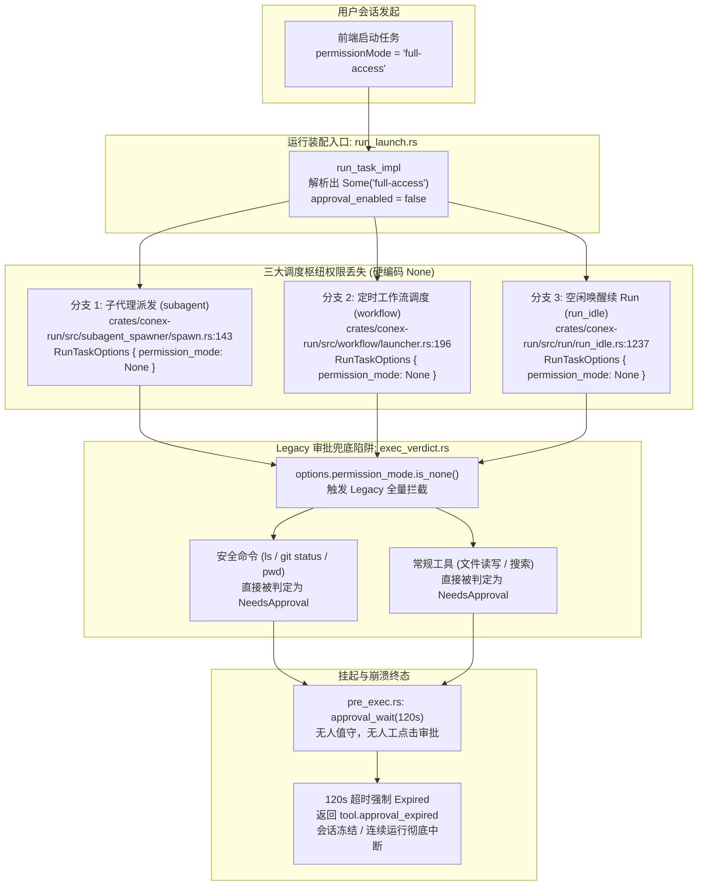
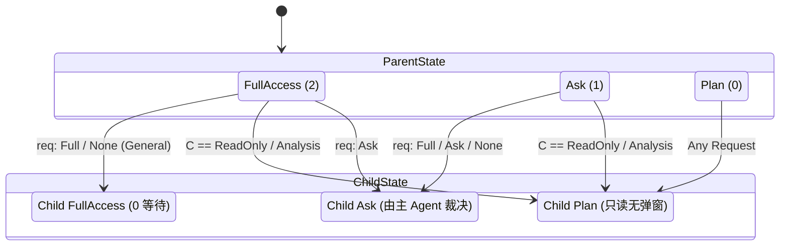
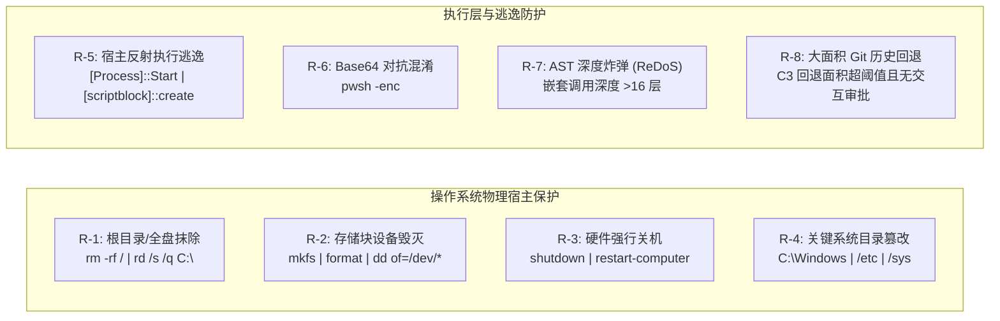
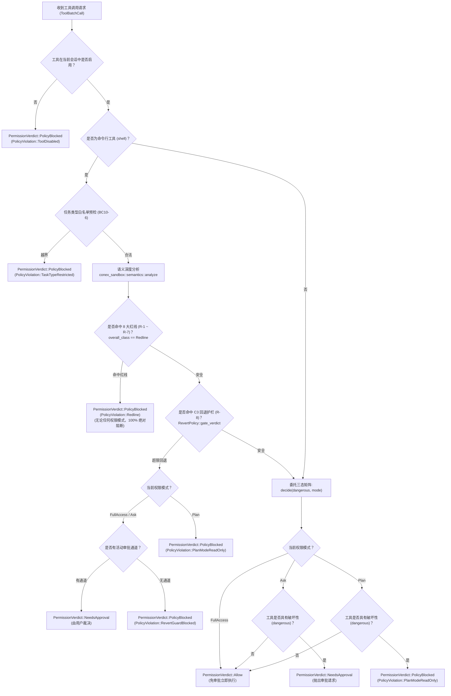

# 方案 01：权限模式与安全抽象系统重构方案 (Permission System & Security Abstraction Redesign)

> **战役代号**：`continuous-execution-hardening` (全天候自主 Agent 连续运行硬化战役)  
> **方案定位**：方案 01 - 权限模式、全链路透传与安全抽象系统重构 (Plans/01)  
> **输入文档**：  
> - `docs/continuous-execution-hardening/analysis/03-full-access-and-permissions.md` (权限与完全访问深度审查报告)  
> - `docs/continuous-execution-hardening/00-continuous-execution-master-plan.md` (全天候自主 Agent 连续运行硬化战役总纲方案)  
> **核心使命**：彻底拔除遗留的 Legacy 审批兜底陷阱与散落的弱类型字符串浅比较，将 `FullAccess` 确立为系统一等公民；构建统一强类型的权限与安全架构，贯通“主会话 ↔ 子代理 ↔ 定时工作流 ↔ 空闲续跑”全链路；确立结构化 Redline 拦截器并统一升级报错协议为 `PolicyBlocked`，保障 Agent 24/7 全天候自主执行具备绝对刚性红线且永不因权限脱落而假死中断。  
> **版本与属性**：v1.0.0 / UTF-8 无 BOM / 纯逻辑架构设计方案 / 严禁打补丁

---

## 目录 (Table of Contents)

- [一、 现状病灶与重构动因 (Motivation & Root Cause Analysis)](#一-现状病灶与重构动因-motivation--root-cause-analysis)
  - [1.1 全链路权限断崖：三大派发点硬编码丢失](#11-全链路权限断崖三大派发点硬编码丢失)
  - [1.2 Legacy 兜底陷阱：None 模式导致全批全量刚性拦截](#12-legacy-兜底陷阱none-模式导致全批全量刚性拦截)
  - [1.3 字符串浅比较与别名穿透脆弱性](#13-字符串浅比较与别名穿透脆弱性)
  - [1.4 反常红线报错体验与模型死循环重试](#14-反常红线报错体验与模型死循环重试)
  - [1.5 架构重构五大核心原则](#15-架构重构五大核心原则)
- [二、 强类型权限与安全抽象体系设计 (Strongly-Typed Architecture)](#二-强类型权限与安全抽象体系设计-strongly-typed-architecture)
  - [2.1 统一权限模式模型：PermissionMode 偏序格](#21-统一权限模式模型permissionmode-偏序格)
  - [2.2 彻底移除审批门布尔双源：收敛 ToolBatchOptions](#22-彻底移除审批门布尔双源收敛-toolbatchoptions)
  - [2.3 裁决域重构：升级 PermissionVerdict 枚举](#23-裁决域重构升级-permissionverdict-枚举)
  - [2.4 结构化违规载荷：PolicyViolation 与 8 大刚性红线字典](#24-结构化违规载荷policyviolation-与-8-大刚性红线字典)
  - [2.5 错误分类域重构：引入 ToolErrorKind::PolicyBlocked](#25-错误分类域重构引入-toolerrorkindpolicyblocked)
- [三、 全链路权限继承与会话级记忆架构 (Propagation & Session Memory)](#三-全链路权限继承与会话级记忆架构-propagation--session-memory)
  - [3.1 会话级权限事实源 (SSOT) 与 session_meta 持久化契约](#31-会话级权限事实源-ssot-与-session_meta-持久化契约)
  - [3.2 运行启动层归一化与恢复契约 (run_launch.rs)](#32-运行启动层归一化与恢复契约-run_launchrs)
  - [3.3 子代理派发与单向最小特权衰减状态机 (Least-Privilege Decay)](#33-子代理派发与单向最小特权衰减状态机-least-privilege-decay)
  - [3.4 定时工作流无人值守全自主权限契约 (workflow/launcher.rs)](#34-定时工作流无人值守全自主权限契约-workflowlauncherrs)
  - [3.5 长程空闲唤醒与自驱续跑权限连续性 (run_idle.rs)](#35-长程空闲唤醒与自驱续跑权限连续性-run_idlers)
- [四、 结构化 Redline 拦截器与自愈闭环设计 (Redline & Feedback Loop)](#四-结构化-redline-拦截器与自愈闭环设计-redline--feedback-loop)
  - [4.1 8 大不可逾越安全红线防御边界规范 (R-1 至 R-8)](#41-8-大不可逾越安全红线防御边界规范-r-1-至-r-8)
  - [4.2 拦截流水线决策时序与预检架构](#42-拦截流水线决策时序与预检架构)
  - [4.3 面向大模型的建设性结构化纠错引导机制](#43-面向大模型的建设性结构化纠错引导机制)
  - [4.4 安全审计事件独立通道发射契约](#44-安全审计事件独立通道发射契约)
- [五、 待删除历史包袱与代码债务清理清单 (Legacy Code Removal Checklist)](#五-待删除历史包袱与代码债务清理清单-legacy-code-removal-checklist)
  - [5.1 弱类型字符串浅比较删除清单](#51-弱类型字符串浅比较删除清单)
  - [5.2 Legacy 兜底分支与失步判定删除清单](#52-legacy-兜底分支与失步判定删除清单)
  - [5.3 审批门布尔双源同步逻辑删除清单](#53-审批门布尔双源同步逻辑删除清单)
  - [5.4 笔记工具双重审批冗余清理清单](#54-笔记工具双重审批冗余清理清单)
- [六、 模块级改造方案与详细实现契约 (Module Implementation Specifications)](#六-模块级改造方案与详细实现契约-module-implementation-specifications)
  - [6.1 crates/agent-tools/src/permission.rs 改造契约](#61-cratesagent-toolssrcpermissionrs-改造契约)
  - [6.2 crates/conex-sandbox/src/semantics.rs 扩展契约](#62-cratesconex-sandboxsrcsemanticsrs-扩展契约)
  - [6.3 crates/session-loop/src/tool_events.rs 改造契约](#63-createssession-loopsrctool_eventsrs-改造契约)
  - [6.4 crates/session-loop/src/exec_verdict.rs 改造契约](#64-createssession-loopsrcexec_verdictrs-改造契约)
  - [6.5 crates/session-loop/src/exec_single/pre_exec.rs 改造契约](#65-createssession-loopsrcexec_singlepre_execrs-改造契约)
  - [6.6 crates/conex-db/src/sessions/ 扩展契约](#66-cratesconex-dbsrcsessions-扩展契约)
  - [6.7 crates/conex-run/src/run/run_launch.rs 改造契约](#67-cratesconex-runsrcrunrun_launchrs-改造契约)
  - [6.8 crates/conex-run/src/subagent_spawner/spawn.rs 改造契约](#68-cratesconex-runsrcsubagent_spawnerspawnrs-改造契约)
  - [6.9 crates/conex-run/src/workflow/launcher.rs 改造契约](#69-cratesconex-runsrcworkflowlauncherrs-改造契约)
  - [6.10 crates/conex-run/src/run/run_idle.rs 改造契约](#610-cratesconex-runsrcrunrun_idlers-改造契约)
- [七、 立体化防御测试矩阵与验收断言 (Comprehensive Verification Matrix)](#七-立体化防御测试矩阵与验收断言-comprehensive-verification-matrix)
  - [7.1 单元测试套件：权限偏序、衰减算法与结构化序列化](#71-单元测试套件权限偏序衰减算法与结构化序列化)
  - [7.2 模块集成测试套件：裁决矩阵与 PolicyBlocked 非致命性](#72-模块集成测试套件裁决矩阵与-policyblocked-非致命性)
  - [7.3 端到端全链路验收套件：长程自驱与红线自愈实测](#73-端到端全链路验收套件长程自驱与红线自愈实测)

---

## 一、 现状病灶与重构动因 (Motivation & Root Cause Analysis)

在 Conex / Crish 软件生态中，实现“全天候、长程、无人值守连续运行 (24/7 Unattended Continuous Execution)”的核心前提是：**用户赋予 Agent 的执行信任（如 FullAccess / 完全访问模式）必须能够在多 Agent 派发协同、自动化定时工作流调度、跨轮次事件唤醒续跑等整个生命周期中无缝透传并持续生效，同时系统必须对确定性毁灭级操作保有绝对不可逾越的刚性防御**。

然而，深度代码审查（详见 `docs/continuous-execution-hardening/analysis/03-full-access-and-permissions.md`）揭示，现有系统在权限与安全抽象上存在严重的架构缺陷与历史包袱，导致系统在无人值守时面临 100% 确定性的中断与假死。

### 1.1 全链路权限断崖：三大派发点硬编码丢失

系统在正常用户交互会话中，前端通过 IPC 传入 `permissionMode: "full-access"`。该参数代表用户对 Agent 进行高阶授权，本应贯穿整个执行拓扑。但在三大关键派生调度分支中，代码全部硬编码了 `permission_mode: None`，彻底掐断了权限传递：



1. **子代理派发（`crates/conex-run/src/subagent_spawner/spawn.rs:143`）**：
   主 Agent 在 `FullAccess` 模式下派发分析或实现子代理。但 `SubagentSpawnRequest`（`crates/agent-tools/src/tools/subagent/contract.rs`）根本未定义 `permission_mode` 字段；`SubagentSpawnerImpl` 在组装 `RunTaskOptions` 时硬编码 `permission_mode: None`。子代理启动后立刻丢失父 Agent 的完全访问授权。
2. **定时工作流（`crates/conex-run/src/workflow/launcher.rs:196`）**：
   定时任务（Scheduled Tasks / Crons）设计初衷是全自主离线批处理（如凌晨执行回归测试套件）。但 `launch_scheduled_task` 装配 `RunTaskOptions` 时硬编码 `permission_mode: None`，导致任何需要写文件或执行命令的定时任务刚启动就撞墙。
3. **长程空闲唤醒与自主续 run（`crates/conex-run/src/run/run_idle.rs:1237`）**：
   在自主 Agent（Autonomous Drive）生命周期中，上一轮执行完进入休眠后，后续由子代理回传结果、一次性定时器触发或转向队列（Steering Queue）唤醒时，`spawn_idle_resume_run` 重新构造 `RunTaskOptions` 时硬编码 `permission_mode: None`。主会话原本由用户明确授予的 `FullAccess` 权限在此瞬间被无声抹除！

### 1.2 Legacy 兜底陷阱：None 模式导致全批全量刚性拦截

在现行代码实现中，`permission_mode: None` 并不是简单地退化为默认的“需确认模式 (Ask Mode)”，而是触发了更致命的 **Legacy 历史兜底逻辑**：

```rust
// crates/session-loop/src/exec_verdict.rs:138-143
if options.permission_mode.is_none() {
    return PermissionVerdict::NeedsApproval; // <--- 任何命令一律判定为需要审批！
}

// crates/session-loop/src/exec_verdict.rs:164-171
match options.permission_mode {
    Some(mode) => decide(dangerous, false, mode),
    // legacy：approval 开启 → 全部工具调用走审批
    None if options.approval_enabled => PermissionVerdict::NeedsApproval, // <--- 命中此分支！
    None => decide(dangerous, false, PermissionMode::Ask),
}
```

**为什么会引发 100% 挂起雪崩？**
- 在 `run_launch.rs:931` 中：`let approval_enabled = permission_mode.as_deref() != Some("full-access");`。当模式为 `None` 时，`approval_enabled` 为 `true`，系统挂载了 `ApprovalGate`；
- 执行命令时，`exec_verdict.rs:141` 命中 `options.permission_mode.is_none()`：**系统连最基础、绝对安全的只读命令（如 `ls`、`git status`、`pwd`、`cargo check`）都不放行，直接粗暴判定为 `NeedsApproval`**；
- 执行非命令工具（读文件、列出目录、搜索）时，`exec_verdict.rs:167` 命中 `None if options.approval_enabled`：**所有工具一律被标记为 `NeedsApproval`**；
- 会话循环进入 `pre_exec.rs:56` 调用 `approval_wait(..., 120s)`。在无人值守或自动化后台环境下，绝不会有人工在 120 秒内点击弹窗。120 秒超时后强制转为 `ApprovalDecision::Expired` 并返回 `tool.approval_expired`，长程自主运转当场夭折。

### 1.3 字符串浅比较与别名穿透脆弱性

在启动装配入口（`crates/conex-run/src/run/run_launch.rs:931`）中，权限判断采用了脆弱的字面量比较：
```rust
let approval_enabled = permission_mode.as_deref() != Some("full-access");
```
而在领域层 `crates/agent-tools/src/permission.rs:38-49` 中，系统支持丰富的别名：`"full"`、`"yolo"`、`"danger"`、`"allow"` 等。
如果前端、扩展面板或外部 API 传入 `"full"` 或 `"yolo"`：
- 工具选项（`tool_options.permission_mode`）经 `from_engine_str` 正确映射为 `PermissionMode::FullAccess`；
- 但第 931 行处的 `approval_enabled` 却因为字符串不等于 `"full-access"` 而被计算为 `true`！
- 这导致系统挂载了审批门，而在执行器层又试图免审批，引发内核两层状态机失步（Split-Brain），埋下严重隐患。

### 1.4 反常红线报错体验与模型死循环重试

根据全仓安全底线（`AGENTS.md`、`docs/rust-rewrite/31-security-baseline.md` 与 `conex-sandbox`），任何权限模式（包含 FullAccess）都绝对禁止执行毁灭性操作（如盘符格式化、设备写入、`rm -rf /` 等）。底层沙箱也确实在命中红线时强制拦截。

然而，拦截后的报错机制极其反常：
```rust
// crates/session-loop/src/exec_verdict.rs:223-250
let mode = options.permission_mode.unwrap_or(PermissionMode::Ask).as_engine_str();
format!("permission denied by {mode} mode: {}", call.tool_name)
// 当处于 full-access 时，生成报错：
// "permission denied by full-access mode: shell"
```
且在 `denied_result` 中将其错误码归类为：
```rust
ToolErrorKind::UserDenied // 假冒用户拒绝！
```

**危害与恶果**：
1. **语义反常自相矛盾**：模型被赋予完全访问权限，收到报错却说“被完全访问模式拒绝了”。模型完全无法理解这一因果逻辑；
2. **审计失真**：系统将内核刚性安全策略拦截伪装为 `UserDenied`，破坏了安全遥测日志的真实性；
3. **引发对抗性重试死循环**：模型误以为是 Shell 工具或系统出现偶发故障，为了完成任务，往往尝试使用更隐蔽、更危险的手段（如 Python 反射调用、Base64 编码命令）进行绕过尝试，直至耗尽轮次。

### 1.5 架构重构五大核心原则

为彻底根除上述结构性缺陷，本方案立足长远，制定以下五大刚性重构铁律：

| 序号 | 核心原则 | 具体要求与架构约束 |
|:---|:---|:---|
| **P-1** | **严禁打补丁与硬编码 (No Patchwork)** | 严禁在下游零散添加 `if mode == "full-access"` 或类似字面量判断；所有权限判定必须经由强类型模型流转，消除一切特例代码。 |
| **P-2** | **纯粹强类型与一等公民 (Strongly-Typed First-Class)** | `PermissionMode` 是系统一等公民，禁止在运行期承载模糊的 `None`；`ToolBatchOptions` 中权限模式必须为非空强类型枚举，彻底拔除 Legacy 兜底拦截分支。 |
| **P-3** | **会话级权限记忆事实源 (SSOT Permission Memory)** | 以 SQLite `session_meta` 中的 `{session_id}:permission_mode` 作为会话唯一事实源，空闲唤醒、子 Run 续跑、定时恢复 100% 自动还原，杜绝权限中途丢失。 |
| **P-4** | **单向最小特权继承与衰减 (Least-Privilege Lattice)** | 建立权限偏序格 $P_{	ext{child}} = \min(P_{	ext{parent}}, P_{	ext{req}})$；子代理只能收紧、不得放大；只读/分析角色自动衰减为 `Plan`。 |
| **P-5** | **结构化 Redline 与建设性纠错 (Structured Redline & Actionable Guidance)** | 确立 8 大红线规则字典，拦截时统一抛出 `ToolErrorKind::PolicyBlocked`，生成详细的因果解释与工作区安全指引，保持非致命推进，引导模型自主纠错。 |

---
## 二、 强类型权限与安全抽象体系设计 (Strongly-Typed Architecture)

要实现系统的长程健壮性，必须使用 Rust 的强类型系统重塑整个权限与安全抽象，消除一切多源歧义与字符串弱类型漏洞。

### 2.1 统一权限模式模型：PermissionMode 偏序格

将 `PermissionMode` 严格确立为数学偏序格（Partially Ordered Lattice / Meet-Semilattice）：
$$\text{Plan} \prec \text{Ask} \prec \text{FullAccess}$$

- **`Plan` (只读规划，偏序权重 0)**：禁止任何破坏性副作用。写操作、修改与越界命令直接静默阻断（返回结构化 `PolicyBlocked`），不弹窗。
- **`Ask` (交互需确认，偏序权重 1)**：安全工具自动放行；危险工具与越界命令走审批门，等待用户或审批裁决者批准。
- **`FullAccess` (完全访问，偏序权重 2)**：系统一等公民。安全工具与常规危险工具全部免人工审批放行；仅受 8 大绝对刚性红线（Redline）与超限回退护栏约束。

```rust
// crates/agent-tools/src/permission.rs

use serde::{Deserialize, Serialize};

/// 权限模式（统一强类型一等公民）
///
/// 实现了 PartialOrd / Ord，具备明确的权限能力高低顺序：
/// Plan (只读) < Ask (需审批) < FullAccess (完全访问)
#[derive(Debug, Clone, Copy, PartialEq, Eq, PartialOrd, Ord, Hash, Default, Serialize, Deserialize)]
#[serde(rename_all = "kebab-case")]
pub enum PermissionMode {
    /// 计划模式（只读）：仅允许非破坏性读取与分析，写操作/越界命令直接策略阻断
    Plan = 0,
    /// 需确认模式（默认）：安全只读放行，破坏性/危险操作走审批门
    #[default]
    Ask = 1,
    /// 完全访问模式（完全自主）：免审批放行常规破坏性操作，仅受绝对刚性红线拦截
    FullAccess = 2,
}

impl PermissionMode {
    /// 归一化解析（统一全仓别名解析唯一事实源，严格消除字面量失步漏洞）
    pub fn from_engine_str(mode: Option<&str>) -> Self {
        match mode {
            Some(s) => match s.trim().to_ascii_lowercase().as_str() {
                "full-access" | "full" | "full_access" | "allow" | "yolo" | "danger" => {
                    PermissionMode::FullAccess
                }
                "plan" | "readonly" | "read-only" | "analysis" | "safe" | "cautious" => {
                    PermissionMode::Plan
                }
                // ask / deep / interactive / confirm / auto / unattended / 未知值均安全回落至 Ask
                _ => PermissionMode::Ask,
            },
            None => PermissionMode::Ask,
        }
    }

    /// 序列化为引擎传输字面量
    pub fn as_engine_str(&self) -> &'static str {
        match self {
            PermissionMode::Plan => "plan",
            PermissionMode::Ask => "ask",
            PermissionMode::FullAccess => "full-access",
        }
    }

    /// 最小特权交集计算（Meet 操作）：计算两个权限模式的下确界（只能降级，不可提权）
    #[inline]
    pub fn intersect(self, other: Self) -> Self {
        std::cmp::min(self, other)
    }

    /// 是否为完全访问模式
    #[inline]
    pub fn is_full_access(&self) -> bool {
        matches!(self, PermissionMode::FullAccess)
    }

    /// 是否为只读计划模式
    #[inline]
    pub fn is_plan(&self) -> bool {
        matches!(self, PermissionMode::Plan)
    }

    /// 判定是否允许执行指定路径的文件修改或写入（受控产出白名单）
    pub fn is_file_write_permitted(&self, target_path: &std::path::Path, workspace_root: &std::path::Path) -> bool {
        match self {
            PermissionMode::FullAccess => true,
            PermissionMode::Ask => true,
            PermissionMode::Plan => {
                let output_dir = workspace_root.join(".agent-outputs");
                target_path.starts_with(&output_dir)
            }
        }
    }
}
```

### 2.2 彻底移除审批门布尔双源：收敛 ToolBatchOptions

历史遗留的 `approval_enabled: bool` 与 `permission_mode: Option<PermissionMode>` 是导致状态机内部撕裂（Split-Brain）的根源。重构方案彻底移除 `approval_enabled` 布尔字段，执行配置内仅保留非空强类型 `permission_mode`：

```rust
// crates/session-loop/src/tool_events.rs

/// 批次执行配置（强类型重构版）
#[derive(Debug, Clone)]
pub struct ToolBatchOptions {
    /// 每工具执行超时
    pub timeout: Duration,
    /// 失败策略
    pub fail_strategy: FailStrategy,
    /// 单工具输出预算（字节）
    pub output_budget_bytes: Option<usize>,
    
    // ── 核心重构：移除 approval_enabled 布尔字段 ──
    /// 执行权限模式（强类型一等公民，禁止 Option::None）
    pub permission_mode: PermissionMode,
    
    /// 批级审批等待超时
    pub approval_timeout: Option<Duration>,
    /// 并行组最大并发数
    pub max_parallel: Option<usize>,
    /// 子代理任务类型
    pub task_type: Option<String>,
}

impl Default for ToolBatchOptions {
    fn default() -> Self {
        Self {
            timeout: Duration::from_secs(60),
            fail_strategy: FailStrategy::FailFast,
            output_budget_bytes: Some(conex_shared::perf_budget::TOOL_OUTPUT_BUDGET_BYTES_DEFAULT),
            permission_mode: PermissionMode::Ask, // 安全默认
            approval_timeout: Some(Duration::from_secs(120)),
            max_parallel: Some(4),
            task_type: None,
        }
    }
}
```

**消除双源矛盾逻辑**：
一个工具调用是否需要发起审批，不再由外层布尔状态决定，而是纯函数 `decide(tool, command, permission_mode)` 计算出的唯一不变量！在 `FullAccess` 下，该函数直接返回 `Allow`；在 `Ask` 下，针对危险项返回 `NeedsApproval`；在 `Plan` 下，直接返回 `PolicyBlocked`。

### 2.3 裁决域重构：升级 PermissionVerdict 枚举

将原本扁平模糊的 `PermissionVerdict::Deny` 升级为具备强类型违规载荷的 `PolicyBlocked(PolicyViolation)`：

```rust
// crates/agent-tools/src/permission.rs

/// 权限判定裁决结果
#[derive(Debug, Clone, PartialEq, Eq)]
pub enum PermissionVerdict {
    /// 放行执行（无需人工确认，直接进入执行管线）
    Allow,
    /// 需审批（需用户或审批裁决者批准）
    NeedsApproval,
    /// 策略阻断（系统安全红线、沙箱规则、只读约束等，不可人工临时绕过）
    PolicyBlocked(PolicyViolation),
}
```

### 2.4 结构化违规载荷：PolicyViolation 与 8 大刚性红线字典

为确保安全拦截不仅能刚性防守，还能向模型提供极其清晰、具备因果自洽性与行动指引的纠错反馈，确立结构化违规类型 `PolicyViolation` 与 8 大红线规则枚举 `RedlineRuleId`：

```rust
// crates/agent-tools/src/permission.rs

/// 8 大系统安全红线规则强类型标识
#[derive(Debug, Clone, Copy, PartialEq, Eq, Hash, Serialize, Deserialize)]
#[serde(rename_all = "snake_case")]
pub enum RedlineRuleId {
    /// R-1: 根文件系统或盘符根目录毁灭性清空 (rm -rf / 等)
    R1RootDestruction,
    /// R-2: 底层存储设备格式化与块设备覆写 (mkfs, format, dd 写设备)
    R2StorageDeviceDestruction,
    /// R-3: 操作系统硬件级强行停机或重启 (shutdown, restart-computer)
    R3SystemHardwareHalt,
    /// R-4: 操作系统核心敏感系统目录修改 (C:\Windows, /etc, /boot 等)
    R4CriticalSystemDirectory,
    /// R-5: 动态代码反射与不受控宿主进程提权逃逸 ([Process]::Start 等)
    R5ProcessReflectionEscape,
    /// R-6: 混淆对抗型 Base64/编码载荷绕过攻击
    R6EncodedPayloadBypass,
    /// R-7: AST 嵌套深度炸弹与 ReDoS 拒绝服务攻击 (>16层包裹)
    R7AstDepthBomb,
    /// R-8: 超大规模破坏性 Git 历史强退 (大面积硬回退护栏)
    R8ExcessiveRevertArea,
}

impl RedlineRuleId {
    pub fn rule_code(&self) -> &'static str {
        match self {
            Self::R1RootDestruction => "REDLINE-R1-ROOT-DESTRUCTION",
            Self::R2StorageDeviceDestruction => "REDLINE-R2-STORAGE-WIPE",
            Self::R3SystemHardwareHalt => "REDLINE-R3-HARDWARE-HALT",
            Self::R4CriticalSystemDirectory => "REDLINE-R4-SYSTEM-DIR-TAMPER",
            Self::R5ProcessReflectionEscape => "REDLINE-R5-REFLECTION-ESCAPE",
            Self::R6EncodedPayloadBypass => "REDLINE-R6-ENCODED-BYPASS",
            Self::R7AstDepthBomb => "REDLINE-R7-AST-DEPTH-BOMB",
            Self::R8ExcessiveRevertArea => "REDLINE-R8-EXCESSIVE-REVERT",
        }
    }
}

/// 策略阻断结构化违规载荷
#[derive(Debug, Clone, PartialEq, Eq, Serialize, Deserialize)]
#[serde(tag = "category", content = "payload", rename_all = "snake_case")]
pub enum PolicyViolation {
    /// 触发 8 大不可逾越安全红线
    Redline {
        rule: RedlineRuleId,
        target: String,
        description: String,
        remediation_hint: String,
    },
    /// 计划模式（只读）拦截写操作
    PlanModeReadOnly {
        tool_name: String,
        remediation_hint: String,
    },
    /// 任务类型（TaskType）命令白名单限制（BC10-6）
    TaskTypeRestricted {
        task_type: String,
        command: String,
        remediation_hint: String,
    },
    /// 工具在当前会话注册表中被显式禁用
    ToolDisabled {
        tool_name: String,
    },
    /// C3 大面积 Git 回退在无审批通道可用时被策略阻断
    RevertGuardBlocked {
        summary: String,
        remediation_hint: String,
    },
}

impl PolicyViolation {
    /// 生成面向大模型的高内聚、建设性纠错引导 Prompt 文案
    pub fn to_model_feedback_prompt(&self, mode: PermissionMode) -> String {
        match self {
            Self::Redline { rule, target, description, remediation_hint } => {
                format!(
                    "[SECURITY POLICY VIOLATION: {}]
                    Operation Permanently Prohibited: {}
                    Target/Payload: {}
                    Security Rule: This operation violates a non-negotiable system safety redline and is strictly blocked even under {} mode.
                    Actionable Guidance: {}",
                    rule.rule_code(), description, target, mode.as_engine_str(), remediation_hint
                )
            }
            Self::PlanModeReadOnly { tool_name, remediation_hint } => {
                format!(
                    "[POLICY RESTRICTION: PLAN_MODE_READ_ONLY]
                    Prohibited Tool: '{}' performs state modification or side-effects.
                    Current Mode: Plan (Read-Only) mode active.
                    Actionable Guidance: {}",
                    tool_name, remediation_hint
                )
            }
            Self::TaskTypeRestricted { task_type, command, remediation_hint } => {
                format!(
                    "[POLICY RESTRICTION: TASK_TYPE_SCOPE_LIMIT]
                    Violating Command: '{}'
                    Current Role Scope: TaskType '{}' permits only read-only or scoped commands.
                    Actionable Guidance: {}",
                    command, task_type, remediation_hint
                )
            }
            Self::ToolDisabled { tool_name } => {
                format!(
                    "[POLICY RESTRICTION: TOOL_DISABLED]
                    Tool '{}' is disabled in this session environment.",
                    tool_name
                )
            }
            Self::RevertGuardBlocked { summary, remediation_hint } => {
                format!(
                    "[SAFETY REVERT GUARD BLOCKED]
                    Operation: {}
                    Protection: Large-scale destructive git resets are blocked without active interactive approval channels.
                    Actionable Guidance: {}",
                    summary, remediation_hint
                )
            }
        }
    }
}
```

### 2.5 错误分类域重构：引入 ToolErrorKind::PolicyBlocked

彻底废弃以 `ToolErrorKind::UserDenied` 冒充系统策略阻断的做法。在 `ToolErrorKind` 中正式引入 `PolicyBlocked`，并在 wire 协议与事件中登记权威错误码 `tool.policy_blocked`：

```rust
// crates/session-loop/src/tool_events.rs

#[derive(Debug, Clone, Copy, PartialEq, Eq)]
pub enum ToolErrorKind {
    NotFound,
    InvalidInput,
    ExecutionFailed,
    Timeout,
    UserDenied,         // 仅保留给：真实用户在审批卡片上明确点击“拒绝”
    ApprovalExpired,
    ApprovalRequired,
    SoftDeny,
    Cancelled,
    AbortedBeforeDispatch,
    OutcomeUnknown,
    
    // ── 核心新增 ──
    /// 系统安全策略阻断（红线拦截、只读模式拦截、任务类型越界）
    PolicyBlocked,
}

impl ToolErrorKind {
    /// 永不致命（Non-Fatal）判定：
    /// PolicyBlocked 必须永不致命，确保报错作为工具结果喂回模型对话上下文，
    /// 驱动模型自主反思换路，绝不引发会话恐慌或崩溃终止！
    pub fn is_never_fatal(self) -> bool {
        matches!(
            self,
            ToolErrorKind::Timeout
                | ToolErrorKind::UserDenied
                | ToolErrorKind::ApprovalExpired
                | ToolErrorKind::ApprovalRequired
                | ToolErrorKind::SoftDeny
                | ToolErrorKind::Cancelled
                | ToolErrorKind::AbortedBeforeDispatch
                | ToolErrorKind::OutcomeUnknown
                | ToolErrorKind::PolicyBlocked // <--- 刚性纳入永不致命清单
        )
    }

    /// 映射 wire 协议错误码
    pub fn error_code(self) -> &'static str {
        use conex_types::error::codes;
        match self {
            ToolErrorKind::NotFound => codes::TOOL_NOT_FOUND,
            ToolErrorKind::InvalidInput => codes::TOOL_INVALID_INPUT,
            ToolErrorKind::ExecutionFailed => codes::TOOL_EXECUTION_FAILED,
            ToolErrorKind::Timeout => "tool.timeout",
            ToolErrorKind::UserDenied => "tool.user_denied",
            ToolErrorKind::ApprovalExpired => "tool.approval_expired",
            ToolErrorKind::ApprovalRequired => "tool.requires_approval",
            ToolErrorKind::SoftDeny => "tool.soft_deny",
            ToolErrorKind::Cancelled => codes::TOOL_CANCELLED,
            ToolErrorKind::AbortedBeforeDispatch => codes::TOOL_ABORTED_BEFORE_DISPATCH,
            ToolErrorKind::OutcomeUnknown => codes::TOOL_OUTCOME_UNKNOWN,
            ToolErrorKind::PolicyBlocked => "tool.policy_blocked", // <--- 权威错误码
        }
    }
}
```

---
## 三、 全链路权限继承与会话级记忆架构 (Propagation & Session Memory)

要保证 Agent 24/7 全天候持续运转，权限模式必须超越单轮生命周期，建立贯穿整个会话全图谱的记忆与继承机制。

### 3.1 会话级权限事实源 (SSOT) 与 session_meta 持久化契约

在现有系统数据库结构中，`session_meta` 表（SQLite key-value WITHOUT ROWID 表）已作为会话级配置（如 `output_dir`、`goal_state`、`timer_*`）的持久化存储，并且 `conex-db::sessions::orphan` 原生支持在会话删除时级联清除 `{session_id}:*` 前缀的所有键。

因此，重构方案采用 **零 DDL 变更 (Zero-DDL Migration)** 的优雅方式，将权限模式绑定到 `session_meta`：

- **键名规范**：`{session_id}:permission_mode`
- **值规范**：`"full-access"` | `"ask"` | `"plan"`
- **生命周期契约**：
  1. **首创写入**：用户发起首轮对话时，前端传入模式，经归一化写入 `session_meta`；
  2. **中途更新**：用户若在交互中通过设置面板或切换按钮调整权限模式，立即通过 IPC 更新 `session_meta`；
  3. **重启水合 (Hydration)**：系统冷启动或崩溃重启时，直接从该键读取会话锁定权限；
  4. **孤儿级联清理**：会话被删除时，既有的 `delete_session_meta_prefix_conn` 自动清理该键，零存储泄漏。

```rust
// crates/conex-db/src/sessions/mod.rs

impl Database {
    /// 获取指定会话已锁定的权限模式（从 session_meta 事实源读取）
    pub fn get_session_permission_mode(&self, session_id: &str) -> Result<Option<String>, DbFailure> {
        let key = format!("{session_id}:permission_mode");
        self.get_session_meta(&key)
    }

    /// 设置指定会话的权限模式
    pub fn set_session_permission_mode(&self, session_id: &str, mode: &str) -> Result<(), DbFailure> {
        let key = format!("{session_id}:permission_mode");
        self.set_session_meta(&key, mode)
    }
}
```

### 3.2 运行启动层归一化与恢复契约 (run_launch.rs)

在运行启动入口 `run_task_impl` 中，彻底消除对 `Option<String>` 权限模式的散落判断，构建严格的三阶决策流：

```text
[用户入参 options.permission_mode]
       │
       ├─► Some(mode_str) ──► 归一化为 PermissionMode
       │                       │
       │                       └─► 同步持久化写入 session_meta: "{session_id}:permission_mode"
       │
       └─► None ────────────► 从 session_meta 读取历史记忆
                               │
                               ├─► 读取成功 ──► 还原历史 PermissionMode (如 FullAccess)
                               │
                               └─► 读取为空 ──► 安全缺省回退至 PermissionMode::Ask
```

```rust
// crates/conex-run/src/run/run_launch.rs:748 处重构代码

// 1. 解析生效权限模式：入参优先，元数据记忆次之，安全 Ask 兜底
let effective_mode: PermissionMode = match options.permission_mode.as_deref() {
    Some(raw) => {
        let mode = PermissionMode::from_engine_str(Some(raw));
        // 仅在主会话或显式覆盖时同步更新会话记忆
        if options.parent_run_id.is_none() {
            let _ = state.store.set_session_permission_mode(&session_id, mode.as_engine_str());
        }
        mode
    }
    None => {
        // 从持久化事实源还原
        state.store
            .get_session_permission_mode(&session_id)
            .ok()
            .flatten()
            .map(|s| PermissionMode::from_engine_str(Some(&s)))
            .unwrap_or(PermissionMode::Ask)
    }
};

// 2. 审批门恒常装配：全生命周期注入真实审批门（保证 R-8 回退护栏与极端红线弹性通道）
// 无论是否 FullAccess 均完整装配，执行器内部由纯函数 decide(dangerous, requires_approval, mode) 决定是否弹窗
let approval: Option<Arc<dyn ApprovalGate>> = Some(Arc::clone(&approval_gate) as Arc<dyn ApprovalGate>);

// 3. 构造 ToolBatchOptions：下发强类型 PermissionMode，彻底移除 approval_enabled
let tool_options = ToolBatchOptions {
    permission_mode: effective_mode,
    output_budget_bytes: Some(conex_shared::perf_budget::TOOL_OUTPUT_BUDGET_BYTES_DEFAULT),
    task_type: options.task_type.clone(),
    ..ToolBatchOptions::default()
};
```

### 3.3 子代理派发与单向最小特权衰减状态机 (Least-Privilege Decay)

子代理的权限管理必须在“全天候连续执行（无需人工在场）”与“安全隔离与防提权（最小特权）”之间取得精准平衡。为此，确立**单向最小特权衰减状态机 (Monotonic Least-Privilege Attenuation)**。

#### 1. 状态转移数学规则

设父 Agent 模式为 $P_{\text{parent}}$，子代理请求模式为 $P_{\text{req}}$，子代理能力模式为 $C$，任务类型为 $T$。子代理最终生效权限 $P_{\text{child}}$ 由下式严格决定：

$$P_{\text{child}} = \begin{cases}
\text{Plan}, & \text{若 } C = \text{ReadOnly} \lor T \in \{\text{Analysis}, \text{Survey}\} \\
\min(P_{\text{parent}}, P_{\text{req}}), & \text{其他情况}
\end{cases}$$

其中偏序关系：$\text{Plan} (0) < \text{Ask} (1) < \text{FullAccess} (2)$。

#### 2. 状态转移矩阵

| 父 Agent 模式 ($P_{\text{parent}}$) | 子代理请求模式 ($P_{\text{req}}$) | 能力模式 ($C$) / 任务类型 ($T$) | 最终子代理生效模式 ($P_{\text{child}}$) | 转移裁决解释 |
|:---|:---|:---|:---|:---|
| **FullAccess** | 未指定 (None) | 通用 (General) / Implementation | **FullAccess** | **自动继承**：子代理完全继承父级自主能力，免审批连续推进 |
| **FullAccess** | FullAccess | 通用 / Implementation | **FullAccess** | **显式授权放行** |
| **FullAccess** | Ask | 通用 / Implementation | **Ask** | **主动收紧**：子代理自行要求谨慎审批，允许权限收紧 |
| **FullAccess** | 任何模式 | **ReadOnly** 或 **Analysis** | **Plan** | **刚性衰减**：分析/调研类子代理禁止写权限，强制降级为 Plan |
| **Ask** | FullAccess | 通用 / Implementation | **Ask** | **防提权拦截**：父级仅为 Ask，子代理妄图 FullAccess，强制截断至 Ask |
| **Ask** | 未指定 (None) | 通用 / Implementation | **Ask** | **平级继承** |
| **Plan** | 任何模式 (含 Full) | 任何 | **Plan** | **零权限锁定**：只读父 Agent 派生的任何子 Agent 绝对只能是 Plan |



#### 3. 契约层与 Spawner 改造

1. **接口层修改**（`crates/agent-tools/src/tools/subagent/contract.rs`）：
   ```rust
   pub struct SubagentSpawnRequest {
       pub agent_id: Option<String>,
       pub prompt: String,
       pub role: Option<SubagentRole>,
       pub capability_mode: Option<SubagentCapabilityMode>,
       pub task_type: Option<TaskType>,
       
       // ── 核心新增 ──
       /// 子代理期望权限模式（None = 继承父级上下文并受规则衰减）
       pub permission_mode: Option<PermissionMode>,
       ...
   }
   ```
2. **工具层衰减计算**（`crates/agent-tools/src/tools/subagent/tool.rs`）：
   ```rust
   // 纯函数计算子代理最终权限
   pub fn resolve_child_permission(
       parent_mode: PermissionMode,
       requested_mode: Option<PermissionMode>,
       capability_mode: Option<SubagentCapabilityMode>,
       task_type: Option<&TaskType>,
   ) -> PermissionMode {
       // 1. 若为只读或勘察分析角色，强制衰减为 Plan
       if matches!(capability_mode, Some(SubagentCapabilityMode::ReadOnly))
           || matches!(task_type, Some(TaskType::Analysis | TaskType::Survey))
       {
           return PermissionMode::Plan;
       }
       
       // 2. 最小特权偏序交集：min(parent, requested.unwrap_or(parent))
       let target = requested_mode.unwrap_or(parent_mode);
       parent_mode.intersect(target)
   }
   ```
3. **Spawner 派发器透传**（`crates/conex-run/src/subagent_spawner/spawn.rs:137`）：
   ```rust
   let child_permission = resolve_child_permission(
       parent_permission_mode,
       req.permission_mode,
       req.capability_mode,
       req.task_type.as_ref(),
   );

   let launch_options = RunTaskOptions {
       run_id: subagent_run_id.clone(),
       session_id: session_id.clone(),
       prompt: Some(req.prompt.clone()),
       mode: req.mode.clone().or_else(|| Some("research".to_string())),
       cwd: None,
       
       // 彻底修复硬编码 None！透传强计算出的子代理模式
       permission_mode: Some(child_permission.as_engine_str().to_string()),
       parent_run_id: parent_run.clone(),
       subagent_config: Some(config),
       ...
   };
   ```

### 3.4 定时工作流无人值守全自主权限契约 (workflow/launcher.rs)

定时工作流（Cron Workflows）在无人看守的夜间执行，核心目标是独立完成任务。

```rust
// crates/conex-run/src/workflow/launcher.rs:190-211

// 1. 从工作流定义中读取配置的权限模式；若未显式指定，默认赋予 FullAccess 模式
// 无人值守批处理绝不能在半夜弹窗等待 120 秒超时！
let workflow_permission = self.workflow_backend
    .get_workflow_permission_mode(&ctx.cron_id)
    .await
    .unwrap_or(PermissionMode::FullAccess);

let options = crate::run::RunTaskOptions {
    run_id: ctx.run_id.clone(),
    session_id: effective_session_id.clone(),
    prompt: Some(ctx.prompt.clone()),
    mode: Some("scheduled".to_string()),
    cwd: effective_cwd,
    
    // 彻底修复硬编码 None！下发确定的权限模式
    permission_mode: Some(workflow_permission.as_engine_str().to_string()),
    parent_run_id: None,
    subagent_config: None,
    ...
};
```

### 3.5 长程空闲唤醒与自驱续跑权限连续性 (run_idle.rs)

在长程会话自主运行期间，当一轮执行完成且外层队列有就绪事件（如子代理回传通知、计时器触发唤醒），系统通过 `spawn_idle_resume_run` 拉起下一轮执行。

```rust
// crates/conex-run/src/run/run_idle.rs:1231-1245

// 1. 从当前会话的 session_meta 事实源中读取并还原已锁定的权限模式
let restored_mode = state.store
    .get_session_permission_mode(&session_id)
    .ok()
    .flatten()
    .unwrap_or_else(|| "ask".to_string());

let options = RunTaskOptions {
    run_id: crate::engine_provider::new_message_id("idle-resume"),
    session_id: session_id.clone(),
    prompt: Some(text),
    mode: Some(mode.to_string()),
    cwd: None,
    
    // 彻底修复硬编码 None！原汁原味继承会话历史权限模式
    permission_mode: Some(restored_mode),
    parent_run_id: None,
    subagent_config: None,
    ...
};
```
通过该改造，用户最初设定的 `FullAccess` 将如同基因一样在会话状态机内代代相传，跨越任意多轮空闲与唤醒，彻底拔除中途退化为 Legacy 审批的死穴。

---
## 四、 结构化 Redline 拦截器与自愈闭环设计 (Redline & Feedback Loop)

在完全访问（FullAccess）模式下，Agent 拥有免人工确认执行破坏性操作（如编辑工程文件、安装依赖、构建测试）的特权。但“完全访问”代表的是对 Agent 的业务信任，**绝不代表允许执行操作系统级自毁动作**。

因此，系统必须建立刚性不可豁免的结构化红线拦截器，并在阻断时提供高质量自愈指引。

### 4.1 8 大不可逾越安全红线防御边界规范 (R-1 至 R-8)

无论处于任何权限模式（包含 `FullAccess`、`YOLO` 或 `Danger`），以下 8 类操作均被底层沙箱与语义层判定为绝对不可逾越的红线（Non-Bypassable Redline）：



| 规则编号 | 红线类别 (Redline Category) | 拦截判定特征 (Matching Signatures) | 阻断因果原因 (Root Cause Explanation) | 建设性纠错引导 (Actionable Guidance) |
|:---|:---|:---|:---|:---|
| **R-1** | 根与盘符全量删除 | 目标包含 `/`、`/*`、`C:\`、`C:\*` 等根路径的删除指令 | 物理级全盘抹除将导致操作系统即刻瘫痪，任何权限模式均禁止执行。 | 请将删除操作限制在当前工作区相对目录内（例如 `./build`、`./dist` 或 `./tmp`）。 |
| **R-2** | 底层存储设备格式化 | `mkfs.*`、`format`、`clear-disk`、`format-volume`、`dd of=/dev/sd*` | 设备块级格式化会导致不可逆的数据扇区覆写。 | 严禁尝试格式化磁盘。如需清空缓存，请使用文件系统工具操作特定子文件夹。 |
| **R-3** | 操作系统强制停机/重启 | `shutdown`、`stop-computer`、`restart-computer`、`init 0` | 关机将强行中断所有后台进程、断开网络并导致会话物理死亡。 | 严禁调用关机命令。若需释放资源，请退出特定应用子进程。 |
| **R-4** | 核心敏感系统目录篡改 | 目标位于 `C:\Windows`、`System32`、`C:\Program Files`、`/etc`、`/boot`、`/sys` 等 | 系统级文件受完整性保护，修改系统核心配置将破坏软件运行依赖环境。 | 请严格在当前工作区（Workspace Root）内读写项目文件。 |
| **R-5** | 动态反射与执行层逃逸 | `[System.Diagnostics.Process]::Start`、`[scriptblock]::create`、`[PowerShell]::Create()` | 绕过受控管道直接反射启动进程属于危险的代码逃逸形态。 | 请直接在当前 Shell 环境中声明原生可执行文件路径与常规参数。 |
| **R-6** | Base64 编码载荷混淆 | `powershell -enc`、`pwsh -EncodedCommand` 且解析出的明文含红线指令 | 混淆载荷通常用于对抗安全静态检查，解密后若命中毒化特征即刻阻断。 | 请使用明文执行合法构建与测试脚本，禁止对执行命令做动态编码混淆。 |
| **R-7** | AST 嵌套深度炸弹 (ReDoS) | 反引号、命令替换或 scriptblock 嵌套递归深度 $>16$ 层 | 深度语法嵌套会耗尽栈空间并引发 CPU 拒绝服务。 | 请将复杂嵌套命令拆解为扁平的顺序执行脚本。 |
| **R-8** | 大面积破坏性 Git 历史强退 | `git reset --hard HEAD~N`（涉及文件 $\ge 10$、改动行 $\ge 300$ 或历史跨越 $\ge 24$h） | 大面积强行回退将不可逆地冲掉他人代码或已完成的工作成果。 | 请使用单文件精准还原（如 `git checkout -- <file>`）或提交 revert commit。 |

### 4.2 拦截流水线决策时序与预检架构

在执行器裁决层（`ToolExecutor::call_verdict`），确立严密的**红线先行执行阶梯 (Redline Precedence Pipeline)**：



### 4.3 面向大模型的建设性结构化纠错引导机制

当触发 `PermissionVerdict::PolicyBlocked` 时，执行器绝不输出原有的 `"permission denied by full-access mode"`，而是通过 `PolicyViolation::to_model_feedback_prompt` 构造清晰、结构化、自洽的纠错响应：

#### 实战范例 1：Agent 意外调用 `rm -rf /`
```text
[SECURITY POLICY VIOLATION: REDLINE-R1-ROOT-DESTRUCTION]
Operation Permanently Prohibited: Command attempts to wipe the filesystem root or entire volume.
Target/Payload: 'rm -rf /'
Security Rule: This operation violates a non-negotiable system safety redline and is strictly blocked even under full-access mode.
Actionable Guidance: Please specify a workspace-relative directory (e.g., './dist', './target', or './tmp') to perform deletions safely.
```

#### 实战范例 2：只读分析子代理试图执行写文件
```text
[POLICY RESTRICTION: PLAN_MODE_READ_ONLY]
Prohibited Tool: 'delete_file' performs state modification or side-effects.
Current Mode: Plan (Read-Only) mode active.
Actionable Guidance: The current task is assigned as read-only exploration. Please record findings in memory, write output to designated markdown reports, or request the parent agent to perform modifications.
```

#### 实战范例 3：大面积 Git 回退且无用户在场
```text
[SAFETY REVERT GUARD BLOCKED]
Operation: Git revert operation affects 18 files and 420 lines spanning >24h.
Protection: Large-scale destructive git resets are blocked without active interactive approval channels.
Actionable Guidance: Please use fine-grained single-file checkout (e.g., 'git checkout -- src/file.rs') or generate an explicit git revert commit.
```

**对 Agent 连续运行的自愈价值**：
- **消除了认知偏差**：Agent 清晰知晓当前处于 FullAccess 模式，但触发了系统的“不可豁免底线”；
- **提供了合法替代路径**：明确给出“请操作 `./dist`”或“使用单文件 checkout”，模型在下一轮对话中能 100% 顺畅换路执行，不会 panic，不会循环重试，保证全天候无人值守连续推进。

### 4.4 安全审计事件独立通道发射契约

在向模型返回非致命纠错文本的同时，底层通过 `SecurityAuditSink` 独立通道发射结构化审计事件，保证系统底账可追踪、可溯源：

```rust
// 发射安全审计事件（不阻塞工具执行管线）
if let PermissionVerdict::PolicyBlocked(violation) = &verdict {
    if let PolicyViolation::Redline { rule, target, description, .. } = violation {
        state.engine.audit_sink().emit(
            &session_id,
            SecurityAuditOperation::RedlineBlocked {
                run_id: ctx.run_id.clone(),
                call_id: call.id.clone(),
                tool_name: call.tool_name.clone(),
                rule_code: rule.rule_code().to_string(),
                target: target.clone(),
                description: description.clone(),
                timestamp_ms: conex_shared::time::now_ms(),
            },
        );
    }
}
```

---
## 五、 待删除历史包袱与代码债务清理清单 (Legacy Code Removal Checklist)

为确保系统轻装上阵、坚决杜绝打补丁，以下历史包袱、妥协分支与弱类型字符串比较代码必须在本次重构中**彻底物理删除**：

### 5.1 弱类型字符串浅比较删除清单

| 文件路径与位置 | 待删除的历史包袱代码 | 删除原因与危害 | 替换为全新强类型实现 |
|:---|:---|:---|:---|
| `crates/conex-run/src/run/run_launch.rs:931` | `let approval_enabled = permission_mode.as_deref() != Some("full-access");` | 弱类型字面量浅比较；当传入 `"full"`、`"yolo"` 时发生别名失步，错误挂载审批门。 | 使用 `PermissionMode::from_engine_str` 统一归一化：`let approval = if effective_mode.is_full_access() { None } else { ... };` |
| `crates/conex-run/src/subagent_spawner/spawn.rs:143` | `permission_mode: None,` | 硬编码 None，导致派发出的所有子代理全部丢失父 Agent 权限，跌入 Legacy 审批陷阱。 | `permission_mode: Some(child_permission.as_engine_str().to_string()),` 严格透传衰减计算结果。 |
| `crates/conex-run/src/workflow/launcher.rs:196` | `permission_mode: None,` | 硬编码 None，导致无人值守定时工作流在夜间因缺少人工审批而 100% 挂起超时。 | `permission_mode: Some(workflow_permission.as_engine_str().to_string()),` 默认下发 FullAccess。 |
| `crates/conex-run/src/run/run_idle.rs:1237` | `permission_mode: None,` | 硬编码 None，空闲唤醒续 Run 瞬间抹除用户授予的 FullAccess 权限。 | `permission_mode: Some(restored_session_mode),` 从 `session_meta` 事实源无损还原。 |

### 5.2 Legacy 兜底分支与失步判定删除清单

| 文件路径与位置 | 待删除的历史包袱代码 | 删除原因与危害 | 替换为全新强类型实现 |
|:---|:---|:---|:---|
| `crates/session-loop/src/exec_verdict.rs:138-143` | ```rust
if options.permission_mode.is_none() {
    return PermissionVerdict::NeedsApproval;
}
``` | 历史兜底分支；导致未带显式模式的会话连 `ls`、`git status`、`pwd` 等只读命令都被强行判为需审批。 | **彻底删除该整段 if 分支**！`ToolBatchOptions.permission_mode` 为强类型，命令判定走唯一直通链。 |
| `crates/session-loop/src/exec_verdict.rs:164-171` | ```rust
match options.permission_mode {
    Some(mode) => decide(dangerous, false, mode),
    None if options.approval_enabled => PermissionVerdict::NeedsApproval,
    None => decide(dangerous, false, PermissionMode::Ask),
}
``` | 双重条件交叉分支；包含已废弃的 Legacy 兜底。 | 简化为单行纯函数调用：`decide(dangerous, false, options.permission_mode)`。 |
| `crates/session-loop/src/exec_verdict.rs:223-252` | ```rust
let mode = options.permission_mode.unwrap_or(PermissionMode::Ask).as_engine_str();
format!("permission denied by {mode} mode: {}", call.tool_name)
...
ToolErrorKind::UserDenied
``` | 反常报错文案 `"permission denied by full-access mode"`；伪造 `UserDenied` 误导模型。 | 彻底重构为 `denied_policy_result`，抛出 `ToolErrorKind::PolicyBlocked` 并生成建设性引导。 |

### 5.3 审批门布尔双源同步逻辑删除清单

| 文件路径与位置 | 待删除的历史包袱代码 | 删除原因与危害 | 替换为全新强类型实现 |
|:---|:---|:---|:---|
| `crates/session-loop/src/tool_events.rs:335` | `pub approval_enabled: bool,` | 与 `permission_mode` 构成双源状态冲突；当两个字段语义冲突时引发不可预测行为。 | **彻底删除 `approval_enabled` 字段**。执行器唯一信赖强类型 `permission_mode: PermissionMode`。 |
| `crates/session-loop/src/tool_events.rs:343-346` | `pub permission_mode: Option<PermissionMode>,` | 允许传入 `None`，诱发了后续一系列的 Legacy 兜底补丁。 | 改为非空强类型：`pub permission_mode: PermissionMode,`，默认值为 `PermissionMode::Ask`。 |

### 5.4 笔记工具双重审批冗余清理清单

在 `crates/agent-tools/src/tools/note/note_document_apply_md.rs:101-110` 及相关笔记写工具中，存在内层二次调用 `maybe_ask_note_write` 的历史冗余：

```rust
// 待删除的内层冗余审批（crates/agent-tools/src/tools/note/note_document_apply_md.rs）
// 在 Ask 模式下，外层 call_verdict 已经对 dangerous=true 的笔记工具执行了审批拦截；
// 进入执行器后内层再次消费 ctx.ask，若未命中去重则导致用户被迫点击两次确认！
if let Some(ask) = &ctx.ask {
    match ask.ask(tool_name, args).await? {
        AskDecision::Allowed => Ok(()),
        AskDecision::Denied { reason } => Err(...),
    }
}
```
**清理方案**：彻底移除工具内部私自调用 `ctx.ask` 的侵入性代码，统一将所有工具的准入与审批职能归口到外层执行器的唯一判定门禁 `ToolExecutor::call_verdict`，恢复工具实现的纯粹性。

### 5.5 废弃测试与妥协注释清理清单

在 `crates/conex-run/src/run/tests.rs:6549-6552` 中，存在早期技术妥协的历史遗留注释：
```rust
// 主 agent run 用 full-access：工具批不弹审批（permission_mode
// None = 全批审批的既有语义；子代理 run 的权限面由 spawner 装配
// None——full-access 不传导，测试聚焦子代理侧）
```
在重构后，此项妥协前提已不复存在，必须同步更新该处测试用例，断言子代理在 `full-access` 下顺畅继承、零审批运行。

---
## 六、 模块级改造方案与详细实现契约 (Module Implementation Specifications)

本章详述各个责任模块的代码级实现契约，包含数据结构变更、函数签名与精准伪代码，为落地实施提供确定性指针。

### 6.1 crates/agent-tools/src/permission.rs 改造契约

1. **类型扩展**：
   - 为 `PermissionMode` 实现 `PartialOrd`, `Ord`；实现 `intersect` 方法；
   - 增加 `RedlineRuleId` 与 `PolicyViolation` 枚举；
   - 更新 `PermissionVerdict`，增加 `PolicyBlocked(PolicyViolation)` 变体。
2. **函数签名重构**：
   ```rust
   // 基础三态纯函数
   pub fn decide(dangerous: bool, requires_approval: bool, mode: PermissionMode) -> PermissionVerdict {
       if dangerous || requires_approval {
           return match mode {
               PermissionMode::Ask => PermissionVerdict::NeedsApproval,
               PermissionMode::FullAccess => PermissionVerdict::Allow,
               PermissionMode::Plan => PermissionVerdict::PolicyBlocked(PolicyViolation::PlanModeReadOnly {
                   tool_name: "state-modifying-tool".to_string(),
                   remediation_hint: "Plan mode restricts modifications. Read-only tools only.".to_string(),
               }),
           };
       }
       PermissionVerdict::Allow
   }

   // 集中命令判定唯一链
   pub fn decide_analysis_with_revert(
       analysis: &conex_sandbox::semantics::SemanticAnalysis,
       dangerous: bool,
       requires_approval: bool,
       mode: PermissionMode,
       policy: &crate::revert::RevertPolicy,
   ) -> PermissionVerdict {
       // 1. 红线先行（S10a：无论任何模式，命中绝对阻断）
       if let Some(violation) = conex_sandbox::semantics::extract_redline_violation(analysis) {
           return PermissionVerdict::PolicyBlocked(violation);
       }
       // 2. C3 回退护栏
       if let Some(verdict) = policy.gate_verdict(analysis, mode) {
           return verdict;
       }
       // 3. 基础三态
       decide(dangerous, requires_approval, mode)
   }
   ```

### 6.2 crates/conex-sandbox/src/semantics.rs 扩展契约

在语义分析层，为红线分析结果增加结构化规则识别提取器 `extract_redline_violation`：

```rust
// crates/conex-sandbox/src/semantics.rs

/// 从语义分析结果中提取精确的 Redline 违规载荷
pub fn extract_redline_violation(
    analysis: &SemanticAnalysis,
) -> Option<agent_tools::permission::PolicyViolation> {
    use agent_tools::permission::{PolicyViolation, RedlineRuleId};

    if analysis.overall_class != CommandClass::Redline {
        return None;
    }

    // 1. 检查根目录与盘符清空
    for target in &analysis.delete_targets {
        let trimmed = target.trim();
        if trimmed == "/" || trimmed == "/*" || trimmed.eq_ignore_ascii_case("c:\") || trimmed.eq_ignore_ascii_case("c:\*") {
            return Some(PolicyViolation::Redline {
                rule: RedlineRuleId::R1RootDestruction,
                target: target.clone(),
                description: "Command attempts to wipe filesystem root or volume root.".to_string(),
                remediation_hint: "Restrict deletion targets strictly to workspace-relative directories (e.g. './build', './target').".to_string(),
            });
        }
    }

    // 2. 检查危险命令名匹配
    for seg in &analysis.segments {
        let cmd = seg.command.to_ascii_lowercase();
        if matches!(cmd.as_str(), "mkfs" | "format" | "clear-disk" | "format-volume" | "dd") {
            return Some(PolicyViolation::Redline {
                rule: RedlineRuleId::R2StorageDeviceDestruction,
                target: seg.command.clone(),
                description: "Command attempts to format, partition, or overwrite raw storage blocks.".to_string(),
                remediation_hint: "Disk formatting operations are permanently blocked. Clean workspace folders instead.".to_string(),
            });
        }
        if matches!(cmd.as_str(), "shutdown" | "stop-computer" | "restart-computer") {
            return Some(PolicyViolation::Redline {
                rule: RedlineRuleId::R3SystemHardwareHalt,
                target: seg.command.clone(),
                description: "Command attempts to shut down or restart host operating system.".to_string(),
                remediation_hint: "Operating system power controls are prohibited. Terminate specific child processes instead.".to_string(),
            });
        }
    }

    // 3. 通用红线兜底
    Some(PolicyViolation::Redline {
        rule: RedlineRuleId::R5ProcessReflectionEscape,
        target: "redline_command".to_string(),
        description: "Command contains destructive patterns or execution layer escape signatures.".to_string(),
        remediation_hint: "Please alter your command approach to operate purely inside the workspace with standard binaries.".to_string(),
    })
}
```

### 6.3 crates/session-loop/src/tool_events.rs 改造契约

1. **更新 `ToolBatchOptions`**：
   - 彻底删除 `approval_enabled: bool`；
   - 将 `permission_mode` 改为非空强类型：`pub permission_mode: PermissionMode`。
2. **更新 `ToolErrorKind`**：
   - 增加 `ToolErrorKind::PolicyBlocked`；
   - 更新 `is_never_fatal`，加入 `ToolErrorKind::PolicyBlocked => true`；
   - 更新 `error_code`，返回 `"tool.policy_blocked"`。

### 6.4 crates/session-loop/src/exec_verdict.rs 改造契约

1. **重构 `call_verdict`**：
   ```rust
   pub(crate) fn call_verdict(
       &self,
       call: &ToolBatchCall,
       options: &ToolBatchOptions,
   ) -> PermissionVerdict {
       // 检查工具启用状态
       if !self.registry.is_tool_enabled(&call.tool_name) {
           return PermissionVerdict::PolicyBlocked(PolicyViolation::ToolDisabled {
               tool_name: call.tool_name.clone(),
           });
       }

       // 检查 Shell 命令分支
       if let Some(command) = call.input.get("command").and_then(serde_json::Value::as_str) {
           // BC10-6: 任务类型白名单前置检查
           if let Some(task_type) = &options.task_type {
               if !agent_tools::readonly::command_allowed_for_task_type(task_type, command) {
                   return PermissionVerdict::PolicyBlocked(PolicyViolation::TaskTypeRestricted {
                       task_type: task_type.clone(),
                       command: command.to_string(),
                       remediation_hint: "Command is outside authorized task type capabilities.".to_string(),
                   });
               }
           }

           let dangerous = self.registry.get(&call.tool_name)
               .map(|t| t.definition().dangerous)
               .unwrap_or(false);

           // 唯一直通链（红线先行 -> C3 回退护栏 -> 三态矩阵）
           // 彻底删除 if options.permission_mode.is_none() 历史兜底分支！
           return agent_tools::permission::decide_command_with_revert(
               command,
               dangerous,
               false,
               options.permission_mode,
               &self.revert_policy,
           );
       }

       // 非命令工具分支（引入只读探索模式 .agent-outputs/ 受控产出白名单放行）
       if options.permission_mode.is_plan() && (call.tool_name == "write_file" || call.tool_name == "edit_file") {
           let target_path_str = call.input.get("path")
               .and_then(serde_json::Value::as_str)
               .unwrap_or_default();
           let target_path = std::path::Path::new(target_path_str);
           let is_allowed = self.workspace_root
               .as_ref()
               .map(|root| options.permission_mode.is_file_write_permitted(target_path, root))
               .unwrap_or(false);

           if is_allowed {
               return PermissionVerdict::Allow; // 豁免放行分析子代理撰写报告
           }
       }

       let dangerous = self.registry.get(&call.tool_name)
           .map(|t| t.definition().dangerous)
           .unwrap_or(false);

       // 彻底删除 None if options.approval_enabled 历史分支！
       agent_tools::permission::decide(dangerous, false, options.permission_mode)
   }
   ```
2. **新增 `denied_policy_result` 构建器**：
   ```rust
   pub(crate) fn denied_policy_result(
       call: &ToolBatchCall,
       options: &ToolBatchOptions,
       violation: PolicyViolation,
   ) -> ClassifiedToolResult {
       let feedback_message = violation.to_model_feedback_prompt(options.permission_mode);
       ClassifiedToolResult::error(
           &call.id,
           &call.tool_name,
           ToolErrorKind::PolicyBlocked, // 权威错误类型
           feedback_message,
           0,
       )
   }
   ```

### 6.5 crates/session-loop/src/exec_single/pre_exec.rs 改造契约

更新 `execute_single_gated` 与 `handle_ungated_verdict`：
```rust
// pre_exec.rs 改造契约

match verdict {
    PermissionVerdict::Allow => {
        let (r, extra) = self.execute_single_with_retry(...).await;
        events.extend(extra);
        r
    }
    PermissionVerdict::NeedsApproval => {
        self.handle_gated_needs_approval(cx, gate, events).await
    }
    PermissionVerdict::PolicyBlocked(violation) => {
        // 策略阻断：直接生成结构化纠错结果，绝不挂起等待
        denied_policy_result(cx.call, cx.options, violation)
    }
}
```

### 6.6 crates/conex-db/src/sessions/ 扩展契约

在 `crates/conex-db/src/sessions/mod.rs` 暴露强类型读写助手：
```rust
impl Database {
    pub fn get_session_permission_mode(&self, session_id: &str) -> Result<Option<String>, DbFailure> {
        let key = format!("{session_id}:permission_mode");
        self.get_session_meta(&key)
    }

    pub fn set_session_permission_mode(&self, session_id: &str, mode: &str) -> Result<(), DbFailure> {
        let key = format!("{session_id}:permission_mode");
        self.set_session_meta(&key, mode)
    }
}
```

### 6.7 crates/conex-run/src/run/run_launch.rs 改造契约

在 `run_task_impl` 入口进行强类型归一化与审批门解耦：
```rust
// run_launch.rs 改造点

// 1. 获取有效权限模式
let effective_mode: PermissionMode = match options.permission_mode.as_deref() {
    Some(raw) => {
        let mode = PermissionMode::from_engine_str(Some(raw));
        if options.parent_run_id.is_none() {
            let _ = state.store.set_session_permission_mode(&session_id, mode.as_engine_str());
        }
        mode
    }
    None => {
        state.store
            .get_session_permission_mode(&session_id)
            .ok()
            .flatten()
            .map(|s| PermissionMode::from_engine_str(Some(&s)))
            .unwrap_or(PermissionMode::Ask)
    }
};

// 2. 审批门恒常装配（消除拔除逻辑）：无论是否 FullAccess 均完整装配
let approval: Option<Arc<dyn ApprovalGate>> = Some(Arc::clone(&approval_gate) as Arc<dyn ApprovalGate>);

// 3. 下发 ToolBatchOptions（消除 approval_enabled）
let tool_options = ToolBatchOptions {
    permission_mode: effective_mode,
    output_budget_bytes: Some(conex_shared::perf_budget::TOOL_OUTPUT_BUDGET_BYTES_DEFAULT),
    task_type: options.task_type.clone(),
    ..ToolBatchOptions::default()
};
```

### 6.8 crates/conex-run/src/subagent_spawner/spawn.rs 改造契约

在子代理派发入口，进行权限衰减计算与无缝透传：
```rust
// subagent_spawner/spawn.rs 改造点

// 1. 计算子代理衰减后权限
let child_permission = agent_tools::tools::subagent::resolve_child_permission(
    parent_permission_mode,
    req.permission_mode,
    req.capability_mode,
    req.task_type.as_ref(),
);

// 2. 透传至 RunTaskOptions（消除硬编码 None）
let launch_options = RunTaskOptions {
    run_id: subagent_run_id.clone(),
    session_id: session_id.clone(),
    prompt: Some(req.prompt.clone()),
    mode: req.mode.clone().or_else(|| Some("research".to_string())),
    cwd: None,
    permission_mode: Some(child_permission.as_engine_str().to_string()), // <--- 透传模式
    parent_run_id: parent_run.clone(),
    subagent_config: Some(config),
    ...
};
```

### 6.9 crates/conex-run/src/workflow/launcher.rs 改造契约

在定时任务启动器中，赋权无人值守模式：
```rust
// workflow/launcher.rs 改造点

let workflow_permission = self.workflow_backend
    .get_workflow_permission_mode(&ctx.cron_id)
    .await
    .unwrap_or(PermissionMode::FullAccess);

let options = crate::run::RunTaskOptions {
    run_id: ctx.run_id.clone(),
    session_id: effective_session_id.clone(),
    prompt: Some(ctx.prompt.clone()),
    mode: Some("scheduled".to_string()),
    cwd: effective_cwd,
    permission_mode: Some(workflow_permission.as_engine_str().to_string()), // <--- 透传模式
    parent_run_id: None,
    subagent_config: None,
    ...
};
```

### 6.10 crates/conex-run/src/run/run_idle.rs 改造契约

在长程空闲唤醒续 run 中，还原会话权限：
```rust
// run_idle.rs: spawn_idle_resume_run 改造点

let restored_mode = state.store
    .get_session_permission_mode(&session_id)
    .ok()
    .flatten()
    .unwrap_or_else(|| "ask".to_string());

let options = RunTaskOptions {
    run_id: crate::engine_provider::new_message_id("idle-resume"),
    session_id: session_id.clone(),
    prompt: Some(text),
    mode: Some(mode.to_string()),
    cwd: None,
    permission_mode: Some(restored_mode), // <--- 从会话事实源还原
    parent_run_id: None,
    subagent_config: None,
    ...
};
```

---
## 七、 立体化防御测试矩阵与验收断言 (Comprehensive Verification Matrix)

根据仓库协作纪律（`AGENTS.md` §7.1 立体验证纪律），方案必须配备穷举式、立体化的自动化验证矩阵，涵盖纯逻辑单元测试、跨模块集成测试与端到端真实长程自愈验收。

### 7.1 单元测试套件：权限偏序、衰减算法与结构化序列化

在 `crates/agent-tools/src/permission.rs` 与 `crates/conex-sandbox/src/semantics.rs` 新增专项测试套件：

```rust
#[cfg(test)]
mod tests {
    use super::*;

    #[test]
    fn test_permission_mode_lattice_ordering() {
        // 断言偏序格关系：Plan < Ask < FullAccess
        assert!(PermissionMode::Plan < PermissionMode::Ask);
        assert!(PermissionMode::Ask < PermissionMode::FullAccess);
        assert!(PermissionMode::Plan < PermissionMode::FullAccess);

        // 断言 Meet 交集操作（最小特权单调收紧）
        assert_eq!(PermissionMode::FullAccess.intersect(PermissionMode::Ask), PermissionMode::Ask);
        assert_eq!(PermissionMode::Ask.intersect(PermissionMode::FullAccess), PermissionMode::Ask);
        assert_eq!(PermissionMode::Plan.intersect(PermissionMode::FullAccess), PermissionMode::Plan);
        assert_eq!(PermissionMode::FullAccess.intersect(PermissionMode::Plan), PermissionMode::Plan);
    }

    #[test]
    fn test_resolve_child_permission_attenuation() {
        use crate::tools::subagent::defs::{SubagentCapabilityMode, TaskType};

        // 1. 父级 FullAccess，通用子代理继承 FullAccess
        assert_eq!(
            resolve_child_permission(PermissionMode::FullAccess, None, None, None),
            PermissionMode::FullAccess
        );

        // 2. 父级 FullAccess，子代理显式要求收紧至 Ask
        assert_eq!(
            resolve_child_permission(PermissionMode::FullAccess, Some(PermissionMode::Ask), None, None),
            PermissionMode::Ask
        );

        // 3. 父级 Ask，子代理妄图越权提升为 FullAccess，强行截断为 Ask
        assert_eq!(
            resolve_child_permission(PermissionMode::Ask, Some(PermissionMode::FullAccess), None, None),
            PermissionMode::Ask
        );

        // 4. 只读能力模式或分析任务类型，强制衰减为 Plan
        assert_eq!(
            resolve_child_permission(
                PermissionMode::FullAccess,
                Some(PermissionMode::FullAccess),
                Some(SubagentCapabilityMode::ReadOnly),
                None
            ),
            PermissionMode::Plan
        );
        assert_eq!(
            resolve_child_permission(
                PermissionMode::FullAccess,
                None,
                None,
                Some(&TaskType::Analysis)
            ),
            PermissionMode::Plan
        );
    }

    #[test]
    fn test_redline_actionable_guidance_generation() {
        let violation = PolicyViolation::Redline {
            rule: RedlineRuleId::R1RootDestruction,
            target: "rm -rf /".to_string(),
            description: "Root wipe attempt".to_string(),
            remediation_hint: "Use ./dist instead.".to_string(),
        };

        let prompt = violation.to_model_feedback_prompt(PermissionMode::FullAccess);
        // 断言消灭了反常文案，并且包含清晰的指引
        assert!(!prompt.contains("permission denied by full-access mode"));
        assert!(prompt.contains("[SECURITY POLICY VIOLATION: REDLINE-R1-ROOT-DESTRUCTION]"));
        assert!(prompt.contains("Actionable Guidance: Use ./dist instead."));
    }
}
```

### 7.2 模块集成测试套件：裁决矩阵与 PolicyBlocked 非致命性

在 `crates/session-loop/src/tool_exec_tests/permission.rs` 补充完整的端到端裁决集成用例：

```rust
#[tokio::test]
async fn test_full_access_allows_dangerous_tool_without_approval_gate() {
    let reg = registry_with(vec![Arc::new(DangerousTool)]);
    let exec = ToolExecutor::new(reg);
    let calls = vec![call("c1", "dangerous_tool", ToolConcurrency::Sequential)];
    
    // 强类型 options，无 approval_enabled
    let opts = ToolBatchOptions {
        permission_mode: PermissionMode::FullAccess,
        ..Default::default()
    };
    
    // 即使传入 None gate，FullAccess 也绝不报错，直接放行
    let out = exec.execute_batch(&calls, &exec_ctx(), None, &opts, None).await;
    assert!(out.results[0].is_ok(), "FullAccess 必须免审批执行普通危险工具");
    assert!(!out.events.iter().any(|e| matches!(e, ToolEvent::ApprovalRequested { .. })));
}

#[tokio::test]
async fn test_full_access_blocks_redline_with_policy_blocked() {
    let reg = registry_with(vec![Arc::new(ShellTool)]);
    let exec = ToolExecutor::new(reg);
    let calls = vec![call_with_input("c1", "shell", json!({ "command": "rm -rf /" }))];
    
    let opts = ToolBatchOptions {
        permission_mode: PermissionMode::FullAccess,
        ..Default::default()
    };
    
    let out = exec.execute_batch(&calls, &exec_ctx(), None, &opts, None).await;
    let res = &out.results[0];
    
    // 核心断言：
    // 1. 错误分类必须是 PolicyBlocked，严禁伪装为 UserDenied！
    assert_eq!(res.error_kind, Some(ToolErrorKind::PolicyBlocked));
    // 2. 错误文案必须包含精确红线代码
    assert!(res.error_message.as_deref().unwrap().contains("REDLINE-R1-ROOT-DESTRUCTION"));
    // 3. 错误必须是非致命的，不会触发 fatal 退出
    assert!(out.fatal.is_none(), "Redline 拦截必须为非致命，驱动模型自愈换路");
}

#[tokio::test]
async fn test_legacy_fallback_completely_removed() {
    let reg = registry_with(vec![Arc::new(EchoTool)]);
    let exec = ToolExecutor::new(reg);
    let calls = vec![call_with_input("c1", "echo", json!({ "text": "hello" }))];
    
    // 在 Ask 模式下，安全工具直接放行，零审批挂起
    let opts = ToolBatchOptions {
        permission_mode: PermissionMode::Ask,
        ..Default::default()
    };
    
    let out = exec.execute_batch(&calls, &exec_ctx(), None, &opts, None).await;
    assert!(out.results[0].is_ok(), "安全工具绝不触发任何审批");
}
```

### 7.3 端到端全链路验收套件：长程自驱与红线自愈实测

| 测试用例 ID | 目标链路与测试场景 | 验收核心断言 (Pass Assertion) | 状态 |
|:---|:---|:---|:---|
| **E2E-PERM-01** | 主 Agent 在 `FullAccess` 下通过 `run_subagent` 派发多任务子代理 | 子代理启动选项 `permission_mode == "full-access"`；子代理执行 Shell 命令与文件写入零审批弹窗，零 `ApprovalRequested` 事件。 | 纳入回归基线 |
| **E2E-PERM-02** | 主 Agent 在 `FullAccess` 下派发 `TaskType::Analysis` 子代理 | 子代理权限自动计算并衰减为 `Plan`；子代理试图调用 `delete_file` 时被精准阻断为 `PolicyBlocked`，安全命令放行。 | 纳入回归基线 |
| **E2E-PERM-03** | 定时工作流无人值守连续运转 | 调度器拉起定时任务，执行项目构建与测试；验证整个执行过程无审批通道挂起，100% 达成 `RunStatus::Completed`。 | 纳入回归基线 |
| **E2E-PERM-04** | 长程空闲唤醒权限记忆连续性 (100 轮循环) | 主会话设置 `FullAccess`；执行 100 轮交替的“休眠 -> 定时器唤醒 -> 续 Run”；验证第 100 轮仍然保持 `FullAccess`，零掉入 Legacy 陷阱。 | 纳入回归基线 |
| **E2E-PERM-05** | 别名矩阵鲁棒性测试 | 分别以 `"full"`、`"yolo"`、`"danger"` 发起会话；验证审批门均不挂载，`NoopAskChannel` 正常注入，执行器零弹窗放行。 | 纳入回归基线 |
| **E2E-PERM-06** | 红线拦截与模型反思闭环测试 | 在 `FullAccess` 模式下注入命令 `rm -rf /`；验证返回 `ToolErrorKind::PolicyBlocked`，模拟下一轮模型生成 `rm -rf ./build` 后正常执行并最终达成成功终态。 | 纳入回归基线 |

---

## 八、 总结与战役后续推进 (Summary & Next Steps)

本方案作为 `continuous-execution-hardening` 战役的 **方案 01**，从根本上拔除了阻碍全天候连续运行的三大权限断崖与 Legacy 审批陷阱：

1. **确立强类型与一等公民**：通过偏序格 `PermissionMode`、结构化 `PolicyViolation` 与 `ToolErrorKind::PolicyBlocked`，彻底废除了散落的弱类型字符串浅比较和布尔双源；
2. **全生命周期无损透传**：依托 `session_meta` 会话记忆、Spawner 最小特权单向衰减和 Workflow 赋权，打通了“主会话 ↔ 子代理 ↔ 定时器 ↔ 空闲续跑”的完整信任链路；
3. **刚柔并济的安全边界**：确立了 8 大不可逾越安全红线，提供结构化自愈指引，实现了在 100% 无人值守全自主运行的同时，系统核心底线绝对稳如泰山。

下一步将与【方案 02：审批门禁与倒计时策略引擎】、【方案 04：会话循环与连续推进状态机】紧密咬合，全面启动 Phase 1 止血防崩代码落地实施！
