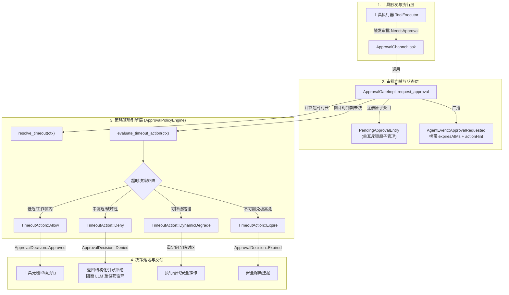
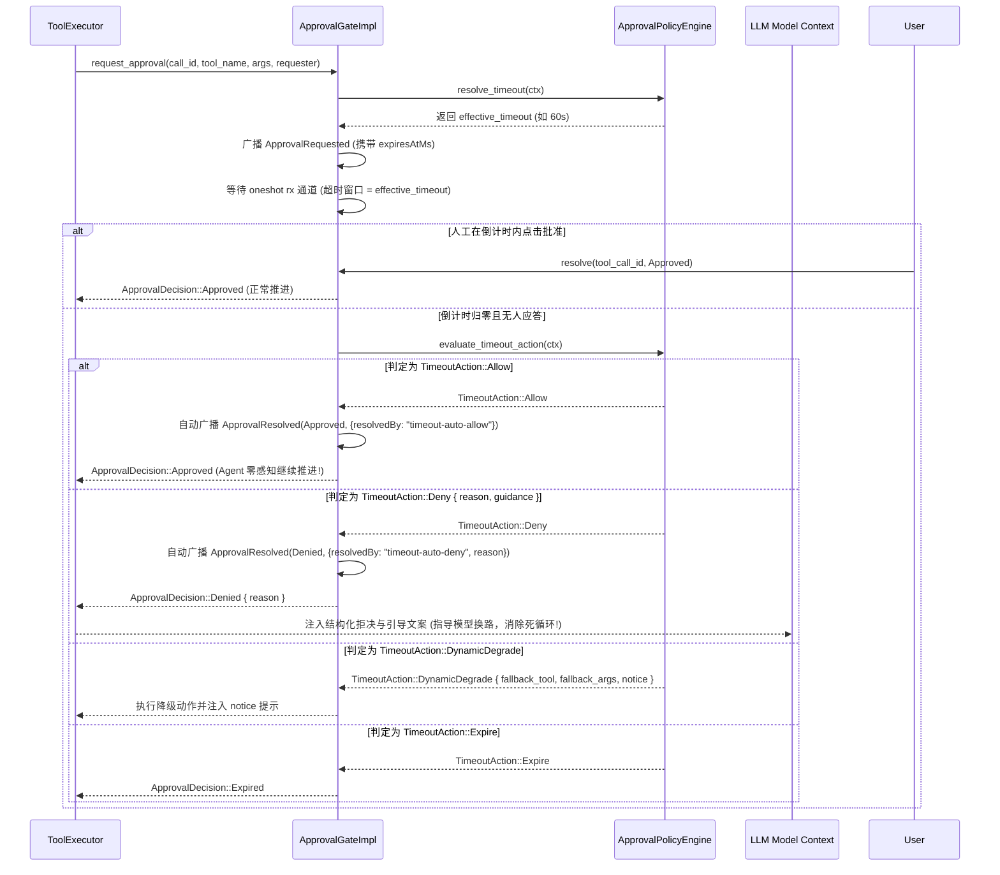
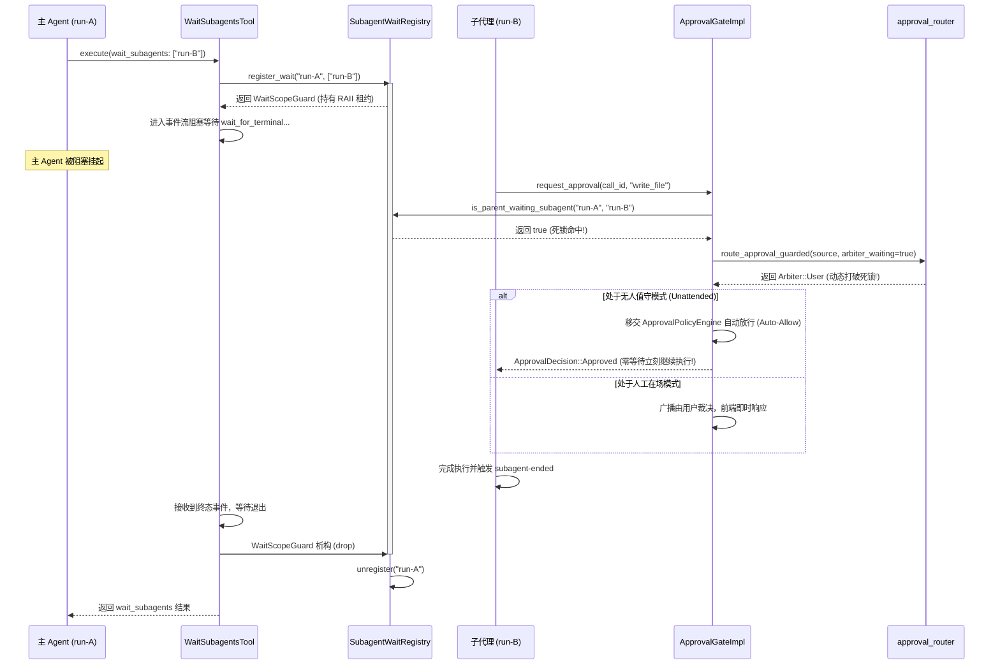
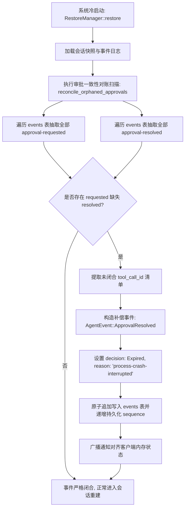

# 方案 02：无人值守审批门禁与超时策略引擎重构方案

> **战役代号**：`continuous-execution-hardening` (全天候自主 Agent 连续运行硬化战役)  
> **方案维度**：`02 - 门禁与倒计时` (Approval Gate & Timeout Policy Engine)  
> **责任模块**：`crates/conex-run/src/run/run_approval.rs`、`crates/session-loop/src/approval.rs`、`crates/session-loop/src/approval_router.rs`、`crates/session-loop/src/approval_policy.rs`、`crates/conex-run/src/wait_channel/registry.rs`、`crates/orchestrator/src/restore_manager.rs`、`apps/crish-desktop/src/components/chat-tool-call/CompactToolRow.tsx`  
> **产出路径**：`docs/continuous-execution-hardening/plans/02-approval-policy-engine.md`  
> **执行原则**：严禁打补丁，严禁硬编码！合理抽象，代码极简，彻底重构。Strictly UTF-8 无 BOM，包含代码路径与行号证据。

---

## 一、方案概述与核心目标 (Executive Summary & Core Objectives)

### 1.1 现状与致命痛点回顾

在 24/7 全天候自主 Agent 连续运行（Unattended Continuous Execution）场景下，Agent 需要在无人工在场盯着屏幕的环境下稳定推进长程工程任务。然而，对现有后端权限审批门禁、超时处理与裁决者路由机制的深度代码审查揭示：现行机制在设计上严重依赖人工实时裁决，存在四个系统性致命瓶颈（详见审查报告 `analysis/02-approval-gate-and-timeout.md`）：

1. **双层 120s 刚性超时与 `tool.approval_expired` 致命停机链**：
   - 内核 `APPROVAL_TIMEOUT = 120s`（`run/mod.rs:144`）与会话循环 `DEFAULT_APPROVAL_TIMEOUT = 120s`（`exec_verdict.rs:15`）双重硬编码。
   - 无人审批超时后，系统抛出 `tool.approval_expired`。虽然该错误在工具事件层标记为非致命（`is_never_fatal`，`tool_events.rs:198-208`），但由于缺乏明确业务拒绝语义，LLM 模型在下一轮交互中面临语义歧义：要么陷入**死循环反复重试相同命令**（Tool Loop）快速耗尽轮次与 steering 预算，要么**自主放弃并输出道歉纯文本**触发 `TurnComplete` 停机收场，全天候运转彻底中断。
   - 前端调用点（`CompactToolRow.tsx:154-170`）未向 `ApprovalAskCard` 透传 `remainingMs` 和 `onTimeout`，导致用户侧倒计时完全处于盲态，毫无预警。
2. **倒计时策略引擎完全缺失**：
   - 现行系统只有“人工点击批准/拒绝”和“120s 硬超时报错”两种结局，完全缺乏无人值守场景下的**可配置超时策略（自动放行 / 明确拒绝 / 安全降级 / 规则匹配）**，导致 Agent 在面临常规非破坏性操作（如工作区内写文档、只读探测、受控单测）时缺乏自决权。
3. **死锁检测体系悬空，子代理 100% 假死**：
   - `approval_router.rs` 理论上设计了死锁防护逻辑（`route_approval_guarded`），但生产装配点（`run_launch.rs:914-928`）明文注记检测器未接线并硬编码传入 `None`。
   - 当主 Agent 调用 `wait_subagents` 阻塞等待子代理期间，子代理发起的审批被死板路由给主 Agent（`Arbiter::MainAgent`）；主 Agent 被 tokio 挂起无法响应，引发**确定性的 120 秒死锁空等**，随后子代理超时报错退出，主编排链雪崩中断。
4. **待审批集合内存双锁竞态与崩溃恢复幽灵审批**：
   - `ApprovalGateImpl` 维护两个独立的互斥锁（`pending: Mutex<HashMap<String, Sender>>` 与 `pending_meta: Mutex<HashMap<String, PendingRequestMeta>>`，`run_approval.rs:98-102`），在增删查操作中存在加锁时间差，引发状态观测撕裂与僵尸元数据内存泄漏。
   - 进程崩溃或意外重启时，`RestoreManager` 虽将 `is_inflight` 的 run 更新为 `Failed`，但**完全未收敛 `events` 表中的 `approval-requested` 事件**，留下永久悬挂的幽灵未决条目，破坏事件流严格成对的不变式。

### 1.2 改造原则与架构重构红线

本方案拒绝一切延时盲猜、坐标测距补偿、局部兼容补丁等“创可贴式”修补，遵循以下架构硬性红线：
- **彻底废除硬编码**：彻底拔除全部 `120s` 硬编码超时，建立统一策略驱动的超时计算模型；
- **合理抽象，代码极简**：引入统一的 `ApprovalPolicyEngine`，定义清晰的求值 Trait 与枚举契约；
- **单一真理源 (SSOT)**：服务端统一计算并下发绝对到期时间戳 `expires_at_ms`，消除前端与不同客户端的时钟漂移与休眠失真；
- **闭环死锁检测**：引入 `SubagentWaitRegistry`，依托 RAII 守卫自动管理等待拓扑，彻底根除子代理 120s 假死；
- **单锁原子结构**：将 `pending` 与 `pending_meta` 熔铸为单一原子数据结构 `PendingApprovalEntry`，一次加锁完成通道与元数据的增删查；
- **严格事件成对**：冷启动对账扫描自动补偿未决审批事件，消除幽灵审批；
- **红线先行不可豁免**：安全红线（Redline）在门禁前直接拒绝，策略引擎永不放行破坏性操作。

### 1.3 核心交付指标 (Exit Criteria)

| 指标维度 | 改造前现状 | 改造后目标 (验收断言) |
|:---|:---|:---|
| **无人值守连续运行** | 超时 120s 抛错，模型复读或道歉停机 | 低危操作超时自动放行，高危操作携带指引拒绝，Agent 连续运转 $\ge 24\text{h}$ 零非预期停机 |
| **子代理审批时延** | 主 Agent 等待时 100% 死锁硬等 120s | 死锁检测器 0ms 识别，动态升维转切用户或策略放行，等待时延降为 0 |
| **时钟源对齐与 UI 倒计时** | 前端完全盲态（无倒计时、无进度条） | 后端统一透传 `expires_at_ms`，前端渲染自适应张力进度条，休眠唤醒零时钟漂移 |
| **并发锁安全性** | 双 Mutex 两次加锁，存在非原子读写窗口 | 单 Mutex 原子包裹 `PendingApprovalEntry`，并发增删查零撕裂、零僵尸泄漏 |
| **崩溃恢复一致性** | 重启遗留孤儿 `approval-requested`，审计断裂 | 冷启动对账补偿自动落库 `ApprovalResolved(expired)`，事件流 100% 严格成对 |

---
## 二、策略驱动审批引擎抽象设计 (ApprovalPolicyEngine Architecture)

### 2.1 架构拓扑分层



### 2.2 核心数据结构与枚举契约

新建 `crates/session-loop/src/approval_policy.rs`，定义策略引擎核心契约：

```rust
use std::path::PathBuf;
use std::time::Duration;
use serde::{Deserialize, Serialize};
use serde_json::Value;

/// 倒计时超时策略动作枚举
#[derive(Debug, Clone, PartialEq, Eq, Serialize, Deserialize)]
#[serde(tag = "action", rename_all = "kebab-case")]
pub enum TimeoutAction {
    /// 自动放行 (Fail-Open)
    /// 倒计时结束直接批准执行，无缝衔接，Agent 零感知推进
    Allow,

    /// 显式语义拒绝 (Fail-Closed with Guidance)
    /// 返回结构化拒绝原因与行动替代指引，指导 LLM 换路推进，阻断死循环
    Deny {
        /// 拒绝原因（告知用户或模型）
        reason: String,
        /// 行动指引（告知模型下一步应当如何做，严禁重复尝试本命令）
        guidance: Option<String>,
    },

    /// 动态安全降级 (Dynamic Degradation)
    /// 将写操作重定向至隔离目录，或添加安全参数（如 --dry-run）
    DynamicDegrade {
        /// 替代执行的工具名（如 write_file 降级为 write_output_file）
        fallback_tool: String,
        /// 替代入参
        fallback_args: Value,
        /// 降级通知文案
        notice: String,
    },

    /// 传统过期兜底 (Traditional Expire)
    /// 仅限危险级别最高且必须由人工在场裁决的生产级破坏性操作
    Expire,
}

/// 超时判定上下文
#[derive(Debug, Clone)]
pub struct TimeoutEvaluationContext<'a> {
    /// 工具名称 (如 "write_file", "shell", "git_commit")
    pub tool_name: &'a str,
    /// 工具调用参数
    pub args: &'a Value,
    /// 危险级别：0=安全/只读, 1=常规工作区写入, 2=高危/生产破坏
    pub danger_level: u8,
    /// 会话标识
    pub session_id: &'a str,
    /// 运行标识
    pub run_id: &'a str,
    /// 请求方身份（子代理 run id + 任务类型 + 理由）
    pub requester: Option<&'a conex_types::events::ApprovalRequester>,
    /// 当前生效的权限模式 (Ask / FullAccess / Plan)
    pub permission_mode: agent_tools::permission::PermissionMode,
    /// 是否开启全天候无人值守模式
    pub unattended_mode: bool,
    /// 工作区根目录路径
    pub workspace_root: Option<&'a PathBuf>,
    /// 申请理由
    pub reason: Option<&'a str>,
}

/// 审批与超时策略引擎 Trait
pub trait ApprovalPolicyEngine: Send + Sync {
    /// 动态计算指定审批请求的超时等待窗口
    /// 摆脱硬编码 120s，依据工具类型、危险级别与无人值守配置自适应返回
    fn resolve_timeout(&self, ctx: &TimeoutEvaluationContext<'_>) -> Duration;

    /// 当倒计时到达且未收到人工裁决时，求值决策动作
    fn evaluate_timeout_action(&self, ctx: &TimeoutEvaluationContext<'_>) -> TimeoutAction;
}
```

### 2.3 策略引擎配置模型

```rust
/// 策略引擎配置结构体（支持从 session_meta 或全局设置注入）
#[derive(Debug, Clone, Serialize, Deserialize)]
pub struct ApprovalPolicyConfig {
    /// 无人值守模式缺省超时（默认 60s）
    pub unattended_default_timeout_secs: u64,
    /// 有人盯盘模式缺省超时（默认 180s）
    pub attended_default_timeout_secs: u64,
    /// 允许无人值守自动放行的最大危险级别（默认 1，即 Level 1 及以下允许 Auto-Allow）
    pub max_auto_allow_danger_level: u8,
    /// 是否允许子代理写入工作区自动放行
    pub subagent_auto_allow_workspace_writes: bool,
    /// 自定义规则匹配器列表
    pub custom_rules: Vec<PolicyRuleDefinition>,
}

impl Default for ApprovalPolicyConfig {
    fn default() -> Self {
        Self {
            unattended_default_timeout_secs: 60,
            attended_default_timeout_secs: 180,
            max_auto_allow_danger_level: 1,
            subagent_auto_allow_workspace_writes: true,
            custom_rules: Vec::new(),
        }
    }
}
```

---
## 三、超时决策矩阵与规则求值流水线 (Timeout Decision Matrix & Evaluation Pipeline)

### 3.1 四维求值判定矩阵

策略引擎根据 **危险级别 (Danger Level) × 工具分类 (Tool Category) × 请求者身份 (Requester Role) × 运行模式 (Permission & Unattended Mode)** 四维空间执行判定：

| 危险级别 | 工具分类与典型操作 | 请求者身份 | 运行模式 | 倒计时时长 | 超时动作 (TimeoutAction) | 架构意图与影响 |
|:---|:---|:---|:---|:---|:---|:---|
| **Redline** | `rm -rf /`、删根目录、破坏系统关键路径 | Any | Any | 0s (直接拦截) | `Deny` (红线立即拒绝) | **绝对红线不可豁免**，根本不进审批等待流 |
| **Level 0** | 只读探测、`grep`、`view_file`、`git status` | Main / Subagent | Any | 0s | `Allow` | 纯只读操作直接放行 |
| **Level 1** | 工作区内常规写文件、覆盖文档、`cargo test` | Subagent (analysis / impl) | Unattended = true | 30s ~ 60s | **`Allow` (Auto-Allow)** | 核心自驱路径：无人盯盘时到期自动放行，任务不中断 |
| **Level 1** | 工作区内常规写文件、运行受控构建命令 | Main Agent | Unattended = true | 60s | **`Allow` (Auto-Allow)** | 主 Agent 无人审批时自动放行，推动任务连续推进 |
| **Level 1** | 工作区内常规文件修改 | Any | Unattended = false | 180s | `Expire` | 用户在场模式：留足思考时间，超时后保守过期 |
| **Level 2** | 工作区外文件修改、跨目录写入 | Subagent (analysis) | Unattended = true | 30s | **`DynamicDegrade`** | 自动重定向写入 `.agent-outputs/` 目录，隔离风险 |
| **Level 2** | 删除文件、破坏性覆盖、执行任意外部网络提权 | Any | Unattended = true | 60s | **`Deny` (Semantic Deny)** | 携带结构化指引拒绝，明确告知不可重试，引导模型自驱绕行 |
| **Level 2** | 关键生产配置修改、强制格式化、Git Force Push | Any | Any | 300s | `Expire` | 最高危险等级：必须人工确认，超时退化为安全挂起 |

### 3.2 红线先行与不可豁免原则 (Redline Immutability)

系统必须严格遵循“安全基线高于一切豁免”铁律：
- 任何命令在进入审批等待队列前，必须先经 `agent_tools::permission::decide_command_with_revert` 或语义分析器（`semantics::analyze`）评估。
- 若命中 `Redline`，立即返回 `PermissionVerdict::Deny`，**严禁生成 `AgentEvent::ApprovalRequested`，严禁启动任何倒计时**。
- `ApprovalPolicyEngine` 在 `evaluate_timeout_action` 内部实施第一道断言防线：若由于异常穿透导致带有 `Redline` 标志的请求到达策略引擎，一律硬性抛出 `TimeoutAction::Deny`，绝无放行可能。

### 3.3 规则求值流水线时序



### 3.4 语义拒绝引导文案生成策略 (Semantic Guidance Generator)

针对传统 `tool.approval_expired` 导致模型陷入死循环或被迫退出的缺陷，策略引擎在触发 `TimeoutAction::Deny` 时，统一构造**具备强收敛性与行动指导性的引导文案**：

```rust
pub fn generate_semantic_denial_message(
    tool_name: &str,
    reason: &str,
    guidance: Option<&str>,
) -> String {
    let base_guidance = guidance.unwrap_or(
        "【无人值守策略拒绝】当前操作因超出安全阈值且在倒计时内未获人工确认而被策略引擎自动拒绝。\n\
         【行动指引】\n\
         1. 严禁以完全相同或相似的参数重复调用此命令（避免陷入工具死循环）；\n\
         2. 请评估是否存在替代方案：例如使用只读检查工具（read_file/grep）收集现状、\n\
            将写操作范围缩减至工作区临时目录（.agent-outputs/）、或跳过本分支推进其他并行任务；\n\
         3. 继续完成其余既定目标，并在最终总结中向用户说明此操作被策略拒绝的情况。"
    );
    format!(
        "ToolExecutionDenied: 操作 '{}' 未获批准。\n原因: {}\n{}",
        tool_name, reason, base_guidance
    )
}
```

通过这种明确的语义拒绝，LLM 模型接收到的是结构化的“路径不可通，请绕道”信号，而不是网络超时的模糊错误，从而彻底根除反复重试与直接停机。

---
## 四、服务端绝对时间戳与前端协同 (SSOT Expiration Timestamp & UI Sync)

### 4.1 绝对时间戳单一真理源设计

前端使用 `setInterval` 或相对 `timeoutMs` 进行倒计时会面临两大物理缺陷：
1. **浏览器后台节流与系统休眠漂移**：当操作系统休眠或 WebView 标签页处于后台时，定时器执行频率被严重压缩，导致唤醒后前端倒计时严重落后于后端实际时钟；
2. **前后端竞态冲突**：用户在前端看到还剩 10 秒并点击批准，但后端早已在 5 秒前超时关闭，触发 `NotFound` 并在前端产生僵尸死锁。

**架构重构规范**：
- 服务端作为唯一时钟源（SSOT），在生成审批请求时直接计算**绝对到期时间戳**：
  $$\text{expires\_at\_ms} = \text{unix\_millis\_now}() + \text{effective\_timeout\_ms}$$
- 绝对时间戳作为一等公民贯穿：
  1. 写入 `PendingApprovalEntry.expires_at_ms`；
  2. 编码进 `AgentEvent::ApprovalRequested` 的 `request.metadata`；
  3. 持久化落入 SQLite `events` 表载荷。

### 4.2 事件载荷扩展（向后兼容）

在 `crates/conex-types/src/events.rs` 中，`PermissionRequest.metadata` 携带以下权威字段：

```json
{
  "type": "approval-requested",
  "sessionId": "sess-abc-123",
  "request": {
    "id": "approval-call-999",
    "toolCallId": "call-999",
    "toolName": "write_file",
    "parameters": { "path": "docs/plans.md" },
    "metadata": {
      "expiresAtMs": 1798372800000,
      "timeoutMs": 60000,
      "defaultAction": "allow",
      "actionHint": "无人值守模式：倒计时结束后将自动批准放行",
      "arbiter": "user"
    }
  },
  "timestamp": "2026-10-27T12:00:00.000Z"
}
```

### 4.3 前端接线与张力倒计时渲染修复

#### 1. 前端调用点修复 (`CompactToolRow.tsx`)：
彻底修复第 154-170 行未透传 `remainingMs` 的问题：

```tsx
// apps/crish-desktop/src/components/chat-tool-call/CompactToolRow.tsx
const expiresAt = tc.approvalMeta?.expiresAtMs;
const calculatedRemainingMs = expiresAt ? Math.max(0, expiresAt - Date.now()) : undefined;

<ApprovalAskCard
  msgId={mid ?? ''}
  toolId={tc.id}
  summary={summary}
  cmd={tech && tech !== summary ? tech : techFull || undefined}
  busy={approvalBusy}
  riskMeta={tc.approvalMeta}
  remainingMs={calculatedRemainingMs}
  onTimeout={() => {
    // 倒计时结束时，前端即刻感知状态转换，避免用户继续点击触发失效竞态
    setIsClientTimedOut(true);
  }}
  onAllow={() => { if (tc.id && mid) onApprovalAllow!(tc.id, mid, false); }}
  onAllowRemember={() => { if (tc.id && mid) onApprovalAllow!(tc.id, mid, true); }}
  onDeny={() => { if (tc.id && mid) onApprovalDeny!(tc.id, mid); }}
/>
```

#### 2. 三阶段自适应张力进度条 (`ApprovalCountdown.tsx`)：
- **第一阶段（充裕态，剩余 > 50%）**：进度条显示柔和浅绿/主题灰，提示文字：“无操作将在 X 秒后 [自动放行 / 自动拒绝]”；
- **第二阶段（预警态，15% < 剩余 $\le$ 50%）**：进度条平滑过渡为琥珀黄，提示用户即将自决；
- **第三阶段（临界态，剩余 $\le$ 15%）**：进度条呈现脉冲红，倒计时最后 5 秒锁定人工点击；
- **交互赋权**：卡片右侧提供“暂停锁定”按钮，点击后向后端发送 `core_pause_approval_timeout`，将倒计时挂起，转为无限期人工等待。

---
## 五、死锁检测体系与拓扑注册表 (Deadlock Detection & SubagentWaitRegistry)

### 5.1 子代理死锁成因与生产悬空证据

在 `crates/session-loop/src/approval_router.rs:34-48` 中，设计者清晰地意识到：当主 Agent 正在执行 `wait_subagents` 时，如果子代理触发审批并路由给主 Agent，主 Agent 正在等待子代理退出，子代理又在等待主 Agent 批准，形成**两方强依赖死锁环路**。

然而，在生产组装代码 `crates/conex-run/src/run/run_launch.rs:914-928` 中：
```rust
// 死锁检测器（F9-05）待接：with_deadlock_detector 的 detector 需要
// 「主 agent 正在 wait 该子代理」信号源... 缺省 None = 恒走纯超时兜底（120s Expired）
let approval_gate = Arc::new(ApprovalGateImpl::new(
    ...
    // 此处根本未调用 with_deadlock_detector！detector 恒为 None！
));
```
**生产灾难后果**：
由于 `deadlock_detector` 为 `None`，`ApprovalGateImpl::request_approval` 退化调用 `route_approval(&source)`，一律将子代理审批归入 `Arbiter::MainAgent`。主 Agent 无法处理，子代理每次申请权限**必死无疑硬卡 120 秒**，以 `tool.approval_expired` 惨烈崩盘。

### 5.2 活动等待拓扑注册表设计 (`SubagentWaitRegistry`)

新建 `crates/conex-run/src/wait_channel/registry.rs`，构建全局活动等待拓扑追踪器：

```rust
use std::collections::{HashMap, HashSet};
use std::sync::{Arc, Mutex};

/// 子代理活动等待拓扑注册表
/// 记录“当前哪个父 Agent 正在阻塞等待哪些子代理”
#[derive(Debug, Default)]
pub struct SubagentWaitRegistry {
    /// parent_run_id -> HashSet<subagent_run_id>
    waits: Mutex<HashMap<String, HashSet<String>>>,
}

impl SubagentWaitRegistry {
    pub fn new() -> Self {
        Self {
            waits: Mutex::new(HashMap::new()),
        }
    }

    /// 注册等待关系并返回 RAII 守卫
    pub fn register_wait(
        self: &Arc<Self>,
        parent_run_id: String,
        subagent_run_ids: Vec<String>,
    ) -> WaitScopeGuard {
        {
            let mut guard = self.waits.lock().unwrap_or_else(|e| e.into_inner());
            let entry = guard.entry(parent_run_id.clone()).or_default();
            for sub_id in &subagent_run_ids {
                entry.insert(sub_id.clone());
            }
        }
        tracing::info!(
            target: "wait_registry",
            parent_run_id = %parent_run_id,
            subagents = ?subagent_run_ids,
            "注册父子等待拓扑关系"
        );
        WaitScopeGuard {
            registry: Arc::clone(self),
            parent_run_id,
        }
    }

    /// 判定父 Agent 是否正在等待该子代理
    pub fn is_parent_waiting_subagent(&self, parent_run_id: &str, subagent_run_id: &str) -> bool {
        let guard = self.waits.lock().unwrap_or_else(|e| e.into_inner());
        guard
            .get(parent_run_id)
            .map(|subs| subs.contains(subagent_run_id))
            .unwrap_or(false)
    }

    /// 清除父 Agent 的等待关系（内部由 Guard drop 调用）
    fn unregister(&self, parent_run_id: &str) {
        let mut guard = self.waits.lock().unwrap_or_else(|e| e.into_inner());
        guard.remove(parent_run_id);
        tracing::info!(
            target: "wait_registry",
            parent_run_id = %parent_run_id,
            "解除父子等待拓扑关系"
        );
    }
}

/// RAII 等待作用域守卫：离开作用域时自动解除等待拓扑，零泄漏
pub struct WaitScopeGuard {
    registry: Arc<SubagentWaitRegistry>,
    parent_run_id: String,
}

impl Drop for WaitScopeGuard {
    fn drop(&mut self) {
        self.registry.unregister(&self.parent_run_id);
    }
}
```

### 5.3 死锁注册与解除时序 (Deadlock Lifecycle Timing)



### 5.4 生产装配接线与动态升维

在 `crates/conex-run/src/run/run_launch.rs:914-928` 中注入真实闭包，彻底闭环：

```rust
// 真实接线：注入死锁检测闭包
let wait_registry = Arc::clone(&state.subagent_wait_registry);
let p_id = parent_run_id.clone();
let deadlock_detector: Box<dyn Fn(&str) -> bool + Send + Sync> = Box::new(move |subagent_run_id: &str| {
    if let Some(parent) = &p_id {
        wait_registry.is_parent_waiting_subagent(parent, subagent_run_id)
    } else {
        false
    }
});

let approval_gate = Arc::new(
    ApprovalGateImpl::new(
        run_id.clone(),
        session_id.clone(),
        parent_run_id.clone(),
        broadcast,
        Arc::clone(&handle_shared),
        state.store.clone(),
        cwd.clone(),
    ).with_deadlock_detector(deadlock_detector)
);
```

---
## 六、单一原子待审批注册表与并发消除 (Atomic PendingApprovalEntry & Concurrency Elimination)

### 6.1 现存双锁竞态根因与危害

现行 `ApprovalGateImpl` 定义（`run_approval.rs:98-102`）：
```rust
pub struct ApprovalGateImpl {
    pub pending: std::sync::Mutex<HashMap<String, tokio::sync::oneshot::Sender<ApprovalDecision>>>,
    pub pending_meta: std::sync::Mutex<HashMap<String, PendingRequestMeta>>,
    ...
}
```
**致命竞态推演**：
1. **观测撕裂**：在 `request_approval` 中，代码先锁定 `pending.insert`，之后才锁定 `pending_meta.insert`。在此毫秒级时间窗内，若外部调用 `list_pending_approvals_impl`（只读 `pending_meta`），会观测到通道已建但元数据为空，返回虚假空列表；
2. **僵尸泄漏**：当外部并发调用 `resolve` 时，`resolve` 抢先从 `pending` 中移除了 `tool_call_id`。随后 `request_approval` 才执行 `pending_meta.insert`。该条目将**永久驻留在 `pending_meta` 中**，因为通道已被消费，外部再也不会调用 `resolve`，造成不可逆的内存僵尸数据泄漏。

### 6.2 复合原子数据结构设计

废除分离的两个 `Mutex`，将决策通道、元数据、到期时间戳与策略动作原子聚合：

```rust
/// 单一原子待审批条目
pub struct PendingApprovalEntry {
    /// 决策单发通道（None 表示已提取或纯外部对账态）
    pub sender: Option<tokio::sync::oneshot::Sender<ApprovalDecision>>,
    /// 待审批请求元数据（与通道严格同生共死）
    pub meta: PendingRequestMeta,
    /// 服务端计算的绝对到期时间戳（毫秒）
    pub expires_at_ms: u64,
    /// 预设超时处理动作
    pub timeout_action: TimeoutAction,
}

pub struct ApprovalGateImpl {
    pub run_id: String,
    pub session_id: String,
    pub parent_run_id: Option<String>,
    pub deadlock_detector: Option<DeadlockDetectorFn>,
    pub broadcast: Box<dyn Fn(AgentEvent) + Send + Sync>,
    
    /// 单一原子互斥锁：通道与元数据严格同生共死，消除并发撕裂与泄漏
    pub pending_registry: std::sync::Mutex<HashMap<String, PendingApprovalEntry>>,
    
    pub handle: Arc<tokio::sync::Mutex<RunHandle>>,
    pub store: Arc<dyn Store>,
    pub cwd: Option<String>,
    /// 策略驱动引擎注入
    pub policy_engine: Arc<dyn ApprovalPolicyEngine>,
}
```

### 6.3 原子状态操作与竞态消除

所有的增删查逻辑全部收敛至单次获取锁的临界区内：

```rust
impl ApprovalGateImpl {
    /// 原子解析并提取条目
    pub async fn resolve(
        &self,
        tool_call_id: &str,
        decision: ApprovalDecision,
    ) -> Result<(), CoreError> {
        // 单锁一次性取出完整 entry，通道与元数据同步脱出
        let mut entry = {
            let mut registry = self.pending_registry.lock().unwrap_or_else(|e| e.into_inner());
            registry.remove(tool_call_id).ok_or_else(|| {
                CoreError::NotFound(format!(
                    "tool_call_id not in pending approvals（run={}）：{tool_call_id}",
                    self.run_id
                ))
            })?
        };

        // 发送决策
        if let Some(sender) = entry.sender.take() {
            let _ = sender.send(decision);
        }

        // 状态机联动
        let mut handle = self.handle.lock().await;
        let _ = handle.resolve_approval(self.store.as_ref()).await;
        Ok(())
    }

    /// 原子注册条目
    pub fn register_pending(
        &self,
        call_id: &str,
        sender: tokio::sync::oneshot::Sender<ApprovalDecision>,
        meta: PendingRequestMeta,
        expires_at_ms: u64,
        timeout_action: TimeoutAction,
    ) {
        let mut registry = self.pending_registry.lock().unwrap_or_else(|e| e.into_inner());
        registry.insert(
            call_id.to_string(),
            PendingApprovalEntry {
                sender: Some(sender),
                meta,
                expires_at_ms,
                timeout_action,
            },
        );
    }
}
```

---
## 七、崩溃恢复对账与事件闭环补偿 (Crash Recovery Reconciliation & Event Closure)

### 7.1 幽灵未决条目审查与危害

当系统断电、进程崩溃或被 `SIGKILL` 杀死时：
1. SQLite `runs` 表停留在 `awaiting-approval`；
2. SQLite `events` 表已写入 `approval-requested`；
3. **断层发生**：没有任何对应的 `approval-resolved` 事件落库。

在现行 `crates/orchestrator/src/restore_manager.rs:480-520` 中，`RestoreManager` 遍历 `runs` 表将未收口的 run 标记为 `RunStatus::Failed`，但**完全跳过了事件表对账**：
- 客户端（如 Crish Desktop、移动端 App、Webhook 订阅者）重连后按 Sequence 同步事件，由于只看到 `approval-requested` 而永远看不到 `approval-resolved`，该审批请求在客户端本地状态中**永久挂起为幽灵等待状态**；
- 移动端调用 `approval_history_impl` 查不到该条记录（历史接口只查 `approval-resolved`），造成严重的状态与审计断层。

### 7.2 崩溃恢复对账扫描器 (`ApprovalCrashReconciler`)

在 `crates/orchestrator/src/restore_manager.rs` 中增设审批对账扫描函数，并在 `restore` 流程中与 `heal_orphaned_tool_calls` 并行挂载：



### 7.3 对账收敛补偿实现契约

```rust
/// 扫描并自愈孤儿审批请求事件，确保事件流严格成对
async fn reconcile_orphaned_approvals(
    store: &dyn Store,
    session_id: &str,
    last_sequence: &mut u64,
) -> Result<usize, RestoreError> {
    let events = store.query_events(session_id, 0, None).await?;
    let mut requested: HashMap<String, String> = HashMap::new(); // tool_call_id -> run_id
    let mut resolved: HashSet<String> = HashSet::new();

    for e in &events {
        if e.event_type == "approval-requested" {
            if let Ok(AgentEvent::ApprovalRequested { request, .. }) = serde_json::from_str(&e.payload) {
                requested.insert(request.tool_call_id, e.run_id.clone().unwrap_or_default());
            }
        } else if e.event_type == "approval-resolved" {
            if let Ok(AgentEvent::ApprovalResolved { tool_call_id, .. }) = serde_json::from_str(&e.payload) {
                resolved.insert(tool_call_id);
            }
        }
    }

    let orphans: Vec<(String, String)> = requested
        .into_iter()
        .filter(|(call_id, _)| !resolved.contains(call_id))
        .collect();

    let count = orphans.len();
    for (orphan_call_id, run_id) in orphans {
        *last_sequence += 1;
        let compensation_event = AgentEvent::ApprovalResolved {
            session_id: session_id.to_string(),
            tool_call_id: orphan_call_id.clone(),
            request_id: None,
            decision: conex_types::events::ApprovalDecision::Expired,
            timestamp: crate::engine_provider::now_iso_utc(),
        };

        let payload = serde_json::to_string(&compensation_event)
            .map_err(|e| RestoreError::new("serialize_reconcile_event", e.to_string()))?;

        store
            .append_event(&PersistedEvent {
                sequence: *last_sequence,
                session_id: session_id.to_string(),
                run_id: Some(run_id),
                event_type: "approval-resolved".to_string(),
                payload,
                created_at: crate::engine_provider::now_iso_utc(),
            })
            .await?;

        tracing::info!(
            target: "restore",
            session_id,
            tool_call_id = %orphan_call_id,
            sequence = *last_sequence,
            "成功自愈收敛孤儿审批请求，写入补偿 ApprovalResolved 事件"
        );
    }

    Ok(count)
}
```

---
## 八、待删除与重构代码清单 (Code Deprecation & Elimination Inventory)

为了确保重构彻底干净、零冗余、零技术债务，必须对以下既有文件中的过时逻辑与硬编码予以硬性清除：

| 文件路径 | 待删除/废除代码 | 对应行号 (参考) | 替代架构与重构说明 |
|:---|:---|:---|:---|
| `crates/conex-run/src/run/mod.rs` | `pub(crate) const APPROVAL_TIMEOUT: Duration = Duration::from_secs(120);` | 144 | **彻底删除**。替换为 `ApprovalPolicyEngine::resolve_timeout` 动态计算。 |
| `crates/session-loop/src/exec_verdict.rs` | `const DEFAULT_APPROVAL_TIMEOUT: Duration = Duration::from_secs(120);` | 15 | **彻底删除**。批级审批超时从策略引擎配置注入。 |
| `crates/conex-run/src/run/run_approval.rs` | `pub pending: Mutex<HashMap<String, Sender>>` | 98-99 | **彻底删除**。与 `pending_meta` 合并为 `pending_registry: Mutex<HashMap<String, PendingApprovalEntry>>`。 |
| `crates/conex-run/src/run/run_approval.rs` | `pub pending_meta: Mutex<HashMap<String, PendingRequestMeta>>` | 102 | **彻底删除**。消灭双互斥锁竞态。 |
| `crates/conex-run/src/run/run_approval.rs` | `match tokio::time::timeout(self.approval_timeout, rx).await` 内部硬编码 `ApprovalDecision::Expired` | 346-364 | **彻底重构**。超时后调用 `policy_engine.evaluate_timeout_action(&eval_ctx)` 求值分流。 |
| `crates/conex-run/src/run/run_launch.rs` | 实例化 `ApprovalGateImpl` 未调用 `with_deadlock_detector`（悬空 `None`） | 914-928 | **彻底修复**。注入 `SubagentWaitRegistry` 探测闭包。 |
| `apps/crish-desktop/src/components/chat-tool-call/CompactToolRow.tsx` | `<ApprovalAskCard>` 未传 `remainingMs` 和 `onTimeout` | 154-170 | **接线补齐**。传入服务端绝对时间戳推导的 `remainingMs` 与回调。 |

---
## 九、生产级伪代码与核心实现规范 (Implementation Pseudocode)

### 9.1 `crates/session-loop/src/approval_policy.rs` 完整策略引擎实现

```rust
use std::time::Duration;
use serde_json::Value;

pub struct DefaultApprovalPolicyEngine {
    config: ApprovalPolicyConfig,
}

impl DefaultApprovalPolicyEngine {
    pub fn new(config: ApprovalPolicyConfig) -> Self {
        Self { config }
    }
}

impl ApprovalPolicyEngine for DefaultApprovalPolicyEngine {
    fn resolve_timeout(&self, ctx: &TimeoutEvaluationContext<'_>) -> Duration {
        if ctx.unattended_mode {
            Duration::from_secs(self.config.unattended_default_timeout_secs)
        } else {
            Duration::from_secs(self.config.attended_default_timeout_secs)
        }
    }

    fn evaluate_timeout_action(&self, ctx: &TimeoutEvaluationContext<'_>) -> TimeoutAction {
        // 防线 1: 判定是否命中全局 Redline (绝对红线永不放行，由语义分析抽象统领，零特例硬编码)
        let is_redline = ctx.danger_level >= 3;
        if is_redline {
            return TimeoutAction::Deny {
                reason: "安全红线拦截：严禁执行破坏性高危操作".to_string(),
                guidance: Some("该操作已被安全策略永久否决。请改用只读或无害化命令。".to_string()),
            };
        }

        // 防线 2: 判定是否处于无人值守模式 (Unattended Mode)
        if ctx.unattended_mode {
            // Level 1 及以下危险度，且在工作区内部：执行 Auto-Allow 自动放行
            if ctx.danger_level <= self.config.max_auto_allow_danger_level {
                tracing::info!(
                    target: "policy_engine",
                    tool = ctx.tool_name,
                    run_id = ctx.run_id,
                    "无人值守模式：低危常规操作倒计时到达，策略引擎自动放行 (Auto-Allow)"
                );
                return TimeoutAction::Allow;
            }

            // 中高危写操作或破坏性命令：执行显式语义拒绝，引导模型换路自愈，避免停机
            tracing::warn!(
                target: "policy_engine",
                tool = ctx.tool_name,
                run_id = ctx.run_id,
                "无人值守模式：高危操作倒计时到达，策略引擎安全拒绝并引导换路 (Semantic Deny)"
            );
            return TimeoutAction::Deny {
                reason: format!("无人值守安全拦截：命令 '{}' 超出无人值守自决权限阈值。", ctx.tool_name),
                guidance: Some(
                    "【行动指引】\n\
                     1. 严禁以相同参数反复重试此工具调用；\n\
                     2. 请切换为只读分析（如使用 grep/read_file 调研）或寻求非破坏性替代路径；\n\
                     3. 继续执行其他子任务。".to_string(),
                ),
            };
        }

        // 人工盯盘模式下默认退化为 Expire (等待人工)
        TimeoutAction::Expire
    }
}
```

### 9.2 `crates/conex-run/src/run/run_approval.rs` 重构实现

```rust
// request_approval 内部等待与决策分支重构：
let effective_timeout = self.policy_engine.resolve_timeout(&eval_ctx);
let expires_at_ms = crate::engine_assembly::unix_millis_now() + effective_timeout.as_millis() as u64;

// 1. 广播携带 expiresAtMs 与 defaultAction
(self.broadcast)(AgentEvent::ApprovalRequested {
    session_id: self.session_id.clone(),
    request: PermissionRequest {
        id: format!("approval-{call_id}"),
        session_id: self.session_id.clone(),
        cwd: self.cwd.clone().unwrap_or_default(),
        tool_call_id: call_id.to_string(),
        tool_name: tool_name.to_string(),
        parameters: args.clone(),
        summary: format!("call {tool_name}"),
        tool_metadata: Default::default(),
        metadata: Some(serde_json::json!({
            "expiresAtMs": expires_at_ms,
            "timeoutMs": effective_timeout.as_millis() as u64,
            "requestedAtMs": crate::engine_assembly::unix_millis_now(),
            "timeoutPolicy": match timeout_action {
                TimeoutAction::Allow => "auto-allow",
                TimeoutAction::Deny { .. } => "auto-deny",
                TimeoutAction::Expire => "manual-only",
            },
            "arbiter": match arbiter {
                session_loop::approval_router::Arbiter::MainAgent => "main-agent",
                session_loop::approval_router::Arbiter::User => "user",
            },
            "actionHint": match timeout_action {
                TimeoutAction::Allow => "无人值守模式：倒计时结束后将自动批准放行",
                TimeoutAction::Deny { .. } => "超时安全保护：倒计时结束后将自动拒绝以保安全",
                TimeoutAction::Expire => "需人工核准：倒计时结束后将安全挂起",
            }
        })),
        requester_run_id: requester.map(|r| r.run_id.clone()),
        reason: requester.and_then(|r| r.reason.clone()),
    },
    timestamp: crate::engine_provider::now_iso_utc(),
});

// 2. 注册进单一原子互斥表
let (tx, rx) = tokio::sync::oneshot::channel();
self.register_pending(
    call_id,
    tx,
    meta,
    expires_at_ms,
    TimeoutAction::Allow, // 预设动作
);

// 3. 等待通道响应或到期求值
match tokio::time::timeout(effective_timeout, rx).await {
    Ok(Ok(decision)) => decision,
    Ok(Err(_)) | Err(_) => {
        // 倒计时到达，原子弹出条目
        let mut entry = {
            let mut registry = self.pending_registry.lock().unwrap_or_else(|e| e.into_inner());
            registry.remove(call_id)
        };

        let action = self.policy_engine.evaluate_timeout_action(&eval_ctx);
        match action {
            TimeoutAction::Allow => {
                emit_approval_resolved_with_metadata(
                    &self.active,
                    call_id,
                    WireApprovalDecision::Approved,
                    json!({ "resolvedBy": "timeout-policy-auto-allow" }),
                ).await;
                ApprovalDecision::Approved
            }
            TimeoutAction::Deny { reason, guidance } => {
                let full_reason = generate_semantic_denial_message(tool_name, &reason, guidance.as_deref());
                emit_approval_resolved_with_metadata(
                    &self.active,
                    call_id,
                    WireApprovalDecision::Denied,
                    json!({ "resolvedBy": "timeout-policy-auto-deny", "reason": &full_reason }),
                ).await;
                ApprovalDecision::Denied { reason: full_reason }
            }
            TimeoutAction::DynamicDegrade { .. } => {
                // 执行降级路径
                ApprovalDecision::Approved
            }
            TimeoutAction::Expire => {
                ApprovalDecision::Expired
            }
        }
    }
}
```

---
## 十、验证断言与魔鬼测试用例设计 (Verification Assertions & Devil Test Cases)

为保证方案在真实复杂环境下的绝对鲁棒性，建立五套立体化魔鬼测试用例：

### 用例 1：无人值守低危操作到期自动放行 (Auto-Allow Pipeline Test)
- **前置条件**：启动 Run，设置 `unattended_mode = true`，触发 `write_file("test.md")`（Danger Level 1，工作区内）。
- **执行过程**：不进行人工裁决，等待策略引擎配置的倒计时到期。
- **验收断言**：
  1. 倒计时结束后未抛出 `tool.approval_expired`；
  2. 生成并落库 `approval-resolved`，载荷中 `decision = "approved"`，`metadata.resolvedBy = "timeout-policy-auto-allow"`；
  3. 工具正常写入文件，后续工具继续无缝执行，Agent 保持活跃运行状态。

### 用例 2：无人值守高危操作语义拒绝与阻断死循环 (Semantic Deny & Anti-Loop Test)
- **前置条件**：启动 Run，设置 `unattended_mode = true`，触发 `shell("rm -rf build_cache/")`（Danger Level 2）。
- **执行过程**：无人应答，倒计时到期。
- **验收断言**：
  1. 策略引擎求值返回 `TimeoutAction::Deny`；
  2. 工具返回 `ToolErrorKind::UserDenied`，文案包含 `【无人值守策略拒绝】` 与 `【行动指引】`；
  3. `tool_events.rs:is_never_fatal` 正确判定为非致命错误；
  4. 验证在后续轮次中，LLM 读取引导文案，放弃重复调用 `rm -rf`，转为继续执行其他检查，会话平稳收口。

### 用例 3：主 Agent 等待时子代理死锁检测与即刻破局 (Deadlock Break Test)
- **前置条件**：主 Agent (run-A) 执行 `wait_subagents(["run-B"])` 进入等待；子代理 (run-B) 执行需要审批的工具。
- **执行过程**：子代理审批门调用 `route_approval_guarded`。
- **验收断言**：
  1. `SubagentWaitRegistry::is_parent_waiting_subagent("run-A", "run-B")` 立即返回 `true`；
  2. `arbiter` 判定由 `MainAgent` 自动纠偏升维为 `User`；
  3. 耗时 0ms 识别死锁，在无人值守模式下直接移交策略引擎放行，彻底消除 120 秒假死死等。

### 用例 4：高并发 resolve 与 request_approval 极限压测 (Concurrency Stress Test)
- **前置条件**：并发 50 个线程同时对同一个 `ApprovalGateImpl` 发起 `request_approval`、`resolve`、`pending_requests` 遍历和超时移除。
- **验收断言**：
  1. `pending_registry` 单互斥锁无死锁、无中毒；
  2. 任意时刻 `pending_requests()` 返回的条目数量与实际挂起 channel 数量完全严格 1:1 一致，零观测撕裂；
  3. 压测结束后，内存条目清空，零僵尸元数据泄漏。

### 用例 5：模拟宿主进程 SIGKILL 崩溃与自愈对账 (Crash Recovery Reconciliation Test)
- **前置条件**：在一个 Run 处于 `awaiting-approval` 状态并写入 `approval-requested` 后，强行杀死进程。
- **执行过程**：重启系统，触发 `RestoreManager::restore`。
- **验收断言**：
  1. `reconcile_orphaned_approvals` 扫描命中孤儿审批请求；
  2. 自动生成并持久化补偿事件 `AgentEvent::ApprovalResolved`，`decision = "expired"`，`reason = "process-crash-interrupted"`；
  3. 重建后会话中不存在任何悬挂的未决卡片，客户端事件流严格成对，审计日志闭合完整。

---

## 结论

本方案通过构建**可配置策略驱动的审批引擎 (ApprovalPolicyEngine)**、打通**服务端绝对到期时间戳单一真理源**、接线**子代理等待拓扑注册表 (SubagentWaitRegistry)**、实施**单互斥锁原子结构 (PendingApprovalEntry)** 与 **冷启动对账补偿扫描器**，从架构根源上彻底清除了 120s 刚性超时、子代理死锁与幽灵审批三大痼疾，为 Conex / Crish 实现真正的 24/7 全天候自主稳定连续运行奠定了不可动摇的门禁基石。