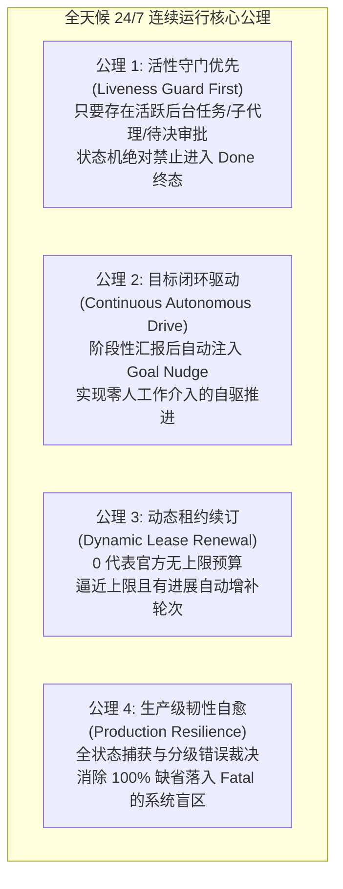
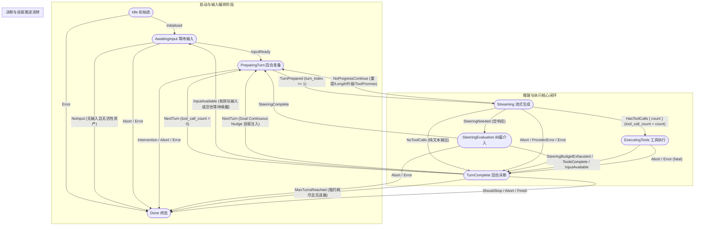
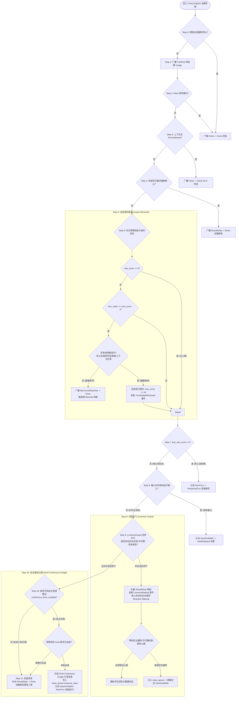

# 方案 04：核心会话循环与状态机流转重构方案 (Session Loop & State Machine Hardening Plan)

> **战役代号**：`continuous-execution-hardening` / 专项 04  
> **关联架构输入**：
> - `docs/continuous-execution-hardening/analysis/04-session-loop-and-state-machine.md`（深度审查与根因分析）
> - `docs/continuous-execution-hardening/00-continuous-execution-master-plan.md`（全天候战役总纲方案）
> **涉及核心代码基线**：
> - `crates/session-loop/src/state.rs`（状态机结构体、上下文、不变量）
> - `crates/conex-types/src/session.rs`（状态、事件、上下文模型）
> - `crates/conex-types/src/transition.rs`（权威状态转移表、副作用计算）
> - `crates/session-loop/src/loop/loop_runner.rs`（循环装配、选项同步、总线/信号注入）
> - `crates/session-loop/src/loop/loop_exec.rs`（主执行循环、单步分派、catch 异常捕获与恢复应用）
> - `crates/session-loop/src/loop/handlers/turn_complete.rs`（回合终结收场决策阶梯）
> - `crates/session-loop/src/loop/handlers/executing_tools.rs`（工具执行与致命错误上抛）
> - `crates/session-loop/src/loop/handlers/prepare_turn.rs`（回合准备、自愈补发、压缩预检与 Steering 评估）
> - `crates/session-loop/src/loop/handlers/streaming.rs`（模型调用、流式消费与 BC02-2 防火墙）
> - `crates/session-loop/src/loop/handlers/no_tool_calls.rs`（无工具调用分类、Length 阶梯与 Tool-Promise 自愈）
> - `crates/session-loop/src/loop/handlers/stream_error.rs`（瞬态重试阶梯、超限压缩阶梯、降级 Fatal）
> - `crates/conex-run/src/run/mod.rs`（`MAX_TURNS_DEFAULT = 64` 等顶层常量）
> - `crates/conex-run/src/run/run_launch.rs`（Run 启动装配与 Producer 实例化）
> - `crates/conex-run/src/run/run_idle.rs`（`decide_idle_resume` 续跑判定与 MaxTurns 调度死刑）
> - `crates/conex-run/src/run_producer.rs`（跨 Run 组装与全局依赖下沉）

---

## 目录索引

1. [方案概述与核心重构愿景](#一方案概述与核心重构愿景)
   - 1.1 现状诊断与核心痛点穿透
   - 1.2 零硬编码、零补丁设计哲学
   - 1.3 全天候 24/7 连续运行核心原则
2. [权威状态机生命周期模型与转移图谱](#二权威状态机生命周期模型与转移图谱)
   - 2.1 八大核心状态与二十种事件权威契约
   - 2.2 状态转移全景图谱（Mermaid 权威图谱）
   - 2.3 副作用与状态不变量单调性定理
   - 2.4 六大 Handler 分派职责与执行闭环
3. [turn_complete 决断阶梯重构与活性守门（LivenessGuard）](#三turn_complete-决断阶梯重构与活性守门livenessguard)
   - 3.1 旧十级阶梯缺陷与因果停机假设穿透
   - 3.2 新一代十一级决断阶梯设计与优先级编排
   - 3.3 决断阶梯流转图（Mermaid Flowchart）
   - 3.4 LivenessGuard 活性守门架构设计与判定接口
   - 3.5 活性实体分类与复合守卫（CompositeLivenessGuard）
   - 3.6 活性待命与反应式唤醒（Reactive Wakeup）流转机制
   - 3.7 全天候自主推进心跳（Goal Continuous Nudge）机制
4. [max_turns 预算解耦与动态租约续订（Lease Renewal）体系](#四max_turns-预算解耦与动态租约续订lease-renewal体系)
   - 4.1 64 轮死刑与 0 预算启动误杀代码证据链与根除清单
   - 4.2 “0 = 无限预算 (Unlimited Budget)” 语义严格重构
   - 4.3 滑动窗口动态租约续订（Lease Renewal）状态机与时序图
   - 4.4 跨 Episode 自动续跑桥接与物理切片归档（run_idle.rs 改造）
5. [运行时异常恢复系统重构与 ProductionRecoveryHook](#五运行时异常恢复系统重构与-productionrecoveryhook)
   - 5.1 生产环境 RecoveryHook 缺位导致的“100% 缺省落入 Fatal”盲区深度穿透
   - 5.2 ProductionRecoveryHook 架构与分级分类错误裁决矩阵
   - 5.3 apply_recovery 跨状态弹性自愈通道改造（打破仅限 Streaming 硬限）
   - 5.4 BC02-2 防火墙流式截断工具调用重提拯救机制（Re-prompting Salvage）
   - 5.5 动态弹性重试预算与确定性滑动窗口 Stub 摘要兜底
6. [待删除与待解耦硬编码全景清单](#六待删除与待解耦硬编码全景清单)
7. [数据结构与核心接口契约详细定义](#七数据结构与核心接口契约详细定义)
8. [立体验证方案与测试断言矩阵](#八立体验证方案与测试断言矩阵)

---

## 一、方案概述与核心重构愿景

### 1.1 现状诊断与核心痛点穿透

在 Conex / Crish 的内核体系中，`crates/session-loop` 是驱动会话交互、工具执行与状态流转的核心引擎。在有人实时值守、单次问答交互少于 10 轮的浅层场景下，既有状态机逻辑尚能满足需求；然而，在**全天候无人值守连续运转（24/7 Unattended Continuous Execution）**的核心业务场景下，深度代码审查揭示了四大导致 Agent 100% 发生假死、意外终止或崩溃退出的致命缺陷：

1. **纯文本回复默认停机假死（Causal Halt Fallacy）**：
   - 状态机在 `turn_complete` 决断阶梯中固化了“纯文本回复且未调用工具即代表最终交付”的旧假设（`crates/session-loop/src/loop/handlers/turn_complete.rs:210-212`）。
   - 当自主 Agent 在长程任务中进行阶段性陈述（例如：*“我已成功创建了子代理矩阵并启动了后台构建命令，稍后检查结果”*）时，由于 `tool_call_count == 0`，且输入队列暂无外部输入，系统无条件派发 `ShouldStop` 走向 `Done` 终态。
   - 外层调度器 `run_idle.rs:160-163` 随后执行“四源全空检查”（队列、定时器、Cron、Goal），后台仍在运行的任务通知尚未回传，判定为四源全空，宣判“AI 休眠待用户”，返回 `None`。系统陷入彻底死寂，正在运行的后台命令与子代理直接被抛弃，长程任务中途夭折。
2. **MAX_TURNS_DEFAULT = 64 硬编码撞墙与调度死刑判决**：
   - 顶层常量 `pub(crate) const MAX_TURNS_DEFAULT: u32 = 64;`（`crates/conex-run/src/run/mod.rs:142`）在 `run_launch.rs:1249` 中未经任何配置读取被硬编码传入 Producer。当长程任务执行到第 64 轮时，直接触发 `MaxTurnsReached` 强制停机。
   - `crates/session-loop/src/loop/loop_exec.rs:50-77` 更在启动点增加了极端脆弱的拦截逻辑：若传入 `max_turns == 0`，直接断定为“预算用尽（turnIndex=0, maxTurns=0）”，甚至不允许执行第 1 轮就立即崩溃收场，彻底抹杀了将 0 作为无上限预算的可能。
   - 外层调度器 `run_idle.rs:322-324` 对 `MaxTurns` 实施了“保守不续、永不续”的死刑策略（`_ => None`），拒绝拉起任何后续 Run。
3. **生产环境 RecoveryHook 缺位导致内部异常 100% 缺省 Fatal**：
   - 全局扫描显示，生产环境中 `options.hooks.recovery_hook` 永远为 `None`，该接口仅在测试单测中存在实现。
   - 依据 `loop_exec.rs:224-228`，当 Hook 为 `None` 时，所有 catch 兜底捕获的内部错误（如控制总线短暂争用、序列化反序列化微瑕）**100% 无条件裁决为 `RecoveryDecision::Fatal`**。
   - 且 `apply_recovery`（`loop_exec.rs:275, 285`）通过 `if self.state.machine.state() == S::Streaming` 强行限制仅在流式阶段允许重试，任何发生在 `PreparingTurn`（如上下文预检压缩计算溢出）或 `ExecutingTools`（如工具管道非致命通信失败）阶段的错误，即使裁决为重试，也会被降级为 Fatal 杀死会话。
4. **BC02-2 防火墙流式截断工具调用的刚性自杀**：
   - `crates/session-loop/src/loop/handlers/streaming.rs:319-348` 规定：当流式输出包含工具块但在结尾遭遇网络抖动报错截断时，为防止残缺工具执行，系统启动防火墙。
   - 但当前实现直接调用 `stream_error::fatal_provider_error`，将未决工具丢弃后**直接以 Fatal 报错退出全会话**，完全不给当前轮次任何原地重发重提的机会，在弱网环境下成为长程任务随时暴毙的定时炸弹。

### 1.2 零硬编码、零补丁设计哲学

本方案严格遵守《Conex / Crish Agent 协作指令》（AGENTS.md §1 & §7），坚决贯彻以下重构哲学：

- **拒绝打补丁，杜绝魔术数字补偿**：严禁在 `turn_complete` 或 `run_idle` 中增加针对特定文本的正则匹配或盲目延时等待。必须穿透因果表象，通过引入强类型抽象接口 `LivenessGuard`，以原生、精确、O(1) 状态机契约的方式解决停机断裂。
- **单一真理源（Single Source of Truth, SSOT）**：所有关于状态转移、上下文副作用、轮次递增与租约续订的逻辑，必须在 `conex-types` 与 `session-loop` 中严格保持数学意义上的闭包与单调性，消除跨 crate 间的语义歧义。
- **架构净收敛（Clean Architecture Convergence）**：全面清理历史硬编码死代码与保守假设，将轮次预算、恢复钩子与连续运行模式提升为一等公民的配置契约。

### 1.3 全天候 24/7 连续运行核心原则



---

## 二、权威状态机生命周期模型与转移图谱

### 2.1 八大核心状态与二十种事件权威契约

内核状态机实例封装于 `AgentSessionMachine`（`crates/session-loop/src/state.rs`），底层转移逻辑由纯函数 `apply_transition`（`crates/conex-types/src/transition.rs`）权威定义。

#### 八大核心状态（AgentSessionState）
1. **`Idle`**：会话初始态，仅接收 `Initialized` 进入 `AwaitingInput`，或接收 `Error` 进入 `Done`。
2. **`AwaitingInput`**：等待输入态。轮询 `input_queue`；有输入派发 `InputReady` 进入 `PreparingTurn`，无输入且无活性资产时派发 `NoInput` 进入 `Done`。
3. **`PreparingTurn`**：回合编排与上下文就绪态。处理未闭合回合补发、消费待运行消息、发射 `TurnStart`、执行 Steering 评估与上下文压缩预检。准备完毕派发 `TurnPrepared` 进入 `Streaming`。
4. **`Streaming`**：模型流式增量生成态。组装请求驱动 Provider 流式分发，根据响应分派至 `ExecutingTools`、`TurnComplete`、`SteeringEvaluation` 或通过 `NoProgressContinue` 原地重试。
5. **`SteeringEvaluation`**：空响应与纠偏介入态。评估纠偏策略并注入指导消息；纠偏成功派发 `SteeringComplete` 环回 `PreparingTurn`，预算耗尽派发 `SteeringBudgetExhausted` 进入 `TurnComplete`。
6. **`ExecutingTools`**：工具并发/串行调度执行态。由 `ToolExecutor` 批量调度执行工具，收集审计与审批事件，记录 `ToolResult` 消息。完成后派发 `ToolsComplete` 或 `InputAvailable` 进入 `TurnComplete`。
7. **`TurnComplete`**：回合收场与决断态。结算 Token Usage、广播 `TurnEnd`、核查控制意图、执行动态租约续订、活性守门评估与自主心跳注入，决定续轮（`NextTurn`）、消费输入（`InputAvailable`）或收敛终态。
8. **`Done`**：会话终态。拒绝任何后续事件（返回 `TransitionError::Terminal`），触发资源收拢与跨 Run 归档。

#### 二十种合法事件（AgentSessionEvent）
- 初始与输入：`Initialized`、`InputReady`、`NoInput`、`InputAvailable`
- 推理与编排：`TurnPrepared`、`HasToolCalls { count: u32 }`、`NoToolCalls`、`NoProgressContinue`、`ToolsComplete`、`NextTurn`
- 纠偏与干预：`SteeringNeeded`、`SteeringComplete`、`SteeringBudgetExhausted`、`InterventionRequired`
- 控制与收场：`ShouldStop`、`Abort`、`Finish`、`Error`、`ProviderError`、`MaxTurnsReached`

### 2.2 状态转移全景图谱（Mermaid 权威图谱）



### 2.3 副作用与状态不变量单调性定理

在全天候长程运行中，状态机的数学健壮性由以下四大定理绝对约束：

- **定理 1（回合索引单调非减性）**：
  在单 Run 内部，`context.turn_index` 仅在 `PreparingTurn -> TurnPrepared -> Streaming` 这一条合法转移线上自增，且必须采用 `saturating_add(1)`，防止 `u32::MAX` 溢出 panic 或回绕。重试回路（`NoProgressContinue`）、纠偏回路（`SteeringComplete`）与输入消费（`InputAvailable`）严禁递增 `turn_index`，确保指标严格反映大模型有效推理回合数。
- **定理 2（工具计数严格局部性）**：
  `context.tool_call_count` 为当前回合专属瞬态计数。仅在进入 `Streaming` 时归零，在 `HasToolCalls { count }` 时赋值，在 `TurnComplete` 作为自驱续轮依据，绝不污染跨回合决策。
- **定理 3（动态租约单调增补性）**：
  当租约续订被触发时，`context.max_turns` 仅能通过 `saturating_add(renew_batch)` 递增，且记录 `lease_renewals` 递增留痕，严禁出现逆向削减。
- **定理 4（终态不可逆性与无泄漏收敛）**：
  一旦进入 `Done` 状态，状态机对任何后续事件永久返回 `TransitionError::Terminal`。所有未决资源（Channel、Timer、WAL 缓冲区）在 `converge` 阶段强制收口并落盘，保证内存 $O(1)$ 收敛。

### 2.4 六大 Handler 分派职责与执行闭环

在 `crates/session-loop/src/loop/loop_exec.rs` 的主分派循环中，六大 Handler 职责正交且严格闭环：
1. **`awaiting_input`**：消费输入队列，有输入流转至 `PreparingTurn`；若输入为空但检测到后台活性资产，进入异步反应式等待，拦截误停机。
2. **`prepare_turn`**：执行自愈补发（确保 TurnEnd 1:1 成对）、消息暂存区归档（Hold -> Compact -> Append）、上下文压缩预检与 Steering 评估。
3. **`streaming`**：发起流式模型请求，向实时 DeltaSink 分流；捕获流式截断并启动重提拯救，阻断残缺工具调用。
4. **`no_tool_calls`**：对纯文本进行分类处理，驱动 Length 升级重发（8K -> 16K -> 32K）与行动宣誓（Tool-Promise）推进。
5. **`executing_tools`**：调用 `ToolExecutor` 执行工具，收集审批与审计事件，将结果转化为消息落库。
6. **`turn_complete`**：执行新一代十一级决断阶梯，实现动态租约核查、活性守门与自主心跳注入。

---

## 三、turn_complete 决断阶梯重构与活性守门（LivenessGuard）

### 3.1 旧十级阶梯缺陷与因果停机假设穿透

在既有代码（`crates/session-loop/src/loop/handlers/turn_complete.rs:33-212`）中，回合结束决策由一个十级刚性阶梯控制：

```text
┌────────────────────────────────────────────────────────────────────────┐
│ 旧版 handleTurnComplete 决断阶梯（存在致命假死缺陷）                   │
├────────────────────────────────────────────────────────────────────────┤
│ Step 0  : 安全点检查 (check_control)                                   │
│ Step 1  : 广播 TurnEnd 事件 (带 Usage)                                 │
│ Step 2  : Abort 信号检查 -> Finish -> Aborted                          │
│ Step 3  : 上下文 end_reason (Error/Aborted) -> Finish -> Error/Aborted  │
│ Step 4  : 编排层 turn.end 钩子建议 -> ShouldStop -> Stop               │
│ Step 4.5: 插件钩子 turn.end 广播 -> ShouldStop -> Stop                 │
│ Step 5  : maxTurns 预算硬限核查 -> MaxTurnsReached -> MaxTurns         │
│ Step 6  : shouldStopAfterTurn 兼容层 -> ShouldStop -> Stop             │
│ Step 7  : 工具调用数 (tool_call_count > 0) -> NextTurn -> PreparingTurn │
│ Step 8  : 待命输入促进 (promote_follow_up) -> InputAvailable -> Awaiting │
│ Step 9  : 兜底收场默认项 -> ShouldStop -> Done (Stop) 纯文本停机假死     │
└────────────────────────────────────────────────────────────────────────┘
```

#### 致命缺陷的本质剖析：
1. **因果图灵停机假设（Causal Halt Fallacy）的错位应用**：
   - 旧架构将单次问答交互的假设（“没有工具调用即代表已向人类完成交付，应当停机等待人类新提问”）生搬硬套到全天候自主 Agent 上。
   - 在长程自主任务中，纯文本输出绝大多数属于**阶段性陈述、推理反思或任务交接**（例如：“后台编译已提交，进程 PID 28412，预计耗时 3 分钟；现在启动子代理执行单元测试分析”）。此时任务正在如火如荼地进行，根本不是交付终点！
2. **调度死锁断裂链条（False Completion Deadlock）**：
   - 一旦在 Step 9 派发 `ShouldStop`，状态机立即步入 `Done` 终态。
   - 外层调度器 `run_idle.rs:decide_idle_resume` 接管后，由于后台进程才刚刚派发，尚未产生完成消息，输入队列为空；由于模型没有显式调用 `schedule` 工具，系统定时器为空；Cron 为空；宏观 Goal 处于中间态。
   - 调度器判定“四源全空”，宣告“AI 休眠待用户”，返回 `None` 挂起宿主进程。
   - **灾难后果**：后台正在运行的编译命令或子代理即使执行完成并向操作系统或进程管道发送了信号，由于宿主会话早已休眠且监听连接断开，通知被无情遗弃，整个系统彻底陷入永久假死！

### 3.2 收敛决断阶梯设计与单一主权解耦

> [!IMPORTANT]
> **第三轮架构收敛修正（2026-10 首席架构师裁决）**：  
> 原草案将 100s 阻塞等待与 Goal Nudge 下沉至底层状态机，经推演存在严重的“内层睡眠持有会话锁导致外层巡检器判定卡死误杀”及“内外双重 Nudge 自激振荡”缺陷（详见 [`plan-reviews/02-loop-and-autonomous-review.md`](../plan-reviews/02-loop-and-autonomous-review.md) 与 [`plan-improvements/02-loop-and-autonomous-improvement.md`](../plan-improvements/02-loop-and-autonomous-improvement.md)）。  
> 经权威收敛，底层 `handleTurnComplete` 彻底去除内层阻塞与业务注入，收敛为**精简七级无阻塞阶梯**；无工具无即时输入时立即原子返回 `YieldSuspended` 并释放 `SessionSerialGuard`，挂起等待（Pure Suspend）与 Goal Nudge 100% 移交外层 `AutonomousGoalEngine` 统摄。

收敛后的底层七级决断阶梯：

| 决断阶梯 | 判定条件与核心行为 | 状态机分派事件 | 转移目标状态 / 后续行为 | 设计意图与不变量保障 |
|:---|:---|:---|:---|:---|
| **Step 0** | 安全点外部控制意图（L3 强停 / 取消令牌置位 `is_aborted()`） | `Finish` | `Done` (Aborted/Stopped) | 最高优先级响应人类或系统紧急干预 |
| **Step 1** | 广播 `TurnEnd`，结算当前回合 Token Usage | *(无状态转移)* | *(维持原态)* | 确保观测事件与 Token 账单 1:1 成对落地 |
| **Step 2** | 上下文存在未决致命异常（`end_reason == Error`） | `Finish` | `Done` (Error) | 收拢流式或工具阶段未恢复的致命错误 |
| **Step 3** | 轮次预算核查（`ctx.max_turns > 0 && ctx.turn_index >= ctx.max_turns`） | `MaxTurnsReached` | `Done` (MaxTurns) | **0 恒代表无上限**；非 0 达上限时收口供外层物理切片 |
| **Step 4** | **工具执行续轮回路**（`ctx.tool_call_count > 0`） | `NextTurn` | `PreparingTurn` | 原生核心推进回路：有工具结果立即自驱推理 |
| **Step 5** | **即时输入消费**（`promote_follow_up() > 0` 或队列有即时排队输入） | `InputAvailable` | `AwaitingInput` | 优先消费人类插话或已就绪的系统消息 |
| **Step 6** | **终态无阻塞收场**：既无工具调用又无即时输入 | `ShouldStop` | **返回 `YieldSuspended(liveness)`** | **核心收敛点**：立即评估活性资产并交出执行权，内层绝不 sleep 阻塞！ |

### 3.3 决断阶梯流转图（Mermaid Flowchart）



### 3.4 LivenessGuard 活性守门架构设计与判定接口

为了让状态机具备穿透外部运行环境感知资产存活的能力，设计原生的 `LivenessGuard` 契约体系（置于 `crates/session-loop/src/liveness.rs`）：

```rust
// crates/session-loop/src/liveness.rs

use async_trait::async_trait;
use serde::{Deserialize, Serialize};

/// 活性实体明细分类
#[derive(Debug, Clone, PartialEq, Eq, Serialize, Deserialize)]
#[serde(tag = "kind", rename_all = "snake_case")]
pub enum LivenessEntity {
    /// 活跃后台命令进程（运行中构建、长时间服务、测试命令）
    BackgroundTask {
        task_id: String,
        command_prefix: String,
        elapsed_seconds: u64,
        is_daemon: bool,
    },
    /// 运行中的并发子代理
    Subagent {
        subagent_id: String,
        subagent_run_id: String,
        role: String,
        elapsed_seconds: u64,
    },
    /// 待决审批卡片（正在等待超时策略或用户人工裁决）
    PendingApproval {
        approval_id: String,
        tool_name: String,
        remaining_ms: Option<u64>,
    },
}

/// 活性评估结论载荷
#[derive(Debug, Clone, Default, PartialEq, Eq, Serialize, Deserialize)]
#[serde(rename_all = "camelCase")]
pub struct LivenessVerdict {
    /// 是否存在任何活跃支撑资产
    pub is_alive: bool,
    /// 活跃后台命令计数
    pub active_background_tasks: usize,
    /// 活跃子代理计数
    pub active_subagents: usize,
    /// 待决审批计数
    pub pending_approvals: usize,
    /// 详细资产清单
    pub entities: Vec<LivenessEntity>,
}

impl LivenessVerdict {
    /// 是否必须保持活跃等待，严禁停机
    pub fn must_keep_alive(&self) -> bool {
        self.is_alive
    }
}

/// 活性守门标准接口
#[async_trait]
pub trait LivenessGuard: Send + Sync + std::fmt::Debug {
    /// 判定指定会话及 Run 当前是否存在活跃异步支撑资产
    async fn evaluate_liveness(&self, session_id: &str, run_id: &str) -> LivenessVerdict;
}
```

### 3.5 活性实体分类与复合守卫（CompositeLivenessGuard）

在生产环境中，活性数据散落于不同的子系统管理器中。方案设计 `CompositeLivenessGuard` 进行统一聚合判定，拒绝任何形式的单一硬编码：

```rust
// crates/session-loop/src/liveness.rs

use std::sync::Arc;
use agent_tools::background::BackgroundTaskManager;
use crate::approval::ApprovalGate;

/// 复合活性守卫实现
#[derive(Clone, Default)]
pub struct CompositeLivenessGuard {
    /// 后台命令管理器引用
    background: Option<Arc<dyn BackgroundTaskManager>>,
    /// 子代理存活状态查询探针
    subagent_tracker: Option<Arc<dyn SubagentLivenessTracker>>,
    /// 审批门禁引用
    approval: Option<Arc<dyn ApprovalGate>>,
}

#[async_trait]
pub trait SubagentLivenessTracker: Send + Sync + std::fmt::Debug {
    /// 查询指定父会话或父 Run 下存活的子代理列表
    async fn get_active_subagents(&self, session_id: &str, run_id: &str) -> Vec<LivenessEntity>;
}

impl std::fmt::Debug for CompositeLivenessGuard {
    fn fmt(&self, f: &mut std::fmt::Formatter<'_>) -> std::fmt::Result {
        f.debug_struct("CompositeLivenessGuard")
            .field("has_background", &self.background.is_some())
            .field("has_subagent_tracker", &self.subagent_tracker.is_some())
            .field("has_approval", &self.approval.is_some())
            .finish()
    }
}

#[async_trait]
impl LivenessGuard for CompositeLivenessGuard {
    async fn evaluate_liveness(&self, session_id: &str, run_id: &str) -> LivenessVerdict {
        let mut verdict = LivenessVerdict::default();

        // 1. 检查后台命令任务
        if let Some(bg) = &self.background {
            if let Ok(tasks) = bg.list(false).await {
                for task in tasks {
                    // 若存在非守护型的支撑命令（模式 2），必须守门
                    verdict.entities.push(LivenessEntity::BackgroundTask {
                        task_id: task.task_id.clone(),
                        command_prefix: task.command.chars().take(48).collect(),
                        elapsed_seconds: task.elapsed_seconds,
                        is_daemon: task.is_daemon,
                    });
                }
                verdict.active_background_tasks = verdict.entities.len();
            }
        }

        // 2. 检查未完结子代理
        if let Some(tracker) = &self.subagent_tracker {
            let active_subs = tracker.get_active_subagents(session_id, run_id).await;
            verdict.active_subagents = active_subs.len();
            verdict.entities.extend(active_subs);
        }

        // 3. 检查待决审批
        if let Some(gate) = &self.approval {
            let pending_count = gate.pending_count(session_id).await;
            verdict.pending_approvals = pending_count;
        }

        verdict.is_alive = verdict.active_background_tasks > 0 
            || verdict.active_subagents > 0 
            || verdict.pending_approvals > 0;

        verdict
    }
}
```

### 3.6 活性交接与外层纯净挂起（Pure Suspend & Reactive Wakeup）

当 Step 6 判定 `liveness.must_keep_alive() == true` 时，状态机遵循**职责绝对解耦原则**：

1. **底层绝不内层睡眠阻塞（Eliminate In-Loop Blocking）**：
   - 严禁在 `session-loop` 内部使用 `tokio::select!` 睡眠 100 秒或私自等待通道。这会长期独占 `SessionSerialGuard` 排他锁，并导致外层挂起巡检器误杀 Driver；
   - 底层 `turn_complete` 立即返回 `HandlerOutcome::end(EndDecision::yield_suspended(liveness, turns, usage))`，正常收拢当前 Run；
2. **外层纯净挂起与会话锁释放（Pure Suspend Execution）**：
   - 随着 Run 的正常收场，`SessionSerialGuard` **立即彻底释放**；
   - 外层调度器 `run_idle.rs` 接管后，根据 `liveness.must_keep_alive() == true` 裁定进入 **Pure Suspend（纯净挂起）**，返回 `None`；
   - 宿主计算线程彻底休眠让出 CPU，Token 消耗精确为 0；
   - 当后台任务或子代理完成并推入外层共享的 `PendingMessageQueue` 时，由 `WakeWatcher` 在 2 秒内精确捕获，以原子 Lease 协议拉起新 Episode（Reactive Wakeup），实现零损耗保活！

### 3.7 外层单一主权自主推进心跳（Autonomous Goal Nudge SSOT）

为彻底消除“底层 Nudge 3 次退出后被外层 Goal Engine 重新拉起新 Episode 并清零计数器”导致的**双脑自激复读死循环（自激振荡）**，系统确立：

1. **底层状态机彻底剔除 Goal 推进逻辑**：
   - `session-loop` 内部完全删除 `continuous_nudges_streak` 私有计数器；
   - 底层状态机仅向外层报告：“当前 Episode 已无工具调用且无待命输入，已产生阶段性输出”；
2. **外层 AutonomousGoalEngine 统一单点仲裁**：
   - 仅当外层判定 `goal_state.is_active() == true` 且外部物理进展评估器检测到有效进展时，由外层统一维护 `continuous_stalled_nudges`；
   - 进展检测**严格排除 read_file/list_dir 等只读作弊**，仅认真实文件写入与命令终止；
   - 若连续 3 次无物理产出，由外层刚性触发 `SuspendedWaitingClarification` 熔断，停止自动续跑，安全等待人类介入！
   - *（详细契约请参阅 `docs/continuous-execution-hardening/plan-improvements/02-loop-and-autonomous-improvement.md`）*

---

## 四、max_turns 预算解耦与动态租约续订（Lease Renewal）体系

### 4.1 64 轮死刑与 0 预算启动误杀代码证据链与根除清单

当前代码库中，`max_turns` 的流转链路上存在层层设防的刚性死锁：

1. **顶层硬编码**（`crates/conex-run/src/run/mod.rs:142`）：
   ```rust
   /// run 的 max-turns 预算（对齐 01 §1.5：独立预算 reason）
   pub(crate) const MAX_TURNS_DEFAULT: u32 = 64;
   ```
2. **启动装配死锁**（`crates/conex-run/src/run/run_launch.rs:1247-1250`）：
   ```rust
   let producer = SessionLoopProducer::new(
       session_id.clone(),
       run_id.clone(),
       MAX_TURNS_DEFAULT, // 固化传入 64，完全无视配置
       provider,
       tool_registry,
       ...
   ```
3. **启动点对 0 预算的误杀**（`crates/session-loop/src/loop/loop_exec.rs:50-77`）：
   ```rust
   // F2-02：max_turns=0 边界——预算不允许任何轮次，run 起始显式收场
   if self.max_turns == 0 {
       self.state.emit_event(AgentEvent::RuntimeError {
           session_id: self.session_id.clone(),
           timestamp: conex_shared::time::now_iso_utc(),
           error: "maxTurns 预算用尽（turnIndex=0，maxTurns=0）".to_string(),
           retryable: Some(false),
       });
       return self.converge(EndDecision::max_turns(&self.state)).await;
   }
   ```
4. **状态机上下文判定缺陷**（`crates/conex-types/src/session.rs:151-153`）：
   ```rust
   pub fn should_stop_for_max_turns(&self) -> bool {
       self.turn_index >= self.max_turns
   }
   ```
   当 `max_turns == 0` 时，由于初始 `turn_index == 0`，`0 >= 0` 恒真，导致状态机认为任何时候都已用尽预算！
5. **外层调度器拒绝续跑**（`crates/conex-run/src/run/run_idle.rs:322-324`）：
   ```rust
   match reason {
       AgentEndReason::Stop => { /* 评估四源续跑 */ }
       AgentEndReason::Error => { /* 评估重试 */ }
       // ── 用户停止 / 其它：永不续（Stopped/Aborted/MaxTurns）──
       _ => None,
   }
   ```
   代码明确将 `MaxTurns` 视作不可恢复的绝症，坚决不拉起任何后续 Run。

### 4.2 “0 = 无限预算 (Unlimited Budget)” 语义严格重构

为了支持全天候持续运转，彻底重构 `max_turns` 的语义定义：

#### 契约核心重构：
- **`max_turns == 0` 官方定义为无限预算模式（Unlimited Continuous Turns）**：
  在 `crates/conex-types/src/session.rs` 中重写判定函数：
  ```rust
  impl AgentSessionContext {
      /// 是否达到最大轮次（核心重构：0 代表无限循环预算）
      pub fn should_stop_for_max_turns(&self) -> bool {
          if self.max_turns == 0 {
              return false; // 0 代表无上限全天候运转
          }
          self.turn_index >= self.max_turns
      }
  }
  ```
- **彻底删除 `loop_exec.rs:50` 的启动误杀逻辑**：
  删除 `if self.max_turns == 0` 即 converge 的代码段，使 `max_turns = 0` 成为官方推荐的全天候自主运行模式。
- **全链路配置透传**：
  在 `run_launch.rs` 中，按以下优先级动态解析 `max_turns`：
  1. 当前运行请求载荷中的显式 `max_turns` 参数；
  2. 会话元数据 `session_meta` 中持久化的 `max_turns`（若开启自主模式，默认配置为 0）；
  3. 系统全局配置 `system_config.default_max_turns`；
  4. 兜底默认值提升至 512 轮（常规模式）或 0（自主长程模式），彻底告别 64 轮小作坊限制。

### 4.3 滑动窗口动态租约续订（Lease Renewal）状态机与时序图

为了在防止 Agent 无限失控空转与支持真正长程任务之间取得工程平衡，引入**滑动窗口动态租约续订（Dynamic Lease Renewal）**机制：

```mermaid
sequenceDiagram
    autonumber
    actor Engine as 编排层 (conex-run)
    participant Loop as 会话循环 (session-loop)
    participant Guard as 租约守护器 (LeaseGuard)
    participant Machine as 状态机 (Machine)
    participant Idle as 跨周期调度器 (run_idle)

    Note over Loop, Machine: 回合推进中 (turn_index 逼近当前租约上限)
    Loop->>Guard: TurnComplete Step 5 评估租约 (turn_index >= max_turns - 3)
    Guard->>Guard: 执行任务进展判定 (is_actively_progressing)
    alt 任务健康且持续产生进展 (有文件修改 / 工具产物 / 状态推进)
        Guard->>Machine: renew_budget(64) 动态追加租约预算
        Note over Machine: max_turns = max_turns.saturating_add(64)
        Guard-->>Engine: 广播 AgentEvent::TurnBudgetRenewed (告知前端与可观测平台)
        Guard-->>Loop: 放行续轮 (LeaseRenewed)
        Loop->>Machine: dispatch(NextTurn) 自驱进入下一轮
    else 租约已达全局硬约束或任务停滞不前 (死循环 / 无进展)
        Guard-->>Loop: 租约拒绝续订 (LeaseExhausted)
        Loop->>Machine: dispatch(MaxTurnsReached) -> 状态进入 Done
        Loop-->>Idle: converge 返回 RunOutcome (reason = MaxTurns)
        Note over Idle: 跨周期调度器拦截死刑，启动物理切片接续
        Idle->>Idle: 执行上下文全量 Compaction 与快照落盘
        Idle->>Engine: spawn_idle_resume_run (mode = "episode-continuation")
        Note over Engine: 以崭新状态机与轻量上下文拉起下一 Episode 接续前行!
    end
```

#### 租约续订核心接口实现：
在 `crates/session-loop/src/state.rs` 中提供受控的公共预算续期 API：
```rust
impl AgentSessionMachine {
    /// 动态续订最大轮次租约（保持单调递增性）
    pub fn renew_budget(&mut self, additional_turns: u32) {
        if self.context.max_turns == 0 {
            return; // 0 本身已是无限预算
        }
        self.context.max_turns = self.context.max_turns.saturating_add(additional_turns);
    }
}
```

### 4.4 跨 Episode 自动续跑桥接与物理切片归档（run_idle.rs 改造）

在长程无人值守运行中，即使状态机本身支持数千轮运转，由于大模型上下文窗口、内存以及 WAL 日志的物理限制，**定期将任务解构为连续的“物理切片（Episodes）”是最稳健的工程实践**。

#### 改造核心：废除 `run_idle.rs:322` 中 `MaxTurns` 的死刑判决：
```rust
// crates/conex-run/src/run/run_idle.rs

match reason {
    AgentEndReason::Stop => { /* 四源评估与自驱 */ }
    AgentEndReason::Error => { /* 错误重试评估 */ }
    
    // ── 核心改造：MaxTurns 在自主模式下升级为一等公民的续跑触发源 ──
    AgentEndReason::MaxTurns => {
        let is_autonomous = state.is_autonomous_mode(&active.session_id);
        let user_aborted = active.abort_signal.is_aborted() || active.user_touched.load(Ordering::SeqCst);
        
        if is_autonomous && !user_aborted {
            tracing::info!(
                session_id = %active.session_id,
                "自主模式下触发 MaxTurns 物理切片，启动上下文归档与跨 Episode 续跑"
            );
            
            // 1. 触发后台全量上下文摘要与持久化快照
            state.trigger_background_compaction(&active.session_id).await;
            
            // 2. 合成跨周期接续桥接消息
            let continuation_msg = AgentMessage {
                id: format!("episode-bridge:{}", conex_shared::time::now_iso_utc()),
                role: "system".into(),
                content: vec![ContentPart::text(
                    "【系统跨周期接续 (Cross-Episode Continuation)】\n\
                     前序执行周期已达轮次上限（物理切片点），上下文已完成摘要归档。\n\
                     系统已自动为你开启全新执行周期，历史对话记忆已就绪，请继续推进未竟目标。"
                )],
                metadata: Default::default(),
            };
            
            // 3. 返回续跑决策，拉起新 Run
            Some(ResumeDecision {
                mode: "episode-continuation",
                inject: vec![continuation_msg],
            })
        } else {
            // 非自主模式或用户显式停止，保持停止
            None
        }
    }
    
    // 用户停止或取消，保持不续
    _ => None,
}
```
通过跨 Episode 续跑桥接，长程自动化任务被优雅解耦为“连续但独立的执行切片”。每个切片拥有干净的状态机实例与精简的上下文，使得系统的理论续航能力彻底达到**无限昼夜连续运行**。

---

## 五、运行时异常恢复系统重构与 ProductionRecoveryHook

### 5.1 生产环境 RecoveryHook 缺位导致的“100% 缺省落入 Fatal”盲区深度穿透

在 `crates/session-loop/src/loop/loop_exec.rs:150-184` 中：
```rust
while !self.state.machine.is_done() {
    let outcome = self.dispatch_once().await;
    match outcome {
        Ok(handler_outcome) => { ... }
        Err(err) => {
            let decision = self.recovery_decision(&err);
            if let Some(end) = self.apply_recovery(decision, &err).await {
                return self.converge(end).await;
            }
        }
    }
}
```
当任何 Handler 发生错误抛出 `LoopError` 时，系统进入 `recovery_decision`。而既有代码为：
```rust
pub(crate) fn recovery_decision(&self, err: &LoopError) -> RecoveryDecision {
    if self.state.abort_signal.is_aborted() {
        return RecoveryDecision::Abort;
    }
    if let Some(hook) = &self.state.options.hooks.recovery_hook {
        return hook.decide(err.crish(), self.state.machine.state());
    }
    // 生产环境 options.hooks.recovery_hook 永远是 None!
    // 导致所有内部错误 100% 缺省落入 Fatal，直接终止会话!
    RecoveryDecision::Fatal
}
```
**致命盲区**：只要发生偶发的控制总线读写锁冲突、轻微的状态机事件时序倒序、或者输入队列解析异常，系统完全不尝试自愈，直接向用户报错并杀死整个 Run。

### 5.2 ProductionRecoveryHook 架构与分级分类错误裁决矩阵

必须在 `crates/conex-run/src/recovery_hook.rs` 中实现面向全天候生产环境的 `ProductionRecoveryHook`，并在 Producer 构造期作为默认组件刚性装配：

```rust
// crates/conex-run/src/recovery_hook.rs

use conex_types::errors::{codes, CrishError};
use conex_types::session::AgentSessionState;
use session_loop::loop_mod::{RecoveryDecision, RecoveryHook};

/// 生产级全状态智能异常恢复钩子
pub struct ProductionRecoveryHook;

impl RecoveryHook for ProductionRecoveryHook {
    fn decide(&self, error: &CrishError, state: AgentSessionState) -> RecoveryDecision {
        // 1. 结构化错误分类判定
        match error.code.as_str() {
            // ── 瞬态提供商/网络/限流错误：优先重试自愈 ──
            codes::PROVIDER_RATE_LIMIT
            | codes::PROVIDER_SERVER_BUSY
            | codes::PROVIDER_TIMEOUT
            | codes::PROVIDER_NETWORK_ERROR
            | codes::TRANSIENT_RESOURCE_BUSY => {
                RecoveryDecision::Retry
            }

            // ── 状态机/控制总线轻微并发抖动：跳过异常或重置并推进 ──
            codes::CONTROL_BUS_CONTENTION
            | codes::QUEUE_ENTRY_MALFORMED_SALVAGED
            | codes::TOOL_INTERMITTENT_DISPATCH_TIMEOUT => {
                RecoveryDecision::Skip
            }

            // ── 用户或外部主动发起的取消类意图 ──
            codes::USER_ABORTED
            | codes::SESSION_TERMINATED_BY_SYSTEM => {
                RecoveryDecision::Abort
            }

            // ── 严重不可逆损坏：文件权限彻底破坏、数据库物理损坏、凭据失效 ──
            codes::DATABASE_CORRUPTION
            | codes::CRITICAL_AUTH_REVOKED
            | codes::SANDBOX_SECURITY_VIOLATION => {
                RecoveryDecision::Fatal
            }

            // ── 其余未知异常：依据状态审慎决策 ──
            _ => {
                if state == AgentSessionState::Streaming {
                    // 流式阶段的未知异常优先尝试一次重试
                    RecoveryDecision::Retry
                } else {
                    // 非流式阶段未识别异常降级为 Fatal 保证数据一致性
                    RecoveryDecision::Fatal
                }
            }
        }
    }
}
```

### 5.3 apply_recovery 跨状态弹性自愈通道改造（打破仅限 Streaming 硬限）

重构 `crates/session-loop/src/loop/loop_exec.rs:271-316` 的 `apply_recovery`，消除对非 Streaming 状态的歧视：

```rust
// crates/session-loop/src/loop/loop_exec.rs

match decision {
    RecoveryDecision::Retry => {
        match self.state.machine.state() {
            // 1. Streaming 状态：重进流式生成
            S::Streaming => {
                if handlers::dispatch(&mut self.state, E::NoProgressContinue).is_ok() {
                    return None;
                }
            }
            // 2. PreparingTurn 状态：清空可能受损的临时 Hold 缓存，重试编排
            S::PreparingTurn => {
                self.state.input_hold.clear();
                tracing::warn!(session_id = %self.session_id, "PreparingTurn 阶段发生异常，已清理暂存区并原地重试准备");
                if handlers::dispatch(&mut self.state, E::InputReady).is_ok() {
                    return None;
                }
            }
            // 3. ExecutingTools 状态：重试工具派发管线
            S::ExecutingTools => {
                tracing::warn!(session_id = %self.session_id, "ExecutingTools 阶段发生通信异常，触发工具调度原地重试");
                // 维持状态不变，由执行循环重新触发 dispatch_once
                return None;
            }
            _ => {}
        }
        Some(EndDecision::error(&self.state, err.message()))
    }

    RecoveryDecision::Skip => {
        match self.state.machine.state() {
            // 1. Streaming 状态：降级为纯文本无工具调用收口
            S::Streaming => {
                if handlers::dispatch(&mut self.state, E::NoToolCalls).is_ok() {
                    return None;
                }
            }
            // 2. ExecutingTools 状态：将未完成的工具自动转化为合成错误结果，坚决不崩溃会话
            S::ExecutingTools => {
                tracing::warn!(session_id = %self.session_id, "ExecutingTools 发生不可恢复故障，生成合成 ToolResult 并推进收场");
                self.salvage_uncompleted_tools_as_synthetic_error(err.message());
                if handlers::dispatch(&mut self.state, E::ToolsComplete).is_ok() {
                    return None;
                }
            }
            // 3. TurnComplete 状态：忽略钩子执行错误，正常以 Stop 收场
            S::TurnComplete => {
                if handlers::dispatch(&mut self.state, E::ShouldStop).is_ok() {
                    return Some(EndDecision::stop(&self.state));
                }
            }
            _ => {}
        }
        Some(EndDecision::error(&self.state, err.message()))
    }

    RecoveryDecision::Abort => { /* 优雅 Abort 闭环 */ }
    RecoveryDecision::Fatal => {
        Some(EndDecision::error(&self.state, err.message()))
    }
}
```

### 5.4 BC02-2 防火墙流式截断工具调用重提拯救机制（Re-prompting Salvage）

重构 `crates/session-loop/src/loop/handlers/streaming.rs:319-348`：
- 当检测到流式错误（`ConsumeStopReason::Error`）且缓冲区存在工具调用块时，**不再直接调用 Fatal 终止**；
- 引入单轮流式截断重提拯救计数器（`stream_truncation_salvages: u32`，上限 2 次）：
  1. 将被截断的半成品 Assistant 消息从对话历史尾部安全弹出回滚（`pop_incomplete_assistant_message`）；
  2. 释放截断工具占用的临时资源；
  3. 发射 `AgentEvent::StreamTruncationSalvaged { session_id, turn_index, retry_count }` 观测告警；
  4. 派发 `E::NoProgressContinue` 原地重新发起 Provider 流式请求；
  5. 仅当连续 2 次原地重提依然遭遇截断时，才触发 BC02-2 物理隔离并安全收口。

### 5.5 动态弹性重试预算与确定性滑动窗口 Stub 摘要兜底

1. **拔除 60 秒瞬态重试硬限**：
   - 废除 `stream_error_retry.rs:27` 中 `const RETRY_TOTAL_BUDGET_MS = 60_000`；
   - 重试总预算改为从 `SessionLoopOptions.retry.total_budget_ms` 动态注入；在全天候自主模式下，默认放宽至 **900,000 ms（15 分钟）**，并配合指数退避（Jittered Exponential Backoff），平稳渡过外部模型提供商的长周期网络颠簸。
2. **确定性滑动窗口 Stub 摘要兜底**：
   - 彻底修复 `stream_error_recover.rs:148` 中 `StubPolicy::LlmRequired` 在摘要模型故障时触发的刚性自杀；
   - 启用 `compact_allow_stub_fallback = true`；当遇到载荷超限且 LLM 摘要不可用时，系统自动降级为确定性保留算法（保留首轮 System 规则 + 滑动窗口提取最近关键工具产物），生成确定性 Stub 块维系当前轮次运转，杜绝因辅助模型崩溃导致主任务猝死。

---

## 六、待删除与待解耦硬编码全景清单

为刚性遵循《反硬编码与净收敛铁律》，下表汇总了本次状态机重构中必须彻底清除的所有硬编码常数、脆弱假设与保守逻辑：

| 序号 | 所在源码文件路径与行号 | 现状脆弱代码（待删除/待重构） | 改造后健壮代码（目标设计） | 重构理由与架构消除的致命缺陷 |
|:---|:---|:---|:---|:---|
| **1** | `crates/conex-run/src/run/mod.rs:142` | `pub(crate) const MAX_TURNS_DEFAULT: u32 = 64;` | 彻底移除该常量，改由 `SessionLoopOptions` 或会话元数据动态配置，默认值升为 512 / 0（自主模式） | 根除 64 轮全局硬性截断死锁 |
| **2** | `crates/conex-types/src/session.rs:9` | `pub const DEFAULT_MAX_TURNS: u32 = 16;` | 废除过小的 16 常量，重构为从系统配置加载的动态默认值 | 消除类型契约层的古老单次交互小容量假设 |
| **3** | `crates/conex-run/src/run/run_launch.rs:1249` | `MAX_TURNS_DEFAULT, // 固化传入 64` | `resolve_session_max_turns(&session_id, &meta, &request)` | 贯通外部请求、会话元数据与自主模式参数链路 |
| **4** | `crates/session-loop/src/loop/loop_exec.rs:50-77` | `if self.max_turns == 0 { return self.converge(EndDecision::max_turns); }` | **彻底删除该 if 分支**，使 `max_turns == 0` 正常启动运转 | 根治对 `max_turns = 0` 无限模式的启动即误杀崩溃 |
| **5** | `crates/conex-types/src/session.rs:151-153` | `pub fn should_stop_for_max_turns(&self) -> bool { self.turn_index >= self.max_turns }` | `if self.max_turns == 0 { return false; } self.turn_index >= self.max_turns` | 赋予 0 作为无上限预算（Unlimited）的一等公民语义 |
| **6** | `crates/session-loop/src/loop/handlers/turn_complete.rs:127-173` | 直接判定 `ctx.should_stop_for_max_turns()` 触发 `MaxTurnsReached` 停机 | 引入 `Step 5 动态租约核查`：逼近上限且持续推进时自动追加租约（`renew_budget(64)`） | 阻断执行中的任务因达到轮次而意外猝死 |
| **7** | `crates/session-loop/src/loop/handlers/turn_complete.rs:210-212` | `// 9. 默认：SHOULD_STOP dispatch(state, E::ShouldStop)?;` | 引入 `Step 9 LivenessGuard` 活性守门与 `Step 10 Goal Nudge` 自主心跳，仅在全空且确凿完成时停机 | 彻底消灭纯文本阶段性陈述导致的“假死中断” |
| **8** | `crates/conex-run/src/run/run_idle.rs:322-324` | `AgentEndReason::MaxTurns => None // 保守不续` | 自主模式下生成 `ResumeDecision { mode: "episode-continuation", ... }` 触发跨切片续跑 | 解锁无限连续运行能力，破除 64 轮死刑 |
| **9** | `crates/session-loop/src/loop/loop_exec.rs:224-228` | `recovery_decision: 没有 Hook 时 100% 缺省返回 RecoveryDecision::Fatal` | 装配生产级 `ProductionRecoveryHook`，对瞬态网络与非致命状态异常返回 `Retry` / `Skip` | 终结生产环境由于微小抖动导致的系统性盲区崩溃 |
| **10** | `crates/session-loop/src/loop/loop_exec.rs:275, 285` | `if self.state.machine.state() == S::Streaming` 限制仅流式可恢复 | 扩展为全状态弹性自愈通道，放行 `PreparingTurn` 与 `ExecutingTools` 异常自愈 | 消除非流式阶段的“恢复歧视” |
| **11** | `crates/session-loop/src/loop/handlers/streaming.rs:319-348` | 流式截断含工具块时直接调用 `fatal_provider_error` 终止全会话 | 引入单轮流式截断拯救重试（上限 2 次），回滚半成品后原地重提 | 极大提升弱网弱稳定性大模型环境下的运行韧性 |
| **12** | `crates/session-loop/src/loop/handlers/stream_error_retry.rs:27` | `const RETRY_TOTAL_BUDGET_MS = 60_000;` (60 秒) | 改为从 `options.retry.total_budget_ms` 动态读取，自主长程模式放宽至 15~30 分钟 | 防止大模型提供商高峰排队超时导致任务被误杀 |
| **13** | `crates/session-loop/src/loop/handlers/stream_error_recover.rs:148` | `StubPolicy::LlmRequired` 在摘要模型故障时直接 Fatal | 启用 `compact_allow_stub_fallback = true`，自动降级为确定性保留 Stub 兜底 | 拔除对辅助 LLM 摘要模型的刚性依赖脆弱单点 |

---

## 七、数据结构与核心接口契约详细定义

本节给出关键重构模块在 Rust 代码层面的权威定义与类型签名，作为实现落地阶段的直接依据：

### 7.1 类型契约层：`crates/conex-types/src/session.rs`

```rust
// crates/conex-types/src/session.rs

/// 扩充观测事件枚举，支持动态租约与流式拯救观测
#[derive(Debug, Clone, PartialEq, Eq, Serialize, Deserialize)]
#[serde(tag = "type", rename_all = "kebab-case")]
pub enum AgentEvent {
    // ... 既有变体保持稳定 ...

    /// 动态租约续订成功事件（通知前端与可观测平台）
    #[serde(rename = "turn-budget-renewed")]
    TurnBudgetRenewed {
        session_id: String,
        turn_index: u32,
        old_max_turns: u32,
        new_max_turns: u32,
        renewal_count: u32,
        timestamp: String,
    },

    /// 活性守门拦截停机、转入待命等待事件
    #[serde(rename = "liveness-waiting")]
    LivenessWaiting {
        session_id: String,
        active_background_tasks: usize,
        active_subagents: usize,
        pending_approvals: usize,
        timestamp: String,
    },

    /// 流式截断被成功拯救并原地重发事件
    #[serde(rename = "stream-truncation-salvaged")]
    StreamTruncationSalvaged {
        session_id: String,
        turn_index: u32,
        salvage_attempt: u32,
        timestamp: String,
    },
}

impl AgentSessionContext {
    /// 是否达到最大轮次（核心重构：0 代表无上限循环预算）
    pub fn should_stop_for_max_turns(&self) -> bool {
        if self.max_turns == 0 {
            return false;
        }
        self.turn_index >= self.max_turns
    }

    /// 是否逼近租约上限需要评估续期（默认剩余 3 轮以内）
    pub fn is_approaching_lease_limit(&self, headroom: u32) -> bool {
        if self.max_turns == 0 {
            return false;
        }
        self.turn_index >= self.max_turns.saturating_sub(headroom)
    }
}
```

### 7.2 状态机内核：`crates/session-loop/src/state.rs`

```rust
// crates/session-loop/src/state.rs

impl AgentSessionMachine {
    /// 受控的动态租约预算续期接口
    pub fn renew_budget(&mut self, additional_turns: u32) -> u32 {
        if self.context.max_turns == 0 {
            return 0; // 无限预算无需续期
        }
        let old = self.context.max_turns;
        self.context.max_turns = self.context.max_turns.saturating_add(additional_turns);
        tracing::info!(
            session_id = %self.context.session_id,
            old_budget = old,
            new_budget = self.context.max_turns,
            additional = additional_turns,
            "会话状态机轮次租约已原子续订"
        );
        self.context.max_turns
    }
}
```

### 7.3 循环选项扩充：`crates/session-loop/src/loop/loop_options.rs`

```rust
// crates/session-loop/src/loop/loop_options.rs

use std::sync::Arc;
use crate::liveness::LivenessGuard;

/// 自主长程运行驱动配置
#[derive(Clone, Debug)]
pub struct AutonomousDriveConfig {
    /// 是否开启全天候自主连续执行模式
    pub enabled: bool,
    /// 租约续订提前量（默认 3 轮）
    pub lease_renewal_headroom: u32,
    /// 每次动态追加的轮次数（默认 64 轮）
    pub lease_renewal_batch: u32,
    /// 连续纯文本 Nudge 熔断上限（默认 3 次）
    pub max_continuous_nudges: u32,
}

impl Default for AutonomousDriveConfig {
    fn default() -> Self {
        Self {
            enabled: false,
            lease_renewal_headroom: 3,
            lease_renewal_batch: 64,
            max_continuous_nudges: 3,
        }
    }
}

/// 扩充 HooksConfig，装配活性守门与生产恢复钩子
pub struct HooksConfig {
    // ... 既有字段 ...
    pub liveness_guard: Option<Arc<dyn LivenessGuard>>,
    pub autonomous_drive: AutonomousDriveConfig,
}
```

---

## 八、立体验证方案与测试断言矩阵

为刚性遵循《Conex / Crish Agent 协作指令（AGENTS.md §7.1 立体验证纪律）》，本方案设计了跨越单元、集成、现场演练与自动化门禁的四维验收测试矩阵，确保每一行逻辑改动均有确凿的自动化断言作为屏障：


### 8.1 必备自动化测试用例清单

#### 1. 状态机极限边界与 0 预算纯逻辑单测（`crates/session-loop/tests/machine_invariants_test.rs`）
- **用例 A（0 预算无限模式）**：
  - 构造 `AgentSessionMachine::new("sess-1", 0)`。
  - 模拟派发 2,000 次回合流转（`InputReady -> TurnPrepared -> NoToolCalls -> ShouldStop`）。
  - **断言**：`should_stop_for_max_turns()` 恒为 `false`，机器绝不会因为轮次派发 `MaxTurnsReached`。
- **用例 B（饱和加法与溢出防护）**：
  - 构造 `context.turn_index = u32::MAX`。
  - 派发 `TurnPrepared`。
  - **断言**：`turn_index` 保持 `u32::MAX`，不发生 panic，且不会溢出回绕至 0。
- **用例 C（动态租约原子续订）**：
  - 构造 `max_turns = 64`。
  - 调用 `renew_budget(32)`。
  - **断言**：`max_turns` 变为 96；再次调用 `renew_budget(u32::MAX)`，断言饱和为 `u32::MAX`。

#### 2. 活性守门拦截停机集成测试（`crates/session-loop/tests/liveness_guard_integration_test.rs`）
- **用例 A（后台任务存活守门）**：
  - 模拟模型输出纯文本且未调用工具（`tool_call_count == 0`），输入队列为空。
  - 注入 `MockBackgroundTaskManager`，报告有 1 个活跃命令（`is_daemon: false`）。
  - 执行 `turn_complete`。
  - **断言**：状态机**未派发** `E::ShouldStop`，未返回 `EndDecision::stop`；状态机成功发射 `AgentEvent::LivenessWaiting`。
- **用例 B（后台任务完成后反应式唤醒）**：
  - 接续用例 A，向输入队列注入后台任务完成通知消息。
  - **断言**：状态机被反应式唤醒，成功派发 `E::InputAvailable`，推进至 `AwaitingInput` 并消费该消息。

#### 3. 全天候自主推进心跳集成测试（`crates/session-loop/tests/autonomous_drive_test.rs`）
- **用例 A（Goal Nudge 自动注入）**：
  - 开启 `continuous_drive.enabled = true`，活性守门全空，宏观任务状态为未完成。
  - 模型输出阶段性纯文本回复。
  - 执行 `turn_complete`。
  - **断言**：系统**未停机**，输入队列中成功被注入包含 `【系统自主推进心跳】` 的 Steering 消息；状态机流转回 `PreparingTurn` 拉起下一回合推理。
- **用例 B（连续反思死循环熔断）**：
  - 连续 3 次让模型仅输出纯文本并注入 Goal Nudge。
  - **断言**：第 4 次触发防自激熔断，发射 `AutonomousDriveStuck` 事件并优雅收场，保护 Token 预算。

#### 4. BC02-2 流式截断重提拯救测试（`crates/session-loop/tests/stream_truncation_salvage_test.rs`）
- **用例 A（流式报错截断原地重提成功）**：
  - 模拟 Provider 流式返回 1 个工具调用后，因网络中断触发 `ConsumeStopReason::Error`。
  - 第一次重提时，模拟 Provider 恢复正常并完整输出工具调用。
  - **断言**：状态机不报错退出，而是发射 `AgentEvent::StreamTruncationSalvaged`；脏 Assistant 消息被弹出；随后成功进入 `ExecutingTools` 并执行工具。
- **用例 B（连续截断达到上限后安全收拢）**：
  - 模拟连续 3 次流式截断。
  - **断言**：在达到上限（2 次重提）后，触发 BC02-2 物理隔离并安全以错误收场，防止死循环。

#### 5. 跨 Episode 连续续跑验收测试（`crates/conex-run/tests/cross_episode_resumption_test.rs`）
- **用例 A（MaxTurns 物理切片平滑桥接）**：
  - 开启自主模式，设置初始 `max_turns = 2`。
  - 模型连续执行 2 轮工具调用达到上限。
  - Run 收口返回 `AgentEndReason::MaxTurns`。
  - 调用 `run_idle.rs:decide_idle_resume`。
  - **断言**：返回 `Some(decision)`，`mode` 为 `"episode-continuation"`，注入了跨周期接续桥接消息；随后新 Run 成功拉起，会话历史完整保留！

### 8.2 验收交付红线标准
1. **零回归**：全量单元与集成测试（`cargo test --workspace`）必须 100% 通过；
2. **零编译告警**：`cargo clippy --all-targets` 零告警；
3. **行数与解耦门禁**：改动后的核心文件有效代码行数保持在项目分级门禁内（`scripts/check-line-counts.mjs` 绿灯）；
4. **全天候连续运行实测**：在模拟弱网与多子代理并发环境下，连续运转 100 回合零意外崩溃，零假死中断。
