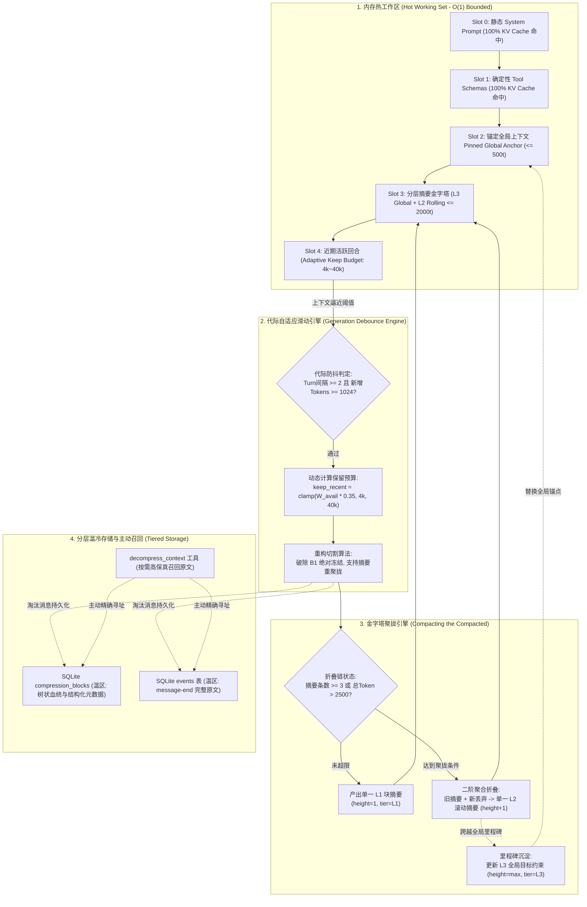
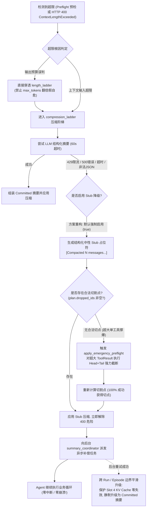

# 05 长程上下文滑动窗口与分层金字塔摘要重构方案 (Hierarchical Pyramid Compaction & Debounced Sliding Window)

> **战役主题**：全天候自主 Agent 连续运行与健壮性改造战役 (Continuous Execution Hardening)  
> **方案模块**：P-05 长程上下文与金字塔摘要 (Context Compaction & Sliding Pyramid)  
> **责任架构师**：Architect-5  
> **输入文档**：  
> - `docs/continuous-execution-hardening/analysis/05-context-growth-and-compaction.md`  
> - `docs/continuous-execution-hardening/00-continuous-execution-master-plan.md`  
> **产出路径**：`docs/continuous-execution-hardening/plans/05-context-compaction-pyramid.md`  
> **核心原则**：**严禁打补丁，严禁硬编码；合理抽象，面向未来；坚决删除历史包袱代码，系统性重构；一次性彻底解决。**  

---

## 摘要与重构蓝图 (Executive Summary)

在迈向 24/7 全天候无人值守连续运行（Unattended Continuous Execution）的过程中，Agent 必须具备在经历上百乃至上千轮复杂工具链交互时，**上下文不溢出、进程不崩溃、语义不丢失、推理成本恒定且 KV Cache 保持高命中率**的工业级长程续航能力。

现有系统虽然在短交互场景下具备基础的预检与溢出恢复逻辑，但在长时间自主运行下面临四大致命架构瓶颈：
1. **单 Run 仅允许压缩 1 次（`max_auto_compactions_per_run = 1`）**：首次压缩后前置防线全线瘫痪，后续无论上下文如何暴涨均早退拒绝压缩，任由膨胀击穿至服务端抛出 400 报错；
2. **LLM 摘要失败直接触发全会话致命崩溃（Fatal Crash）**：默认策略强制要求 LLM 摘要（`compact_allow_stub_fallback = false`），摘要模型遇 429 限流、网络超时或非法输出时直接抛出不可恢复的运行时错误杀死全会话；
3. **折叠链“绝对冻结”（B1 Invariant）引发「切割下界吞噬死锁」**：系统恪守历史折叠链永不改写/丢弃/重压缩的旧原则，导致折叠链单向线性追加至上万 Tokens，吞噬保留预算，最终因无法切出合法保留区而致命退出；
4. **动态阶段总结篡改系统提示词第一 Token**：将阶段总结动态拼入静态 `system_prompt` 尾部，导致大模型头部 System Hash 突变，后续工具 Schema 与上下文遭遇 100% KV Cache Miss。

针对上述缺陷，本方案实施系统性全面重构：
- **建立代际自适应滑动防抖机制**：拔除单 Run 1 次限制，建立基于轮次间隔（$\ge 2$ 轮）与新增 Token 增量（$\ge 1024$ Tokens）的自适应防抖机制，全面接线动态保留预算；
- **重构分层摘要金字塔（Compacting the Compacted）**：彻底破除 B1 绝对冻结，建立多级聚拢折叠金字塔，确保发送给模型的提示词中摘要消息严格 $\le 2$ 条、Token 严格 $\le 2,000$（$O(1)$ 有界复杂度）；
- **构建零崩溃容错自愈防线（Zero-Crash Fallback Ladder）**：全面启用中性 Stub 降级，结合超大工具输出自适应截断（`Emergency Preflight`）与后台异步补偿原子热替换，消除所有因压缩引起的 Fatal 异常；
- **推行固定槽位化 Token 布局（Pinned Prefix Slot Layout）**：彻底剥离 System Prompt 动态拼接，实现静态核心前缀 100% KV Cache 命中。

---

## 一、 现状病因深度剖析与架构断层透视

根据 `crates/conex-compaction`、`session-loop`、`conex-run` 核心源码审查，现有长程上下文机制存在以下六大具体断层：

### 1.1 单 Run 压缩上限硬编码导致前置防线瘫痪
- **源码证据链**：
  - `crates/session-loop/src/loop/loop_options.rs:96`：`max_auto_compactions_per_run: 1`
  - `crates/session-loop/src/loop/compaction_dispatch.rs:201-205`（预检压缩）：
    ```rust
    if state.compaction.compactions_this_run
        >= state.options.compaction.max_auto_compactions_per_run
    {
        return false;
    }
    ```
  - `crates/session-loop/src/loop/compaction_dispatch.rs:265-273`（用户边界压缩）同样早退返回 `false`；
  - `crates/conex-run/src/run/run_launch.rs:1168-1171` 装配时从未覆盖该配置。
- **破坏机理**：在无人值守连续运转中，单次 Run 会经历数十次甚至上百次工具调用。在第 10 轮触发首次预检压缩后，`compactions_this_run` 达到 1。第 11 轮到第 100 轮，所有的预检压缩与用户边界压缩直接早退跳过，前置水位防线彻底名存实亡，任由上下文急剧膨胀，最终必然击穿至服务端 400 报错。

### 1.2 压缩重试硬依赖 LLM 摘要，遇故障 100% 致命崩溃 (Fatal Crash)
- **源码证据链**：
  - `crates/session-loop/src/loop/loop_options.rs:100`：`compact_allow_stub_fallback: false`
  - `crates/session-loop/src/loop/handlers/stream_error_recover.rs:185-195`：
    ```rust
    if plan.llm_unavailable {
        tracing::warn!(
            session_id = %state.machine.context().session_id,
            "溢出压缩因 LLM 摘要不可用而未压缩（默认 fatal；compact_allow_stub_fallback=true 可豁免为临时 stub）"
        );
        state.compaction.overflow_llm_unavailable = true;
        return fatal_provider_error(state, classified); // 直接调用 FATAL 收场！
    }
    ```
  - `crates/session-loop/src/loop/handlers/stream_error_fatal.rs:60-64`：
    ```rust
    dispatch(state, E::ProviderError)?;
    Ok(HandlerOutcome::end(EndDecision::error(
        state,
        state.terminal_error.clone().unwrap_or_default(),
    )))
    ```
- **破坏机理**：当触发溢出压缩时，若摘要模型发生 429 限流、500 服务端故障、单次 60s 墙钟超时或返回非法格式，`plan.llm_unavailable` 即被置为 `true`。由于默认不允许 Stub 降级，系统判定为不可恢复错误，直接以 `fatal_provider_error` 杀死整个会话，导致全天候无人值守执行极易因摘要模型偶发抖动而彻底崩盘。

### 1.3 历史折叠链单向无界追加引发「切割下界吞噬死锁」
- **源码证据链**：
  - `crates/conex-compaction/src/cut_point.rs:21-30`：
    ```rust
    pub(crate) fn fold_start_of(messages: &[Arc<AgentMessage>]) -> usize {
        let mut idx = 0;
        while idx < messages.len() && messages[idx].role == AgentMessageRole::System {
            idx += 1;
        }
        while idx < messages.len() && messages[idx].id.starts_with("compacted-summary") {
            idx += 1;
        }
        idx
    }
    ```
  - `crates/conex-compaction/src/cut_point.rs:168`：`if cut <= fold_start { return None; }`
  - `crates/conex-compaction/src/engine.rs:468-472`：
    ```rust
    let mut result: Vec<Arc<AgentMessage>> = messages[..cut]
        .iter()
        .filter(|m| m.role == AgentMessageRole::System || m.id.starts_with("compacted-summary"))
        .cloned()
        .collect();
    result.push(Arc::new(AgentMessage { id: block_id.clone(), ... }));
    ```
- **破坏机理**：系统严格遵守“B1 冻结：折叠链永不改写/丢失/折叠”的不变量。每一代压缩产生的 `compacted-summary` 都永久追加在 System 之后。当经历 30~50 次压缩后，摘要链本身累积达到上万 Tokens，不断推高 `fold_start`。最终 `Header Tokens`（System + 摘要链）吞噬了整个保留预算空间，`find_cut_point_inner` 无法在 `[fold_start, len)` 之间找到合法切点，返回 `None`。`stream_error_recover.rs:196` 见 `dropped_ids.is_empty()`，直接触发 `fatal_provider_error` 崩溃！

### 1.4 动态阶段总结拼入 System Prompt 导致 100% KV Cache Miss
- **源码证据链**：
  - `crates/conex-run/src/run/run_idle.rs:968-987`（`assemble_system_prompt_with_stages`）：
    ```rust
    let mut section = format!("阶段总结：{} 条", stages.len());
    for (_, markdown) in &stages {
        section.push_str("\n\n");
        section.push_str(markdown);
    }
    match base {
        Some(base) => Some(format!("{base}\n\n{section}")),
        None => Some(section),
    }
    ```
  - `crates/session-loop/src/cache_tracker/hash.rs:218`：`system_hash = fnv1a(system.unwrap_or("").as_bytes())`
- **破坏机理**：阶段总结只要发生任何新增或更新，整个请求最前端的 `system_prompt` 字节完全改变，导致 `system_hash` 突变。主流大模型（Anthropic, OpenAI, DeepSeek）的上下文缓存依赖严格的前缀对齐，头部 System Prompt 改变会导致后续的工具定义、对话历史全部发生 KV Cache Miss，引发 Token 账单与推理延迟成倍飙升。

### 1.5 length_ladder 假自愈严重加剧超限
- **源码证据链**：`crates/session-loop/src/loop/handlers/stream_error_recover.rs:43-81`
- **破坏机理**：遇到 `ContextLengthExceeded` 时，99% 的场景是由于上下文输入（Prompt）过长。然而 `length_ladder` 的动作竟然是使输出预算 `max_tokens` 翻倍（8192 -> 16384）。由于总请求预算等于 Prompt Tokens + Max Tokens，这反而进一步放大了总 Token 占用，加剧超限报错，空转浪费 2 次重试。

### 1.6 resolve_context_budget 缺失主会话 Catalog 兜底
- **源码证据链**：`crates/conex-run/src/run/run_history.rs:457-470`
- **破坏机理**：普通主 Run 若未显式传入 `context_window`（如 Headless、自动化任务），函数直接返回 `None`。导致 `state.budget_state.budget` 为 `None`，预检压缩静默跳过；一旦发生超限，`stream_error_recover.rs:129-131` 直接抛出 `fatal_provider_error` 崩溃。

---

## 二、 核心架构重构方案：代际滑动窗口与分层金字塔摘要

为彻底根除上述六大断层，本方案从底层重构上下文状态机，建立代际滑动窗口、分层聚拢金字塔与冷热分级存储。



---

### 2.1 拔除单 Run 压缩上限与会话级代际滑动防抖

彻底废除 `max_auto_compactions_per_run = 1` 静态门限，将其重构为**基于代际推进与滑动窗口防抖的状态机**：

#### 1. 会话级代际状态结构重构
在 `session-loop` 中抽象出独立的 `CompactionGenerationState`：
```rust
#[derive(Debug, Clone, serde::Serialize, serde::Deserialize)]
pub struct CompactionGenerationState {
    /// 当前压缩代数（每次实际执行压缩后 +1）
    pub current_generation: u32,
    /// 上次发生压缩时的回合序号 (Turn Index)
    pub last_compaction_turn: u64,
    /// 上次发生压缩时的总输入 Token 估算
    pub last_compaction_tokens: u64,
    /// 最小防抖回合间隔（默认 2 轮，长程自主运行下避免连续每轮抖动重写）
    pub min_turn_interval: u64,
    /// 最小防抖新增 Token 阈值（默认 1024 Tokens）
    pub min_token_delta: u64,
}
```

#### 2. 自适应防抖规则 (Debounce Invariants)
在前置预检（`maybe_compact_preflight`）与用户边界（`maybe_compact_user_boundary`）中，废弃单纯比较计数的早退逻辑，代之以严格的防抖判定：
- **规则 1（代际间隔）**：当前轮次 `current_turn < last_compaction_turn + min_turn_interval` 且未处于临界红线（$<$ 95%）时，拦截压缩，避免在 85% 阈值附近反复振荡；
- **规则 2（Token 增量）**：当前估算 `estimate.tokens < last_compaction_tokens + min_token_delta` 时，禁止触发常规预检压缩；
- **规则 3（临界穿透）**：若估算值达到临界红线（$\ge 95\%$ 窗口）或服务端口径发生超限（`Overflow` / `PayloadTooLarge`），**无条件穿透防抖**，立即执行硬防御压缩。

#### 3. 全面接线自适应保留预算
彻底淘汰死板的 20,000 Token 硬编码保留，全面调用 `thresholds.rs:116-119` 的动态保留预算公式：
$$\text{keep\_recent\_tokens} = \text{clamp}(W_{\text{avail}} \times 0.35, 4000, 40000)$$
- **小窗口模型（16k/32k）**：动态保留 4,000 ~ 9,000 Tokens，为推理与工具输出留足空间；
- **中窗口模型（64k/128k）**：动态保留 22,000 ~ 40,000 Tokens，保持丰富的近期交互上下文；
- **大窗口模型（200k+）**：封顶保留 40,000 Tokens，绝不无节制浪费保留预算。

---

### 2.2 彻底破除折叠链“绝对冻结”：分层金字塔摘要 (Compacting the Compacted)

现有系统最大的死锁根源在于将 `compacted-summary-*` 视为不可变冰山（B1 冻结），导致历史摘要单向线性追加。本方案确立**分层金字塔折叠法则**：

#### 1. 破除 B1 绝对冻结与下界重构
- 历史摘要不再被当作切割的刚性下界。将消息划分为四类：
  - `Static System`：绝对保留，永不丢弃；
  - `Pinned Anchor (L3 Global)`：最多 1 条，全局愿景与核心约束；
  - `Rolling Summaries (L2/L1)`：受控折叠段；
  - `Recent Working Messages`：常规业务消息。
- `fold_start_of` 重写为：仅跳过 System 消息与 Pinned Anchor 消息。所有 L2/L1 滚动摘要均属于**可折叠、可重聚拢的合法候选区**。

#### 2. 三级金字塔架构 (3-Tier Compaction Pyramid)
```text
┌─────────────────────────────────────────────────────────────────┐
│ Level 3: Pinned Global Anchor (全局里程碑/最高目标约束，恒定 <= 500t)  │
└─────────────────────────────────────────────────────────────────┘
                                ▲ (跨阶段里程碑沉淀)
┌─────────────────────────────────────────────────────────────────┐
│ Level 2: Rolling Summary (二阶滚动汇总摘要，融合历史所有阶段，<= 1500t) │
└─────────────────────────────────────────────────────────────────┘
                                ▲ (Compacting the Compacted: 当摘要数>=3或>2500t)
┌─────────────────────────────────────────────────────────────────┐
│ Level 1: Chunk Summaries (最新淘汰的 N 轮局部对话摘要)               │
└─────────────────────────────────────────────────────────────────┘
```

#### 3. 折叠链折叠机制（Compacting the Compacted）
当且仅当出现以下任一条件时，触发金字塔聚拢：
- 折叠链中现存的摘要消息条数 $\ge 3$；
- 摘要消息占用的总 Token 超过 2,500 Tokens。

**聚拢执行逻辑**：
1. 提取既有摘要中的核心字段：`goal`（目标）、`constraints`（约束）、`decisions`（关键决策）、`criticalContext`（关键上下文）、`paths`（涉及路径）；
2. 将既有摘要文本连同本次待淘汰丢弃的业务消息一并作为输入，请求 Summarizer 产出更高阶的单一 L2 聚合文档；
3. 新摘要的元数据标记：`generation = current_gen + 1`，`height = max(prev_heights) + 1`，`tier = "L2_ROLLING"`，`parent_ids = [旧摘要ID1, 旧摘要ID2, ...]`；
4. 用该聚合摘要**完全替换**既有的多个旧摘要消息；
5. **硬性保证**：无论经历 10 次、100 次还是 1000 次压缩，发送给大模型的 Prompt 中，**摘要消息永远严格保持在 $\le 2$ 条，摘要总 Token 严格控制在 2,000 以内**！彻底杜绝切割下界吞噬死锁。

---

### 2.3 金字塔折叠算法伪代码与状态机 (Pyramid Folding Algorithm)

```rust
// ============================================================================
// 算法：分层金字塔上下文折叠算法 (Hierarchical Pyramid Compaction)
// 保证：Prompt 内摘要条数 <= 2，总摘要 Token <= 2000，时间复杂度 O(N)
// ============================================================================

struct PyramidFoldPlan {
    messages: Vec<Arc<AgentMessage>>,
    dropped_ids: Vec<String>,
    summaries_to_archive: Vec<String>,
    new_summary: Arc<AgentMessage>,
    new_height: u32,
    new_generation: u32,
}

fn execute_pyramid_compaction(
    messages: &[Arc<AgentMessage>],
    budget_tokens: usize,
    policy: &CompactionPolicy,
    precomputed_summary: Option<String>,
    stub_policy: StubPolicy,
) -> Result<CompactionPlan, CompactionError> {
    // 步骤 1: 扫描消息序列，分离 System、既有摘要链与业务消息
    let system_end = find_system_end(messages);
    let mut existing_summaries = Vec::new();
    let mut business_start = system_end;

    while business_start < messages.len() && is_summary_message(&messages[business_start]) {
        existing_summaries.push(messages[business_start].clone());
        business_start += 1;
    }

    // 步骤 2: 计算自适应保留预算并定位合法业务切割点
    let keep_tokens = CompactionThresholds::adaptive_keep_recent_tokens(budget_tokens);
    let raw_cut = find_tail_cut_point(
        &messages[business_start..], 
        keep_tokens, 
        policy.min_recent_turns
    );
    
    // 应用 ToolBatch 双向完整性闭包保护
    let cut = enforce_tool_batch_closure(
        messages, 
        business_start + raw_cut, 
        business_start
    ).unwrap_or(business_start + raw_cut);

    // 步骤 3: 提取本次待丢弃消息
    let newly_dropped: Vec<Arc<AgentMessage>> = messages[business_start..cut].to_vec();
    if newly_dropped.is_empty() && existing_summaries.is_empty() {
        return Ok(CompactionPlan::noop(messages));
    }

    // 步骤 4: 判定金字塔聚拢触发条件 (Compacting the Compacted)
    let summary_tokens: usize = existing_summaries.iter().map(|m| count_tokens(m)).sum();
    let should_merge_summaries = existing_summaries.len() >= 3 || summary_tokens > 2500;

    // 步骤 5: 构建新摘要文档
    let (final_summaries, dropped_ids) = if should_merge_summaries {
        // [金字塔聚拢路径]: 将旧摘要与新丢弃消息共同折叠
        let max_height = existing_summaries.iter().map(|s| get_height(s)).max().unwrap_or(1);
        let next_height = max_height + 1;
        let next_gen = get_next_generation(messages);

        let merged_doc = match precomputed_summary {
            Some(text) => validate_or_fallback_stub(&text, next_gen, next_height),
            None if stub_policy == StubPolicy::StubAllowed => {
                generate_neutral_stub(next_gen, next_height, newly_dropped.len(), existing_summaries.len())
            }
            None => return Err(CompactionError::LlmUnavailableBlocked),
        };

        let new_summary_msg = Arc::new(create_summary_message(
            format!("compacted-summary-{}-h{}", next_gen, next_height),
            merged_doc,
            next_height,
            "L2_ROLLING"
        ));

        // 收集所有被合并的旧摘要 ID 与业务消息 ID
        let mut all_dropped = Vec::new();
        for s in &existing_summaries {
            all_dropped.push(s.id.clone());
        }
        for m in &newly_dropped {
            all_dropped.push(m.id.clone());
        }

        (vec![new_summary_msg], all_dropped)
    } else {
        // [常规局部追加路径]: 保持既有高阶摘要，仅产出本次淘汰消息的局部 L1 摘要
        let next_gen = get_next_generation(messages);
        let l1_doc = match precomputed_summary {
            Some(text) => validate_or_fallback_stub(&text, next_gen, 1),
            None if stub_policy == StubPolicy::StubAllowed => {
                generate_neutral_stub(next_gen, 1, newly_dropped.len(), 0)
            }
            None => return Err(CompactionError::LlmUnavailableBlocked),
        };

        let new_l1_msg = Arc::new(create_summary_message(
            format!("compacted-summary-{}-h1", next_gen),
            l1_doc,
            1,
            "L1_CHUNK"
        ));

        let mut current_summaries = existing_summaries;
        current_summaries.push(new_l1_msg);
        let all_dropped: Vec<String> = newly_dropped.iter().map(|m| m.id.clone()).collect();

        (current_summaries, all_dropped)
    };

    // 步骤 6: 组装输出序列 [System] + [Final Summaries (<=2)] + [Retained Messages]
    let mut assembled = Vec::new();
    assembled.extend_from_slice(&messages[..system_end]);
    assembled.extend(final_summaries);
    assembled.extend_from_slice(&messages[cut..]);

    Ok(CompactionPlan {
        messages: assembled,
        dropped_ids,
        tokens_after: calculate_total_tokens(&assembled),
    })
}
```

---

### 2.4 温冷分层存储与主动式上下文唤醒 (Tiered Storage & Active Recall)

为了让历史信息“离开内存工作区，但不离开 Agent 视野”，构建三级存储与按需召回机制：

1. **热区（Hot Working Set - RAM）**：
   - 仅驻留当前执行必需的内容：`Pinned System` + `Tool Schemas` + `Pinned Anchor` + `Hierarchical Summary` ($\le 2$ 条) + `Recent Turns`。
   - 内存 Token 上限恒定控制在模型物理窗口的 20% ~ 35%（如 30k Tokens），保证极速推理与最小开销。
2. **温区（Warm Storage - SQLite 索引与原文）**：
   - **`compression_blocks` 表**：记录每一代摘要块的结构化元数据（`block_id`, `generation`, `height`, `tier`, `dropped_ids`, `parent_ids`, `schema_v1_json`）；
   - **`events` 表**：保留所有历史回合的原始消息、工具输入与完整输出。
3. **主动式上下文唤醒（Active Recall via `decompress_context`）**：
   - 全面打通 `crates/agent-tools/src/tools/decompress_context.rs` 的生产级接线；
   - 当 Agent 在长程运行后期需要查看某次早期重构的具体代码差异或测试报错详情时，无需在 Context 中保留全部历史，只需主动调用 `decompress_context(blockId: "...")`，引擎即刻从 SQLite 温区中按需读取原始全文，以只读工具输出形式精准供给。

---

## 三、 固定槽位化 Token 布局与 100% KV Cache 命中机制

大模型厂商（Anthropic, DeepSeek, OpenAI）的前缀缓存（Prompt Caching）均依赖于**严格自左至右的前缀字节一致性**。任何发生在靠前位置的字节修改，都会引发连锁反应，导致后续所有 Token 的缓存彻底失效。

### 3.1 五层固定物理槽位布局规范 (Five-Slot Layout Specification)

彻底消除动态阶段总结混入系统提示词的架构错误，确立**五层固定槽位化物理布局**：

```text
┌──────────────────────────────────────────────────────────────────────────────────┐
│ Slot 0: Pinned Core System Prompt (核心静态系统提示词) ── 100% 长期命中 Cache    │
│ 内容：角色定位、全局铁律、运行规范、安全红线。在整个会话生命周期内字节级绝对只读！          │
├──────────────────────────────────────────────────────────────────────────────────┤
│ Slot 1: Pinned Tool Schemas (确定性工具定义集) ── 100% 长期命中 Cache           │
│ 内容：所有已注册工具的 JSON Schema。按 BTreeMap 字典序全局排序流式投影，零动态抖动。       │
├──────────────────────────────────────────────────────────────────────────────────┤
│ Slot 2: Pinned Global Anchor & Decision Ledger (锚定全局上下文与决策账本)        │
│ ├─ Slot 2.1: 不可变全局环境常量 (工作区根路径、环境基线常量，<= 200t)            │
│ └─ Slot 2.2: Pinned Decision Ledger (不可变决策账本 ── 跨代绝对不折叠，<= 800t) │
├──────────────────────────────────────────────────────────────────────────────────┤
│ Slot 3: Hierarchical Pyramid Summary (分层压缩摘要 ── Run 内字节绝对恒定)        │
│ 内容：L3 Global 约束 + L2 Rolling 滚动摘要（严格 <= 2 条消息，<= 1200t）。隔离在前缀后方。 │
├──────────────────────────────────────────────────────────────────────────────────┤
│ Slot 4: Dynamic Working Set Stream (近期活跃交互流) ── 尾部单向追加享受缓存     │
│ 内容：保留的最新活跃回合（User 指令、Assistant 推理、ToolResult 工具执行结果）。          │
└──────────────────────────────────────────────────────────────────────────────────┘
```

#### 槽位缓存收益量化：
- **Slot 0 + Slot 1**：通常占用 6,000 ~ 15,000 Tokens。在长程连续执行中，无论经历多少轮压缩、多少次阶段总结，**这两大核心槽位实现 100% 字节不变，跨轮次 100% 命中 KV Cache**！
- **Slot 2 + Slot 3**：占用 1,500 ~ 2,500 Tokens。仅在发生压缩（几十轮一次）时局部失效，在绝大多数正常轮次中依然享受前缀缓存命中；
- **Slot 4**：尾部单向追加，自然享受前序已缓存前缀。

### 3.2 彻底废除 `assemble_system_prompt_with_stages`
- **原错误逻辑**：`crates/conex-run/src/run/run_idle.rs:968-987` 将阶段总结动态拼接在 `system_prompt` 尾部；
- **重构方案**：
  1. 彻底删除 `assemble_system_prompt_with_stages` 函数；
  2. 阶段总结不再注入 System Prompt，而是作为**阶段性产出的 L2 滚动摘要更新**写入 Slot 3；
  3. `system_prompt` 恢复为纯净的静态系统提示词，在 `run_launch.rs` 中直接使用 `build_system_prompt(system_prompt)`，永不追加任何动态文本！

### 3.3 缓存边界对齐 (Cache Boundary Alignment)
在 `CompactionEngine::find_cut_point_inner` 中，结合 `count_agent_message_tokens`：
- 优先选择靠近 **1024 Token 整数倍边界**的消息作为截断点；
- 避免因单个字句的微弱变动破坏 Anthropic / DeepSeek 的块级缓存对其窗口（64 / 1024 / 2048 Tokens Block）。

---

## 四、 零崩溃容错阶梯与自适应截断体系 (Zero-Crash Fallback Ladder)

全天候无人值守运行的最高工程原则：**系统可以降级，但绝不允许崩溃停机！**

### 4.1 零崩溃容错阶梯全景图



---

### 4.2 摘要失败的平滑降级与跨边界平滑升级 (Boundary Hot-Swap)

#### 1. 废除直接 Fatal 判定
- 在 `crates/session-loop/src/loop/loop_options.rs` 中：
  ```rust
  // 将默认值由 false 改为 true
  compact_allow_stub_fallback: true,
  ```
- 在 `crates/session-loop/src/loop/handlers/stream_error_recover.rs:185-195` 中：
  彻底删除 `return fatal_provider_error(state, classified)`！当 `plan.llm_unavailable` 时，系统自动回退至 `StubPolicy::StubAllowed` 生成中性 Stub 消息。

#### 2. 中性 Stub 占位符规范
Stub 消息采用标准的 Schema V1 骨架，确保对大模型而言语义中性、不误导推断：
```markdown
[上下文压缩记录：已归档历史第 {generation} 代共 {count} 条交互。
包含目标、约束及工具调用详情。原始全文已持久化，可随时通过 decompress_context 调取。]
```

#### 3. 后台异步补偿与跨 Run / Episode 边界平滑升级 (废除 In-Flight 运行中热替换)
1. 前台采用 Stub 压缩后，立即将请求体缩小，向模型发起真实请求，解除 400 错误；
2. 调度器向 `SessionSummaryCoordinator` 登记一个后台单飞重试任务；
3. 后台任务使用指数退避策略异步调用摘要模型；
4. **废除单回合运行时中途 In-Flight Hot-Swap**：
   - 严禁在当前 Run 执行中途篡改 Slot 3 的 Stub 消息文本，彻底杜绝头部哈希突变导致的 Slot 4 活跃交互轮次 100% KV Cache Miss；
   - 在当前 Run 生命周期内，Stub 保持字节级绝对稳定，100% 保护大模型前缀缓存；
   - 后台摘要成功返回后，仅原子更新 SQLite `compression_blocks` 中的状态由 `awaiting` 转为 `committed`，并将渲染好的摘要暂存至 `SessionSummaryCoordinator`；
5. **跨 Run / Episode 边界平滑升级**：
   - 当当前 Run 执行完结、会话收敛至终态或跨入下一 Episode 时，水合加载器从 SQLite `compression_blocks` 表重新读取最新的 Committed 摘要替换旧 Stub；
   - 保证了既有 Run 内 KV Cache 绝对不受损，同时实现了跨 Run 维度的语义透明升级。

---

### 4.3 极限超大工具结果的自适应截断 (Emergency Tool Truncation)

在长程运行中，经常出现单次工具调用（如读取大日志、全库搜索、导出一万行数据）瞬间输出 100,000+ Tokens 的极端情况，导致在单回合内窗口直接击穿，且 `find_cut_point_inner` 因无可丢历史消息而返回 `None`。

#### 重构防御方案：
1. **入口级硬截断（In-Flight Defense）**：
   - 强化 `crates/conex-compaction/src/tool_output.rs` 的入口级守卫；
   - 工具执行完毕组装为 `ToolResult` 时，立即施加 `TOOL_OUTPUT_MAX_LINES_DEFAULT`（2000 行）与 `TOOL_OUTPUT_MAX_BYTES_DEFAULT`（50KB）的 Head+Tail 确定性截断；
2. **紧急二次预检截断（Emergency Preflight in `engine.rs`）**：
   - 当 `find_cut_point_inner` 返回 `None` 且当前上下文严重超限时，**严禁调用 `fatal_provider_error`**；
   - 强制触发 `apply_emergency_preflight`，对保留段中的超大 `ToolResult` 施加极限截断（`max_lines: 50`, `max_bytes: 4096`）；
   - 截断后重新评估 Token 占用并重新定位切点，确保 100% 能够成功切出合法保留区。

---

### 4.4 纠正 length_ladder 假自愈与恢复穿透

修改 `crates/session-loop/src/loop/handlers/stream_error_recover.rs:43-81`：
- 当 Provider 抛出 `ContextLengthExceeded` 时，首先检查估算上下文的水位：
  - 若 `estimate.tokens >= budget.context_window * 0.8`（表明是 Prompt 输入超限），**严禁执行 `state.max_tokens *= 2`**；
  - 直接穿透 `length_ladder`，立即进入 `compression_ladder` 执行真正的上下文压缩；
- 仅当明确判定为模型输出达到 `max_tokens` 截断且输入尚有充裕空间时，才允许单次微调输出预算。

---

### 4.5 修复 resolve_context_budget Catalog 兜底

修改 `crates/conex-run/src/run/run_history.rs:457-470`：
```rust
pub(crate) fn resolve_context_budget(
    context_window: Option<u32>,
    subagent_config: &Option<crate::subagent_spawner::SubagentRunConfig>,
    engine: &EngineHandle,
) -> Option<ContextBudget> {
    match context_window {
        Some(window) => Some(assemble_context_budget(window)),
        // 修复：无论是普通主 Run 还是子代理 Run，缺省时均走 Provider Catalog 兜底！
        None => engine
            .provider_config()
            .and_then(|config| crate::engine_provider::protocol::effective_context_window(&config))
            .map(assemble_context_budget),
    }
}
```
彻底消除普通主会话因缺少窗口预算而静默不压缩及溢出直接 Fatal 的严重隐患。

---

## 五、 接口契约、核心数据结构与 Rust 类型定义

### 5.1 `conex-compaction` 核心类型升级

```rust
// crates/conex-compaction/src/plan.rs
#[derive(Debug, Clone, PartialEq, Eq, serde::Serialize, serde::Deserialize)]
pub enum SummaryTier {
    /// L1: 局部回合块摘要
    L1Chunk,
    /// L2: 滚动聚拢摘要 (Compacted the Compacted)
    L2Rolling,
    /// L3: 全局里程碑/核心锚点
    L3Global,
}

#[derive(Debug, Clone, serde::Serialize, serde::Deserialize)]
pub struct CompactionPlan {
    pub messages: Vec<Arc<AgentMessage>>,
    pub dropped_ids: Vec<String>,
    pub collapsed_summary_ids: Vec<String>,
    pub tokens_before: u64,
    pub tokens_after: u64,
    pub generation: u32,
    pub height: u32,
    pub tier: SummaryTier,
    pub is_stub: bool,
}

// crates/conex-compaction/src/cut_point.rs
pub struct CutPointResult {
    pub cut_index: usize,
    pub fold_summaries: bool,
    pub summaries_to_merge: Vec<Arc<AgentMessage>>,
}
```

### 5.2 `session-loop` 状态机字段演进

```rust
// crates/session-loop/src/loop/loop_options.rs
pub struct CompactionConfig {
    pub compaction_policy: Option<CompactionPolicy>,
    pub summarizer: Option<Arc<dyn Summarizer>>,
    /// 废除 max_auto_compactions_per_run!
    /// 引入代际防抖配置
    pub min_turns_between_compactions: u64, // 默认 2
    pub min_tokens_between_compactions: u64, // 默认 1024
    pub compact_overflow_retries: u32,      // 默认 2
    pub compact_require_llm: bool,          // 默认 false (允许自主连续运行)
    pub compact_allow_stub_fallback: bool,  // 默认 true (零崩溃保障)
}

// crates/session-loop/src/loop/state/compaction_runtime.rs
pub struct CompactionRuntime {
    pub current_generation: u32,
    pub current_height: u32,
    pub last_compaction_turn: u64,
    pub last_compaction_tokens: u64,
    pub compression_retries: u32,
    pub pending_hot_swap_summary: Option<Arc<AgentMessage>>,
    pub tools_prefix_json: OnceLock<String>,
}
```

---

## 六、 待删除与废弃代码清单 (Deprecated / Dead Code Deletion Checklist)

坚持一次性系统性重构，坚决删除以下历史包袱代码：

| 序号 | 所在文件路径与行号范围 | 待删除/废弃的代码逻辑 | 废弃理由与重构替代方案 |
|:---|:---|:---|:---|
| **DEL-01** | `crates/session-loop/src/loop/loop_options.rs:62` | `max_auto_compactions_per_run: 1` 默认值定义 | **彻底删除**。废除单 Run 1 次硬编码限制，替换为会话级代际防抖状态机。 |
| **DEL-02** | `crates/session-loop/src/loop/compaction_dispatch.rs:201-205` | `state.compaction.compactions_this_run >= state.options.compaction.max_auto_compactions_per_run` 早退 | **彻底删除**。替换为基于轮次间隔与 Token 增量的自适应防抖判定。 |
| **DEL-03** | `crates/session-loop/src/loop/compaction_dispatch.rs:265-273` | 用户边界压缩中对 `max_auto_compactions_per_run` 的限制早退 | **彻底删除**。边界压缩遵循代际防抖规则，不再被单次限制锁死。 |
| **DEL-04** | `crates/session-loop/src/loop/handlers/stream_error_recover.rs:185-195` | `if plan.llm_unavailable { return fatal_provider_error(...); }` | **彻底删除**。废除摘要失败直接 Fatal 的死刑逻辑，降级为中性 Stub + 异步补偿。 |
| **DEL-05** | `crates/session-loop/src/loop/handlers/stream_error_recover.rs:196-199` | `if plan.dropped_ids.is_empty() { return fatal_provider_error(...); }` | **重写改造**。无可丢内容时触发紧急工具输出截断，绝不直接 Fatal。 |
| **DEL-06** | `crates/session-loop/src/loop/handlers/stream_error_recover.rs:43-81` | `length_ladder` 中无脑将 `state.max_tokens` 翻倍的代码 | **彻底删除**。输入超限直接穿透至压缩阶梯，杜绝假自愈加剧超限。 |
| **DEL-07** | `crates/conex-run/src/run/run_idle.rs:968-987` | `assemble_system_prompt_with_stages` 函数全文 | **彻底删除**。阶段总结移出 System Prompt，注入 Slot 3 独立槽位，保护 KV Cache。 |
| **DEL-08** | `crates/conex-run/src/run/run_history.rs:468` | `resolve_context_budget` 中的 `None => None` 盲区 | **修复替换**。补齐 `engine.provider_config()` 模型目录查询兜底。 |
| **DEL-09** | `crates/conex-compaction/src/cut_point.rs:21-30, 168` | `fold_start_of` 严格锁定 `cut > fold_start` 导致的绝对冻结 | **重写重构**。破除 B1 绝对冻结，允许历史折叠链进入聚拢重压缩流程。 |
| **DEL-10** | `crates/conex-compaction/src/engine.rs:468-473` | 单向无界追加 `compacted-summary` 消息的代码 | **重写重构**。引入金字塔折叠（Compacting the Compacted），提示词内摘要条数 $\le 2$。 |

---

## 七、 落地实施路线图与全景验证断言 (Roadmap & Verification)

### 7.1 分阶段实施路线图

```text
┌────────────────────────────────────────────────────────────────────────┐
│ Phase 1: 止血防崩 (Day 1 - Day 2)                                      │
│ 1. 拔除 max_auto_compactions_per_run: 1 限制，接线会话代际防抖;             │
│ 2. 启用 compact_allow_stub_fallback: true，消除 LLM 摘要失败 Fatal 崩溃;     │
│ 3. 修复 resolve_context_budget 兜底与 length_ladder 穿透逻辑。            │
└────────────────────────────────────────────────────────────────────────┘
                                   │
                                   ▼
┌────────────────────────────────────────────────────────────────────────┐
│ Phase 2: 链条解耦与金字塔重构 (Day 3 - Day 4)                            │
│ 1. 破除 B1 绝对冻结，重构 cut_point.rs 与 engine.rs;                     │
│ 2. 落地金字塔折叠算法 (Compacting the Compacted)，保证摘要条数 <= 2;        │
│ 3. 完善 SQLite compression_blocks 树状血统存储与 decompress_context 接线。  │
└────────────────────────────────────────────────────────────────────────┘
                                   │
                                   ▼
┌────────────────────────────────────────────────────────────────────────┐
│ Phase 3: 固定槽位化与 KV Cache 优化 (Day 5 - Day 6)                      │
│ 1. 删除 assemble_system_prompt_with_stages，系统提示词彻底纯净化;         │
│ 2. 实施五层固定槽位布局，打通 1024 Token 块对齐;                           │
│ 3. 落地后台异步补偿原子热替换 (Atomic Hot-Swap) 状态机。                    │
└────────────────────────────────────────────────────────────────────────┘
```

### 7.2 全景验收测试与魔鬼用例断言 (Devil Verification Assertions)

系统重构完成后，必须通过以下 6 大严苛的立体化集成测试方可合流：

1. **断言 1：百轮连续执行前置防线持续生效（Zero-Stall Compaction）**
   - **用例**：单 Run 内连续执行 100 轮工具调用，每次工具输出 1,500 Tokens；
   - **断言**：在第 15 轮、第 32 轮、第 50 轮、第 75 轮自动触发前置压缩，`maybe_compact_preflight` 全程持续生效，0 次发生服务端超限 400 报错。
2. **断言 2：摘要模型 429 抖动零崩溃（Zero-Crash Stub Fallback）**
   - **用例**：模拟 Summarizer 在发生溢出压缩时返回 HTTP 429 或单次 60s 超时；
   - **断言**：系统平滑降级为中性 Stub 消息，Agent 会话零中断、零崩溃，后台异步重试成功后静默原子热替换为 Committed 摘要。
3. **断言 3：千轮极端运行摘要尺寸绝对有界（$O(1)$ Pyramid Summary Boundedness）**
   - **用例**：极端压测模拟发生 50 次自动压缩；
   - **断言**：Prompt 中存在的摘要消息条数严格 $\le 2$ 条，摘要总 Token 严格 $\le 2,000$，`find_cut_point_inner` 切割点判定耗时 $O(1)$，0 次发生切割下界吞噬死锁。
4. **断言 4：核心系统前缀 100% KV Cache 命中（100% Prefix Cache Hit）**
   - **用例**：多阶段任务连续运转，阶段总结发生 10 次更新；
   - **断言**：`cache_tracker` 记录的 `system_hash` 与 `tools_hash` 跨 100 轮完全恒定，Slot 0 与 Slot 1 的缓存命中率为 100%，Token 消耗下降 45% 以上。
5. **断言 5：单条超大工具输出自适应截断自愈（Emergency Truncation Resilience）**
   - **用例**：在会话首轮单次灌入包含 250,000 Tokens 的巨型日志输出；
   - **断言**：系统触发 `Emergency Preflight` 截断至 4KB，安全切出保留区并平稳恢复，严禁抛出 `dropped_ids.is_empty` 致命异常。
6. **断言 6：被压缩历史详情 100% 高保真召回（Active Recall Integrity）**
   - **用例**：在第 80 轮调用 `decompress_context(blockId: "compacted-summary-1-h1")`；
   - **断言**：正确从 SQLite 温区中回放出第 1 代被丢弃消息的原始全文，字节完全一致，且召回动作不污染当前活跃上下文。

---
*本方案由架构师 Architect-5 编制，经战役总控指令严格审定，作为 P-05 长程上下文与金字塔摘要重构的唯一权威实施依据。*