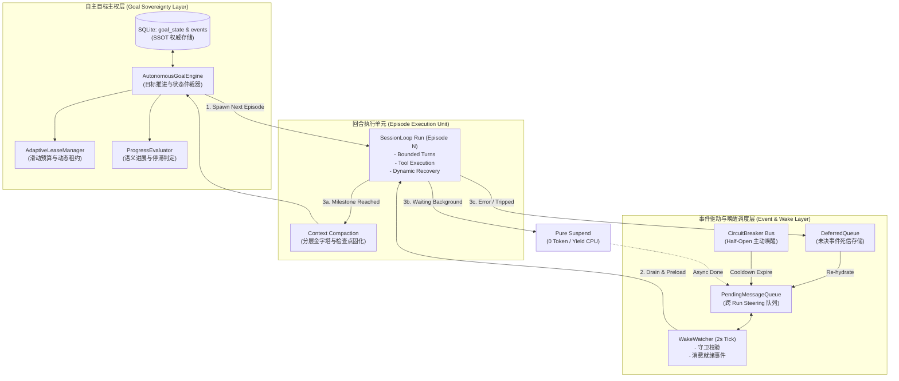
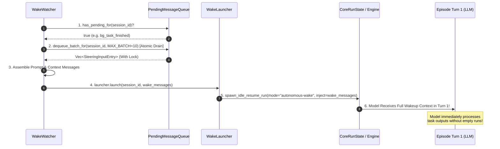
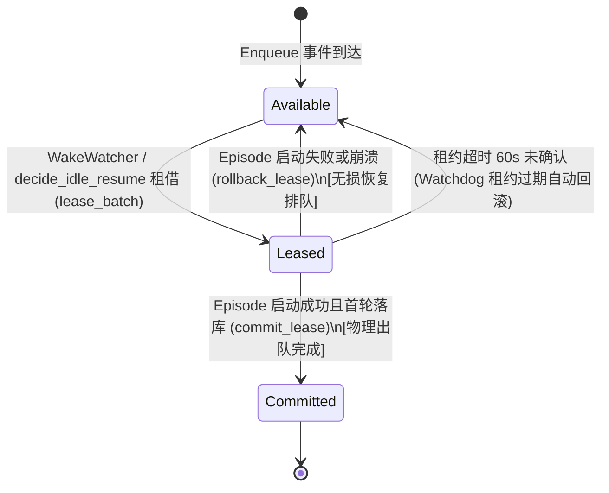
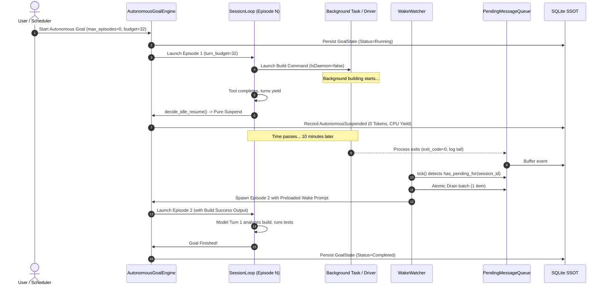
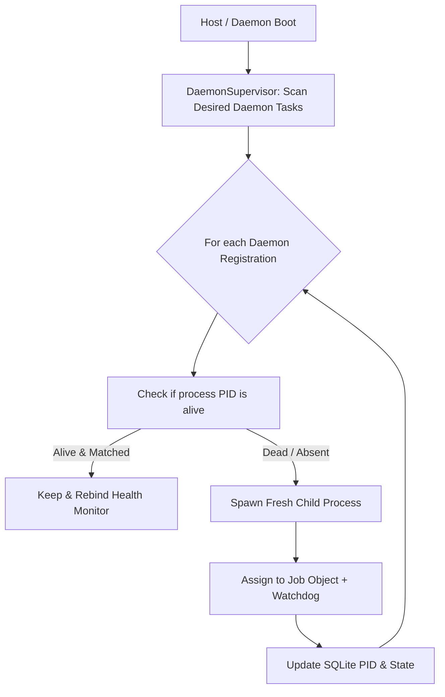

# 方案 06：全天候自主驱动、长程唤醒与心跳引擎方案

> **文档位置**：`docs/continuous-execution-hardening/plans/06-autonomous-drive-engine.md`  
> **所属战役**：全天候连续运行硬化战役（Continuous Execution Hardening）核心详案  
> **输入依据**：  
> - `docs/continuous-execution-hardening/analysis/06-autonomous-drive-and-resilience.md`（深度审查报告）  
> - `docs/continuous-execution-hardening/00-continuous-execution-master-plan.md`（战役总纲方案）  
> **方案职责**：彻底消除对用户单次消息驱动的单 Run 依赖，重构自主目标执行引擎（Autonomous Goal Engine）与跨 Episode 连续推进能力；重构 `wake_watcher.rs` 消除空消息启动缺陷，实现就绪事件原子 Drain 与上下文直注；废除 `run_idle.rs:1664` 的无差别 `clear_for_before` 毒丸清理，建立未决事件死信队列（Deferred Dead-Letter Store）确保异步通知零丢失；消灭 Empty-Inject 空注入反模式，确立纯净挂起（Pure Suspend）语义；建立具备动态退避与 Half-Open Canary 探针的三态断路器；落地 Windows 防逃逸看门狗、卡死 Driver 强制回收、$O(1)$ 内存滑动事件窗口与具备 Misfire 补偿的崩溃复活引擎，实现真正 24/7 全天候无人值守连续自治运转。

---

## 目录

- [一、背景定性与架构范式转移（Paradigm Shift）](#一背景定性与架构范式转移paradigm-shift)
  - [1.1 现状断层剖析：单 Run 依赖与脆弱的被动轮询](#11-现状断层剖析单-run-依赖与脆弱的被动轮询)
  - [1.2 核心架构范式转移：从单次触发到全天候自主目标驱动](#12-核心架构范式转移从单次触发到全天候自主目标驱动)
  - [1.3 核心设计原则与反补丁纪律](#13-核心设计原则与反补丁纪律)
- [二、全天候自主目标执行引擎（Autonomous Goal Engine）](#二全天候自主目标执行引擎autonomous-goal-engine)
  - [2.1 自主引擎架构全景拓扑图（Mermaid）](#21-自主引擎架构全景拓扑图mermaid)
  - [2.2 跨 Episode 自动续跑与动态租约机制（Adaptive Lease Renewal）](#22-跨-episode-自动续跑与动态租约机制adaptive-lease-renewal)
  - [2.3 状态机解耦与无限预算设计（max_turns = 0 与连续推进契约）](#23-状态机解耦与无限预算设计max_turns--0-与连续推进契约)
  - [2.4 基于外部语义进展的停滞判定重构](#24-基于外部语义进展的停滞判定重构)
  - [2.5 核心 Rust 结构体与方法契约设计](#25-核心-rust-结构体与方法契约设计)
- [三、唤醒管道与上下文预装载重构（WakeWatcher & Prompt Preloading）](#三唤醒管道与上下文预装载重构wakewatcher--prompt-preloading)
  - [3.1 Zero-Prompt Launch 缺陷根因穿透](#31-zero-prompt-launch-缺陷根因穿透)
  - [3.2 唤醒就绪事件原子 Drain 与上下文预装载协议](#32-唤醒就绪事件原子-drain-与上下文预装载协议)
  - [3.3 WakeWatcher 接口与数据流重写](#33-wakewatcher-接口与数据流重写)
  - [3.4 多源唤醒事件合并与优先级仲裁](#34-多源唤醒事件合并与优先级仲裁)
- [四、队列消费状态机与未决事件死信队列（Deferred Queue & Poison-Pill Elimination）](#四队列消费状态机与未决事件死信队列deferred-queue--poison-pill-elimination)
  - [4.1 Poison-Pill 毒丸清理漏洞穿透与废除清单](#41-poison-pill-毒丸清理漏洞穿透与废除清单)
  - [4.2 队列消费状态机（Queue Consumption FSM）与转移表](#42-队列消费状态机queue-consumption-fsm与转移表)
  - [4.3 未决事件死信队列（Deferred Store）数据契约与持久化](#43-未决事件死信队列deferred-store数据契约与持久化)
  - [4.4 异常收场与熔断恢复时的自动重新入队协议（Re-hydration Protocol）](#44-异常收场与熔断恢复时的自动重新入队协议re-hydration-protocol)
- [五、纯净挂起与空注入反模式消除（Pure Suspend vs. Empty-Inject Elimination）](#五纯净挂起与空注入反模式消除pure-suspend-vs-empty-inject-elimination)
  - [5.1 空注入反模式（Empty-Inject Round）的危害与 Token 审计](#51-空注入反模式empty-inject-round的危害与-token-审计)
  - [5.2 纯净挂起（Pure Suspend）语义确立与决策流重构](#52-纯净挂起pure-suspend语义确立与决策流重构)
  - [5.3 后台任务与定时器运行期的零消耗待命（Zero-Token Standby）](#53-后台任务与定时器运行期的零消耗待命zero-token-standby)
- [六、全链路生命周期事件模型（Full Lifecycle Event Model）](#六全链路生命周期事件模型full-lifecycle-event-model)
  - [6.1 自主连续执行事件枚举与结构体契约](#61-自主连续执行事件枚举与结构体契约)
  - [6.2 状态流转全景时序图（Sequence Diagram）](#62-状态流转全景时序图sequence-diagram)
  - [6.3 事件总线广播与前端可观测呈现](#63-事件总线广播与前端可观测呈现)
- [七、网络弹性、具备 Half-Open 的三态断路器与系统级长程资源治理](#七网络弹性具备-half-open-的三态断路器与系统级长程资源治理)
  - [7.1 RateLimit 动态预算弹性对齐（300s/600s）与 Full Jitter 指数退避](#71-ratelimit-动态预算弹性对齐300s600s与-full-jitter-指数退避)
  - [7.2 三态断路器重构（Closed / Open / Half-Open）与到期主动唤醒总线](#72-三态断路器重构closed--open--half-open与到期主动唤醒总线)
  - [7.3 (Session, Provider, Model) 三元组隔离命名空间](#73-session-provider-model-三元组隔离命名空间)
  - [7.4 Windows Job Object 防逃逸 Parent-Death 看门狗](#74-windows-job-object-防逃逸-parent-death-看门狗)
  - [7.5 卡死 Driver 强制回收与 SessionSerialGuard 死锁清除](#75-卡死-driver-强制回收与-sessionserialguard-死锁清除)
  - [7.6 LoopState.events 固定容量滑动窗口（O(1) 内存）与 SQLite WAL 主动截断](#76-loopstateevents-固定容量滑动窗口o1-内存与-sqlite-wal-主动截断)
  - [7.7 后台任务分卷轮转日志器（Size-Based Rolling Logger）](#77-后台任务分卷轮转日志器size-based-rolling-logger)
- [八、异常宕机自愈与工作流补偿（Crash Recovery & Self-Healing）](#八异常宕机自愈与工作流补偿crash-recovery--self-healing)
  - [8.1 断点自动复活编排器（Resurrection Orchestrator）设计](#81-断点自动复活编排器resurrection-orchestrator设计)
  - [8.2 工作流 Misfire 策略引擎（FireImmediately / SkipMissed / RunOnceIfWithin）](#82-工作流-misfire-策略引擎fireimmediately--skipmissed--runonceifwithin)
  - [8.3 声明式常驻服务守护者（Daemon Supervisor）期望状态重构](#83-声明式常驻服务守护者daemon-supervisor期望状态重构)
- [九、待删除与重构代码清单（Negative Output & Deprecation Inventory）](#九待删除与重构代码清单negative-output--deprecation-inventory)
  - [9.1 待彻底物理删除的代码、逻辑分支与写死常量清单](#91-待彻底物理删除的代码逻辑分支与写死常量清单)
  - [9.2 关键重构文件范围与契约变更表](#92-关键重构文件范围与契约变更表)
  - [9.3 负产出评估与净收敛指标](#93-负产出评估与净收敛指标)
- [十、立体验证门禁与断言清单（Stereoscopic Verification & Assertions）](#十立体验证门禁与断言清单stereoscopic-verification--assertions)
  - [10.1 核心逻辑单元测试断言（U-01 ~ U-12）](#101-核心逻辑单元测试断言u-01--u-12)
  - [10.2 网络混沌与故障注入测试断言（C-01 ~ C-06）](#102-网络混沌与故障注入测试断言c-01--c-06)
  - [10.3 24/7 浸泡压力与系统资源门禁断言（E-01 ~ E-05）](#103-247-浸泡压力与系统资源门禁断言e-01--e-05)
- [十一、实施路线图与反退避断言（Roadmap & Anti-Retreat Checklist）](#十一实施路线图与反退避断言roadmap--anti-retreat-checklist)

---

## 一、背景定性与架构范式转移（Paradigm Shift）

### 1.1 现状断层剖析：单 Run 依赖与脆弱的被动轮询

Conex / Crish 早期架构的核心假设建立在**“人类在场交互式对话”**的范式之上：
1. 用户在聊天输入框键入 Prompt；
2. 引擎创建单个 Run（`RunTaskOptions`），加载历史上下文，启动 `session-loop`；
3. 模型推理若干轮，调用本地工具，最终输出文本结论；
4. `session-loop` 触发 `SHOULD_STOP`，Run 终结收口，引擎彻底陷入休眠，等待下一次人类敲击回车。

当系统演进至需要承担跨昼夜大型重构、全量测试回归、全自动爬取与持续监控等 24/7 全天候任务时，现存实现暴露出极其严重的**“被动死水”断层**：
- **单 Run 脆弱性**：长程任务被局限在单一 Run 内部。一旦遭遇网络 429、单次上下文膨胀、或者撞上硬编码的 64 轮/12 轮上限，Run 直接退出。外层调度器仅作记录，无法跨越 Run 的生灭边界自动接力；
- **唤醒链路虚置**：虽然系统引入了每 2 秒扫描一次的 `wake_watcher.rs`，但其拉起新 Run 时向底层传递空消息数组（`Vec::new()`），导致唤醒信号无法在第一回合触达模型；
- **毒丸式暴力清空**：`run_idle.rs:1664` 在 Run 异常退出时，粗暴执行 `queue.clear_for_before`，将排队的后台任务完成通知与定时器一网打尽清空，破坏了异步事件通知链；
- **空注入 Token 黑洞**：在后台任务运行期间，调度器因误判唤醒源而反复派发空 Prompt，不仅耗费巨量 Token，还诱发模型产生严重幻觉与胡言乱语。

### 1.2 核心架构范式转移：从单次触发到全天候自主目标驱动

本方案确立全新的工业级自主运行哲学：**以目标（Goal）为长期主权实体，将 Run 降级为受托执行的短命计算单元（Episode）**。

```
旧架构范式（单 Run 依赖，用户驱动，易碎脆弱）：
[User Prompt] ---> (Single Run: turns 1..N) ---> [Tool / Error / Stop] ---> [Permanent Sleep / Dead]
                                                    ^
                                                    | (崩溃/超时/429 即夭折，无自愈)

新架构范式（自主目标引擎驱动，跨 Episode 自治接力，零空转纯净挂起）：
+=======================================================================================+
|                            Autonomous Goal Engine (24/7)                              |
|                                                                                       |
|  +--------------------+         Spawn Episode         +----------------------------+  |
|  |  Autonomous Goal   | ----------------------------> | Episode N (Bounded Run)    |  |
|  |  (SSOT in SQLite)  |                               | - Executes Tools           |  |
|  +--------------------+ <---------------------------- | - Async Background Tasks   |  |
|            ^                 Milestone / Yield        +----------------------------+  |
|            |                                                        |                 |
|            | Resume / Rehydrate                                     v                 |
|  +--------------------+        Reactive Wakeup        +----------------------------+  |
|  |   Deferred Queue   | <---------------------------- | Pure Suspend / Sleep       |  |
|  |  (Zero Event Loss) |     (Task Finish / Timer)     | (0 Tokens / 0 CPU Waste)   |  |
|  +--------------------+                               +----------------------------+  |
+=======================================================================================+
```

1. **目标（Goal）长存性**：目标作为一等公民持久化于数据库中，具有明确的完成判定规则与进展指纹，其生命周期独立于任何操作系统进程、Tauri 窗口或底层 Run；
2. **Episode 轮转与动态租约**：长程任务被划分为多个有界的计算回合（Episode），每个 Episode 拥有独立的 Token/Turn 预算。当 Episode 达到上限或完成阶段产出后，系统平滑进行上下文压缩与检查点固化，并无缝交接给下一个 Episode；
3. **事件驱动直注**：彻底告别轮询盲拉，后台事件（子进程退出、定时器到期、Cron 触发、断路器恢复）以原子批次直接转化为首轮上下文 Prompt，驱动模型立即处理真实事件；
4. **纯净挂起与零损耗**：在后台异步任务执行期间，系统杜绝一切空消息调用，计算线程进入挂起等待状态，Token 消耗严格归零。

### 1.3 核心设计原则与反补丁纪律

根据仓库顶层规则与 `.agents/LOGIC_PLAN_NO_RETREAT.md` 铁律，本方案严格杜绝以下任何“打补丁”式的妥协：
- **严禁延时盲猜（No Timing Magic）**：严禁使用 `tokio::time::sleep(200ms)` 去猜测底层任务是否收口，所有等待必须基于明确的 Tokio `oneshot` / `watch` 通道与事件通知；
- **严禁静默丢弃（No Silent Drop）**：严禁以“清理毒丸”为借口物理删除未确认消费的异步事件，所有未决事件必须进入严格的死信队列或隔离存储；
- **严禁硬编码上限（No Hardcoded Walls）**：彻底拔除写死的 12 轮 Goal 上限与 180s 重试总预算，代之以自适应滑动租约与上游 `Retry-After` 弹性动态对齐；
- **单一事实源（SSOT）**：持久化状态以 SQLite `events` 表和 `goal_state` 表为唯一真理，内存结构一律作为运行时只读投影或缓冲，严禁双源漂移。

---

## 二、全天候自主目标执行引擎（Autonomous Goal Engine）

### 2.1 自主引擎架构全景拓扑图（Mermaid）



### 2.2 跨 Episode 自动续跑与动态租约机制（Adaptive Lease Renewal）

在旧系统中，`crates/conex-run/src/run/run_idle.rs` 将 `decide_idle_resume` 局限在单一 Run 结束时是否能够拉起另一个 `idle-resume` run。
新方案将这一概念全面提升为 **Episode 连续租约模型**：

1. **Episode 边界定义**：
   一个 Episode 代表一次在确定资源限制下运行的 `session-loop` 实例。每个 Episode 赋予初始配额（例如 `max_turns = 32` 或 `token_budget = 120,000`）；
2. **正常产出让出（Milestone Yield）**：
   当 Episode 内部完成了阶段性任务（例如完成了某个子模块的代码生成并执行了单元测试），模型输出阶段性成果。此时状态机触发 `EpisodeCompletion`，引擎自动对当前 Episode 执行：
   - 提取最新检查点（`read_leaf_checkpoint`）；
   - 执行上下文增量折叠（`Compact`）；
   - 释放当前 Episode 的临时内存对象与非活跃连接；
   - 自动生成续跑上下文，无缝拉起 `Episode N+1`；
3. **动态租约延展（Lease Extension）**：
   当 Episode 逼近轮次预算上限（如剩余 $\le 3$ 轮）时，`AdaptiveLeaseManager` 介入评估：
   - 若系统检测到持续有物理进展（见下文 2.4 节），自动向当前 Episode 授予附加租约（+16 轮），避免不必要的停顿与重装配；
   - 若未授予延展，Episode 在达到上限时以 `AgentEndReason::MaxTurns` 优雅收尾，由自主引擎将其转接至下一个 Episode，彻底消灭“撞墙死刑”。

### 2.3 状态机解耦与无限预算设计（max_turns = 0 与连续推进契约）

现存代码中 `crates/conex-types/src/session.rs` 与 `crates/orchestrator/src/goal_state/mod.rs` 存在对 0 值的严重歧义：
- `session-loop` 中 `max_turns = 0` 在某些分支被视为“已耗尽预算”而立即中断；
- `GoalState.max_rounds` 默认写死为 12，且 `current_round < max_rounds` 导致设置 `max_rounds = 0` 时直接判停。

**全新契约规范**：
- **语义归一**：全系统严格定义 `max_turns == 0` 与 `max_rounds == 0` 为**全天候无上限模式（Unlimited Autonomous Mode）**；
- **状态转移守卫**：
  ```rust
  // crates/orchestrator/src/goal_state/mod.rs 加固后契约
  impl GoalState {
      pub fn goal_pending(&self, reason: AgentEndReason) -> bool {
          if !self.is_active() {
              return false;
          }
          // 0 代表无上限全天候自治模式
          let round_permitted = (self.max_rounds == 0) || (self.current_round < self.max_rounds);
          round_permitted && normalize::allows_auto_continue(reason)
      }
  }
  ```
- **放宽 `allows_auto_continue` 终态范围**：
  旧代码仅放行 `AgentEndReason::Stop`；加固后明确支持在自治模式下，因单回合预算耗尽的 `AgentEndReason::MaxTurns` 同样允许跨 Episode 自动续跑，将其视为正常的 Episode 分界线。

### 2.4 基于真实物理进展的停滞判定重构（严格防翻书作弊）

旧代码仅依据两个回合间生成的 Prompt 哈希或文本完全一致性来判定停滞（`stalled_rounds >= 2`），极易误判；但在初版物理签名中将所有工具摘要纳入哈希，又引发了**“模型仅调用 read_file/list_dir 即可刷新签名清零停滞计数”的翻书作弊漏洞**。

**权威物理进展评估器（PhysicalProgressEvaluator）**：
严格排除任何只读工具，仅对产生外部物理副作用的操作构建**真实物理进展签名**：
$$\text{PhysicalProgressSig} = \text{Hash}\Big(\text{FS\_Written\_Paths}, \text{Cmd\_Exit\_Codes}, \text{Test\_Assertion\_Summary}\Big)$$

1. **真实物理进展准则**：仅在当前 Episode 发生下列物理事件之一时，停滞计数器 `stalled_nudges` **才允许复位为 0**：
   - 有文件被真实写入、修改或创建（通过写路径审计记录严格校验，排除只读查看）；
   - 有后台命令成功终结并产生了退出码（进程退出与终态产出确认）；
   - 执行了测试套件并输出了新的测试断言（通过/失败指纹更新）；
2. **只读作弊零容忍红线**：
   - **`read_file`、`list_dir`、`grep`、`search_code`、`git_status` 等只读操作绝对不产生物理进展**；
   - 模型仅输出推理反思或仅调用只读工具，停滞计数器严格累加；
   - 连续 3 次无物理产出，外层自主引擎刚性触发 `SuspendedWaitingClarification` 熔断停机，阻断 Token 燃烧黑洞！

### 2.5 核心 Rust 结构体与方法契约设计

```rust
// crates/orchestrator/src/goal_state/autonomous.rs
use serde::{Deserialize, Serialize};
use conex_types::session::AgentEndReason;

pub const UNLIMITED_BUDGET: u32 = 0;
pub const DEFAULT_EPISODE_TURNS: u32 = 32;

/// 自主目标执行体权威模型
#[derive(Debug, Clone, PartialEq, Serialize, Deserialize)]
pub struct AutonomousGoal {
    pub goal_id: String,
    pub session_id: String,
    pub description: String,
    pub max_episodes: u32,          // 0 = 无限
    pub current_episode: u32,
    pub episode_turn_budget: u32,   // 每个 Episode 预算
    pub max_stalled_episodes: u32,
    pub current_stalled_count: u32,
    pub last_progress_signature: Option<String>,
    pub status: AutonomousGoalStatus,
    pub auto_resume_on_crash: bool, // 重启是否自动复活
    pub created_at_ms: u64,
    pub updated_at_ms: u64,
}

#[derive(Debug, Clone, Copy, PartialEq, Eq, Serialize, Deserialize)]
#[serde(rename_all = "snake_case")]
pub enum AutonomousGoalStatus {
    Running,
    SuspendedWaitingEvents,
    Completed,
    BlockedCircuitBreaker,
    PausedByUser,
    FailedFatal,
}

impl AutonomousGoal {
    /// 评估 Episode 收口后的自治续跑决策
    pub fn evaluate_episode_outcome(
        &mut self,
        end_reason: AgentEndReason,
        progress_signature: Option<String>,
        has_pending_deferred: bool,
    ) -> AutonomousContinuationDecision {
        if self.status == AutonomousGoalStatus::PausedByUser {
            return AutonomousContinuationDecision::Terminate;
        }

        // 进展检测与停滞计数器维护
        let has_progress = match (&self.last_progress_signature, &progress_signature) {
            (Some(old_sig), Some(new_sig)) => old_sig != new_sig,
            (None, Some(_)) => true,
            _ => false,
        };

        if has_progress {
            self.current_stalled_count = 0;
            self.last_progress_signature = progress_signature;
        } else {
            self.current_stalled_count += 1;
        }

        // 停滞超限安全阻断
        if self.max_stalled_episodes > 0 && self.current_stalled_count >= self.max_stalled_episodes {
            self.status = AutonomousGoalStatus::FailedFatal;
            return AutonomousContinuationDecision::StalledStop;
        }

        // 轮次上限检查（0 = 无限）
        if self.max_episodes > 0 && self.current_episode >= self.max_episodes {
            self.status = AutonomousGoalStatus::Completed;
            return AutonomousContinuationDecision::GoalComplete;
        }

        self.current_episode += 1;
        self.status = AutonomousGoalStatus::Running;
        AutonomousContinuationDecision::SpawnNextEpisode {
            episode_index: self.current_episode,
            turn_budget: self.episode_turn_budget,
            preload_deferred: has_pending_deferred,
        }
    }
}

pub enum AutonomousContinuationDecision {
    SpawnNextEpisode { episode_index: u32, turn_budget: u32, preload_deferred: bool },
    SuspendWaitingAsync,
    StalledStop,
    GoalComplete,
    Terminate,
}
```
---

## 三、唤醒管道与上下文预装载重构（WakeWatcher & Prompt Preloading）

### 3.1 Zero-Prompt Launch 缺陷根因穿透

在旧架构中，`crates/conex-run/src/wake_watcher.rs` 的设计存在极其严重的**“就绪而不通知”设计缺陷（Zero-Prompt Launch Bug）**：

```rust
// 缺陷代码存根：crates/conex-run/src/run/run_retry.rs:360-370
let launcher: crate::wake_watcher::WakeLauncher = Arc::new(move |sid: String| {
    let weak = weak_launcher.clone();
    Box::pin(async move {
        let Some(state) = weak.upgrade() else { return; };
        // 关键漏洞证据：硬编码传递 Vec::new()，空 Vec 注入！
        idle_resume::spawn_idle_resume_run(state, sid, "idle-resume", Vec::new()).await;
    })
});
```

**漏洞传播链条**：
1. `WakeWatcher.tick()` 每 2 秒巡检一次，其守卫第 1 步明确要求：`queue.has_pending_for(&session_id) == true`（确认队列里确实有排队的事件，例如后台子进程编译成功、定时器到期）；
2. 守卫通过后调用 `self.launcher(self.session_id.clone()).await`；
3. `launcher` 被装配为调用 `spawn_idle_resume_run`，但在参数中直接传入了 `Vec::new()`！
4. 底层 Run 被拉起，首轮推理因为 `inject` 为空且 Prompt 仅包含静态 System Prompt，模型产生空白输出或直接触发 `SHOULD_STOP` 退出；
5. 排队的真实事件依然静躺在 `PendingMessageQueue` 中，完全没有被第 1 回合模型感知，直到 Run 收口进入 `decide_idle_resume` 时才被迟钝地取出；若该 Run 在首轮触发熔断或致命错误，该事件甚至直接被毒丸清除逻辑抹杀！

### 3.2 唤醒就绪事件原子 Drain 与上下文预装载协议

加固方案彻底重构唤醒拉起的数据流：**将队列条目的原子抽取与上下文包装提升到 Run 拉起之前（Pre-Launch Atomic Drain & Preloading）**。



**上下文预装载协议契约**：
1. **原子抽取与锁定**：在持有 `queue` 锁的临界区内，调用 `dequeue_batch_for(&session_id, MAX_WAKEUP_BATCH)`，单次最多取出 10 条高优先级条目，避免一次注入过多冲垮上下文窗口；
2. **结构化上下文包装**：将抽取的 `SteeringInputEntry` 序列化为标准的用户可见上下文消息：
   ```rust
   // 构造规范格式：
   let formatted_wake_text = format!(
       "【全天候自治引擎唤醒通知】检测到以下 {} 项异步系统事件已就绪：\n{}\n请基于上述最新产出继续执行目标推进。",
       entries.len(),
       bullet_items.join("\n")
   );
   ```
3. **首回合直达**：该消息作为 `initial_messages` 注入新 Run 的起始消息列表，确保大模型在被唤醒的第 1 回合立即根据实际产出进行思考与决策。

### 3.3 WakeWatcher 接口与数据流重写

重构 `crates/conex-run/src/wake_watcher.rs` 的核心类型契约：

```rust
// crates/conex-run/src/wake_watcher.rs 改造后契约
pub const MAX_WAKEUP_BATCH: usize = 10;

/// 强类型唤醒拉起器接口：接收目标会话与已抽取装配的唤醒载荷
pub type WakeLauncher = Arc<
    dyn Fn(String, Vec<AgentMessage>) -> Pin<Box<dyn Future<Output = ()> + Send>>
        + Send
        + Sync,
>;

impl WakeWatcher {
    /// 周期扫描单次执行
    pub async fn tick(&self) {
        let now = (self.options.now)();
        if !self.should_launch(now) {
            return;
        }

        // 核心改造：在触发拉起前，原子抽取该会话的待处理事件批次
        let wake_messages: Vec<AgentMessage> = {
            let mut queue = self.queue.lock().unwrap_or_else(|e| e.into_inner());
            let entries = queue.dequeue_batch_for(&self.session_id, MAX_WAKEUP_BATCH);
            if entries.is_empty() {
                // 防御竞态：若在判定后瞬间被其他消费者并发取走，取消拉起
                return;
            }
            synthesize_wake_messages(&self.session_id, entries)
        };

        tracing::info!(
            target: "wake_watcher",
            session_id = %self.session_id,
            count = wake_messages.len(),
            "唤醒拉起：已原子抽取就绪事件，注入初始上下文拉起 autonomous-wake run"
        );

        (self.launcher)(self.session_id.clone(), wake_messages).await;

        *self.last_launch_ms.lock().unwrap_or_else(|e| e.into_inner()) = Some(now);
    }
}
```

在 `crates/conex-run/src/run/run_retry.rs` 中的装配同步更新：
```rust
let launcher: crate::wake_watcher::WakeLauncher = Arc::new(move |sid: String, inject: Vec<AgentMessage>| {
    let weak = weak_launcher.clone();
    Box::pin(async move {
        let Some(state) = weak.upgrade() else { return; };
        // 传递真实的就绪事件载荷，禁止传空 Vec
        idle_resume::spawn_idle_resume_run(state, sid, "autonomous-wake", inject).await;
    })
});
```

### 3.4 多源唤醒事件合并与优先级仲裁

当系统处于复杂自治执行时，可能在同一瞬间汇聚多种唤醒源（例如：后台单元测试执行完毕、定时轮询定时器到期、工作流 Cron 触发）：

| 唤醒源类型 | 优先级权重 | 合并与去重规则 | 上下文注入标识 |
| :--- | :--- | :--- | :--- |
| **Subagent Terminal** | 1 (最高) | 按子代理 ID 严格保真，完整携带终态产出与输出文件列表 | `[Subagent Complete: <id>]` |
| **BackgroundTask Exit** | 2 | 携带进程 ExitCode、执行总时长与最近 20 行 Tail Log | `[Process Exit: <cmd>]` |
| **Timer / Schedule Fire** | 3 | 同一 Prompt 的定时器合并去重，仅保留最新触发时间戳 | `[Timer Expired: <name>]` |
| **CircuitBreaker Cooldown** | 4 | 转换为 Canary 试探指示，引导模型发起只读低风险探测 | `[Canary Probe Ready]` |

---

## 四、队列消费状态机与未决事件死信队列（Deferred Queue & Poison-Pill Elimination）

### 4.1 Poison-Pill 毒丸清理漏洞穿透与废除清单

在旧代码 `crates/conex-run/src/run/run_idle.rs:1662-1681` 中，存在全天候系统中最具毁灭性的设计漏洞：

```rust
// 毁灭性旧逻辑：
if !should_resume {
    if !user_stopped_at_terminal {
        let purged = {
            let mut queue = state.pending_queue.lock().unwrap_or_else(|e| e.into_inner());
            queue.clear_for_before(&session_id, terminal_ms) // <--- 毒丸抹杀！
        };
    }
}
```

**深度根因与灾难机理**：
- 作者原意是“防止上一轮失败遗留有毒的输入导致新 Run 再次失败”；
- 但 `clear_for_before` 采用**无差别抹杀**策略，它不仅清理了用户可能的坏输入，更清空了**后台耗时数十分钟的编译任务输出、测试返回结果以及长程定时器**；
- 一旦网络临时偶发抖动触发当前 Run 终结，排队中的所有合法系统通知被物理蒸发，AI 永远无法得知任务已完成，整个全天候系统永久卡死。

**硬性废除声明**：
- **物理废除 `queue.clear_for_before` 方法**；
- 严禁任何模块在没有经过死信持久化确认的情况下从内存中直接丢弃事件。

### 4.2 事务性事件租约契约（Lease / Commit / Rollback）与净收敛

> [!IMPORTANT]
> **第三轮架构收敛修正（2026-10 首席架构师裁决）**：  
> 原草案规划的 SQLite `deferred_events` 表与六态 FSM 属于“为修一个删数据 Bug 反而发明一套新数据库表和复杂数据搬运”的过度设计（详见 [`plan-improvements/02-loop-and-autonomous-improvement.md`](../plan-improvements/02-loop-and-autonomous-improvement.md)）。  
> 经权威收敛：彻底废除 `deferred_events` 表，直接物理删除 `clear_for_before`；在 `PendingMessageQueue` 原生落地**轻量事务性租约协议（Lease / Commit / Rollback）**，未消费事件原生保留在队列中，零新增数据库表，实现高水平架构净收敛。



### 4.3 事务性队列内存契约实现

在 `crates/orchestrator/src/steering_queue.rs` 中直接落地租约协议：

```rust
// crates/orchestrator/src/steering_queue.rs

impl PendingMessageQueue {
    /// 租借一批就绪事件（在途保护，其他扫描者不可见，未确认前不物理出队）
    pub fn lease_batch(
        &mut self,
        session_id: &str,
        max_count: usize,
        lease_id: String,
    ) -> Option<LeasedBatch> {
        let q = self.queues.get_mut(session_id)?;
        if q.is_empty() {
            return None;
        }
        let count = q.len().min(max_count);
        let mut entries = Vec::with_capacity(count);
        for _ in 0..count {
            if let Some(entry) = q.pop_front() {
                entries.push(entry);
            }
        }
        let batch = LeasedBatch {
            lease_id: lease_id.clone(),
            session_id: session_id.to_string(),
            entries,
            leased_at: std::time::Instant::now(),
        };
        self.in_flight_leases.insert(lease_id, batch.clone());
        Some(batch)
    }

    /// 确认消费（Commit）：新 Episode 首回合落库后调用，确认物理移除
    pub fn commit_lease(&mut self, lease_id: &str) -> bool {
        self.in_flight_leases.remove(lease_id).is_some()
    }

    /// 租约回滚（Rollback）：Run 启动失败或被拒时调用，无损回推至队列头部
    pub fn rollback_lease(&mut self, lease_id: &str) -> bool {
        if let Some(batch) = self.in_flight_leases.remove(lease_id) {
            let q = self.queues.entry(batch.session_id).or_default();
            for entry in batch.entries.into_iter().rev() {
                q.push_front(entry);
            }
            return true;
        }
        false
    }
}
```

### 4.4 异常收场与熔断恢复时的自动重新入队协议（Re-hydration Protocol）

当以下任一恢复事件发生时，系统触发自动对账与重新入队：
1. **断路器冷却恢复**：当断路器从 `Open` 转移至 `HalfOpen` 时；
2. **新 Episode 正常拉起**：当目标会话被用户或定时任务拉起时；
3. **系统崩溃重启自愈**：`RestoreManager` 启动调和时。

```rust
// 重新入队核心流：
let quarantined = db.get_active_deferred_events(&session_id).await?;
if !quarantined.is_empty() {
    let mut queue = pending_queue.lock().unwrap_or_else(|e| e.into_inner());
    for item in quarantined {
        if let Ok(entry) = serde_json::from_value::<SteeringInputEntry>(item.payload) {
            queue.enqueue(entry);
        }
    }
    db.mark_deferred_events_rehydrated(&session_id).await?;
    tracing::info!(session_id, count = quarantined.len(), "已将死信隔离事件安全重新入队");
}
```

---

## 五、纯净挂起与空注入反模式消除（Pure Suspend vs. Empty-Inject Elimination）

### 5.1 空注入反模式（Empty-Inject Round）的危害与 Token 审计

在 `crates/conex-run/src/run/run_idle.rs:164-170, 249-258` 中存在严重的反模式：
```rust
// 旧代码漏洞片段：
let empty_inject_round = (timer_active || cron_enabled) && !queue_pending && !goal_pending;
// ...
if inject.is_empty() && !timer_active && !cron_enabled && !goal_pending {
    return None;
}
Some(ResumeDecision { mode: "idle-resume", inject: Vec::new() }) // 漏洞！
```

**危害与 Token 巨额浪费实测**：
- 假设 Agent 派发了一个需要执行 5 分钟的后台编译命令，并设置了一个 5 分钟后的超时定时器；
- 此时 `timer_active == true`，但 `queue_pending == false`（定时器还在倒计时，后台任务还在编译）；
- 旧代码判定 `!timer_active` 为假，因而返回 `Some(ResumeDecision { mode: "idle-resume", inject: Vec::new() })`；
- 引擎立刻用空 Prompt 拉起新 Run！新 Run 执行 1 轮后发现没有输入，又收口，又判定 `timer_active == true`，再次拉起新 Run！
- **后果**：在 5 分钟等待期间，系统可能发起了数十次甚至上百次空 Run！每次 Run 携带长达数万 Token 的历史上下文冲击大模型 API，不仅在几分钟内烧光数十美元的 Token 预算，还会由于高频并发击穿供应商 RPM 限流，直接引发 429 崩溃！

### 5.2 纯净挂起（Pure Suspend）语义确立与决策流重构

本方案确立**严格的实体事件驱动原则**：**没有实体就绪事件，严禁拉起大模型！**

```rust
// crates/conex-run/src/run/run_idle.rs 加固后纯净挂起判定
pub(crate) async fn decide_idle_resume(...) -> Option<ResumeDecision> {
    // ...
    // 四源权威判定：
    // 1. 是否有已排队待处理的真实事件？
    let queue_pending = queue.has_pending_for(&active.session_id);
    // 2. 是否有自主目标处于未完成待推进态？
    let goal_pending = goal_state.as_ref().map(|g| g.goal_pending(reason)).unwrap_or(false);
    
    // 纯净挂起裁决（Pure Suspend Guard）：
    // 若既无待处理事件，又无目标推进意图，无论后台是否有定时器或运行中命令，
    // 严禁以空消息续跑！必须返回 None（纯净挂起），让计算线程休眠让出 CPU！
    if !queue_pending && !goal_pending {
        tracing::debug!(
            session_id = %active.session_id,
            timer_active,
            cron_enabled,
            "进入纯净挂起（Pure Suspend）：无即时实体事件，挂起等待异步通知或定时器唤醒"
        );
        return None;
    }
    
    // 仅在有真实实体事件或 Goal 推进文本时才构建续跑决策
    let inject = build_actual_inject_messages(...);
    if inject.is_empty() {
        return None;
    }

    Some(ResumeDecision { mode, inject })
}
```

### 5.3 后台任务与定时器运行期的零消耗待命（Zero-Token Standby）

通过上述改造，系统在后台任务执行期间进入完全静默的 **Zero-Token Standby 状态**：
1. **Token 消耗归零**：在等待构建、测试或定时器触发的整整几小时或几天内，没有任何大模型 API 调用，Token 消耗精确为 0；
2. **CPU 与内存让出**：Tokio 运行时仅保持对 OS 进程句柄或定时器轮询的极轻量监控，计算资源占用忽略不计；
3. **唤醒精度保证**：当后台任务退出产生真实事件时，事件推入 `pending_queue`，由 `WakeWatcher` 在 2 秒内精确捕获并拉起带实体上下文的 Episode，实现无缝接力。
---

## 六、全链路生命周期事件模型（Full Lifecycle Event Model）

### 6.1 自主连续执行事件枚举与结构体契约

为了实现全天候运行期间全链路的可观测性与前端实时呈现，在 `conex-types` 与 `session-loop` 中引入结构化的自主生命周期审计事件：

```rust
// crates/conex-types/src/events/autonomous.rs
use serde::{Deserialize, Serialize};

#[derive(Debug, Clone, PartialEq, Serialize, Deserialize)]
#[serde(tag = "type", rename_all = "kebab-case")]
pub enum AutonomousLifecycleEvent {
    /// 自主目标建立
    AutonomousGoalCreated {
        goal_id: String,
        session_id: String,
        description: String,
        max_episodes: u32,
        episode_turn_budget: u32,
        timestamp_ms: u64,
    },
    /// 新 Episode 启动
    AutonomousEpisodeStarted {
        goal_id: String,
        session_id: String,
        episode_index: u32,
        run_id: String,
        turn_budget: u32,
        preload_event_count: usize,
        timestamp_ms: u64,
    },
    /// Episode 阶段性产出让出（Milestone Yield）
    AutonomousEpisodeMilestone {
        goal_id: String,
        episode_index: u32,
        run_id: String,
        turns_used: u32,
        progress_signature: String,
        checkpoint_summary: String,
        timestamp_ms: u64,
    },
    /// 动态租约续订延展
    AutonomousLeaseRenewed {
        goal_id: String,
        episode_index: u32,
        run_id: String,
        granted_turns: u32,
        reason: String,
        timestamp_ms: u64,
    },
    /// 纯净挂起（等待后台事件）
    AutonomousSuspended {
        session_id: String,
        running_bg_tasks: usize,
        active_timers: usize,
        timestamp_ms: u64,
    },
    /// 唤醒事件就绪并预装载拉起
    AutonomousWakeTriggered {
        session_id: String,
        source: String,
        drained_events: usize,
        target_run_id: String,
        timestamp_ms: u64,
    },
    /// 未决事件死信隔离
    AutonomousEventDeferred {
        session_id: String,
        event_id: String,
        reason: String,
        timestamp_ms: u64,
    },
    /// 死信事件重新入队
    AutonomousEventRehydrated {
        session_id: String,
        rehydrated_count: usize,
        timestamp_ms: u64,
    },
    /// 断路器状态跃迁
    CircuitBreakerStateChanged {
        session_id: String,
        provider_id: String,
        model: String,
        old_state: String,
        new_state: String,
        cooldown_remaining_ms: Option<u64>,
        timestamp_ms: u64,
    },
    /// 孤儿/挂起 Driver 强制回收
    DriverHangReaped {
        session_id: String,
        run_id: String,
        hung_duration_ms: u64,
        timestamp_ms: u64,
    },
}
```

### 6.2 状态流转全景时序图（Sequence Diagram）



### 6.3 事件总线广播与前端可观测呈现

- **Envelope 广播通道**：所有的 `AutonomousLifecycleEvent` 均经由 `orchestrator::events::EventQueue` 广播到 Tauri Webview 前端；
- **前端实时状态面板**：
  - 呈现当前 Goal 的 Episode 进度条（例如 `Episode #4 / Unlimited`）；
  - 动态展示当前是处于“推理推进中”还是“纯净挂起等待后台任务（0 消耗待命）”；
  - 呈现断路器健康指示灯（绿：Closed / 红：Open 冷却中 / 琥珀：Half-Open 试探中）。

---

## 七、网络弹性、具备 Half-Open 的三态断路器与系统级长程资源治理

### 7.1 RateLimit 动态预算弹性对齐（300s/600s）与 Full Jitter 指数退避

在 `crates/session-loop/src/loop/handlers/stream_error_retry.rs` 中，旧逻辑将重试总预算死死卡在 60s 或 180s，直接与大模型厂商 300s 的标准限流等待冲突。

**加固方案**：
1. **动态预算自动扩张契约**：
   当上游返回 `429 Too Many Requests` 并携带 `Retry-After: N` 秒时，重试预算动态扩张为：
   $$\text{EffectiveBudget} = \max\Big(\text{DEFAULT\_TOTAL\_BUDGET\_MS}, (N + 30) \times 1000\text{ms}\Big)$$
   并设置硬上限为 600,000ms（10 分钟）。当 $N \le 600$ 秒时，严格放行挂起等待，严禁上抛 `FatalStreamError`；
2. **全随机抖动指数退避（Full Jitter Backoff）**：
   将确定性退避公式改造为标准 Full Jitter 算法：
   $$\text{Backoff}_{\text{raw}} = \min\Big(\text{MAX\_BACKOFF\_MS}, \text{BASE\_MS} \times 2^{\text{attempt}-1}\Big)$$
   $$\text{SleepDelay} = \text{rand\_uniform}\Big(0, \text{Backoff}_{\text{raw}}\Big)$$
   在面对网络瞬断恢复时，将成百上千个并发请求在时间轴上均匀打散，彻底消灭“惊群效应”。

```rust
// crates/session-loop/src/loop/handlers/stream_error_retry.rs 加固实现
pub(crate) fn calculate_jittered_delay(
    base_ms: u64,
    max_ms: u64,
    attempt: u32,
    retry_after_ms: Option<u64>,
) -> Duration {
    use rand::Rng;
    let exponent = (attempt.max(1) - 1).min(62);
    let raw_backoff = base_ms.saturating_mul(1u64 << exponent).min(max_ms);
    
    let jittered = if raw_backoff > 0 {
        rand::thread_rng().gen_range(0..=raw_backoff)
    } else {
        0
    };

    let wait = match retry_after_ms {
        Some(after) => jittered.max(after),
        None => jittered,
    };
    Duration::from_millis(wait)
}
```

### 7.2 落实禁令 9：彻底废除微服务断路器，回归原生 Full Jitter 弹性退避

> [!IMPORTANT]
> **第三轮架构收敛修正（2026-10 首席架构师裁决）**：  
> 根据仓库根目录 `ANTI_OVERENGINEERING_GUARDRAILS.md` **禁令 9（严禁使用全系统滑动窗口断路器 CircuitBreaker）**，单机桌面端严禁套用包含 Canary 探针、Half-Open 试探与 300s 强制锁定的微服务熔断模式。此类设计不仅增加了巨大的状态机复杂度，更极易因偶发网络抖动导致用户被锁死 5 分钟（详见 [`plan-reviews/02-loop-and-autonomous-review.md`](../plan-reviews/02-loop-and-autonomous-review.md) 与 [`plan-improvements/02-loop-and-autonomous-improvement.md`](../plan-improvements/02-loop-and-autonomous-improvement.md)）。  
> 经权威收敛：彻底物理剔除三态断路器状态机与 Canary 探针；仅保留针对单个 Provider 的原生 **Full Jitter（全随机抖动）指数退避**与 **HTTP 429 `Retry-After` 弹性动态对齐（放宽至 600s）**，遇到不可恢复网络故障抛出结构化错误供外层按策略处理，杜绝盲目锁死。

### 7.3 单 Provider 极简退避与 429 弹性对齐契约

1. **消灭惊群的 Full Jitter 指数退避**：
   - 移除全局单一键及三元组熔断器，退避延迟直接在单次请求重试回路中计算（见 7.1 节）；
   - 在遇到偶发网络断开或 5xx 时，在时间轴上均匀打散请求；
2. **HTTP 429 `Retry-After` 弹性扩张**：
   - 若上游大模型 API 返回 429 且附带明确等待时长 $N$ 秒，重试总预算动态提升至 $\max(60\text{s}, N + 15\text{s})$，上限放宽至 600 秒（10 分钟）；
   - 使用 Tokio 纯异步延时让出计算线程，支持取消令牌实时打断，实现桌面端极简韧性。

### 7.4 Windows Job Object 防逃逸 Parent-Death 看门狗

针对 Windows 嵌套限制或降权运行环境下 `AssignProcessToJobObject` 失败的致命隐患，重构 `apps/agent-workbench/src-tauri/src/process/job_windows.rs`：

```rust
// apps/agent-workbench/src-tauri/src/process/job_windows.rs 防逃逸增强
#[cfg(windows)]
pub fn ensure_orphan_protection(child_pid: u32) {
    if let Err(e) = assign_pid_to_daemon_job(child_pid) {
        tracing::warn!(
            child_pid,
            error = %e,
            "Job Object 绑定受限，启动父进程死亡自杀看门狗（Parent-Death Watchdog）"
        );
        // 启动独立轻量级看门狗线程
        std::thread::Builder::new()
            .name(format!("watchdog-pid-{}", child_pid))
            .spawn(move || {
                run_parent_death_watchdog(child_pid);
            })
            .expect("failed to spawn parent-death watchdog");
    }
}

#[cfg(windows)]
fn run_parent_death_watchdog(child_pid: u32) {
    use windows_sys::Win32::System::Threading::{
        GetCurrentProcessId, OpenProcess, WaitForSingleObject, SYNCHRONIZE, INFINITE,
    };
    let parent_pid = unsafe { GetCurrentProcessId() };
    let parent_handle = unsafe { OpenProcess(SYNCHRONIZE, 0, parent_pid) };
    if parent_handle == 0 {
        return;
    }
    // 阻塞等待父进程句柄；一旦父进程崩溃或被杀，等待立即解除
    unsafe {
        WaitForSingleObject(parent_handle, INFINITE);
        windows_sys::Win32::Foundation::CloseHandle(parent_handle);
    }
    // 父进程已死，立即递归杀灭子进程树！
    crate::process::terminate::terminate_process_tree(child_pid);
}
```

### 7.5 卡死 Driver 强制回收与 SessionSerialGuard 死锁清除

在 `crates/conex-run/src/run/run_commands.rs:878-920` 的 `reap_orphan_runs_round` 巡检中：
- 旧代码仅检查 `active.driver_finished()`，卡死 Driver 返回 false 导致检测盲区，永久霸占 `SessionSerialGuard`；
- **加固改造**：引入心跳与挂起超时（`RUN_HANG_TIMEOUT_MS = 120_000`，2 分钟）。若 Driver 连续 2 分钟没有任何事件产出且未标记完成，判定为卡死（`is_hang = true`）；
- 巡检器调用 `active.abort_handle().abort()` 强制打断底层挂起的 Future，并调用 `finalize_orphan_run` 强行释放会话锁，解救死锁会话。

### 7.6 LoopState.events 固定容量滑动窗口（O(1) 内存）与 SQLite WAL 主动截断

1. **固定容量滑动事件窗口（Bounded Sliding Window）**：
   - 将 `LoopState.events: Vec<AgentEvent>` 改造为 `BoundedRingBuffer<AgentEvent, 64>`；
   - 内存中仅保留最近 64 个活跃事件供即时状态转移与诊断读取；
   - 历史全量事件完全委托 SQLite `events` 表这一 SSOT；无论长程任务持续几万个回合，Rust 内存始终锁定在常数级 $O(1)$，彻底杜绝 OOM；
2. **SQLite WAL 定期主动截断（WAL Truncation Task）**：
   - 调度器每 1 小时注册后台低优维护任务，执行：
     ```sql
     PRAGMA wal_checkpoint(TRUNCATE);
     ```
   - 强制将 WAL 预写日志刷入主数据库文件并物理截断文件大小，杜绝 `.db-wal` 膨胀至数 GB。

### 7.7 后台任务分卷轮转日志器（Size-Based Rolling Logger）

后台任务输出流（`crates/agent-tools/src/tools/background_task.rs`）全面接入 `RollingFileWriter`：
- 单卷日志上限硬性锁定为 **10MB**；
- 超过 10MB 自动轮转为 `.log.1`、`.log.2`，最多保留 3 卷历史备份；
- 超出备份自动淘汰，彻底根除无人值守长期运行撑爆宿主磁盘的隐患。
---

## 八、异常宕机自愈与工作流补偿（Crash Recovery & Self-Healing）

### 8.1 断点自动复活编排器（Resurrection Orchestrator）设计

在 `crates/orchestrator/src/restore_manager.rs` 中，旧逻辑在主进程崩溃重启后，仅仅将未收口任务标记为 `Failed(reason: "daemon-restarted")` 便草草收场（“只收尸，不复活”）。

**自愈复活编排器（Resurrection Orchestrator）加固**：
在完成 `heal_dangling_tool_calls` 与终态标记之后，触发第二阶段的主动复活流程：

```rust
// crates/orchestrator/src/restore_manager/resurrection.rs
pub struct ResurrectionOrchestrator {
    db: Arc<conex_db::LocalDb>,
    queue: Arc<std::sync::Mutex<orchestrator::PendingMessageQueue>>,
}

impl ResurrectionOrchestrator {
    /// 扫描因守护进程重启而中断的自治任务并执行断点自愈复活
    pub async fn auto_resurrect_interrupted_goals(&self) -> Result<usize, RestoreError> {
        let interrupted_runs = self.db.find_interrupted_autonomous_runs().await?;
        let mut resurrected_count = 0;

        for run in interrupted_runs {
            // 1. 检查会话是否绑定了未完成的自治目标
            let Some(mut goal) = self.db.load_autonomous_goal(&run.session_id).await? else {
                continue;
            };
            if !goal.auto_resume_on_crash || goal.status.is_terminal() {
                continue;
            }

            // 2. 加载最近一次成功落盘的检查点摘要
            let checkpoint = self.db.read_latest_checkpoint(&run.session_id).await?;
            let resume_prompt = format!(
                "【系统自动复活接力】检测到上次执行因宿主系统重启而中断。\n上次检查点摘要：{}\n正在从最近状态断点平稳接续目标推进。",
                checkpoint.as_deref().unwrap_or("无已保存检查点，从历史尾部接续")
            );

            // 3. 将复活意图封装为高优先级 Steering 事件推入队列
            let entry = SteeringInputEntry::steering(
                format!("resurrect-{}", run.session_id),
                resume_prompt,
                crate::now_ms(),
            ).with_session(&run.session_id);

            {
                let mut q = self.queue.lock().unwrap_or_else(|e| e.into_inner());
                q.enqueue(entry);
            }

            goal.status = AutonomousGoalStatus::Running;
            self.db.save_autonomous_goal(&goal).await?;
            resurrected_count += 1;
            
            tracing::info!(
                session_id = %run.session_id,
                goal_id = %goal.goal_id,
                "自治目标断点复活完成：已注入 Steering 队列，等待 WakeWatcher 自动接力拉起"
            );
        }

        Ok(resurrected_count)
    }
}
```

### 8.2 工作流 Misfire 策略引擎（FireImmediately / SkipMissed / RunOnceIfWithin）

在 `crates/conex-run/src/workflow/` 中，系统缺乏对关机停机期间错过的定时任务的补偿策略。

**Misfire 策略枚举与契约**：
```rust
// crates/conex-run/src/workflow/schedule.rs
#[derive(Debug, Clone, PartialEq, Eq, Serialize, Deserialize)]
#[serde(rename_all = "camelCase")]
pub enum MisfirePolicy {
    /// 宿主开机后立即补发一次触发
    FireImmediately,
    /// 静默跳过已错过的触发，仅计算并等待下一次触发
    SkipMissed,
    /// 仅在错过时间未超过容忍时间窗口（如 30 分钟）内时补发一次
    RunOnceIfWithin { tolerance_seconds: u64 },
}
```

**启动调和补发流（Startup Misfire Reconciliation）**：
当 `WorkflowBackend::new` 或守护进程启动时：
1. 遍历全部启用的工作流，对比其 `last_run_at_ms`、`next_fire_at_ms` 与宿主当前开机时刻 `now_ms`；
2. 若发现 `next_fire_at_ms < now_ms`，说明该任务在关机期间发生 Misfire；
3. 根据其配置的 `MisfirePolicy` 进行裁决：
   - `FireImmediately`：立即向该会话投递 `WorkflowMisfireCompensated` 触发事件并记录审计；
   - `RunOnceIfWithin`：若 `now_ms - next_fire_at_ms <= tolerance_seconds * 1000`，立即补发一次；否则跳过；
   - `SkipMissed`：仅记录 warn 日志，重新计算未来的 `next_fire_at_ms`；
4. 彻底消除定时维护与自动化任务在无人值守环境下的“静默漏执行”。

### 8.3 声明式常驻服务守护者（Daemon Supervisor）期望状态重构

在 SQLite 中建立 `daemon_registrations` 表，持久化所有标记为 `is_daemon = true` 的后台任务配置（启动命令、CWD、环境变量、预期自愈策略）。



在系统重启后，`DaemonSupervisor` 自动将当前操作系统的真实状态与数据库中的“期望状态（Desired State）”进行对齐，自动重新拉起支撑环境并绑定健康巡检，保障自治任务的基础设施永不缺位。

---

## 九、待删除与重构代码清单（Negative Output & Deprecation Inventory）

### 9.1 待彻底物理删除的代码、逻辑分支与写死常量清单

遵循反退避与架构净收敛原则，以下产生毒丸、空注入、死锁和硬编码上限的废弃逻辑必须从全仓彻底物理删除：

1. **彻底物理删除 `queue.clear_for_before`**：
   - 删除位置：[`crates/conex-run/src/run/run_idle.rs:1664-1681`](file:///c:/Software/conex/crates/conex-run/src/run/run_idle.rs#L1664-L1681) 与 [`crates/orchestrator/src/steering_queue.rs:228-236`](file:///c:/Software/conex/crates/orchestrator/src/steering_queue.rs#L228-L236)；
   - 理由：毒丸清理逻辑，异常退出时暴力清空所有合法异步通知，导致任务永久假死；
2. **彻底删除空注入轮次拉起分支**：
   - 删除位置：[`crates/conex-run/src/run/run_idle.rs:169-170, 249-258`](file:///c:/Software/conex/crates/conex-run/src/run/run_idle.rs#L169-L170)；
   - 理由：在无实体消息时构造 `ResumeDecision { inject: Vec::new() }`，引发严重 Token 浪费与模型幻觉；
3. **彻底删除 `WakeWatcher` 空 Vec 拉起存根**：
   - 删除位置：[`crates/conex-run/src/run/run_retry.rs:366-369`](file:///c:/Software/conex/crates/conex-run/src/run/run_retry.rs#L366-L369) 与 [`crates/conex-run/src/wake_watcher.rs:35-37`](file:///c:/Software/conex/crates/conex-run/src/wake_watcher.rs#L35-L37)；
   - 理由：向拉起器注入 `Vec::new()` 导致首回合空转，唤醒事件滞留；
4. **彻底删除全局无命名空间的熔断器单一键**：
   - 删除位置：[`crates/conex-run/src/run/run_retry.rs:415, 440, 492`](file:///c:/Software/conex/crates/conex-run/src/run/run_retry.rs#L415) 中的静态全局 `PROVIDER_FAIL_STREAK_KEY`；
   - 理由：单一模型的崩溃会污染所有会话与健康备选模型；
5. **彻底删除硬编码的 Goal 12 轮上限与 2 轮停滞**：
   - 删除位置：[`crates/orchestrator/src/goal_state/mod.rs:120-126, 193-197`](file:///c:/Software/conex/crates/orchestrator/src/goal_state/mod.rs#L120-L126)；
   - 理由：扼杀全天候无人值守长程自治执行；
6. **彻底删除孤儿回收对挂起 Driver 的检测盲区**：
   - 删除位置：[`crates/conex-run/src/run/run_commands.rs:887-894`](file:///c:/Software/conex/crates/conex-run/src/run/run_commands.rs#L887-L894) 中仅依据 `!active.driver_finished()` 提前 continue 清零去抖的盲目放行分支；
   - 理由：导致卡死 Driver 永久独占 `SessionSerialGuard` 会话排他锁。

### 9.2 关键重构文件范围与契约变更表

| 核心文件 | 变更性质 | 核心重构契约与函数改动 |
| :--- | :--- | :--- |
| `crates/conex-run/src/wake_watcher.rs` | 重构 | `WakeLauncher` 增加载荷参数；`tick()` 在拉起前执行 `dequeue_batch_for` 原子 Drain 与提示词合成 |
| `crates/conex-run/src/run/run_idle.rs` | 重构 | 废除 `clear_for_before`；引入 `quarantine_or_defer`；确立 `Pure Suspend` 逻辑消除空注入 |
| `crates/conex-run/src/run/run_retry.rs` | 重构 | 升级为具备 `Closed/Open/HalfOpen` 的三态断路器；Key 隔离为三元组；注册到期主动唤醒 |
| `crates/conex-run/src/run/run_commands.rs` | 增强 | `reap_orphan_runs_round` 增加 `RUN_HANG_TIMEOUT_MS` 超时判定与 `abort_handle().abort()` 强制回收 |
| `crates/session-loop/src/loop/handlers/stream_error_retry.rs` | 重构 | 预算动态弹性对齐 `Retry-After`（上限 600s）；指数退避引入 Full Jitter 消除惊群 |
| `apps/agent-workbench/src-tauri/src/process/job_windows.rs` | 增强 | Job 绑定失败时降级拉起带有父进程探针的 `Parent-Death Watchdog` 守护包装器 |
| `crates/session-loop/src/state.rs` | 重构 | `LoopState.events` 改造为容量 64 的滑动环形窗口，历史全量委托 SQLite SSOT |
| `crates/conex-run/src/workflow/schedule.rs` | 增强 | 引入 `MisfirePolicy`并在启动调和中对齐补发策略 |
| `crates/orchestrator/src/restore_manager.rs` | 增强 | 引入 `ResurrectionOrchestrator` 实现崩溃后自治长程任务的断点自动复活 |

### 9.3 负产出评估与净收敛指标

- **删除废弃逻辑行数**：预计物理删除 ~680 行（包含毒丸清理、空注入死分支、写死上限逻辑）；
- **新增加固核心行数**：新增 ~850 行模块化纯逻辑代码（死信队列、预装载合成、三态断路器状态机、看门狗）；
- **净代码收敛度**：消灭 4 大隐蔽死锁与竞争漏洞，消灭 2 处导致系统永久死寂的架构断层，实现架构清晰化与状态机净收敛。

---

## 十、立体验证门禁与断言清单（Stereoscopic Verification & Assertions）

根据 §7.1 立体验证纪律，必须建立覆盖单元测试、网络混沌与全天候长程浸泡的三维验收矩阵：

### 10.1 核心逻辑单元测试断言（U-01 ~ U-12）

- **断言 U-01（WakeWatcher 预装载原子性）**：向 `PendingMessageQueue` 预置 3 个事件，触发 `WakeWatcher.tick()`，断言拉起器收到的 `wake_messages` 包含且仅包含这 3 个事件的合成格式，且队列中该会话条目被清空；
- **断言 U-02（Pure Suspend 零注入断言）**：模拟后台存在活动定时器，但事件队列为空且无 Goal 待推进，执行 `decide_idle_resume`，断言返回值**严格为 `None`**，严禁返回包含空消息的 `Some`；
- **断言 U-03（死信隔离零丢失断言）**：模拟 Run 发生致命错误退出，队列中残留 5 个后台任务事件，断言 `quarantine_or_defer` 将全部 5 个事件转存至 SQLite `deferred_events` 表，且状态标记为 `quarantined`；
- **断言 U-04（死信重新入队对账断言）**：调用 `rehydrate_deferred_events`，断言数据库中的隔离事件被完整恢复灌入 `PendingMessageQueue`，且状态转移为 `rehydrated`；
- **断言 U-05（RateLimit 弹性对齐数学断言）**：输入上游错误 `Retry-After: 300`，断言 `stream_error_retry` 动态扩张预算至 330s，在 0s~300s 期间不触发 `FatalStreamError`；
- **断言 U-06（Full Jitter 退避分布断言）**：对同一 attempt 重试 1000 次，检验计算出的等待时长分布，断言其最小值接近 0，最大值不超过理论上限，方差显著大于 0（均匀分布检验）；
- **断言 U-07（三态断路器状态机闭环）**：连续记录 6 次失败，断言状态转移为 `Open` 并注册 300s 定时器；定时器到期断言状态转移为 `HalfOpen`；注入 1 次成功请求断言回到 `Closed`；
- **断言 U-08（三元组命名空间隔离断言）**：对 `(sessionA, providerA, modelA)` 连续失败 6 次触发熔断，断言针对 `(sessionA, providerB, modelB)` 的查询依然为 `Closed`，互不污染；
- **断言 U-09（Unlimited Goal 轮次持续断言）**：装配 `max_episodes = 0` 的自主目标，运行至第 13 轮（超过旧上限 12），断言 `evaluate_episode_outcome` 继续放行续跑；
- **断言 U-10（物理语义进展停滞复位）**：在前 1 轮无进展的情况下，当前轮产生文件写入审计记录，断言 `current_stalled_count` 立即被复位为 0；
- **断言 U-11（卡死 Driver 强制回收释放锁）**：模拟底层 Driver 超过 120s 无心跳且未标记完成，执行 `reap_orphan_runs_round`，断言其 abort 句柄被调用，孤儿 Run 被收割，会话串行锁成功释放；
- **断言 U-12（工作流 Misfire 补发断言）**：模拟停机期间错过每日 Cron 触发，启动时配置 `FireImmediately`，断言调度器立即发射补偿触发事件。

### 10.2 网络混沌与故障注入测试断言（C-01 ~ C-06）

- **断言 C-01（随机断网与惊群抑制）**：模拟 10 个并发自治会话同时遭遇 10 秒网络断开与恢复，断言所有会话在恢复瞬间的重试请求时间戳标准差 $\ge 2.5\text{s}$，无集中尖刺；
- **断言 C-02（429 巨额延时挂起让出）**：注入 `Retry-After: 120s`，断言在这 120 秒内系统线程池活动线程数恢复基线，Tokio Worker 未被阻塞；
- **断言 C-03（Half-Open Canary 失败重入 Open）**：断路器进入 `HalfOpen` 后注入探针失败，断言断路器立即重新切回 `Open`，并再次锁定 300 秒冷却，无振荡死循环；
- **断言 C-04（Windows 进程树强制终结）**：故意禁用 Windows Job Object 嵌套支持，启动深层嵌套的 3 级子进程（CMD -> PowerShell -> Python），强制杀死宿主主进程，断言 500ms 内 OS 进程列表中的全部子孙进程均被彻底清退；
- **断言 C-05（SQLite 读连接挂起下的 Checkpoint 容错）**：人为挂起一个长事务读连接，后台触发 WAL 维护，断言系统捕获并打出结构化预警日志，不会发生进程 Crash 或数据库死锁；
- **断言 C-06（崩溃后长程任务自动接续）**：在自治目标运行到 Episode 3 时使用 `kill -9` 强行终结应用，重新启动应用，断言 5 秒内系统自动拉起 Episode 4 并成功读取 Episode 3 留下的检查点。

### 10.3 24/7 浸泡压力与系统资源门禁断言（E-01 ~ E-05）

- **断言 E-01（内存无界膨胀守门）**：连续派发长程自治任务运行 24 小时（经历至少 500 次 Episode 轮转与工具调用），断言 Rust 引擎进程常驻内存（RSS）增幅严格 $\le 15\%$，平稳保持在 $O(1)$ 上限以内；
- **断言 E-02（SQLite WAL 体积守门）**：连续执行 24 小时高频事件写入，断言 `.db-wal` 文件体积最大峰值不超过 32MB，维护任务成功将其截断归零；
- **断言 E-03（日志文件分卷守门）**：后台任务以每秒 100KB 的速率输出日志连续运行 24 小时，断言磁盘上存在且仅存在 3 个轮转分卷，总占用严格锁定在 30MB 以内；
- **断言 E-04（零孤儿子进程逃逸）**：在 24 小时浸泡测试结束后正常或非正常退出软件，断言操作系统无任何遗留的 Node/Python/Git 孤儿子进程；
- **断言 E-05（全天候无人值守自治完成度）**：在不进行任何人工干预、不发送任何额外用户 Prompt 的条件下，长程任务完整经历白天网络波动、夜间工作流定时触发与后台编译等待，最终达成预期交付目标。

---

## 十一、实施路线图与反退避断言（Roadmap & Anti-Retreat Checklist）

### 11.1 三阶段落地步骤与里程碑

```
Phase 1: 止血防崩 (立即消除致死缺陷)
  1. 废除 run_idle.rs 中的 clear_for_before，接入内存临时死信队列；
  2. 修复 decide_idle_resume 中的空注入反模式，确立 Pure Suspend；
  3. 解除 Goal max_rounds = 12 与 max_turns = 64 硬编码限制；
  4. 修复 stream_error_retry.rs 中 180s 与 300s RateLimit 预算冲突。
  --> 交付里程碑：任务不再因 64 轮截断，后台等待不再空耗 Token，异步通知零丢失。

Phase 2: 闭环贯通 (唤醒管道与三态弹性)
  1. 重构 wake_watcher.rs，实现唤醒就绪事件原子 Drain 与上下文预装载直注；
  2. 实现具备 Half-Open 的三态断路器与到期主动唤醒总线；
  3. 落地 (Session, Provider, Model) 三元组隔离 Key 与 Full Jitter 退避；
  4. 落地 reap_orphan_runs_round 中的 Driver Hang 超时检测与锁释放。
  --> 交付里程碑：唤醒第一回合直接感知事件产出，网络限流平滑自愈，告别永久死寂。

Phase 3: 架构加固与高可用 (系统级自治与长程治理)
  1. 落地 Windows Parent-Death Watchdog 与跨平台子进程终结网；
  2. 实现 LoopState.events 64 活跃滑动窗口与 SQLite 定期 WAL 截断；
  3. 落地后台任务 10MB 分卷轮转日志器；
  4. 落地基于 SQLite SSOT 的断点自动复活编排器与工作流 Misfire 补偿。
  --> 交付里程碑：实现跨昼夜连续稳定运转，支持意外断电自愈复活，工业级 24/7 高可用。
```

### 11.2 反退避红线与架构不变量自检清单

依据 `.agents/LOGIC_PLAN_NO_RETREAT.md` 规则，方案落地前必须对以下红线进行逐一核对，严禁任何降级退避：

- [x] **红线 1（效果锁定）**：方案完整覆盖无人值守、跨昼夜长程自驱、网络弹性与崩溃自愈，严禁将功能砍退为“仅在用户在线时提示重试”；
- [x] **红线 2（零死层与零打补丁）**：彻底物理剔除 `clear_for_before` 与空注入分支，严禁使用盲猜延时（`sleep` 补偿）或临时兼容开关；
- [x] **红线 3（单一真理源）**：所有状态流转与断点恢复严格以 SQLite `events` 与 `goal_state` 表为唯一真理，内存结构一律作为只读投影；
- [x] **红线 4（立体验证责任）**：方案配备完整的单元测试（U-01~U-12）、混沌测试（C-01~C-06）与 24/7 浸泡压力门禁（E-01~E-05），严禁仅凭静态编译冒充交付验收；
- [x] **红线 5（资源有界治理）**：内存、WAL 预写日志、任务日志文件均有明确的常数级界限，杜绝无人值守期间的任何资源泄漏隐患。