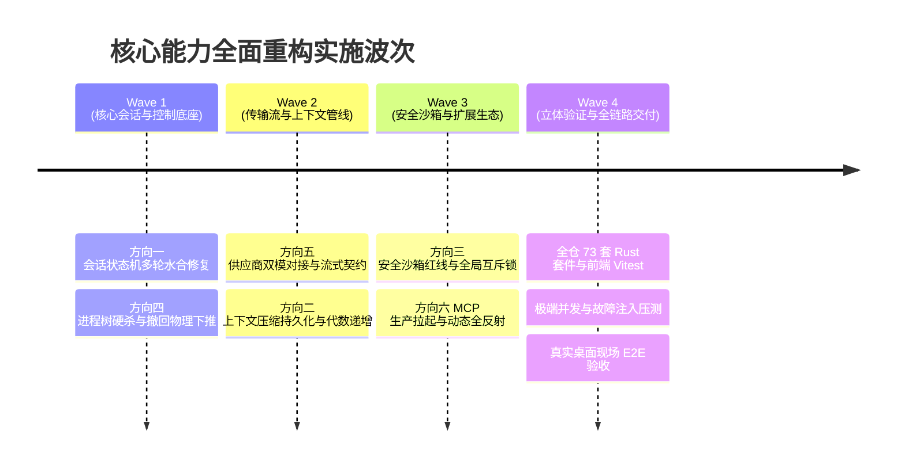

# 核心能力全面重构与真实落地方案（总方案）

> **战役工作区**：`docs/core-capability-remediation/`  
> **编制依据**：12 路子 Agent 独立详案（`independent-plans/01A~06B`，覆盖 6 大核心方向双轨验证）  
> **战役指导思想**：
> 1. **做对的事情**：花足够时间从根本做对，坚决杜绝偷懒、作弊、假实现与空桩代码；
> 2. **拒绝补丁式修补**：改动量大就按大重构来，穿透根因，追求架构净收敛；
> 3. **非必要不兼容**：仅硬性维护用户体验核心数据（如对话历史版本维护），对历史遗留死代码、无用胶水层、伪兼容变量坚决物理拔除；
> 4. **笔记功能暂缓**：本次重构聚焦于核心对话、执行、协议、沙箱与扩展生命周期，笔记不列入本次范围。

---

## 一、战役全景与六大重灾区破局蓝图

```mermaid
graph TD
    subgraph 方向一[核心会话状态机与多轮水合]
        A1[废除 truncate_to_last_user] --> A2[Prior Completed 契约单源]
        A3[废除 LegacyToolCall] --> A4[保留回放 toolCalls.output]
        A5[修改 transition effect] --> A6[单 Run 内 turn_index 单调递增]
        A7[TurnStart/TurnEnd 守卫闭合] --> A8[Usage 零丢失与 1:1 成对]
    end

    subgraph 方向二[上下文压缩与摘要管线]
        B1[标准摘要 AgentMessage] --> B2[持久化写入 session_messages]
        B3[全局代数真理源] --> B4[单调递增代数杜绝主键冲突]
        B5[多态 Critical Context] --> B6[Markdown 渲染确定性保真]
        B7[生产级 DbCompressionStore] --> B8[激活 search/decompress_context]
    end

    subgraph 方向三[安全沙箱与写路径互斥]
        C1[PowerShell 编码全语法解码] --> C2[UTF-16LE 还原明文红线审查]
        C3[解释器内联 AST 提取] --> C4[Python/Node 动态执行深度审计]
        C5[全局 WorkspacePathMutex] --> C6[细粒度 tool_call_id 锁与 RAII]
        C7[全模式回收站接管] --> C8[彻底废除 FullAccess 物理直删]
    end

    subgraph 方向四[控制停止撤回与进程管理]
        D1[AbortSignal 绑定 AbortToken] --> D2[RAII 树杀 Job Object/pgid]
        D3[撤回下推 SQLite 事务] --> D4[物理修补消息表杜绝重启复活]
        D5[统一 boundary_seq] --> D6[精确对齐真实目标消息序号]
        D7[全 Run 并行收敛网] --> D8[排空总线保留用户中断原因]
    end

    subgraph 方向五[多模型供应商协议与流传输]
        E1[Gemini 动态分流] --> E2[:streamGenerateContent + 单帧 JSON]
        E3[Anthropic 运行时转向] --> E4[保真投影交替 User 块]
        E5[ConsumeStopReason::Error] --> E6[阻断截断工具伪成功执行]
        E7[全分隔符 FSM] --> E8[思考块签名保全与回放]
    end

    subgraph 方向六[扩展中心与 MCP 工具生态]
        F1[物理拔除 KNOWN_MCP_TOOL_MAP] --> F2[后端 tools/list 全动态反射]
        F3[真实拉起 MCP 子进程] --> F4[LocalFileMcpPersistence 生产持久化]
        F5[McpDynamicToolAdapter] --> F6[两级解耦消除悬挂死指针]
        F7[ToolRegistry 运行时掩码] --> F8[细粒度开关与模型动态可见]
    end
```

---

## 二、六大方向双轨收敛与核心架构设计

### 方向一：核心会话状态机与多轮水合（01A + 01B 融合）

#### 1. 根治“截断上一轮回答”（BC01-4）
* **断裂根因**：`hydrate.rs:323-330` 的 `truncate_to_last_user` 强行将历史截取至最后一个 User 消息，而前端 `streamSession.ts:177` 发送时已排除了本条待发新消息。结果 `[u1, a1]` 截断为 `[u1]`，追加 `u2` 后变成 `[u1, u2]`，上一轮 Assistant 回答彻底消失。
* **重构方案**：
  * **物理彻底删除 `truncate_to_last_user`** 及其附生逻辑；
  * 确立前置已完成历史（Prior Completed History）的单源契约：已入库历史天然且应当以 Assistant/Tool 收尾；尾部追加仅由 `session_loop.run(new_user_message)` 负责；
  * 仅保留 `sanitize_conversation_head` 清洗头部非法系统碎片，确立水合幂等性 $H(H(x)) = H(x)$。

#### 2. 根治“真实工具输出丢失与伪造假报错”（BC01-5）
* **断裂根因**：前端在 `toolCalls[].output` 保存真实输出，但后端 `LegacyToolCall` 仅反序列化了 `id/name/arguments`，serde 默认忽略未知字段；水合时由于缺少 output，后续 `repair_orphan_tool_calls` 将其判为孤儿，伪造带有 `TOOL_OUTCOME_UNKNOWN` 且标记为 `is_error: true` 的报错消息塞给模型。
* **重构方案**：
  * **物理拔除 `LegacyToolCall` 与 `LegacyToolCallResult`**；
  * 建立全保真水合数据模型，在解析 Assistant 历史消息时，无损提取 `toolCalls[].output`、`status`、`images`；
  * 生成与实时运行时完全对齐的独立 `AgentMessageRole::Tool` 消息，正文为真实工具输出；
  * 严密收窄孤儿工具自愈判定：仅对真实无结果的在途中断调用标记中断码，绝不伪造假报错向模型投毒。

#### 3. 根治“无工具回合 turn_index 归零导致正文覆写”（BC01-3）
* **断裂根因**：`transition.rs:175` 在 `TurnComplete + InputAvailable` 转移上触发了 `reset_all_counters: true`，将 `turn_index` 重置为 0，下一轮重新发 `TurnStart(1)`；前端以 `turnIndex` 为下标覆盖上一轮 `segs[1]`。
* **重构方案**：
  * 修改转移表：`TurnComplete + InputAvailable` 的上下文 effect 调整为 `reset_all_counters: false`；
  * 确立单 Run 内部回合时钟不可逆单调自增不变量：`turn_index` 严格单调递增（1, 2, 3...）；
  * 前端消息按独立递增轮次定位，彻底消灭覆盖覆写。

#### 4. 状态机事件 1:1 成对发射与 Usage 零丢失（BC01-1 / BC01-2）
* **重构方案**：
  * 切断 `ExecutingTools -> PreparingTurn` 越级旁路，工具批完成后统一推进至 `TurnComplete` 闭环；
  * 在 `prepare_turn.rs` 增加入口守卫：若检测到 `current_turn_index` 尚未闭合，先原地补发携带真实 `turn_usage` 的 `TurnEnd`，确保事件严格成对发射，用量零丢失；
  * 重构 `check_control`：移除首部盲目补发伪终态，仅在真正终止（`ForceCancel`/`CooperativeStop`）时闭合；软注入绝不触碰 `TurnEnd`；强停时先将中断合成工具消息入树，再发射 `TurnEnd`。

---

### 方向二：上下文压缩与摘要管线（02A + 02B 融合）

#### 1. 彻底根除“空壳压缩与全文复活”（BC05-1）
* **断裂根因**：压缩仅在内存替换 `state.conversation`，未生成持久化消息事件（`MessageStart`/`MessageEnd`），未写回 SQLite `session_messages`；桌面下一轮从数据库读回未压缩全文，导致压缩形同虚设。
* **重构方案**：
  * 压缩完成生成标准摘要 `AgentMessage`（携带 `isCompactedSummary: true` 与元数据），经 `record_message` 标准管道广播 `MessageStart` / `MessageEnd`；
  * 通过 `LocalDb::rewrite_session_messages_on_compaction` 基于已有的 Diff Shrink 机制物理收缩 SQLite 消息表；
  * 前端 `buildHistoryMessages` 改造为压缩感知，以最新压缩块为锚点过滤旧消息，前后端历史源彻底单真理化。

#### 2. 根治代数写死 1 与数据库主键冲突（BC05-3）
* **重构方案**：
  * 彻底拔除 `engine.rs:369` 硬编码 `let generation: u32 = 1`；
  * 以数据库 `session_meta.last_compaction_generation` 为全局代数真理源；
  * 压缩引擎显式接收自增 `generation` 参数，生成严格单调递增的块 ID（`compacted-summary-1-1`, `2-2`, `3-3`...），彻底绝罚 SQLite `INSERT OR IGNORE` 冲突吞块。

#### 3. 彻底对齐 Critical Context 契约断裂（BC05-6）
* **重构方案**：
  * 重构 Markdown 渲染器中的 `push_critical_context`：全面支持数组（`- item`）、对象（`- key: value`）与字符串多态解析；
  * 模型诚实输出的结构化关键路径、错误串与符号，在 Markdown 投影中 100% 确定性保真呈现，杜绝关键信息蒸发。

#### 4. 落地生产级 CompressionContextStore（BC11-4）
* **重构方案**：
  * 拔除 `exec_single.rs:424` 硬编码 `compression_store: None`；
  * 在 `conex-db` 落地 `DbCompressionContextStore`，实现 `search_blocks`（支持模糊全文检索）与 `decompress_block`（基于 `events` 表的原始事件流无损提取原文）；
  * 通过 `SessionLoopOptions` -> `ToolExecCtx` -> `ToolContext` 全链路注入，彻底激活 `search_context` 与 `decompress_context`。

#### 5. 高保真分词器与自适应滑动窗口（BC05-2, BC05-4, BC05-5）
* **重构方案**：
  * 引入零依赖 `FastBpeTokenizer` 高保真估算引擎：CJK 1.45 加权、空白序列折叠、 Framing 开销保全，消除 JSON 虚高 3 倍与中文低估 50%；
  * 双阈值水位调度：85% 预热异步摘要，95% 临界同步硬防御；自适应尾部保留计算 `clamp(available * 0.35, 4k, 40k)`，废除粗暴切至 2 万 Token 的做法；
  * TurnBatch 双向原子闭包截断，杜绝孤儿调用；
  * `RunTaskOptions` 补齐 `attachments` 并在 `prepare_turn.rs` 接入预算钳制。

---

### 方向三：安全沙箱、命令红线与写路径互斥（03A + 03B 融合）

#### 1. PowerShell 编码命令全缩写解码（BC10-1）
* **重构方案**：
  * 重写 `is_ps_encoded_command_flag`，支持所有官方合法前缀与短名（`-ec`, `-en`, `/ec`, `-ec:payload` 等）；
  * 接入 UTF-16LE / UTF-8 双模 Base64 解码器，还原明文进行递归 AST 与静态红线审查；
  * 审批通道中向用户明文化展示真实解码后的指令，杜绝 Base64 障眼法逃逸。

#### 2. 深度审计解释器内联脚本（BC10-2）
* **重构方案**：
  * 构建 `PolyglotCodeInspector` 解释器审计引擎，覆盖 Python/Node/Bash/Ruby 等多语言内联开关（`-c`, `-e`, `--eval` 等）；
  * 深度提取 `os.system`、`execSync` 等嵌套 Shell 调用与 `rmtree`、`rmSync` 等破坏性 API，消灭 Indirect 门禁放行漏洞。

#### 3. CD 形态全阻断与正文绝对路径围栏（BC10-3 / BC10-4）
* **重构方案**：
  * 补齐 `CD_COMMANDS` 名单（新增 `Push-Location`, `Pop-Location`, `chdir`），确立间接执行 `CdShape` 向上冒泡定理，阻断 `-WorkingDirectory` 逃逸；
  * 建立 `CommandPathInspector`，从命令行与参数中提取所有绝对路径，刚性执行系统关键目录物理红线（`is_system_critical_path`）阻断与工作区边界强隔离。

#### 4. 全局分级路径互斥锁（BC10-5）
* **重构方案**：
  * 将 `WritePathRegistry` 提升为工作区全局单例 `WorkspacePathMutexManager`，以 Canonical Path 为唯一真理源；
  * 锁持有者细化为 `(session_id, run_id, tool_call_id)`，消除同 run 内并行写互斥穿透；
  * RAII Guard Drop 时仅精准释放自身声明的路径，废除粗暴的按 holder 整表清空，动态维持 15s 租约心跳，彻底终结并发交叉写文件覆盖。

#### 5. 任务类型策略刚性注入与 FullAccess 删除安全接管（BC10-6 / BC10-7）
* **重构方案**：
  * 在 `ToolContext`、`ToolBatchOptions`、`call_verdict` 与 `shell.rs` 中完整贯通 `task_type` 传递，刚性约束 commit 代理只能执行 git 命令；
  * 彻底拔除 `shell.rs` 中针对 `FullAccess` 跳过删除重定向的特权分支，强制所有删除形态无条件进入回收站 WAL 事务体系，生成 SHA-256 校验和与快照。

---

### 方向四：控制、停止、撤回与进程管理（04A + 04B 融合）

#### 1. L3 强停物理终止进程树（BC03-1 / BC03-2）
* **重构方案**：
  * 将 run 级 `AbortSignal` 与底层的 `AbortToken` 建立双向监听与物理绑定，杜绝 `exec_single` 中的空令牌与丢弃；
  * 彻底废除普通执行路径下的 `kill_on_drop(false)`，引入 RAII 树杀守卫 `ProcessTreeGuard`：
    * Windows：创建匿名内核作业对象（Job Object）并配置 `JOB_OBJECT_LIMIT_KILL_ON_JOB_CLOSE`，通过 `TerminateJobObject` 达到 <1ms 级联强杀；
    * Unix：创建进程组 Leader（`setpgid(0, 0)`）并通过 `-PGID` 级联投递 SIGKILL；
  * `ForceCancelSink` 刚性契约升级：广播触发 `abort_signal.abort()`，实现子代理 kill 与工具批秒级打断。

#### 2. 时间线撤回四重时空边界物理收敛（BC03-5）
* **重构方案**：
  * 纠正 `boundary_seq` 语义：严格定义为目标消息起始事件序号（而非日志尾）；
  * 撤回操作原子下推至 SQLite 存储层（`truncate_session_messages_after`），物理删除目标消息后的数据库行并更新 `message_count` 与 `body_version`，**彻底根除刷新应用后被撤回消息死灰复燃**；
  * 文件系统快照精准逆序回滚 `(Seq_target, Seq_tail]`；
  * 撤回等待升级为会话内全 Run 并行收敛网（`wait_all_converged`），消灭 `HashMap` 随机单 Run 盲区。

#### 3. 会话冻结门禁与 Steering 统一预算（BC03-3 / BC03-6 / BC03-7）
* **重构方案**：
  * 两阶段冻结注册表：彻底拔除 `freeze.rs` 中 `RunTerminal` / `AgentEnd` 的撤离白名单，冻结生效后除携带 Token 的 `TimelineTruncate` 外零越界写入；
  * 消除协调器与策略层的双道门打架，统一由协调器预算单一真理源裁决；引入死循环追踪器，防止死循环计数器被提前清零；
  * 检查点提示词真实注入主上下文；叶子节点独立隔离模型检查点与阶段总结槽位，杜绝冲刷覆盖。

---

### 方向五：多模型供应商协议与流传输（05A + 05B 融合）

#### 1. Gemini 双模自适应传输与流式纠正（BC08-1）
* **重构方案**：
  * URL 纠正：流式模式下 `provider_url_for` 针对 Gemini 严格生成 `:streamGenerateContent?alt=sse`；
  * 引入双模自适应管道（`Dual-Mode Transport`）：探测 `Content-Type: application/json` 时自动切入单帧完整文档通道，解析 `candidates[].content.parts` 与 `usageMetadata`，杜绝整段 JSON 无 `data:` 前缀导致的空流假错误，实现流式与非流式同轨解析。

#### 2. Anthropic 运行时转向保真投影（BC08-5）
* **重构方案**：
  * 建立双轨保真投影：顶层 `system` 参数承载全局系统提示词；
  * 中途由 `session-loop` 动态注入的 Steering/Nudge（`AgentMessageRole::System`）按时序保真投射为包裹 `[System Directive / Runtime Steering]` 的 `user` 角色块，经 `push_alternating` 严格满足 Anthropic 角色交替铁律，模型 100% 能够感知并执行纠偏。

#### 3. Gemini 工具单指定与 ID 贯通（BC08-6）
* **重构方案**：
  * `tool_choice` 映射重构：`ToolChoice::Function { name }` 映射为 `{ mode: "ANY", allowedFunctionNames: [name] }`，刚性限制候选集为该指定工具；
  * ID 全生命周期贯通：在出站 `functionCall`、入站解析与回传 `functionResponse` 中完整携带与绑定 `call.id`，彻底消除同名工具多次调用的错配风险。

#### 4. 消除“流中错误伪装成功”漏洞（BC02-2）
* **重构方案**：
  * `ConsumeStopReason` 扩充新增 `Error` 终态变体，中途出错时严禁盖写为 `Stop` 或 `ToolCall`；
  * 工具强隔离防火墙：流以 Error 终止且存在 `tool_calls` 时，物理阻断工具派发，就地合成中断记录；部分正文/思考安全留存为 `stopReason: "error"` 消息，绝不调用 `no_tool_calls` 谎报成功。

#### 5. 错误阶梯恢复与全协议健壮分帧（BC02-1, BC08-3, BC08-4, BC08-7）
* **重构方案**：
  * 物理拔除 `classify_stream_error` 降级胶水层，全链路无损透传 `ProviderErrorKind`、`retryable` 与 `retry_after_ms`，接入 429/超时重试阶梯；
  * 重构 WHATWG 兼容全分隔符 FSM，支持单帧内紧密排列的多 JSON 对象解包与坏帧切除排空；
  * 升级数据模型：保全 Anthropic、Gemini、DeepSeek 的思考签名（`signature`）与原生 item id，下一轮原样回放，根治 Claude 3.7 400 崩溃；
  * 建立 Responses 出站工具配对验证闸门，杜绝孤儿调用引发 400；
  * 真实注入基于协议族的权威 `CacheAccounting`（Anthropic/Gemini 真实走 Excluded，OpenAI 走 Included）。

---

### 方向六：扩展中心与 MCP 工具生态全链路（06A + 06B 融合）

#### 1. 彻底物理拔除前端死字典（KNOWN_MCP_TOOL_MAP）
* **重构方案**：
  * 物理删除 `knownMcpTools.ts` 与对应测试，拔除所有预置假工具解析；
  * 建立全动态真实反射体系：未连接时工具列表为空并提示“未连接，启动后动态反射”，连接就绪后严格按后端真实的 `tools/list` 报文元数据渲染工具列表与入参 Schema。

#### 2. 生产环境 MCP 进程拉起与常驻守护（Stdio + SSE 全支持）
* **重构方案**：
  * 切除 `engine_build.rs` 中的两处 `#[allow(dead_code)]`，从 `command_manifest.rs` 中移出幽灵列表，真实接入 7 条 IPC 管理命令；
  * 实现 `LocalFileMcpPersistence` 生产级配置文件原子落盘（`mcp_servers.json`），引擎启动时自动拉起配置为 `auto_start` 的服务；
  * 修复 BC11-3：引入原子 CAS 状态机锁死 `Exited` 终态（禁止被错误覆盖为 `Degraded`），实现 Ping 主动探活与指数退避自愈。

#### 3. 消除悬挂死指针，动态注入模型运行期 ToolRegistry（BC11-2）
* **重构方案**：
  * 将静态持有 `session: Arc<McpServerSession>` 的旧适配器全量重构为两级解耦的 `McpDynamicToolAdapter`（弱引用网桥 + 动态寻址），子进程重启后自动路由至最新健康会话，彻底清除悬挂死指针；
  * 命名空间防碰撞：采用 `mcp_<clean_id>_<short_hash>__<tool>` 确定性哈希前缀，避免 `my.server` 与 `my_server` 冲突；
  * 增强 `ToolRegistry`：支持服务重启更新时热替换而不报 `tool.version_conflict`；
  * 会话发请求时，`ensure_tools_snapshot` 真实收集 MCP 工具定义进入发往 LLM 的 Schema，大模型真实看见并能成功调用 `mcp_*` 工具，执行结果无损回传上下文。

#### 4. 细粒度工具开关控制与外部插件实权打通
* **重构方案**：
  * 在 `ToolRegistry` 中实现 `disabled_tools` 运行时掩码，被禁用的工具在 `list_definitions()` 阶段被自动过滤，Prompt 中不出现被禁工具；
  * 前端详情页切换工具开关时，原子同步持久化配置与内存中的掩码状态；前端 `mcpApi.ts` 彻底拔除所有 `unavailable` 与 `unsupported` 的假代码；
  * 扩展 `PluginActivateApi` 契约，增加实权注册接口 `registerTool` 与 `registerMcpServer`，彻底拔除 `activate.ts` 中的纯日志占位。

---

## 三、非必要不兼容与物理拔除清单

为了保证系统架构的纯粹与高收敛，坚决拒绝伪兼容层。本次重构在代码库中明确物理拔除以下历史包袱：

| 模块 | 物理拔除对象 | 拔除理由与收益 |
| :--- | :--- | :--- |
| **会话状态机** | `hydrate.rs: truncate_to_last_user` | 错误的历史截断逻辑，导致多轮失忆，彻底废除 |
| **会话状态机** | `LegacyToolCall` / `LegacyToolCallResult` | 废弃的旧工具调用结构，丢弃 output 字段，由 `HydratedToolCall` 单轨取代 |
| **会话状态机** | `transition.rs: reset_all_counters: true` | 错误的时钟清零逻辑，导致消息覆盖，彻底废除 |
| **上下文压缩** | `engine.rs: let generation = 1;` | 写死代数导致数据库主键冲突，由全局代数真理源取代 |
| **上下文压缩** | `historyMessages.ts` 200,000 虚假硬编码预算 | 脱离模型真实窗口的死数字，由动态模型窗口自适应取代 |
| **上下文压缩** | `summary_dispatch.rs` 独立调度冗余与未接线桩代码 | 双轨调度分叉，由单一 `CompactionCoordinator` 取代 |
| **安全沙箱** | `shell.rs: permission_mode != FullAccess` 豁免分支 | FullAccess 物理直删漏洞，强制全模式进入回收站 |
| **安全沙箱** | 粗粒度 per-run `release_holder` 级联删除 | 并行写锁穿透与提前释放，由精准 RAII Drop 取代 |
| **控制与停止** | `shell_exec.rs: kill_on_drop(false)` 普通分支 | 强停孤儿进程残留漏洞，由 RAII `ProcessTreeGuard` 取代 |
| **控制与停止** | `freeze.rs: is_retraction_evacuation_event` 越界白名单 | 破坏冻结序号单调性的后门，彻底切断 |
| **供应商协议** | `classify_stream_error` 降级未知错误胶水层 | 抹杀 429 与重试阶梯，由原始 `ProviderErrorKind` 单轨透传取代 |
| **供应商协议** | `cache_accounting_kind` 假判定死代码 | 不可达分支，由显式协议族 `CacheAccounting` 取代 |
| **扩展中心** | `knownMcpTools.ts`（`KNOWN_MCP_TOOL_MAP` 假字典） | 欺骗性前端硬编码工具表，由后端动态反射全量取代 |
| **扩展中心** | `mcpApi.ts` 中返回 `unavailable` / `unsupported` 的假桩 | 假接口，由真实 Tauri IPC 命令接线取代 |
| **扩展中心** | `engine_build.rs` 中的 `#[allow(dead_code)]` MCP 标记 | 生产未装配死代码，正式打通生产执行链 |

---

## 四、实施落地四波（Wave 1 ~ Wave 4）规划

按照逻辑依赖与因果收敛次序，重构分为 4 个推进波次：

### Wave 1：核心会话与控制底座（方向一 + 方向四）
* **目标**：彻底恢复多轮对话记忆能力，杜绝强停孤儿进程与撤回重启复活。
* **交付件**：
  * `crates/session-loop/src/hydrate.rs`、`handlers/`、`transition.rs` 重构；
  * `crates/agent-tools/src/tools/shell_exec.rs`（`ProcessTreeGuard` 与 Job Object 接入）；
  * `apps/agent-workbench/src-tauri/src/retraction_commands.rs` 与 `conex-db` 撤回事务物理下推。

### Wave 2：传输流与上下文管线（方向五 + 方向二）
* **目标**：彻底打通 Gemini/Anthropic 协议保真，解决压缩读回全文与代数冲突。
* **交付件**：
  * `crates/agent-provider/`（Gemini 双模分流、Anthropic Steering 保真、FSM 分帧器）；
  * `crates/session-loop/src/stream.rs`（`ConsumeStopReason::Error` 终态变体）；
  * `crates/conex-compaction/` 与 `conex-db`（代数自增、Critical Context 渲染、`DbCompressionContextStore` 激活）。

### Wave 3：安全沙箱与扩展生态（方向三 + 方向六）
* **目标**：建立无死角命令红线、工作区绝对锁，彻底实现真实 MCP 进程拉起与动态反射。
* **交付件**：
  * `crates/conex-sandbox/src/semantics.rs`（PowerShell 全缩写解码、解释器内联审计、CD 冒泡）；
  * `crates/agent-tools/src/write_paths_state.rs`（全局 `WorkspacePathMutexManager`、TaskType 执行链）；
  * `apps/agent-workbench/src-tauri/src/mcp_commands.rs`、`engine_build.rs`（生产拉起与持久化）；
  * `apps/crish-desktop/src/components/extensions-surface/`（物理拔除死字典，接入真实反射）。

### Wave 4：立体验证与全链路交付
* **目标**：履行立体验证纪律，确保 0 未捕获异常、0 静态门禁违规、全套回归测试全绿。
* **验证断言**：
  1. `cargo test --workspace`：全量通过，无警告；
  2. 前端 `npm run typecheck` + `npm run test` + `check:line-counts`：全绿；
  3. 现场 E2E 验收：Gemini/Claude 多轮问答、长对话压缩、强停杀进程、撤回重启、真实 MCP 外部工具调用无缝通过。
