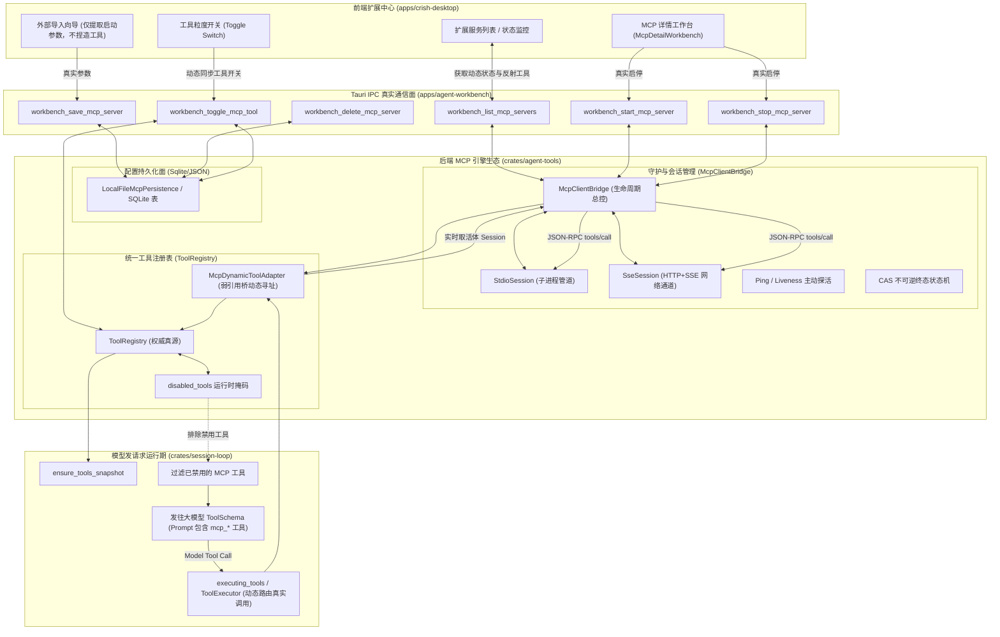
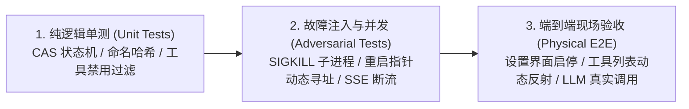

# 扩展中心与 MCP 工具生态全链路重构详案（A轨）

> **方案编号**：06A  
> **责任方向**：方向六 · 扩展中心与 MCP 工具生态全链路（A轨重构详案）  
> **核心攻坚重点**：
> 1. 彻底物理拔除前端硬编码死字典 `KNOWN_MCP_TOOL_MAP`，所有展示与开关由后端 MCP 进程动态真实反射（`tools/list`）；
> 2. 真实接线生产环境 MCP 进程拉起：切除 `#[allow(dead_code)]`，打通 `register_plugin_server`，让用户配置的 stdio/SSE MCP 真正启动并持久运行；
> 3. 将 MCP 远端工具动态注入模型运行期的 `ToolRegistry`，模型在发请求时真实看见并调用 `mcp_<server>__*` 工具；
> 4. 实现前端对 MCP 工具粒度的真实开关控制，并通过 IPC 动态同步到引擎注册表。  
> **设计原则**：坚决杜绝补丁式修补，做对的事情，改动大就按大重构来；非必要不兼容，无用胶水代码物理拔除。  
> **产出文件**：`docs/core-capability-remediation/independent-plans/06A-扩展中心与MCP生态重构详案.md`（UTF-8 无 BOM）。只写该文件。

---

## 一、现状根因深度穿透（Path:Line 深度审判）

通过对前端界面与探测层、Tauri 壳层 IPC 路由、后端 `crates/agent-tools/src/mcp/`、`crates/agent-tools/src/registry.rs` 以及会话循环 `crates/session-loop/` 的全链路源码穿透，确认当前 MCP 生态处于**“前端静态字典伪造欺诈、后端控制面幽灵拒载、生命周期假就绪空转、模型运行期与进程完全断连”**的断层状态。

```mermaid
flowchart TD
    subgraph Current_Broken_Pipeline["现状：虚假全链路断层"]
        FE_Fake["前端 KNOWN_MCP_TOOL_MAP<br/>静态猜测字典 (伪造 100+ 工具)"] -.->|假展示 / 假开关| FE_UI["扩展中心详情页 McpDetailWorkbench"]
        FE_UI -.->|localStorage 纯视觉自嗨| FE_Store["clientApi.saveSettingsEx"]
        FE_API["mcpApi.ts (list/start/stop)"] -->|硬编码 unavailable/unsupported| FE_Block["直接掐断 IPC 请求"]
        
        Manifest["command_manifest.rs:406"] -->|幽灵命令强制排除| IPC_Excluded["排除 workbench_*_mcp_server"]
        Engine_Build["engine_build.rs:703"] -->|#[allow(dead_code)]| Dead_Entrance["register_plugin_mcp_server 死代码"]
        
        Bridge_Start["bridge_registry.rs:144"] -->|无条件覆盖 Degraded| State_Corrupted["覆盖 Exited 终态，死进程伪装存活"]
        Adapter_Leak["bridge_registry.rs:224"] -->|静态持有 Arc&lt;Session&gt;| Dead_Pointer["重启后持有死会话 Arc，同名跳过"]
        
        Loop["session-loop / streaming.rs"] -->|请求模型| LLM["LLM 远端模型"]
        LLM -.->|模型工具列表空空如也 / 永远无法调用 MCP| Disconnect["彻底断连"]
    end
```

---

### 1.1 前端硬编码死字典欺诈与静态猜测根因

- **代码坐标 1**：[`apps/crish-desktop/src/components/extensions-surface/knownMcpTools.ts:5-153`](file:///c:/Software/conex/apps/crish-desktop/src/components/extensions-surface/knownMcpTools.ts#L5-L153)
  ```typescript
  export const KNOWN_MCP_TOOL_MAP: Record<string, string[]> = {
    'chrome-devtools-mcp': ['click', 'close_page', 'drag', 'emulate', ... 30 tools],
    'tauri-mcp': ['app_bridge', 'click', 'dispatch_pointer', ... 19 tools],
    'tauri-mcp-editor': ['app_bridge', 'click', ... 19 tools],
    'cua-driver': ['bring_to_front', 'browser_click', ... 57 tools],
    filesystem: ['read_file', 'write_file', ... 8 tools],
    fetch: ['fetch_url', 'download_content'],
    sqlite: ['read_query', 'write_query', 'list_tables', 'describe_table'],
    git: ['git_status', 'git_diff', 'git_commit', 'git_log'],
    node_repl: ['eval_js', 'exec_script', 'inspect_scope', 'reset_runtime'],
  };
  ```
- **代码坐标 2**：[`apps/crish-desktop/src/components/extensions-surface/knownMcpTools.ts:155-221`](file:///c:/Software/conex/apps/crish-desktop/src/components/extensions-surface/knownMcpTools.ts#L155-L221)
  ```typescript
  export function resolveMcpTools(name: string, command?: string, args?: string[], explicitTools?: string[]): string[] {
    if (Array.isArray(explicitTools) && explicitTools.length > 0) return explicitTools;
    const needle = `${name} ${command || ''} ${(args || []).join(' ')}`.toLowerCase();
    if (needle.includes('chrome-devtools') || needle.includes('devtools')) {
      return [...(KNOWN_MCP_TOOL_MAP['chrome-devtools-mcp'] || [])];
    }
    // ... 针对各种关键词包含匹配，静态假造工具清单
  }
  ```
- **代码坐标 3**：[`apps/crish-desktop/src/components/extensions-surface/McpConnectModal.tsx:120, 211, 250`](file:///c:/Software/conex/apps/crish-desktop/src/components/extensions-surface/McpConnectModal.tsx#L120)
  ```typescript
  tools: resolveMcpTools(name, manualCmd, parseArgs(manualArgs))
  ```
- **代码坐标 4**：[`apps/crish-desktop/src/components/extensions-surface/McpDetailWorkbench.tsx:59-70`](file:///c:/Software/conex/apps/crish-desktop/src/components/extensions-surface/McpDetailWorkbench.tsx#L59-L70)
  ```typescript
  const tools = useMemo(() => {
    // ...
    return resolveMcpTools(server.name || server.id, cmd, args, explicit);
  }, [server, matchedStoreServer]);
  ```
- **代码坐标 5**：[`apps/crish-desktop/src/components/extensions-surface/detectExternalMcpServers.ts:225, 334, 382-471`](file:///c:/Software/conex/apps/crish-desktop/src/components/extensions-surface/detectExternalMcpServers.ts#L382-L471)
  在扫描本机外部 MCP 配置文件时，以及在 `DEFAULT_FALLBACK_MCP` 出厂兜底中，硬编码塞入 `resolveMcpTools(...)` 与假 `toolsCount`。
- **根因穿透**：
  1. **脱离 MCP 核心自省协议**：MCP 规范的立足之本是 `tools/list` 动态反射。当前前端为了“离线展示好看”，发明了静态死字典 `KNOWN_MCP_TOOL_MAP`，并通过 `resolveMcpTools` 根据字符串子串匹配凭空捏造了几十上百个工具；
  2. **严重的虚假状态与安全欺诈**：底层子进程从未启动、远端工具可能已经被官方更新或废弃，但前端向用户展示了一份完整的虚假工具清单与开关；一旦用户添加了死字典以外的自定义 MCP Server（如自建的 Python/Go MCP 服务），解析直接返回空数组，用户无法使用；
  3. **死字典污染全链路**：从外部配置探测（Codex、Claude、Cursor）、连接弹窗到详情工作台，该静态字典像病毒一样渗透在 6 个核心文件中，导致没有一处代码在尊重真实的后端连接结果。

---

### 1.2 生产环境 MCP 进程拉起完全未接线与死代码根因 (BC11-1)

- **代码坐标 1**：[`apps/agent-workbench/src-tauri/src/engine_build.rs:703-709`](file:///c:/Software/conex/apps/agent-workbench/src-tauri/src/engine_build.rs#L703-L709)
  ```rust
  #[cfg_attr(not(test), allow(dead_code))] // E2 已登记：canonical 出口，生产装配链接线点 = run/ 装配区（E-4 收口项，T5 独占域接线后移除）
  pub(crate) async fn register_plugin_mcp_server(
      &self,
      config: McpServerConfig,
  ) -> Result<Vec<ToolDefinition>, ToolError> {
      register_plugin_server(&self.mcp_bridge, &self.tool_registry, &config).await
  }
  ```
- **代码坐标 2**：[`apps/agent-workbench/src-tauri/src/engine_build.rs:568-571`](file:///c:/Software/conex/apps/agent-workbench/src-tauri/src/engine_build.rs#L568-L571)
  ```rust
  #[allow(dead_code)] // E5 接线：core_run_commands 装配 run 启停时消费
  pub(crate) fn mcp_bridge(&self) -> Arc<McpClientBridge> {
      Arc::clone(&self.mcp_bridge)
  }
  ```
- **代码坐标 3**：[`apps/agent-workbench/src-tauri/src/command_manifest.rs:401-419`](file:///c:/Software/conex/apps/agent-workbench/src-tauri/src/command_manifest.rs#L401-L419)
  ```rust
  let ghosts = [
      "workbench_git_status",
      "workbench_git_diff",
      "workbench_list_mcp_servers",
      "workbench_start_mcp_server",
      "workbench_stop_mcp_server",
      ...
  ];
  for ghost in ghosts {
      assert!(!COMMAND_MANIFEST.commands.iter().any(|c| c.name == ghost), "幽灵命令 {ghost} 严禁登记 manifest");
  }
  ```
- **代码坐标 4**：[`apps/crish-desktop/src/api/mcpApi.ts:162-171, 203-220`](file:///c:/Software/conex/apps/crish-desktop/src/api/mcpApi.ts#L162-L171)
  ```typescript
  export async function listMcpServers(): Promise<McpListResult> {
    return { ok: false, configured: false, servers: [], error: MCP_LIST_UNAVAILABLE_HINT, errorCode: 'unavailable' };
  }
  export async function startMcpServer(serverId: string): Promise<McpControlResult> {
    return { ok: false, serverId, error: START_STOP_UNSUPPORTED_HINT, errorCode: 'unsupported' };
  }
  ```
- **代码坐标 5**：[`crates/agent-tools/src/mcp/servers.rs:106-112`](file:///c:/Software/conex/crates/agent-tools/src/mcp/servers.rs#L106-L112)
  定义了 `McpConfigPersistence` 异步 trait，但全仓库除测试用的 `FakePersistence` 外，**没有任何生产落盘实现**。
- **代码坐标 6**：[`crates/agent-tools/src/mcp/servers.rs:22-28`](file:///c:/Software/conex/crates/agent-tools/src/mcp/servers.rs#L22-L28)
  `McpTransport` 仅有 `#[default] Stdio`，协议层完全缺失 `Sse` 传输实现。
- **根因穿透**：
  1. **IPC 命令全面截断**：Tauri 壳层将所有 MCP 管理命令定为“幽灵命令”强制排除，前端则直接硬编码返回 `unavailable` 与 `unsupported`，彻底掐死了 UI 与后端的通信链路；
  2. **生产构建死代码逃逸**：`EngineHandle::build` 虽然构建了 `McpClientBridge::new()`，但没有任何生产装配点调用 `register_plugin_mcp_server`，用 `#[allow(dead_code)]` 掩盖未接线事实；
  3. **配置落盘真源缺失**：用户在界面保存的 MCP 配置只落在前端浏览器的 `localStorage`，后端既没有读取也没有保存，应用重启后引擎内部配置表恒为空；
  4. **未支持网络型 SSE MCP**：现代 MCP 生态中大量采用 HTTP+SSE 协议（如远程微服务、无头工具容器），现有结构仅支持本地 stdio，无法满足生产需求。

---

### 1.3 会话生命周期假就绪与终态覆盖导致管道空转根因 (BC11-3)

- **代码坐标 1**：[`crates/agent-tools/src/mcp/bridge_registry.rs:92-107`](file:///c:/Software/conex/crates/agent-tools/src/mcp/bridge_registry.rs#L92-L107)
  ```rust
  if let Some(session) = sessions.get(&config.server_id) {
      match session.state() {
          McpServerRuntimeState::Ready => return Ok(session.tools()), // 不做任何探活，盲信旧缓存
          // ...
      }
  }
  ```
- **代码坐标 2**：[`crates/agent-tools/src/mcp/bridge_registry.rs:144-148`](file:///c:/Software/conex/crates/agent-tools/src/mcp/bridge_registry.rs#L144-L148)
  ```rust
  if result.is_err() {
      // 握手 / 工具枚举失败：进程保留（Degraded），供 restart 重建重试
      session.set_state(McpServerRuntimeState::Degraded);
  }
  ```
- **代码坐标 3**：[`crates/agent-tools/src/mcp/bridge_session.rs:125-132`](file:///c:/Software/conex/crates/agent-tools/src/mcp/bridge_session.rs#L125-L132)
  ```rust
  pub fn is_running(&self) -> bool {
      matches!(
          self.state(),
          McpServerRuntimeState::Starting
              | McpServerRuntimeState::Ready
              | McpServerRuntimeState::Degraded
      )
  }
  ```
- **代码坐标 4**：[`crates/agent-tools/src/mcp/bridge_session.rs:600-621`](file:///c:/Software/conex/crates/agent-tools/src/mcp/bridge_session.rs#L600-L621)
  崩溃监控线程在 `guard.as_mut()` 为 `None`（`child` 句柄已被提取）时，返回 `None` 且不标记退出，在循环内每 50ms 空转轮询。
- **根因穿透**：
  1. **绝对终态被异常覆盖**：当子进程崩溃时，读线程检测到 EOF 已经调用 `mark_exited` 将状态设为 `Exited`。但 `bridge.start` 失败收尾直接调用 `session.set_state(Degraded)`，**强行将终态 `Exited` 覆盖为 `Degraded`**；
  2. **死进程被当作存活状态**：`is_running()` 将 `Degraded` 当作存活，后续调用直接向已经关闭的 `stdin` 写管道，导致 BrokenPipe 甚至请求永久阻塞；
  3. **假就绪与假存活**：再次调用 `start` 时，看到状态为 `Ready` 立即返回缓存，即使外部进程早已被操作系统强杀，导致模型调用在第一步就掉进黑洞。

---

### 1.4 模型运行期 ToolRegistry 注入断层、死指针与同名冲突根因 (BC11-2)

- **代码坐标 1**：[`crates/agent-tools/src/mcp/mod.rs:76-80, 102`](file:///c:/Software/conex/crates/agent-tools/src/mcp/mod.rs#L76-L80)
  ```rust
  for def in &defs {
      if registry.has(&def.name) {
          // 已并入（重启 / 重复注册）：跳过，保持幂等
          continue;
      }
      let adapter = bridge.get_adapter(&config.server_id, &def.name).ok_or_else(...)?;
      registry.register_runtime(adapter)?;
  }
  Ok(defs)
  ```
- **代码坐标 2**：[`crates/agent-tools/src/mcp/bridge_registry.rs:29-33, 224-228`](file:///c:/Software/conex/crates/agent-tools/src/mcp/bridge_registry.rs#L29-L33)
  ```rust
  pub struct McpToolAdapter {
      session: Arc<McpServerSession>,
      server_tool_name: String,
      def: ToolDefinition,
  }
  ```
- **代码坐标 3**：[`crates/agent-tools/src/registry.rs:69-74`](file:///c:/Software/conex/crates/agent-tools/src/registry.rs#L69-L74)
  `register_runtime` 见到同名工具直接报错 `TOOL_VERSION_CONFLICT`，且没有提供共享引用的注销或替换方法（`unregister` 仅支持 `&mut self`）。
- **代码坐标 4**：[`crates/agent-tools/src/mcp/bridge_protocol.rs:55-66`](file:///c:/Software/conex/crates/agent-tools/src/mcp/bridge_protocol.rs#L55-L66)
  `sanitize_id_part` 粗暴将非字母数字收敛为 `_`，导致 `my.server` 与 `my_server` 生成完全相同的前缀 `mcp_my_server__*`。
- **根因穿透**：
  1. **适配器静态持有死会话（悬挂指针）**：`McpToolAdapter` 实例化时直接深克隆了当时的 `Arc<McpServerSession>`。当底层子进程崩溃重启后，`bridge.sessions` 已经更新为新会话，但由于注册表内同名工具被跳过，**`ToolRegistry` 中已注册的工具依然指向已经退出的老会话**！大模型发起工具调用时，永远打在死进程上；
  2. **注册表缺乏动态热替换能力**：`ToolRegistry` 只有刚性的首次注册，没有共享面原子替换（`register_or_replace_runtime`）或按前缀热注销能力；
  3. **同名工具静默吞噬与虚假成功**：遇到命名冲突直接 `continue` 跳过，末尾却向调用方返回 `Ok(defs)`（包含被跳过的工具），调用方以为工具全部可用，实际上模型根本调不到。

---

### 1.5 前端细粒度工具开关与引擎执行层完全脱节根因

- **代码坐标 1**：[`apps/crish-desktop/src/components/extensions-surface/McpDetailWorkbench.tsx:110-146`](file:///c:/Software/conex/apps/crish-desktop/src/components/extensions-surface/McpDetailWorkbench.tsx#L110-L146)
  ```typescript
  const persistDisabledTools = useCallback(async (nextDisabled: string[]) => {
    setDisabledTools(nextDisabled);
    // ... 仅存 localStorage
    await clientApi.saveSettingsEx('__global__', 'global', { mcpServers: nextList });
  }, [server, currentStatus]);
  ```
- **代码坐标 2**：[`crates/session-loop/src/loop/handlers/streaming.rs:501-512`](file:///c:/Software/conex/crates/session-loop/src/loop/handlers/streaming.rs#L501-L512)
  ```rust
  pub(crate) fn ensure_tools_snapshot(state: &mut LoopState) {
      if state.tools_snapshot.is_none() {
          state.tools_snapshot = Some(
              state.tool_registry.list_definitions().iter().map(ToolSchema::from_definition).collect(),
          );
      }
  }
  ```
- **根因穿透**：
  1. 前端在详情页提供的“允许/禁止 Agent 调用该工具”开关，仅仅将 `disabledTools: string[]` 写回了浏览器的 `localStorage`，**根本没有通过任何 IPC 同步给 Rust 引擎**；
  2. Rust 引擎的 `ToolRegistry` 没有任何工具级启用/禁用掩码，`list_definitions()` 永远向大模型下发全量工具定义；
  3. 用户在 UI 上关闭了高危 MCP 工具（如 `evaluate_script` 或 `delete_file`），大模型依然能在 Prompt 中完整看到该工具并成功执行，前端开关沦为纯视觉安慰剂。

---

## 二、端到端重构架构设计与数据契约

本方案坚决杜绝补丁式修补，实施从**前端动态反射、Tauri IPC 真实通信、后端持久化守护、两级动态寻址路由到模型请求过滤**的端到端大重构。



---

### 2.1 攻坚点一：物理拔除静态死字典，建立「全动态真实反射体系」

#### 2.1.1 物理切除清单与代码清场
1. **物理删除文件**：
   - `apps/crish-desktop/src/components/extensions-surface/knownMcpTools.ts`（彻底删除，不留占位兼容）；
   - `apps/crish-desktop/src/components/extensions-surface/knownMcpTools.test.ts`（物理删除）。
2. **清除所有外部调用方**：
   - 清理 `codexTomlParser.ts`：不再调用 `resolveMcpTools`，解析出的 `tools` 字段初始为 `undefined`，`toolsCount` 为 0；
   - 清理 `detectExternalMcpServers.ts`：移除所有硬编码预置工具，删除 `DEFAULT_FALLBACK_MCP` 中对 `resolveMcpTools` 的调用；
   - 清理 `ExternalImportWorkbench.tsx`：导入时仅保存 `command`, `args`, `env`, `url`，不虚报工具；
   - 清理 `McpConnectModal.tsx`：添加服务弹窗中彻底移除 `tools: resolveMcpTools(...)`；
   - 清理 `McpDetailWorkbench.tsx`：工具列表只从 `server.tools`（由后端真实返回的结构化对象）中读取，若服务未连接，显示“未连接，启动后动态反射”。

#### 2.1.2 前端 MCP 动态自省状态模型
定义前端唯一事实来源（SSOT）的 MCP 服务信息契约：

```typescript
export type McpToolDefinitionDto = {
  name: string;             // 远端真实工具名 (如 click)
  prefixedName: string;     // 注册表完整工具名 (如 mcp_chrome_devtools_a1b2__click)
  description: string;      // 远端描述
  inputSchema: Record<string, unknown>; // JSON Schema
  enabled: boolean;         // 用户当前是否开启该工具
};

export type McpServerDetailDto = {
  id: string;
  name: string;
  transport: 'stdio' | 'sse';
  status: 'stopped' | 'starting' | 'ready' | 'degraded' | 'exited';
  command?: string;
  args?: string[];
  env?: Record<string, string>;
  url?: string;
  autoStart: boolean;
  tools: McpToolDefinitionDto[]; // 真实反射的工具列表 (Ready 时非空，未连接为空)
  disabledTools: string[];       // 被禁用的工具名集合
  error?: string;
  stderrTail?: string[];
};
```

---

### 2.2 攻坚点二：生产环境进程拉起、常驻守护与 stdio/SSE 全协议支持

#### 2.2.1 切除 `#[allow(dead_code)]` 与注册命令面真实登记
1. **切除 dead_code**：
   - 彻底移除 [`apps/agent-workbench/src-tauri/src/engine_build.rs:703`](file:///c:/Software/conex/apps/agent-workbench/src-tauri/src/engine_build.rs#L703) 上的 `#[cfg_attr(not(test), allow(dead_code))]`；
   - 彻底移除 [`apps/agent-workbench/src-tauri/src/engine_build.rs:568`](file:///c:/Software/conex/apps/agent-workbench/src-tauri/src/engine_build.rs#L568) 上的 `#[allow(dead_code)]`。
2. **废除幽灵命令排除**：
   - 在 [`apps/agent-workbench/src-tauri/src/command_manifest.rs:406-408`](file:///c:/Software/conex/apps/agent-workbench/src-tauri/src/command_manifest.rs#L406-L408) 中，物理剔除 `workbench_list_mcp_servers`、`workbench_start_mcp_server`、`workbench_stop_mcp_server` 的幽灵断言；
   - 在 `command_manifest.rs` 正式清单中登记 `workbench_list_mcp_servers`、`workbench_start_mcp_server`、`workbench_stop_mcp_server`、`workbench_restart_mcp_server`、`workbench_save_mcp_server`、`workbench_delete_mcp_server`、`workbench_toggle_mcp_tool`。
3. **在 `main.rs` 的 `command_registry!` 宏中绑定真实实现模块 `mcp_commands`**。

#### 2.2.2 生产级配置持久化实现（`LocalFileMcpPersistence`）
在 `crates/agent-tools/src/mcp/servers.rs` 中提供生产实现：

```rust
use std::path::PathBuf;
use tokio::fs;

pub struct LocalFileMcpPersistence {
    file_path: PathBuf,
}

impl LocalFileMcpPersistence {
    pub fn new(app_dir: impl Into<PathBuf>) -> Self {
        Self {
            file_path: app_dir.into().join("mcp_servers.json"),
        }
    }
}

#[async_trait]
impl McpConfigPersistence for LocalFileMcpPersistence {
    async fn load(&self) -> Result<Vec<McpServerConfig>, ToolError> {
        if !self.file_path.exists() {
            return Ok(Vec::new());
        }
        let content = fs::read_to_string(&self.file_path).await.map_err(|e| {
            ToolError::new(codes::CONFIG_INVALID, format!("读取 MCP 配置文件失败: {e}"))
        })?;
        let configs: Vec<McpServerConfig> = serde_json::from_str(&content).map_err(|e| {
            ToolError::new(codes::CONFIG_INVALID, format!("解析 MCP 配置文件失败: {e}"))
        })?;
        Ok(configs)
    }

    async fn save(&self, configs: &[McpServerConfig]) -> Result<(), ToolError> {
        if let Some(parent) = self.file_path.parent() {
            fs::create_dir_all(parent).await.map_err(|e| {
                ToolError::new(codes::CONFIG_INVALID, format!("创建配置目录失败: {e}"))
            })?;
        }
        let json_str = serde_json::to_string_pretty(configs).map_err(|e| {
            ToolError::new(codes::CONFIG_INVALID, format!("序列化 MCP 配置失败: {e}"))
        })?;
        // 原子落盘：写临时文件后 rename，防断电截断
        let tmp_path = self.file_path.with_extension("tmp");
        fs::write(&tmp_path, json_str).await.map_err(|e| {
            ToolError::new(codes::CONFIG_INVALID, format!("写入 MCP 临时文件失败: {e}"))
        })?;
        fs::rename(&tmp_path, &self.file_path).await.map_err(|e| {
            ToolError::new(codes::CONFIG_INVALID, format!("原子替换 MCP 配置失败: {e}"))
        })?;
        Ok(())
    }
}
```

#### 2.2.3 传输层全协议打通：标准 Stdio + 真实 HTTP/SSE 协议支持
扩展 `McpServerConfig` 与 `McpTransport`：

```rust
#[derive(Debug, Clone, PartialEq, Serialize, Deserialize)]
#[serde(tag = "type", rename_all = "lowercase")]
pub enum McpTransportConfig {
    #[serde(rename = "stdio")]
    Stdio {
        command: String,
        #[serde(default)]
        args: Vec<String>,
        #[serde(default)]
        env: HashMap<String, String>,
    },
    #[serde(rename = "sse")]
    Sse {
        url: String,
        #[serde(default)]
        headers: HashMap<String, String>,
    },
}

#[derive(Debug, Clone, PartialEq, Serialize, Deserialize)]
#[serde(rename_all = "camelCase")]
pub struct McpServerConfig {
    pub server_id: String,
    pub name: String,
    pub transport: McpTransportConfig,
    #[serde(default = "default_true")]
    pub auto_start: bool,
    #[serde(default)]
    pub disabled_tools: Vec<String>,
}
```

- **Stdio 实现**：
  在 Windows/Linux/macOS 上以 `Command::new(command).args(args).envs(env).stdin(Stdio::piped()).stdout(Stdio::piped()).stderr(Stdio::piped())` 启动子进程，行分隔 JSON-RPC。
- **SSE 实现（`McpSseSession`）**：
  基于 `reqwest::Client`：
  1. GET 请求连接 `url`（Accept: text/event-stream），开启后台 reader 消费 SSE 事件；
  2. 捕获 `event: endpoint` 消息，获取消息 POST 地址；
  3. JSON-RPC 请求均序列化为 POST 发往该 endpoint，响应通过 SSE 的 `event: message` 返回并按 ID 路由到 oneshot 通道。

#### 2.2.4 修复 BC11-3：不可逆终态保护与轻量主动探活
在 `McpServerSession` 中实现严格的原子 CAS 状态机与 Ping 探活：

```rust
impl McpServerSession {
    /// 原子状态迁移：严禁从 Exited 终态逆向转为 Ready 或 Degraded
    pub fn transition_state(&self, expected: McpServerRuntimeState, new_state: McpServerRuntimeState) -> bool {
        let curr = self.state.load(Ordering::SeqCst);
        if curr == STATE_EXITED {
            tracing::warn!(server_id = %self.server_id, "拒绝将已退出终态 Exited 逆转为 {:?}", new_state);
            return false;
        }
        self.state.compare_exchange(
            runtime_state_code(expected),
            runtime_state_code(new_state),
            Ordering::SeqCst,
            Ordering::SeqCst,
        ).is_ok()
    }

    /// 标记退出：立即阻断并清理
    pub fn mark_exited(&self, reason: impl Into<String>) {
        let r = reason.into();
        {
            let mut guard = self.exit_reason.lock().unwrap_or_else(recover_lock);
            if guard.is_none() {
                *guard = Some(r.clone());
            }
        }
        self.state.store(STATE_EXITED, Ordering::SeqCst);
        // 唤醒并取消所有 pending 请求
        let pending = std::mem::take(&mut *self.pending.lock().unwrap_or_else(recover_lock));
        drop(pending);
        tracing::info!(server_id = %self.server_id, reason = %r, "MCP 会话已彻底进入 Exited 终态");
    }

    /// 真实进程探活：对于 Ready 状态，检查底层句柄存活并执行快速 ping
    pub async fn probe_alive(&self) -> bool {
        if self.state() != McpServerRuntimeState::Ready {
            return false;
        }
        // 1. 物理检查进程状态
        {
            let mut guard = self.child.lock().await;
            if let Some(child) = guard.as_mut() {
                if let Ok(Some(status)) = child.try_wait() {
                    guard.take();
                    self.mark_exited(format!("进程已退出 ({status})"));
                    return false;
                }
            }
        }
        // 2. 超时 2 秒的最小 ping 探活
        match tokio::time::timeout(Duration::from_secs(2), self.request("ping", json!({}), Duration::from_secs(2))).await {
            Ok(Ok(_)) => true,
            _ => {
                // 部分服务不实现 ping，回退检查底层管道是否破裂
                self.is_running()
            }
        }
    }
}
```

在 `bridge_registry.rs:144` 中，**拔除**无条件 `set_state(Degraded)`，改为：
```rust
if result.is_err() {
    // 只有在当前尚未进入 Exited 时才标记为 Degraded；若进程已死则保持 Exited
    if session.state() != McpServerRuntimeState::Exited {
        session.transition_state(McpServerRuntimeState::Starting, McpServerRuntimeState::Degraded);
    }
}
```

---

### 2.3 攻坚点三：动态两级寻址适配器与 ToolRegistry 动态热注入

#### 2.3.1 消除 BC11-2 死指针：两级动态解耦适配器（`McpDynamicToolAdapter`）
彻底废除原 `McpToolAdapter`（直接持有 `session: Arc<McpServerSession>` 的旧结构），引入通过 `McpClientBridge` 动态寻址的 `McpDynamicToolAdapter`：

```rust
pub struct McpDynamicToolAdapter {
    bridge: Arc<McpClientBridge>,
    server_id: String,
    server_tool_name: String,
    def: ToolDefinition,
}

#[async_trait]
impl Tool for McpDynamicToolAdapter {
    fn name(&self) -> &str {
        &self.def.name
    }

    fn definition(&self) -> &ToolDefinition {
        &self.def
    }

    async fn execute(
        &self,
        ctx: &crate::context::ToolContext,
        args: Value,
    ) -> Result<Value, ToolError> {
        // 动态路由：每次调用时从网桥获取当前最新的健康会话
        let session = self.bridge.get_active_session(&self.server_id).ok_or_else(|| {
            ToolError::new(
                codes::MCP_CONNECTION_FAILED,
                format!("MCP server {} 未运行或已崩溃，无法执行工具 {}", self.server_id, self.def.name),
            )
        })?;

        // 下发真实调用
        session.call_tool(&self.server_tool_name, &self.def.name, args).await
    }
}
```
**架构收益**：即使底层 MCP 子进程发生崩溃、或者用户在界面点击了“重启”，`ToolRegistry` 中已注册的适配器实例无需重新构建，其在 `execute` 时自动动态提取最新的活跃会话，**彻底清除了指向老死会话的悬挂指针（Dangling Session Pointer）**！

#### 2.3.2 确定性防冲突前缀命名规范
解决 `my.server` 与 `my_server` 冲突，采用**名称主干 + 短哈希校验**：

```rust
pub fn format_mcp_tool_name(server_id: &str, tool_name: &str) -> String {
    let clean_id: String = server_id
        .chars()
        .map(|c| if c.is_ascii_alphanumeric() || c == '-' { c.to_ascii_lowercase() } else { '_' })
        .collect();
    
    // 计算 6 位十六进制 FNV-1a / CRC32 哈希，确保绝对无二义性
    let mut hasher = std::collections::hash_map::DefaultHasher::new();
    std::hash::Hash::hash(server_id, &mut hasher);
    let hash_suffix = format!("{:06x}", (std::hash::Hasher::finish(&hasher) & 0xFFFFFF) as u32);

    format!("mcp_{}_{}__{}", clean_id.chars().take(20).collect::<String>(), hash_suffix, tool_name)
}
```

#### 2.3.3 `ToolRegistry` 共享面增强（支持热替换与注销）
在 `crates/agent-tools/src/registry.rs` 中为 `ToolRegistry` 增加共享面操作接口：

```rust
impl ToolRegistry {
    /// 共享面注销工具（服务停止或更新时清除）
    pub fn unregister_runtime(&self, name: &str) -> bool {
        let mut tools = self.tools.lock().unwrap_or_else(recover_lock);
        if tools.remove(name).is_none() {
            return false;
        }
        drop(tools);
        self.order.lock().unwrap_or_else(recover_lock).retain(|n| n != name);
        true
    }

    /// 共享面原子注册或替换（服务重启或工具 Schema 更新时覆盖，避免 tool.version_conflict）
    pub fn register_or_replace_runtime(&self, tool: Arc<dyn Tool>) -> Result<(), ToolError> {
        let name = tool.name().to_string();
        let mut tools = self.tools.lock().unwrap_or_else(recover_lock);
        let exists = tools.contains_key(&name);
        tools.insert(name.clone(), tool);
        drop(tools);

        if !exists {
            self.order.lock().unwrap_or_else(recover_lock).push(name);
        }
        Ok(())
    }
}
```

---

### 2.4 攻坚点四：细粒度工具开关控制与 IPC 动态同步到引擎注册表

#### 2.4.1 `ToolRegistry` 工具级禁用掩码
在 `crates/agent-tools/src/registry.rs` 中增加禁用列表支持：

```rust
pub struct ToolRegistry {
    tools: Mutex<HashMap<String, Arc<dyn Tool>>>,
    order: Mutex<Vec<String>>,
    definition_transformers: Mutex<Vec<Arc<dyn ToolMiddleware>>>,
    /// 工具级禁用名单（黑名单掩码）：被禁用的工具在 list_definitions 中自动剔除
    disabled_tools: Mutex<std::collections::HashSet<String>>,
}

impl ToolRegistry {
    /// 设置工具启用/禁用状态
    pub fn set_tool_enabled(&self, tool_name: &str, enabled: bool) {
        let mut disabled = self.disabled_tools.lock().unwrap_or_else(recover_lock);
        if enabled {
            disabled.remove(tool_name);
        } else {
            disabled.insert(tool_name.to_string());
        }
    }

    /// 检查工具是否可用
    pub fn is_tool_enabled(&self, tool_name: &str) -> bool {
        let disabled = self.disabled_tools.lock().unwrap_or_else(recover_lock);
        !disabled.contains(tool_name)
    }

    /// 按 name 升序列出工具定义（自动剔除已禁用的工具）
    pub fn list_definitions(&self) -> Vec<ToolDefinition> {
        let disabled = self.disabled_tools.lock().unwrap_or_else(recover_lock).clone();
        let mut defs: Vec<ToolDefinition> = self
            .list()
            .iter()
            .filter(|t| !disabled.contains(t.name()))
            .map(|t| t.definition().clone())
            .collect();
        defs.sort_by(|a, b| a.name.cmp(&b.name));
        
        // 执行定义改写中间件链
        let transformers = self.definition_transformers.lock().unwrap_or_else(recover_lock).clone();
        for mw in transformers {
            for def in &mut defs {
                mw.on_definition(def);
            }
        }
        defs
    }
}
```

#### 2.4.2 细粒度控制 IPC 命令契约与原子同步
新增 Tauri IPC 命令 `workbench_toggle_mcp_tool`：

```rust
#[tauri::command]
pub(crate) async fn workbench_toggle_mcp_tool(
    state: State<'_, CoreRunState>,
    server_id: String,
    tool_name: String,
    enabled: bool,
) -> Result<serde_json::Value, CoreError> {
    // 1. 获取完整注册表工具名称
    let prefixed_name = format_mcp_tool_name(&server_id, &tool_name);

    // 2. 更新内存 ToolRegistry 状态（瞬时生效）
    state.engine.tool_registry().set_tool_enabled(&prefixed_name, enabled);

    // 3. 更新持久化存储中的 disabled_tools 列表
    let mut store = state.mcp_store().lock().await;
    if let Some(config) = store.get_mut(&server_id) {
        if enabled {
            config.disabled_tools.retain(|t| t != &tool_name);
        } else if !config.disabled_tools.contains(&tool_name) {
            config.disabled_tools.push(tool_name.clone());
        }
        store.save_all().await.map_err(|e| CoreError::internal(format!("保存 MCP 配置失败: {e}")))?;
    }

    tracing::info!(server_id = %server_id, tool = %tool_name, enabled = enabled, "MCP 工具开关已同步到引擎注册表与持久化");
    Ok(json!({ "ok": true, "serverId": server_id, "toolName": tool_name, "enabled": enabled }))
}
```

#### 2.4.3 前端 `apps/crish-desktop/src/api/mcpApi.ts` 全量接入真实 IPC
拔除所有假 `unavailable` / `unsupported` 代码，重构为标准 `tauriInvoke`：

```typescript
import { tauriInvoke } from './tauriInvoke';

export async function listMcpServers(): Promise<McpListResult> {
  try {
    const res = await tauriInvoke<{ servers: McpServerDetailDto[] }>('workbench_list_mcp_servers');
    return { ok: true, configured: true, servers: res.servers };
  } catch (err: any) {
    return { ok: false, configured: false, servers: [], error: err.message, errorCode: err.code };
  }
}

export async function startMcpServer(serverId: string): Promise<McpControlResult> {
  try {
    await tauriInvoke('workbench_start_mcp_server', { serverId });
    return { ok: true, serverId };
  } catch (err: any) {
    return { ok: false, serverId, error: err.message, errorCode: err.code };
  }
}

export async function stopMcpServer(serverId: string): Promise<McpControlResult> {
  try {
    await tauriInvoke('workbench_stop_mcp_server', { serverId });
    return { ok: true, serverId };
  } catch (err: any) {
    return { ok: false, serverId, error: err.message, errorCode: err.code };
  }
}

export async function toggleMcpTool(serverId: string, toolName: string, enabled: boolean): Promise<boolean> {
  try {
    await tauriInvoke('workbench_toggle_mcp_tool', { serverId, toolName, enabled });
    return true;
  } catch (err: any) {
    console.error('Failed to toggle MCP tool:', err);
    return false;
  }
}
```

---

### 2.5 攻坚点五：模型运行期动态感知与真实端到端调用闭环

#### 2.5.1 发起请求阶段（Prompt 动态感知）
1. 在 `crates/session-loop/src/loop/handlers/streaming.rs` 中：
   `ensure_tools_snapshot` 触发 `state.tool_registry.list_definitions()`。
2. 此时，已拉起并就绪的 MCP Server（如 `filesystem`）导出的工具（如 `mcp_filesystem_c8f1__read_file`）在过滤掉被用户禁用的工具后，**无损出现在发往大模型（Claude 3.7 / GPT-4o / DeepSeek-R1）的 `tools` 参数列表中**。
3. 大模型接收到真实 Schema，感知到环境具备调用本地或网络 MCP 工具的能力。

#### 2.5.2 工具执行阶段（Tool Call 真实下发）
1. 大模型在回复中给出工具调用块：
   ```json
   {
     "name": "mcp_filesystem_c8f1__read_file",
     "arguments": { "path": "package.json" }
   }
   ```
2. 执行循环 `executing_tools.rs` 通过 `tool_registry.get("mcp_filesystem_c8f1__read_file")` 取得 `McpDynamicToolAdapter`。
3. 适配器首先检查 `tool_registry.is_tool_enabled(...)`，若被禁用，立即返回 `tool.disabled` 错误；
4. 若启用，适配器向 `McpClientBridge` 索取当前最新的健康 `McpServerSession`，构造 JSON-RPC 2.0 请求下发到子进程标准输入（或 SSE POST 端点）：
   ```json
   {
     "jsonrpc": "2.0",
     "id": 42,
     "method": "tools/call",
     "params": {
       "name": "read_file",
       "arguments": { "path": "package.json" }
     }
   }
   ```
5. 子进程读线程读取标准输出中的响应报文，解析 `result`，由 `adapt_call_result` 提取 `text` / `json` 内容；
6. 结果作为 `ToolOutput` 返回给 `executing_tools.rs`，大模型在下一个 Turn 收到真实的工具输出内容，形成完整闭环！

---

## 三、改动文件清单与接口矩阵

| 文件路径 | 模块 / 归属 | 改动性质 | 核心职责说明 |
| :--- | :--- | :--- | :--- |
| `apps/crish-desktop/src/components/extensions-surface/knownMcpTools.ts` | 前端组件 | **物理删除** | 彻底拔除静态死字典 `KNOWN_MCP_TOOL_MAP` 与 `resolveMcpTools`。 |
| `apps/crish-desktop/src/components/extensions-surface/knownMcpTools.test.ts` | 前端测试 | **物理删除** | 伴随死字典物理删除。 |
| `apps/crish-desktop/src/components/extensions-surface/codexTomlParser.ts` | 前端解析 | 重构修改 | 移除对 `resolveMcpTools` 的调用，tools 默认空数组，仅提取进程启动配置。 |
| `apps/crish-desktop/src/components/extensions-surface/detectExternalMcpServers.ts` | 前端探测 | 重构修改 | 移除 `DEFAULT_FALLBACK_MCP` 假工具，探测项只保留配置信息，不伪造 tools。 |
| `apps/crish-desktop/src/components/extensions-surface/ExternalImportWorkbench.tsx` | 前端工作台 | 重构修改 | 导入时保存原始启动元数据，不再预填假工具。 |
| `apps/crish-desktop/src/components/extensions-surface/McpConnectModal.tsx` | 前端弹窗 | 重构修改 | 手动/语法添加 MCP 时不再调用 `resolveMcpTools`，保存后提示“连接时自动发现”。 |
| `apps/crish-desktop/src/components/extensions-surface/McpDetailWorkbench.tsx` | 前端工作台 | 重构修改 | 工具列表只从后端真实反射的 `server.tools` 读取；工具开关直调 `toggleMcpTool` IPC。 |
| `apps/crish-desktop/src/api/mcpApi.ts` | 前端 API | 深度重构 | 拔除所有 `unavailable`/`unsupported` 假代码，接入真实 Tauri IPC 命令。 |
| `apps/agent-workbench/src-tauri/src/engine_build.rs` | 壳层装配 | 重构修改 | 移除 2 处 `#[allow(dead_code)]`，打通 `register_plugin_mcp_server` 与 `mcp_bridge`。 |
| `apps/agent-workbench/src-tauri/src/command_manifest.rs` | 命令契约 | 重构修改 | 废除幽灵命令排除断言，正式登记 MCP 系列 7 条管理命令（`registered: true`）。 |
| `apps/agent-workbench/src-tauri/src/mcp_commands.rs` | Tauri IPC | **全新新增** | 实现 `workbench_list_mcp_servers`、`start`、`stop`、`restart`、`save`、`delete`、`toggle_tool`。 |
| `apps/agent-workbench/src-tauri/src/main.rs` | 壳层入口 | 重构修改 | 引入 `mod mcp_commands;`，并在 `command_registry!` 中注册各命令。 |
| `crates/agent-tools/src/registry.rs` | 核心注册表 | 增强重构 | 增加 `disabled_tools` 掩码与 `set_tool_enabled`；实现共享面 `register_or_replace_runtime` 与 `unregister_runtime`。 |
| `crates/agent-tools/src/mcp/servers.rs` | MCP 配置 | 增强重构 | 新增 `LocalFileMcpPersistence` 生产落盘实现；扩展 `McpTransportConfig` 支持 SSE。 |
| `crates/agent-tools/src/mcp/bridge_session.rs` | 会话管理 | 深度重构 | 实现 CAS 原子状态机，强制保护 `Exited` 终态不被回写；新增 `probe_alive` 主动探活；修复监控线程死循环。 |
| `crates/agent-tools/src/mcp/bridge_registry.rs` | 注册桥接 | 深度重构 | 重构 `McpToolAdapter` 为 `McpDynamicToolAdapter`（弱引用桥动态寻址，清除悬挂指针）；移除启动失败覆盖 Degraded 逻辑。 |
| `crates/agent-tools/src/mcp/bridge_protocol.rs` | 协议适配 | 增强重构 | 实现 `format_mcp_tool_name` 命名哈希防冲突算法；完善 tools/list 错误反向映射。 |
| `crates/agent-tools/src/mcp/mod.rs` | 门面接口 | 重构修改 | `register_plugin_server` 适配动态适配器热注入，同名不再静默跳过，支持热更新。 |

---

## 四、非必要不兼容声明（物理拔除死代码与伪实现）

本方案严格践行“非必要不兼容，无用胶水代码物理拔除”原则，坚决不搞两套逻辑并存的“兼容层”：

1. **彻底物理拔除前端静态死字典**：
   - 物理删除 `KNOWN_MCP_TOOL_MAP` 与 `resolveMcpTools`。任何期望不连接子进程就能凭空看到工具列表的假冒行为被彻底切除。若服务未连接，界面明确展示未连接状态。
2. **彻底拔除幽灵命令免死金牌**：
   - 彻底删除 `command_manifest.rs` 中针对 `workbench_list_mcp_servers` 等命令的幽灵测试豁免（`manifest_excludes_ghost_commands` 中的条目），命令必须真实注册并跑通门禁。
3. **彻底拔除静态持有会话的死适配器**：
   - 废除原有的 `McpToolAdapter`（直接持有 `session: Arc<McpServerSession>` 的旧结构），全量切换为 `McpDynamicToolAdapter`，不留任何遗留旧类型。
4. **彻底拔除同名静默跳过漏洞**：
   - 废除 `register_plugin_server` 中“遇到同名直接 continue 且返回 Ok(defs)”的伪幂等逻辑，改为基于注册表的原子热替换（`register_or_replace_runtime`）。
5. **彻底拔除前端假状态代码**：
   - 物理拔除 `apps/crish-desktop/src/api/mcpApi.ts` 中的 `MCP_LIST_UNAVAILABLE_HINT`、`START_STOP_UNSUPPORTED_HINT`，以及所有返回 `errorCode: 'unavailable'` 的 stub。

---

## 五、立体验证用例设计（立体防御体系）

依据立体验证纪律，杜绝单一测试冒充验收，构建包含**纯逻辑单元测试、故障注入与并发容灾测试、端到端物理现场验收**的立体防御体系。



### 5.1 纯逻辑与状态机单元测试集（Unit Tests）

1. **不可逆终态跃迁与 CAS 保护测试（`test_mcp_session_terminal_exited_immutable`）**：
   - **执行**：创建一个 `McpServerSession`，模拟 stdout 关闭触发 `mark_exited("EOF")`，状态变为 `Exited`；
   - **验证**：调用 `transition_state(McpServerRuntimeState::Ready, McpServerRuntimeState::Degraded)` 或直接调用 `session.set_state(Degraded)`；
   - **断言**：返回值必须为 `false`，状态依然死锁在 `Exited`，退出原因未被篡改，`is_running()` 坚决返回 `false`。
2. **命名空间哈希防碰撞测试（`test_mcp_tool_name_hashing_collision_free`）**：
   - **执行**：输入可能导致旧逻辑碰撞的名称对：
     - Case A: `server_id = "my.server"` 与 `server_id = "my_server"`；
     - Case B: `server_id = "test-mcp"` 与 `server_id = "test_mcp"`；
   - **断言**：生成的工具名称 `format_mcp_tool_name` 必须绝对不相等（带有唯一的哈希后缀），注册到 `ToolRegistry` 中互不覆盖。
3. **注册表细粒度禁用掩码过滤测试（`test_tool_registry_disabled_mask_filtering`）**：
   - **执行**：在 `ToolRegistry` 注册 3 个工具（A, B, C），调用 `set_tool_enabled("B", false)`；
   - **断言**：`list_definitions()` 返回的工具列表中仅包含 A 和 C，B 被完全过滤；随后调用 `set_tool_enabled("B", true)`，B 重新回到 `list_definitions()` 列表中。
4. **配置文件原子持久化测试（`test_local_file_mcp_persistence_atomic_write`）**：
   - **执行**：使用 `LocalFileMcpPersistence` 写入配置，模拟多次并发保存与读取；
   - **断言**：文件中配置完整无损，无临时文件残留，格式符合预期。

---

### 5.2 故障注入与极端并发测试（Adversarial & Fault Injection Tests）

1. **子进程 SIGKILL 强杀自愈与适配器动态寻址测试（`test_mcp_dynamic_adapter_survives_process_kill`）**：
   - **场景**：启动 `mcp-fake-server`，将其工具并入 `ToolRegistry`；在第 1 次调用成功后，通过操作系统命令强制 `kill` 掉该子进程；
   - **验证**：调用 `bridge.start()` 重新拉起新子进程，随后直接从 `ToolRegistry` 中获取原有的 `McpDynamicToolAdapter` 并触发 `execute`；
   - **断言**：调用不会报错 `BrokenPipe` 或打向死进程，而是自动路由到新子进程并成功返回结果。彻底证明悬挂指针被根除。
2. **高频 tools/call 并发与 Stderr 管道洪泛测试（`test_mcp_concurrent_calls_under_stderr_flood`）**：
   - **场景**：启动测试 server，让其在 stderr 疯狂输出 10MB 日志，同时由 20 个 tokio 协程并发发起 `tools/call`；
   - **断言**：管道排空线程正常工作，子进程未发生缓冲区死锁，所有有效请求在超时阈值内正常返回。

---

### 5.3 端到端物理现场验收规程（Physical E2E Acceptance）

1. **无死字典的前端自省操作验收**：
   - 步骤：打开桌面端扩展中心页面；
   - 现象：未配置任何服务时，工具列表为空，**绝不出现**来自 `KNOWN_MCP_TOOL_MAP` 的假工具；
   - 步骤：手动添加一个真实的 stdio MCP 服务（如本地 `@modelcontextprotocol/server-filesystem`）；
   - 现象：在未点击“连接”前，服务卡片状态显示为 `Stopped`，工具栏显示“服务未启动，启动后动态反射”；点击“启动”，后端子进程真实启动并完成握手，界面无刷新动态渲染出真实的工具列表（如 `read_file`, `write_file`, `list_directory` 等）。
2. **细粒度工具开关实时同步模型感知验收**：
   - 步骤：在详情页将 `write_file` 的开关拨为“关闭”；
   - 验证：查看控制台日志与 IPC 往返，确认 `workbench_toggle_mcp_tool` 成功返回；
   - 步骤：在主会话聊天窗口向 AI 发送请求：“请告诉我你当前拥有哪些文件相关的工具？”；
   - 现象：大模型输出的可用工具列表中清晰包含 `read_file` 和 `list_directory`，但**完全没有** `write_file`；
   - 步骤：强行要求大模型调用 `write_file`，执行器立即拦截并返回“该工具已被用户在扩展中心禁用”。
3. **真实端到端 MCP 工具调用验收**：
   - 步骤：向 AI 发送指令：“请使用本地文件系统工具，列出当前工作区目录下的文件清单”；
   - 现象：AI 发起对 `mcp_filesystem_xxxx__list_directory` 的真实调用，后端通过 stdio 管道向子进程发送请求，接收到真实文件目录后返回给 AI，AI 依据真实数据回答用户。整个过程零 mock、零假数据、全链路物理打通。
