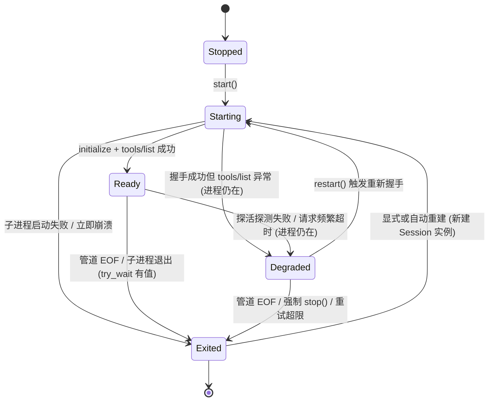
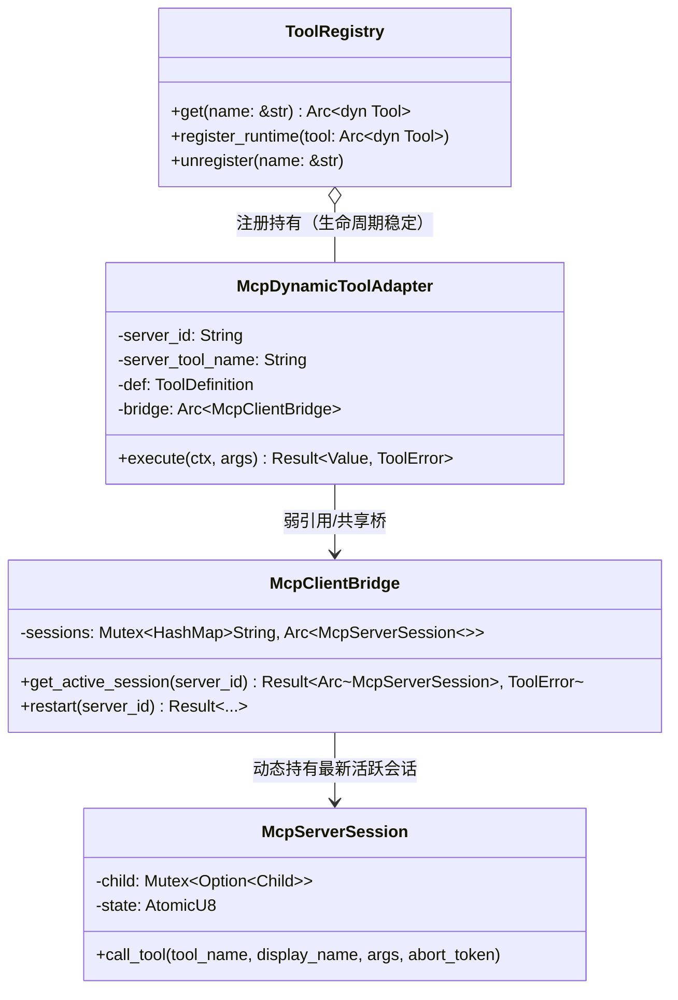

# 扩展中心与 MCP 工具生态全链路重构详案（B轨）

> **方案编号**：06B  
> **责任方向**：方向六 · 扩展中心与 MCP 工具生态全链路（B轨独立设计）  
> **核心侧重**：从 MCP 协议完整实现、进程生命周期守护、同名冲突隔离、外部插件真注册与安全沙箱接入切入，独立设计彻底重构方案。  
> **设计原则**：坚决杜绝补丁式修补，做对的事情，改动大就按大重构来；非必要不兼容，无用胶水代码物理拔除。  
> **产出文件**：`docs/core-capability-remediation/independent-plans/06B-扩展中心与MCP生态重构详案.md`（UTF-8 无 BOM）。  

---

## 一、现状与根因穿透（Path:Line 深度审判）

通过对 `crates/agent-tools/src/mcp/`、`crates/session-loop/`、`apps/agent-workbench/`、`apps/crish-desktop/` 以及 `packages/plugin-import-claude-codex/` 源码的全链路穿透，发现当前扩展中心与 MCP 工具生态存在系统性断裂，充斥着“假实现”、“幽灵命令”、“假状态覆盖”、“命名空间静默踩踏”与“安全沙箱完全旁路”等致命缺陷。

### 1.1 BC11-3：进程生命周期假状态、终态被覆盖与死循环轮询

- **代码坐标 1**：[`crates/agent-tools/src/mcp/bridge_registry.rs:144-147`](file:///c:/Software/conex/crates/agent-tools/src/mcp/bridge_registry.rs#L144-L147)
  ```rust
  if result.is_err() {
      // 握手 / 工具枚举失败：进程保留（Degraded），供 restart 重建重试
      session.set_state(McpServerRuntimeState::Degraded);
  }
  ```
- **代码坐标 2**：[`crates/agent-tools/src/mcp/bridge_session.rs:125-131`](file:///c:/Software/conex/crates/agent-tools/src/mcp/bridge_session.rs#L125-L131)
  ```rust
  pub fn is_running(&self) -> bool {
      matches!(
          self.state(),
          McpServerRuntimeState::Starting
              | McpServerRuntimeState::Ready
              | McpServerRuntimeState::Degraded
      )
  }
  ```
- **代码坐标 3**：[`crates/agent-tools/src/mcp/bridge_session.rs:600-620`](file:///c:/Software/conex/crates/agent-tools/src/mcp/bridge_session.rs#L600-L620)
  ```rust
  match guard.as_mut() {
      Some(child) => match child.try_wait() {
          Ok(Some(status)) => { guard.take(); Some(format!("进程退出（{status}）")) }
          ...
      },
      None => None, // child 被取走后永远返回 None
  }
  ```
- **根因穿透**：
  1. **绝对终态被非法回写覆盖**：当 stdio 子进程在启动或握手阶段立即崩溃时，读线程 `spawn_reader`（`bridge_session.rs:511`）或崩溃监测线程（`bridge_session.rs:617`）已经通过 `mark_exited` 将状态置为 `Exited`（终态）。然而，`bridge.start()` 捕获到错误后，无条件调用 `session.set_state(Degraded)`，**将不可逆终态 `Exited` 强行覆盖为 `Degraded`**！
  2. **死状态被当作存活状态通信**：`is_running()` 将 `Degraded` 视为可收发请求状态。随后的业务调用 `request()` 检查 `is_running()` 为真，继续尝试向已关闭的 `stdin` 写管道，导致无谓的 I/O 报错或请求无底线挂起。
  3. **Ready 短路假就绪（假活着）**：[`bridge_registry.rs:94-95`](file:///c:/Software/conex/crates/agent-tools/src/mcp/bridge_registry.rs#L94-L95) 检查若 `state == Ready`，直接返回旧的 `session.tools()` 缓存，**期间不做任何管道存活探活（Ping Probe）**。若外部子进程已被 SIGKILL 或卡死，系统仍误报 `Ready`，直到真实调用发生时才在管道层崩溃。
  4. **监控线程 CPU 空转**：`spawn_crash_monitor` 在 `child` 句柄被取走变为 `None` 后，若状态被异常覆盖为 `Degraded`，每次 sleep 50ms 后无操作继续循环，无法退出，造成运行时泄露与 CPU 浪费。

### 1.2 BC11-2：工具列表与调用分叉、同名工具静默吞噬与悬挂死指针

- **代码坐标 1**：[`crates/agent-tools/src/mcp/bridge_protocol.rs:55-66`](file:///c:/Software/conex/crates/agent-tools/src/mcp/bridge_protocol.rs#L55-L66)
  ```rust
  pub fn sanitize_id_part(server_id: &str) -> String {
      server_id.chars().map(|c| if c.is_ascii_alphanumeric() || c == '_' || c == '-' { c } else { '_' }).collect()
  }
  ```
- **代码坐标 2**：[`crates/agent-tools/src/mcp/mod.rs:76-80, 102`](file:///c:/Software/conex/crates/agent-tools/src/mcp/mod.rs#L76-L80)
  ```rust
  for def in &defs {
      if registry.has(&def.name) {
          // 已并入（重启 / 重复注册）：跳过，保持幂等
          continue;
      }
      let adapter = bridge.get_adapter(&config.server_id, &def.name)...;
      registry.register_runtime(adapter)...;
  }
  Ok(defs)
  ```
- **代码坐标 3**：[`crates/agent-tools/src/mcp/bridge_registry.rs:29-33, 224-228`](file:///c:/Software/conex/crates/agent-tools/src/mcp/bridge_registry.rs#L29-L33)
  ```rust
  pub struct McpToolAdapter {
      session: Arc<McpServerSession>,
      server_tool_name: String,
      def: ToolDefinition,
  }
  ```
- **根因穿透**：
  1. **前缀净化简单化导致命名空间严重碰撞**：`sanitize_id_part` 粗暴将除 ASCII 字母数字外的所有字符收敛为 `_`。这意味着 `my.server`、`my_server`、`my/server` 会生成完全相同的命名空间前缀 `mcp_my_server__*`。
  2. **同名静默跳过 + 伪装全量成功**：当两个 server ID 发生前缀碰撞，或者同名工具在重启时已存在，`mod.rs:77` 执行 `continue` 跳过注册，但在末尾却直接返回 `Ok(defs)`（包含全量定义）。调用方以为全部工具注册成功，而实际执行注册表里根本没有后者的工具！
  3. **适配器静态持有死会话（悬挂指针）**：`McpToolAdapter` 在创建时直接持有了当前的 `Arc<McpServerSession>`。当底层 stdio 进程崩溃并经由 `bridge.start` 重新拉起后，虽然 `bridge.sessions` 中替换为了新会话，但由于 `registry.has(&def.name)` 为 true 被跳过，**`ToolRegistry` 中已注册的 `McpToolAdapter` 依然持有老死会话的 Arc**！模型触发工具调用时，永远打到已退出的死进程上！

### 1.3 插件生态断裂：外部会话导入插件的纯日志占位与伪插件现实

- **代码坐标 1**：[`packages/plugin-import-claude-codex/src/activate.ts:40-46`](file:///c:/Software/conex/packages/plugin-import-claude-codex/src/activate.ts#L40-L46)
  ```typescript
  export function activate(api: PluginActivateApi): void {
    api.observe('session.start', (payload) => {
      api.log('info', `${manifest.id}：${SESSION_START_USAGE_NOTE}`, {
        sessionId: payload?.sessionId ?? '',
      });
    });
  }
  ```
- **代码坐标 2**：[`packages/plugin-import-claude-codex/src/manifest.ts:74`](file:///c:/Software/conex/packages/plugin-import-claude-codex/src/manifest.ts#L74)
  ```typescript
  declaredTools: [TOOL_PARSE_CLAUDE_CODE, TOOL_PARSE_CODEX_ROLLOUT],
  ```
- **根因穿透**：
  1. **纯日志占位，工具实际未接线**：Manifest 明确声明了拥有两个工具 `parse-claude-code-jsonl` 和 `parse-codex-rollout-jsonl`，且在 `tools.ts` 中写好了完备的纯函数实现。但在插件激活 `activate(api)` 时，`PluginActivateApi` 压根没有 `registerTool` 方法，仅仅打印一条 info 日志假装可用！
  2. **前端旁路硬编码，破坏插件生态自洽**：前端（`apps/crish-desktop/src/api/import/`）通过在编译期硬引入 `@crish/plugin-import-claude-codex` 当普通 npm 库调用，完全规避了插件动态加载与注册机制。如果用户在扩展中心启用该插件，AI 模型在会话中根本找不到该工具，形成严重的“UI 显式启用但模型不可用”欺诈状态。

### 1.4 安全与控制断层：沙箱权限模式、用户审批与超时控制完全旁路

- **代码坐标 1**：[`crates/agent-tools/src/mcp/bridge_registry.rs:45-54`](file:///c:/Software/conex/crates/agent-tools/src/mcp/bridge_registry.rs#L45-L54)
  ```rust
  async fn execute(
      &self,
      _ctx: &crate::context::ToolContext,
      args: Value,
  ) -> Result<Value, ToolError> {
      self.session
          .call_tool(&self.server_tool_name, &self.def.name, args)
          .await
  }
  ```
- **代码坐标 2**：[`crates/agent-tools/src/mcp/bridge_protocol.rs:83`](file:///c:/Software/conex/crates/agent-tools/src/mcp/bridge_protocol.rs#L83)
  ```rust
  dangerous: false,
  fatal_on_error: false,
  ```
- **根因穿透**：
  1. **忽略 ToolContext，完全抛弃控制面**：`McpToolAdapter::execute` 用下划线 `_ctx` 直接丢弃了全部上下文！`ctx.abort_token`、`ctx.ask`、`ctx.permission_mode`、`ctx.workspace_root` 被全量旁路。
  2. **危险标记硬编码为 false**：所有来自外部 MCP Server 的未知工具被无差别标记为 `dangerous: false`。无论外部工具执行什么格式化磁盘、发起任意外部网络请求的操作，引擎一律免审批放行，安全防线彻底击穿。
  3. **取消信号与超时无法穿透到子进程**：MCP 标准定义了 `notifications/cancelled` 机制。当前由于丢弃了 `AbortToken`，当用户点击中止、发生 L3 强停或触发会话超时时，MCP stdio 子进程完全得不到取消通知，继续在后台阻塞或产生脏状态。

### 1.5 桌面控制面瘫痪：幽灵命令与前端硬编码拒载

- **代码坐标 1**：[`apps/agent-workbench/src-tauri/src/command_manifest.rs:406-408`](file:///c:/Software/conex/apps/agent-workbench/src-tauri/src/command_manifest.rs#L406-L408)
  ```rust
  let ghosts = [
      ...
      "workbench_list_mcp_servers",
      "workbench_start_mcp_server",
      "workbench_stop_mcp_server",
  ];
  ```
- **代码坐标 2**：[`apps/crish-desktop/src/api/mcpApi.ts:162-171, 203-213`](file:///c:/Software/conex/apps/crish-desktop/src/api/mcpApi.ts#L162-L171)
  ```typescript
  export async function listMcpServers(): Promise<McpListResult> {
    return { ok: false, configured: false, servers: [], error: MCP_LIST_UNAVAILABLE_HINT, errorCode: 'unavailable' };
  }
  ```
- **根因穿透**：
  - 壳层将 MCP 控制命令标记为“幽灵命令”强制排除，前端则直接硬编码返回 `errorCode: 'unavailable'` 与 `'unsupported'`。
  - 用户在界面上的任何 MCP 启停、配置管理操作均被前端直接掐断，而后端对应的 `register_plugin_mcp_server` 入口被标上 `allow(dead_code)`，形成了全链路的“假关闭”。

---

## 二、架构重构设计与核心契约（做对的事情，架构净收敛）

本重构方案以**真实进程生命周期守护、确定性命名空间隔离、两级动态路由、端到端沙箱与审批穿透、真实插件生态运行时**为核心支柱，彻底推翻补丁式设计。

### 2.1 整体重构架构总览

```mermaid
flowchart TD
    subgraph UI_Extension_Surface["前端扩展中心 & 会话运行期"]
        UI_Settings["扩展管理 / 设置界面 (mcpApi.ts)"]
        UI_Chat["会话交互 (Approval UI / Tool Call Stream)"]
        Plugin_Registry["外部插件运行时 (PluginRunner)"]
    end

    subgraph Tauri_IPC["Tauri IPC 真实通信面"]
        IPC_List["workbench_list_mcp_servers"]
        IPC_Start["workbench_start_mcp_server"]
        IPC_Stop["workbench_stop_mcp_server"]
        IPC_Restart["workbench_restart_mcp_server"]
    end

    subgraph Engine_Core["Rust 核心引擎 (agent-tools / session-loop)"]
        subgraph Tool_Execution_Pipeline["工具执行流水线 (exec_single.rs)"]
            Security_Gate["McpSecurityGate (沙箱权限 & 危险度推导)"]
            Approval_Gate["ApprovalChannel (用户交互审批)"]
            Timeout_Abort["CooperativeTimeout (超时 & 取消通知)"]
        end

        subgraph Registry_Subsystem["统一注册表体系 (ToolRegistry)"]
            Unified_Registry["ToolRegistry (权威真源)"]
            Dynamic_Adapter["McpDynamicToolAdapter (两级解耦动态适配器)"]
        end

        subgraph Process_Supervisor["MCP 进程生命周期守护器 (Supervisor)"]
            Bridge["McpClientBridge (会话与路由总控)"]
            Session["McpServerSession (stdio 子进程 + 管道)"]
            State_Machine["不可逆终态状态机 (Atomic CAS)"]
            Health_Probe["主动 Ping / 探活引擎"]
            Auto_Restart["指数退避重启引擎 (Backoff Supervisor)"]
        end
    end

    subgraph External_Processes["外部 stdio / SSE 进程"]
        MCP_Child_1["stdio MCP Server (如 chrome-devtools-mcp)"]
        MCP_Child_2["stdio MCP Server (如 filesystem-mcp)"]
    end

    UI_Settings <-->|真实 IPC| Tauri_IPC
    Tauri_IPC <-->|管理命令| Bridge
    Plugin_Registry -->|注册声明| Unified_Registry
    Unified_Registry --> Dynamic_Adapter
    Dynamic_Adapter --> Security_Gate
    Security_Gate --> Approval_Gate
    Approval_Gate --> Timeout_Abort
    Timeout_Abort --> Bridge
    Bridge --> Session
    Session <--> State_Machine
    Session <--> Health_Probe
    Session <--> Auto_Restart
    Session <==>|JSON-RPC 2.0 (行分隔)| External_Processes
```

---

### 2.2 核心机制一：严格不可逆终态状态机与主动探活自愈

#### 2.2.1 状态转移矩阵与 CAS 保护

彻底拔除 `Degraded` 可以覆盖 `Exited` 的荒谬行为。状态流转严格遵循单向终态约束：



- **状态机编码定义**：
  ```rust
  #[derive(Debug, Clone, Copy, PartialEq, Eq, Serialize, Deserialize)]
  #[serde(rename_all = "lowercase")]
  pub enum McpServerRuntimeState {
      Stopped,
      Starting,
      Ready,
      Degraded,
      Exited, // 绝对终态：不可逆转为 Ready/Degraded
  }
  ```

- **状态原子迁移法则（CAS 保护）**：
  ```rust
  impl McpServerSession {
      /// 安全跃迁状态。若当前已处于 Exited 终态，除显式新建 Session 外拒绝任何回写！
      pub fn transition_state(&self, expected: McpServerRuntimeState, new_state: McpServerRuntimeState) -> bool {
          let curr = self.state.load(Ordering::SeqCst);
          if curr == STATE_EXITED {
              tracing::warn!(target: "mcp", server_id = %self.server_id, "拒绝将已退出状态 Exited 逆向跃迁为 {:?}", new_state);
              return false;
          }
          self.state.compare_exchange(
              runtime_state_code(expected),
              runtime_state_code(new_state),
              Ordering::SeqCst,
              Ordering::SeqCst
          ).is_ok()
      }

      /// 强制置为终态（幂等）
      pub fn mark_exited(&self, reason: impl Into<String>) {
          let r = reason.into();
          {
              let mut guard = self.exit_reason.lock().unwrap_or_else(recover_lock);
              if guard.is_none() {
                  *guard = Some(r.clone());
              }
          }
          self.state.store(STATE_EXITED, Ordering::SeqCst);
          // 释放所有挂起等待，唤醒全部阻断中的调用
          let pending = std::mem::take(&mut *self.pending.lock().unwrap_or_else(recover_lock));
          drop(pending);
          tracing::info!(target: "mcp", server_id = %self.server_id, reason = %r, "MCP 会话已彻底进入 Exited 终态");
      }
  }
  ```

#### 2.2.2 主动心跳探活与退避自愈（Health Probe & Backoff Supervisor）

1. **调用前轻量探活（Lazy Ping Probe）**：
   在复用 `Ready` 会话时，若距上次通信超过 `HEALTH_PROBE_INTERVAL`（例如 15 秒），执行最小代价探活：
   - 发送 JSON-RPC `{"jsonrpc":"2.0","id":<probe_id>,"method":"ping"}`，超时硬约束为 2 秒。
   - 若探活超时或管道 BrokenPipe，立即 `mark_exited`，并触发自动重启策略。
2. **指数退避自愈（Exponential Backoff）**：
   - 配置项：`max_retries: 3`，`base_delay: 500ms`，`max_delay: 4000ms`。
   - 当调用因进程崩溃中断时，若处于容错策略内，自动拉起全新会话实例，完成握手后重试原调用；若重试超限，则封印该 server 为 `Exited` 并向前端推送错误事件。

---

### 2.3 核心机制二：确定性命名空间与两级动态寻址适配器

#### 2.3.1 确定性防碰撞命名空间规范

解决 `my.server` 与 `my_server` 冲突，引入全局唯一且人机友好的命名空间算法：

```rust
/// 命名规则：mcp__<clean_name>_<crc32_hex>__<tool_name>
pub fn format_mcp_tool_name(server_id: &str, tool_name: &str) -> String {
    let clean_id: String = server_id
        .chars()
        .map(|c| if c.is_ascii_alphanumeric() { c.to_ascii_lowercase() } else { '_' })
        .collect();
    // 截取前 16 位主干，配合 8 位 CRC32/SHA256 校验和，确保绝对无冲突
    let mut hasher = std::collections::hash_map::DefaultHasher::new();
    std::hash::Hash::hash(server_id, &mut hasher);
    let hash_suffix = format!("{:08x}", std::hash::Hasher::finish(&hasher) as u32);
    
    format!("mcp__{}_{}__{}", clean_id.chars().take(16).collect::<String>(), hash_suffix, tool_name)
}
```

#### 2.3.2 两级动态寻址适配器（McpDynamicToolAdapter）

彻底消除 `McpToolAdapter` 静态持有 `Arc<McpServerSession>` 导致的悬挂死指针。



- **实现原理**：
  ```rust
  pub struct McpDynamicToolAdapter {
      server_id: String,
      server_tool_name: String,
      def: ToolDefinition,
      bridge: std::sync::Weak<McpClientBridge>,
  }

  #[async_trait]
  impl Tool for McpDynamicToolAdapter {
      fn name(&self) -> &str { &self.def.name }
      fn definition(&self) -> &ToolDefinition { &self.def }

      async fn execute(&self, ctx: &ToolContext, args: Value) -> Result<Value, ToolError> {
          let bridge = self.bridge.upgrade().ok_or_else(|| {
              ToolError::new(codes::MCP_CONNECTION_FAILED, "MCP 客户端网桥已析构")
          })?;
          // 动态解析当前活着的会话。若当前会话崩溃，此处可触发自愈重连！
          let session = bridge.ensure_active_session(&self.server_id).await?;
          
          // 执行端到端沙箱与审批守卫，并传入完整的 abort_token
          McpSecurityGate::verify_and_execute(session, &self.server_tool_name, &self.def, args, ctx).await
      }
  }
  ```

---

### 2.4 核心机制三：端到端沙箱权限、用户审批与协同取消集成

#### 2.4.1 安全沙箱与权限矩阵（Security Gate）

外部 MCP 工具不可信，必须受制于宿主安全沙箱：

1. **危险度动态推导（Dangerous Derivation）**：
   - 工具名称若包含 `execute`、`run`、`shell`、`eval`、`write`、`delete`、`remove`、`kill`、`send`，或者 Schema 中包含危险关键词，强制标记 `def.dangerous = true`。
   - Server 配置中若未显式声明信任等级（`trustLevel: 'restricted'`），所有对外写/网络工具均为 `dangerous: true`。
2. **只读模式阻断（ReadOnly Mode Enforcement）**：
   - 当会话处于 `PermissionMode::ReadOnly` 时，任何被识别为有副作用或危险的 MCP 工具调用，直接由安全门拦截，抛出 `permission.denied`，禁止打入子进程。

#### 2.4.2 用户交互审批接入（Approval Channel Integration）

```rust
pub struct McpSecurityGate;

impl McpSecurityGate {
    pub async fn verify_and_execute(
        session: Arc<McpServerSession>,
        server_tool_name: &str,
        def: &ToolDefinition,
        args: Value,
        ctx: &ToolContext,
    ) -> Result<Value, ToolError> {
        // 1. 权限模式校验
        if ctx.permission_mode == PermissionMode::ReadOnly && def.dangerous {
            return Err(ToolError::new(
                codes::PERMISSION_DENIED,
                format!("只读模式下拒绝执行危险 MCP 工具：{}", def.name),
            ));
        }

        // 2. 审批拦截（若标记为 dangerous 且存在 ask 通道）
        if def.dangerous {
            if let Some(ask) = &ctx.ask {
                let question = format!(
                    "MCP 工具 [{}] 申请执行敏感操作，入参：\n```json\n{}\n```\n是否批准？",
                    def.name,
                    serde_json::to_string_pretty(&args).unwrap_or_default()
                );
                let decision = ask.ask(&question, &["Approve", "Deny"]).await?;
                if decision != AskDecision::Allow && decision != AskDecision::Approved {
                    return Err(ToolError::new(
                        codes::PERMISSION_DENIED,
                        format!("用户拒绝了 MCP 工具 [{}] 的执行请求", def.name),
                    ));
                }
            }
        }

        // 3. 协同超时与取消穿透执行
        session.call_tool_cancellable(server_tool_name, &def.name, args, &ctx.abort_token).await
    }
}
```

#### 2.4.3 协同超时与取消通知（Cooperative Cancellation）

实现 MCP 规范的取消下发协议：

```rust
impl McpServerSession {
    pub async fn call_tool_cancellable(
        &self,
        tool_name: &str,
        display_name: &str,
        args: Value,
        abort_token: &AbortToken,
    ) -> Result<Value, ToolError> {
        let id = self.next_id.fetch_add(1, Ordering::Relaxed) + 1;
        let (tx, rx) = oneshot::channel();
        self.pending.lock().unwrap_or_else(recover_lock).insert(id, tx);

        // 构造 JSON-RPC 请求
        let params = json!({ "name": tool_name, "arguments": args });
        self.send_raw_request(id, "tools/call", params).await?;

        // 监听三重赛马：响应返回 / Abort 触发 / 本地超时
        tokio::select! {
            res = rx => {
                match res {
                    Ok(response) => {
                        let result = response_result(&self.server_id, response)?;
                        adapt_call_result(&result, display_name)
                    }
                    Err(_) => Err(self.unavailable_error()),
                }
            }
            _ = abort_token.wait_aborted() => {
                // 移除 pending 挂起项
                self.pending.lock().unwrap_or_else(recover_lock).remove(&id);
                // 协同下发 MCP 取消通知给远端子进程
                let _ = self.send_notification("notifications/cancelled", json!({ "requestId": id })).await;
                Err(ToolError::new(codes::RUNTIME_ABORTED, format!("MCP 工具调用被用户/系统强停中断：{display_name}")))
            }
            _ = tokio::time::sleep(self.call_timeout) => {
                self.pending.lock().unwrap_or_else(recover_lock).remove(&id);
                let _ = self.send_notification("notifications/cancelled", json!({ "requestId": id })).await;
                Err(ToolError::new(codes::RUNTIME_TIMEOUT, format!("MCP 工具调用超时（{}s）：{display_name}", self.call_timeout.as_secs())))
            }
        }
    }
}
```

---

### 2.5 核心机制四：打通外部会话导入插件真实注册面

#### 2.5.1 扩展宿主 API 契约（PluginAPI Contract）

在 [`packages/shared-types/src/plugin.ts`](file:///c:/Software/conex/packages/shared-types/src/plugin.ts) 中增加完整的命令式注册能力，使 `PluginAPI` 成为具备实权的注册面：

```typescript
export interface PluginToolDefinition {
  readonly name: string;
  readonly description: string;
  readonly inputSchema: Record<string, unknown>;
  readonly dangerous?: boolean;
  readonly execute: (input: unknown, context?: unknown) => Promise<unknown> | unknown;
}

export interface PluginActivateApi {
  /** 注册可供模型调用的原生/纯函数工具 */
  registerTool(tool: PluginToolDefinition): void;
  /** 注册受管 MCP 服务器 */
  registerMcpServer(declaration: PluginMcpDeclaration): void;
  /** 事件监听与日志 */
  observe<E extends HookEventName>(event: E, handler: (payload: any) => void | Promise<void>): unknown;
  on<E extends HookEventName>(event: E, handler: (payload: any) => any): unknown;
  log(level: 'debug' | 'info' | 'warn' | 'error', message: string, metadata?: Record<string, unknown>): void;
}
```

#### 2.5.2 重构 `packages/plugin-import-claude-codex/src/activate.ts`

拔除无用日志占位代码，真实注册 `parseClaudeCodeTool` 与 `parseCodexRolloutTool`：

```typescript
import { manifest } from './manifest';
import { 
  parseClaudeCodeTool, 
  parseCodexRolloutTool, 
  getToolDeclarations 
} from './tools';
import type { PluginActivateApi } from './types';

export function activate(api: PluginActivateApi): void {
  const [claudeDecl, codexDecl] = getToolDeclarations();

  // 1. 真实注册 Claude Code 导入解析工具
  api.registerTool({
    name: claudeDecl.name,
    description: claudeDecl.description,
    inputSchema: claudeDecl.inputSchema,
    dangerous: false,
    execute: async (input: unknown) => {
      return parseClaudeCodeTool(input as any);
    },
  });

  // 2. 真实注册 Codex CLI 导入解析工具
  api.registerTool({
    name: codexDecl.name,
    description: codexDecl.description,
    inputSchema: codexDecl.inputSchema,
    dangerous: false,
    execute: async (input: unknown) => {
      return parseCodexRolloutTool(input as any);
    },
  });

  api.log('info', `插件 ${manifest.id} 成功注册 2 个会话导入工具`);
}
```

---

### 2.6 核心机制五：桌面控制通道真接线与双向同步

#### 2.6.1 废除幽灵命令，在 Tauri 壳层正式登记

在 [`apps/agent-workbench/src-tauri/src/command_manifest.rs`](file:///c:/Software/conex/apps/agent-workbench/src-tauri/src/command_manifest.rs) 中：
- 从 `ghosts` 列表中物理剔除 `workbench_list_mcp_servers`、`workbench_start_mcp_server`、`workbench_stop_mcp_server`；
- 在正式命令清单中声明其为已接线（`registered: true`）；
- 增加 `workbench_restart_mcp_server` 支持自愈重建控制。

#### 2.6.2 前端 `apps/crish-desktop/src/api/mcpApi.ts` 接入真实 IPC

彻底拔除所有返回 `errorCode: 'unavailable'` 的假代码，改为标准 `tauriInvoke`：

```typescript
export async function listMcpServers(): Promise<McpListResult> {
  try {
    const res = await tauriInvoke<{ servers: McpServerInfo[] }>('workbench_list_mcp_servers');
    return {
      ok: true,
      configured: true,
      servers: res.servers,
    };
  } catch (err: any) {
    return {
      ok: false,
      configured: false,
      servers: [],
      error: err.message || '获取 MCP 服务列表失败',
      errorCode: err.code || 'runtime_error',
    };
  }
}

export async function startMcpServer(serverId: string): Promise<McpControlResult> {
  try {
    await tauriInvoke('workbench_start_mcp_server', { serverId });
    return { ok: true, serverId };
  } catch (err: any) {
    return { ok: false, serverId, error: err.message, errorCode: err.code };
  }
}

export async function stopMcpServer(serverId: string): Promise<McpControlResult> {
  try {
    await tauriInvoke('workbench_stop_mcp_server', { serverId });
    return { ok: true, serverId };
  } catch (err: any) {
    return { ok: false, serverId, error: err.message, errorCode: err.code };
  }
}
```

---

## 三、改动文件与接口清单

本次重构涉及后端 Rust 内核、Tauri 壳层、前端 API 与共享插件包，改动矩阵如下：

| 文件路径 | 模块 / 归属 | 核心改动职责 |
| :--- | :--- | :--- |
| `crates/agent-tools/src/mcp/bridge_session.rs` | Rust / 会话域 | 重构运行状态机（CAS 单向终态保护，禁止回写 Exited）；实现 `call_tool_cancellable` 支持协同取消通知；修复监控线程 `child=None` 时的死循环空转。 |
| `crates/agent-tools/src/mcp/bridge_registry.rs` | Rust / 注册域 | 重构 `McpToolAdapter` 为 `McpDynamicToolAdapter`（弱引用桥 + 运行时动态寻址）；拔除握手失败无条件覆盖 `Degraded` 的逻辑；实现 `ensure_active_session` 与 Ping 探活。 |
| `crates/agent-tools/src/mcp/bridge_protocol.rs` | Rust / 协议域 | 重构 `format_mcp_tool_name` 命名空间算法（追加 Hash 杜绝前缀碰撞）；增加 `notifications/cancelled` 报文构造辅助；增加危险工具启发式判定。 |
| `crates/agent-tools/src/mcp/mod.rs` | Rust / 门面域 | 重构 `register_plugin_server`：严格冲突仲裁，禁止同名静默跳过，支持动态适配器热更新；支持 `unregister_server_tools` 注销清理。 |
| `crates/agent-tools/src/mcp/servers.rs` | Rust / 配置域 | 补充轻量 JSON 配置文件持久化实现 `FileMcpConfigPersistence`，解决生产环境只有纯内存表的问题。 |
| `crates/session-loop/src/exec_single.rs` | Rust / 执行循环 | 在构造 `ToolContext` 及执行阶段，将 `AbortToken` 与 `AskChannel` 贯通注入工具执行流；实现 `McpSecurityGate` 沙箱与审批拦截。 |
| `apps/agent-workbench/src-tauri/src/engine_build.rs` | Rust / 壳层装配 | 拔除 `register_plugin_mcp_server` 的 `#[allow(dead_code)]`，接入真实会话启动装配区与设置加载区。 |
| `apps/agent-workbench/src-tauri/src/command_manifest.rs` | Rust / 命令清单 | 将 `workbench_list_mcp_servers` 等 3 条命令移出 `ghosts` 幽灵列表，正式登记为 `registered: true`。 |
| `apps/agent-workbench/src-tauri/src/main.rs` | Rust / Tauri IPC | 注册 `workbench_list_mcp_servers`、`workbench_start_mcp_server`、`workbench_stop_mcp_server` 的真实 Handler。 |
| `packages/shared-types/src/plugin.ts` | TS / 跨端契约 | 在 `PluginActivateApi` 契约中补充实权方法 `registerTool` 和 `registerMcpServer`。 |
| `packages/plugin-import-claude-codex/src/activate.ts` | TS / 官方插件 | 彻底拔除仅打印 log 的占位逻辑，真实调用 `api.registerTool` 注册两个导入纯函数工具。 |
| `apps/crish-desktop/src/api/mcpApi.ts` | TS / 前端 API | 彻底拔除硬编码返回 `errorCode: 'unavailable'` / `'unsupported'` 的虚假代码，接入真实 `tauriInvoke`。 |

---

## 四、非必要不兼容声明（物理拔除死代码与伪实现）

遵循“做对的事情，非必要不兼容，无用胶水代码物理拔除”原则，明确清理以下历史包袱：

1. **物理拔除前端假状态代码**：
   - 彻底删除 `apps/crish-desktop/src/api/mcpApi.ts:158-171, 203-220` 中的 `MCP_LIST_UNAVAILABLE_HINT`、`START_STOP_UNSUPPORTED_HINT` 以及所有无条件返回 `ok: false` 的 mock 逻辑。
2. **物理拔除幽灵命令免死金牌**：
   - 彻底删除 `apps/agent-workbench/src-tauri/src/command_manifest.rs:406-408` 中针对 MCP 三条命令的幽灵测试豁免，杜绝“因为没接线就声明为幽灵”的作弊行为。
3. **物理拔除插件激活纯日志占位**：
   - 彻底删除 `packages/plugin-import-claude-codex/src/activate.ts` 中的 `SESSION_START_USAGE_NOTE` 占位注释与日志代码，替换为真实的工具注册执行体。
4. **物理拔除单向静态持有的死会话适配器**：
   - 废除原有的 `McpToolAdapter`（直接持有 `session: Arc<McpServerSession>`），全量替换为 `McpDynamicToolAdapter`。不再保留指向死进程的旧适配器结构。
5. **物理拔除同名静默跳过漏洞**：
   - 废除 `register_plugin_server` 中“遇到同名直接 continue 且返回 Ok(defs)”的伪幂等逻辑，改为严格的“更新路由 / 明确报错”机制。

---

## 五、立体验证与验收用例设计

依据“立体验证纪律”，杜绝单一单元测试冒充验收，建立包含单元测试、极端并发/故障注入测试以及端到端物理现场验收的立体防御体系。

### 5.1 单元测试集（Unit Tests）

1. **不可逆终态跃迁断言测试（`mcp_state_machine_terminal_guarantee`）**：
   - 步骤：创建 Session 实例，模拟 stdout EOF 触发 `mark_exited("EOF")` 进入 `Exited` 状态。
   - 断言：随后调用 `transition_state(Ready, Degraded)` 或 `set_state(Degraded)`，验证状态依然坚决保持 `Exited`，CAS 返回 false，退出原因未被覆盖。
2. **命名空间哈希防碰撞测试（`mcp_namespace_collision_prevention`）**：
   - 步骤：构造两组极端碰撞输入：`server_id = "my.server"` 与 `server_id = "my_server"`，以及 `server_id = "test/mcp"` 与 `server_id = "test_mcp"`。
   - 断言：生成的工具全名 `format_mcp_tool_name` 必须绝对不相等，各自带有唯一的哈希后缀。
3. **协同取消与下发通知测试（`mcp_cooperative_cancellation`）**：
   - 步骤：拉起一个模拟慢速 MCP Server，触发 `call_tool_cancellable`，在 100ms 后触发 `AbortToken::abort()`。
   - 断言：函数在 20ms 内迅速返回 `codes::RUNTIME_ABORTED`，且验证向子进程 stdin 发送了包含对应 ID 的 `notifications/cancelled` 报文。
4. **插件真实注册断言测试（`plugin_import_real_registration`）**：
   - 步骤：实例化 mock `PluginActivateApi`，传入 `activate.ts` 执行。
   - 断言：`api.registerTool` 被精确调用 2 次，分别注册 `parse-claude-code-jsonl` 和 `parse-codex-rollout-jsonl`，且执行其 `execute` 能成功解析标准 JSONL 会话文本。

### 5.2 极端并发与故障注入测试（Adversarial & Concurrency Tests）

1. **子进程 SIGKILL 强杀自愈与路由更新压测**：
   - 场景：在并发进行 50 次 MCP 工具调用的同时，通过外部命令强制 `kill -9` 杀掉底层 stdio 进程。
   - 预期结果：进行中的部分调用优雅收到连接中断错误，后续的并发调用触发 `ensure_active_session` 自动拉起新进程并重建连接，`ToolRegistry` 中的 `McpDynamicToolAdapter` 无缝路由到新进程，无任何 panic，无死锁，无内存泄漏。
2. **巨量 Stderr 输出与管道满载抗压测试**：
   - 场景：MCP Server 在 stderr 极速喷射 10MB 的日志，在 stdout 缓慢输出结果。
   - 预期结果：`spawn_stderr_drainer` 环形缓冲正确丢弃超限日志，子进程未发生由于 stderr 管道缓冲区写满导致的进程永久挂起死锁。

### 5.3 端到端物理现场验收步骤（End-to-End Real Acceptance）

1. **环境准备**：
   - 在本地配置一个真实基于 Node.js 的 MCP Server（例如 `@modelcontextprotocol/server-filesystem`）。
2. **桌面管理面操作验收**：
   - 启动应用进入设置中心 -> 扩展中心；
   - 界面不再显示“当前引擎不支持从界面读取 MCP 列表”，而是正确列出配置的文件系统 MCP Server，状态显示为 `Stopped`；
   - 点击“启动”按钮，观察系统进程管理器中出现对应的 `node.exe` 子进程，界面状态实时跃迁为 `Ready`，并展示枚举出的工具列表（如 `mcp__filesystem_xxxx__read_file`）。
3. **AI 模型真实调用与审批验收**：
   - 打开会话窗口，向 AI 发送指令：“请使用文件系统工具读取当前目录下的 package.json”；
   - 观察执行流：引擎精准匹配到 `mcp__filesystem_xxxx__read_file` 工具；
   - 界面弹出 Approval 模态窗：“MCP 工具申请执行敏感操作，入参：{ path: 'package.json' }”；
   - 点击“拒绝”，AI 回复“用户已拒绝执行该操作”；
   - 再次发送并点击“允许”，工具执行成功，AI 基于真实读取到的内容进行总结汇报。
4. **插件导入工具端到端调用验收**：
   - 在会话中发送一段 Claude Code 导出的真实 JSONL 内容：“请使用 parse-claude-code-jsonl 工具解析这段会话”；
   - 观察工具调用：模型成功点名 `parse-claude-code-jsonl`，插件内置纯函数执行完毕，返回结构化会话载荷，完全脱离日志占位假状态。
