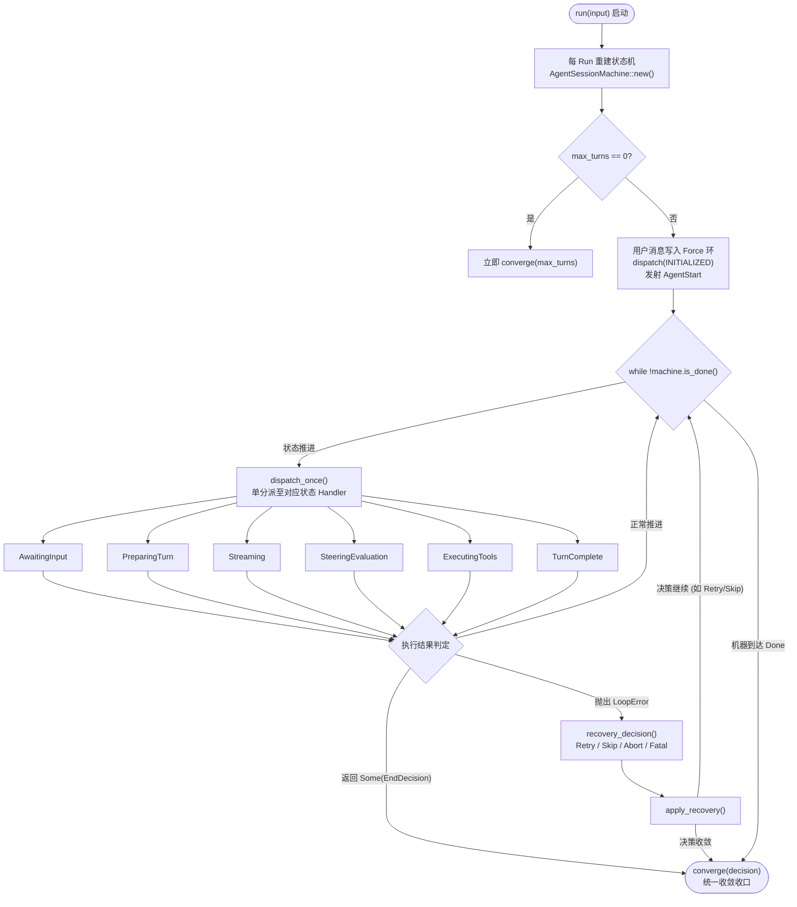
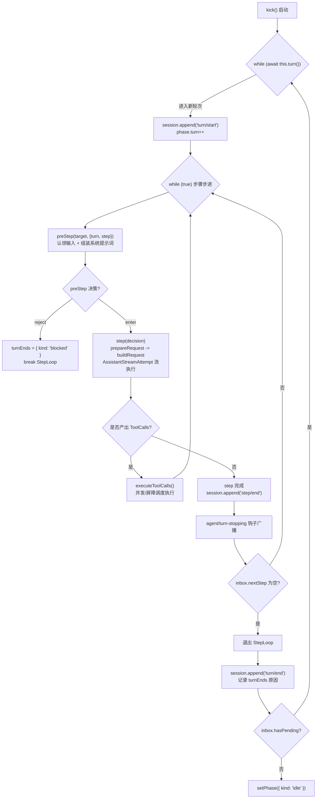
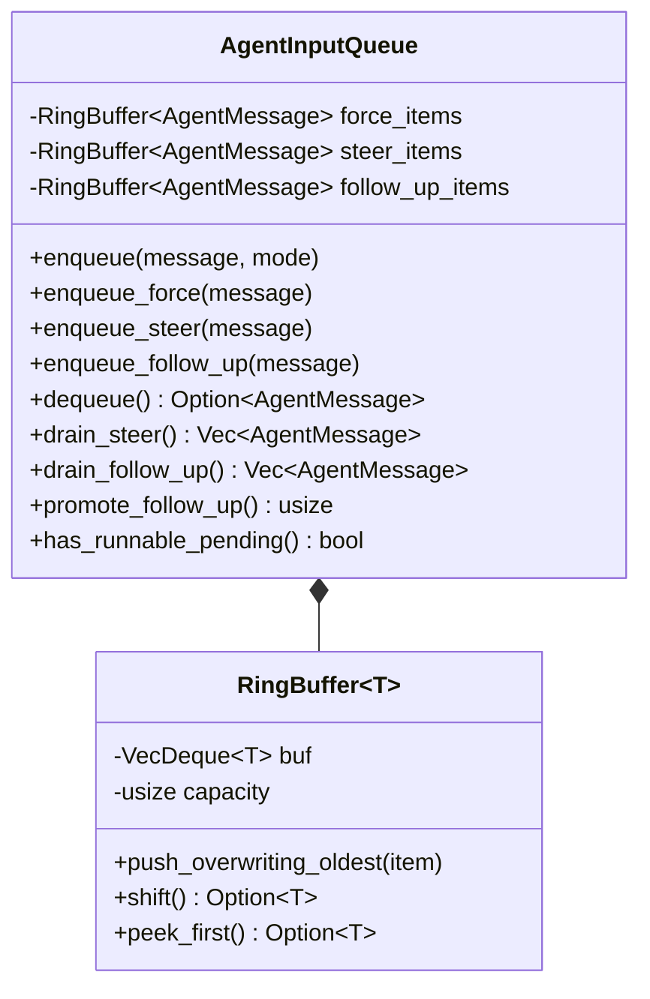

# Conex (Crish) 与 DeepSeek Harness (dsh) 代码级深度审计报告：Agent Loop 状态机与控制流

> **审计基准**：纯源码级逐行审查（专心看代码，严禁参考任何外部文档）。  
> **核心对标代码路径**：  
> - **Conex 侧**：  
>   - [`crates/session-loop/src/state.rs`](file:///c:/Software/conex/crates/session-loop/src/state.rs)（状态机内核实例与转移驱动）  
>   - [`crates/conex-types/src/transition.rs`](file:///c:/Software/conex/crates/conex-types/src/transition.rs)（状态转移表 160 组合全矩阵穷举）  
>   - [`crates/session-loop/src/control.rs`](file:///c:/Software/conex/crates/session-loop/src/control.rs)（L0-L3 控制意图协议与 ControlBus 仲裁总线）  
>   - [`crates/session-loop/src/safe_point.rs`](file:///c:/Software/conex/crates/session-loop/src/safe_point.rs)（安全点控制映射与 AbortSignal 广播竞速）  
>   - [`crates/session-loop/src/input.rs`](file:///c:/Software/conex/crates/session-loop/src/input.rs)（三环输入队列与容量背压覆盖留痕）  
>   - [`crates/session-loop/src/loop/loop_exec.rs`](file:///c:/Software/conex/crates/session-loop/src/loop/loop_exec.rs)（主循环控制面、单分派与单点收敛器）  
>   - [`crates/session-loop/src/loop/handlers/mod.rs`](file:///c:/Software/conex/crates/session-loop/src/loop/handlers/mod.rs)（`check_control` 安全点与 `drive_machine_to_stop` 协作驱动）  
>   - [`crates/session-loop/src/loop/handlers/executing_tools.rs`](file:///c:/Software/conex/crates/session-loop/src/loop/handlers/executing_tools.rs)（工具批次执行、审批栅栏与错误收口）  
>   - [`crates/session-loop/src/loop/handlers/stream_error_retry.rs`](file:///c:/Software/conex/crates/session-loop/src/loop/handlers/stream_error_retry.rs)（瞬态重试退避、熔断闸与 Abort 竞速）  
>   - [`crates/session-loop/src/steering/strategy.rs`](file:///c:/Software/conex/crates/session-loop/src/steering/strategy.rs)（死循环与重复工具调用检测策略）  
> - **DSH 侧**：  
>   - [`reference/deepseek-harness/packages/core/agent-loop/src/agent.ts`](file:///c:/Software/conex/reference/deepseek-harness/packages/core/agent-loop/src/agent.ts)（`ReactLoopAgent` 双层嵌套驱动、三态微型 Phase、流打断与请求组装）  
>   - [`reference/deepseek-harness/packages/core/agent-loop/src/inbox.ts`](file:///c:/Software/conex/reference/deepseek-harness/packages/core/agent-loop/src/inbox.ts)（`ReactLoopInbox` 事件溯源投影、双目标分环与全局 ID 强校验）  
>   - [`reference/deepseek-harness/packages/core/agent-loop/src/tool-calls.ts`](file:///c:/Software/conex/reference/deepseek-harness/packages/core/agent-loop/src/tool-calls.ts)（滚动并发池、独占执行屏障、模型保序提交与合成中断错误）  
>   - [`reference/deepseek-harness/packages/core/agent-loop/src/assistant-stream.ts`](file:///c:/Software/conex/reference/deepseek-harness/packages/core/agent-loop/src/assistant-stream.ts)（流尝试帧划分、打断内容安全抢救与持久化提交）  
>   - [`reference/deepseek-harness/packages/core/agent-loop/src/runtime-context.ts`](file:///c:/Software/conex/reference/deepseek-harness/packages/core/agent-loop/src/runtime-context.ts)（系统提示词动态投影与运行上下文表面同步）  
>   - [`reference/deepseek-harness/packages/llm/llm/src/retry-policy.ts`](file:///c:/Software/conex/reference/deepseek-harness/packages/llm/llm/src/retry-policy.ts)（请求重试退避配置与校验）

---

## 1. 架构总览与循环驱动模型对照（Loop Driver Architecture）

### 1.1 Conex 驱动流：基于显式有限状态机（FSM）的单分派收敛模型

Conex 的 `session-loop` 采用高度形式化的**显式有限状态机驱动**架构。整个驱动循环由 [`crates/session-loop/src/loop/loop_exec.rs:22-162`](file:///c:/Software/conex/crates/session-loop/src/loop/loop_exec.rs#L22-L162) 的 `AgentSessionLoop::run` 集中管控。



1. **主循环骨架与生命周期初始化**：
   - 每次 `run` 启动时，强制构造全新的状态机实例（[`crates/session-loop/src/loop/loop_exec.rs:43-44`](file:///c:/Software/conex/crates/session-loop/src/loop/loop_exec.rs#L43-L44)）：
     ```rust
     self.state.machine = crate::state::AgentSessionMachine::new(self.session_id.clone(), self.max_turns);
     ```
   - 在进入循环前，硬性拦截 `max_turns == 0` 边界（[`crates/session-loop/src/loop/loop_exec.rs:50-69`](file:///c:/Software/conex/crates/session-loop/src/loop/loop_exec.rs#L50-L69)），防止执行零轮次时由于首轮完成才校验而导致的逻辑穿透。
   - 驱动主干为显式 `while` 循环（[`crates/session-loop/src/loop/loop_exec.rs:136-152`](file:///c:/Software/conex/crates/session-loop/src/loop/loop_exec.rs#L136-L152)），每一步调用 `self.dispatch_once().await`。
2. **状态单分派路由（`dispatch_once`）**：
   - 在 [`crates/session-loop/src/loop/loop_exec.rs:165-198`](file:///c:/Software/conex/crates/session-loop/src/loop/loop_exec.rs#L165-L198) 中，根据当前活跃状态严格路由至对应的子处理器：
     - `S::AwaitingInput => handlers::awaiting_input::handle(...)`
     - `S::PreparingTurn => handlers::prepare_turn::handle(...)`
     - `S::Streaming => handlers::streaming::handle(...)`
     - `S::SteeringEvaluation => handlers::steering_evaluation::handle(...)`
     - `S::ExecutingTools => handlers::executing_tools::handle(...)`
     - `S::TurnComplete => handlers::turn_complete::handle(...)`
   - `S::Idle` 与 `S::Done` 被划为不可分派状态，一旦非法进入，直接返回 `LoopError::internal`。
3. **收敛中心（`converge`）与零拷贝移交**：
   - 整个生命周期的所有退出分支统一由 [`crates/session-loop/src/loop/loop_exec.rs:304-351`](file:///c:/Software/conex/crates/session-loop/src/loop/loop_exec.rs#L304-L351) 的 `converge()` 集中收口。
   - **孤儿 Turn-Start 兜底闭合**（[`crates/session-loop/src/loop/loop_exec.rs:309`](file:///c:/Software/conex/crates/session-loop/src/loop/loop_exec.rs#L309)）：调用 `handlers::emit_missing_turn_end(&mut self.state)`，保证无论在任何状态下发生异常中断，`turn-start` 与 `turn-end` 事件恒定闭合成对。
   - **零拷贝所有权移交**（[`crates/session-loop/src/loop/loop_exec.rs:334-350`](file:///c:/Software/conex/crates/session-loop/src/loop/loop_exec.rs#L334-L350)）：通过 `std::mem::take` 移交 `conversation`、`events` 和 `terminal_provider_error`，将内存转移优化至严格的 $O(1)$。

---

### 1.2 DSH 驱动流：基于事件溯源（Event Sourcing）的双层嵌套步进模型

DeepSeek Harness 采用了**双层嵌套异步循环**配合**会话事件日志溯源投影（Event Sourcing Projection）**的架构，由 [`reference/deepseek-harness/packages/core/agent-loop/src/agent.ts`](file:///c:/Software/conex/reference/deepseek-harness/packages/core/agent-loop/src/agent.ts) 主导。



1. **双层嵌套循环结构**：
   - 外层循环 `kick()`（[`reference/deepseek-harness/packages/core/agent-loop/src/agent.ts:225-238`](file:///c:/Software/conex/reference/deepseek-harness/packages/core/agent-loop/src/agent.ts#L225-L238)）：负责持续调用 `while (await this.turn()) {}`，直到收件箱无待处理输入。
   - 内层步进循环 `turn()`（[`reference/deepseek-harness/packages/core/agent-loop/src/agent.ts:269-350`](file:///c:/Software/conex/reference/deepseek-harness/packages/core/agent-loop/src/agent.ts#L269-L350)）：开辟 `turn` 边界并记录 `turn/start`，内部由 `while(true)` 持续驱动 `step` 演进，直到工具执行完毕或输入耗尽才闭合 `turn/end`。
2. **极简三态微型 Phase**：
   - DSH 在内部**没有定义有限状态机**，仅在 [`reference/deepseek-harness/packages/core/agent-loop/src/agent.ts:41-50`](file:///c:/Software/conex/reference/deepseek-harness/packages/core/agent-loop/src/agent.ts#L41-L50) 中声明了一个微型联合类型：
     ```typescript
     type Phase =
       | { kind: 'idle'; lastTurn: number }
       | { kind: 'maintenance'; abort: AbortController; lastTurn: number; wakeRequested: boolean }
       | { kind: 'running'; abort: AbortController; turn: number; step: number; wakeRequested: boolean }
     ```
   - 对外暴露的状态只有 `'idle' | 'running'`（[`reference/deepseek-harness/packages/core/agent-loop/src/agent.ts:114-116`](file:///c:/Software/conex/reference/deepseek-harness/packages/core/agent-loop/src/agent.ts#L114-L116)）。
   - 所有的细粒度阶段（准备请求、流式传输、工具执行、中断抢救）全部**隐式内嵌在过程式的 Promise 调用栈中**。
3. **事件驱动落地（Append-Only Event Sourcing）**：
   - 所有的驱动动作均映射为向 `session` 提交不可变事件：`turn/start`（行 278）、`step/start`（行 302）、`system/message`（行 371）、`user/message`（行 375）、`assistant/message`（行 476）、`step/end`（行 312）、`turn/end`（行 339）。状态的重现完全依赖于只追加日志（WAL）与投影折叠。

---

## 2. 状态机穷举与转移安全性深度审计

### 2.1 Conex 的 FSM 穷举转移表与代数类型安全

Conex 的状态机实现了数学级别严格的代数转移矩阵，核心逻辑分布在 `conex-types` 与 `session-loop` 中：

1. **转移表完全穷举（160 对状态-事件空间逐行穷举）**：
   - 8 种会话状态（[`crates/session-loop/src/state.rs:111-122`](file:///c:/Software/conex/crates/session-loop/src/state.rs#L111-L122)）：`Idle`, `AwaitingInput`, `PreparingTurn`, `Streaming`, `SteeringEvaluation`, `ExecutingTools`, `TurnComplete`, `Done`。
   - 20 种强类型事件（[`crates/session-loop/src/state.rs:124-147`](file:///c:/Software/conex/crates/session-loop/src/state.rs#L124-L147)）：包含 `Initialized`, `InputReady`, `TurnPrepared`, `HasToolCalls { count }`, `NoToolCalls`, `ToolsComplete`, `InputAvailable`, `NextTurn`, `ShouldStop`, `Abort`, `Error`, `MaxTurnsReached`, `SteeringNeeded` 等。
   - 在 [`crates/conex-types/src/transition.rs:89-191`](file:///c:/Software/conex/crates/conex-types/src/transition.rs#L89-L191) 中定义纯函数 `apply_transition(state, event)`：
     - **精确定义了 33 条合法转移路径**；
     - **其余 127 种非法组合**全部显式路由至 `TransitionError::Undefined { state, event }` 或 `TransitionError::Terminal`（`Done` 状态拒绝一切事件，行 189）。
     - 单元测试 [`crates/session-loop/src/state.rs:487-507`](file:///c:/Software/conex/crates/session-loop/src/state.rs#L487-L507) 执行 $8 \times 20$ 循环穷举断言，确保 33 条合法转移与 127 条非法组合分毫不差。
2. **转移失败的原子性保证**：
   - 在 [`crates/session-loop/src/state.rs:64-68`](file:///c:/Software/conex/crates/session-loop/src/state.rs#L64-L68) 中：
     ```rust
     pub fn dispatch(&mut self, event: AgentSessionEvent) -> Result<(), TransitionError> {
         let transition = apply_transition(self.state, event)?;
         self.apply_transition(transition);
         Ok(())
     }
     ```
   - 遵循“先查表、后更新”原则。若遭遇未定义转移，在 `?` 处直接报错返回，机器的状态与上下文绝对保持不变，杜绝了脏状态残留。
3. **上下文副作用（Context Effect）解耦**：
   - [`crates/conex-types/src/transition.rs:15-24`](file:///c:/Software/conex/crates/conex-types/src/transition.rs#L15-L24) 定义 `AgentTransitionEffect`：
     - `turn_index_increment`: `TURN_PREPARED` 时触发自增。
     - `reset_tool_call_count`: 重置工具调用计数。
     - `set_tool_call_count`: 将工具计数置为事件载荷 `count`。
     - `reset_all_counters`: `TurnComplete` 下 `InputAvailable` 时将所有轮次计数全部归零。
4. **溢出饱和防护（F1-03）**：
   - 在 [`crates/session-loop/src/state.rs:78-83`](file:///c:/Software/conex/crates/session-loop/src/state.rs#L78-L83) 中：
     ```rust
     if effect.turn_index_increment {
         self.context.turn_index = self.context.turn_index.saturating_add(1);
     }
     ```
   - 彻底防范了 `turn_index` 达到 `u32::MAX` 时的溢出漏洞（避免 Release 模式下回绕归零导致 `max_turns` 预算被绕过）。
5. **抢救已产出内容的状态机拓扑**：
   - [`crates/conex-types/src/transition.rs:143, 164`](file:///c:/Software/conex/crates/conex-types/src/transition.rs#L143) 包含关键裁决：
     当处于 `Streaming` 或 `ExecutingTools` 时接收到 `Abort` 或 `Error`，状态机**不是粗暴跃迁到 `Done`**，而是转移至 `TurnComplete`（`end_reason = Aborted / Error`）。这一拓扑使循环能够安全落盘已生成的部分 Assistant 消息或已完成的工具结果，再由收敛器优雅收尾。

---

### 2.2 DSH 的过程式控制流与状态安全性破绽

DSH 在状态机设计上存在明显的架构代偿：

1. **形式化状态机的缺失导致防御边界散落**：
   - DSH 仅有三态微型枚举 `Phase`，无法静态穷举状态合法性。
   - 为了防止非法的并发或跨阶段重入，DSH 不得不在各个方法中充斥着手动的字符串防御断言：
     - [`reference/deepseek-harness/packages/core/agent-loop/src/agent.ts:242`](file:///c:/Software/conex/reference/deepseek-harness/packages/core/agent-loop/src/agent.ts#L242)：`if (this.phase.kind !== 'running') throw new Error(...)`
     - [`reference/deepseek-harness/packages/core/agent-loop/src/agent.ts:271`](file:///c:/Software/conex/reference/deepseek-harness/packages/core/agent-loop/src/agent.ts#L271)：`if (this.phase.kind !== 'running') this.throwError(...)`
     - [`reference/deepseek-harness/packages/core/agent-loop/src/agent.ts:354`](file:///c:/Software/conex/reference/deepseek-harness/packages/core/agent-loop/src/agent.ts#L354)：`if (this.phase.kind !== 'running') throw new Error(...)`
   - 一旦在异步间隙出现逻辑重入，代码会直接抛出未捕获的运行时错误，而不是在状态机层面拒绝事件。
2. **异常捕获与收口恢复的粗糙性**：
   - 在 [`reference/deepseek-harness/packages/core/agent-loop/src/agent.ts:322-336`](file:///c:/Software/conex/reference/deepseek-harness/packages/core/agent-loop/src/agent.ts#L322-L336) 中：
     ```typescript
     } catch (error: unknown) {
       if (signal.aborted) {
         turnEnds = { kind: 'aborted', reason: signal.reason as AgentCancelCause }
         throw error
       }
       turnEnds = {
         kind: 'error',
         error: error instanceof LlmError ? error.failure : { message: errorChain(error), code: 'UNKNOWN' },
       }
       this.throwError(error)
     } finally {
       this.session.append('turn/end', { turn, reason: turnEnds! })
     }
     ```
   - 缺乏像 Conex 这样解耦的错误恢复决策器（[`crates/session-loop/src/loop/loop_exec.rs:202-214`](file:///c:/Software/conex/crates/session-loop/src/loop/loop_exec.rs#L202-L214) 的 `recovery_decision`：支持 `Retry / Skip / Abort / Fatal` 分级），发生任何未被局部捕获的错误都会直接导致整个 `turn` 崩溃终止。
3. **亮点工程设计：`runMaintenance` 独占模式**：
   - [`reference/deepseek-harness/packages/core/agent-loop/src/agent.ts:157-177`](file:///c:/Software/conex/reference/deepseek-harness/packages/core/agent-loop/src/agent.ts#L157-L177) 实现了独立的维护相位：
     ```typescript
     runMaintenance<T>(job: (signal: AbortSignal) => Promise<T>): Promise<T> {
       if (this.phase.kind !== 'idle') throw new Error(`agent "${this.id}" already has active work`)
       const maintenance: Phase = { kind: 'maintenance', abort: new AbortController(), lastTurn: this.phase.lastTurn, wakeRequested: false }
       this.setPhase(maintenance)
       // 执行异步维护任务并在退出时恢复 idle
     }
     ```
   - 保证了上下文整理、历史压缩等重度后台作业与正常的 Agent 驱动在时间线上互斥，并通过 `wakeRequested` 闭锁唤醒信号，避免了并发脏写。

---

## 3. 控制总线、安全点与中断抢占仲裁

### 3.1 Conex 的四级协议（L0-L3）、ControlBus 与 SafePoint

Conex 实现了目前业界最为严密的控制总线与中断抢占机制：

1. **四级协议划分（RunControlLevel）**：
   - [`crates/session-loop/src/control.rs:47-58`](file:///c:/Software/conex/crates/session-loop/src/control.rs#L47-L58)：
     - `L0 Continue`: 继续当前运行，不入队列。
     - `L1 SoftInject / Steer / FollowUp`: 软注入消息，不打断流。
     - `L2 CooperativeStop`: 协作停止，等待安全点优雅退出（`endReason = Stopped`）。
     - `L3 ForceCancel`: 强行终止，立即切断异步执行（`endReason = Aborted`）。
2. **集中仲裁与优先级聚合（`ControlBus::drain_as_action`）**：
   - 在 [`crates/session-loop/src/control.rs:416-473`](file:///c:/Software/conex/crates/session-loop/src/control.rs#L416-L473) 中建立了严格的仲裁优先级：
     $$\text{ForceCancel (L3)} > \text{CooperativeStop (L2)} > \text{SoftInject (L1)}$$
   - 仲裁逻辑无遗漏：
     - 若队列中存在 `ForceCancel`，直接返回 `ControlDrainAction::ForceCancel`（行 428-431）。
     - 若为 `CooperativeStop`，且停止前伴随 L1 注入消息，通过 `pending_messages` 完整带出（行 456-461），防止停止指令把用户伴随注入的上下文挤丢。
     - L1 注入根据意图类型精准分流至 `steer_messages`（下一安全点注入）和 `follow_up_messages`（仅 idle 注入）（行 442-454）。
3. **安全点统一检查（SafePoint Check）与优雅协作停止**：
   - 安全点统领函数 [`crates/session-loop/src/loop/handlers/mod.rs:478-560`](file:///c:/Software/conex/crates/session-loop/src/loop/handlers/mod.rs#L478-L560)（`check_control`）全面埋设于每个 Handler 起始、Streaming 数据块迭代与 Tool 批次执行前后。
   - **`drive_machine_to_stop` 协作驱动**（[`crates/session-loop/src/loop/handlers/mod.rs:425-442`](file:///c:/Software/conex/crates/session-loop/src/loop/handlers/mod.rs#L425-L442)）：
     ```rust
     fn drive_machine_to_stop(state: &mut LoopState) -> Result<(), LoopError> {
         match state.machine.state() {
             S::Streaming => {
                 dispatch(state, E::NoToolCalls)?;
                 dispatch(state, E::ShouldStop)?;
             }
             S::ExecutingTools => {
                 dispatch(state, E::ToolsComplete)?;
                 dispatch(state, E::ShouldStop)?;
             }
             S::TurnComplete => dispatch(state, E::ShouldStop)?,
             S::AwaitingInput => dispatch(state, E::NoInput)?,
             S::PreparingTurn | S::SteeringEvaluation => {}
             S::Idle | S::Done => {}
         }
         Ok(())
     }
     ```
     协作停止不触发 `Abort`，而是依照当前所处状态合法推进至 `Done`，完美保留已产出的完整内容。
4. **`AbortSignal` 广播与即时竞速（`wait_aborted`）**：
   - [`crates/session-loop/src/safe_point.rs:37-75`](file:///c:/Software/conex/crates/session-loop/src/safe_point.rs#L37-L75) 结合 Tokio `Notify` 实现了异步广播：
     ```rust
     pub async fn wait_aborted(&self) {
         if self.is_aborted() { return; }
         let notified = self.notify.notified();
         if self.is_aborted() { return; }
         notified.await;
     }
     ```
   - 在 [`crates/session-loop/src/loop/handlers/stream_error_retry.rs:152-156`](file:///c:/Software/conex/crates/session-loop/src/loop/handlers/stream_error_retry.rs#L152-L156) 的退避睡眠中，使用 `tokio::select! { biased; _ = state.abort_signal.wait_aborted() => ..., _ = sleep(...) => ... }` 进行竞速，一旦外部强停，睡眠立即被精准掐断，零轮询延迟。

---

### 3.2 DSH 的基于 AbortController 与轮询信号的控制流

DSH 依托标准 `AbortController` 实现了直观的过程式控制流：

1. **一刀切的取消接口**：
   - [`reference/deepseek-harness/packages/core/agent-loop/src/agent.ts:149-155`](file:///c:/Software/conex/reference/deepseek-harness/packages/core/agent-loop/src/agent.ts#L149-L155)：
     ```typescript
     cancel(cause: AgentCancelCause, options: CancelOptions = {}): void {
       if (!options.keepInbox) {
         this.inbox.clear()
         if (this.phase.kind !== 'idle') this.phase.wakeRequested = false
       }
       if (this.phase.kind !== 'idle') this.phase.abort.abort(cause)
     }
     ```
   - 缺乏类似 Conex 的 L2 `CooperativeStop` 协议，调用 `cancel` 必然导致底层的 `AbortController.abort()` 触发，直接截断执行。
2. **密集的防御性 `throwIfAborted` 轮询**：
   - DSH 在控制流各关键切点密集插入了 `signal.throwIfAborted()`：
     - `turn()` 中：行 275, 287, 301, 314, 317（共 5 处）
     - `preStep()` 中：行 246, 256（共 2 处）
     - `step()` 中：行 356, 391, 395, 398, 459（共 5 处）
     - `prepareRequest()` 与 `buildRequest()` 中：行 534, 548, 599
   - 这种显式抛错模型完全依赖同步检查，无法对长时间处于等待中的外部异步操作提供即时打断能力。
3. **唤醒闭锁机制（Wake Latch）**：
   - [`reference/deepseek-harness/packages/core/agent-loop/src/agent.ts:187-208`](file:///c:/Software/conex/reference/deepseek-harness/packages/core/agent-loop/src/agent.ts#L187-L208)：
     ```typescript
     private wakeDriver(wakeAfterAbort = false): void {
       if (this.phase.kind !== 'idle') {
         const reason = this.phase.abort.signal.reason as AgentCancelCause | undefined
         if (reason?.kind !== 'disposed' && (this.phase.kind === 'maintenance' || wakeAfterAbort)) {
           this.phase.wakeRequested = true
         }
         return
       }
       // 启动 driver 异步任务
     }
     ```
   - 当 Agent 正处于 `maintenance` 或是刚刚被 `abort` 正在收口时，新传入的唤醒消息不会丢弃，而是将 `wakeRequested` 闭锁为 `true`，在收尾 `finally` 阶段自动拉起新的 driver。
4. **中断内容的安全抢救（`interruptedBlocks`）**：
   - 在 [`reference/deepseek-harness/packages/core/agent-loop/src/agent.ts:402-425`](file:///c:/Software/conex/reference/deepseek-harness/packages/core/agent-loop/src/agent.ts#L402-L425) 中：
     ```typescript
     if (signal.aborted) {
       const content = live.interruptedBlocks()
       if (content.length > 0) {
         live.settle('assistant/message', () => this.session.append('assistant/message', {
           turn, step,
           message: createAssistantMessage({ content, source: { ... } }),
           interrupted: true,
           stream: live.stream,
         }))
       }
     }
     ```
   - 流式传输被打断时，DSH 能够截取已传输的 Token 块，打上 `interrupted: true` 标记沉淀入会话历史，避免半生成内容直接丢失。

---

## 4. 输入队列架构与分环机制

### 4.1 Conex 的三环输入队列（`AgentInputQueue`）

Conex 实现了面向多交互模式的**三环环形缓冲队列**（[`crates/session-loop/src/input.rs`](file:///c:/Software/conex/crates/session-loop/src/input.rs)）：



1. **三环功能划分与消费优先级**（[`crates/session-loop/src/input.rs:191-200`](file:///c:/Software/conex/crates/session-loop/src/input.rs#L191-L200)）：
   - `Force 环`：默认入队，mid-stream 可打断流（legacy 兼容）。
   - `Steer 环`：下一安全点注入，不杀当前流（主控推荐注入路径）。
   - `FollowUp 环`：仅在 Run 即将 Idle 时注入（无工具、无 steer 时）。
   - 普通出队 [`crates/session-loop/src/input.rs:245-249`](file:///c:/Software/conex/crates/session-loop/src/input.rs#L245-L249)：`dequeue()` 优先级严格为 `force > steer`，**绝对不会自动出队 `followUp`**。
2. **显式提级消费（`promote_follow_up`）**：
   - [`crates/session-loop/src/input.rs:278-285`](file:///c:/Software/conex/crates/session-loop/src/input.rs#L278-L285)：
     ```rust
     pub fn promote_follow_up(&mut self) -> usize {
         let msgs = self.drain_follow_up();
         let n = msgs.len();
         for m in msgs { push_ring_traced(&mut self.steer_items, m); }
         n
     }
     ```
     只有在系统即将触发 `ShouldStop` 时，才允许主循环调用 `promote_follow_up()` 将消息提升至 `steer` 环，杜绝了追问消息在任务中途非法插队。
3. **容量背压与覆盖留痕（EV-12）**：
   - 每环固定容量为 1000（`INPUT_QUEUE_CAPACITY`）。
   - 当达到容量上限时调用 `push_overwriting_oldest`（[`crates/session-loop/src/input.rs:175-189`](file:///c:/Software/conex/crates/session-loop/src/input.rs#L175-L189)），原子计数 `INPUT_OVERWRITES + 1`，并截取被覆盖消息的前 120 个字符打印警告日志，防止长消息刷屏的同时确保覆盖可审计。

---

### 4.2 DSH 的基于事件溯源的双目标收件箱（`ReactLoopInbox`）

DSH 实现了**完全建立在只追加日志上的事件溯源收件箱**（[`reference/deepseek-harness/packages/core/agent-loop/src/inbox.ts`](file:///c:/Software/conex/reference/deepseek-harness/packages/core/agent-loop/src/inbox.ts)）：

1. **双目标结构（InboxTarget）**：
   - 目标仅划分为两个（[`reference/deepseek-harness/packages/core/agent-loop/src/inbox.ts:21-24`](file:///c:/Software/conex/reference/deepseek-harness/packages/core/agent-loop/src/inbox.ts#L21-L24)）：
     - `'next-turn'`: 轮次边界消息（跨轮次消费，对应 FollowUp）。
     - `'next-step'`: 步骤边界消息（当前轮次下一步消费，对应 Steer）。
   - 对应方法：`followup(msg)` 对应 `next-turn`；`steer(msg)` 对应 `next-step` + 立即唤醒；`inject(msg)` 对应 `next-step` + 静默不唤醒。
2. **投影回放折叠（Projection Fold）与全局 ID 强校验**：
   - 收件箱的物理状态通过 `inboxProjectionDefinition`（[`reference/deepseek-harness/packages/core/agent-loop/src/inbox.ts:27-65`](file:///c:/Software/conex/reference/deepseek-harness/packages/core/agent-loop/src/inbox.ts#L27-L65)）从 `agent/inbox/spliced` 事件回放计算。
   - **全局 Message ID 强校验**（行 47、226）：在任何消息入队或切片前，通过 `Set<string>` 校验全局 ID 是否重复，重复即刻抛错，杜绝了分布式消息重放导致的重复处理。
3. **步骤认领机制（`claim`）**：
   - [`reference/deepseek-harness/packages/core/agent-loop/src/inbox.ts:111-116`](file:///c:/Software/conex/reference/deepseek-harness/packages/core/agent-loop/src/inbox.ts#L111-L116)：
     ```typescript
     claim(target: InboxTarget, turn: number): UserMessage[] {
       const claimed = this.mutate('next-step', 0, this.nextStep.length, [], false)
       if (target === 'next-turn') claimed.push(...this.mutate('next-turn', 0, 1, [], false))
       for (const message of claimed) this.dispatch.emit('agent/inbox/claimed', { message, turn })
       return claimed
     }
     ```
   - 每次 Step 开启时，原子性取出并清空所有 `next-step` 消息；若处于新轮次起点，再额外取出 `next-turn` 的第一条消息。

---

## 5. 不可变消息冻结与数据流保护

### 5.1 DSH 的运行时深度递归冻结（`deepFreeze`）

在动态类型语言环境下，DSH 展示了工业级的数据防腐手段：

1. **运行时不可变固化（`deepFreeze`）**：
   - 在 [`reference/deepseek-harness/packages/core/agent-loop/src/agent.ts:602-610`](file:///c:/Software/conex/reference/deepseek-harness/packages/core/agent-loop/src/agent.ts#L602-L610) 中：
     ```typescript
     deepFreeze(header)
     const boundaryMessages = session.deriveMessages()
     for (const message of boundaryMessages) {
       if (this.frozenMessages.has(message)) continue
       deepFreeze(message)
       this.frozenMessages.add(message)
     }
     Object.freeze(boundaryMessages)
     ```
   - 在构建 LLM 请求前，对消息历史数组、内部消息对象及 Header 执行递归 `Object.freeze`。
   - 使用 `this.frozenMessages = new WeakSet<Message>()` 记录已冻结对象，避免历史消息在后续 Step 中被重复递归遍历。
2. **防篡改价值**：
   - 杜绝了任何中间件、插件或外部 Hook 对历史消息对象的非法修改（Mutation），一旦发生就地篡改立即在严格模式下抛出 `TypeError`，确保了进入 LLM 的上下文与只追加日志完全一致。

---

### 5.2 Conex 的静态零成本防御：Rust 所有权系统

Conex 完全依托 Rust 语言的底层类型系统实现更高维度的防护：

1. **编译期借用检查与只读切片**：
   - 消息切片一律以不可变引用 `&[AgentMessage]` 或共享指针 `Arc<AgentMessage>`（[`crates/session-loop/src/steering/strategy.rs:76`](file:///c:/Software/conex/crates/session-loop/src/steering/strategy.rs#L76)）传递。
   - 任何下游逻辑在编译阶段就被剥夺了就地修改数据的能力，无需在运行时耗费 CPU 遍历对象树，零 GC 压力，零性能损耗。
2. **指针所有权零拷贝转移（$O(1)$ 终态收敛）**：
   - [`crates/session-loop/src/loop/loop_exec.rs:334-335`](file:///c:/Software/conex/crates/session-loop/src/loop/loop_exec.rs#L334-L335) 通过 `std::mem::take` 移交数据：
     ```rust
     messages: std::mem::take(&mut self.state.conversation),
     events: std::mem::take(&mut self.state.events),
     ```
   - 无论历史消息堆积多少兆字节，终态收口都是常数级别的指针移动，性能与安全性兼备。

---

## 6. 并发工具调度与异常恢复闭环

### 6.1 DSH 的模型保序提交与合成中断占位（Tool-Calls Scheduler）

DSH 在 [`reference/deepseek-harness/packages/core/agent-loop/src/tool-calls.ts`](file:///c:/Software/conex/reference/deepseek-harness/packages/core/agent-loop/src/tool-calls.ts) 中实现了极其惊艳的工具并发调度器：

1. **动态重分类与滚动并发池（Rolling Pool & Barrier）**：
   - 支持并发模式判定：`parallel` vs 独占屏障（`group = [first]`）。
   - 在 [`reference/deepseek-harness/packages/core/agent-loop/src/tool-calls.ts:199-231`](file:///c:/Software/conex/reference/deepseek-harness/packages/core/agent-loop/src/tool-calls.ts#L199-L231) 中，使用 `Promise.race(inFlight.values())` 动态填充并发池，最大并发数受控于 `maxParallelToolCalls`。
   - **动态重分类（Dynamic Reclassification）**（行 204-205）：并发执行中途，后续工具被重新分类为非 `parallel` 时，调度器立刻暂停派发并等待当前并发池排空，形成动态执行屏障。
2. **模型保序提交（Model-Order Commit）**：
   - 在 [`reference/deepseek-harness/packages/core/agent-loop/src/tool-calls.ts:147-161`](file:///c:/Software/conex/reference/deepseek-harness/packages/core/agent-loop/src/tool-calls.ts#L147-L161) 中：
     ```typescript
     const commitReady = async (): Promise<void> => {
       while (committed < group.length) {
         const slot = slots[committed]
         if (slot === undefined) break
         // 提交 committed 对应的工具结果至 Session，递增 committed++
       }
     }
     ```
   - 尽管并发执行的工具返回时机完全乱序，但写入 Session Log 的 `tool/result` 必须严格按照模型在 Prompt 中输出的原始顺序连续递增提交，确保了会话重放的因果严格保序。
3. **合成错误占位屏障（Synthetic Abort Results）**：
   - [`reference/deepseek-harness/packages/core/agent-loop/src/tool-calls.ts:250-260`](file:///c:/Software/conex/reference/deepseek-harness/packages/core/agent-loop/src/tool-calls.ts#L250-L260)：
     ```typescript
     function appendSkippedToolCall(session: Session, turn: number, step: number, block: ToolCallBlock): void {
       const callSeq = appendToolCall(session, turn, step, block)
       appendToolResult(session, turn, step, block, {
         content: [{ type: 'text', text: 'Error: tool call aborted before dispatch' }],
         isError: true,
         error: {
           message: 'tool call aborted before dispatch',
           info: { name: 'AbortError', code: TOOL_ABORTED_BEFORE_DISPATCH },
         },
       }, callSeq)
     }
     ```
   - 当工具批次执行中途遭遇取消时，所有被跳过的工具调用，**一律自动追加一条携带 `TOOL_ABORTED_BEFORE_DISPATCH` 的合成错误结果**！彻底消除了会话历史中“有 ToolCall 却无 ToolResult”的孤儿断层，确保了后续 Session Replay 和模型 API 严格校验 100% 合法。

---

### 6.2 Conex 的多维异常恢复阶梯与死循环纠偏策略

Conex 在应对复杂运行时异常时拥有深厚的防线：

1. **瞬态重试与熔断阶梯（Transient Retry & Circuit Breaker）**：
   - 在 [`crates/session-loop/src/loop/handlers/stream_error_retry.rs`](file:///c:/Software/conex/crates/session-loop/src/loop/handlers/stream_error_retry.rs) 中：
     - **总预算控制**：总重试预算硬性限制为 60 秒（`RETRY_TOTAL_BUDGET_MS = 60_000`，行 27），防止无休止重试。
     - **429 智能退避**：对 RateLimit 错误放宽等待上限至 5 分钟（`RETRY_RATE_LIMIT_MAX_DELAY_MS = 300_000`，行 24），优先消费服务端的 `Retry-After` 头（行 68-71）。
     - **熔断机制（Circuit Breaker）**：若 `provider_fail_streak >= 6`（`PROVIDER_FAIL_THRESHOLD`，行 30），直接触发熔断，跳过 Run 内重试直接判定为 fatal，保护系统资源。
2. **死循环与重复调用纠偏（Recovery Steering Strategy）**：
   - 在 [`crates/session-loop/src/steering/strategy.rs`](file:///c:/Software/conex/crates/session-loop/src/steering/strategy.rs) 中实现了主动认知纠偏：
     - `detect_recent_tool_error_loop`（行 146-174）：自尾部扫描，检测连续工具错误（默认 $\ge 2$ 次），自动识别工具错误环。
     - `detect_repeated_tool_call_loop`（行 181-207）：按 `工具名:入参JSON` 生成调用签名，检测重复工具调用（默认 $\ge 3$ 次），自动识别模型发呆死循环。
     - 命中规则后，在策略预算内自动向输入队列注入纠偏提示词（`InjectMessage`，行 127-130），引导模型换路；预算用尽后抛出 `InterventionRequired` 请求人工干预。

---

## 7. 优劣裁决与高下评判（Head-to-Head Verdict）

| 评测维度 | Conex (Crish) 实现特征 | DeepSeek Harness 实现特征 | 裁决结论与判定理由 |
| :--- | :--- | :--- | :--- |
| **状态机完备性与转移安全** | 显式有限状态机内核，8 态 $\times$ 20 事件全矩阵穷举，127 个非法转移显式拒绝，转移原子无副作用，`u32` 饱和溢出保护 | 无形式化状态机，仅有微型三态 `Phase`，状态依赖 `while/try/catch` 过程式控制流，无法静态形式化验证 | **Conex 完胜**。<br/>Conex 具备严格形式化的有限状态机内核，状态转移具有数学级确定性；DSH 仍为传统过程式循环。 |
| **控制总线与中断仲裁** | L0-L3 四级分层，`ControlBus` 集中仲裁（ForceCancel > CooperativeStop > SoftInject），具备原生 `CooperativeStop`（优雅协作停止）与 `wait_aborted` 广播竞速 | 无控制总线，依赖直接方法调用与密集的 `signal.throwIfAborted()`，缺乏协作停止抽象 | **Conex 胜出**。<br/>Conex 将协作停止与强行中断清晰解耦，人机协同体验极佳；DSH 缺少优雅停止机制。 |
| **持久化与事件溯源一致性** | 内存队列为主，外部挂载 `PendingInputStore`，终态收口零拷贝移交，内存与落盘弱一致 | 纯粹的事件溯源（Event Sourcing），Inbox 完全基于 Session Log 投影，状态变迁即事件追加，重放一致性极高 | **DSH 胜出**。<br/>DSH 的架构哲学极其纯粹，会话与收件箱无缝融合进只追加事件流，根除了内存与磁盘的裂脑问题。 |
| **并发工具调度与会话自洽** | 委托外部 `ToolExecutor` 批处理，具备审批门和致命错误识别，但中断时未对未运行工具做合成补齐 | 独占屏障与滚动并发池原生集成，严格模型保序提交（Model-Order Commit），中断时自动写入合成错误占位（Synthetic Abort Results） | **DSH 胜出**。<br/>DSH 在工具并发调度上的细节极其考究，尤其是合成中断错误结果的设计，保证了 Session Replay 永不出现孤儿调用。 |
| **数据流不可变性与内存开销** | 依托 Rust 借用检查器实现编译期零成本不可变保障，终态收口 `std::mem::take` 零拷贝移交 $O(1)$ | 运行时全量递归 `deepFreeze` 与 `WeakSet` 缓存跟踪，严密防止外部插件污染，但存在运行时 CPU 与遍历开销 | **Conex 胜出**。<br/>Conex 在语言底层天然具备不可变性与零拷贝能力；DSH 的 `deepFreeze` 属于动态语言的防御性代偿。 |

---

## 8. 各自具体破绽与技术债务深度剖析

### 8.1 Conex 的具体破绽与技术债务

1. **工具中断时的孤儿调用断层（Lack of Synthetic Abort Results）**：
   - **源码位置**：[`crates/session-loop/src/loop/handlers/executing_tools.rs:89-105`](file:///c:/Software/conex/crates/session-loop/src/loop/handlers/executing_tools.rs#L89-L105)
   - **破绽成因**：当 `executor.execute_batch` 因收到 `AbortSignal` 提前退出时，若本次 Assistant 消息输出了多个工具调用，未执行的工具调用直接被丢弃，未生成对应的 `ToolResult` 消息。状态机直接推进到 `TurnComplete` 并收口为 `Aborted`。
   - **不良影响**：会话历史中遗留了未成对的 `tool_use_id`。后续会话送入 Anthropic 或 OpenAI 严格模式 API 时，服务端会抛出 `tool_use without corresponding tool_result` 校验拒绝，导致重试或续跑失败。
   - **修复路径**：借鉴 DSH `tool-calls.ts:250` 的实现，在工具批中断退出时，为所有未启动的工具调用合成并记录一条 `tool.aborted_before_dispatch` 的错误结果消息。

2. **输入队列持久化与内存队列的弱一致性（Split-Brain Vulnerability）**：
   - **源码位置**：[`crates/session-loop/src/input.rs:218-223`](file:///c:/Software/conex/crates/session-loop/src/input.rs#L218-L223)、[`crates/session-loop/src/loop/loop_exec.rs:111-113`](file:///c:/Software/conex/crates/session-loop/src/loop/loop_exec.rs#L111-L113)
   - **破绽成因**：`AgentInputQueue` 采用内存 `RingBuffer`。虽然定义了 `PendingInputStore`，但写操作采用异步后台派发（`self.spawn_pending_input_save(&input_snapshot)`），且被声明为 `fail-open`（失败仅打印日志不阻断）。
   - **不良影响**：若系统突发崩溃或进程被强制 Kill，容易导致内存中已入队甚至已消费的消息未能在数据库中及时落盘或清除，导致跨进程恢复时发生消息丢失或重复消费。
   - **修复路径**：将输入队列的核心变更改造为事务性同步提交，或借鉴 DSH 的 Event Sourcing 投影思路统一状态存储。

3. **异步运行时中使用同步互斥锁与锁中毒兜底风险（Sync Mutex in Async Loop）**：
   - **源码位置**：[`crates/session-loop/src/loop/handlers/mod.rs:481-484`](file:///c:/Software/conex/crates/session-loop/src/loop/handlers/mod.rs#L481-L484)
   - **破绽成因**：
     ```rust
     let mut bus = state.control_bus.lock().unwrap_or_else(|e| {
         tracing::error!(target: "session_loop", "control_bus 锁中毒，按恢复模式继续：{e}");
         e.into_inner()
     });
     ```
   - **不良影响**：在 Tokio 异步调度循环中使用标准库的同步 `std::sync::Mutex`。当遭遇 Panic 导致锁中毒时，代码通过 `e.into_inner()` 强行解出内部数据继续运行，这可能导致处于半更新不一致状态的控制队列引发错误的优先级仲裁。
   - **修复路径**：改用 `tokio::sync::Mutex`，或通过原子通道（`tokio::sync::mpsc`）彻底重构控制总线的消息投递。

---

### 8.2 DSH 的具体破绽与技术债务

1. **无形式化状态机导致隐式状态爆炸（Implicit State Explosion）**：
   - **源码位置**：[`reference/deepseek-harness/packages/core/agent-loop/src/agent.ts:269-350`](file:///c:/Software/conex/reference/deepseek-harness/packages/core/agent-loop/src/agent.ts#L269-L350)
   - **破绽成因**：DSH 将整个 Agent 的驱动逻辑全部依托在 `turn()` 和 `step()` 的嵌套循环、`try/catch/finally` 以及数十个分散的局部布尔标志位（如 `startsRequestSeries`, `firstAttempt`, `concluded`, `started`, `wakeRequested`）上。
   - **不良影响**：状态转移无法进行形式化验证。代码维护者很难穷举所有边界条件下的组合（如打断后立即有唤醒输入、流未启动即被取消等），极易产生难以定位的时序死锁或幽灵状态。
   - **修复路径**：抽象出显式的有限状态机（FSM）内核，将 `Phase` 从三态微型枚举扩充为完整的强类型状态转移矩阵。

2. **缺少多级控制仲裁与优雅协作停止（Lack of Cooperative Stop Hierarchy）**：
   - **源码位置**：[`reference/deepseek-harness/packages/core/agent-loop/src/agent.ts:149-155`](file:///c:/Software/conex/reference/deepseek-harness/packages/core/agent-loop/src/agent.ts#L149-L155)
   - **破绽成因**：DSH 只有单一的 `cancel()` 方法，直接触发底层的 `AbortController.abort()`。
   - **不良影响**：当用户只想让 Agent 完成当前正在执行的代码保存或格式化工具后优雅停下时，调用 `cancel()` 会强行掐断当前的异步操作，容易在用户工作区留下损坏的半截文件。缺乏类似 Conex 的 `CooperativeStop` 严重削弱了人机协作体验。
   - **修复路径**：引入类似 Conex 的 L0-L3 控制级别，在 Step 和 Turn 边界埋设安全点，支持优雅停止。

3. **收件箱频繁 Splice 导致的 $O(n)$ 内存开销与事件膨胀（Splice Overhead & Event Bloat）**：
   - **源码位置**：[`reference/deepseek-harness/packages/core/agent-loop/src/inbox.ts:42, 221, 238`](file:///c:/Software/conex/reference/deepseek-harness/packages/core/agent-loop/src/inbox.ts#L42)
   - **破绽成因**：`ReactLoopInbox` 在底层使用不可变数组操作 `inbox.toSpliced(...)`。每次认领或修改都会分配一个全新的数组并拷贝剩余元素，时间复杂度为 $O(n)$。
   - **不良影响**：收件箱的每一次细微变动都向 Session 追加一个 `agent/inbox/spliced` 事件。在多工具调用的复杂任务中，Session Log 中会充斥大量瞬态的收件箱事件，极大地膨胀了日志体积，显著拖慢了后续事件流回放和投影折叠的性能。
   - **修复路径**：将瞬态的收件箱操作与持久化事件流解耦，或者采用快照（Snapshot）加批量压缩机制清理瞬态 Splice 事件。
