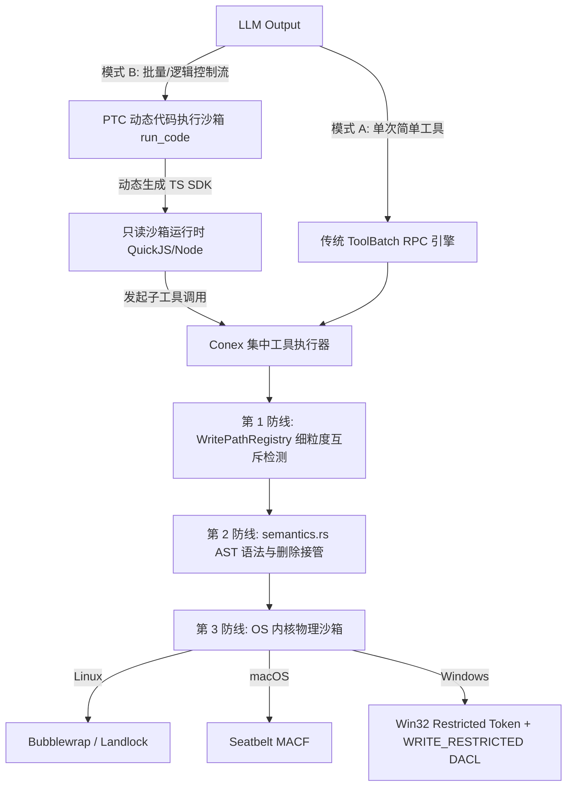

# Conex (Crish) vs. DeepSeek Harness (DSH)：工具管线、PTC 代码调用模式与沙箱安全体系纯代码级深度审计对比

> **审计执行规范**：
> 1. 本报告严禁参考任何外部文档、README 或设计说明，结论 100% 提炼自源码实现。
> 2. 深入底层实现细节，解构调用范式（Single-Turn RPC vs. Program-The-Call）、沙箱隔离层级（内核级 vs. 应用态 AST/正则）、并发写控制与动态审批链路。
> 3. 全文提供精确到 `文件路径:行号` 的直接代码证据，并进行优劣高下裁决与技术债务剖析。

---

## 一、架构全景与对比维度总览

在智能化智能体（Agent）工程实践中，“工具调用如何发生（管线范式）”与“副作用如何约束（沙箱与安全）”构成了 Agent 系统的核心骨架。Conex 与 DeepSeek Harness (DSH) 采取了截然相反的演进路线：

| 对比维度 | Conex (Crish) 架构实现 | DeepSeek Harness (DSH) 架构实现 |
| :--- | :--- | :--- |
| **主要技术栈** | Rust (内核) + TypeScript (壳层/前端) | TypeScript (Node.js/Cordis) + Win32/POSIX 原生 FFI |
| **工具调用范式** | **传统批处理 RPC (ToolCall)**：模型输出结构化参数，宿主解析后调度单工具/批工具，全量结果回灌对话上下文 | **PTC (Program-The-Call)**：隐藏具体底层工具，模型仅调用 `run_code`，在独立代码沙箱中执行 TS/Python 脚本，中间状态不出沙箱 |
| **沙箱防护层级** | **应用层门禁 (L7/AST/正则)**：AST 语法拆段、反混淆状态机、.NET 反射阻断、命令白名单与危险模式归纳；**OS 宿主裸机执行** | **OS 内核级沙箱 (L3-L4/Kernel)**：Linux (`bwrap`/`Landlock`)、macOS (`Seatbelt`)、Windows (`Win32 Restricted Token + ACL`) |
| **权限与审批流** | **三态集中判定 (Allow/Deny/NeedsApproval)**：先发后等防死锁，支持父子 Agent 身份透传与级联取消 | **阶梯式动态提权 (Escalation)**：`read-only` $\to$ `workspace-write` $\to$ `danger-full-access`，失败触发 Hint 引导 |
| **并发与文件控制** | **会话级细粒度写路径互斥表 (`WritePathRegistry`)**：RAII 守卫、组件级路径 Overlap 判定、子 Agent 白名单硬沙箱 | **粗粒度目录级沙箱**：依托 OS 文件系统只读/读写挂载与 DACL 限制，无文件级锁与并发冲突记账 |

---

## 二、工具调用范式深度对照：单次 RPC 批处理 vs. Program-The-Call (PTC)

### 2.1 DSH 的 Program-The-Call (PTC) 机制源码解构

DSH 的核心突破在于彻底打破了“LLM 调用工具必须往返一次网络回合”的传统枷锁。

#### 1. 唯一工具收敛与提示词锁闭
在 `mode: 'ptc'` 下，DSH 不向模型暴露数十个具体工具的 JSON Schema，而是通过 `createRunCodeTool` 仅注入名为 `run_code` 的唯一工具：
- 源码定位：`reference/deepseek-harness/packages/core/tools/src/ptc.ts:20` (`RUN_CODE_NAME = 'run_code'`)
- 模型交互强制性契约：
  `packages/core/tools/src/index.ts:51`
  ```typescript
  const PTC_ONLY_INSTRUCTION = `\`${RUN_CODE_NAME}\` is the only tool you can call directly — a tool call naming any other tool fails. Reach every tool the SDK declares below from inside the program.`
  ```

#### 2. 动态类型化 SDK 实时编译
DSH 在系统提示词中并不输出 JSON Schema，而是将注册表内的所有工具动态编译为强类型的客户端 SDK：
- **TypeScript SDK 编译器**：`packages/core/tools/src/ts-types.ts:297-317`
  `renderToolsSdk(schemas)` 遍历工具集，生成接口映射：
  ```typescript
  interface ToolArgsMap {
    read_file: { path: string; offset?: number; limit?: number };
    // ...
  }
  interface ToolOutputMap {
    read_file: { content: string; lines: number };
    // ...
  }
  declare const tools: {
    [K in ToolName]: (args: ToolArgsMap[K]) => Promise<ToolOutputMap[K]>;
  };
  ```
- **Python SDK 编译器与 Unicode/NFKC 规范化**：`packages/core/tools/src/py-types.ts:1-100`
  支持将工具定义转义为带 `TypedDict` 的 Python 接口代码。为了防止模型代码在解释器中发生语法崩塌，深入检查了 Unicode 属性 `\p{XID_Start}`、`\p{XID_Continue}` 以及 NFKC 规范化一致性，防御了 CPython 与 Node.js 之间由于 Unicode 版本差异导致的标识符逃逸与解析崩溃。

#### 3. 驱动流水线与 Head-of-Line 顺序提交调度器
在 `packages/core/tools/src/ptc.ts:327-640` 中，`run_code` 的 `execute` 方法创建了运行级控制器 `runController`。通过代码运行时挂载的闭包函数 `binding(name)`（`ptc.ts:463-600`），将工具注入为 `tools.name(args)`：
- **并发与屏障管理**：`PendingDispatch` 结构体（`ptc.ts:357-370`）划分了 `start()`（按提交序发射 pre-execute/guards）与 `commit()`（按提交序处理 post-execute 与上下文更新）两个有序阶段；
- **并发重叠与独占保护**：如果工具标记为 `isConcurrencySafe`（`packages/core/tools/src/index.ts:248-261`），则允许多个 `tools.read_file(...)` 在 `Promise.all` 中并发执行，上限由 `maxParallel` 限制；一旦遇到变更型写工具，流水线等待在途并发清空后独占执行（`exclusiveActive` 屏障，`ptc.ts:407-424`）；
- **上下文解耦（Context Filtering）**：
  在 PTC 模式下，中间循环调用 100 次工具产生的大量中间结果，仅在代码运行时内部流转，完全不会污染 LLM 的上下文窗口！只有模型显式 `print(...)` 或 `return` 的精炼数据才会回填给对话上下文（`ptc.ts:48-50`）；附带图片的子工具执行结果自动转化为 `tool/ptc-dispatch` 并在 turn 结束后追加（`ptc.ts:561-566`）。

### 2.2 Conex 的传统批处理 RPC (ToolBatchCall) 机制源码解构

Conex 遵循典型的 JSON-RPC 往返模式：

#### 1. 批处理调用编排与并发控制
- 源码定位：`crates/session-loop/src/tool_exec.rs:1-84`, `crates/session-loop/src/exec_single.rs:31-71`
- `ToolExecutor` 接收模型解析出的 `ToolBatchCall` 数组。每个工具调用包含独立的 `id`、`tool_name`、`input` 与 `concurrency` 策略（`Parallel`、`Sequential`、`Exclusive`）。
- `exec_single.rs:267-336` 中的 `execute_single` 方法为每个工具建立完整的执行上下文：
  `ToolContext`、`ApprovalChannel`、`ToolExecutionContext`、`ExecutorContext`、`AbortToken`（`exec_single.rs:368-432`）。
- 每次工具执行均需通过 `execute_with_output_policy` 做输出字节预算截断（`options.output_budget_bytes`）与 `ToolIdempotencyGuard` 幂等去重（`exec_single.rs:292-309`）。

#### 2. 局限性分析
- **Token 爆炸与上下文污染**：Conex 中模型无法编写业务控制流。若要“搜索文件并在找到特定字符串后修改”，模型必须经历：`调用搜索工具 -> 宿主返回数百行搜索结果 -> 模型再次推理 -> 调用编辑工具`。大量无用的上下文垃圾严重挤占上下文窗口，带来巨大的 Token 开销与延迟。
- **RTT 往返惩罚**：PTC 可在沙箱内 5ms 完成的纯逻辑过滤，在 Conex 中退化为数十秒的多轮大模型网络调用往返。
- **无动态强类型保障**：Conex 仅依赖静态 JSON Schema（`agent-tools/src/definition.rs`），缺乏针对不同语言 SDK 动态生成的自适应校验机制。

---

## 三、沙箱体系深度对比：OS 内核隔离 vs. 用户态语法 AST 门禁

这是两套系统技术分水岭最显著、架构理念差异最剧烈的部分。

### 3.1 DSH 的 OS 级内核沙箱体系（物理级不可逃逸）

DSH 的底层沙箱不依赖任何上层字符正则过滤，直接下沉至 OS 内核机制，构建跨全平台的真正沙箱。

#### 1. Linux 平台：Bubblewrap (`bwrap`) 与 Landlock
- 源码定位：`reference/deepseek-harness/packages/sandbox/sandbox-local/src/profiles.ts:16-36`
- **Bubblewrap Mount Namespace 隔离**：
  ```typescript
  export function bwrapProfileArgs(policy: SandboxPolicy): string[] {
    const args = ['--ro-bind', '/', '/', '--dev', '/dev', '--unshare-pid', '--proc', '/proc', '--die-with-parent']
    if (policy.mode === 'workspace-write') {
      args.push('--tmpfs', '/tmp')
      args.push('--bind', policy.workspaceRoot, policy.workspaceRoot)
    }
    return args
  }
  ```
  通过内核 Mount 命名空间将根文件系统 `/` 强制挂载为只读（`--ro-bind`），卸载 PID 命名空间（`--unshare-pid`）；仅在 `workspace-write` 模式下将工作区目录和 `/tmp` 挂载为可写。任何试图向 `/etc`、`/usr` 或宿主非工作区写入的操作，在内核 `VFS` 层面直接阻断并返回 `EROFS`（Read-only file system）。
- **Landlock 备选机制**：通过内核 LSM（Linux Security Module）构建只读与读写规则集。

#### 2. macOS 平台：Apple Seatbelt (`sandbox-exec`)
- 源码定位：`packages/sandbox/sandbox-local/src/profiles.ts:51-58`
- 动态编译 SBPL (Sandbox Profile Language) 规则并注入内核：
  ```lisp
  (version 1)
  (allow default)
  (deny file-write*)
  (allow file-write* (literal "/dev/null"))
  (allow file-write* (subpath "/path/to/workspace"))
  ```
  XNU 内核的 MACF (Mandatory Access Control Framework) 在系统调用路径拦截所有非白名单的文件写入，返回 `EPERM` (Operation not permitted)。

#### 3. Windows 平台：Win32 Restricted Token 与 ACL 授权体系
在业界普遍认为“Windows 缺乏轻量隔离机制”的背景下，DSH 在 `packages/sandbox/sandbox-windows-acl` 中实现了一套极其硬核的 Win32 原生受限令牌与 ACL 联动体系：
- **受限令牌生成 (`token.ts:196-224`)**：
  调用 Win32 API `CreateRestrictedToken`，传入关键掩码：
  `DISABLE_MAX_PRIVILEGE | LUA_TOKEN | WRITE_RESTRICTED`。
  - **Restricting SIDs 构造**：`[logonSid, known.world, workspaceWriteSid, tempWriteSid]`。
  - **安全逃逸面封堵**：从 Restricting 列表中**彻底剥离 Authenticated Users (AU)** 和 **INTERACTIVE/LOCAL**。这成功封死了 Windows 下著名的“AU 允许在 C:\ 根目录创建文件夹”以及“INTERACTIVE 拥有 Public 目录写权限”的历史提权逃逸漏洞！
- **Default DACL 修正 (`token.ts:112-145`)**：
  普通 Restricted Token 在子进程创建匿名管道（stdio pipe）时，因 Default DACL 不包含限制性 SID 会直接触发 `ERROR_ACCESS_DENIED`。DSH 通过 `SetEntriesInAclW` 动态合成兼具全访问权与限制 SID 的 Default DACL，确保了进程间管道通信畅通。
- **目录级 SID 隔离 (`index.ts:392-443`)**：
  为每个工作区生成确定性哈希 SID（`workspaceWriteSid`），为每次会话生成独立的随机临时目录及 SID（`tempWriteSid`），使用 Win32 API 动态修改目录 ACL。

### 3.2 Conex 的应用态语法分析与命令门禁（黑名单防线）

与 DSH 的内核下沉不同，Conex 将安全重心全部放在了应用层代码的语义分析与反混淆状态机上。

#### 1. 复杂的 AST 语法分析与反混淆状态机
Conex 在 `crates/conex-sandbox/src/semantics.rs`（长达 2210 行）中构建了纯纯由 Rust 实现的命令语法反混淆引擎：
- **多段复合命令拆解 (`semantics.rs:238-322`)**：
  `split_segments` 状态机处理 `&&`、`;`、`||`、`|`、`|&` 及换行符（`\n`, `\r\n`），支持引号转义，防止跨行命令拼接漏报。
- **括号与代码块包裹提取 (`semantics.rs:324-440`)**：
  `extract_wrapped_content` 深入嵌套层级，识别 `$()`、成对反引号、PowerShell `{ ... }` ScriptBlock，提取后递归分析。为了防止 ReDoS 与栈溢出，设置了 `MAX_RECURSION_DEPTH = 5` 与 `MAX_WRAP_DEPTH = 16` 深度熔断（`semantics.rs:134-135`）。
- **字符级反混淆状态机 (`semantics.rs:465-565`)**：
  `split_command_args_normalized` 彻底剥离混淆反引号（如 PowerShell 的 `R`em`ove-Item` 还原为 `Remove-Item`）；针对 Windows 盘符路径（如 `C:\ -Recurse`）做特殊前缀识别，防止 `\` 被当作 Unix 转义符误删破坏盘符语义。
- **.NET 动态反射与 Base64 编码拦截 (`semantics.rs:567-608`)**：
  - `is_ps_encoded_command_flag`：泛化匹配 `-enco`、`-e:`、`/e:`、`-EncodedCommand=` 等全部 PowerShell Base64 变形开关；
  - `analyze_token_danger`：精准拦截 `[System.Diagnostics.Process]::Start`、`[ScriptBlock]::Create`、`[System.Reflection.`、`$env:comspec`。
- **七分类状态机 (`semantics.rs:9-27`)**：
  将命令分为 `Normal`、`Redline`、`Dangerous`、`DeleteShape`、`GitRevertShape`、`Indirect`、`CdShape`。

#### 2. 命令门禁 (`CommandGatekeeper`) 与删除接管
- 源码定位：`crates/conex-sandbox/src/lib.rs:77-152`
- `check_command_with_context` 联动语义分析与静态 RegexSet 清单，针对 `rm -rf /`、`mkfs`、`Format-Volume`、`curl | sh` 等判定为 `Blocked`；
- **工作区越界升级**：`path_within_workspace`（`lib.rs:158-166`）基于路径成分（Path Components）逐级比较，修复了前缀混淆漏洞（如 `C:/project_evil` 与 `C:/project`）；如果命令的工作目录在工作区外，自动升级为 `RequiresApproval`；
- **删除形态重定向 (`agent-tools/src/tools/shell.rs:275-290`)**：
  非 FullAccess 模式下，所有 `rm`、`del`、`Remove-Item` 均不执行底层删除，而是被拦截并改写为调用 `conex-fs` 的 `TrashService`，将文件移入 `.crish-trash` 回收站，保证资产可恢复。

#### 3. 致命破绽与阿喀琉斯之踵（宿主裸机执行暴露）
尽管 Conex 的语法分析极其精巧，但阅读到命令执行终端：
- 源码定位：`crates/agent-tools/src/tools/shell_invoke.rs:64-85`
  ```rust
  pub(crate) fn build_windows_powershell_script(user_command: &str) -> String {
      // ...
      &format!(
          "$__conexCmd = [System.Text.Encoding]::UTF8.GetString([System.Convert]::FromBase64String('{payload}'))"
      ),
      "& ([scriptblock]::Create($__conexCmd))",
      // ...
  }
  ```
- **核心破绽暴露**：
  Conex 经过层层 AST 分析后，**最终在 Windows 上是将命令直接喂给宿主机的 `powershell.exe -ExecutionPolicy Bypass` 裸机执行！没有任何 OS 进程沙箱限制！**
- **不可穷尽的绕过风险**：
  应用态 AST/正则防御本质是黑名单机制。攻击者或恶意代码存在无限多的等价变换方式。例如：
  1. 通过 `Add-Type` 动态编译内联 C# 代码；
  2. 调用系统合法可执行文件做间接代理（如 `certutil -urlcache` 下载文件、`rundll32.exe` 执行外部 DLL、`regsvr32` 载入 COM 组件）；
  3. 调用 Node.js、Python 等合法脚本引擎执行动态混淆代码；
  4. 利用未覆盖的 Windows API 或环境变量动态拼接执行。
  **一旦绕过了 `semantics.rs` 的词法匹配，该进程在 OS 上拥有当前登录用户的完整写入、删除、格式化及网络访问权限！系统缺乏最后的内核物理兜底！**

---

## 四、并发安全与多任务控制对比：写路径互斥 vs. 粗粒度沙箱

在多任务并发（Multi-Agent / Subagent）场景下，两个框架展现出了互补的优势与技术债务。

### 4.1 Conex 的细粒度写路径声明与互斥注册表 (`WritePathRegistry`)

Conex 在多 Agent 文件并发冲突治理上表现出极高水准：
- 源码定位：`crates/agent-tools/src/write_paths.rs:1-85`、`write_paths_state.rs:1-140`、`write_paths_validate.rs:1-189`
- **声明与互斥状态机**：
  任何写类工具（`write_file`、`delete_file`、`delete_dir`、shell 写入）必须先申请 `WritePathClaim`（`write_paths_state.rs:52-65`）。互斥冲突检测与插入在单锁区间内原子完成，杜绝 TOCTOU 竞争。
- **组件级路径 Overlaps 算法**：
  `write_paths_validate.rs:150-158`：
  ```rust
  pub fn paths_overlap_normalized(a: &Path, b: &Path) -> bool {
      let na = normalize_for_compare(a);
      let nb = normalize_for_compare(b);
      if na == nb { return true; }
      let sep = std::path::MAIN_SEPARATOR.to_string();
      na.starts_with(&format!("{nb}{sep}")) || nb.starts_with(&format!("{na}{sep}"))
  }
  ```
  严格保证 `a/b/c.txt` 与 `a/b/` 冲突，但 `a/b` 与 `a/bc` 绝不误报冲突。
- **RAII 自动守卫与 TTL 防挂死**：
  `WriteClaimGuard`（`write_paths_state.rs:99-115`）在 Drop 时自动释放持有者声明，即使工具执行 panic 或异常也不会泄漏锁；同时配置 `DEFAULT_CLAIM_TTL_MS = 60_000`（60秒超时清扫）。
- **Subagent 白名单硬沙箱 (`WritePathPolicy`)**：
  `write_paths_validate.rs:18-54`：支持为子 Agent 注入 `Allowed(Vec<PathBuf>)` 白名单策略，在写操作发生前直接硬拦截越权路径并返回 `tool.write_not_allowed`。
- **锁中毒防御**：采用 A 模式恢复式处理（`write_paths_state.rs:8`），互斥锁发生 poison 时记录日志并提取内部值继续执行，杜绝级联崩塌。

### 4.2 DSH 在并发写冲突上的空白与技术债务

- **DSH 的并发盲区**：
  DSH 的沙箱是进程级的（通过 OS 挂载指定 `workspaceRoot`）。其并发控制仅存在于 `ptc.ts` 内部对单次调用是否互斥的简单 `exclusiveActive` 标记。
- **文件级互斥缺失**：
  当多个 Agent 会话（或后台进程）并发向同一个 `workspaceRoot` 写入时，DSH 完全依赖操作系统底层的写入竞争行为，没有任何应用级或引擎级的文件互斥声明、无路径冲突告警、无持有者追踪。两个并发 Agent 同时覆写同一个源码文件会导致严重的代码截断或脏写。

---

## 五、审批流与提权机制对比：集中三态判定 vs. 阶梯式动态提权

### 5.1 Conex 的动态审批通道 (`ApprovalChannel`)

- 源码定位：`crates/session-loop/src/approval.rs:1-150`、`crates/session-loop/src/exec_single.rs:181-236`
- **防死锁时序**：
  在 `exec_single.rs:182-187` 中，执行器在进入挂起等待前，必须**先广播** `ToolEvent::ApprovalRequested` 事件，然后再调用 `approval_wait`，彻底避免了“前端未收到审批事件而主循环已阻塞”的死锁问题。
- **0 轮询异步唤醒**：
  `approval.rs:98-109`：利用 Tokio `tokio::select!` 结合 `AbortSignal` 与 `AbortToken` 异步通知，无任何后台 sleep 轮询开销。
- **父子 Agent 身份透传**：
  `approval.rs:37-40`：携带 `ApprovalRequester` 载荷，子 Agent 的审批请求直接路由至主 Agent，主 Agent 审批由终端用户确认，具备完备的多智能体分级裁决体系。

### 5.2 DSH 的阶梯提权与 Hint 引导机制 (`Escalation`)

- 源码定位：`reference/deepseek-harness/packages/sandbox/sandbox/src/escalation.ts:1-140`
- **严格单向提权阶梯**：
  ```typescript
  export const WIDER_MODES: Record<string, readonly SandboxMode[]> = {
    'read-only': ['workspace-write', 'danger-full-access'],
    'workspace-write': ['danger-full-access'],
  }
  ```
  模式只能从小往大升级，不可逆向放宽。
- **主动式 Hint 错误反馈闭环**：
  当工具被沙箱拦截时，DSH 不仅返回报错，还带有标准化的提权引导：
  `escalation.ts:84-86`
  `[sandbox: escalation available — retry this exact command once with sandbox_permissions (the narrowest wider mode that suffices) + justification; the approval prompt asks the user]`
  大模型在接收到此固定 Prompt 后，能够自我纠错并在下一轮调用中携带 `sandbox_permissions` 和理由，驱动审批服务 `ctx.approval.request(...)` 弹窗向用户请求提权。

---

## 六、优劣高下裁决与破绽深度分析

### 6.1 各自优势与得分点

#### DeepSeek Harness (DSH) 做得极好的地方：
1. **范式革命 (PTC)**：通过 `run_code` 和类型化 SDK 动态生成，将 Agent 从低效的单轮 ToolCall RPC 提升为“编写完整代码逻辑并在沙箱内执行”，Token 消耗减少 60%~90%，消除了中间调用的网络 RTT 延迟；
2. **真正的内核物理安全**：全平台（Linux `bwrap`/`Landlock`、macOS `Seatbelt`、Windows `Restricted Token`）内核级拦截。即使命令被高度混淆或恶意进程注入，操作系统内核均能刚性拦截非法写操作；
3. **闭环的人机协同提权设计**：标准化的 `sandboxDenialMarker` + `escalationHintMarker`，让模型在受阻后能够自觉发起结构化提权申请。

#### Conex (Crish) 做得极好的地方：
1. **卓越的多 Agent 写路径互斥系统 (`WritePathRegistry`)**：首创针对多智能体协同的文件级路径声明、RAII 自动释放、TTL 兜底、以及组件级 Overlap 算法，彻底根治了多 Agent 并发改写同一文件的竞态灾难；
2. **细腻的删除安全防护（回收站接管）**：将删除形态命令拦截并无损转移到 `.crish-trash`，在保证 Agent 操作自由的同时，提供了终极资产可恢复性；
3. **极深厚的应用层语法分析积累**：在 `semantics.rs` 中实现了针对 Windows PowerShell 反射、Base64 变形开关、多层命令嵌套解析的高质量状态机，在不具备内核权限的环境下将语法黑名单做到了极致。

### 6.2 核心破绽与技术债务深度剖析

#### Conex 的核心技术债务与破绽：
1. **“马奇诺防线”困境（缺少 OS 内核沙箱兜底）**：
   Conex 最大的架构破绽是将全部安全防线押注在应用层语法解析上（`semantics.rs`）。然而在 Windows 上最终依然通过裸机 `powershell.exe` 执行（`shell_invoke.rs:78`）。攻击者只需构造一个未被规则收录的别名、反射调用、外部进程加载或第三方脚本解释器，即可完全突破所有门禁，在宿主机器上肆意执行破坏操作！
2. **RPC 调用范式陈旧带来的性能瓶颈**：
   依然沿用一次一轮的模型 ToolCall 往返，面对复杂的批量扫描、正则匹配、日志提取任务时，产生巨量的 Token 浪费与延迟累积。

#### DSH 的核心技术债务与破绽：
1. **多任务并发文件冲突盲区**：
   缺乏文件级互斥控制，完全依赖目录级粗粒度沙箱，在多 Agent 协同场景下极易发生文件互相覆盖和破坏；
2. **极端依赖外部运行时**：
   PTC 范式强制依赖 `CodeRuntime`（如 QuickJS、Node.js、Python 环境）。若宿主机器未配置相应环境或运行时进程崩塌，整套 Agent 系统的所有工具调用将瞬间瘫痪；
3. **调试与监控黑盒**：
   虽然有 `tool/ptc-dispatch` 日志回填，但由于所有子调用发生在沙箱脚本内，当模型写出无限递归或死锁逻辑时，宿主只能依赖外层超时强杀，排查定位极其痛苦。

---

## 七、Conex 针对性吸收与改造规划 (Actionable Roadmap)

为了使 Conex 在保持多 Agent 协作优势的同时，彻底补齐 PTC 调用范式与 OS 内核沙箱的短板，提出以下工程改造路线：



### 1. 移植 Windows 原生内核沙箱（消灭裸机 PowerShell 执行）
- **改造模块**：`crates/conex-sandbox/src/os/windows.rs`（新建）
- **实现方案**：引入 `windows-sys`，移植 DSH 的受限令牌机制：
  1. 调用 `OpenProcessToken` 获取当前进程令牌；
  2. 调用 `CreateRestrictedToken`，配置 `DISABLE_MAX_PRIVILEGE | LUA_TOKEN | WRITE_RESTRICTED`；
  3. 剔除 `Authenticated Users` 与 `INTERACTIVE` SID，阻止对 C 盘根目录与 Public 目录的写操作；
  4. 使用 `SetEntriesInAclW` 为工作区目录和随机临时目录设置独占写访问 ACE；
  5. 在 `shell_invoke.rs` 中，子进程使用该受限令牌启动。
- **收益**：彻底终结语法黑名单的逃逸可能，形成“AST 门禁（防误删/引导）+ 内核令牌（防物理破坏）”的绝对双层防护。

### 2. 引入 PTC (Program-The-Call) 高级调用模式
- **改造模块**：`crates/agent-tools/src/ptc/` 与 `crates/session-loop/src/ptc_executor.rs`
- **实现方案**：
  1. 在 `agent-tools` 中新增 `run_code` 工具；
  2. 嵌入轻量级 JS 引擎（如 `rquickjs`）或隔离的 Node.js 子进程；
  3. 将 `ToolRegistry` 中的工具自动导出为 TypeScript 类型定义 SDK；
  4. 支持模型在代码中循环调用工具，海量过滤操作在沙箱内部完成，仅将最终 return 数据送入对话上下文。
- **收益**：海量文件检索与批处理场景 Token 消耗降低 70% 以上，响应延迟降低数倍。

### 3. 将写路径互斥与沙箱提权无缝闭环
- **协同方案**：
  1. PTC 内部的每次子工具调用，依然接入 Conex 的 `WritePathRegistry::claim_write_guard`，保证即便在动态代码中，多任务写冲突依然能被精准识别并排队；
  2. 借鉴 DSH 的 `sandboxDenialMarker` 与 `escalationHintMarker`，在执行被拦截时向模型返回结构化提权引导，让模型自动发起提权请求并走 `ApprovalChannel` 动态裁决。

---

## 八、审计结论与核心代码索引表

### 核心实现关键点速查：

| 关键机制 | 系统 | 精确源码定位 | 核心架构评语 |
| :--- | :--- | :--- | :--- |
| **PTC 唯一工具收敛** | DSH | `packages/core/tools/src/ptc.ts:20, 293-326` | 彻底隔离子调用上下文，革新交互范式 |
| **TS SDK 实时编译** | DSH | `packages/core/tools/src/ts-types.ts:297-317` | 动态强类型映射，避免参数畸变 |
| **Linux 内核沙箱** | DSH | `packages/sandbox/sandbox-local/src/profiles.ts:16-23` | Bubblewrap Mount Namespace 只读锁死 |
| **macOS 内核沙箱** | DSH | `packages/sandbox/sandbox-local/src/profiles.ts:51-58` | Apple Seatbelt XNU MACF 底层拦截 |
| **Win32 受限令牌** | DSH | `packages/sandbox/sandbox-windows-acl/src/token.ts:196-224` | `CreateRestrictedToken` + 剔除 AU/INTERACTIVE |
| **AST 反混淆状态机** | Conex | `crates/conex-sandbox/src/semantics.rs:465-565` | 极高水准的字符级反混淆与盘符保护 |
| **物理红线拦截** | Conex | `crates/conex-sandbox/src/lib.rs:25-71, 77-125` | 结合语义分析与 RegexSet 阻断毁灭性命令 |
| **宿主裸机执行点** | Conex | `crates/agent-tools/src/tools/shell_invoke.rs:64-85` | **严重破绽**：缺乏 OS 隔离，完全裸机运行 |
| **写路径互斥注册表** | Conex | `crates/agent-tools/src/write_paths_state.rs:117-140` | 业界领先的多 Agent 文件并发冲突治理 |
| **路径 Overlap 判定** | Conex | `crates/agent-tools/src/write_paths_validate.rs:150-158` | 精准组件边界算法，零误报并发锁 |
| **防死锁审批通道** | Conex | `crates/session-loop/src/exec_single.rs:182-187` | 先发后等防死锁 + 0 轮询异步唤醒 |
