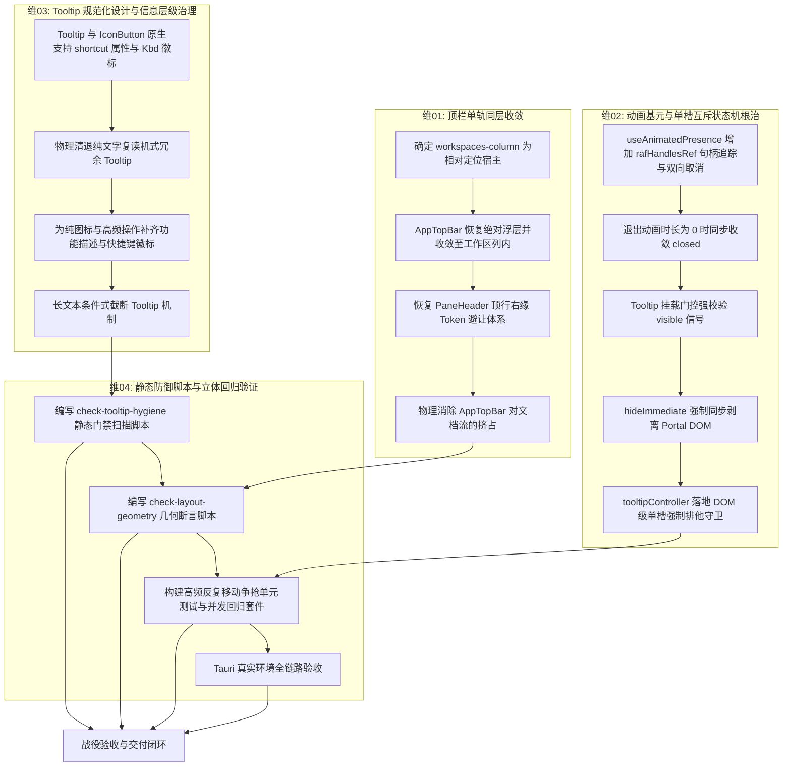

# 顶栏单轨同层收敛与 Hover 提示系统性治理总方案

> **权威标识**：`docs/desktop-ui-systemic-repair/00-总方案-顶栏单轨同层收敛与Hover提示系统性治理.md`  
> **关联分维**：
> - 维 01：[`01-分维详案-顶栏单轨同层收敛与工作区视口安全避让.md`](./01-分维详案-顶栏单轨同层收敛与工作区视口安全避让.md)
> - 维 02：[`02-分维详案-动画基元与单槽互斥状态机根治Hover残留.md`](./02-分维详案-动画基元与单槽互斥状态机根治Hover残留.md)
> - 维 03：[`03-分维详案-全局Tooltip信息架构治理与快捷键感知规范.md`](./03-分维详案-全局Tooltip信息架构治理与快捷键感知规范.md)
> - 维 04：[`04-分维详案-静态防御脚本与立体回归验证套件.md`](./04-分维详案-静态防御脚本与立体回归验证套件.md)

---

## 一、问题全景与架构断层穿透

### 1. 顶栏空间退化断层（两行拆分导致纵向空间利用率骤降 50%）
- **现场病症**：会话标签栏（`PaneHeader`）被挤到第二行，第一行沦为仅承载右侧 Windows 窗控按钮与帮助图标的空白顶栏（`AppTopBar`）。顶部整整堆叠占用 `36px + 36px = 72px` 物理高度。
- **历史归因**：提交 `c772e95ba` 为解决绝对定位顶栏遮挡左侧 Sidebar 的问题，草率地将 `AppTopBar` 移入 `.workspaces-column` 的常规文档流；随后提交 `84b172fd9` 顺水推舟切除了 `PaneHeader` 的右缘窗控避让规则。
- **架构断层**：破坏了桌面操作系统「顶栏单轨同层整合（Single Track Alignment）」的基本范式。未在容器层建立精确的坐标系约束，而采用下推文档流的粗暴手段，造成界面严重割裂。

### 2. Tooltip 幽灵残留断层（异步动画竞态与挂载门控缺陷导致永久卡死）
- **现场病症**：用户在界面划过鼠标后，右上角「快捷键与帮助」、中部「继续」、下部「编辑消息」等多枚 Tooltip 同时常驻滞留，移走光标或点击后依然无法消除。
- **底层成因（四重并发竞态）**：
  1. **动画状态机孤儿帧竞态**：[`useAnimatedPresence.ts`](file:///c:/Software/conex/apps/crish-desktop/src/components/ui/Dialog/useAnimatedPresence.ts) 的入场双重 `requestAnimationFrame` 未受生命周期追踪。当 `visible` 快速转为 `false` 时，排队的 rAF 无法被撤销，在随后帧强制把 `state` 篡改为 `'open'`，造成 `isMounted = true`；
  2. **组件渲染门控漏检**：[`Tooltip.tsx`](file:///c:/Software/conex/apps/crish-desktop/src/components/ui/Tooltip/Tooltip.tsx) 第 540 行仅依靠 `isMounted` 判定 Portal 挂载，未检查组件真实的 `visible` 信号；
  3. **存活巡检守护静默罢工**：`Tooltip.tsx` 的自毁机制完全受限在 `if (!visible) return;` 内。一旦进入「`visible: false` 但 `isMounted: true`」的脱水幽灵态，所有全局监听器（`pointermove`）与 rAF 巡检全被卸载，组件变为完全脱离控制的孤魂野鬼；
  4. **全局互斥中枢状态机击穿**：`claimTooltipSlot` 尝试调用幽灵组件的 `entry.hide()`（即 `setVisible(false)`）时，由于 React State 自身已是 `false`，触发状态 Bailout，跳过重新渲染，无法将已经挂载的 DOM 剥离。

### 3. Tooltip 交互体验与信息架构失范
- **现场病症**：大量已有明确文本的按钮存在 100% 重复的复读机 Tooltip（增加阅读负担）；而真正需要认知的纯图标操作却缺少快捷键提示（如 `?` 未标注 `Ctrl+/`，编辑未标注快捷键）；长文本未发生截断时也盲目弹出 Tooltip。

---

## 二、端到端纯逻辑架构与依赖拓扑

本方案遵循纯逻辑依赖拓扑展开，所有步骤逻辑同权，无工期、无人员分配、不打任何临时补丁：

---

## 三、硬性红线与架构原则（零容忍）

1. **绝对禁止硬编码与魔术数字**：
   - 顶栏高度严格锚定 `var(--header-height)`（36px）；
   - 右侧避让宽度严格使用 `var(--edge-reserve-right-win)`（144px）与 `var(--edge-reserve-right-macos)`（38px）；
   - Tooltip 圆角、阴影、间距 100% 遵从 Design Tokens。
2. **绝对禁止多轨并存与给旧岛续命**：
   - 顶栏结构必须是唯一样式通道，物理切除 `c772e95ba` 的流内冗余样式；
   - 严禁通过双层 CSS 或者运行时 JS 临时计算补丁抵消高度。
3. **绝对禁止功能伪连通**：
   - 新增的 `shortcut` 属性必须在真实渲染树中生成标准化 `<kbd>` 节点；
   - Tooltip 销毁必须在物理 DOM 树中被真实移除，禁止仅修改 CSS `opacity: 0` 却残留空 DOM 元素。
4. **负向断言立体验证**：
   - 测试必须包含负向用例：断言当鼠标快速划过、快速离开、连续点击时，页面中残留的 `[data-tooltip-portal="true"]` 节点数绝对 $\le 1$，且完全离开后严格为 $0$。

---

## 四、分维治理任务书矩阵

| 维度编号 | 维度主题 | 核心治理文件域 | 验收断言 |
| :--- | :--- | :--- | :--- |
| **维 01** | 顶栏单轨同层收敛与工作区视口安全避让 | `AppTopBar.module.css`, `AppTopBar.tsx`, `PaneHeader.module.css`, `App.tsx` | 顶栏与标签行处于同一 36px 水平行；右上角窗控与帮助按钮无遮挡、无重叠；分屏与单窗格几何严格对齐。 |
| **维 02** | 动画基元与单槽互斥状态机根治 Hover 残留 | `useAnimatedPresence.ts`, `Tooltip.tsx`, `tooltipController.ts` | 孤儿 rAF 零残留；脱水态 Portal 零挂载；高频连续划过 `pointerenter/leave` 幽灵实例数为 0。 |
| **维 03** | 全局 Tooltip 信息架构治理与快捷键感知规范 | `Tooltip.tsx`, `IconButton.tsx`, `ChatMessageRow`, `AppTopBar.tsx` 等 | 纯文字复读机全部切除；高频图标补齐 `<kbd>` 快捷键微标；截断长文本条件触发。 |
| **维 04** | 静态防御脚本与立体回归验证套件 | `scripts/check-tooltip-hygiene.mjs`, `Tooltip.test.tsx`, `AppTopBar.test.tsx` | 自动化门禁脚本刚性阻断；vitest 全套通过；真实桌面宿主零运行时异常。 |
