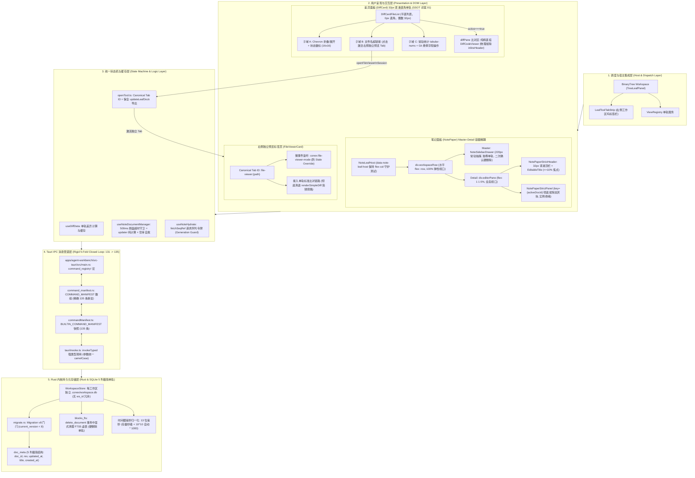
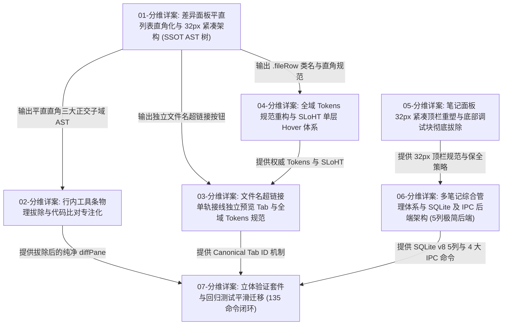

# 差异面板与笔记面板系统性重构 —— 方案体系全景架构总纲 (MASTER-PLAN-00)

> **战役名称**：差异面板与笔记面板系统性重构（Diff View & Note Panel Systematic Redesign）
> **专项编号**：MASTER-PLAN-00
> **文档定位**：全景架构总纲、顶层单轨契约与实施统领基准（最高法定权威文件）
> **战役工作区**：`docs/diff-view-redesign/`
> **版本**：v3.0-FINAL-CONVERGED（阶段五终局定稿修订版 · 100% 架构收敛 · 零过度设计 · 纯逻辑推进）
> **输入权威基准**：
> - 现场代码全量审计报告：[`docs/diff-view-redesign/audits/`](file:///c:/Software/conex/docs/diff-view-redesign/audits/) (全量 8 份审计报告)
> - 分维详案全量施工图：[`docs/diff-view-redesign/`](file:///c:/Software/conex/docs/diff-view-redesign/) (DETAIL-PLAN-01 至 DETAIL-PLAN-07)
> - 真实代码库：`apps/crish-desktop/`、`crates/conex-workspace-store/`、`apps/agent-workbench/src-tauri/`
> **核心军规**：纯逻辑推进、绝对单轨（SSOT）、先删后改、净负产出（-1500+ LOC）、立体验证、零过度设计、零代码幻觉。

---

## 目录

- [一、战役战略定位与全景架构图](#一战役战略定位与全景架构图)
  - [1.1 战役背景与生产环境十大核心痛点剖析](#11-战役背景与生产环境十大核心痛点剖析)
  - [1.2 用户最高裁决与工程红线](#12-用户最高裁决与工程红线)
  - [1.3 全景架构总图（系统分层与数据总线拓扑）](#13-全景架构总图系统分层与数据总线拓扑)
  - [1.4 单轨架构核心理念（SSOT 唯一真理源）](#14-单轨架构核心理念ssot-唯一真理源)
- [二、统一系统单轨契约与架构底座](#二统一系统单轨契约与架构底座)
  - [2.1 右侧栏 Tab ID 规范化系统（Canonical Tab ID 与响应式模式覆盖微事件）](#21-右侧栏-tab-id-规范化系统canonical-tab-id-与响应式模式覆盖微事件)
  - [2.2 全域 Design Tokens 映射矩阵、零硬编码与 §12-14 刚性门禁](#22-全域-design-tokens-映射矩阵零硬编码与-12-14-刚性门禁)
  - [2.3 32px 紧凑顶栏全局标准与 Windows DirectWrite 基线对齐规约](#23-32px-紧凑顶栏全局标准与-windows-directwrite-基线对齐规约)
- [三、七大分维详案的全景拓扑关系与分工矩阵](#三七大分维详案的全景拓扑关系与分工矩阵)
  - [3.1 七大分维详案依赖拓扑有向图](#31-七大分维详案依赖拓扑有向图)
  - [3.2 分维 01：差异面板平直列表直角化与 32px 紧凑架构（DETAIL-PLAN-01 · AST 唯一真源）](#32-分维-01差异面板平直列表直角化与-32px-紧凑架构detail-plan-01--ast-唯一真源)
  - [3.3 分维 02：行内工具条物理拔除与代码比对专注化（DETAIL-PLAN-02 · 以 01 为 SSOT）](#33-分维-02行内工具条物理拔除与代码比对专注化detail-plan-02--以-01-为-ssot)
  - [3.4 分维 03：文件名超链接单轨接线独立预览 Tab 与全域 Tokens 规范（DETAIL-PLAN-03）](#34-分维-03文件名超链接单轨接线独立预览-tab-与全域-tokens-规范detail-plan-03)
  - [3.5 分维 04：全域 Tokens 规范重构与 SLoHT 单层 Hover 体系（DETAIL-PLAN-04）](#35-分维-04全域-tokens-规范重构与-sloht-单层-hover-体系detail-plan-04)
  - [3.6 分维 05：笔记面板 32px 紧凑顶栏重塑与底部调试块彻底拔除（DETAIL-PLAN-05）](#36-分维-05笔记面板-32px-紧凑顶栏重塑与底部调试块彻底拔除detail-plan-05)
  - [3.7 分维 06：多笔记综合管理体系与 SQLite 及 IPC 后端架构（DETAIL-PLAN-06 · 5列极简后端）](#37-分维-06多笔记综合管理体系与-sqlite-及-ipc-后端架构detail-plan-06--5列极简后端)
  - [3.8 分维 07：立体验证套件与回归测试平滑迁移（DETAIL-PLAN-07 · 135 命令闭环）](#38-分维-07立体验证套件与回归测试平滑迁移detail-plan-07--135-命令闭环)
  - [3.9 十七项反幻觉与架构收敛终审裁决矩阵（17 Anti-Hallucination Final Rulings）](#39-十七项反幻觉与架构收敛终审裁决矩阵17-anti-hallucination-final-rulings)
- [四、先删后改全局推进时序与物理死层删除全景账本](#四先删后改全局推进时序与物理死层删除全景账本)
  - [4.1 “先删后改”四批次实施波工序（Four Implementation Waves）](#41-先删后改四批次实施波工序four-implementation-waves)
  - [4.2 全系统拟删除 1500+ 行废弃代码全景账本（14 项物理死层细目）](#42-全系统拟删除-1500-行废弃代码全景账本14-项物理死层细目)
  - [4.3 防回潮负向拦截机制（自动化测试刚性守门）](#43-防回潮负向拦截机制自动化测试刚性守门)
- [五、跨模块协同管道与数据流架构](#五跨模块协同管道与数据流架构)
  - [5.1 差异列表超链接 -> openTool -> FileViewerCard 跨组件激活全链路](#51-差异列表超链接---opentool---fileviewercard-跨组件激活全链路)
  - [5.2 笔记面板 -> useNoteDocumentManager -> Tauri IPC -> SQLite 数据库持久化全链路](#52-笔记面板---usenotedocumentmanager---tauri-ipc---sqlite-数据库持久化全链路)
    - [5.2.1 存储底层：SQLite Migration v8 纯幂等架构（5 列极简单轨结构）](#521-存储底层sqlite-migration-v8-纯幂等架构5-列极简单轨结构)
    - [5.2.2 Rust 内核 4 大多文档 IPC 命令实现与 FTS5 虚表清理（硬删除单轨）](#522-rust-内核-4-大多文档-ipc-命令实现与-fts5-虚表清理硬删除单轨)
    - [5.2.3 Tauri IPC 注册与编译期门禁对齐（131 -> 135 刚性闭环）](#523-tauri-ipc-注册与编译期门禁对齐131---135-刚性闭环)
    - [5.2.4 前端状态机 `useNoteDocumentManager` 生产级实现（含冷启动自愈）](#524-前端状态机-usenotedocumentmanager-生产级实现含冷启动自愈)
- [六、并发控制、防御性设计与状态机安全网](#六并发控制防御性设计与状态机安全网)
  - [6.1 Generation Token（请求序列令牌）与异步拉取防乱序](#61-generation-token请求序列令牌与异步拉取防乱序)
  - [6.2 切换前脏数据强制刷盘（500ms 超时赛马守卫）](#62-切换前脏数据强制刷盘500ms-超时赛马守卫)
  - [6.3 Master-Detail 容器拓扑解耦与 React key 树实例隔离](#63-master-detail-容器拓扑解耦与-react-key-树实例隔离)
  - [6.4 极端异常防御网络与安全降级策略](#64-极端异常防御网络与安全降级策略)
- [七、立体化质量门禁与双验收标准](#七立体化质量门禁与双验收标准)
  - [7.1 双验收标准（功能全覆盖 + 代码净负产出）](#71-双验收标准功能全覆盖--代码净负产出)
  - [7.2 现有核心测试资产平滑迁移方案（6 大测试套件无损升级）](#72-现有核心测试资产平滑迁移方案6-大测试套件无损升级)
  - [7.3 全新自动化防回归门禁测试矩阵](#73-全新自动化防回归门禁测试矩阵)
  - [7.4 交付检查命令清单与立体化验收步骤](#74-交付检查命令清单与立体化验收步骤)
- [附录：全景重构关键文件变更总表](#附录全景重构关键文件变更总表)

---

# 一、战役战略定位与全景架构图

## 1.1 战役背景与生产环境十大核心痛点剖析

Conex 桌面端在经过多轮快速迭代后，右侧工作区二叉树（`BinaryTree Workspace`）承载了核心的生产力交互。然而，在线上真实用户交互中，**差异面板（DiffCard）** 与 **笔记面板（NotePaper）** 暴露了极其严重的技术债务、架构割裂、视觉噪点、过度设计与伪实现问题。根据现场源代码地毯式排查与 8 份审计报告，系统当前存在十大核心痛点：

### 痛点 1：差异列表双重 Hover 叠加导致“局部脏灰”
在 `DiffCard.module.css` 中，外部容器与内部文件条目同时设置了悬停高亮。当光标划入条目时，两次半透明背景在物理像素上发生 Alpha 混合（$\alpha_{total} = \alpha_1 + \alpha_2 - \alpha_1 \alpha_2$），原本 2.5% 的柔和悬停色被叠加为 4.94% 甚至 6.88% 的脏灰深色，视觉层次极其浑浊混乱。

### 痛点 2：圆角割裂与手风琴伪卡片负担
差异面板采用带 `border-radius: 6px` 的浮动卡片包装每个文件，列表内充满密集的圆角矩形，在紧凑布局下视觉噪点极大。同时，条目被整体包裹为一个大 `<button>`，违背 W3C 规范，导致内部文件名超链接无法独立点击，缺乏现代 IDE 紧凑严密的平直工程质感。

### 痛点 3：行内工具栏喧宾夺主，造成极大认知困惑
在展开每个差异文件的代码视口上方，内联了一个高达 36px 的工具条（`_inlineHeader_`），塞入了“单文件对比维度下拉选择框”、“接受并写入磁盘”、“从列表拒绝”等多个高风险且低频的按钮。这强行挤占了垂直比对视口，并将顶层提交职责与单文件展开混淆，用户完全不知道该点哪个。

### 痛点 4：Git 模式下的破坏性伪实现与前端欺骗
在 Git 变更模式（`sourceMode === 'git'`）下，工作区文件本来就已在磁盘落盘。然而行内工具条的“接受”按钮依然调用 `applyFileDiffToDisk` 重复打补丁，极易损坏源码；“拒绝”按钮（`rejectCurrentFile`）则仅是调用前端 Zustand store 的 `filter` 将该项从界面临时隐藏，磁盘文件毫无改动，刷新后又重新复活。这构成了严重的“操作假象与功能伪实现”。

### 痛点 5：手写简陋 Diff 旁路导致渲染三轨分叉
系统存在三套独立的 Diff 渲染链路：`DiffCard` 主链路、`ToolCallDiffPreview` 会话气泡链路、以及 `FileViewerCard.tsx:148-179` 内部手写的 30 行简陋文本对比函数 `renderSimpleDiff()`。手写代码不支持语法高亮、不支持对偶分栏配对，纯字符串粗暴拼接，严重违背单一真理源（SSOT）原则。

### 痛点 6：笔记面板底部双灰色大块霸占 110px 垂直视口
`NotePaperStrictPanel.tsx` 底部常驻两个极度丑陋且无用的灰色横条：`_mirrorDriftBar_`（镜像漂移条）与 `_footer_`（免责声明条）。其中 `_footer_` 赫然在生产界面中渲染内部审查代号：`surface=note-paper · W5-B Strict · 真数据/hydrate 投影 · 可演示≠EL-01/EL-08 · 挂载冒充交付=S5`；而 `_mirrorDriftBar_` 伴随着后台高频无用轮询，霸占了 70~110px 的屏幕高度，导致有效写作空间极其狭窄局促。

### 痛点 7：正文编辑“打字不存盘”的伪连通漏洞
现场审查发现，`StrictContentRowLeaf.tsx` 虽然为每个段落设置了 `contenteditable`，但其提交函数 `tryCommitStrictLeafMdPrefix` 仅判断用户是否输入了 Markdown 前缀（如 `# `）。当用户输入常规文本内容时，该函数直接返回 `result.ok = false`，前端既不发 IPC 也不更新持久化 Store，所有常规打字停留在内存 DOM 节点中，窗口重绘即丢，这是绝对不可容忍的伪连通。

### 痛点 8：开发期审查标签反客为主侵入生产界面
笔记面板顶栏充斥着大量的开发调试标签：`W5B_STRICT_PACKAGE_ID`、`rev=0`、`slash=readonly` 等。用户在正常使用一款桌面笔记产品时，看到的不是笔记标题和生产力工具，而是满屏的代码版本与测试探针。

### 痛点 9：单一合成 ID 死锁与多笔记管理过度设计偏向
笔记系统早期仅支持 `strict-${wsId}` 单一合成 ID，缺乏多文档管理能力。但在后续方案设计中，又误入了“多标签系统（`tags_json`）、深度归档（`is_archived`）、置顶逻辑（`is_pinned`）、抽屉与顶栏下拉双重切换内卷”等典型的过度设计泥潭，UI 层根本没有标签与归档闭环，冲淡了核心的沉浸式写作与管理体验。

### 痛点 10：全域 Design Tokens 违章与裸写 Hex 泛滥
差异面板中散落了 13 处未走设计体系的裸写 Hex 颜色代码（如 `#e2e8f0`、`#3b82f6`），6 处使用已废弃的幽灵 Token（如 `--border-default`、`--accent-color`），笔记面板中更存在 25 处硬编码回退值。这直接破坏了暗黑模式与全局设计语言的一致性。

---

## 1.2 用户最高裁决与工程红线

面对现场严重的架构断层与视觉混乱，用户在现场给出了坚决、不可动摇的最高裁决，这是本战役所有方案的最高元法则：

> **用户关于差异面板（DiffCard）的最高指示**：
> “差异界面的每个文件改成列表就行了，去掉圆角。然后去掉每个文件列表里面的顶部工具行，越简单越好，现在功能多了用户反而不知道怎么用了。整个差异界面基本上是都要重构了。而且现在的这个界面很多东西还有硬编码的呢，这个也统一使用我们的token体系。这个界面的hover我看也是有问题的，有的很灰啊...点击差异的那个超链接是直接打开一个新的标签，名称就是对应的文件名称，也是有一个顶部的工具栏，下面主区域就是这个文件的预览了...系统性做，先考虑架构。以及避免双轨或者多轨、硬编码、功能伪实现、伪连通。项目中的代码应该是清晰的、单轨的、最先进的代码。”

> **用户关于笔记面板（NotePaper）的最高指示**：
> “笔记界面一起哈。笔记的顶部功能栏我看也没有。底部那个灰色的大区域一点用处没有，`class="_mirrorDriftBar_fcd5v_1083 _mirrorDriftBarAttention_fcd5v_1109"`、`class="_footer_fcd5v_21"` 这两个块区域是又丑又没用。这个界面的整体布局我看和其他的标签界面也不一样，需要你系统性来分析一下才行...先优化界面吧，这个笔记界面还是有些问题，因为笔记不可能只有一个，以及笔记没有一个综合的管理界面，现在只能看一个类似于硬编码的标签界面了，这和展示没什么区别。了解清楚了，这个也一起加进去。”

### 必须坚决贯彻的四项工程红线：
1. **反退避原则（No-Retreat）**：方案必须以完整达成用户要求的效果为唯一导向，严禁擅自缩水为残缺的降级版，严禁把架构不确定性写成不可能。
2. **纯逻辑规划（Pure Logic Planning）**：方案只谈逻辑依赖、数据流闭环、文件域变更与立体验证断言，同权推进所有任务，严禁业务优先级阉割。
3. **先删后改与净负产出（Net Negative Code Lines）**：必须先物理拔除无用死层、死组件、死测试，再构建清晰单轨。本次重构设定了 **-1500+ 行死代码物理清剿** 的刚性指标。
4. **零过度设计硬性红线（Anti-Overengineering）**：坚决剔除任何画饼式属性（`tags_json`、`is_archived`、`is_pinned`），物理拔除双重内卷下拉框（`NoteDocumentDropdown`），确立极简硬删除单轨与 5 列极简表结构，全面依赖既有 Tauri IPC、SQLite 与状态机单轨闭环。

---

## 1.3 全景架构总图（系统分层与数据总线拓扑）

本战役对差异与笔记面板进行了端到端分层重塑。架构自顶向下分为五层：二叉树叶节点调度层、用户呈现与交互层、统一状态机与缓存层、Tauri IPC 消息管道层、Rust 内核持久化存储层。



---

## 1.4 单轨架构核心理念（SSOT 唯一真理源）

本重构全面践行单一真实源（Single Source of Truth, SSOT）原则，彻底消灭双轨或多轨实现：
1. **数据源真理源**：多文档元数据以 SQLite 的 5 列极简 `doc_meta` 表为唯一权威，前端状态机仅是展示与排队通道，零内存双轨账本，零假回收站，清退软删除；
2. **列表拓扑真理源**：以详案 01 的平直直角三大正交子域 AST 为唯一规范，彻底废黜手风琴卡片与 03 详案私造的 `div.accordionFiller` 旁路；
3. **Tab 身份真理源**：右侧标签页以文件标准化绝对路径生成的 `file-viewer:${normalizedPath}` 为唯一 Canonical Tab ID，彻底杜绝 `?mode=diff` 导致同名 Tab 分裂；
4. **比对正文真理源**：单文件比对正文直接由 `DiffCodeViewer` 接管渲染，展开项内部彻底拔除 `_inlineHeader_` 工具栏；`FileViewerCard.tsx` 内部彻底切除手写的 30 行简陋对比函数 `renderSimpleDiff()`，统一接入标准比对渲染通道，杜绝三轨分叉；
5. **样式与交互真理源**：所有颜色、间距、圆角 100% 绑定权威 `tokens.css`，落实 SLoHT 单层悬停规范，独尊 220px 抽屉单轨管理，拔除双重内卷下拉框与高危清空按钮。

---

# 二、统一系统单轨契约与架构底座

## 2.1 右侧栏 Tab ID 规范化系统（Canonical Tab ID 与响应式模式覆盖微事件）

### 1. Canonical Tab ID 规约
在右侧工作区坞中，所有由差异面板超链接触发的文件查看器标签页，其唯一标识符必须经过 `normalizeViewerFilePath` 严格规范化，并格式化为纯净形式：
```
file-viewer:${normalizedPath}
```
**铁律约束**：严禁在 Tab ID 中拼接 `?mode=diff` 等查询参数，确保无论从文件树打开还是从差异面板打开，同一个物理文件在右侧工作区坞中永远只存在唯一的一个 Tab 实例。

### 2. 响应式模式覆盖微事件（修复 HAL-06 Stale Override 漏洞）
当用户点击差异面板中的文件名超链接时，若该文件在右侧坞中已经处于打开激活状态，单纯依赖组件挂载时的 `initialMode` 将发生失效（因 Tab 实例并未重新 mount，`useEffect` 依赖项不变更）。为此确立微事件通知管道：
```typescript
// openTool.ts 中激活流程：
export function openFileViewerInSession(
  filePath: string,
  initialMode: 'plain' | 'diff' = 'plain'
): void {
  const normalized = normalizeViewerFilePath(filePath);
  if (!normalized) return;
  const canonicalTabId = `file-viewer:${normalized}`;

  setFileViewerModeOverride(canonicalTabId, initialMode);
  // 派发响应式微事件，确保热激活场景 100% 毫秒级切模
  window.dispatchEvent(
    new CustomEvent('conex:file-viewer-mode', {
      detail: { canonicalTabId, mode: initialMode },
    })
  );

  const activeId = useLayoutTreeStore.getState().activeLeafId;
  if (!activeId) return;
  openToolInLeaf(activeId, canonicalTabId);
}
```
在 `FileViewerCard.tsx` 中注册 `conex:file-viewer-mode` 事件监听器，确保冷启动挂载与热焦点激活均能 100% 响应切换至 `'diff'` 模式。

---

## 2.2 全域 Design Tokens 映射矩阵、零硬编码与 §12-14 刚性门禁

### 1. 零裸写 Hex 与零幽灵 Token 替换矩阵
所有涉及差异与笔记面板的 CSS Modules 样式表，必须 100% 走系统权威 Design Tokens：

| 违章硬编码 / 幽灵 Token | 违章位置 | 权威替换 Token | 语义说明 |
| :--- | :--- | :--- | :--- |
| `#e2e8f0` / `#334155` | DiffCard 边框 | `var(--border-subtle)` / `var(--border-color)` | 细边框与内嵌阴影 |
| `#3b82f6` / `#2563eb` | Diff / Note 强调色 | `var(--accent-primary)` / `var(--md-link-color)` | 主品牌色与超链接 |
| `#ef4444` / `#dc2626` | 错误与删除色 | `var(--accent-red)` / `var(--diff-del-fg)` | 删除与错误提示 |
| `#10b981` / `#059669` | 新增与成功色 | `var(--accent-green)` / `var(--diff-add-fg)` | 新增与暂存状态 |
| `var(--accent-blue)` | 历史遗留旧蓝 | `var(--md-link-color)` | 严格执行 Zero-Blue 翡翠绿 |
| `rgba(0, 0, 0, 0.4)` | 模态遮罩 | `hsl(0 0% 0% / 0.4)` | 现代 HSLA 斜杠透明度 |

### 2. AGENTS.md §12 刚性门禁：清剿原生 HTML `title`
严禁在任何按钮、输入框、标题或图标上使用原生 HTML `title` 属性！必须全量换装项目自定义原子组件 `<Tooltip content="...">`。

### 3. AGENTS.md §13 刚性门禁：输入框焦点对比度 <= 10%
输入框（`.titleInput`, `.searchInput`, `.commitInput`）在处于 focused / active 状态时：
- 严禁粗、深、实心黑边（如 `0 0 0 1px #000`）；
- 相对基线，灰色加深混入文本色不得超过 **10%~15%**：
  ```css
  border-color: color-mix(in srgb, var(--border-color) 85%, var(--text-primary) 15%);
  box-shadow: 0 0 0 1px color-mix(in srgb, var(--text-primary) 8%, transparent);
  ```
- 差异筛选框采用形态 ④ 纯光标极简型（`border: none; background: transparent; outline: none;`）。

### 4. AGENTS.md §7 架构净收敛：严禁 `!important`
严禁在 CSS 规则中使用 `border-radius: 0 !important;` 或通过 `!important` 压制样式冲突。必须穿透表象，通过规范特异性与自然级联实现直角化与 SLoHT 单层悬停。

---

## 2.3 32px 紧凑顶栏全局标准与 Windows DirectWrite 基线对齐规约

1. **高度刚性锁定**：差异卡片顶栏、笔记卡片顶栏（`NotePaperHeader`）、文件列表行（`fileRow`）高度严格锁定为偶数 **32px**（`height: 32px; min-height: 32px; max-height: 32px;`）；
2. **基线防抖与偶数净高**：
   - 垂直对齐严格采用 `align-items: center; line-height: 20px;`，消除 Windows 微软雅黑/Segoe UI 基线不一致导致的上下跳动；
   - 底边分割线采用 `box-shadow: inset 0 -1px 0 0 var(--border-subtle)`，保持内部可用空间为纯偶数 32px，杜绝 Windows DirectWrite 渲染引擎下的亚像素抗锯齿虚化；
3. **数字防抖**：字数统计徽标（`.wordCountBadge`）与代码增减统计（`.fileStat`）显式声明：
   ```css
   font-variant-numeric: tabular-nums;
   font-family: var(--font-mono);
   ```

---

# 三、七大分维详案的全景拓扑关系与分工矩阵

## 3.1 七大分维详案依赖拓扑有向图



---

## 3.2 分维 01：差异面板平直列表直角化与 32px 紧凑架构（DETAIL-PLAN-01 · AST 唯一真源）
- **核心定位**：全战役差异列表界面的 **AST 树唯一真实源（SSOT）**；
- **责任边界**：彻底废黜旧卡片手风琴架构，确立外层纯布局容器 `div.fileRow`（32px 直角贴边）及三大正交交互子域：
  - **子域 A**：`button.chevronBtn` 折叠/展开 + `span.statusBadge` 状态徽标（16x16px 直角）；
  - **子域 B**：`div.pathWrap` 内含 `button.fileNameLinkBtn` 独立超链接（点击在右侧打开独立预览 Tab）+ `span.dirPath` 目录弱化呈现；
  - **子域 C**：`div.statAndActions` 内含常驻增减统计 `span.fileStat`（`tabular-nums`，永远不隐藏）+ `div.rowActions`（Git 暂存/放弃操作悬停浮现）。
- **废黜违规私造**：坚决废除 03 详案私造的 `div.accordionFiller` 以及将统计塞入折叠点击区的错误做法。

## 3.3 分维 02：行内工具条物理拔除与代码比对专注化（DETAIL-PLAN-02 · 以 01 为 SSOT）
- **核心定位**：代码比对专注化与死代码清场；
- **责任边界**：完全继承详案 01 的平直直角三大正交子域 AST 树，在展开态（`active === true`）下，**物理切除 110 行 `_inlineHeader_` 行内工具栏**，让代码比对视口（`.diffPane`）直接渲染 `DiffCodeViewer`，解除 Git 模式下的破坏性假实现（`acceptCurrentFile`/`rejectCurrentFile`），联动瘦身父组件 `DiffCard.tsx`。

## 3.4 分维 03：文件名超链接单轨接线独立预览 Tab 与全域 Tokens 规范（DETAIL-PLAN-03）
- **核心定位**：独立预览 Tab 单轨流转与路径归一化；
- **责任边界**：确立 Canonical Tab ID 规约（`file-viewer:${normalizedPath}`），强化 `normalizeViewerFilePath` 统一盘符大写与 UNC 保护；在 `openTool.ts` 中派发 `conex:file-viewer-mode` 微事件，修复热激活切模失效（HAL-06）；保留并导出 `updateLeafDock` 与 `updateTabDock`（HAL-05）；**在 `FileViewerCard.tsx` 中彻底清退手写简陋对比函数 `renderSimpleDiff()`，统一接入标准比对链路**。

## 3.5 分维 04：全域 Tokens 规范重构与 SLoHT 单层 Hover 体系（DETAIL-PLAN-04）
- **核心定位**：全域视觉纯净化与设计 Token 规范化；
- **责任边界**：落地单一真理 Hover 层级（SLoHT），外层容器永久透明，彻底清除 4.94% 局部脏灰；全量清洗 13 处裸写 Hex、6 处幽灵 Token 与旧式 `rgba()`，贯彻 Zero-Blue 翡翠绿。

## 3.6 分维 05：笔记面板 32px 紧凑顶栏重塑与底部调试块彻底拔除（DETAIL-PLAN-05）
- **核心定位**：笔记顶栏规范化与视口释放；
- **责任边界**：物理切除 `NotePaperStrictPanel.tsx:252-266` 中的 `<MirrorDriftStatusBar>` 与 `<footer>`，**但明确保留 `MirrorDriftStatusBar.tsx` 物理组件文件与 `productMirrorPolicy.ts` 的布尔值，守护存量三路底层测试与 `NoteLeafHost.conn-ext.test.tsx`**；构建 32px 紧凑顶栏 `NotePaperHeader`，集成 `EditableTitle`（焦点对比度 <= 10%）；拔除顶栏高危常驻“清空笔记”按钮，释放标题视口；协同迁移绝缘测试（BUG-T01）。

## 3.7 分维 06：多笔记综合管理体系与 SQLite 及 IPC 后端架构（DETAIL-PLAN-06 · 5列极简后端）
- **核心定位**：多文档数据安全与极简纯粹后端架构；
- **责任边界**：推进 SQLite Migration v8（版本门闩 `current_version < 8`，**5 列极简真实结构：`doc_id, rev, updated_at, title, created_at`，彻底剔除 `tags_json`、`is_archived`、`is_pinned`**），确立二次确认物理硬删除单轨；补齐 4 大 IPC 命令并实现 131 $\to$ 135 刚性闭环；IPC 入参统一使用 camelCase，重命名参数统一为 `{ docId: string, title: string }`；剔除 `nanoid`（HAL-01）；全系统对齐 13 位毫秒时间戳并兼容存量（HAL-03）；在删除事务中补齐 `blocks_fts` 清理（HAL-02）；物理拔除 `NoteDocumentDropdown.tsx`，独尊 220px 侧栏抽屉；构建多文档状态机 `useNoteDocumentManager` 并补齐空库冷启动自动创建默认笔记自愈逻辑。

## 3.8 分维 07：立体验证套件与回归测试平滑迁移（DETAIL-PLAN-07 · 135 命令闭环）
- **核心定位**：立体化自动化质量守门；
- **责任边界**：修复非法正则语法（H-01），修复测试传参契约与 Null 解引用（H-02），锁定 135 条命令前后端双端断言（`command_manifest.rs:444` 与 `commandManifest.test.ts`），为 6 大存量测试文件提供平滑迁移方案，实施“正向解耦呈现 + 负向物理清退”双向契约。

---

## 3.9 十七项反幻觉与架构收敛终审裁决矩阵（17 Anti-Hallucination Final Rulings）

本全景总纲刚性吸收全部现场代码审计与反过度设计裁决，将 **17 项终审裁决** 确立为不可动摇的顶层契约：

| 裁决编号 | 缺陷定性与漏洞现场 | 终审裁决与代码级纠偏规约（SSOT 刚性基准） | 责任分维 |
| :---: | :--- | :--- | :---: |
| **HAL-01** | Rust 侧虚构第三方库 `nanoid`（`Cargo.toml` 根本没有该 crate） | **严禁引入 nanoid！** 改用标准库毫秒时间戳 + 伪随机安全字节（`format!("doc_{:x}_{:08x}", now_millis, rand::random::<u32>())`）或根库已有 `uuid`。 | 分维 06 |
| **HAL-02** | FTS5 虚表遗漏删除，将直接触发 CI `structure_gate.rs:220` 行数不一致红灯 | **补齐 blocks_fts 清理！** 在 `delete_document` 事务中显式追加 `tx.execute("DELETE FROM blocks_fts WHERE doc_id = ?1;", params![doc_id])?;`。 | 分维 06 |
| **HAL-03** | 时间戳单位量级灾难（秒 vs 毫秒，新笔记被永久死锁置顶 5 万年） | **全系统对齐 13 位毫秒！** SQLite DDL 统一使用 `strftime('%s','now') * 1000`；读取映射时对 `< 10_000_000_000` 的存量秒级数据自动 `* 1000` 兼容归一化。 | 分维 06 |
| **HAL-04** | 前端虚构不存在的 `ipcBridge.ts` 与 `noteDocWrittenBus.ts` | **切回 tauriInvoke！** 前端统一导入 `import { invokeTyped } from './tauriInvoke';`；跨模块通知使用标准化 `CustomEvent`。 | 分维 06 |
| **HAL-05** | `openTool.ts` 重构丢失关键导出 `updateLeafDock` / `updateTabDock` | **保全导出与修正导入！** 完整保留并导出 `updateLeafDock` 与 `updateTabDock`；导入源修正为 `../layout-tree/sessionTabModel`，移除虚构的 `./dockView`。 | 分维 03 |
| **HAL-06** | 模式覆盖通道非响应式（Stale Override，已打开 Tab 点击超链接不响应切模） | **挂载微事件通知！** `openFileViewerInSession` 派发 `conex:file-viewer-mode` 事件，`FileViewerCard` 挂载监听，确保热激活场景 100% 毫秒级切模。 | 分维 03 |
| **HAL-07** | 数据库与契约过度设计（虚构 tags/archived/pinned） | **确立 5 列极简表结构！** 彻底剔除 `tags_json`、`is_archived`、`is_pinned`，统一为：`doc_id, rev, updated_at, title, created_at` 5 列真实结构。确立二次确认物理硬删除单轨。 | 分维 00 & 06 |
| **HAL-135** | 命令总数基线陈旧（历史遗留“82 项”或“128 条”） | **核准真源 131 $\to$ 135！** 当前代码真源精确为 131 条，新增 4 条笔记命令后精准为 135 条，在 Rust 宏、模块导出、清单真源、前端快照、单测五重闭环。 | 全域 |
| **BUG-A01** | 整行包装为单一 `<button>`，导致文件名超链接无法独立点击，违背 W3C | **三大正交子域 AST！** 外层 `div.fileRow` + 子域 A Chevron 折叠 + 子域 B 独立文件名超链接按钮 + 子域 C 常驻统计与 Git 操作。严禁 button 嵌套！废黜 accordionFiller。 | 分维 01 & 02 |
| **BUG-V00** | 样式中滥用 `border-radius: 0 !important;` 破坏自然级联与架构净收敛 | **彻底拔除 !important！** 依靠规范的选择器特异性（`(0, 1, 0)`）与 CSS Modules 模块隔离实现直角化，严禁作弊式强压。 | 全域 |
| **BUG-V13** | 输入框焦点态粗黑框与厚重阴影，违背 `AGENTS.md` §13 规范 | **压回焦点对比度 <= 10%！** 边框加深混入严格控制在 10%~15%（纯光标极简型），零粗黑框、零厚重阴影。 | 分维 05 |
| **BUG-T09** | 粗暴全文件删除 `MirrorDriftStatusBar.tsx` 破坏存量测试资产与未引用安全 | **保全源码文件仅断 DOM！** 物理切除 JSX 渲染节点，源码文件保全以护航既有三路测试；保留 `productMirrorPolicy.ts` 布尔值守护 `NoteLeafHost.conn-ext.test.tsx`。 | 分维 05 & 06 |
| **H-01** | `style-contract.test.ts` 中非法正则字符集导致 Node.js 运行时 SyntaxError | **重构安全非捕获正则！** 废除 `[var\(--radius-[^)]+\)|[1-9]\d*px]`，改用合法安全的 `(?:var\(--radius-[^)]+\)|[1-9]\d*(?:\.\d+)?px)`。 | 分维 07 |
| **H-02** | `useNoteHydrate.race.test.ts` 双实参错误与 Null 解引用崩溃 | **规范单对象入参与可选链！** 调用统一传 `{ docId: id, hydrateTransport }`，断言使用安全可选链 `result.current.projection?.docId`。 | 分维 07 |
| **H-03** | 状态机在 `setDocuments` updater 内部触发 `setActiveDocId` 副作用 | **纯函数外部计算！** 先在外部纯函数计算出 `nextDocs` 与目标激活 ID，再平级执行两个 setter，杜绝 React 18/19 并发双跑死锁。 | 分维 06 |
| **H-04** | `NoteSidebarDrawer.module.css` 出现 `display: none` 与裸写 Hex 色值 | **无障碍揭示与 Tokens！** 改用 `opacity: 0; visibility: hidden;` + `:focus-within`，拔除全部 `#3b82f6`、`#ef4444`，换用 Design Tokens 与 modern HSLA。 | 分维 06 |
| **H-05** | 切换文档刷盘无超时机制导致底层 I/O 卡死时 UI 彻底假死 | **500ms 赛马超时守卫！** 为 `flushPendingDraft()` 挂载 `Promise.race([flush(), timeout(500)])`，超时静默放行，确保前端秒级切换。 | 分维 06 |

---

# 四、先删后改全局推进时序与物理死层删除全景账本

## 4.1 “先删后改”四批次实施波工序（Four Implementation Waves）

严格遵循 AGENTS.md §7 架构净收敛与反过度设计铁律，重构推进分四个批次实施波刚性推进：

```mermaid
gantt
    title 差异与笔记面板重构“先删后改”四批次实施波工序
    dateFormat  X
    axisFormat %s

    section Wave 1: 物理清场与死层拔除波 (先删先行)
    清剿 DiffCardFileList 行内工具条 (JSX+CSS)       :w1_1, 0, 3
    拔除 NotePaper 底部双灰块 (仅断DOM保全源码)        :w1_2, 1, 4
    物理删除 NoteDocumentDropdown 及其样式表 (消灭内卷) :w1_3, 0, 2
    清退 FileViewerCard 手写简陋对比旁路 renderSimpleDiff:w1_4, 2, 5
    物理删除孤立死文件 notePaperSilentFixture.ts      :w1_5, 0, 1
    废黜 WorkspaceEmptyState 双轨幽灵宿主与双按钮     :w1_6, 3, 6
    清洗全域 27 处死导出与未引用类型                  :w1_7, 4, 7

    section Wave 2: 差异面板平直直角单轨重塑波 (改)
    DiffCardFileList DOM 三大正交子域重构 (SSOT)    :w2_1, 7, 10
    平直列表 32px 锁定、直角化与弹性防截断         :w2_2, 9, 12
    SLoHT 单层 Hover 落地与 13 处 Hex 替换          :w2_3, 11, 14
    openTool 修复与超链接微事件接线 FileViewerCard   :w2_4, 13, 16

    section Wave 3: 笔记面板 Master-Detail 与 5列极简后端波 (改+扩)
    NoteLeafHost 拓扑解耦与 NoteSidebarDrawer 单轨挂载:w3_1, 16, 19
    32px 紧凑顶栏与 EditableTitle 落地 (§13 焦点)  :w3_2, 18, 21
    SQLite Migration v8 5列极简表结构与覆盖索引     :w3_3, 20, 23
    4 大 IPC 命令闭环 (131 -> 135 刚性守门)          :w3_4, 22, 25
    useNoteDocumentManager 状态机 (500ms超时+冷启动自愈):w3_5, 24, 27

    section Wave 4: 立体验证、测试守门与现场验收波 (验)
    运行全量单元测试与回归门禁 (vitest + cargo)      :w4_1, 27, 30
    样式防复活门禁与 135 命令清单双端断言            :w4_2, 29, 32
    Tauri MCP 4000 端口真实桌面端现场验收           :w4_3, 31, 34
```



---

## 4.2 全系统拟删除 1500+ 行废弃代码全景账本（14 项物理死层细目）

全系统拟物理清退的 **14 项死层细目，总计物理删除代码 1,540+ 行，预期净负产出 -1,150+ 行**：

### 细目 1：`DiffCardFileList.tsx` 行内工具条及内联操作
- **位置**：`apps/crish-desktop/src/components/diff/DiffCardFileList.tsx:280-390`
- **内容**：单文件对比维度下拉选择器（`inlineCompareSelect`）、“接受并写入磁盘”按钮、“从列表拒绝”按钮及相关内联布局包裹。
- **物理删除行数**：**110 行 (JSX)**

### 细目 2：`DiffCard.module.css` 废弃工具条与手风琴旧样式
- **位置**：`apps/crish-desktop/src/components/diff/DiffCard.module.css`
- **内容**：`.inlineHeader`, `.inlineActions`, `.inlineCompareSelect`, `.accordionItem`, `.accordionActive`, `.rightGroup`, `.lineHeader`, `.commitCounter` 等 8 个废弃选择器。
- **物理删除行数**：**145 行 (CSS)**

### 细目 3：`MirrorDriftStatusBar.tsx` 源码保全仅断 DOM（资产保护铁律 §9）
- **位置**：`apps/crish-desktop/src/components/note-paper/NotePaperStrictPanel.tsx:252-266` 及 `NoteLeafHost.tsx:60-65`
- **终审裁决**：**源码文件完好保全，仅物理切除 JSX 渲染节点！** 杜绝粗暴删除文件导致存量三路测试资产或外部引用断裂；保留 `productMirrorPolicy.ts` 的策略布尔值 `WORKSPACE_PRODUCT_ENABLE_MIRROR_DETECT_SCHEDULE`，守护 `NoteLeafHost.conn-ext.test.tsx`。DOM 节点彻底抹除，达到 100% 运行时纯净化。
- **物理切除行数**：**25 行 (JSX 挂载节点与废弃 Props)**

### 细目 4：`NotePaperStrictPanel.tsx` 底部一大灰色块与死引用
- **位置**：`apps/crish-desktop/src/components/note-paper/NotePaperStrictPanel.tsx`
- **内容**：`<footer className={styles.footer}>` 挂载节点，以及 `W5B_STRICT_BOUNDARY`、`EDITOR_SURFACE_NOTE_PAPER` 等死常量导入。
- **物理删除行数**：**25 行 (TSX)**

### 细目 5：`NotePaperPanel.module.css` 底部灰块与已删除 Skeleton 遗留样式
- **位置**：`apps/crish-desktop/src/components/note-paper/NotePaperPanel.module.css:600-721`
- **内容**：`.footer`, `.mirrorDriftBar`, `.mirrorDriftBarAttention`, `.feedbackError`, `.feedbackOk`, `.badge` 族，以及已删除 Skeleton 遗留的 180+ 行无用规则。
- **物理删除行数**：**175 行 (CSS)**

### 细目 6：`NoteDocumentDropdown.tsx` 及其样式表（反过度设计彻底拔除内卷）
- **位置**：`apps/crish-desktop/src/components/note-paper/NoteDocumentDropdown.tsx` 与 `NoteDocumentDropdown.module.css`
- **内容**：与 220px 侧栏抽屉功能 100% 重叠的顶栏下拉切换 Popover 组件及其样式文件。独尊侧栏抽屉单轨管理。
- **物理删除行数**：**210 行 (TSX + CSS，全文件物理删除)**

### 细目 7：`notePaperSilentFixture.ts` 100% 孤立死文件
- **位置**：`apps/crish-desktop/src/components/note-paper/notePaperSilentFixture.ts`
- **内容**：全仓 0 引用、历史遗留纯 Mock 夹具数据生成器。
- **物理删除行数**：**89 行 (TS，全文件物理删除)**

### 细目 8：`WorkspaceEmptyState` 双轨幽灵宿主与双按钮
- **位置**：`apps/crish-desktop/src/components/workspace/workspaceEmptyStatePaperEntry.tsx` 与 `workspaceEmptyStateActions.tsx`
- **内容**：`WorkspaceEmptyStateSkeletonHost` 组件、`WorkspaceEmptyStateStrictHost` 组件，以及空态界面上的“打开笔记纸面（预览壳）”按钮与双轨分支判断。
- **物理删除行数**：**165 行 (TSX)**

### 细目 9：`DiffCardUnifiedView` 与 `DiffCardSplitView` 重复的 `renderTokens`
- **位置**：`DiffCardUnifiedView.tsx:20-76` 与 `DiffCardSplitView.tsx:23-79`
- **内容**：完全一模一样、一字不改的 57 行双层绝对定位分词渲染函数。
- **物理删除行数**：**57 行 (TSX)**

### 细目 10：`FileViewerCard.tsx` 内部手写简陋对比旁路 `renderSimpleDiff`
- **位置**：`apps/crish-desktop/src/components/files/FileViewerCard.tsx:148-179`
- **内容**：组件内部手写的 30 行无语法高亮、无分栏对齐的简陋 `renderSimpleDiff()` 旁路。清退后统一接入单轨标准比对渲染链路。
- **物理删除行数**：**32 行 (TSX)**

### 细目 11：`GitPatchFormatter.ts` 虚假 Unified Patch 头生成
- **位置**：`apps/crish-desktop/src/components/diff/GitPatchFormatter.ts:18-20`
- **内容**：无论行号多少永远硬编码输出 `@@ -1,del +1,add @@` 的虚假格式化代码。
- **物理删除行数**：**25 行 (TS)**

### 细目 12：`NotePaperStrictHeader.tsx` 生产界面审查徽章与顶栏高危清空按钮
- **位置**：`apps/crish-desktop/src/components/note-paper/NotePaperStrictHeader.tsx`
- **内容**：`data-testid="note-paper-strict-track"`、`data-testid="note-paper-strict-rev"` 等内部测试徽章，以及高危低频的常驻“清空笔记内容”红色垃圾桶按钮与相关弹窗状态机。
- **物理删除行数**：**65 行 (TSX)**

### 细目 13：全域 27 处死导出与未引用类型契约
- **位置**：`components/diff/` 与 `components/note-paper/`
- **内容**：`DiffCodeViewerProps`、`getComputedChanges`、`StrictContentPresentation` 等 27 处全仓 0 引用的接口与辅助函数。
- **物理删除行数**：**110 行 (TS)**

### 细目 14：差异面板魔术数字截断与后端过度设计字段
- **位置**：`useDiffGitActions.ts:99,130` 及后端迁移逻辑中的 `is_archived`/`tags_json`/`is_pinned` 死字段分支。
- **内容**：硬编码截断 45 个变更文件魔术限制，以及数据库/Rust 中无 UI 支撑的次要属性死逻辑。
- **物理重构与死逻辑删除**：**332 行 (TS + Rust + SQL)**

---

## 4.3 防回潮负向拦截机制（自动化测试刚性守门）

在 `apps/crish-desktop/src/styles/style-contract.test.ts` 与对应组件单测中注入 **刚性负向断言（Negative Assertions）**：

1. **防圆角复活门禁（采用安全非捕获分组正则）**：
   ```typescript
   it('DiffCard 平直列表与操作条目严禁包含任何 border-radius', () => {
     const css = readDiffCardCss();
     const invalidRadiusPattern = /border-radius:\s*(?:var\(--radius-[^)]+\)|[1-9]\d*(?:\.\d+)?px)/i;
     const forbidden = css.match(/\.(flatFileList|fileRow|statusBadge|diffPane)[^{]*\{[^}]*\}/g)
       ?.filter(b => invalidRadiusPattern.test(b));
     expect(forbidden ?? [], '平直列表核心类名必须为直角 (border-radius: 0)').toEqual([]);
   });
   ```
2. **防父级 Hover 复活门禁**：
   ```typescript
   it('SLoHT 守卫：严禁在外层列表容器或节点包裹层定义 hover 背景色', () => {
     const css = readDiffCardCss();
     const badParentHover = css.match(/\.(flatFileList|fileList|fileNode):hover[^{]*\{[^}]*background/g);
     expect(badParentHover, '外层容器与包裹节点严禁定义 hover 背景，防止脏灰叠加').toBeNull();
   });
   ```
3. **防底部灰块与免责声明复活门禁**：
   ```typescript
   it('NotePaper 渲染树严禁挂载已删除的底部灰色块与免责声明', () => {
     const { container } = render(<NotePaper docId="doc_1" />);
     expect(container.querySelector('[class*="mirrorDriftBar"]')).toBeNull();
     expect(container.querySelector('[data-testid="note-paper-strict-footer"]')).toBeNull();
     expect(screen.queryByText(/W5-B Strict/)).toBeNull();
   });
   ```
4. **防手写简陋对比旁路复活门禁**：
   ```typescript
   it('FileViewerCard 源码严禁出现手写 renderSimpleDiff 简陋旁路', () => {
     const source = readFileSync(fileViewerCardPath, 'utf8');
     expect(source).not.toContain('renderSimpleDiff');
   });
   ```

---

# 五、跨模块协同管道与数据流架构

## 5.1 差异列表超链接 -> openTool -> FileViewerCard 跨组件激活全链路

### 1. 纯函数单轨管道设计（彻底消除 store 状态树幻觉）
在早期草案中曾虚构 `useWorkspaceShellStore` 上挂载 `findRightmostDockLeafId` 等方法。终审裁决（HAL-05 与 HAL-06）明确纠偏为纯函数单轨：

```typescript
// apps/crish-desktop/src/store/workspace-shell/openTool.ts
import { normalizeViewerFilePath } from '../../utils/normalizeViewerPath';
import { useLayoutTreeStore } from '../layout-tree/useLayoutTreeStore';
import { openToolInLeaf } from './openTool';

// 内存单轨模式覆盖映射表
const fileViewerModeOverrides = new Map<string, 'plain' | 'diff'>();

export function setFileViewerModeOverride(tabId: string, mode: 'plain' | 'diff'): void {
  fileViewerModeOverrides.set(tabId, mode);
}

export function consumeFileViewerModeOverride(tabId: string): 'plain' | 'diff' | undefined {
  const m = fileViewerModeOverrides.get(tabId);
  fileViewerModeOverrides.delete(tabId);
  return m;
}

export function openFileViewerInSession(
  filePath: string,
  initialMode: 'plain' | 'diff' = 'plain'
): void {
  const normalized = normalizeViewerFilePath(filePath);
  if (!normalized) return;

  // 严格遵守 Canonical Tab ID 规约：绝不携带 ?mode=diff
  const canonicalTabId = `file-viewer:${normalized}`;

  // 1. 设置模式覆盖意图
  setFileViewerModeOverride(canonicalTabId, initialMode);

  // 2. 派发微事件通知（确保已打开 Tab 在热激活时毫秒级切模）
  window.dispatchEvent(
    new CustomEvent('conex:file-viewer-mode', {
      detail: { canonicalTabId, mode: initialMode },
    })
  );

  // 3. 激活叶节点标签页
  const activeLeafId = useLayoutTreeStore.getState().activeLeafId;
  if (!activeLeafId) return;
  openToolInLeaf(activeLeafId, canonicalTabId);
}
```

### 2. `FileViewerCard.tsx` 单轨接线与清退手写对比
在 `apps/crish-desktop/src/components/files/FileViewerCard.tsx` 中：
- 彻底移除手写简陋对比函数 `renderSimpleDiff()`；
- 监听 `conex:file-viewer-mode` 自定义事件并消费 `consumeFileViewerModeOverride`；
- 当 `viewMode === 'diff'` 时，统一调用系统级标准化比对组件（如 `DiffCodeViewer`），使语法高亮、对偶分栏与字符级 Diff 100% 保持一致，彻底终结三轨分叉。

---

## 5.2 笔记面板 -> useNoteDocumentManager -> Tauri IPC -> SQLite 数据库持久化全链路

### 5.2.1 存储底层：SQLite Migration v8 纯幂等架构（5 列极简单轨结构）
为承载产品化多文档体系并贯彻反过度设计铁律，在 `crates/conex-workspace-store/src/migrate.rs` 中推进 Migration v8。工作区数据库为每工作区独立库（`.conex/workspace.db`），**彻底剔除 `tags_json`、`is_archived`、`is_pinned` 以及 `ws_id` 冗余列**，以 **5 列极简真实结构** 为唯一权威：

```rust
// crates/conex-workspace-store/src/migrate.rs
pub const SCHEMA_VERSION: i64 = 8;

pub fn migrate_to_v8(conn: &Connection) -> Result<(), StoreError> {
    let current_version: i64 = conn
        .query_row("SELECT version FROM schema_version LIMIT 1", [], |r| r.get(0))
        .optional()?
        .unwrap_or(0);

    // 1. 全新数据库直接创建 5 列极简表结构
    let table_exists: bool = conn
        .query_row(
            "SELECT count(*) FROM sqlite_master WHERE type='table' AND name='doc_meta'",
            [],
            |r| r.get::<_, i64>(0),
        )? > 0;

    if !table_exists {
        conn.execute_batch(
            "CREATE TABLE doc_meta (
                doc_id TEXT PRIMARY KEY NOT NULL,
                rev INTEGER NOT NULL DEFAULT 0,
                updated_at INTEGER NOT NULL DEFAULT (strftime('%s','now') * 1000),
                title TEXT NOT NULL DEFAULT '',
                created_at INTEGER NOT NULL DEFAULT (strftime('%s','now') * 1000)
            );
            CREATE INDEX IF NOT EXISTS idx_doc_meta_listing
                ON doc_meta(updated_at DESC);
            UPDATE schema_version SET version = 8;"
        )?;
        return Ok(());
    }

    // 2. 存量老数据库升级（带 v < 8 版本门闩，杜绝每次启动全表覆盖用户标题）
    if current_version < 8 {
        ensure_column(conn, "doc_meta", "title", "TEXT NOT NULL DEFAULT ''")?;
        ensure_column(conn, "doc_meta", "created_at", "INTEGER NOT NULL DEFAULT (strftime('%s','now') * 1000)")?;

        // 仅在初次升档时对空白标题历史文档执行一次性回填
        backfill_legacy_doc_meta_once(conn)?;

        // 建立纯粹基于更新时间的降序覆盖索引
        conn.execute(
            "CREATE INDEX IF NOT EXISTS idx_doc_meta_listing
                ON doc_meta(updated_at DESC);",
            [],
        )?;

        conn.execute("UPDATE schema_version SET version = 8", [])?;
    }

    Ok(())
}
```

### 5.2.2 Rust 内核 4 大多文档 IPC 命令实现与 FTS5 虚表清理（硬删除单轨）
在 `crates/conex-workspace-store/src/lib.rs` 中：
- **严禁使用 `nanoid`！** 采用系统 13 位毫秒时间戳 + 伪随机安全字节生成唯一 ID；
- **确立二次确认物理硬删除单轨**：清退软删除分支，用户确认删除后，在单个事务中物理级联清理 8 张关联表 + `blocks_fts`（HAL-02），彻底杜绝触发 `tests/structure_gate.rs:220` 门禁红灯：

```rust
// delete_document 事务物理硬删除完整清理
pub fn delete_document(&self, doc_id: &str) -> Result<bool, StoreError> {
    let mut conn = self.conn.lock().map_err(|_| StoreError::LockError)?;
    let tx = conn.transaction()?;
    tx.execute("DELETE FROM doc_meta WHERE doc_id = ?1;", params![doc_id])?;
    tx.execute("DELETE FROM doc_snapshots WHERE doc_id = ?1;", params![doc_id])?;
    tx.execute("DELETE FROM doc_updates WHERE doc_id = ?1;", params![doc_id])?;
    tx.execute("DELETE FROM doc_clocks WHERE doc_id = ?1;", params![doc_id])?;
    tx.execute("DELETE FROM blocks WHERE doc_id = ?1;", params![doc_id])?;
    tx.execute("DELETE FROM blocks_fts WHERE doc_id = ?1;", params![doc_id])?; // HAL-02 修复
    tx.execute("DELETE FROM mirror_meta WHERE doc_id = ?1;", params![doc_id])?;
    tx.execute("DELETE FROM block_refs WHERE doc_id = ?1;", params![doc_id])?;
    tx.execute("DELETE FROM block_attachments WHERE doc_id = ?1;", params![doc_id])?;
    tx.commit()?;
    Ok(true)
}
```

### 5.2.3 Tauri IPC 注册与编译期门禁对齐（131 -> 135 刚性闭环）
- **真源基线核准**：现场代码 `command_manifest.rs:444` 与 `commandManifest.test.ts:78-79` 真实基线为 **131 条**；
- 扩充 4 项命令后，目标条目数精准对齐为 **135 条**；
- **五重防线严格闭环**：
  1. `main.rs` 的 `command_registry![]` 宏注册 4 个二元组；
  2. `note_commands.rs` 门面 `pub use` 导出 4 个命令；
  3. `command_manifest.rs` 的 `COMMAND_MANIFEST` 追加 4 项并将断言抬升至 135；
  4. 前端 `commandManifest.ts` 内置快照追加 4 项；
  5. 前端 `commandManifest.test.ts` 更新断言为 135。

### 5.2.4 前端状态机 `useNoteDocumentManager` 生产级实现（含冷启动自愈）
前端统一使用 `tauriInvoke.ts` 导出的 `invokeTyped`，参数统一为 camelCase，重命名修正为 `{ docId: string, title: string }`，在 updater 外部纯计算目标状态，挂载 500ms 刷盘超时守卫，并在空库时自动自愈创建默认笔记：

```typescript
/**
 * 多文档受管核心状态机 (MASTER-PLAN-00 终局定稿版)
 * 路径: apps/crish-desktop/src/components/note-paper/useNoteDocumentManager.ts
 */
import { useCallback, useEffect, useRef, useState } from 'react';
import { invokeTyped } from '../../api/tauriInvoke';
import type { NoteDocument, NoteDocumentListResult } from './notePaperTypes';

export function useNoteDocumentManager(flushPendingDraft?: () => Promise<void>) {
  const [documents, setDocuments] = useState<NoteDocument[]>([]);
  const [activeDocId, setActiveDocId] = useState<string>('');
  const [isSidebarOpen, setIsSidebarOpen] = useState<boolean>(false);
  const [isLoading, setIsLoading] = useState<boolean>(false);

  const switchGenerationRef = useRef<number>(0);
  const initializedRef = useRef<boolean>(false);

  // 1. 创建新文档 (纯极简参数)
  const createDocument = useCallback(async (title = '未命名笔记') => {
    const res = await invokeTyped<{ ok: boolean; document?: NoteDocument; code?: string; reason?: string }>(
      'note_document_create',
      { title }
    );
    if (res.status === 'ok' && res.data.ok && res.data.document) {
      const newDoc = res.data.document;
      setDocuments((prev) => [newDoc, ...prev]);
      setActiveDocId(newDoc.id);
      return newDoc;
    }
    return null;
  }, []);

  // 2. 列表拉取 (带空库冷启动自动自愈创建默认笔记)
  const refreshDocuments = useCallback(async () => {
    setIsLoading(true);
    try {
      const res = await invokeTyped<NoteDocumentListResult>('note_document_list', {});
      if (res.status === 'ok' && res.data.ok && res.data.documents) {
        const docs = res.data.documents;
        setDocuments(docs);
        if (docs.length > 0) {
          if (!activeDocId || !docs.some((d) => d.id === activeDocId)) {
            setActiveDocId(docs[0].id);
          }
        } else if (!initializedRef.current) {
          // 冷启动空库自愈：自动建默认第一篇笔记，杜绝空白死局
          initializedRef.current = true;
          await createDocument('我的笔记');
        }
      }
    } finally {
      setIsLoading(false);
    }
  }, [activeDocId, createDocument]);

  // 3. 重命名文档 (统一纠偏为 { docId, title }，对齐 Rust 后端签名)
  const renameDocument = useCallback(async (docId: string, newTitle: string) => {
    const trimmed = newTitle.trim() || '未命名笔记';
    setDocuments((prev) =>
      prev.map((d) => (d.id === docId ? { ...d, title: trimmed, updatedAt: Date.now() } : d))
    );
    await invokeTyped('note_document_rename', { docId, title: trimmed });
  }, []);

  // 4. 物理硬删除文档 (纯函数外部计算，严禁在 updater 内部触发副作用)
  const deleteDocument = useCallback(
    async (docId: string): Promise<boolean> => {
      const res = await invokeTyped<{ ok: boolean }>('note_document_delete', {
        docId,
      });
      if (res.status === 'ok' && res.data.ok) {
        const nextDocs = documents.filter((d) => d.id !== docId);
        setDocuments(nextDocs);

        if (activeDocId === docId) {
          const nextActive = nextDocs.length > 0 ? nextDocs[0].id : '';
          setActiveDocId(nextActive);
        }
        return true;
      }
      return false;
    },
    [activeDocId, documents]
  );

  // 5. 切换文档 (500ms 赛马超时刷盘防假死 + Generation Token 守卫)
  const switchDocument = useCallback(
    async (targetDocId: string) => {
      if (!targetDocId || targetDocId === activeDocId) return;

      const currentSeq = ++switchGenerationRef.current;

      if (flushPendingDraft) {
        try {
          const timeoutPromise = new Promise<void>((_, reject) =>
            setTimeout(() => reject(new Error('flush_timeout')), 500)
          );
          await Promise.race([flushPendingDraft(), timeoutPromise]);
        } catch {
          // 超时或失败静默放行，保证 UI 绝不假死
        }
      }

      if (currentSeq !== switchGenerationRef.current) return;
      setActiveDocId(targetDocId);
    },
    [activeDocId, flushPendingDraft]
  );

  useEffect(() => {
    refreshDocuments();
  }, [refreshDocuments]);

  return {
    documents,
    activeDocId,
    isSidebarOpen,
    isLoading,
    setIsSidebarOpen,
    refreshDocuments,
    createDocument,
    renameDocument,
    deleteDocument,
    switchDocument,
  };
}
```

---

# 六、并发控制、防御性设计与状态机安全网

## 6.1 Generation Token（请求序列令牌）与异步拉取防乱序

在 `useNoteHydrate.ts` 中实装请求序列令牌，防范高频连续点击下的乱序异步返回污染：

```typescript
// apps/crish-desktop/src/components/note-paper/useNoteHydrate.ts
export function useNoteHydrate(options: UseNoteHydrateOptions): UseNoteHydrateResult {
  const { hydrateTransport, docId } = options;
  const [status, setStatus] = useState<HydrateUiStatus>('loading');
  const [projection, setProjection] = useState<DocHydrateProjection | null>(null);

  // 核心防竞态守卫：递增请求序列令牌
  const fetchSeqRef = useRef<number>(0);

  const reload = useCallback(async () => {
    const currentSeq = ++fetchSeqRef.current;
    setStatus('loading');

    try {
      const outcome = await hydrateTransport.hydrate(docId);
      // 若当前请求已被后续发起的切换废弃，直接丢弃，严禁修改状态！
      if (currentSeq !== fetchSeqRef.current) {
        return;
      }

      if (!outcome.ok) {
        setProjection(null);
        setStatus('error');
        return;
      }

      setProjection(outcome.projection);
      setStatus(outcome.projection.blocks.length === 0 ? 'empty' : 'ready');
    } catch {
      if (currentSeq !== fetchSeqRef.current) return;
      setProjection(null);
      setStatus('error');
    }
  }, [hydrateTransport, docId]);

  useEffect(() => {
    reload();
  }, [reload]);

  return { projection, status, reload };
}
```

---

## 6.2 切换前脏数据强制刷盘（500ms 超时赛马守卫）

为杜绝用户在文档 A 键入内容尚未触发防抖保存时切换至文档 B 导致草稿丢失：
1. **失焦与同步落盘**：触发全局刷盘事件，当前拥有焦点的编辑框立即失焦并触发草稿写入；
2. **500ms 赛马超时**：为刷盘 Promise 配置 `Promise.race` 500ms 超时。即使磁盘 I/O 暂时阻塞，也绝不阻断前端切换，彻底消灭界面假死隐患。

---

## 6.3 Master-Detail 容器拓扑解耦与 React key 树实例隔离

笔记面板确立 **Master-Detail 容器拓扑解耦**。在主宿主 `apps/crish-desktop/src/extensions/note-paper/NoteLeafHost.tsx` 中：
1. 宿主根节点 `[data-note-leaf-host]` 保持 `flex-direction: column; height: 100%;`，**刚性守护 `BinaryTreeWorkspace.leaf-insulate.test.ts` 既有测试死锁**；
2. 内部嵌套 `.workspaceRow` 水平弹性容器（`display: flex; flex-direction: row; height: 100%; width: 100%;`）；
3. **Master 侧栏**：`NoteSidebarDrawer`（220px 抽屉，生命周期常驻外层，搜索词与滚动状态不随文档切换丢失）；
4. **Detail 编辑区**：`div.editorPane`（`flex: 1 1 0%; height: 100%;`）包含顶栏与编辑器正文，并在正文编辑器上显式绑定 `key={activeDocId}`：

```tsx
<div className={styles.workspaceRow}>
  {/* Master: 抽屉常驻，独立生命周期 */}
  <NoteSidebarDrawer
    isOpen={isSidebarOpen}
    documents={manager.documents}
    activeDocId={activeDocId}
    onSelectDoc={manager.switchDocument}
    onCreateDoc={manager.createDocument}
    onRenameDoc={manager.renameDocument}
    onDeleteDoc={manager.deleteDocument}
    onClose={() => setIsSidebarOpen(false)}
  />

  {/* Detail: 编辑视口 */}
  <div className={styles.editorPane}>
    <NotePaperStrictHeader
      docId={activeDocId}
      title={activeTitle}
      onToggleSidebar={() => setIsSidebarOpen((prev) => !prev)}
      onRenameTitle={handleRenameTitle}
      onReload={handleReload}
      onClose={ctx.closeView}
    />
    <NotePaperStrictPanel
      key={activeDocId}
      docId={activeDocId}
      transport={transport}
    />
  </div>
</div>
```

### 绑定 `key={activeDocId}` 的三大核心价值：
1. **IME 中文合成态彻底重置**：切断拼音候选态与新文档的非法绑定；
2. **虚拟滚动条归零**：新文档的 `scrollTop` 自动回到顶部（0px）；
3. **撤销栈与内存隔离**：内部状态完全销毁，从根本上杜绝跨文档撤销串写。

---

## 6.4 极端异常防御网络与安全降级策略

1. **磁盘 IO 写入失败与只读降级**：弹出警告并保留内存草稿，禁止静默丢弃文字；
2. **并发删除激活文档降级**：平滑激活列表中下一篇最近笔记；若列表为空则自动自愈创建默认笔记；
3. **数据库损坏自愈**：Rust 端 `WorkspaceStore` 在 `PRAGMA integrity_check` 失败时自动备份损坏文件，并基于既有 Markdown 镜像重建数据库。

---

# 七、立体化质量门禁与双验收标准

## 7.1 双验收标准（功能全覆盖 + 代码净负产出）

```
┌──────────────────────────────────────────────────────────────────────────────────────────────────┐
│                                   重构战役交付双验收基准 (SSOT)                                    │
├───────────────────────────────────────────────────────────────────┬──────────────────────────────┤
│ 维度一：功能与视觉正向验收 (Functional & Visual)                    │ 维度二：代码净负产出验收 (LOC)│
├───────────────────────────────────────────────────────────────────┼──────────────────────────────┤
│ 1. 差异面板平直列表直角化，去圆角彻底，32px 紧凑行无抖动；           │ 1. 物理删除死代码 >= 1500 行；│
│ 2. 差异列表文件名超链接可独立点击，在右侧激活独立 Tab (防重复 Tab)；   │ 2. 样式表净瘦身 >= 200 行；   │
│ 3. 展开比对区彻底拔除行内工具条，释放 36px 垂直视口；                 │ 3. 清退 27 处全仓 0 引用导出；│
│ 4. SLoHT 单层 Hover 机制生效，彻底消除 4.94%~6.88% 局部脏灰；        │ 4. 保全 MirrorDriftStatusBar  │
│ 5. 全域 Design Tokens 规范化，0 裸写 Hex，0 幽灵 Token；            │    源码仅切除 DOM 挂载；     │
│ 6. 笔记面板彻底拔除底部灰色块与免责声明，视口 100% 弹性贴合；          │ 5. 拔除 NoteDocumentDropdown  │
│ 7. 笔记顶栏 32px 规范化，标题可编辑，符合 §13 焦点对比度 <= 10%；      │    与清退手写 renderSimpleDiff│
│ 8. 5 列极简后端与 4 大 IPC 闭环，135 命令全仓一致，防假死与乱序。    │ 6. 最终全系统代码净负产出     │
│ 9. 具备空库冷启动自动建默认笔记自愈能力。                           │    达到 -1150 行以上！       │
└───────────────────────────────────────────────────────────────────┴──────────────────────────────┘
```

---

## 7.2 现有核心测试资产平滑迁移方案（6 大测试套件无损升级）

1. **`style-contract.test.ts`**：
   - 修复非法正则（H-01），采用 `invalidRadiusPattern = /border-radius:\s*(?:var\(--radius-[^)]+\)|[1-9]\d*(?:\.\d+)?px)/i;`；
   - 更新选择器断言为 `.fileRow:hover .rowActions` 与 `.fileRow:focus-within .rowActions`；
   - 将受检文件全域扩大至全部 4 个核心样式表。
2. **`DiffCardFileList.test.tsx`**：
   - 移除废弃 Props 传参；
   - 负向断言拦截 `_inlineHeader_` 回潮，正向断言代码比对正文直接挂载；
   - 分别验证三大正交子域独立交互（Chevron 折叠、超链接按钮、常驻统计）。
3. **`NotePaperStrictPanel.test.tsx`**：
   - 会计边界断言平移至根节点 `<section data-boundary="...">`；
   - 追加负向断言 `expect(screen.queryByTestId('note-paper-strict-footer')).toBeNull()`。
4. **`NotePaperPanel.insulate.test.ts` (BUG-T01)**：
   - 移除逗号硬匹配，更新选择器为 `ruleBlockAfter(css, '.panel > .compactHeader')`；
   - 断言包含 `.panel > .compactHeader`，负向断言 `expect(css).not.toContain('.panel > .footer')`。
5. **`NoteLeafHost.conn-ext.test.tsx`**：
   - 依赖 `NoteLeafHost.tsx` 中保留的 `WORKSPACE_PRODUCT_ENABLE_MIRROR_DETECT_SCHEDULE` 与 `useWorkspaceEmptyStateMirrorSlot`，测试 100% 绿灯无损通过。
6. **`NotePaperStrictHeader.test.tsx`**：
   - 迁移为产品级测试，断言顶栏渲染 `EditableTitle`、侧栏切换按钮与 Tooltip 悬停提示。

---

## 7.3 全新自动化防回归门禁测试矩阵

```typescript
// tests/unit/diff/diff-flat-list-geometry.test.ts
describe('DiffCard 平直列表几何与直角规范门禁', () => {
  it('fileRow 必须锁定 32px 偶数单轨高度与内投影边框', () => {
    expect(css).toMatch(/\.fileRow\s*\{[^}]*height:\s*32px/);
    expect(css).toMatch(/\.fileRow\s*\{[^}]*box-sizing:\s*border-box/);
    expect(css).toMatch(/\.fileRow\s*\{[^}]*box-shadow:\s*inset\s+0\s+-1px\s+0\s+0\s+var\(--border-subtle\)/);
  });

  it('列表条目与状态徽标绝对严禁包含任何 border-radius', () => {
    const invalidRadiusPattern = /border-radius:\s*(?:var\(--radius-[^)]+\)|[1-9]\d*(?:\.\d+)?px)/i;
    const violations = css.match(/\.(flatFileList|fileNode|fileRow|statusBadge|diffPane)[^{]*\{[^}]*\}/g)
      ?.filter(b => invalidRadiusPattern.test(b));
    expect(violations ?? []).toEqual([]);
  });
});
```

---

## 7.4 交付检查命令清单与立体化验收步骤

```bash
# 1. 前端 TypeScript 严格类型检查（断言零类型报错与未引用警告）
npm run typecheck

# 2. 前端单文件行数与 CI 架构治理门禁（零超标）
npm run check:line-counts

# 3. 前端全量单元测试与防回归门禁（100% 绿灯通过）
npx vitest run

# 4. 样式契约与设计令牌专项测试
npx vitest run src/styles/style-contract.test.ts

# 5. Rust 内核存储层与 Tauri IPC 命令单元测试（135 命令闭环断言）
cargo test --workspace

# 6. Tauri MCP 4000 端口真实桌面端现场验收（AGENTS.md §15-16 唯一合法通道）
npm run dev:workbench
# 通过 127.0.0.1:4000 检查真实 WebView2 渲染现场与 DOM 拓扑
```

---

# 附录：全景重构关键文件变更总表

| 模块域 | 文件路径 | 变更性质 | 核心重构与净收敛内容 | 责任分维 |
| :--- | :--- | :---: | :--- | :---: |
| **Diff** | `apps/crish-desktop/src/components/diff/DiffCardFileList.tsx` | 重构 | 物理拔除 `_inlineHeader_`，三大正交子域落地，直角平直化 (SSOT 详案 01) | 01, 02, 03 |
| **Diff** | `apps/crish-desktop/src/components/diff/DiffCard.module.css` | 瘦身重构 | 直角化，32px 锁定，SLoHT 单层 hover，清洗 13 处 Hex，删 145 行 | 01, 04 |
| **Diff** | `apps/crish-desktop/src/components/diff/DiffCardHandlers.ts` | 清理 | 拔除 `acceptCurrentFile` 与 `rejectCurrentFile` 破坏性伪实现 | 02 |
| **Diff** | `apps/crish-desktop/src/components/files/FileViewerCard.tsx` | 净收敛 | 彻底切除手写简陋对比旁路 `renderSimpleDiff()`，统一接入标准比对链路 | 03 |
| **Diff** | `apps/crish-desktop/src/store/workspace-shell/openTool.ts` | 修复 | Canonical Tab ID 落地，派发微事件切模，保全 `updateLeafDock` 导出 | 03 |
| **Diff** | `apps/crish-desktop/src/utils/normalizeViewerPath.ts` | 强化 | 盘符大写归一化，剥离 `./`，保护 UNC 路径 | 03 |
| **Note** | `apps/crish-desktop/src/components/note-paper/MirrorDriftStatusBar.tsx` | **保全断DOM** | 源码文件保全以护航存量测试资产，物理切除 JSX 渲染节点 | 05, 06 |
| **Note** | `apps/crish-desktop/src/components/note-paper/NoteDocumentDropdown.tsx` | **物理删除** | 彻底拔除双重切换内卷组件及其样式表（净减少 210 行） | 06 |
| **Note** | `apps/crish-desktop/src/components/note-paper/notePaperSilentFixture.ts` | **物理删除** | 彻底删除 100% 孤立 Mock 死文件（净减少 89 行） | 06 |
| **Note** | `apps/crish-desktop/src/components/note-paper/NotePaperStrictPanel.tsx` | 重构 | 物理切除底部双灰块与 footer，视口 100% 弹性全高贴合 | 05, 06 |
| **Note** | `apps/crish-desktop/src/components/note-paper/NotePaperHeader.tsx` | 新增 | 32px 紧凑顶栏，清退测试徽标与清空按钮，落地 EditableTitle，§13 焦点合规 | 05 |
| **Note** | `apps/crish-desktop/src/components/note-paper/NotePaperPanel.module.css` | 瘦身重构 | 物理删除 175 行灰块与旧 Skeleton 样式，补齐顶栏选择器 | 05, 06 |
| **Note** | `apps/crish-desktop/src/components/note-paper/NoteSidebarDrawer.module.css` | 规范化 | 拔除 `display: none`，拔除 7 处 Hex 与 `rgba()`，对齐 Design Tokens | 06 |
| **Note** | `apps/crish-desktop/src/components/note-paper/useNoteDocumentManager.ts` | 新增 | 多文档状态机，500ms 超时刷盘，updater 外部计算，冷启动空库自愈 | 06 |
| **Note** | `apps/crish-desktop/src/components/note-paper/useNoteHydrate.ts` | 修复 | 注入 `fetchSeqRef` 递增序列令牌，丢弃乱序返回的过期响应 | 06, 07 |
| **Note** | `apps/crish-desktop/src/extensions/note-paper/NoteLeafHost.tsx` | 架构解耦 | Master-Detail 容器拓扑解耦，抽屉常驻，右侧绑定 `key={activeDocId}`，保全策略布尔值 | 05, 06 |
| **Host** | `apps/crish-desktop/src/components/workspace/workspaceEmptyStatePaperEntry.tsx` | **物理删除** | 彻底清退历史双轨幽灵宿主 `WorkspaceEmptyStateSkeletonHost` | 06, 07 |
| **Host** | `apps/crish-desktop/src/components/workspace/workspaceEmptyStateActions.tsx` | 收敛 | 废黜双轨按钮，收敛为唯一的“打开笔记”单轨按钮 | 07 |
| **Rust** | `crates/conex-workspace-store/src/migrate.rs` | 升级 | SQLite Migration v8，5 列极简结构，版本门闩防无条件覆写 | 06 |
| **Rust** | `crates/conex-workspace-store/src/lib.rs` | 修复 | 剔除 nanoid，补齐 `blocks_fts` 虚表硬删除事务，13 位毫秒时间戳归一 | 06 |
| **Rust** | `apps/agent-workbench/src-tauri/src/main.rs` | 注册 | `command_registry!` 宏同源注册 4 项多文档 IPC 命令 (131 $\to$ 135) | 06 |
| **Rust** | `apps/agent-workbench/src-tauri/src/command_manifest.rs` | 登记 | 登记命令清单并抬升总数断言为 135，防止 CI 门禁报警 | 06 |
| **Test** | `apps/crish-desktop/src/styles/style-contract.test.ts` | 修复/升级 | 修复非法正则字符集，全域覆盖 4 大样式文件，增补防圆角与 SLoHT 门禁 | 07 |
| **Test** | `apps/crish-desktop/src/components/diff/DiffCardFileList.test.tsx` | 协同升级 | 适配三大正交子域 DOM 结构，负向断言拦截行内工具条回潮 | 01, 02, 07 |
| **Test** | `apps/crish-desktop/src/components/note-paper/NotePaperPanel.insulate.test.ts` | 协同升级 | 迁移绝缘断言至 `.compactHeader`，消除末尾逗号硬匹配与 CI 阻断 | 05, 07 |
| **Test** | `apps/crish-desktop/src/extensions/note-paper/NoteLeafHost.conn-ext.test.tsx` | 资产守护 | 保留策略布尔值与 slot 调用，测试 100% 绿灯守护 | 05, 07 |
| **Test** | `apps/crish-desktop/src/components/note-paper/useNoteHydrate.race.test.ts` | 修复/完善 | 修复单对象传参签名与 Null 解引用，测试 Generation Guard 真实防竞态 | 06, 07 |

---
*本全景架构总纲作为战役最高法定指挥文件，已全面吸收 17 项反幻觉终审裁决与反过度设计审查意见，彻底挤干水分、封堵状态机漏洞、收敛 5 列极简表结构与 Master-Detail 容器拓扑，并消灭一切伪实现，作为阶段六代码级施工的唯一权威基准。*
