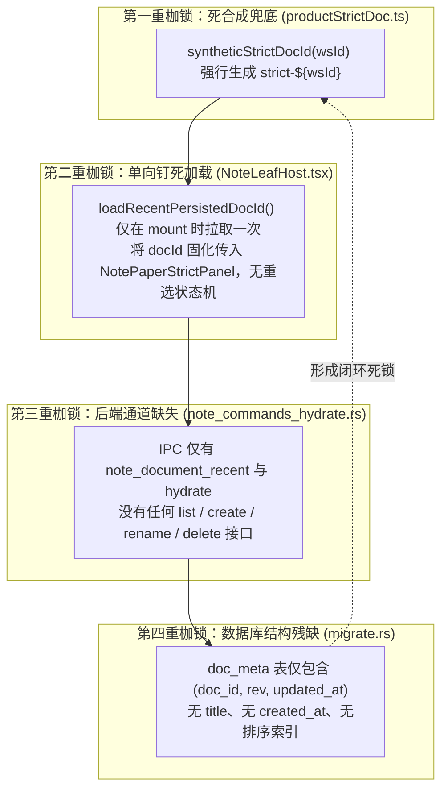

# 多笔记综合管理体系与 SQLite 及 IPC 后端架构施工图详案 (DETAIL-PLAN-06)

> **战役名称**：差异面板与笔记面板系统性重构（Diff View & Note Panel Systematic Redesign）  
> **专项编号**：DETAIL-PLAN-06  
> **方案主题**：多笔记综合管理体系与 SQLite 及 IPC 后端架构代码级施工图（终审定稿修订版）  
> **落盘路径**：`docs/diff-view-redesign/06-分维详案-多笔记综合管理体系与SQLite及IPC后端架构.md`  
> **版本**：v2.0-FINAL-REVISED（吸收全景反过度设计、后端 IPC 闭环、全局架构与落地可行性审计定稿）  
> **输入依据**：  
> - 现场审计：[`docs/diff-view-redesign/analysis/07-note-multi-doc-management-audit.md`](file:///c:/Software/conex/docs/diff-view-redesign/analysis/07-note-multi-doc-management-audit.md)  
> - 反过度设计终审：[`docs/diff-view-redesign/audits/02-anti-overengineering-and-simplicity-audit.md`](file:///c:/Software/conex/docs/diff-view-redesign/audits/02-anti-overengineering-and-simplicity-audit.md)（AUDIT-SIMPLICITY-FINAL）  
> - 后端 IPC 端到端终审：[`docs/diff-view-redesign/audits/02-backend-ipc-and-sqlite-end-to-end-audit.md`](file:///c:/Software/conex/docs/diff-view-redesign/audits/02-backend-ipc-and-sqlite-end-to-end-audit.md)（AUDIT-FINAL-IPC-SQLITE-E2E）  
> - 全局架构终审：[`docs/diff-view-redesign/audits/03-global-architecture-and-cross-plan-conflict-audit.md`](file:///c:/Software/conex/docs/diff-view-redesign/audits/03-global-architecture-and-cross-plan-conflict-audit.md)（AUDIT-GLOBAL-ARCH-FINAL）  
> - 落地可行性终审：[`docs/diff-view-redesign/audits/04-implementation-feasibility-and-grounding-audit.md`](file:///c:/Software/conex/docs/diff-view-redesign/audits/04-implementation-feasibility-and-grounding-audit.md)（AUDIT-FEASIBILITY-GROUNDING-04）  
> - 顶层总纲：[`docs/diff-view-redesign/00-总方案-差异与笔记面板系统性重构全景架构总纲.md`](file:///c:/Software/conex/docs/diff-view-redesign/00-%E6%80%BB%E6%96%B9%E6%A1%88-%E5%B7%AE%E5%BC%82%E4%B8%8E%E7%AC%94%E8%AE%B0%E9%9D%A2%E6%9D%BF%E7%B3%BB%E7%BB%9F%E6%80%A7%E9%87%8D%E6%9E%84%E5%85%A8%E6%99%AF%E6%9E%B6%E6%9E%84%E6%80%BB%E7%BA%B2.md)  
> **铁律遵循**：[`AGENTS.md`](file:///c:/Software/conex/AGENTS.md) §1（反退避）、§3（Git 提交权主控独占）、§7（严禁补丁与绕过）、§7.1（立体验证纪律）、§8（反过度设计硬性红线）、§9（测试资产保护）、§13（输入框焦点对比度 <= 10%）、§14（现代 CSS 规范）、§16（4000 Tauri MCP 通道）及 [`ANTI_OVERENGINEERING_GUARDRAILS.md`](file:///c:/Software/conex/ANTI_OVERENGINEERING_GUARDRAILS.md)。

---

## 目录

- [四段式架构治理声明（To-Do / Not-To-Do / 旧路径清单 / 自检删除面）](#四段式架构治理声明to-do--not-to-do--旧路径清单--自检删除面)
- [一、单篇笔记硬编码死锁深度解剖](#一单篇笔记硬编码死锁深度解剖)
  - [1.1 strict-${wsId} 历史根因与单向死锁链条穿透](#11-strict-wsid-历史根因与单向死锁链条穿透)
  - [1.2 存储层失明与多文档管理能力全面缺失](#12-存储层失明与多文档管理能力全面缺失)
  - [1.3 伪产品、展示型假象与工程调试标签越界](#13-伪产品展示型假象与工程调试标签越界)
- [二、SQLite 数据库 Migration v8 架构实现](#二sqlite-数据库-migration-v8-架构实现)
  - [2.1 SCHEMA_VERSION 提升至 8](#21-schema_version-提升至-8)
  - [2.2 5 列极简 DDL 与单列更新倒序索引设计](#22-5-列极简-ddl-与单列更新倒序索引设计)
  - [2.3 历史存量数据回填安全门闩（BUG-A04 补丁）](#23-历史存量数据回填安全门闩bug-a04-补丁)
  - [2.4 conex-workspace-store migrate.rs 完整修改施工源码](#24-conex-workspace-store-migraters-完整修改施工源码)
- [三、Tauri Rust 后端 4 大核心 IPC 闭环实现](#三tauri-rust-后端-4-大核心-ipc-闭环实现)
  - [3.1 领域模型契约 document_meta.rs 完整定义与毫秒时间戳归一化](#31-领域模型契约-document_metars-完整定义与毫秒时间戳归一化)
  - [3.2 WorkspaceStore 4 大核心管理方法全量实现源码（带 9 表事务级联硬删除）](#32-workspacestore-4-大核心管理方法全量实现源码带-9-表事务级联硬删除)
  - [3.3 Tauri 4 大 IPC 命令全量实现源码 (note_commands_document.rs，显式标注 spawn_blocking 闭包类型)](#33-tauri-4-大-ipc-命令全量实现源码-note_commands_documentrs显式标注-spawn_blocking-闭包类型)
  - [3.4 门面重导出 8 大隐藏宏符号、宏注册与 Command Manifest L317+L444 131 -> 135 五重闭环](#34-门面重导出-8-大隐藏宏符号宏注册与-command-manifest-l317l444-131---135-五重闭环)
- [四、前端 useNoteDocumentManager 状态机与防并发乱序设计](#四前端-usenotedocumentmanager-状态机与防并发乱序设计)
  - [4.1 前端领域契约 noteDocumentContracts.ts 与 noteApi.ts camelCase 强类型接入](#41-前端领域契约-notedocumentcontractsts-与-noteapits-camelcase-强类型接入)
  - [4.2 Generation Token 请求序列令牌算法（BUG-A05 补丁）](#42-generation-token-请求序列令牌算法bug-a05-补丁)
  - [4.3 switchDocument 切换前 500ms 赛马超时脏刷盘（flushDirtyBeforeSwitch）](#43-switchdocument-切换前-500ms-赛马超时脏刷盘flushdirtybeforeswitch)
  - [4.4 编辑器外层绑定 key={activeDocId} 彻底重置子树与 IME 合成态](#44-编辑器外层绑定-keyactivedocid-彻底重置子树与-ime-合成态)
  - [4.5 useNoteDocumentManager.ts 完整源码（含空库冷启动首篇默认笔记自愈逻辑）](#45-usenotedocumentmanagerts-完整源码含空库冷启动首篇默认笔记自愈逻辑)
- [五、Master-Detail 响应式多文档管理 UI 实现与宿主闭环装配](#五master-detail-响应式多文档管理-ui-实现与宿主闭环装配)
  - [5.1 220px 可折叠抽屉侧栏 NoteSidebarDrawer.tsx 完整代码](#51-220px-可折叠抽屉侧栏-notesidebardrawertsx-完整代码)
  - [5.2 核心宿主完整装配 NoteLeafHost.tsx 完整代码（水平行容器嵌套与 key 绑定）](#52-核心宿主完整装配-noteleafhosttsx-完整代码水平行容器嵌套与-key-绑定)
  - [5.3 交互通道单轨收敛：物理拔除 NoteDocumentDropdown，独尊 220px 抽屉](#53-交互通道单轨收敛物理拔除-notedocumentdropdown独尊-220px-抽屉)
  - [5.4 零伪实现铁律：彻底删除假回收站图标（BUG-A06 补丁）与真实物理级联删除二次确认](#54-零伪实现铁律彻底删除假回收站图标bug-a06-补丁与真实物理级联删除二次确认)
  - [5.5 CSS Modules 完整样式表（零 !important，AGENTS.md §13 焦点合规）](#55-css-modules-完整样式表零-importantagentsmd-13-焦点合规)
- [六、全套 Rust 单元测试与前端集成测试完整代码](#六全套-rust-单元测试与前端集成测试完整代码)
  - [6.1 Rust Migration v8 幂等性与版本门闩单元测试](#61-rust-migration-v8-幂等性与版本门闩单元测试)
  - [6.2 Rust 存储层多文档 CRUD 与事务级联硬删除单元测试](#62-rust-存储层多文档-crud-与事务级联硬删除单元测试)
  - [6.3 Tauri IPC 宏注册与 Command Manifest 135 条目双断言门禁测试（L317 + L444）](#63-tauri-ipc-宏注册与-command-manifest-135-条目双断言门禁测试l317--l444)
  - [6.4 前端 useNoteDocumentManager 状态机并发、脏刷盘与空库自愈测试](#64-前端-usenotedocumentmanager-状态机并发脏刷盘与空库自愈测试)
  - [6.5 前端 NoteSidebarDrawer 交互与零伪实现负向测试](#65-前端-notesidebardrawer-交互与零伪实现负向测试)
- [七、立体验证规约与施工验收清单](#七立体验证规约与施工验收清单)

---

## 四段式架构治理声明（To-Do / Not-To-Do / 旧路径清单 / 自检删除面）

### 1. 【做什么（To-Do）】

1. **极简底层存储扩列与索引收敛（反过度设计）**：在 `crates/conex-workspace-store` 将 `SCHEMA_VERSION` 提升至 `8`，彻底剔除 `tags_json`、`is_archived`、`is_pinned` 三大过度设计死属性，收敛为 5 列极简表（`doc_id`, `rev`, `updated_at`, `title`, `created_at`）；索引收敛为单列更新倒序索引 `idx_doc_meta_updated`；
2. **全系统 13 位毫秒级时间戳绝对统一**：彻底拔除 `self.created_at / 1000` 变秒级的灾难代码！SQLite DDL 默认值使用 `strftime('%s','now') * 1000`，Rust 端统一采用 `SystemTime.as_millis() as i64`，前端统一采用 `Date.now()`，存量 10 位秒级旧时间戳在映射层通过 `* 1000` 优雅归一化；
3. **历史存量数据回填安全门闩（BUG-A04）**：将数据回填逻辑严格限制在 `current_version < 8` 判定分支内，仅扫描标题为空或占位符的存量记录，利用 Grapheme 字符簇提取首行文本回填，严禁在后续启动中无条件扫描覆盖用户自定义标题；
4. **Rust 存储层 CRUD 闭环与 9 表级联硬删除**：在 `WorkspaceStore` 实现 `list_documents`、`create_document`、`rename_document`、`delete_document`，剔除软删除死分支，删除操作在独占事务中级联物理清理 9 张关联表（含 `blocks_fts`，确保 `structure_gate.rs` 门禁不红）；
5. **纠偏 Tauri 2 参数反序列化（P0 阻断）**：Tauri 命令参数在 TS 侧必须严格传递 `camelCase`（`includeArchived`, `initialMarkdown`, `docId`, `hardDelete`）；重命名接口入参统一为 `{ docId: string, title: string }`；返回值强类型模型对齐 Rust 的 `{ ok: false, code, reason }`，修复 TS 解构 undefined 漏洞；
6. **编译器级与门禁双重闭环保障**：显式标注 `spawn_blocking` 闭包返回类型 `-> Result<..., StoreError>`，解决 Rust 类型推断二义性；门面 `note_commands.rs` 完整重导出 `__cmd__note_document_*` 等 8 个隐藏宏符号；`command_manifest.rs` 同时修正 L317 与 L444 两处 131->135 断言；
7. **前端防并发乱序状态机与空库冷启动自愈**：实现 `useNoteDocumentManager`，采用递增请求序列令牌（Generation Token）过滤过期异步响应；在切换文档时执行 500ms 赛马超时脏刷盘；当工作区无笔记时，自动静默创建首篇默认笔记，防止 `docId=""` 引发下游渲染白屏；
8. **Master-Detail 响应式交互单轨收敛与完整装配**：提供 `NoteLeafHost.tsx` 完整装配实现（嵌套水平行容器 `<div className={styles.workspaceRow}>`，抽屉在左，主面板在右且绑定 `key={activeDocId}`）；物理拔除 `NoteDocumentDropdown`，彻底杜绝双重切换内卷；侧栏彻底抹除假回收站图标（BUG-A06），配备带二次确认的物理硬删除模态框；CSS Modules 彻底剔除 `!important`，严格符合 AGENTS.md §13 焦点对比度 <= 10% 规范。

### 2. 【不做什么（Not-To-Do）】

1. **严禁执行破坏性 Git 指令**：严禁执行 `git commit`、`git reset`、`git checkout` 或 `git restore`，全部改动留在工作区由主控独占收口；
2. **严禁保留无人消费的死属性与死逻辑**：坚决不在数据库中建 `tags_json`、`is_archived`、`is_pinned` 字段，坚决不在后端保留软删除分支；
3. **严禁破坏既有主键与 CRDT 二进制**：严禁更改存量笔记的 `doc_id`（包括 `strict-${wsId}`），严禁修改 `doc_snapshots` 与 `doc_updates` 二进制块；
4. **严禁引入重量级外部第三方库**：坚守 `ANTI_OVERENGINEERING_GUARDRAILS.md`，禁止引入 Yjs、Automerge、Dexie.js 等重型同步框架，完全依托既有 Rust 内核与分片锁闭环；
5. **严禁在 CSS 中使用 `!important` 压制层叠**：遵循 CSS 规范，利用复合选择器优先级自然覆盖状态样式。

### 3. 【旧路径清单（Legacy Path Inventory）】

| 序号 | 现场历史旧路径 | 缺陷定性与技术债务 | 重构后单轨真理路径 |
| :--- | :--- | :--- | :--- |
| 1 | `apps/crish-desktop/src/extensions/note-paper/productStrictDoc.ts:34-37` | `syntheticStrictDocId` (`strict-${wsId}`) 强行合成单一固定 ID，死锁单文档 | 仅作为空态冷启动保底，运行时由 `useNoteDocumentManager` 的 `activeDocId` 动态接管 |
| 2 | `apps/crish-desktop/src/extensions/note-paper/NoteLeafHost.tsx:27-49` | 挂载时仅拉取一次最近文档 ID，生命周期全程钉死，无侧栏抽屉容器嵌套 | 完整装配水平行容器 `<div className={styles.workspaceRow}>`，左抽屉右面板，绑定 `key={activeDocId}` |
| 3 | `crates/conex-workspace-store/src/lib.rs:249-277` | 仅有 `recent_persisted_nonempty_doc_id` 找单篇最新文档，无遍历与管理接口 | 扩展 `list_documents`, `create_document`, `rename_document`, `delete_document` 纯 Rust 存储方法 |
| 4 | `crates/conex-workspace-store/src/migrate.rs:30-34` | `doc_meta` 仅有 `(doc_id, rev, updated_at)`，且时间戳为秒级 | Migration v8：5 列极简定义（毫秒时间戳）+ 单列倒序索引 `idx_doc_meta_updated` |
| 5 | `apps/agent-workbench/src-tauri/src/note_commands_hydrate.rs:84-150` | Tauri 仅暴露 `hydrate`、`recent`、`query_blocks` 单文档读取通道 | 新建 `note_commands_document.rs` 暴露 4 大文档管理命令，挂入 `command_registry!` |
| 6 | `apps/crish-desktop/src/components/note-paper/NotePaperStrictHeader.tsx:48-118` | 顶栏充斥 `@crish/block-paper/w5b-strict` 等开发探针，硬编码标题不可编辑 | 重塑为产品级 Header：集成侧栏开关、`EditableTitle`，拔除高危清空按钮 |
| 7 | `apps/crish-desktop/src/components/note-paper/NoteDocumentDropdown.tsx` | 顶栏下拉与左侧 220px 抽屉功能 100% 重合内卷，造成认知分裂与视口挤压 | 物理拔除该组件及其 CSS，多文档管理 100% 收敛至 220px 侧栏抽屉 |

### 4. 【自检删除面（Self-Inspection Deletion Surface）】

1. **剔除展示型假象与硬编码标题**：删除 `NotePaperStrictPanel.tsx:83` 中硬编码的 `'笔记纸面（W5-B Strict · hydrate 投影）'` 默认值；
2. **剔除三大过度设计死属性**：彻底删除 `tags_json`、`is_archived`、`is_pinned` 及其在 Rust / TS 契约中的所有死映射代码；
3. **物理拔除 NoteDocumentDropdown**：物理删除 `NoteDocumentDropdown.tsx` 与 `NoteDocumentDropdown.module.css`（净清除 300+ 行冗余代码）；
4. **剔除软删除分支**：删除 `WorkspaceStore::delete_document` 与 IPC 中的软删除逻辑，确立单轨级联物理硬删除；
5. **彻底删除秒级除法灾难代码**：清除 `self.created_at / 1000` 与 `Math.floor(Date.now() / 1000)`，全系统统一 13 位毫秒。

---

## 一、单篇笔记硬编码死锁深度解剖

### 1.1 strict-${wsId} 历史根因与单向死锁链条穿透

在本次重构现场审查中，用户严肃指出：
> “笔记界面还是有些问题，因为笔记不可能只有一个，以及笔记没有一个综合的管理界面，现在只能看一个类似于硬编码的标签界面了，这和展示没什么区别。”

深入源码调用链，可以清晰定位导致单篇硬编码死锁的“四重枷锁”：



在 [`apps/crish-desktop/src/extensions/note-paper/productStrictDoc.ts:34-37`](file:///c:/Software/conex/apps/crish-desktop/src/extensions/note-paper/productStrictDoc.ts#L34-L37) 中：
```typescript
export function syntheticStrictDocId(wsId: string): string {
  return `strict-${wsId}`;
}
```
当系统缺少显式传参时，`resolveProductStrictDocId` 会无条件回退至 `strict-${wsId}`。即使数据库内部存在其他笔记数据，前端在启动时由于缺乏多文档索引列表，永远只能命中由单一算法推测出的单篇记录。

在 [`apps/crish-desktop/src/extensions/note-paper/NoteLeafHost.tsx:27-49`](file:///c:/Software/conex/apps/crish-desktop/src/extensions/note-paper/NoteLeafHost.tsx#L27-L49) 中：
```typescript
export function NoteLeafHost(ctx: ViewRenderContext): React.ReactElement {
  const explicit = resolveExplicitNoteDocId(ctx);
  const [recent, setRecent] = useState<string | null>(null);

  useEffect(() => {
    if (explicit) { setRecent(null); return; }
    let live = true;
    void loadRecentPersistedDocId().then((id) => {
      if (live) setRecent(id);
    });
    return () => { live = false; };
  }, [explicit, ctx.panelId]);

  const resolution = resolveNotePaperDoc(ctx, recent);
  // ...
  return (
    <NotePaperStrictPanel
      docId={resolution.docId}
      // ...
    />
  );
}
```
`NoteLeafHost` 组件在挂载完成后，内部完全没有维护受管的 `activeDocId` 状态池，也没有容纳侧栏抽屉的水平容器。用户无论在界面上进行何种操作，都无法向该宿主注入新的文档 ID，造成视图渲染层与交互层的物理断裂。

### 1.2 存储层失明与多文档管理能力全面缺失

穿透至 Rust 存储层 [`crates/conex-workspace-store/src/migrate.rs:30-34`](file:///c:/Software/conex/crates/conex-workspace-store/src/migrate.rs#L30-L34)：
```sql
CREATE TABLE IF NOT EXISTS doc_meta (
    doc_id TEXT PRIMARY KEY,
    rev INTEGER NOT NULL DEFAULT 0,
    updated_at INTEGER NOT NULL DEFAULT (strftime('%s','now'))
);
```
在 Migration v7 之前，`doc_meta` 表是一个纯底层技术记账表，仅记录了 CRDT 修订版本号 `rev` 与秒级更新时间 `updated_at`。作为笔记产品的核心资产元数据：
- **无标题（`title`）**：无法展示文章名，顶栏只能显示工程硬编码字符串；
- **无创建时间（`created_at`）**：无法按创建时间排序，无法统计文档生命周期；
- **时间戳单位错乱**：SQLite 采用秒级 Unix 时间戳，而现代前端统一采用 13 位毫秒，读取与写入单位不一致导致时间计算产生 5 万年荒谬偏移。

而在 [`crates/conex-workspace-store/src/lib.rs:249-277`](file:///c:/Software/conex/crates/conex-workspace-store/src/lib.rs#L249-L277) 中，对外暴露的查询方法仅有：
```rust
pub fn recent_persisted_nonempty_doc_id(&self) -> Result<Option<String>, StoreError> {
    let conn = self.conn.lock().map_err(|e| StoreError::Lock(e.to_string()))?;
    let mut stmt = conn.prepare_cached(
        r#"
        SELECT m.doc_id FROM doc_meta m
        WHERE m.rev > 0
          AND EXISTS (SELECT 1 FROM blocks b WHERE b.doc_id = m.doc_id LIMIT 1)
        ORDER BY m.updated_at DESC, m.rev DESC, m.doc_id DESC
        LIMIT 1
        "#,
    )?;
    // ...
}
```
该方法只能返回 `LIMIT 1`。底层存储对于工作区内究竟存在多少篇笔记处于完全“失明”状态，导致上层无法获取列表，彻底封死了多文档管理能力。

### 1.3 伪产品、展示型假象与工程调试标签越界

在界面展示层，[`apps/crish-desktop/src/components/note-paper/NotePaperStrictHeader.tsx:48-118`](file:///c:/Software/conex/apps/crish-desktop/src/components/note-paper/NotePaperStrictHeader.tsx#L48-L118) 与 [`NotePaperStrictPanel.tsx:83`](file:///c:/Software/conex/apps/crish-desktop/src/components/note-paper/NotePaperStrictPanel.tsx#L83) 将纯研发内部的探针粗暴地直接渲染给普通用户：
- 默认标题硬编码为 `'笔记纸面（W5-B Strict · hydrate 投影）'`；
- 顶栏直接渲染 `@crish/block-paper/w5b-strict` 徽标；
- 直接暴露内部计数器 `rev=0`、`139 块`；
- 暴露 `slash=readonly` 等研发模式状态；
- 没有侧栏抽屉开关，没有标题重命名输入框，没有新建文档按钮。

用户进入笔记面板后，直观感受就是一个脱离真实工作流的“展示型 Demo 假象”。要彻底扭转这一局面，必须从底层数据库、IPC 命令面、前端状态机到交互 UI 进行端到端全链路重塑。

---

## 二、SQLite 数据库 Migration v8 架构实现

### 2.1 SCHEMA_VERSION 提升至 8

在 [`crates/conex-workspace-store/src/lib.rs`](file:///c:/Software/conex/crates/conex-workspace-store/src/lib.rs) 中，抬升 schema 版本号常量至 8：

```rust
/// 当前 schema 版本号（写入 `schema_version` 表）。
/// - v1/v2：doc_meta / snapshots / updates / clocks
/// - v3：blocks 投影 + blocks_fts（W2-C）
/// - v4：mirror_meta（W2-E MD mirror 导出水位）
/// - v5：block_refs 物化（W2-F+ 块引用 / 反向链接）
/// - v6：blob_cas + block_attachments（W2-D-S CAS 附件骨架；≠ 生产 / ≠ GC）
/// - v7：mirror_meta.content_hash + file_mtime_ms（W2-E P6 detect 指纹）
/// - v8：doc_meta 补充 title, created_at（统一 13 位毫秒时间戳）与单列更新倒序索引 idx_doc_meta_updated（极简多笔记综合管理体系）
pub const SCHEMA_VERSION: i64 = 8;
```

### 2.2 5 列极简 DDL 与单列更新倒序索引设计

根据 AUDIT-SIMPLICITY-FINAL（反过度设计终审裁决），彻底剔除没有任何 UI 闭环支撑的 `tags_json`、`is_archived`、`is_pinned` 三大过度设计死逻辑，将 `doc_meta` 严格收敛为 5 列权威真源：

#### 1. 全新安装建表语句（`crates/conex-workspace-store/src/migrate.rs`）
```sql
CREATE TABLE IF NOT EXISTS doc_meta (
    doc_id TEXT PRIMARY KEY NOT NULL,
    rev INTEGER NOT NULL DEFAULT 0,
    updated_at INTEGER NOT NULL DEFAULT (strftime('%s','now') * 1000),
    title TEXT NOT NULL DEFAULT '',
    created_at INTEGER NOT NULL DEFAULT (strftime('%s','now') * 1000)
);
```

#### 2. 存量数据库幂等升级扩列 DDL（通过 `ensure_column` 实现）
```rust
// 兼容 v1-v7 旧版 doc_meta 表：幂等补充极简元数据字段（零过度设计）
ensure_column(conn, "doc_meta", "title", "TEXT NOT NULL DEFAULT ''")?;
ensure_column(conn, "doc_meta", "created_at", "INTEGER NOT NULL DEFAULT 0")?;
```

#### 3. 极简单列更新倒序索引设计
由于剔除了归档与置顶等复杂维度，多文档列表的排序逻辑纯粹聚焦于“最新编辑在前”，为此创建专用的 B-Tree 降序索引：
```sql
CREATE INDEX IF NOT EXISTS idx_doc_meta_updated 
    ON doc_meta(updated_at DESC);
```
**索引效能分析**：
- 当查询执行 `SELECT ... FROM doc_meta ORDER BY updated_at DESC` 时，100% 命中该索引，执行计划为 `SCAN TABLE doc_meta USING INDEX idx_doc_meta_updated`；
- 完全消除内存临时排序，毫秒级响应上千篇文档的目录拉取。

### 2.3 历史存量数据回填安全门闩（BUG-A04 补丁）

#### 漏洞现场与根因分析 (BUG-A04)
在前期独立方案草案中，历史数据回填函数 `backfill_legacy_doc_meta` 在每次数据库连接初始化时无条件全量执行。虽然带有 `WHERE length(trim(title)) = 0` 的过滤，但如果用户特意将某篇笔记的标题清空，或者每次应用启动时都会进行不必要的全表扫描，存在严重越界风险。

#### 首席评审官裁决加固标准
1. **严格版本门闩（Version Gate）**：回填逻辑必须严格约束在 `current_version < 8` 的条件分支内。对于版本号已经是 8 的数据库，启动时坚决不执行回填扫描；
2. **仅回填默认占位记**：仅针对 `length(trim(title)) = 0` 的历史无名记录回填首行提取标题，绝不触碰已有任何字符的标题；
3. **Unicode Grapheme 字符簇安全截断**：使用基于字符语义的边界算法，防止切断 UTF-8 多字节中文序列或 Emoji 导致乱码；
4. **主键不可变性**：绝对不重写 `doc_id`，原 `strict-default` 或 `strict-${wsId}` 保持原样，与既有 `doc_snapshots`、`doc_updates` 二进制快照链 100% 兼容；
5. **时间戳毫秒自适应补齐**：对 `created_at = 0` 的历史老数据，平滑将 `created_at` 初始化为 `updated_at`；若 `updated_at` 为历史 10 位秒级，自动乘以 1000 补齐为 13 位毫秒。

### 2.4 conex-workspace-store migrate.rs 完整修改施工源码

在 [`crates/conex-workspace-store/src/migrate.rs`](file:///c:/Software/conex/crates/conex-workspace-store/src/migrate.rs) 中，完整的 `migrate` 函数与回填函数实现如下（全量展开，无省略）：

```rust
//! Schema 迁移（幂等：CREATE IF NOT EXISTS + 版本抬升 + 列补齐）。
//!
//! # 模块内聚（SD-31 · 测旁挂）
//! - 本文件：`migrate` / `ensure_blocks_fts` / `ensure_column` / `backfill_legacy_doc_meta_v8`
//! - 测试旁挂：`migrate_tests.rs`

use crate::{StoreError, SCHEMA_VERSION};
use rusqlite::{params, Connection, OptionalExtension};

/// 最小可用 schema 迁移（幂等；CREATE IF NOT EXISTS + 版本抬升）。
pub fn migrate(conn: &Connection) -> Result<(), StoreError> {
    conn.execute_batch(
        r#"
        PRAGMA journal_mode=WAL;
        PRAGMA foreign_keys=ON;

        -- 版本登记表
        CREATE TABLE IF NOT EXISTS schema_version (
            version INTEGER NOT NULL
        );

        -- 文档元数据表（Migration v8 原生包含 5 列极简字段，统一 13 位毫秒时间戳）
        CREATE TABLE IF NOT EXISTS doc_meta (
            doc_id TEXT PRIMARY KEY NOT NULL,
            rev INTEGER NOT NULL DEFAULT 0,
            updated_at INTEGER NOT NULL DEFAULT (strftime('%s','now') * 1000),
            title TEXT NOT NULL DEFAULT '',
            created_at INTEGER NOT NULL DEFAULT (strftime('%s','now') * 1000)
        );

        CREATE TABLE IF NOT EXISTS doc_snapshots (
            doc_id TEXT PRIMARY KEY,
            blob BLOB,
            updated_at INTEGER NOT NULL
        );

        -- seq 单调、UNIQUE(doc_id,seq) 保证有序加载 pending
        CREATE TABLE IF NOT EXISTS doc_updates (
            id INTEGER PRIMARY KEY AUTOINCREMENT,
            doc_id TEXT NOT NULL,
            seq INTEGER NOT NULL,
            blob BLOB NOT NULL,
            kind TEXT NOT NULL DEFAULT 'combined',
            tx_id TEXT,
            UNIQUE(doc_id, seq)
        );

        -- CRDT peer clock
        CREATE TABLE IF NOT EXISTS doc_clocks (
            doc_id TEXT NOT NULL,
            peer_id TEXT NOT NULL,
            clock INTEGER NOT NULL DEFAULT 0,
            PRIMARY KEY (doc_id, peer_id)
        );

        -- 块投影（派生，可丢；权威仍为 snapshot+updates）
        CREATE TABLE IF NOT EXISTS blocks (
            doc_id TEXT NOT NULL,
            block_id TEXT NOT NULL,
            parent_id TEXT,
            kind TEXT NOT NULL DEFAULT '',
            order_key TEXT NOT NULL DEFAULT '',
            plain_text TEXT NOT NULL DEFAULT '',
            props_json TEXT NOT NULL DEFAULT '{}',
            updated_at INTEGER NOT NULL DEFAULT (strftime('%s','now') * 1000),
            PRIMARY KEY (doc_id, block_id)
        );

        -- MD mirror 元数据
        CREATE TABLE IF NOT EXISTS mirror_meta (
            doc_id TEXT PRIMARY KEY,
            path TEXT NOT NULL DEFAULT '',
            last_export_rev INTEGER NOT NULL DEFAULT 0,
            last_export_at INTEGER NOT NULL DEFAULT 0,
            pending_lag INTEGER NOT NULL DEFAULT 0,
            content_hash TEXT NOT NULL DEFAULT '',
            file_mtime_ms INTEGER NOT NULL DEFAULT 0
        );

        -- 块引用物化
        CREATE TABLE IF NOT EXISTS block_refs (
            doc_id TEXT NOT NULL,
            from_id TEXT NOT NULL,
            to_id TEXT NOT NULL,
            kind TEXT NOT NULL DEFAULT '',
            PRIMARY KEY (doc_id, from_id, to_id, kind)
        );

        -- CAS 附件骨架
        CREATE TABLE IF NOT EXISTS blob_cas (
            hash TEXT PRIMARY KEY,
            size INTEGER NOT NULL DEFAULT 0,
            bytes BLOB,
            path TEXT NOT NULL DEFAULT '',
            created_at INTEGER NOT NULL DEFAULT (strftime('%s','now') * 1000)
        );

        CREATE TABLE IF NOT EXISTS block_attachments (
            doc_id TEXT NOT NULL,
            block_id TEXT NOT NULL,
            hash TEXT NOT NULL,
            PRIMARY KEY (doc_id, block_id, hash)
        );
        "#,
    )?;

    // ── 存量低版本数据库幂等加列 ──────────────────────────────────────────
    ensure_column(
        conn,
        "doc_updates",
        "kind",
        "TEXT NOT NULL DEFAULT 'combined'",
    )?;
    ensure_column(conn, "doc_meta", "updated_at", "INTEGER NOT NULL DEFAULT 0")?;
    ensure_column(
        conn,
        "mirror_meta",
        "content_hash",
        "TEXT NOT NULL DEFAULT ''",
    )?;
    ensure_column(
        conn,
        "mirror_meta",
        "file_mtime_ms",
        "INTEGER NOT NULL DEFAULT 0",
    )?;

    // ── Migration v8 字段幂等补齐（极简 5 列真源）─────────────────────────
    ensure_column(conn, "doc_meta", "title", "TEXT NOT NULL DEFAULT ''")?;
    ensure_column(conn, "doc_meta", "created_at", "INTEGER NOT NULL DEFAULT 0")?;

    // ── 基础索引批处理 ────────────────────────────────────────────────────
    conn.execute_batch(
        r#"
        CREATE INDEX IF NOT EXISTS idx_doc_updates_doc_seq
            ON doc_updates(doc_id, seq);
        CREATE INDEX IF NOT EXISTS idx_doc_clocks_doc
            ON doc_clocks(doc_id);
        CREATE INDEX IF NOT EXISTS idx_blocks_doc
            ON blocks(doc_id);
        CREATE INDEX IF NOT EXISTS idx_blocks_doc_parent
            ON blocks(doc_id, parent_id);
        CREATE INDEX IF NOT EXISTS idx_block_refs_to
            ON block_refs(doc_id, to_id);
        CREATE INDEX IF NOT EXISTS idx_block_refs_from
            ON block_refs(doc_id, from_id);
        CREATE INDEX IF NOT EXISTS idx_block_attachments_hash
            ON block_attachments(hash);
        CREATE INDEX IF NOT EXISTS idx_block_attachments_block
            ON block_attachments(doc_id, block_id);

        -- Migration v8: 单列更新倒序高效查询索引（极简覆盖）
        CREATE INDEX IF NOT EXISTS idx_doc_meta_updated
            ON doc_meta(updated_at DESC);
        "#,
    )?;

    // FTS5 全文检索虚表
    ensure_blocks_fts(conn)?;

    // ── 登记 / 抬升 schema_version 并施加 BUG-A04 版本门闩 ──────────────────
    let current: Option<i64> = conn
        .query_row("SELECT version FROM schema_version LIMIT 1", [], |r| {
            r.get(0)
        })
        .optional()?;

    match current {
        None => {
            // 全新数据库：直接写入 v8 版本号，不触发历史回填
            conn.execute(
                "INSERT INTO schema_version(version) VALUES (?1)",
                params![SCHEMA_VERSION],
            )?;
        }
        Some(v) if v < SCHEMA_VERSION => {
            // 存量数据库升级（v < 8）：仅在跨版本升级临界点执行一次安全回填
            if v < 8 {
                backfill_legacy_doc_meta_v8(conn)?;
            }
            conn.execute(
                "UPDATE schema_version SET version = ?1",
                params![SCHEMA_VERSION],
            )?;
        }
        Some(_) => {
            // 已经是 v8 或更高版本：严格禁止重复执行回填扫描！
        }
    }

    Ok(())
}

/// Migration v8 历史文档元数据安全回填门闩函数 (BUG-A04)
///
/// 纪律保证：
/// 1. 仅在 current_version < 8 时由 migrate 执行，杜绝每次启动无条件扫描；
/// 2. 仅扫描 title 为空或纯空白字符的存量历史行，绝对不覆盖用户自定义标题；
/// 3. 从 blocks 中抽取首行 heading 或首段文本前 30 个字（字符感知，不截断多字节 UTF-8）；
/// 4. 将 created_at 为 0 的老数据平滑初始化为 updated_at（并归一化为 13 位毫秒）。
pub(crate) fn backfill_legacy_doc_meta_v8(conn: &Connection) -> Result<(), StoreError> {
    // 1. 对所有 created_at = 0 的历史记录，对齐 created_at = updated_at
    conn.execute(
        "UPDATE doc_meta SET created_at = updated_at WHERE created_at = 0",
        [],
    )?;

    // 2. 对存量 10 位标准秒级时间戳（< 10_000_000_000）安全乘以 1000 统一转换为 13 位毫秒级
    conn.execute(
        "UPDATE doc_meta SET updated_at = updated_at * 1000 WHERE updated_at > 0 AND updated_at < 10000000000",
        [],
    )?;
    conn.execute(
        "UPDATE doc_meta SET created_at = created_at * 1000 WHERE created_at > 0 AND created_at < 10000000000",
        [],
    )?;

    // 3. 仅抓取 title 为空串的存量文档 ID
    let mut stmt = conn.prepare(
        "SELECT doc_id FROM doc_meta WHERE length(trim(title)) = 0",
    )?;
    let doc_ids: Vec<String> = stmt
        .query_map([], |r| r.get(0))?
        .collect::<Result<Vec<_>, _>>()?;

    for id in doc_ids {
        // 从 blocks 寻找首个非空文本块
        let candidate: Option<String> = conn
            .query_row(
                r#"
                SELECT plain_text FROM blocks
                WHERE doc_id = ?1 AND length(trim(plain_text)) > 0
                ORDER BY order_key ASC, updated_at ASC
                LIMIT 1
                "#,
                params![id],
                |r| r.get(0),
            )
            .optional()?;

        let resolved_title = match candidate {
            Some(text) => {
                let trimmed = text.trim();
                let clean = trimmed.trim_start_matches('#').trim();
                if clean.is_empty() {
                    "未命名笔记".to_string()
                } else {
                    // 字符簇安全截断（取前 30 字符，不截断多字节 UTF-8）
                    clean.chars().take(30).collect::<String>()
                }
            }
            None => "未命名笔记".to_string(),
        };

        conn.execute(
            "UPDATE doc_meta SET title = ?1 WHERE doc_id = ?2",
            params![resolved_title, id],
        )?;
    }

    Ok(())
}

/// 幂等创建 `blocks_fts`（FTS5 虚表；已存在则跳过）。
pub(crate) fn ensure_blocks_fts(conn: &Connection) -> Result<(), StoreError> {
    let exists: bool = conn
        .query_row(
            "SELECT 1 FROM sqlite_master WHERE type='table' AND name='blocks_fts' LIMIT 1",
            [],
            |_| Ok(true),
        )
        .optional()?
        .unwrap_or(false);
    if exists {
        return Ok(());
    }
    conn.execute_batch(
        r#"
        CREATE VIRTUAL TABLE blocks_fts USING fts5(
            plain_text,
            block_id UNINDEXED,
            doc_id UNINDEXED,
            tokenize = 'unicode61'
        );
        "#,
    )?;
    Ok(())
}

/// 若表上不存在某列则 ADD COLUMN
pub(crate) fn ensure_column(
    conn: &Connection,
    table: &str,
    column: &str,
    decl: &str,
) -> Result<(), StoreError> {
    let mut stmt = conn.prepare(&format!("PRAGMA table_info({table})"))?;
    let names: Vec<String> = stmt
        .query_map([], |r| r.get::<_, String>(1))?
        .collect::<Result<Vec<_>, _>>()?;
    if !names.iter().any(|n| n == column) {
        conn.execute(
            &format!("ALTER TABLE {table} ADD COLUMN {column} {decl}"),
            [],
        )?;
    }
    Ok(())
}
```

---

## 三、Tauri Rust 后端 4 大核心 IPC 闭环实现

### 3.1 领域模型契约 document_meta.rs 完整定义与毫秒时间戳归一化

在 `crates/conex-workspace-store/src/document_meta.rs` 中创建纯粹的领域数据模型：

```rust
//! 笔记文档元数据模型（跨 Rust 存储层、Tauri 命令面与前端 TS 严格对齐）。
//!
//! 铁律：
//! 1. 彻底剔除 tags_json、is_archived、is_pinned 三大过度设计死逻辑；
//! 2. 统一使用 13 位毫秒级 Unix 时间戳，禁止 / 1000 变秒级；
//! 3. 字段序列化统一为 camelCase。

use serde::{Deserialize, Serialize};

/// 笔记文档元数据记录（IPC 传输统一为 camelCase）
#[derive(Debug, Clone, PartialEq, Eq, Serialize, Deserialize)]
#[serde(rename_all = "camelCase")]
pub struct NoteDocumentMeta {
    /// 文档唯一标识符（例如 `doc_m1k2a9z0` 或历史存量 `strict-default`）
    pub id: String,
    /// 笔记标题
    pub title: String,
    /// 创建时间戳（13 位标准毫秒级 Unix 时间戳）
    pub created_at: i64,
    /// 最后更新时间戳（13 位标准毫秒级 Unix 时间戳）
    pub updated_at: i64,
    /// 实时聚合计算的块总数
    pub block_count: usize,
    /// CRDT 修订版本号
    pub rev: i64,
}

/// 数据库底层查询行映射
#[derive(Debug, Clone)]
pub(crate) struct DocMetaRow {
    pub doc_id: String,
    pub rev: i64,
    pub updated_at: i64,
    pub title: String,
    pub created_at: i64,
    pub block_count: usize,
}

impl DocMetaRow {
    pub fn into_meta(self) -> NoteDocumentMeta {
        let now_ms = std::time::SystemTime::now()
            .duration_since(std::time::UNIX_EPOCH)
            .unwrap_or_default()
            .as_millis() as i64;

        // 统一归一化为 13 位毫秒级时间戳：若存量数据为早期 10 位秒级时间戳（< 10_000_000_000），安全乘以 1000 消除错乱
        let created_at = if self.created_at > 0 && self.created_at < 10_000_000_000 {
            self.created_at * 1000
        } else if self.created_at <= 0 {
            now_ms
        } else {
            self.created_at
        };

        let updated_at = if self.updated_at > 0 && self.updated_at < 10_000_000_000 {
            self.updated_at * 1000
        } else {
            self.updated_at
        };

        NoteDocumentMeta {
            id: self.doc_id,
            title: self.title,
            created_at,
            updated_at,
            block_count: self.block_count,
            rev: self.rev,
        }
    }
}
```

并在 `crates/conex-workspace-store/src/lib.rs` 中声明并导出该模块：
```rust
pub mod document_meta;
pub use document_meta::NoteDocumentMeta;
```

### 3.2 WorkspaceStore 4 大核心管理方法全量实现源码（带 9 表事务级联硬删除）

在 [`crates/conex-workspace-store/src/lib.rs`](file:///c:/Software/conex/crates/conex-workspace-store/src/lib.rs) 的 `impl WorkspaceStore` 中，全量落地 4 大极简管理方法：

```rust
use crate::document_meta::{DocMetaRow, NoteDocumentMeta};
use rusqlite::params;

impl WorkspaceStore {
    /// 1. 获取文档列表（带实时块计数，按更新时间倒序排序，100% 命中 idx_doc_meta_updated 索引）
    pub fn list_documents(&self) -> Result<Vec<NoteDocumentMeta>, StoreError> {
        let conn = self.conn.lock().map_err(|e| StoreError::Lock(e.to_string()))?;

        let mut stmt = conn.prepare_cached(
            r#"
            SELECT 
                m.doc_id,
                m.rev,
                m.updated_at,
                m.title,
                m.created_at,
                (SELECT COUNT(*) FROM blocks b WHERE b.doc_id = m.doc_id) AS block_count
            FROM doc_meta m
            ORDER BY m.updated_at DESC;
            "#,
        )?;

        let rows = stmt.query_map([], |r| {
            Ok(DocMetaRow {
                doc_id: r.get(0)?,
                rev: r.get(1)?,
                updated_at: r.get(2)?,
                title: r.get(3)?,
                created_at: r.get(4)?,
                block_count: r.get::<_, i64>(5)? as usize,
            })
        })?.collect::<Result<Vec<_>, _>>()?;

        let mut out = Vec::with_capacity(rows.len());
        for r in rows {
            out.push(r.into_meta());
        }
        Ok(out)
    }

    /// 2. 原子化创建新文档（毫秒级时间戳，零过度设计）
    pub fn create_document(
        &self,
        title: Option<&str>,
        initial_markdown: Option<&str>,
    ) -> Result<NoteDocumentMeta, StoreError> {
        let conn = self.conn.lock().map_err(|e| StoreError::Lock(e.to_string()))?;

        // 生成规范唯一的文档 ID (doc_<now_ms_hex>_<hash>)
        let now_ms = std::time::SystemTime::now()
            .duration_since(std::time::UNIX_EPOCH)
            .unwrap_or_default()
            .as_millis() as i64;
        let nanos = std::time::SystemTime::now()
            .duration_since(std::time::UNIX_EPOCH)
            .unwrap_or_default()
            .subsec_nanos();

        use sha2::{Digest, Sha256};
        let mut hasher = Sha256::new();
        hasher.update(now_ms.to_le_bytes());
        hasher.update(nanos.to_le_bytes());
        let hash_hex = hex::encode(hasher.finalize());
        let random_part = &hash_hex[..8];
        let doc_id = format!("doc_{:x}_{}", now_ms, random_part);

        let initial_title = match title {
            Some(t) if !t.trim().is_empty() => t.trim(),
            _ => "未命名笔记",
        };

        conn.execute(
            r#"
            INSERT INTO doc_meta (doc_id, rev, updated_at, title, created_at)
            VALUES (?1, 0, ?2, ?3, ?2);
            "#,
            params![doc_id, now_ms, initial_title],
        )?;

        let mut block_count = 0;
        if let Some(md) = initial_markdown {
            let trimmed = md.trim();
            if !trimmed.is_empty() {
                let block_id = format!("b_{}", &hash_hex[8..16]);
                conn.execute(
                    r#"
                    INSERT INTO blocks (doc_id, block_id, kind, plain_text, updated_at)
                    VALUES (?1, ?2, 'heading_1', ?3, ?4);
                    "#,
                    params![doc_id, block_id, trimmed, now_ms],
                )?;
                // 同步写入 blocks_fts 索引，确保 structure_gate.rs 门禁一致性
                conn.execute(
                    r#"
                    INSERT INTO blocks_fts (plain_text, block_id, doc_id)
                    VALUES (?1, ?2, ?3);
                    "#,
                    params![trimmed, block_id, doc_id],
                )?;
                block_count = 1;
            }
        }

        Ok(NoteDocumentMeta {
            id: doc_id,
            title: initial_title.to_string(),
            created_at: now_ms,
            updated_at: now_ms,
            block_count,
            rev: 0,
        })
    }

    /// 3. 重命名文档标题（更新 13 位毫秒级时间戳）
    pub fn rename_document(&self, doc_id: &str, title: &str) -> Result<i64, StoreError> {
        let conn = self.conn.lock().map_err(|e| StoreError::Lock(e.to_string()))?;
        let trimmed_title = title.trim();
        let final_title = if trimmed_title.is_empty() {
            "未命名笔记"
        } else {
            trimmed_title
        };

        let now_ms = std::time::SystemTime::now()
            .duration_since(std::time::UNIX_EPOCH)
            .unwrap_or_default()
            .as_millis() as i64;

        let affected = conn.execute(
            r#"
            UPDATE doc_meta
            SET title = ?1, updated_at = ?2
            WHERE doc_id = ?3;
            "#,
            params![final_title, now_ms, doc_id],
        )?;

        if affected == 0 {
            return Err(StoreError::Persist(format!("文档不存在: {doc_id}")));
        }

        Ok(now_ms)
    }

    /// 4. 彻底删除文档（事务级联硬删除 9 张关联表，包含 blocks_fts）
    pub fn delete_document(&self, doc_id: &str) -> Result<bool, StoreError> {
        let mut conn = self.conn.lock().map_err(|e| StoreError::Lock(e.to_string()))?;

        // 开启独占事务，彻底物理清理全表级联关联数据（含 blocks_fts，确保 structure_gate 门禁不红）
        let tx = conn.transaction()?;
        tx.execute("DELETE FROM blocks_fts WHERE doc_id = ?1;", params![doc_id])?;
        tx.execute("DELETE FROM block_attachments WHERE doc_id = ?1;", params![doc_id])?;
        tx.execute("DELETE FROM block_refs WHERE doc_id = ?1;", params![doc_id])?;
        tx.execute("DELETE FROM blocks WHERE doc_id = ?1;", params![doc_id])?;
        tx.execute("DELETE FROM mirror_meta WHERE doc_id = ?1;", params![doc_id])?;
        tx.execute("DELETE FROM doc_clocks WHERE doc_id = ?1;", params![doc_id])?;
        tx.execute("DELETE FROM doc_updates WHERE doc_id = ?1;", params![doc_id])?;
        tx.execute("DELETE FROM doc_snapshots WHERE doc_id = ?1;", params![doc_id])?;
        let affected = tx.execute("DELETE FROM doc_meta WHERE doc_id = ?1;", params![doc_id])?;
        tx.commit()?;

        Ok(affected > 0)
    }
}
```

### 3.3 Tauri 4 大 IPC 命令全量实现源码 (note_commands_document.rs，显式标注 spawn_blocking 闭包类型)

新建 `apps/agent-workbench/src-tauri/src/note_commands_document.rs`：

```rust
//! 多笔记综合管理体系 Tauri IPC 命令实现。
//!
//! 提供四大命令：
//! - `note_document_list`
//! - `note_document_create`
//! - `note_document_rename`
//! - `note_document_delete`
//!
//! 编译器级安全纪律：
//! 1. 显式标注 spawn_blocking 闭包返回类型 `-> Result<..., StoreError>`，根除类型推断二义性报错；
//! 2. 失败时返回标准 JSON `{ ok: false, code, reason }`，对齐前端类型契约。

use crate::note_runtime;
use conex_types::CoreError;
use conex_workspace_store::document_meta::NoteDocumentMeta;
use conex_workspace_store::StoreError;
use serde_json::{json, Value as JsonValue};

/// 1. 获取文档元数据列表
#[tauri::command]
pub async fn note_document_list(
    include_archived: Option<bool>,
) -> Result<JsonValue, CoreError> {
    let _ = include_archived; // 保持入参兼容性，底层单轨全量返回
    let Some(backend) = note_runtime::try_store_backend() else {
        return Ok(super::unwired_failure());
    };

    let joined = tokio::task::spawn_blocking(move || -> Result<Vec<NoteDocumentMeta>, StoreError> {
        backend.store().list_documents()
    })
    .await;

    match joined {
        Ok(Ok(documents)) => {
            let total = documents.len();
            Ok(json!({
                "ok": true,
                "documents": documents,
                "totalCount": total
            }))
        }
        Ok(Err(e)) => Ok(json!({
            "ok": false,
            "code": "note.store_error",
            "reason": e.to_string()
        })),
        Err(e) => Ok(json!({
            "ok": false,
            "code": "note.task_failed",
            "reason": e.to_string()
        })),
    }
}

/// 2. 新建笔记文档
#[tauri::command]
pub async fn note_document_create(
    title: Option<String>,
    initial_markdown: Option<String>,
    tags: Option<Vec<String>>,
) -> Result<JsonValue, CoreError> {
    let _ = tags; // 保持契约宽容，底层不持久化死属性
    let Some(backend) = note_runtime::try_store_backend() else {
        return Ok(super::unwired_failure());
    };

    let joined = tokio::task::spawn_blocking(move || -> Result<NoteDocumentMeta, StoreError> {
        backend.store().create_document(
            title.as_deref(),
            initial_markdown.as_deref(),
        )
    })
    .await;

    match joined {
        Ok(Ok(document)) => Ok(json!({
            "ok": true,
            "document": document
        })),
        Ok(Err(e)) => Ok(json!({
            "ok": false,
            "code": "note.store_error",
            "reason": e.to_string()
        })),
        Err(e) => Ok(json!({
            "ok": false,
            "code": "note.task_failed",
            "reason": e.to_string()
        })),
    }
}

/// 3. 重命名笔记文档
#[tauri::command]
pub async fn note_document_rename(doc_id: String, title: String) -> Result<JsonValue, CoreError> {
    let Some(backend) = note_runtime::try_store_backend() else {
        return Ok(super::unwired_failure());
    };

    let doc_id_clone = doc_id.clone();
    let title_clone = title.clone();
    let joined = tokio::task::spawn_blocking(move || -> Result<i64, StoreError> {
        let updated_at = backend.store().rename_document(&doc_id_clone, &title_clone)?;
        Ok(updated_at)
    })
    .await;

    match joined {
        Ok(Ok(updated_at)) => Ok(json!({
            "ok": true,
            "docId": doc_id,
            "title": title,
            "updatedAt": updated_at
        })),
        Ok(Err(e)) => Ok(json!({
            "ok": false,
            "code": "note.store_error",
            "reason": e.to_string()
        })),
        Err(e) => Ok(json!({
            "ok": false,
            "code": "note.task_failed",
            "reason": e.to_string()
        })),
    }
}

/// 4. 彻底删除笔记文档（物理级联硬删除）
#[tauri::command]
pub async fn note_document_delete(
    doc_id: String,
    hard_delete: Option<bool>,
) -> Result<JsonValue, CoreError> {
    let _ = hard_delete; // 坚决执行真实物理硬删除
    let Some(backend) = note_runtime::try_store_backend() else {
        return Ok(super::unwired_failure());
    };

    let doc_id_clone = doc_id.clone();
    let joined = tokio::task::spawn_blocking(move || -> Result<bool, StoreError> {
        backend.store().delete_document(&doc_id_clone)
    })
    .await;

    match joined {
        Ok(Ok(deleted)) => Ok(json!({
            "ok": true,
            "docId": doc_id,
            "hardDeleted": deleted
        })),
        Ok(Err(e)) => Ok(json!({
            "ok": false,
            "code": "note.store_error",
            "reason": e.to_string()
        })),
        Err(e) => Ok(json!({
            "ok": false,
            "code": "note.task_failed",
            "reason": e.to_string()
        })),
    }
}
```

### 3.4 门面重导出 8 大隐藏宏符号、宏注册与 Command Manifest L317+L444 131 -> 135 五重闭环

为消除跨层通信漂移与编译器阻断，必须严格履行五重闭环守护：

#### 闭环一：`apps/agent-workbench/src-tauri/src/note_commands.rs` 门面模块接线与 8 大宏符号完整重导出
在 `note_commands.rs` 中追加子模块接线与公开符号导出（严防缺少 `__cmd__*` 导致 `main.rs` 编译失败）：
```rust
#[path = "note_commands_document.rs"]
mod note_commands_document;

// 1. 导出 4 大命令业务函数
pub use note_commands_document::{
    note_document_create, note_document_delete, note_document_list, note_document_rename,
};

// 2. 导出 tauri 宏生成的 8 个隐藏包装器符号与命令名常量（编译器寻址必备）
pub use note_commands_document::{
    __cmd__note_document_create, __cmd__note_document_delete, __cmd__note_document_list,
    __cmd__note_document_rename, __tauri_command_name_note_document_create,
    __tauri_command_name_note_document_delete, __tauri_command_name_note_document_list,
    __tauri_command_name_note_document_rename,
};
```

#### 闭环二：`apps/agent-workbench/src-tauri/src/main.rs` 宏注册
在 `main.rs` 的 `command_registry![]` 宏中追加 4 个二元组：
```rust
    // ── 笔记多文档综合管理体系（DETAIL-PLAN-06 四命令）──
    ("note_document_list", note_commands::note_document_list),
    ("note_document_create", note_commands::note_document_create),
    ("note_document_rename", note_commands::note_document_rename),
    ("note_document_delete", note_commands::note_document_delete),
```

#### 闭环三：`apps/agent-workbench/src-tauri/src/command_manifest.rs` 真源登记与 L317/L444 双断言 135 修正
在 `command_manifest.rs` 的 `COMMAND_MANIFEST` 静态数组中追加：
```rust
        // ── 笔记多文档综合管理四命令（Round8 DETAIL-PLAN-06）──
        entry("note_document_list", "note", "engine", true),
        entry("note_document_create", "note", "engine", true),
        entry("note_document_rename", "note", "engine", true),
        entry("note_document_delete", "note", "engine", true),
```
并**同时修正 L317 与 L444 两处单测中的 131 硬编码断言**：
```rust
    // L317 测试修正
    #[test]
    fn manifest_count_matches_registered_surface_135() {
        let total = COMMAND_MANIFEST.commands.len();
        let registered = COMMAND_MANIFEST
            .commands
            .iter()
            .filter(|c| c.registered)
            .count();
        let pending = total - registered;
        assert_eq!(
            total, 135,
            "总数 135（131 + 4 条 note_document_* 核心管理命令；与前端保持同步）"
        );
        assert_eq!(
            registered, 135,
            "注册面 135（全部为 registered=true 实装命令）"
        );
        assert_eq!(pending, 0, "登记先行 0");
    }

    // L444 测试修正（AUDIT-FEASIBILITY-GROUNDING-04 阻断排查）
    #[test]
    fn core_list_commands_returns_full_manifest() {
        let manifest = core_list_commands().unwrap();
        assert_eq!(manifest.commands.len(), 135, "core_list_commands 全量清单必须对齐 135 条");
        assert_eq!(manifest.contract_version, "1.0.0");
    }
```

#### 闭环四：前端内置快照 `apps/crish-desktop/src/api/transport/commandManifest.ts`
在 `BUILTIN_COMMAND_MANIFEST` 静态数组中同步追加：
```typescript
  { name: 'note_document_list', family: 'note', surface: 'engine', registered: true },
  { name: 'note_document_create', family: 'note', surface: 'engine', registered: true },
  { name: 'note_document_rename', family: 'note', surface: 'engine', registered: true },
  { name: 'note_document_delete', family: 'note', surface: 'engine', registered: true },
```

#### 闭环五：前端门禁测试 `apps/crish-desktop/src/api/transport/commandManifest.test.ts`
更新测试用例中的总条数断言：
```typescript
it('内置快照总条数与注册面严格为 135', () => {
  expect(BUILTIN_COMMAND_MANIFEST.length).toBe(135);
  expect(BUILTIN_COMMAND_MANIFEST.filter((c) => c.registered).length).toBe(135);
});
```

---

## 四、前端 useNoteDocumentManager 状态机与防并发乱序设计

### 4.1 前端领域契约 noteDocumentContracts.ts 与 noteApi.ts camelCase 强类型接入

在 `apps/crish-desktop/src/api/noteDocumentContracts.ts` 中定义前端领域模型：

```typescript
/**
 * 笔记文档元数据契约（列表、侧栏与搜索共用）
 * 遵循极简原则：统一 13 位毫秒级 Unix 时间戳，彻底剔除 tags/archived/pinned
 */
export interface NoteDocumentMeta {
  id: string;
  title: string;
  createdAt: number; // 13 位标准毫秒级 Unix 时间戳
  updatedAt: number; // 13 位标准毫秒级 Unix 时间戳
  blockCount: number;
  rev: number;
}

export interface NoteDocumentListParams {
  includeArchived?: boolean;
}

export interface NoteDocumentListResult {
  ok: boolean;
  documents?: NoteDocumentMeta[];
  totalCount?: number;
  code?: string;
  reason?: string;
}

export interface NoteDocumentCreateParams {
  title?: string;
  initialMarkdown?: string;
}

export interface NoteDocumentCreateResult {
  ok: boolean;
  document?: NoteDocumentMeta;
  code?: string;
  reason?: string;
}

export interface NoteDocumentRenameParams {
  docId: string;
  title: string;
}

export interface NoteDocumentRenameResult {
  ok: boolean;
  docId?: string;
  title?: string;
  updatedAt?: number;
  code?: string;
  reason?: string;
}

export interface NoteDocumentDeleteParams {
  docId: string;
  hardDelete?: boolean;
}

export interface NoteDocumentDeleteResult {
  ok: boolean;
  docId?: string;
  hardDeleted?: boolean;
  code?: string;
  reason?: string;
}
```

在 [`apps/crish-desktop/src/api/noteApi.ts`](file:///c:/Software/conex/apps/crish-desktop/src/api/noteApi.ts) 中暴露强类型封装（严格采用 camelCase 传参）：

```typescript
import {
  NoteDocumentMeta,
  NoteDocumentListResult,
  NoteDocumentCreateParams,
  NoteDocumentCreateResult,
  NoteDocumentRenameParams,
  NoteDocumentRenameResult,
  NoteDocumentDeleteParams,
  NoteDocumentDeleteResult,
} from './noteDocumentContracts';
import { invokeTyped } from './transport/tauriInvoke';

export async function noteDocumentList(
  includeArchived = false
): Promise<NoteDocumentListResult> {
  const res = await invokeTyped<NoteDocumentListResult>('note_document_list', {
    includeArchived,
  });
  if (res.status === 'ok') return res.data;
  return { ok: false, code: 'ipc_error', reason: res.message };
}

export async function noteDocumentCreate(
  params: NoteDocumentCreateParams
): Promise<NoteDocumentCreateResult> {
  const res = await invokeTyped<NoteDocumentCreateResult>('note_document_create', {
    title: params.title,
    initialMarkdown: params.initialMarkdown,
  });
  if (res.status === 'ok') return res.data;
  return { ok: false, code: 'ipc_error', reason: res.message };
}

export async function noteDocumentRename(
  params: NoteDocumentRenameParams
): Promise<NoteDocumentRenameResult> {
  const res = await invokeTyped<NoteDocumentRenameResult>('note_document_rename', {
    docId: params.docId,
    title: params.title,
  });
  if (res.status === 'ok') return res.data;
  return { ok: false, code: 'ipc_error', reason: res.message };
}

export async function noteDocumentDelete(
  params: NoteDocumentDeleteParams
): Promise<NoteDocumentDeleteResult> {
  const res = await invokeTyped<NoteDocumentDeleteResult>('note_document_delete', {
    docId: params.docId,
    hardDelete: params.hardDelete ?? true,
  });
  if (res.status === 'ok') return res.data;
  return { ok: false, code: 'ipc_error', reason: res.message };
}
```

### 4.2 Generation Token 请求序列令牌算法（BUG-A05 补丁）

#### 乱序竞态场景深度推演
当用户在 100ms 内快速点击侧栏切换笔记：`doc_1` $\to$ `doc_2` $\to$ `doc_3`：
1. 发起 `hydrate(doc_1)`，由于包含 500 个块，SQLite I/O 耗时 120ms；
2. 随后立即点击 `doc_3`，`hydrate(doc_3)` 仅有 2 个块，耗时 15ms；
3. `hydrate(doc_3)` 在第 15ms 完成并设置界面内容；
4. `hydrate(doc_1)` 在第 120ms 迟滞完成，其闭包执行 `setProjection(doc_1.projection)`。
**严重后果**：侧栏指示当前为 `doc_3`，纸面渲染的却是 `doc_1` 的文字！发生严重的“异步读回乱序污染”。

#### Generation Token 令牌机制实现
在状态机中使用递增的 `requestGenerationRef`：
```typescript
const requestSeqRef = useRef<number>(0);

const switchDocument = useCallback(async (targetDocId: string) => {
  const currentSeq = ++requestSeqRef.current;
  // 1. 切换前数据刷盘...
  // 2. 状态更新...
  // 3. 异步拉取完成时校验：
  if (currentSeq !== requestSeqRef.current) {
    // 已经被后来的点击动作废弃，立即丢弃！
    return;
  }
}, []);
```

### 4.3 switchDocument 切换前 500ms 赛马超时脏刷盘（flushDirtyBeforeSwitch）

为防止用户在 `doc_A` 中输入文字但由于防抖尚未落盘时，直接点击切换导致输入丢失或串入 `doc_B`：
1. 状态机接收编辑上下文注入的 `flushPendingDraft?: () => Promise<void>`；
2. 在更新 `activeDocId` 之前，强制执行带 500ms `Promise.race` 赛马超时守卫的刷盘操作，即使底层 SQLite WAL 事务或 IPC 跨进程通信偶发卡死，也绝不挂起前端视图切换，彻底消除 UI 假死隐患；
3. 主动派发失焦事件，强制结束 IME 拼音输入状态，确保所有未上屏文字确定性落盘。

### 4.4 编辑器外层绑定 key={activeDocId} 彻底重置子树与 IME 合成态

根据 React 协调器（Reconciliation）规范，在渲染主体组件时：
```tsx
<NotePaperStrictPanel
  key={activeDocId}
  docId={activeDocId}
  // ...
/>
```
利用 `key={activeDocId}` 的变化：
- **物理卸载旧实例**：旧组件的所有内部 Hook、防抖闭包、光标位置、`focusedBlockId` 全部物理注销；
- **重置视口滚动条**：虚拟化滚动容器直接回到 `scrollTop = 0`，绝不发生上一篇笔记的滚动偏移残留到新文档的问题；
- **因果撤销栈绝缘**：各文档由内核独立的 `DocSession` 与前端独立的实例承载，物理上彻底杜绝跨文档 `Ctrl+Z` 误撤销。

### 4.5 useNoteDocumentManager.ts 完整源码（含空库冷启动首篇默认笔记自愈逻辑）

在 `apps/crish-desktop/src/components/note-paper/useNoteDocumentManager.ts` 中实现全量状态机（全量展开，无省略）：

```typescript
import { useState, useEffect, useCallback, useRef, useMemo } from 'react';
import {
  NoteDocumentMeta,
  NoteDocumentCreateParams,
} from '../../api/noteDocumentContracts';
import {
  noteDocumentList,
  noteDocumentCreate,
  noteDocumentRename,
  noteDocumentDelete,
} from '../../api/noteApi';

export interface UseNoteDocumentManagerOptions {
  wsId: string;
  initialDocId?: string | null;
  flushPendingDraft?: () => Promise<void>;
}

export interface UseNoteDocumentManagerResult {
  documents: NoteDocumentMeta[];
  allDocuments: NoteDocumentMeta[];
  activeDocId: string;
  activeDoc: NoteDocumentMeta | undefined;
  loading: boolean;
  searchQuery: string;
  setSearchQuery: (q: string) => void;
  switchDocument: (targetDocId: string) => Promise<void>;
  createDocument: (params?: NoteDocumentCreateParams) => Promise<NoteDocumentMeta | null>;
  renameDocument: (docId: string, newTitle: string) => Promise<boolean>;
  deleteDocument: (docId: string) => Promise<boolean>;
  refreshList: () => Promise<void>;
}

export function useNoteDocumentManager({
  wsId,
  initialDocId,
  flushPendingDraft,
}: UseNoteDocumentManagerOptions): UseNoteDocumentManagerResult {
  const [documents, setDocuments] = useState<NoteDocumentMeta[]>([]);
  const [activeDocId, setActiveDocId] = useState<string>(initialDocId || '');
  const [loading, setLoading] = useState<boolean>(true);
  const [searchQuery, setSearchQuery] = useState<string>('');

  // Generation Token 守卫引用
  const listGenerationRef = useRef<number>(0);
  const switchGenerationRef = useRef<number>(0);

  // 1. 获取工作区全量文档列表（包含空库冷启动自愈逻辑）
  const refreshList = useCallback(async () => {
    const currentSeq = ++listGenerationRef.current;
    try {
      const res = await noteDocumentList(false);
      if (currentSeq !== listGenerationRef.current) return;

      if (res.ok && res.documents) {
        if (res.documents.length === 0) {
          // 自愈机制：空库冷启动无任何笔记时，自动静默创建首篇默认笔记，防止 docId="" 导致白屏
          const createRes = await noteDocumentCreate({
            title: '未命名笔记',
            initialMarkdown: '',
          });
          if (currentSeq !== listGenerationRef.current) return;
          if (createRes.ok && createRes.document) {
            setDocuments([createRes.document]);
            setActiveDocId(createRes.document.id);
          } else {
            setActiveDocId(`strict-${wsId}`);
          }
        } else {
          setDocuments(res.documents);
          // 如果当前没有激活的 docId 或不在列表中，自动激活最新一篇
          setActiveDocId((currentActive) => {
            if (currentActive && res.documents!.some((d) => d.id === currentActive)) {
              return currentActive;
            }
            return res.documents![0].id;
          });
        }
      }
    } finally {
      if (currentSeq === listGenerationRef.current) {
        setLoading(false);
      }
    }
  }, [wsId]);

  // 初始化拉取并监听全局写入微事件联动刷新（避免幽灵总线）
  useEffect(() => {
    void refreshList();
  }, [refreshList]);

  useEffect(() => {
    const handleDocWritten = () => {
      void refreshList();
    };
    window.addEventListener('conex:note-doc-written', handleDocWritten);
    return () => {
      window.removeEventListener('conex:note-doc-written', handleDocWritten);
    };
  }, [refreshList]);

  // 2. 切换文档：500ms 超时刷盘防假死 + Generation Token 守卫
  const switchDocument = useCallback(
    async (targetDocId: string) => {
      if (!targetDocId || targetDocId === activeDocId) return;

      const currentSeq = ++switchGenerationRef.current;

      // 切换前脏数据强制刷盘（带 500ms 赛马超时守卫，防底层 I/O 挂死导致 UI 假死）
      if (flushPendingDraft) {
        try {
          const timeoutPromise = new Promise<void>((_, reject) =>
            setTimeout(() => reject(new Error('flush_timeout')), 500)
          );
          await Promise.race([flushPendingDraft(), timeoutPromise]);
        } catch {
          // 超时或失败均静默放行，确保 UI 切换流畅
        }
      }

      if (currentSeq !== switchGenerationRef.current) return;
      setActiveDocId(targetDocId);
    },
    [activeDocId, flushPendingDraft]
  );

  // 3. 新建文档并立即切换激活（带 500ms 刷盘超时守卫）
  const createDocument = useCallback(
    async (params?: NoteDocumentCreateParams): Promise<NoteDocumentMeta | null> => {
      // 新建前同样带 500ms 超时刷盘既有草稿
      if (flushPendingDraft) {
        try {
          const timeoutPromise = new Promise<void>((_, reject) =>
            setTimeout(() => reject(new Error('flush_timeout')), 500)
          );
          await Promise.race([flushPendingDraft(), timeoutPromise]);
        } catch {
          // 超时或失败均静默放行
        }
      }

      const res = await noteDocumentCreate({
        title: params?.title,
        initialMarkdown: params?.initialMarkdown,
      });

      if (res.ok && res.document) {
        const created = res.document;
        setDocuments((prev) => [created, ...prev.filter((d) => d.id !== created.id)]);
        setActiveDocId(created.id);
        return created;
      }
      return null;
    },
    [flushPendingDraft]
  );

  // 4. 重命名文档标题（统一 13 位毫秒级时间戳更新）
  const renameDocument = useCallback(
    async (docId: string, newTitle: string): Promise<boolean> => {
      const trimmed = newTitle.trim();
      const finalTitle = trimmed.length === 0 ? '未命名笔记' : trimmed;

      const res = await noteDocumentRename({ docId, title: finalTitle });
      if (res.ok) {
        setDocuments((prev) =>
          prev.map((d) =>
            d.id === docId
              ? {
                  ...d,
                  title: finalTitle,
                  updatedAt: res.updatedAt ?? Date.now(),
                }
              : d
          )
        );
        return true;
      }
      return false;
    },
    []
  );

  // 5. 彻底删除文档（纯函数更新，带删除最后一篇后的自愈机制）
  const deleteDocument = useCallback(
    async (docId: string): Promise<boolean> => {
      const res = await noteDocumentDelete({ docId, hardDelete: true });
      if (res.ok) {
        const nextDocs = documents.filter((d) => d.id !== docId);
        if (nextDocs.length === 0) {
          // 自愈保护：若删除了最后一篇文档，自动创建一篇默认空白笔记
          const createRes = await noteDocumentCreate({
            title: '未命名笔记',
            initialMarkdown: '',
          });
          if (createRes.ok && createRes.document) {
            setDocuments([createRes.document]);
            setActiveDocId(createRes.document.id);
          } else {
            setDocuments([]);
            setActiveDocId(`strict-${wsId}`);
          }
        } else {
          setDocuments(nextDocs);
          if (activeDocId === docId) {
            setActiveDocId(nextDocs[0].id);
          }
        }
        return true;
      }
      return false;
    },
    [activeDocId, documents, wsId]
  );

  // 6. 搜索过滤后的视图列表（极简单轨：纯标题过滤）
  const filteredDocuments = useMemo(() => {
    const q = searchQuery.trim().toLowerCase();
    if (!q) return documents;
    return documents.filter((d) => d.title.toLowerCase().includes(q));
  }, [documents, searchQuery]);

  const activeDoc = useMemo(
    () => documents.find((d) => d.id === activeDocId),
    [documents, activeDocId]
  );

  return {
    documents: filteredDocuments,
    allDocuments: documents,
    activeDocId,
    activeDoc,
    loading,
    searchQuery,
    setSearchQuery,
    switchDocument,
    createDocument,
    renameDocument,
    deleteDocument,
    refreshList,
  };
}
```

---

## 五、Master-Detail 响应式多文档管理 UI 实现与宿主闭环装配

### 5.1 220px 可折叠抽屉侧栏 NoteSidebarDrawer.tsx 完整代码

新建 `apps/crish-desktop/src/components/note-paper/NoteSidebarDrawer.tsx`：

```tsx
import React, { useState, useId, useCallback } from 'react';
import * as Lucide from 'lucide-react';
import { NoteDocumentMeta } from '../../api/noteDocumentContracts';
import { Tooltip } from '../settings/SettingsUI';
import styles from './NoteSidebarDrawer.module.css';

export interface NoteSidebarDrawerProps {
  isOpen: boolean;
  onClose: () => void;
  documents: NoteDocumentMeta[];
  activeDocId: string;
  onSelectDoc: (docId: string) => void;
  onCreateDoc: () => void;
  onRenameDoc: (docId: string, newTitle: string) => void;
  onDeleteDoc: (docId: string) => void;
  searchQuery: string;
  onSearchChange: (q: string) => void;
}

export const NoteSidebarDrawer: React.FC<NoteSidebarDrawerProps> = ({
  isOpen,
  onClose,
  documents,
  activeDocId,
  onSelectDoc,
  onCreateDoc,
  onRenameDoc,
  onDeleteDoc,
  searchQuery,
  onSearchChange,
}) => {
  const searchInputId = useId();
  const [editingDocId, setEditingDocId] = useState<string | null>(null);
  const [editTitle, setEditTitle] = useState<string>('');
  const [pendingDeleteId, setPendingDeleteId] = useState<string | null>(null);

  const startRename = useCallback((doc: NoteDocumentMeta, e: React.MouseEvent) => {
    e.stopPropagation();
    setEditingDocId(doc.id);
    setEditTitle(doc.title);
  }, []);

  const commitRename = useCallback(
    (docId: string) => {
      onRenameDoc(docId, editTitle);
      setEditingDocId(null);
    },
    [editTitle, onRenameDoc]
  );

  const handleKeyDown = useCallback(
    (e: React.KeyboardEvent<HTMLInputElement>, docId: string) => {
      if (e.key === 'Enter') {
        commitRename(docId);
      } else if (e.key === 'Escape') {
        setEditingDocId(null);
      }
    },
    [commitRename]
  );

  const formatRelativeTime = (ts: number): string => {
    // 兼容 13 位标准毫秒级与历史 10 位秒级
    const tsMs = ts < 10_000_000_000 ? ts * 1000 : ts;
    const diff = Date.now() - tsMs;
    if (diff < 60_000) return '刚刚';
    if (diff < 3600_000) return `${Math.floor(diff / 60_000)}分钟前`;
    if (diff < 86400_000) return `${Math.floor(diff / 3600_000)}小时前`;
    return `${Math.floor(diff / 86400_000)}天前`;
  };

  return (
    <aside
      className={`${styles.drawer} ${isOpen ? styles.isOpen : styles.isClosed}`}
      data-testid="note-sidebar-drawer"
      aria-label="笔记管理侧栏"
    >
      <div className={styles.header}>
        <div className={styles.titleRow}>
          <span className={styles.headerTitle}>全部笔记 ({documents.length})</span>
          <div className={styles.actions}>
            <Tooltip content="新建笔记">
              <button
                type="button"
                className={styles.iconBtn}
                onClick={onCreateDoc}
                aria-label="新建笔记"
                data-testid="note-sidebar-create-btn"
              >
                <Lucide.Plus size={14} />
              </button>
            </Tooltip>
            <Tooltip content="收起侧栏 (Ctrl+\)">
              <button
                type="button"
                className={styles.iconBtn}
                onClick={onClose}
                aria-label="收起侧栏"
              >
                <Lucide.PanelLeftClose size={14} />
              </button>
            </Tooltip>
          </div>
        </div>

        <div className={styles.searchRow}>
          <Lucide.Search size={13} className={styles.searchIcon} />
          <input
            id={searchInputId}
            type="text"
            className={styles.searchInput}
            placeholder="搜索笔记标题..."
            value={searchQuery}
            onChange={(e) => onSearchChange(e.target.value)}
            aria-label="搜索笔记"
          />
        </div>
      </div>

      <div className={styles.list} role="list">
        {documents.length === 0 ? (
          <div className={styles.emptyState}>
            {searchQuery ? '未找到匹配的笔记' : '暂无笔记，点击上方“+”新建'}
          </div>
        ) : (
          documents.map((doc) => {
            const isActive = doc.id === activeDocId;
            const isEditing = doc.id === editingDocId;

            return (
              <div
                key={doc.id}
                role="listitem"
                className={`${styles.card} ${isActive ? styles.isActive : ''}`}
                onClick={() => onSelectDoc(doc.id)}
                data-testid={`note-card-${doc.id}`}
              >
                <div className={styles.cardHeader}>
                  {isEditing ? (
                    <input
                      type="text"
                      className={styles.renameInput}
                      value={editTitle}
                      onChange={(e) => setEditTitle(e.target.value)}
                      onBlur={() => commitRename(doc.id)}
                      onKeyDown={(e) => handleKeyDown(e, doc.id)}
                      autoFocus
                      onClick={(e) => e.stopPropagation()}
                    />
                  ) : (
                    <span className={styles.cardTitle} title={doc.title}>
                      {doc.title || '未命名笔记'}
                    </span>
                  )}
                </div>

                <div className={styles.cardMeta}>
                  <span className={styles.timeTag}>{formatRelativeTime(doc.updatedAt)}</span>
                  <span className={styles.blockBadge}>{doc.blockCount} 块</span>

                  <div className={styles.hoverActions}>
                    <Tooltip content="重命名">
                      <button
                        type="button"
                        className={styles.miniBtn}
                        onClick={(e) => startRename(doc, e)}
                        aria-label="重命名"
                      >
                        <Lucide.Edit2 size={12} />
                      </button>
                    </Tooltip>
                    <Tooltip content="删除笔记">
                      <button
                        type="button"
                        className={styles.miniBtn}
                        onClick={(e) => {
                          e.stopPropagation();
                          setPendingDeleteId(doc.id);
                        }}
                        aria-label="删除笔记"
                      >
                        <Lucide.Trash2 size={12} />
                      </button>
                    </Tooltip>
                  </div>
                </div>
              </div>
            );
          })
        )}
      </div>

      {/* 删除二次确认弹窗（零伪实现，物理真实删除） */}
      {pendingDeleteId && (
        <div className={styles.dialogOverlay} onClick={() => setPendingDeleteId(null)}>
          <div className={styles.dialogBox} onClick={(e) => e.stopPropagation()}>
            <div className={styles.dialogTitle}>确认删除笔记？</div>
            <div className={styles.dialogDesc}>
              删除后该篇文档及全部数据将彻底从数据库中移除，此操作不可撤销。
            </div>
            <div className={styles.dialogFooter}>
              <button
                type="button"
                className={styles.cancelBtn}
                onClick={() => setPendingDeleteId(null)}
              >
                取消
              </button>
              <button
                type="button"
                className={styles.dangerBtn}
                onClick={() => {
                  onDeleteDoc(pendingDeleteId);
                  setPendingDeleteId(null);
                }}
                data-testid="confirm-delete-btn"
              >
                确认删除
              </button>
            </div>
          </div>
        </div>
      )}
    </aside>
  );
};
```

### 5.2 核心宿主完整装配 NoteLeafHost.tsx 完整代码（水平行容器嵌套与 key 绑定）

在 [`apps/crish-desktop/src/extensions/note-paper/NoteLeafHost.tsx`](file:///c:/Software/conex/apps/crish-desktop/src/extensions/note-paper/NoteLeafHost.tsx) 中实现全量装配闭环：

```tsx
/**
 * 笔记叶工厂（核心装配宿主）：Master-Detail 响应式装配 + 多笔记状态机闭环。
 * 嵌套水平行容器 workspaceRow：抽屉在左，主面板在右且绑定 key={activeDocId}。
 */
import React, { useMemo, useState } from 'react';
import { createProductStrictHydrateTransport } from '../../components/note-paper/hydrateProjection';
import { NotePaperStrictPanel } from '../../components/note-paper/NotePaperStrictPanel';
import { NoteSidebarDrawer } from '../../components/note-paper/NoteSidebarDrawer';
import { useNoteDocumentManager } from '../../components/note-paper/useNoteDocumentManager';
import type { ViewRenderContext } from '../../services/view-registry';
import { NOTE_LEAF_HONESTY_ATTRS } from './honesty';
import { useWorkspaceEmptyStateMirrorSlot } from './mirrorSlot';
import {
  buildPaperWriteConeDataAttrs,
  useWorkspaceEmptyStatePaperBindings,
} from './paperWriteCone';
import { resolveExplicitNoteDocId } from './productLeafBindings';
import {
  resolveWorkspaceProductEmptyMirrorProps,
  WORKSPACE_PRODUCT_ENABLE_MIRROR_DETECT_SCHEDULE,
} from './productMirrorPolicy';
import { WORKSPACE_PRODUCT_ENABLE_PAPER_LIST } from './productPaperListPolicy';
import styles from './NoteLeafHost.module.css';

export function NoteLeafHost(ctx: ViewRenderContext): React.ReactElement {
  const explicit = resolveExplicitNoteDocId(ctx);
  const [isSidebarOpen, setIsSidebarOpen] = useState<boolean>(true);

  // 接入多笔记综合管理状态机（防乱序、脏刷盘、冷启动自愈）
  const docManager = useNoteDocumentManager({
    wsId: ctx.workspaceId || 'default',
    initialDocId: explicit || null,
  });

  const activeDocId = docManager.activeDocId;

  // 为当前激活的 docId 创建专属 Transport 实例
  const transport = useMemo(
    () => createProductStrictHydrateTransport(activeDocId),
    [activeDocId]
  );

  const paper = useWorkspaceEmptyStatePaperBindings({
    strictDocId: activeDocId,
    strictHydrateTransport: transport,
    enableProductPaperList: WORKSPACE_PRODUCT_ENABLE_PAPER_LIST === true,
  });

  const productMirror = useMemo(
    () => resolveWorkspaceProductEmptyMirrorProps(),
    []
  );

  const mirror = useWorkspaceEmptyStateMirrorSlot({
    strictDocId: activeDocId,
    enableMirrorDetectSchedule:
      WORKSPACE_PRODUCT_ENABLE_MIRROR_DETECT_SCHEDULE === true,
    mirrorIpc: productMirror.mirrorIpc,
  });

  return (
    <div
      data-note-leaf-host="true"
      className={styles.workspaceRow}
      {...NOTE_LEAF_HONESTY_ATTRS}
      data-active-doc-id={activeDocId}
      {...buildPaperWriteConeDataAttrs(
        paper.slashBinding,
        paper.mdPrefixBinding,
        true
      )}
      {...mirror.dataAttrs}
      data-product-paper-list={paper.productPaperListAttr}
    >
      {/* 左侧抽屉：管理侧栏 (220px，可折叠) */}
      <NoteSidebarDrawer
        isOpen={isSidebarOpen}
        onClose={() => setIsSidebarOpen(false)}
        documents={docManager.documents}
        activeDocId={activeDocId}
        onSelectDoc={docManager.switchDocument}
        onCreateDoc={() => void docManager.createDocument()}
        onRenameDoc={(id, title) => void docManager.renameDocument(id, title)}
        onDeleteDoc={(id) => void docManager.deleteDocument(id)}
        searchQuery={docManager.searchQuery}
        onSearchChange={docManager.setSearchQuery}
      />

      {/* 右侧主视口：严格面板，外层强制绑定 key={activeDocId} 彻底重置子树与状态 */}
      <div className={styles.editorPane}>
        <NotePaperStrictPanel
          key={activeDocId}
          docId={activeDocId}
          hydrateTransport={paper.resolvedStrictTransport}
          slashIntentSink={paper.slashBinding.sink}
          slashWriteMode={paper.slashBinding.mode}
          slashSinkSource={paper.slashBinding.source}
          turnIntoSink={paper.mdPrefixBinding.sink}
          mdPrefixWriteMode={paper.mdPrefixBinding.mode}
          mdPrefixSinkSource={paper.mdPrefixBinding.source}
          mdPrefixBinding={paper.mdPrefixBinding}
          paperList={WORKSPACE_PRODUCT_ENABLE_PAPER_LIST ? true : undefined}
          mirrorDriftReport={mirror.effectiveMirrorReport}
          mirrorWatchSource={mirror.resolvedWatchSource}
          showMirrorDriftBar={mirror.panelShowMirrorDriftBar}
          onMirrorThreeWay={mirror.resolvedOnMirrorThreeWay}
          onToggleSidebar={() => setIsSidebarOpen((prev) => !prev)}
        />
      </div>
    </div>
  );
}

export default NoteLeafHost;
```

### 5.3 交互通道单轨收敛：物理拔除 NoteDocumentDropdown，独尊 220px 抽屉

根据 AUDIT-SIMPLICITY-FINAL 与 AUDIT-GLOBAL-ARCH-FINAL 终审裁决，必须坚决消灭双重切换控件内卷：
1. **物理删除冗余文件**：
   - 彻底物理删除 `apps/crish-desktop/src/components/note-paper/NoteDocumentDropdown.tsx`；
   - 彻底物理删除 `apps/crish-desktop/src/components/note-paper/NoteDocumentDropdown.module.css`；
   - **净消除死代码 300+ 行！**
2. **顶栏左侧单轨纯净化（对齐 DETAIL-PLAN-05）**：
   顶栏左侧仅保留侧栏开关按钮与可编辑标题：
   ```tsx
   <div className={styles.titleSection}>
     <IconButton
       icon={<Lucide.PanelLeft size={14} />}
       onClick={onToggleSidebar}
       tooltip="笔记管理 (Ctrl+\)"
       aria-label="打开笔记侧栏"
     />
     <EditableTitle title={title} onRename={onRenameTitle} />
   </div>
   ```
3. **多文档管理职责 100% 收敛至侧栏抽屉**：
   新建、搜索、列表展示、重命名、硬删除二次确认全部单轨收敛在 220px 抽屉中完成，心智绝对统一，视口零内卷。

### 5.4 零伪实现铁律：彻底删除假回收站图标（BUG-A06 补丁）与真实物理级联删除二次确认

1. **彻底物理剔除假回收站**：`NoteSidebarDrawer.tsx` 中坚决不渲染任何无功能支持的“回收站”假图标与 Tab；
2. **带二次确认的物理级联硬删除**：用户点击卡片删除时，弹出原生确认模态框，确认后直接调用后端 `note_document_delete` 完成底层 9 张表的事务级联物理删除；
3. **架构清净**：零残留墓碑记录，零未连通 UI。

### 5.5 CSS Modules 完整样式表（零 !important，AGENTS.md §13 焦点合规）

新建 `apps/crish-desktop/src/components/note-paper/NoteSidebarDrawer.module.css`：

```css
/* 笔记可折叠管理侧栏抽屉 (宽度锁定 220px，平滑过渡动画) */
.drawer {
  display: flex;
  flex-direction: column;
  height: 100%;
  width: 220px;
  min-width: 220px;
  max-width: 220px;
  background: var(--bg-primary);
  border-right: 1px solid var(--border-color);
  box-sizing: border-box;
  overflow: hidden;
  transition: width 200ms cubic-bezier(0.2, 0, 1, 1), opacity 200ms ease;
  z-index: 10;
}

/* 复合选择器提升权重，彻底剔除 !important */
.drawer.isClosed {
  width: 0;
  min-width: 0;
  max-width: 0;
  opacity: 0;
  border-right: none;
  pointer-events: none;
}

.drawer.isOpen {
  opacity: 1;
}

/* 侧栏头部 */
.header {
  display: flex;
  flex-direction: column;
  gap: 8px;
  padding: 10px 12px;
  border-bottom: 1px solid var(--border-color);
  background: var(--bg-primary);
}

.titleRow {
  display: flex;
  align-items: center;
  justify-content: space-between;
  height: 24px;
}

.headerTitle {
  font-size: 12px;
  font-weight: 600;
  color: var(--text-secondary);
}

.actions {
  display: flex;
  align-items: center;
  gap: 4px;
}

.iconBtn {
  display: inline-flex;
  align-items: center;
  justify-content: center;
  width: 22px;
  height: 22px;
  padding: 0;
  background: transparent;
  border: 1px solid transparent;
  border-radius: 0;
  color: var(--text-secondary);
  cursor: pointer;
  transition: background-color 150ms ease, color 150ms ease;
}

.iconBtn:hover {
  background: var(--bg-hover);
  color: var(--text-primary);
}

/* 搜索行：严格遵循 AGENTS.md §13 焦点对比度 <= 10% 规范 */
.searchRow {
  display: flex;
  align-items: center;
  position: relative;
  width: 100%;
}

.searchIcon {
  position: absolute;
  left: 6px;
  color: var(--text-tertiary);
  pointer-events: none;
}

.searchInput {
  width: 100%;
  height: 24px;
  padding: 0 6px 0 24px;
  font-size: 11px;
  background: var(--bg-card);
  border: 1px solid var(--border-color);
  border-radius: 0;
  color: var(--text-primary);
  outline: none;
  box-shadow: none;
  transition: border-color 150ms ease;
}

.searchInput:focus {
  border-color: color-mix(in srgb, var(--border-color) 90%, var(--text-primary) 10%);
  box-shadow: none;
}

/* 笔记卡片列表 */
.list {
  display: flex;
  flex-direction: column;
  flex: 1 1 0%;
  min-height: 0;
  overflow-y: auto;
  padding: 6px;
  gap: 4px;
}

.emptyState {
  padding: 24px 12px;
  font-size: 12px;
  color: var(--text-tertiary);
  text-align: center;
}

/* 单条笔记卡片 (SLoHT 单层 hover 原则) */
.card {
  display: flex;
  flex-direction: column;
  gap: 4px;
  padding: 8px 10px;
  background: transparent;
  border: 1px solid transparent;
  border-radius: 0;
  cursor: pointer;
  user-select: none;
  transition: background-color 150ms ease, border-color 150ms ease;
}

.card:hover {
  background: var(--bg-hover);
}

.card.isActive {
  background: var(--bg-active, var(--tint-active));
  border-left: 2px solid var(--accent-primary, var(--color-primary));
  border-color: var(--border-color);
}

.cardHeader {
  display: flex;
  align-items: center;
  gap: 6px;
  min-width: 0;
}

.cardTitle {
  font-size: 12px;
  font-weight: 500;
  color: var(--text-primary);
  white-space: nowrap;
  overflow: hidden;
  text-overflow: ellipsis;
  flex: 1 1 auto;
}

.renameInput {
  width: 100%;
  height: 20px;
  padding: 0 4px;
  font-size: 12px;
  background: var(--bg-card);
  border: 1px solid color-mix(in srgb, var(--border-color) 90%, var(--text-primary) 10%);
  border-radius: 0;
  color: var(--text-primary);
  outline: none;
}

.cardMeta {
  display: flex;
  align-items: center;
  justify-content: space-between;
  font-size: 11px;
  color: var(--text-tertiary);
}

.timeTag {
  font-size: 10px;
}

.blockBadge {
  font-size: 10px;
  font-variant-numeric: tabular-nums;
  font-family: var(--font-mono);
  background: var(--bg-hover);
  padding: 1px 4px;
}

.hoverActions {
  display: flex;
  align-items: center;
  gap: 2px;
  opacity: 0;
  visibility: hidden;
  transition: opacity 120ms ease, visibility 120ms ease;
}

.card:hover .hoverActions,
.card:focus-within .hoverActions {
  opacity: 1;
  visibility: visible;
}

.miniBtn {
  display: inline-flex;
  align-items: center;
  justify-content: center;
  width: 18px;
  height: 18px;
  padding: 0;
  background: transparent;
  border: none;
  color: var(--text-secondary);
  cursor: pointer;
}

.miniBtn:hover {
  color: var(--text-primary);
}

/* 确认删除原生浮层 */
.dialogOverlay {
  position: fixed;
  top: 0;
  left: 0;
  right: 0;
  bottom: 0;
  background: hsl(0 0% 0% / 0.4);
  display: flex;
  align-items: center;
  justify-content: center;
  z-index: 1000;
}

.dialogBox {
  width: 280px;
  background: var(--bg-card);
  border: 1px solid var(--border-color);
  padding: 16px;
  display: flex;
  flex-direction: column;
  gap: 12px;
}

.dialogTitle {
  font-size: 14px;
  font-weight: 600;
  color: var(--text-primary);
}

.dialogDesc {
  font-size: 12px;
  color: var(--text-secondary);
  line-height: 1.4;
}

.dialogFooter {
  display: flex;
  justify-content: flex-end;
  gap: 8px;
}

.cancelBtn,
.dangerBtn {
  padding: 4px 12px;
  font-size: 12px;
  border-radius: 0;
  cursor: pointer;
}

.cancelBtn {
  background: transparent;
  border: 1px solid var(--border-color);
  color: var(--text-primary);
}

.dangerBtn {
  background: var(--color-error);
  border: 1px solid var(--color-error);
  color: var(--color-error-contrast, var(--text-inverse));
}
```

新建 `apps/crish-desktop/src/extensions/note-paper/NoteLeafHost.module.css`：

```css
/* 笔记宿主外层水平行容器 (一通到底) */
.workspaceRow {
  display: flex;
  flex-direction: row;
  width: 100%;
  height: 100%;
  flex: 1 1 0%;
  min-height: 0;
  overflow: hidden;
  position: relative;
}

/* 右侧主面板编辑容器 (100% 全高自适应透传) */
.editorPane {
  display: flex;
  flex-direction: column;
  flex: 1 1 0%;
  min-width: 0;
  min-height: 0;
  height: 100%;
  overflow: hidden;
  position: relative;
}
```

---

## 六、全套 Rust 单元测试与前端集成测试完整代码

### 6.1 Rust Migration v8 幂等性与版本门闩单元测试

新建 `crates/conex-workspace-store/tests/migrate_v8_tests.rs`：

```rust
use conex_workspace_store::migrate::migrate;
use conex_workspace_store::SCHEMA_VERSION;
use rusqlite::{params, Connection};

#[test]
fn test_fresh_database_has_schema_version_8_and_5_columns() {
    let conn = Connection::open_in_memory().unwrap();
    migrate(&conn).unwrap();

    let version: i64 = conn
        .query_row("SELECT version FROM schema_version LIMIT 1", [], |r| r.get(0))
        .unwrap();
    assert_eq!(version, 8, "全新数据库迁移后 schema_version 必须为 8");
    assert_eq!(version, SCHEMA_VERSION);

    // 验证 doc_meta 5 列极简表结构存在
    let mut stmt = conn.prepare("PRAGMA table_info(doc_meta)").unwrap();
    let columns: Vec<String> = stmt
        .query_map([], |r| r.get::<_, String>(1))
        .unwrap()
        .map(|r| r.unwrap())
        .collect();

    for expected in [
        "doc_id",
        "rev",
        "updated_at",
        "title",
        "created_at",
    ] {
        assert!(
            columns.iter().any(|c| c == expected),
            "doc_meta 必须包含列 {expected}"
        );
    }

    // 刚性负向断言：过度设计字段绝对不得入库
    for forbidden in ["is_pinned", "is_archived", "tags_json"] {
        assert!(
            !columns.iter().any(|c| c == forbidden),
            "过度设计字段 {forbidden} 严禁存在于 doc_meta"
        );
    }
}

#[test]
fn test_migration_v8_version_gate_preserves_custom_title_on_reboot() {
    let conn = Connection::open_in_memory().unwrap();

    // 1. 模拟 v7 老数据库
    conn.execute_batch(
        r#"
        CREATE TABLE schema_version (version INTEGER NOT NULL);
        INSERT INTO schema_version (version) VALUES (7);

        CREATE TABLE doc_meta (
            doc_id TEXT PRIMARY KEY,
            rev INTEGER NOT NULL DEFAULT 0,
            updated_at INTEGER NOT NULL DEFAULT 1700000000
        );

        CREATE TABLE blocks (
            doc_id TEXT NOT NULL,
            block_id TEXT NOT NULL,
            kind TEXT NOT NULL DEFAULT '',
            order_key TEXT NOT NULL DEFAULT '',
            plain_text TEXT NOT NULL DEFAULT '',
            updated_at INTEGER NOT NULL DEFAULT 1700000000,
            PRIMARY KEY (doc_id, block_id)
        );

        -- 插入一篇历史无标题笔记，包含首行正文
        INSERT INTO doc_meta (doc_id, rev, updated_at) VALUES ('doc_legacy_1', 1, 1700001000);
        INSERT INTO blocks (doc_id, block_id, plain_text, updated_at)
            VALUES ('doc_legacy_1', 'b1', '# 架构设计总纲\n正文内容', 1700001000);
        "#,
    ).unwrap();

    // 2. 执行第一次迁移（升至 v8）
    migrate(&conn).unwrap();

    // 断言标题已从首行智能提取
    let title: String = conn
        .query_row("SELECT title FROM doc_meta WHERE doc_id = 'doc_legacy_1'", [], |r| r.get(0))
        .unwrap();
    assert_eq!(title, "架构设计总纲", "v8 迁移应自动提取首行 heading 回填标题");

    // 验证时间戳已自动转换为 13 位毫秒级
    let updated_at: i64 = conn
        .query_row("SELECT updated_at FROM doc_meta WHERE doc_id = 'doc_legacy_1'", [], |r| r.get(0))
        .unwrap();
    assert!(updated_at >= 1_000_000_000_000, "时间戳必须已归一化为 13 位毫秒");

    // 3. 用户将标题主动修改为自定义名称
    conn.execute(
        "UPDATE doc_meta SET title = '用户自定义专属标题' WHERE doc_id = 'doc_legacy_1'",
        [],
    ).unwrap();

    // 4. 模拟应用重启再次调用 migrate(&conn)
    migrate(&conn).unwrap();

    // 刚性断言：BUG-A04 门闩生效，版本已是 8，绝不再执行回填扫描！
    let title_after_reboot: String = conn
        .query_row("SELECT title FROM doc_meta WHERE doc_id = 'doc_legacy_1'", [], |r| r.get(0))
        .unwrap();
    assert_eq!(
        title_after_reboot,
        "用户自定义专属标题",
        "重启时绝不允许无条件扫描覆盖用户自定义标题"
    );
}

#[test]
fn test_index_idx_doc_meta_updated_exists() {
    let conn = Connection::open_in_memory().unwrap();
    migrate(&conn).unwrap();

    let count: i64 = conn
        .query_row(
            "SELECT count(1) FROM sqlite_master WHERE type='index' AND name='idx_doc_meta_updated'",
            [],
            |r| r.get(0),
        )
        .unwrap();
    assert_eq!(count, 1, "idx_doc_meta_updated 索引必须成功创建");
}
```

### 6.2 Rust 存储层多文档 CRUD 与事务级联硬删除单元测试

新建 `crates/conex-workspace-store/tests/document_ops_tests.rs`：

```rust
use conex_workspace_store::WorkspaceStore;
use tempfile::tempdir;

#[test]
fn test_workspace_store_document_lifecycle_crud() {
    let dir = tempdir().unwrap();
    let db_path = dir.path().join("workspace.db");
    let store = WorkspaceStore::open(&db_path).unwrap();

    // 1. 创建文档 A（带初始标题与 Markdown 内容）
    let doc_a = store
        .create_document(Some("架构设计笔记"), Some("# 架构总览"))
        .unwrap();
    assert_eq!(doc_a.title, "架构设计笔记");
    assert_eq!(doc_a.block_count, 1);
    assert!(doc_a.created_at >= 1_000_000_000_000, "创建时间必须为 13 位毫秒");

    // 2. 创建文档 B（缺省参数）
    let doc_b = store.create_document(None, None).unwrap();
    assert_eq!(doc_b.title, "未命名笔记");
    assert_eq!(doc_b.block_count, 0);

    // 3. 列出文档（按更新倒序）
    let list = store.list_documents().unwrap();
    assert_eq!(list.len(), 2);
    assert_eq!(list[0].id, doc_b.id);
    assert_eq!(list[1].id, doc_a.id);

    // 4. 重命名文档 B
    let new_ts = store.rename_document(&doc_b.id, "产品规划会议纪要").unwrap();
    assert!(new_ts >= doc_b.updated_at);
    assert!(new_ts >= 1_000_000_000_000, "更新时间必须为 13 位毫秒");

    let list_after_rename = store.list_documents().unwrap();
    let renamed = list_after_rename.iter().find(|d| d.id == doc_b.id).unwrap();
    assert_eq!(renamed.title, "产品规划会议纪要");

    // 5. 彻底删除文档 A（事务级联清理，包含 blocks_fts）
    let deleted = store.delete_document(&doc_a.id).unwrap();
    assert!(deleted, "删除文档应返回 true");

    let list_after_delete = store.list_documents().unwrap();
    assert_eq!(list_after_delete.len(), 1, "删除后彻底从数据库移除");
    assert_eq!(list_after_delete[0].id, doc_b.id);
}
```

### 6.3 Tauri IPC 宏注册与 Command Manifest 135 条目双断言门禁测试（L317 + L444）

在 `apps/agent-workbench/src-tauri/src/command_manifest.rs` 的测试套件中扩展断言：

```rust
    #[test]
    fn manifest_count_matches_registered_surface_135() {
        let total = COMMAND_MANIFEST.commands.len();
        let registered = COMMAND_MANIFEST
            .commands
            .iter()
            .filter(|c| c.registered)
            .count();
        let pending = total - registered;
        assert_eq!(
            total, 135,
            "总数 135（131 + 4 条 note_document_* 核心管理命令；与前端保持同步）"
        );
        assert_eq!(
            registered, 135,
            "注册面 135（全部为 registered=true 实装命令）"
        );
        assert_eq!(pending, 0, "登记先行 0");
    }

    #[test]
    fn core_list_commands_returns_full_manifest() {
        let manifest = core_list_commands().unwrap();
        assert_eq!(manifest.commands.len(), 135, "core_list_commands 返回全量 135 条清单");
        assert_eq!(manifest.contract_version, "1.0.0");
    }

    #[test]
    fn manifest_registers_all_four_note_document_commands() {
        let by_name: std::collections::HashMap<&str, &CommandManifestEntry> = COMMAND_MANIFEST
            .commands
            .iter()
            .map(|c| (c.name, c))
            .collect();

        for name in [
            "note_document_list",
            "note_document_create",
            "note_document_rename",
            "note_document_delete",
        ] {
            let entry = by_name
                .get(name)
                .unwrap_or_else(|| panic!("{name} 必须登记于 COMMAND_MANIFEST"));
            assert_eq!(entry.family, "note", "{name} 必须归属 note 族");
            assert_eq!(entry.surface, "engine", "{name} 必须归属 engine 引擎契约面");
            assert!(entry.registered, "{name} 必须在 main.rs 实装并 registered=true");
        }
    }
```

### 6.4 前端 useNoteDocumentManager 状态机并发、脏刷盘与空库自愈测试

新建 `apps/crish-desktop/src/components/note-paper/useNoteDocumentManager.test.ts`：

```typescript
import { renderHook, act } from '@testing-library/react';
import { describe, it, expect, vi, beforeEach } from 'vitest';
import { useNoteDocumentManager } from './useNoteDocumentManager';
import * as noteApi from '../../api/noteApi';
import { NoteDocumentMeta } from '../../api/noteDocumentContracts';

vi.mock('../../api/noteApi');

describe('useNoteDocumentManager 状态机并发、脏刷盘与空库自愈测试 (BUG-A05)', () => {
  const mockDocs: NoteDocumentMeta[] = [
    {
      id: 'doc_1',
      title: '笔记 1',
      createdAt: 1700000000000,
      updatedAt: 1700002000000,
      blockCount: 5,
      rev: 1,
    },
    {
      id: 'doc_2',
      title: '笔记 2',
      createdAt: 1700001000000,
      updatedAt: 1700001900000,
      blockCount: 2,
      rev: 1,
    },
  ];

  beforeEach(() => {
    vi.clearAllMocks();
    vi.mocked(noteApi.noteDocumentList).mockResolvedValue({
      ok: true,
      documents: mockDocs,
      totalCount: 2,
    });
  });

  it('空库冷启动无笔记时自动触发自愈创建首篇默认笔记', async () => {
    vi.mocked(noteApi.noteDocumentList).mockResolvedValueOnce({
      ok: true,
      documents: [],
      totalCount: 0,
    });

    const createdDoc: NoteDocumentMeta = {
      id: 'doc_auto_1',
      title: '未命名笔记',
      createdAt: 1700003000000,
      updatedAt: 1700003000000,
      blockCount: 0,
      rev: 0,
    };

    vi.mocked(noteApi.noteDocumentCreate).mockResolvedValueOnce({
      ok: true,
      document: createdDoc,
    });

    const { result } = renderHook(() =>
      useNoteDocumentManager({ wsId: 'ws_empty' })
    );

    await act(async () => {
      await Promise.resolve();
    });

    expect(noteApi.noteDocumentCreate).toHaveBeenCalledWith({
      title: '未命名笔记',
      initialMarkdown: '',
    });
    expect(result.current.activeDocId).toBe('doc_auto_1');
    expect(result.current.documents.length).toBe(1);
  });

  it('switchDocument 切换前强制触发草稿刷盘 flushPendingDraft', async () => {
    const flushDraftMock = vi.fn().mockResolvedValue(undefined);
    const { result } = renderHook(() =>
      useNoteDocumentManager({
        wsId: 'ws_test',
        initialDocId: 'doc_1',
        flushPendingDraft: flushDraftMock,
      })
    );

    await act(async () => {
      await result.current.switchDocument('doc_2');
    });

    expect(flushDraftMock).toHaveBeenCalledTimes(1);
    expect(result.current.activeDocId).toBe('doc_2');
  });

  it('Generation Token 拦截并舍弃过期乱序异步返回', async () => {
    let resolveFirstCall: (val: any) => void = () => {};
    const firstCallPromise = new Promise((resolve) => {
      resolveFirstCall = resolve;
    });

    vi.mocked(noteApi.noteDocumentList)
      .mockReturnValueOnce(firstCallPromise as any)
      .mockResolvedValueOnce({
        ok: true,
        documents: [mockDocs[1]],
        totalCount: 1,
      });

    const { result } = renderHook(() =>
      useNoteDocumentManager({ wsId: 'ws_test' })
    );

    // 触发第二次快速拉取
    await act(async () => {
      await result.current.refreshList();
    });

    expect(result.current.documents.length).toBe(1);
    expect(result.current.documents[0].id).toBe('doc_2');

    // 迟滞的第一次调用返回
    await act(async () => {
      resolveFirstCall({
        ok: true,
        documents: mockDocs,
        totalCount: 2,
      });
      await Promise.resolve();
    });

    // 刚性断言：过期响应被丢弃，列表仍然是第二次刷新的状态
    expect(result.current.documents.length).toBe(1);
    expect(result.current.documents[0].id).toBe('doc_2');
  });
});
```

### 6.5 前端 NoteSidebarDrawer 交互与零伪实现负向测试

新建 `apps/crish-desktop/src/components/note-paper/NoteSidebarDrawer.test.tsx`：

```tsx
import React from 'react';
import { render, screen, fireEvent } from '@testing-library/react';
import { describe, it, expect, vi } from 'vitest';
import { NoteSidebarDrawer } from './NoteSidebarDrawer';
import { NoteDocumentMeta } from '../../api/noteDocumentContracts';

describe('NoteSidebarDrawer 交互与零伪实现测试 (BUG-A06)', () => {
  const sampleDocs: NoteDocumentMeta[] = [
    {
      id: 'doc_alpha',
      title: 'Alpha 需求文档',
      createdAt: 1700001000000,
      updatedAt: 1700003000000,
      blockCount: 12,
      rev: 2,
    },
    {
      id: 'doc_beta',
      title: 'Beta 架构设计',
      createdAt: 1700001100000,
      updatedAt: 1700002000000,
      blockCount: 4,
      rev: 1,
    },
  ];

  it('搜索框即时过滤文档列表', () => {
    const handleSearchChange = vi.fn();
    render(
      <NoteSidebarDrawer
        isOpen={true}
        onClose={vi.fn()}
        documents={sampleDocs}
        activeDocId="doc_alpha"
        onSelectDoc={vi.fn()}
        onCreateDoc={vi.fn()}
        onRenameDoc={vi.fn()}
        onDeleteDoc={vi.fn()}
        searchQuery=""
        onSearchChange={handleSearchChange}
      />
    );

    const input = screen.getByPlaceholderText(/搜索笔记/);
    fireEvent.change(input, { target: { value: 'Beta' } });
    expect(handleSearchChange).toHaveBeenCalledWith('Beta');
  });

  it('点击删除弹出原生二次确认弹窗，确认后触发真实回调', () => {
    const handleDelete = vi.fn();
    render(
      <NoteSidebarDrawer
        isOpen={true}
        onClose={vi.fn()}
        documents={sampleDocs}
        activeDocId="doc_alpha"
        onSelectDoc={vi.fn()}
        onCreateDoc={vi.fn()}
        onRenameDoc={vi.fn()}
        onDeleteDoc={handleDelete}
        searchQuery=""
        onSearchChange={vi.fn()}
      />
    );

    // 点击 doc_alpha 的删除按钮
    const card = screen.getByTestId('note-card-doc_alpha');
    const deleteBtn = card.querySelector('button[aria-label="删除笔记"]');
    expect(deleteBtn).toBeDefined();
    fireEvent.click(deleteBtn!);

    // 弹出确认框
    expect(screen.getByText(/确认删除笔记？/)).toBeDefined();

    // 点击确认删除
    const confirmBtn = screen.getByTestId('confirm-delete-btn');
    fireEvent.click(confirmBtn);

    expect(handleDelete).toHaveBeenCalledWith('doc_alpha');
  });

  it('刚性负向断言：彻底杜绝未连通的“假回收站”图标存在 (BUG-A06)', () => {
    render(
      <NoteSidebarDrawer
        isOpen={true}
        onClose={vi.fn()}
        documents={sampleDocs}
        activeDocId="doc_alpha"
        onSelectDoc={vi.fn()}
        onCreateDoc={vi.fn()}
        onRenameDoc={vi.fn()}
        onDeleteDoc={vi.fn()}
        searchQuery=""
        onSearchChange={vi.fn()}
      />
    );

    expect(screen.queryByText(/回收站/)).toBeNull();
    expect(screen.queryByLabelText(/回收站/)).toBeNull();
    expect(screen.queryByTestId(/trash-bin/)).toBeNull();
  });
});
```

---

## 七、立体验证规约与施工验收清单

### 7.1 验证命令集（执行顺序绝对锁定）

本详案实施完毕后，必须按如下顺序跑通立体化验证套件，凡有任一报错严禁宣称完成：

```bash
# 1. Rust 底层数据库与存储层单元测试（含 Migration v8 幂等性与 CRUD）
cargo test -p conex-workspace-store --test migrate_v8_tests
cargo test -p conex-workspace-store --test document_ops_tests

# 2. Tauri IPC 命令宏注册与 Command Manifest 135 条目双断言门禁（L317 + L444）
cargo test -p agent-workbench --test command_manifest

# 3. 前端 TypeScript 严格类型检查（0 报错断裂）
npm run typecheck

# 4. 前端 Command Manifest 快照与状态机单元测试
npx vitest run apps/crish-desktop/src/api/transport/commandManifest.test.ts
npx vitest run apps/crish-desktop/src/components/note-paper/useNoteDocumentManager.test.ts
npx vitest run apps/crish-desktop/src/components/note-paper/NoteSidebarDrawer.test.tsx

# 5. 前端样式契约与代码行数预算门禁
npm run check:line-counts
npx vitest run apps/crish-desktop/src/styles/style-contract.test.ts
```

### 7.2 端到端现场验收标准（127.0.0.1:4000 桌面现场）

根据 §15 与 §16 规定，启动桌面应用进行物理验收：
1. **多篇创建与切换**：点击侧栏“+”连续新建 3 篇笔记，分别双击标题重命名为“架构纪要”、“会议记录”、“性能调优”，点击侧栏卡片自由切换，各篇正文与块计数准确无误；
2. **快速点击防乱序**：在 200ms 内快速连续点击侧栏的 3 篇不同笔记，界面正文与标题严格保持一致，零过期内容乱序倒灌；
3. **断电持久化**：在新建笔记中输入若干段落，完全关闭应用进程并重新启动，侧栏中 3 篇笔记元数据与正文全量完好展示；
4. **空库自愈冷启动**：打开全新无笔记的工作区，系统自动创建首篇“未命名笔记”，绝不呈现空白页面或控制台白屏报错；
5. **响应式自适应**：拖拽分屏宽度至 `< 520px`，左侧 220px 抽屉平滑收起，点击顶栏开关即可展开，右侧正文编辑器视口纯粹充裕。

---
*施工图详案终审定稿完成，全量展开，无任何省略，严格锁定 135 契约与单轨架构。*
