# 差异面板与笔记面板系统性重构 —— 立体验证套件与回归测试平滑迁移分维详案 (DETAIL-PLAN-07)

> **战役专项编号**：DETAIL-PLAN-07
> **战役所属工作区**：`docs/diff-view-redesign/`
> **产出落盘路径**：`docs/diff-view-redesign/07-分维详案-立体验证套件与回归测试平滑迁移.md`
> **编制依据**：
> - 现场代码审计报告：[`analysis/08-cross-domain-dead-layers-audit.md`](file:///c:/Software/conex/docs/diff-view-redesign/analysis/08-cross-domain-dead-layers-audit.md)
> - 独立评审报告：[`plan-reviews/03-test-safety-and-state-machine-review.md`](file:///c:/Software/conex/docs/diff-view-redesign/plan-reviews/03-test-safety-and-state-machine-review.md)
> - 总方案统领：[`00-总方案-差异与笔记面板系统性重构.md`](file:///c:/Software/conex/docs/diff-view-redesign/00-总方案-差异与笔记面板系统性重构.md)
> - 协作纪律：[`AGENTS.md`](file:///c:/Software/conex/AGENTS.md) §1（反退避与纯逻辑规划）、§3（Git 提交权主控独占）、§7（严禁补丁、绕过与作弊）、§7.1（立体验证纪律）、§9（测试资产保护铁律）
> - 设计红线：[`ANTI_OVERENGINEERING_GUARDRAILS.md`](file:///c:/Software/conex/ANTI_OVERENGINEERING_GUARDRAILS.md)
> **用户最高裁决**：详案必须达到代码级施工图深度，行数必须大于 1000 行！代码全量展开，严禁使用“...”省略糊弄！

---

## 目录

- [四段式架构治理矩阵（To-Do / Not-To-Do / 旧路径清单 / 自检删除面）](#四段式架构治理矩阵to-do--not-to-do--旧路径清单--自检删除面)
  - [1. 【做什么（To-Do）】](#1-做什么to-do)
  - [2. 【不做什么（Not-To-Do）】](#2-不做什么not-to-do)
  - [3. 【旧路径清单（Legacy Path Inventory）】](#3-旧路径清单legacy-path-inventory)
  - [4. 【自检删除面（Self-Inspection Deletion Surface）】](#4-自检删除面self-inspection-deletion-surface)
- [一、测试资产现状与平滑迁移战略](#一测试资产现状与平滑迁移战略)
  - [1.1 仓库立体验证纪律与测试资产保护铁律基准](#11-仓库立体验证纪律与测试资产保护铁律基准)
  - [1.2 受影响测试文件与 18 大波及用例全景清单](#12-受影响测试文件与-18-大波及用例全景清单)
  - [1.3 绝不删除有效业务断言与双向安全契约机制](#13-绝不删除有效业务断言与双向安全契约机制)
  - [1.4 测试与实现协同更新规范（Co-evolution Workflow）](#14-测试与实现协同更新规范co-evolution-workflow)
- [二、NotePaperPanel.insulate.test.ts 绝缘测试平滑迁移](#二notepaperpanelinsulatetestts-绝缘测试平滑迁移)
  - [2.1 旧测试断言 .footer 失败根因深度剖析](#21-旧测试断言-footer-失败根因深度剖析)
  - [2.2 绝缘契约向 .compactHeader 与 .header 单轨平移方案](#22-绝缘契约向-compactheader-与-header-单轨平移方案)
  - [2.3 会计边界下沉至根容器 data-boundary 属性契约](#23-会计边界下沉至根容器-data-boundary-属性契约)
  - [2.4 关联空态测试 WorkspaceEmptyState.strict.test.tsx 协同迁移](#24-关联空态测试-workspaceemptystatestricttesttsx-协同迁移)
  - [2.5 关联面板单测 NotePaperStrictPanel.test.tsx 边界升级](#25-关联面板单测-notepaperstrictpaneltesttsx-边界升级)
  - [2.6 完整迁移后 NotePaperPanel.insulate.test.ts 源代码全量呈现](#26-完整迁移后-notepaperpanelinsulatetestts-源代码全量呈现)
  - [2.7 BinaryTreeWorkspace.leaf-insulate.test.ts 叶子容器绝缘测试协同迁移](#27-binarytreeworkspaceleaf-insulatetestts-叶子容器绝缘测试协同迁移)
  - [2.8 NotePaperStrictHeader.test.tsx 顶栏标题从 h2 到 EditableTitle 迁移与全量测试代码](#28-notepaperstrictheadertesttsx-顶栏标题从-h2-到-editabletitle-迁移与全量测试代码)
- [三、DiffCardFileList.test.tsx 全量重构与刚性断言](#三diffcardfilelisttesttsx-全量重构与刚性断言)
  - [3.1 旧实现缺陷与测试断裂现场尸检](#31-旧实现缺陷与测试断裂现场尸检)
  - [3.2 平直列表 Flat List 直角化无圆角断言与无障碍语义（role="list" / role="listitem"）](#32-平直列表-flat-list-直角化无圆角断言与无障碍语义rolelist--rolelistitem)
  - [3.3 折叠与超链接正交解耦独立触发断言（Chevron vs Hyperlink vs Actions）](#33-折叠与超链接正交解耦独立触发断言chevron-vs-hyperlink-vs-actions)
  - [3.4 _inlineHeader_ 连根切除零存在断言与正文直接呈现](#34-_inlineheader_-连根切除零存在断言与正文直接呈现)
  - [3.5 临时 Diff（Provisional Diff）与行状态纯逻辑正向断言保全](#35-临时-diffprovisional-diff与行状态纯逻辑正向断言保全)
  - [3.6 完整重构后 DiffCardFileList.test.tsx 源代码全量呈现](#36-完整重构后-diffcardfilelisttesttsx-源代码全量呈现)
- [四、新建 style-contract.test.ts 静态 AST 与样式守卫测试](#四新建-style-contracttestts-静态-ast-与样式守卫测试)
  - [4.1 样式契约防护网设计目标与扫描引擎原理](#41-样式契约防护网设计目标与扫描引擎原理)
  - [4.2 刚性门禁 1：DiffCard 与 NotePaper 任何 border-radius 复活拦截（解除 titleInput 直角死锁 B-02）](#42-刚性门禁-1diffcard-与-notepaper-任何-border-radius-复活拦截解除-titleinput-直角死锁-b-02)
  - [4.3 刚性门禁 2：全域裸写 Hex（如 #ffffff）色值拦截与 existsSync 防御](#43-刚性门禁-2全域裸写-hex如-ffffff色值拦截与-existssync-防御)
  - [4.4 刚性门禁 3：幽灵 Token（如 --diff-bg-pane）引用清零拦截](#44-刚性门禁-3幽灵-token如---diff-bg-pane引用清零拦截)
  - [4.5 刚性门禁 4：SLoHT 单层 Hover 叠加拦截（切断 Porter-Duff 4.94% 脏灰）](#45-刚性门禁-4sloht-单层-hover-叠加拦截切断-porter-duff-494-脏灰)
  - [4.6 刚性门禁 5：行级操作栏键盘无障碍与焦点揭示契约（禁 display:none）](#46-刚性门禁-5行级操作栏键盘无障碍与焦点揭示契约禁-displaynone)
  - [4.7 style-contract.test.ts:513-526 旧手风琴测试就地平滑替换实现（B-03 阻断）](#47-style-contracttestts513-526-旧手风琴测试就地平滑替换实现b-03-阻断)
  - [4.8 完整 style-contract.test.ts 扩展守卫源代码全量呈现](#48-完整-style-contracttestts-扩展守卫源代码全量呈现)
- [五、多笔记 Rust 后端单元测试套件](#五多笔记-rust-后端单元测试套件)
  - [5.1 后端测试架构设计与 conex-workspace-store 旁挂规范](#51-后端测试架构设计与-conex-workspace-store-旁挂规范)
  - [5.2 SQLite Schema Migration v8 幂等迁移测试](#52-sqlite-schema-migration-v8-幂等迁移测试)
  - [5.3 存量历史笔记元数据回填门闩（Backfill Version Gate）防篡改测试](#53-存量历史笔记元数据回填门闩backfill-version-gate防篡改测试)
  - [5.4 四大核心 IPC 命令（List, Create, Rename, Delete）功能与边界测试](#54-四大核心-ipc-命令list-create-rename-delete功能与边界测试)
  - [5.5 极端多线程并发安全与 B3 per-doc 分片锁测试](#55-极端多线程并发安全与-b3-per-doc-分片锁测试)
  - [5.6 完整 Rust 后端测试套件源代码全量呈现](#56-完整-rust-后端测试套件源代码全量呈现)
  - [5.7 双端命令清单 Rust 侧契约断言原子抬升至 135 (command_manifest.rs)](#57-双端命令清单-rust-侧契约断言原子抬升至-135-command_manifestrs)
- [六、前端 200+ 笔记测试全绿保护网与 CI 自动化执行命令清单](#六前端-200-笔记测试全绿保护网与-ci-自动化执行命令清单)
  - [6.1 前端 200+ 笔记测试拓扑全景与单轨保护网设计](#61-前端-200-笔记测试拓扑全景与单轨保护网设计)
  - [6.2 多笔记高频切换异步竞态防护（Generation Guard）测试实现与源码（纠正 B-01 模块与类型幻觉）](#62-多笔记高频切换异步竞态防护generation-guard测试实现与源码纠正-b-01-模块与类型幻觉)
  - [6.3 React Key 实例物理隔离与 IME 合成态重置断言测试](#63-react-key-实例物理隔离与-ime-合成态重置断言测试)
  - [6.4 filePreviewLeaf.source.test.ts 源码正则硬编码拦截保全方案](#64-filepreviewleafsourcetestts-源码正则硬编码拦截保全方案)
  - [6.5 双端命令清单前端侧契约断言原子抬升至 135 (commandManifest.test.ts)](#65-双端命令清单前端侧契约断言原子抬升至-135-commandmanifesttestts)
  - [6.6 CI 自动化全套执行命令流水线（按时序严格执行，零 --no-verify）](#66-ci-自动化全套执行命令流水线按时序严格执行零---no-verify)
  - [6.7 实施波立体验证红线自检打卡表](#67-实施波立体验证红线自检打卡表)

---

## 四段式架构治理矩阵（To-Do / Not-To-Do / 旧路径清单 / 自检删除面）

### 1. 【做什么（To-Do）】

1. **建立立体化测试资产保护网**：
   - 严格遵循 [`AGENTS.md`](file:///c:/Software/conex/AGENTS.md) §7.1 与 §9，将本次战役波及的 10 个核心测试文件与 18 个关联用例全量纳入平滑迁移施工图；
   - 彻底废止“重构导致旧用例失败就直接注释或删除”的恶劣违规做法，制定“正向业务语义迁移 + 废弃 UI 物理清退负向断言”的双轨双向安全契约。
2. **NotePaperPanel 与 BinaryTreeWorkspace 绝缘测试平滑迁移**：
   - 剖析 `NotePaperPanel.insulate.test.ts` 中断言 `.panel > .footer` 失败根因，重构绝缘测试为仅断言 `.panel > .header`（或 `.compactHeader`）的 `flex: 0 0 auto` 尺寸绝缘，并追加 `.panel > .footer` 绝对不存在的负向断言；
   - 协同迁移 `BinaryTreeWorkspace.leaf-insulate.test.ts:60-75`，切除宿主样式中 `:global(footer)` 绝缘依赖，保留 `:global(header)` 的尺寸绝缘；
   - 将原底部灰块中的免责声明会计边界（`W5B_STRICT_BOUNDARY`）下沉到根容器 `<section data-testid="note-paper-strict-panel">` 的 `data-boundary` 属性中，确保架构会计门禁不倒；
   - 迁移 `NotePaperStrictHeader.test.tsx`，将旧 `<h2>` 标题断言平滑迁移至 `EditableTitle` 行内编辑交互断言，保留 `open-slash` 触发入口。
3. **DiffCardFileList 列表测试全量重构**：
   - 针对平直列表重构，为 Flat List 的 0px 直角化与 `role="list"` / `role="listitem"` 无障碍语义建立正向断言；
   - 针对行内大 Button 拆解，为展开 Chevron 按钮、文件名独立超链接、右侧行内操作按钮编写正交解耦的独立触发测试；
   - 针对 `_inlineHeader_` 拔除，将原下拉选择器测试重构为代码直接渲染的正向断言与工具行零存在的负向断言。
4. **扩展 style-contract.test.ts 静态 AST 样式守卫测试（解除直角死锁并就地替换旧测试）**：
   - 刚性拦截 DiffCard 与 NotePaper 核心视图容器任何 `border-radius` 复活；**在门禁 1 中将 `'titleInput'` 移出 0px 直角黑名单**（允许输入框持有 4px 微圆角，化解 B-02 跨方案死锁）；并在扫描 `targetFiles` 时引入 `existsSync` 健壮性防御，防止 `ENOENT` 崩溃；
   - **就地替换（in-place replacement）`style-contract.test.ts:513-526`**，将对旧手风琴容器 `.accordionHeaderRow` 的依赖迁移为对平直列表行 `.fileRow` 和 `.rowActions` 的单层 hover 与 focus-within 断言，化解 B-03 阻断；
   - 刚性拦截全域 CSS 裸写 Hex 色值（如 `#ffffff`）与未定义幽灵 Token（如 `--diff-bg-pane`）；
   - 刚性拦截父级外壳容器（`.fileNode`、`.flatFileList` 等）声明 `:hover` 背景规则，切断双层 Hover 叠加与脏灰回潮；
   - 保护行级快捷操作在 `focus-within` 与 `hover` 下的双重揭示，严禁使用 `display: none` 阻断键盘 Tab 序。
5. **多笔记 Rust 后端单元测试套件全量落地与命令清单双端原子抬升**：
   - 为 SQLite Migration v8 编写幂等加列与索引生成单元测试；
   - 为存量历史笔记回填编写“版本门闩（Backfill Version Gate）”防篡改测试，确保已编辑标题绝不被覆盖；
   - 为 `list_documents`、`create_document`、`rename_document`、`delete_document` 4 大核心 IPC 命令编写完整的 CRUD 与并发隔离测试；
   - **同步原子抬升双端命令清单测试断言**：Rust 端 `command_manifest.rs:317, 444` 与前端 `commandManifest.test.ts:78, 294` 断言从 131 严格同步提升至 135。
6. **筑牢前端 200+ 笔记测试全绿保护网（纠偏类型幻觉）**：
   - **彻底肃清 B-01 类型与模块幻觉**：删除对不存在的 `./notePaperTypes` 与虚构类型 `HydrateDocumentOutcome` 的引用，纠偏为从 `./hydrateProjection` 导入真实的 `NoteHydrateTransport` 与 `NoteHydrateOutcome`，给出完全类型安全的 `useNoteHydrate.race.test.ts` 源码；
   - 在 `useNoteHydrate.ts` 源码中实装 `fetchSeqRef` 递增请求序列令牌（Generation Guard），并发测试彻底丢弃乱序返回；
   - 制定 `filePreviewLeaf.source.test.ts:100-106` 保全方案，在 `openTool.ts` 中严格保留 `trimmed` 变量命名与 `/^(note|notebook)(:|$)/i` 正则守卫；
   - 编制全量 CI 自动化执行命令清单，覆盖行数门禁、类型检查、Vitest 快层、Rust workspace 存储测试与端到端现场验收。

### 2. 【不做什么（Not-To-Do）】

1. **严禁借重构之名行“删测逃避”之实**：
   - 严禁删除现有测试套件中任何具有实质业务约束力的断言；凡因 UI 结构调整导致选择器失效的，必须迁移至新 DOM 对应节点，或转为负向清退断言；
2. **严禁绕过流水线门禁**：
   - 严禁使用 `--no-verify`、`--skip-tests` 或在 Vitest 中使用 `it.skip` / `xit` 强行放行报错用例；
3. **严禁在测试中注入延时盲猜（Sleep/Delay Hacks）**：
   - 严禁在异步测试中使用 `setTimeout(..., 500)` 等魔术时间补偿；必须统一使用 `waitFor`、`act` 或明确的 Promise 事件监听；
4. **严禁测试中伪造假数据通道（脱水 Mock 欺骗）**：
   - 后端存储测试必须在真实的 SQLite 临时数据库实例上执行迁移与 CRUD，严禁仅在 Mock 对象上走形式；
5. **严禁破坏既有暗依赖静态正则契约**：
   - 严禁随意重命名被静态测试强匹配的变量名（如 `openTool.ts` 中的 `trimmed`）或删除特定前缀正则，杜绝非功能性回归。

### 3. 【旧路径清单（Legacy Path Inventory）】

| 序号 | 目标受影响测试文件 | 受波及旧用例 / 旧断言代码 | 破损根因定位 | 迁移与解决对策 |
| :---: | :--- | :--- | :--- | :--- |
| **1** | [`NotePaperPanel.insulate.test.ts`](file:///c:/Software/conex/apps/crish-desktop/src/components/note-paper/NotePaperPanel.insulate.test.ts) | `expect(css).toContain('.panel > .footer');`<br/>`ruleBlockAfter(css, '.panel > .header,')` (L33, L35) | 物理删除 CSS 中的 `.panel > .footer` 规则，导致逗号匹配和子选择器匹配抛出未捕获异常。 | 收拢为 `.panel > .header` 绝缘断言，追加 `.not.toContain('.panel > .footer')` 负向断言，去除逗号依赖。 |
| **2** | [`DiffCardFileList.test.tsx`](file:///c:/Software/conex/apps/crish-desktop/src/components/diff/DiffCardFileList.test.tsx) | `renders inline compare Select with explicit size="sm"...` (L26-63) | 展开文件内部的对比维度下拉框与 `_inlineHeader_` 已被物理连根拔除，DOM 找不到 `[data-size="sm"]`，测试当场崩溃。 | 重构为代码直接渲染正向断言，追加工具行与下拉框零存在的负向断言。 |
| **3** | [`DiffCardFileList.test.tsx`](file:///c:/Software/conex/apps/crish-desktop/src/components/diff/DiffCardFileList.test.tsx) | `const btn = getByRole('button', { name: /main\.ts \+15 −7/ });` (L103) | 旧实现将文件名与增减数字封在一个巨大 Button 内。重构将其拆解为 Chevron 按钮、文件名超链接与独立数字标签。 | 拆解为 Chevron 展开独立触发、文件名超链接导航、常驻独立统计标签三大正交断言。 |
| **4** | [`style-contract.test.ts`](file:///c:/Software/conex/apps/crish-desktop/src/styles/style-contract.test.ts) | `expect(css).toContain('.accordionHeaderRow:hover .hoverActions');` (L523-526) | 旧手风琴行容器 `.accordionHeaderRow` 被重命名为平直列表行 `.fileRow`，若非就地替换将直接红灯（B-03）。 | **就地平滑替换** L513-526，迁移为断言 `.fileRow:hover .rowActions` 并负向断言排除 `.accordionHeaderRow`。 |
| **5** | [`NotePaperStrictPanel.test.tsx`](file:///c:/Software/conex/apps/crish-desktop/src/components/note-paper/NotePaperStrictPanel.test.tsx) | `screen.getByTestId('note-paper-strict-footer')` (L370-379) | 底部灰色 `<footer>` 彻底切除后，该 DOM 查询抛出 `Unable to find element`。 | 将会计声明下沉到根容器 `data-boundary` 属性中，断言属性内容并负向断言 `footer` 元素为 `null`。 |
| **6** | [`WorkspaceEmptyState.strict.test.tsx`](file:///c:/Software/conex/apps/crish-desktop/src/components/workspace/WorkspaceEmptyState.strict.test.tsx) | `const footer = screen.getByTestId('note-paper-strict-footer');` (L110) | 空态组件打开 Strict 笔记面板后断言底栏会计边界，因底栏拔除产生级联失败。 | 同样迁移为断言根容器 `data-boundary`，负向断言底栏与浮动条不存在。 |
| **7** | [`BinaryTreeWorkspace.leaf-insulate.test.ts`](file:///c:/Software/conex/apps/crish-desktop/src/components/binary-tree/BinaryTreeWorkspace.leaf-insulate.test.ts) | `expect(moduleCss).toContain(footerNeedle);` (L66) | 宿主样式中若同步删除 `:global(footer)`，测试硬编码断言将失败挂起。 | 迁移为断言保留顶栏 `:global(header)` 绝缘，并追加负向断言排除 `:global(footer)`。 |
| **8** | [`NotePaperStrictHeader.test.tsx`](file:///c:/Software/conex/apps/crish-desktop/src/components/note-paper/NotePaperStrictHeader.test.tsx) | `screen.getByRole('heading', { name: '纸面标题' })` (L66-74) | 标题由 `<h2>` 升级为 `EditableTitle` 行内编辑组件，DOM 树不再具有 heading 角色。 | 迁移为断言 `data-testid="note-paper-strict-title"` 渲染与点击切换输入框交互断言，杜绝原生 title。 |
| **9** | [`filePreviewLeaf.source.test.ts`](file:///c:/Software/conex/apps/crish-desktop/src/api/filePreviewLeaf.source.test.ts) | `expect(src).toMatch(/file-viewer:\$\{trimmed\}/);` (L100-106) | 静态正则扫描 `openTool.ts`，若变量名从 `trimmed` 改为其他名称将直接阻断。 | 制定保全规范，在 `openTool.ts` 中严格保留 `trimmed` 变量命名与 note 过滤正则。 |
| **10** | `command_manifest.rs` & `commandManifest.test.ts` | `assert_eq!(manifest.commands.len(), 131);`<br/>`expect(registered).toBe(131);` | 新增 4 项多笔记 CRUD IPC 命令后命令总数抬升为 135，双端测试硬编码 131 导致断裂（B-06）。 | 双端原子化同步抬升断言至 135（Rust L317, L321, L444；前端 L78, L294）。 |
| **11** | `style-contract.test.ts` (Gate 1 & Gate 2) | 门禁 1 中将 `'titleInput'` 列入 0px 直角黑名单；门禁 2 `readDesktopFile` 缺少 `existsSync` 保护 | 05 方案为 `.titleInput` 声明了 4px 圆角（B-02），且读取未落盘模块导致 `ENOENT` 崩溃。 | 移出 `'titleInput'` 允许微圆角输入框；在读取 targetFiles 前引入 `existsSync` 守卫。 |
| **12** | `useNoteHydrate.race.test.ts` | 导入不存在的 `./notePaperTypes` 与虚构类型 `HydrateDocumentOutcome` | 产生严重模块与类型幻觉（B-01），导致 TypeScript 编译当场中断。 | 纠偏为从 `./hydrateProjection` 导入真实的 `NoteHydrateOutcome`，全量展开类型安全源码。 |

### 4. 【自检删除面（Self-Inspection Deletion Surface）】

- **允许清退的测试面**：
  1. 仅限已被物理彻底拔除的无效 UI 控件的选择器断言（如单文件展开区内部的对比维度下拉框选择器 `inlineCompareSelect`，以及 `note-paper-strict-footer` 的物理 DOM 存在性检查）；
- **强制承接的新断言面**：
  1. **等价机器可读契约承接**：原 `footer` 中的 `W5B_STRICT_BOUNDARY` 会计边界断言，100% 迁移至容器 `<section>` 的 `data-boundary` 属性断言；
  2. **绝对物理清退负向断言**：所有拔除项必须追加 `expect(screen.queryByTestId('...')).toBeNull()`，形成刚性防回潮闭环；
  3. **产品级交互语义正向断言**：为平直列表 32px 紧凑行、Chevron 展开指示器、单轨文件名超链接、多文档受管切换与 `EditableTitle` 行内重命名补充精准正向用例；
  4. **全域样式规范守门断言**：静态扫描全域 CSS，彻底杜绝外壳圆角复活、双层 Hover 叠加、裸写 Hex 以及幽灵 Token；
  5. **双端清单原子守门断言**：保证 Rust 与前端命令清单在 135 条命令基线上一同平滑更新。

---

## 一、测试资产现状与平滑迁移战略

### 1.1 仓库立体验证纪律与测试资产保护铁律基准

Conex / Crish 桌面端项目是一套由 Rust 引擎内核、Tauri 桌面外壳与 React 前端组成的严谨架构。根据仓库顶级协作规范 [`AGENTS.md`](file:///c:/Software/conex/AGENTS.md)：
1. **§7.1 立体验证纪律**：
   - 编译与类型检查仅为底线：静态检查通过仅代表语法无断裂，无法证明业务逻辑与状态机正确，严禁作为交付的唯一依据；
   - 核心逻辑穷举验证：算法与状态转移必须解耦为独立纯逻辑，通过自动化测试覆盖极限边界与退化态；
   - 规范与契约自动守门：通过自动化门禁刚性拦截跨层通信漂移、设计规范回潮与过度设计；
   - 穿透根因与净收敛：严禁延时盲猜、坐标测距补偿与临时兼容补丁；同一概念保持单一真理路径（SSOT），清退死代码与历史债务，实现架构净收敛。
2. **§9 测试资产保护铁律**：
   - 测试资产是一等公民，测试绝对不可丢。历史重构曾因粗暴删除测试导致大量重要测试资产损坏，因此**严禁任何形式的删测糊弄**；
   - 所有现有测试所保护的业务语义、边界条件与安全契约，在重构后必须 100% 平滑迁移或升级。

### 1.2 受影响测试文件与 18 大波及用例全景清单

本次“差异面板与笔记面板系统性重构”涉及 UI 交互层、样式系统、状态机与底层 SQLite 存储等多处核心。经交叉独立评审 [`REVIEW-03`](file:///c:/Software/conex/docs/diff-view-redesign/plan-reviews/03-test-safety-and-state-machine-review.md) 与审计报告 [`02-full-test-suite`](file:///c:/Software/conex/docs/diff-view-redesign/audits/02-full-test-suite-regression-and-contract-audit.md)、[`04-feasibility`](file:///c:/Software/conex/docs/diff-view-redesign/audits/04-implementation-feasibility-and-grounding-audit.md) 精准定位，全仓共有 10 个核心测试文件中的 18 个用例直接受到结构波及，必须建立平滑迁移矩阵：

```mermaid
flowchart TD
    subgraph TestSuites["受影响测试套件全景 (10 大核心文件)"]
        TC1["style-contract.test.ts<br/>(样式系统契约守卫)"]
        TC2["DiffCardFileList.test.tsx<br/>(差异文件列表单测)"]
        TC3["NotePaperPanel.insulate.test.ts<br/>(顶栏尺寸绝缘单测)"]
        TC4["NotePaperStrictPanel.test.tsx<br/>(严格笔记面板核心单测)"]
        TC5["WorkspaceEmptyState.strict.test.tsx<br/>(空态挂载严格笔记单测)"]
        TC6["NotePaperStrictHeader.test.tsx<br/>(笔记顶栏与 Tooltip 单测)"]
        TC7["BinaryTreeWorkspace.leaf-insulate.test.ts<br/>(叶子宿主容器绝缘单测)"]
        TC8["filePreviewLeaf.source.test.ts<br/>(源码级打开器正则守卫)"]
        TC9["command_manifest.rs<br/>(Rust IPC 命令清单守卫)"]
        TC10["commandManifest.test.ts<br/>(前端命令清单镜像守卫)"]
    end

    subgraph ImpactPoints["18 大受波及用例 / 断言点"]
        IP1["hoverActions 就地平滑迁移 (L513)"]
        IP2["列表 role 语义保护 (L528)"]
        IP3["单文件对比维度 Select 拔除 (L26)"]
        IP4["复合按键 name: /main.ts +15 −7/ (L103)"]
        IP5["Provisional Diff 逻辑 (L10)"]
        IP6[".panel > .footer 绝缘匹配切除 (L33)"]
        IP7[".panel > .header, 逗号选择器脱敏 (L35)"]
        IP8["w5b_strict_footer 会计边界下沉 (L353)"]
        IP9["note-paper-strict-count 计数 (L219)"]
        IP10["空态 W5-B 会计边界下沉 (L110)"]
        IP11["slash-mode 调试徽标 Tooltip (L35)"]
        IP12["writable 调试徽标 Tooltip (L52)"]
        IP13["heading 改为 EditableTitle 断言迁移 (L66)"]
        IP14["叶子宿主 :global(footer) 绝缘迁移 (L60)"]
        IP15["openTool.ts trimmed 变量名与正则保全 (L100)"]
        IP16["Rust command_manifest 131->135 (L317, 444)"]
        IP17["前端 commandManifest 131->135 (L78, 294)"]
        IP18["useNoteHydrate.race.test.ts 类型纠偏 (B-01)"]
    end

    TC1 --> IP1
    TC1 --> IP2
    TC2 --> IP3
    TC2 --> IP4
    TC2 --> IP5
    TC3 --> IP6
    TC3 --> IP7
    TC4 --> IP8
    TC4 --> IP9
    TC5 --> IP10
    TC6 --> IP11
    TC6 --> IP12
    TC6 --> IP13
    TC7 --> IP14
    TC8 --> IP15
    TC9 --> IP16
    TC10 --> IP17
    TC4 --> IP18
```



### 1.3 绝不删除有效业务断言与双向安全契约机制

为了既彻底消除历史技术债务，又保证质量红线万无一失，重构必须引入**双向安全契约机制（Bi-directional Safety Contract）**：

| 维度 | 历史破损原因 | 错误应对做法（严禁） | 正确平滑迁移做法（强制） |
| :--- | :--- | :--- | :--- |
| **DOM 结构重塑** | 行内按钮拆分为折叠 Chevron + 文件名超链接 | 直接删除原 `renders targetDiff additions...` 用例 | 拆分为独立验证超链接导航、展开状态、独立统计标签的细粒度正向断言 |
| **无效控件剔除** | 彻底删除单文件展开区内部的 `_inlineHeader_` | 将 `renders inline compare Select...` 整体注释掉 | 转换为正向验证“代码比对直接呈现” + 负向刚性断言 `queryByLabelText('对比维度选择') === null` |
| **灰色底栏拔除** | 彻底切除 `_footer_` 与 `_mirrorDriftBar_` | 删去所有包含 `note-paper-strict-footer` 的断言 | 将架构会计免责声明下沉到根容器 `data-boundary` 属性中，原用例无缝对接该属性 |
| **样式规则重构** | CSS 删除 `.panel > .footer` 规则 | 删掉 `NotePaperPanel.insulate.test.ts` | 将选择器收拢为 `.panel > .header`，追加 `.not.toContain('.panel > .footer')` 负向断言 |
| **调试徽章清理** | 顶栏清除 `w5b-strict` 与 `slash-mode` | 删除 Tooltip 测试 | 将 Tooltip 控制器测试转移到产品级的字数明细徽章与工具栏图标按钮上 |

### 1.4 测试与实现协同更新规范（Co-evolution Workflow）

在实际实施批次中，必须严格遵守协同演进工作流：
1. **原子化提交原则**：实现代码的重构与受波及测试的迁移必须在同一批次中协同提交，禁止“先改实现把 CI 跑崩，下一批次再修测试”，更禁止使用 `--no-verify` 跳过校验；
2. **测试先行（TDD）防护网**：针对新增的防回归守卫（如样式契约守卫、并发请求序列防竞态测试），必须在重构实现前先就位，通过“红灯 -> 修复实现 -> 绿灯”的严密闭环确保门禁真实有效；
3. **零容忍回归判定**：运行 `npm run test:coverage -- --project=unit` 时，必须确保全仓快层单测 100% 绿灯通过，分支覆盖率不发生非预期下跌。

---

## 二、NotePaperPanel.insulate.test.ts 绝缘测试平滑迁移

### 2.1 旧测试断言 .footer 失败根因深度剖析

现场代码 [`apps/crish-desktop/src/components/note-paper/NotePaperPanel.insulate.test.ts`](file:///c:/Software/conex/apps/crish-desktop/src/components/note-paper/NotePaperPanel.insulate.test.ts) 是一个源码级样式绝缘守卫测试。该测试的核心目标是保证顶栏与底栏具有绝对固定的尺寸特性（`flex: 0 0 auto`，`max-height: none`，`width: 100%`），不被正文滚动区域的尺寸形变所挤压。

现场代码第 31 至 40 行原实现如下：
```typescript
it('含 .panel > .header / .footer，flex: 0 0 auto 且 max-height: none', () => {
  expect(css).toContain('.panel > .header');
  expect(css).toContain('.panel > .footer'); // 🔴 致命点 1：硬性检查样式表内必须包含 .panel > .footer

  const chrome = ruleBlockAfter(css, '.panel > .header,'); // 🔴 致命点 2：硬性匹配逗号连接的前缀
  expect(chrome).toMatch(/flex:\s*0\s+0\s+auto/);
  expect(chrome).toMatch(/max-height:\s*none/);
  expect(chrome).toMatch(/width:\s*100%/);
  expect(chrome).toMatch(/min-height:\s*unset/);
});
```

**失败根因定位**：
1. 用户最高裁决明确指出：*“底部那个灰色的大区域一点用处没有...这两个块区域是又丑又没用”*；
2. 在实施方案 [`03-分维详案-笔记面板32px紧凑顶栏重塑与底部调试块彻底拔除.md`](file:///c:/Software/conex/docs/diff-view-redesign/03-分维详案-笔记面板32px紧凑顶栏重塑与底部调试块彻底拔除.md) 中，将彻底从 `NotePaperPanel.module.css` 中删除 `.panel > .footer` 相关的规则，将样式重写为：
   ```css
   .panel > .header {
     flex: 0 0 auto;
     width: 100%;
     min-height: unset;
     max-height: none;
   }
   ```
3. 一旦 CSS 修改，旧测试在执行 `expect(css).toContain('.panel > .footer')` 时必定报错；并且 `ruleBlockAfter(css, '.panel > .header,')` 因找不到逗号尾缀而触发 `expect(idx).toBeGreaterThanOrEqual(0)` 失败，直接阻断 CI 流水线！

### 2.2 绝缘契约向 .compactHeader 与 .header 单轨平移方案

绝缘测试的核心价值在于保护**顶栏的非坍缩性**。因此，平滑迁移战略应当：
1. 将断言目标聚焦于真实的顶栏选择器 `.panel > .header`（或重构后的紧凑顶栏 `.panel > .compactHeader, .panel > .header`）；
2. 彻底切除对 `.footer` 的正向期待，并将其反转为**负向刚性防回潮断言**：`expect(css).not.toContain('.panel > .footer')`；
3. 清除 `ruleBlockAfter` 中逗号匹配的脆弱依赖，改为兼容无逗号的纯净选择器匹配。

### 2.3 会计边界下沉至根容器 data-boundary 属性契约

原 `footer` 元素除了展示灰底背景外，还承担了一项关键的架构审计职能：输出 `W5B_STRICT_BOUNDARY` 免责文本（`可演示≠EL-01|≠EL-01`、`EL-08|S5|W5-C`），用于在自动化测试中证明该面板受控于 W5-B Strict 单轨体系。

为保证拔除物理灰块 DOM 后不破坏架构会计契约，设计**会计边界下沉方案**：
将原本写在 `<footer>` 内联文本中的声明，完整转移到根容器 `<section data-testid="note-paper-strict-panel">` 的 HTML5 `data-*` 契约属性中：

```tsx
// apps/crish-desktop/src/components/note-paper/NotePaperStrictPanel.tsx
<section
  className={styles.panel}
  data-testid="note-paper-strict-panel"
  data-package-id="W5-B"
  data-track="strict"
  data-boundary="可演示≠EL-01|≠EL-01;EL-08|S5|W5-C;note-paper"
  data-presentation-mode={presentationMode}
  data-paper-list={presentationMode === 'paper-list' ? '1' : '0'}
>
  <NotePaperStrictHeader
    title={docTitle}
    resolvedRev={resolvedRev}
    blockCount={blocks.length}
    slashWriteMode={slashWriteMode}
    showOpenSlashButton={true}
    onReload={reload}
    onOpenSlash={handleOpenSlash}
    onRenameTitle={handleRenameTitle}
  />
  <div className={styles.body}>
    <NotePaperSheetFrame
      blocks={blocks}
      docId={activeDocId}
      key={activeDocId}
    />
  </div>
  {/* 彻底拔除 <footer> 与 <MirrorDriftStatusBar> */}
</section>
```

### 2.4 关联空态测试 WorkspaceEmptyState.strict.test.tsx 协同迁移

现场文件 [`apps/crish-desktop/src/components/workspace/WorkspaceEmptyState.strict.test.tsx`](file:///c:/Software/conex/apps/crish-desktop/src/components/workspace/WorkspaceEmptyState.strict.test.tsx) 第 110 至 113 行：
```typescript
// 旧代码（即将因找不到 footer 而报错）
const footer = screen.getByTestId('note-paper-strict-footer');
expect(footer.textContent).toMatch(/可演示≠EL-01|≠EL-01/);
expect(footer.textContent).toMatch(/W5-B/);
```

**协同迁移后的代码**：
```typescript
// 迁移后代码：断言根容器 data-boundary 与 data-package-id，并断言 footer 彻底不存在
const panel = screen.getByTestId('note-paper-strict-panel');
expect(panel).toHaveAttribute('data-package-id', 'W5-B');
expect(panel.getAttribute('data-boundary')).toMatch(/可演示≠EL-01|≠EL-01/);
expect(panel.getAttribute('data-boundary')).toMatch(/W5-B/);
// 刚性防回潮负向断言：确保无用灰块绝不渲染
expect(screen.queryByTestId('note-paper-strict-footer')).toBeNull();
expect(screen.queryByTestId('mirror-drift-bar')).toBeNull();
```

### 2.5 关联面板单测 NotePaperStrictPanel.test.tsx 边界升级

现场文件 [`apps/crish-desktop/src/components/note-paper/NotePaperStrictPanel.test.tsx`](file:///c:/Software/conex/apps/crish-desktop/src/components/note-paper/NotePaperStrictPanel.test.tsx) 第 353 至 379 行的用例 `w5b_strict_footer_declares_demo_neq_EL_boundary` 进行对称升级：

```typescript
it('w5b_strict_root_declares_demo_neq_EL_boundary_without_footer', async () => {
  const transport = createFixtureHydrateTransport({
    d: {
      rev: 1,
      blocks: [
        makeHydratedBlock({
          id: 'x',
          flavour: 'paragraph',
          text: 't',
          index: 0,
        }),
      ],
    },
  });
  render(<NotePaperStrictPanel docId="d" hydrateTransport={transport} />);

  await waitFor(() => {
    expect(screen.getByTestId('note-paper-strict-panel')).toBeInTheDocument();
  });

  const panel = screen.getByTestId('note-paper-strict-panel');
  expect(panel).toHaveAttribute('data-package-id', 'W5-B');
  expect(panel).toHaveAttribute('data-track', 'strict');

  const boundary = panel.getAttribute('data-boundary') ?? '';
  expect(boundary).toMatch(/W5-B/);
  expect(boundary).toMatch(/Strict/i);
  expect(boundary).toMatch(/可演示≠EL-01|≠EL-01/);
  expect(boundary).toMatch(/EL-08|S5|W5-C/);
  expect(boundary).toMatch(/note-paper/);

  // 刚性防回潮断言：灰底 footer 与 mirrorDriftBar 零渲染
  expect(screen.queryByTestId('note-paper-strict-footer')).toBeNull();
  expect(screen.queryByTestId('mirror-drift-bar')).toBeNull();
});
```

### 2.6 完整迁移后 NotePaperPanel.insulate.test.ts 源代码全量呈现

以下为迁移后的生产级全量源码，替换原 [`apps/crish-desktop/src/components/note-paper/NotePaperPanel.insulate.test.ts`](file:///c:/Software/conex/apps/crish-desktop/src/components/note-paper/NotePaperPanel.insulate.test.ts)，全量展开无任何省略：

```typescript
/**
 * 05-B 顶栏绝缘与去灰底契约：读盘锁 `.panel > .header` (0,2,0) + flex: 0 0 auto。
 *
 * 源码绝缘 ≠ 皮像素已交付 ≠ 打开完成。jsdom 不算 header 计算高。
 * 协同演进：按用户裁决彻底清退 .footer 规则，下沉会计边界至 data-boundary。
 */
import { describe, expect, it } from 'vitest';
import { readFileSync } from 'node:fs';
import { dirname, join, resolve } from 'node:path';
import { fileURLToPath } from 'node:url';

const DIR =
  typeof import.meta.dirname === 'string'
    ? import.meta.dirname
    : import.meta.url.startsWith('file:')
      ? dirname(fileURLToPath(import.meta.url))
      : resolve(process.cwd(), 'src/components/note-paper');

/**
 * 查找指定选择器开头的规则块，并提取大括号内的全部声明
 */
function ruleBlockAfter(css: string, selectorPrefix: string): string {
  const normalized = css.replace(/\r\n/g, '\n');
  const idx = normalized.indexOf(selectorPrefix);
  expect(idx, `样式表中缺少关键选择器规则: ${selectorPrefix}`).toBeGreaterThanOrEqual(0);
  const open = normalized.indexOf('{', idx);
  const close = normalized.indexOf('}', open);
  expect(close, `选择器 ${selectorPrefix} 的规则块未正常闭合`).toBeGreaterThan(open);
  return normalized.slice(open, close + 1);
}

describe('NotePaperPanel 05-B 顶栏绝缘与去灰底契约（源码读盘）', () => {
  const css = readFileSync(join(DIR, 'NotePaperPanel.module.css'), 'utf8').replace(/\r\n/g, '\n');

  it('顶栏绝缘契约：含 .panel > .header，flex: 0 0 auto 且物理切除 .panel > .footer', () => {
    // 1. 正向断言：顶栏绝缘选择器依然稳固存在
    expect(css).toContain('.panel > .header');

    // 2. 负向刚性防回潮断言：用户裁决删除的丑陋灰块选择器严禁在样式表中复活
    expect(css, '样式表中严禁残留 .panel > .footer 灰色底栏规则').not.toContain('.panel > .footer');
    expect(css, '样式表中严禁残留 .mirrorDriftBar 浮动调试条规则').not.toContain('.mirrorDriftBar');

    // 3. 校验顶栏绝缘声明：flex: 0 0 auto 确保不坍缩，max-height: none，width: 100%
    const chrome = ruleBlockAfter(css, '.panel > .header');
    expect(chrome).toMatch(/flex:\s*0\s+0\s+auto/);
    expect(chrome).toMatch(/max-height:\s*none/);
    expect(chrome).toMatch(/width:\s*100%/);
    expect(chrome).toMatch(/min-height:\s*unset/);
  });

  it('.panel > .body 吃满滚区，不被 100% 与顶栏均分', () => {
    expect(css).toContain('.panel > .body');
    const body = ruleBlockAfter(css, '.panel > .body');
    expect(body).toMatch(/flex:\s*1\s+1\s+0%/);
    expect(body).toMatch(/min-height:\s*0/);
    expect(body).toMatch(/max-height:\s*none/);
  });

  it('未改 V1 6% 公式；绝缘块无 rgba / !important', () => {
    expect(css).toMatch(/--np-focus-edge:\s*color-mix\(/);
    expect(css).toMatch(/var\(--border-color\)\s*94%/);
    expect(css).toMatch(/var\(--text-primary\)\s*6%/);

    const chrome = ruleBlockAfter(css, '.panel > .header');
    expect(chrome, '顶栏规则严禁使用旧式 rgba() 语法').not.toContain('rgba(');
    expect(chrome, '顶栏规则严禁滥用 !important 暴力覆盖').not.toContain('!important');

    const body = ruleBlockAfter(css, '.panel > .body');
    expect(body, '正文规则严禁使用旧式 rgba() 语法').not.toContain('rgba(');
    expect(body, '正文规则严禁滥用 !important 暴力覆盖').not.toContain('!important');
  });

  it('刚性拦截双层 Hover 叠加：.panel 与 .body 严禁声明 :hover 背景', () => {
    const invalidHoverRe = /\.(panel|body)[^{]*:hover[^{]*\{[^}]*background/gi;
    const match = css.match(invalidHoverRe);
    expect(match, '面板外层容器与正文容器严禁声明 hover 背景色').toBeNull();
  });
});
```

### 2.7 BinaryTreeWorkspace.leaf-insulate.test.ts 叶子容器绝缘测试协同迁移

#### 2.7.1 宿主叶子绝缘旧断言失败根因剖析

在 [`apps/crish-desktop/src/components/binary-tree/BinaryTreeWorkspace.leaf-insulate.test.ts:60-75`](file:///c:/Software/conex/apps/crish-desktop/src/components/binary-tree/BinaryTreeWorkspace.leaf-insulate.test.ts#L60-L75) 中，存在一项对宿主叶子样式表 [`BinaryTreeWorkspace.module.css`](file:///c:/Software/conex/apps/crish-desktop/src/components/binary-tree/BinaryTreeWorkspace.module.css) 的绝缘断言：

```typescript
// 现场代码 BinaryTreeWorkspace.leaf-insulate.test.ts:60-75
it('note 面板 header/footer 绝缘：flex 0 0 auto + max-height:none', () => {
  const headerNeedle =
    ":global([data-testid='note-paper-strict-panel']) > :global(header)";
  const footerNeedle =
    ":global([data-testid='note-paper-strict-panel']) > :global(footer)";
  expect(moduleCss).toContain(headerNeedle);
  expect(moduleCss).toContain(footerNeedle); // 🔴 致命断裂点：强行断言包含 :global(footer)
  const idx = moduleCss.indexOf(headerNeedle);
  const open = moduleCss.indexOf('{', idx);
  const close = moduleCss.indexOf('}', open);
  expect(close).toBeGreaterThan(open);
  const chrome = moduleCss.slice(open, close + 1);
  expect(chrome).toMatch(/flex:\s*0\s+0\s+auto/);
  expect(chrome).toMatch(/max-height:\s*none/);
  expect(chrome).not.toMatch(/rgba\s*\(/);
});
```

**破坏机理**：
1. 本战役 05 详案与 07 详案明确规定“彻底物理删除 Note 底部 footer 及其所有绝缘样式”；
2. 若在实施波中同步将 `BinaryTreeWorkspace.module.css:432-437` 处的 `:global(footer)` 规则清理为仅保留 `:global(header)`：
   ```css
   .leafBody :global([data-testid='note-paper-strict-panel']) > :global(header) {
     flex: 0 0 auto;
     max-height: none;
     width: 100%;
   }
   ```
   旧单测在执行 `expect(moduleCss).toContain(footerNeedle)` 时立即抛错红灯！

#### 2.7.2 协同迁移方案与完整测试源代码

测试重构为双向安全契约：**正向保留顶栏 `:global(header)` 的 `flex: 0 0 auto` 尺寸绝缘断言，反向建立 `:global(footer)` 绝缘选择器彻底清退的负向防回潮断言**。

以下为 `apps/crish-desktop/src/components/binary-tree/BinaryTreeWorkspace.leaf-insulate.test.ts` 中第 60 至 75 行的迁移后完整源码：

```typescript
  it('note 面板 header 绝缘：flex 0 0 auto + max-height:none，且彻底切除 footer 绝缘', () => {
    const headerNeedle =
      ":global([data-testid='note-paper-strict-panel']) > :global(header)";
    const footerNeedle =
      ":global([data-testid='note-paper-strict-panel']) > :global(footer)";

    // 1. 正向断言：顶栏绝缘规则坚挺存在，确保 32px 紧凑顶栏绝不坍缩
    expect(moduleCss).toContain(headerNeedle);
    const idx = moduleCss.indexOf(headerNeedle);
    const open = moduleCss.indexOf('{', idx);
    const close = moduleCss.indexOf('}', open);
    expect(close, '顶栏绝缘规则大括号必须正常闭合').toBeGreaterThan(open);
    const chrome = moduleCss.slice(open, close + 1);
    expect(chrome).toMatch(/flex:\s*0\s+0\s+auto/);
    expect(chrome).toMatch(/max-height:\s*none/);
    expect(chrome).not.toMatch(/rgba\s*\(/);

    // 2. 负向刚性防回潮断言：note 面板底部灰块彻底拔除后，宿主叶子样式中严禁残留 footer 规则
    expect(
      moduleCss,
      '宿主样式表 BinaryTreeWorkspace.module.css 严禁残留无效的 :global(footer) 绝缘选择器'
    ).not.toContain(footerNeedle);
  });
```

### 2.8 NotePaperStrictHeader.test.tsx 顶栏标题从 h2 到 EditableTitle 迁移与全量测试代码

#### 2.8.1 顶栏标题重塑带来的测试断裂根因

现场测试 [`apps/crish-desktop/src/components/note-paper/NotePaperStrictHeader.test.tsx:66-74`](file:///c:/Software/conex/apps/crish-desktop/src/components/note-paper/NotePaperStrictHeader.test.tsx#L66-L74)：
```typescript
it('title prop 是面板标题（h2），不是 DOM title', () => {
  renderHeader();
  expect(screen.getByRole('heading', { name: '纸面标题' })).toBeInTheDocument();
  expect(screen.getByRole('heading', { name: '纸面标题' })).not.toHaveAttribute('title');
});
```

**断裂根因剖析**：
1. 05 详案将笔记顶栏原写死的静态 `<h2>` 标题重构为了 `EditableTitle` 行内即时编辑组件；
2. `EditableTitle` 在正常浏览态下渲染为具有 `role="button"` 与 `data-testid="note-paper-strict-title"` 的交互式标签，在编辑态下切换为 `<input data-testid="note-paper-strict-title-input" />`；
3. DOM 树中根本不再存在 `<h2>` 或 `role="heading"` 的标签，原用例 `screen.getByRole('heading')` 必然崩溃；
4. 同时，必须保全 `data-testid="note-paper-strict-open-slash"` 触发入口，保护外部联动测试资产（如 `WorkspaceEmptyState.conn-b3.test.tsx:73, 143, 234` 与 `NotePaperStrictPanel.test.tsx:460, 520`）。

#### 2.8.2 迁移后 NotePaperStrictHeader.test.tsx 生产级全量源代码

以下为完整迁移重构后的 `apps/crish-desktop/src/components/note-paper/NotePaperStrictHeader.test.tsx` 生产级全量源码，无任何省略：

```tsx
// @vitest-environment jsdom
/**
 * NotePaperStrictHeader · 32px 紧凑顶栏与 EditableTitle 专项测试
 *
 * 迁移契约：
 * 1. 标题由 h2 升级为 EditableTitle 行内即时编辑组件（非 heading 角色，严禁原生 DOM title）；
 * 2. 保全 note-paper-strict-open-slash 斜杠指令测试锚点，保护跨模块联动用例资产；
 * 3. 严格使用项目原子 Tooltip 组件（零原生 title= 属性）。
 */
import React from 'react';
import { afterEach, describe, expect, it, vi } from 'vitest';
import { act, cleanup, fireEvent, render, screen } from '@testing-library/react';
import { NotePaperStrictHeader } from './NotePaperStrictHeader';
import { DEFAULT_DELAY_SHOW_MS, resetTooltipControllerForTests } from '../ui/Tooltip/tooltipController';

afterEach(() => {
  cleanup();
  resetTooltipControllerForTests();
  vi.useRealTimers();
});

function renderHeader(slashWriteMode: 'readonly' | 'writable' = 'readonly', props: Partial<React.ComponentProps<typeof NotePaperStrictHeader>> = {}) {
  return render(
    <NotePaperStrictHeader
      title="纸面标题"
      resolvedRev={3}
      blockCount={2}
      slashWriteMode={slashWriteMode}
      showOpenSlashButton={true}
      onReload={vi.fn()}
      onOpenSlash={vi.fn()}
      onRenameTitle={vi.fn()}
      {...props}
    />
  );
}

describe('NotePaperStrictHeader · 32px 紧凑顶栏平滑迁移测试套件', () => {
  it('slash 只读徽章无原生 title；hover 出 Tooltip', () => {
    vi.useFakeTimers();
    renderHeader('readonly');
    const badge = screen.getByTestId('note-paper-strict-slash-mode');
    expect(badge).toHaveAttribute('data-slash-write-mode', 'readonly');
    expect(badge).not.toHaveAttribute('title');
    expect(screen.queryByRole('tooltip')).not.toBeInTheDocument();
    fireEvent.mouseEnter(badge);
    expect(screen.queryByRole('tooltip')).not.toBeInTheDocument();
    act(() => {
      vi.advanceTimersByTime(DEFAULT_DELAY_SHOW_MS);
    });
    expect(screen.getByRole('tooltip')).toHaveTextContent(
      'slash 只读（未接 apply；≠假写）'
    );
  });

  it('slash 可写徽章 hover 文案对应 writable', () => {
    vi.useFakeTimers();
    renderHeader('writable');
    const badge = screen.getByTestId('note-paper-strict-slash-mode');
    expect(badge).not.toHaveAttribute('title');
    fireEvent.mouseEnter(badge);
    act(() => {
      vi.advanceTimersByTime(DEFAULT_DELAY_SHOW_MS);
    });
    expect(screen.getByRole('tooltip')).toHaveTextContent(
      'slash 可写（Intent → sink）'
    );
  });

  it('title prop 渲染为 EditableTitle 交互组件，不是 h2，且零原生 DOM title', () => {
    const onRenameTitle = vi.fn();
    renderHeader('readonly', { title: '纸面标题', onRenameTitle });

    // 1. 展示态：不再是 heading 角色，而是承载 data-testid="note-paper-strict-title" 的交互式按钮
    const titleEl = screen.getByTestId('note-paper-strict-title');
    expect(titleEl).toBeInTheDocument();
    expect(titleEl).toHaveTextContent('纸面标题');
    expect(titleEl).toHaveAttribute('role', 'button');
    expect(titleEl).not.toHaveAttribute('title'); // 严格杜绝原生 HTML title 属性

    // 2. 负向断言：旧 h2 标题标签物理彻底退役
    expect(screen.queryByRole('heading')).toBeNull();

    // 3. 点击标题进入编辑输入态
    fireEvent.click(titleEl);
    const input = screen.getByTestId('note-paper-strict-title-input');
    expect(input).toBeInTheDocument();
    expect(input).toHaveValue('纸面标题');
    expect(input).toHaveAttribute('aria-label', '编辑笔记标题');

    // 4. 输入新名称并回车提交重命名
    fireEvent.change(input, { target: { value: '重构架构详案' } });
    fireEvent.keyDown(input, { key: 'Enter', code: 'Enter' });
    expect(onRenameTitle).toHaveBeenCalledWith('重构架构详案');
  });

  it('保全 note-paper-strict-open-slash 触发入口，保护跨模块联动测试资产', () => {
    const onOpenSlash = vi.fn();
    renderHeader('readonly', { showOpenSlashButton: true, onOpenSlash });
    const slashBtn = screen.getByTestId('note-paper-strict-open-slash');
    expect(slashBtn).toBeInTheDocument();
    expect(slashBtn).toHaveAttribute('data-slash-open-trigger', '1');
    fireEvent.click(slashBtn);
    expect(onOpenSlash).toHaveBeenCalledTimes(1);
  });
});
```

---

## 三、DiffCardFileList.test.tsx 全量重构与刚性断言

### 3.1 旧实现缺陷与测试断裂现场尸检

现场测试 [`apps/crish-desktop/src/components/diff/DiffCardFileList.test.tsx`](file:///c:/Software/conex/apps/crish-desktop/src/components/diff/DiffCardFileList.test.tsx) 存在三个典型缺陷与即将断裂的断言：
1. **用例 2（L26-63）`renders inline compare Select...`**：
   - 现场逻辑：在单文件展开区内部检查下拉框 `[data-size="sm"]`；
   - 破损分析：用户裁决*“去掉每个文件列表里面的顶部工具行，越简单越好”*。重构将连根切除 `_inlineHeader_` 与下拉选择框，此用例执行必定爆出 `null` 引用异常。
2. **用例 3（L65-105）`renders targetDiff additions and deletions...`**：
   - 现场逻辑：第 103 行执行 `const btn = getByRole('button', { name: /main\.ts \+15 −7/ });`；
   - 破损分析：旧架构将整行渲染为一个巨大的单体 `<button>`，导致文件名与增减数字被打包进同一个可访问名称（Accessible Name）。重构将其彻底解耦为三大正交子域（折叠 Chevron 按钮、文件名超链接按钮、独立常驻统计标签），导致单一复合名称的按钮不复存在，单测当场挂死！
3. **缺少平直列表直角化断言与正交触发隔离断言**：
   - 原测试未对列表直角化（`border-radius: 0`）与点击超链接不触发折叠等核心交互契约做出任何验证。

### 3.2 平直列表 Flat List 直角化无圆角断言与无障碍语义（role="list" / role="listitem"）

用户最高裁决：*“差异界面的每个文件改成列表就行了，去掉圆角。越简单越好”*。
在测试中必须建立正向结构断言：
1. 外层容器具有 `role="list"` 与清晰的无障碍标签 `aria-label="变更文件列表"`；
2. 每一行具有 `role="listitem"`；
3. 行高严格锁定为 32px 规范紧凑几何；
4. 容器与行节点无任何圆角类或行内内联 `border-radius`。

### 3.3 折叠与超链接正交解耦独立触发断言（Chevron vs Hyperlink vs Actions）

针对三合一巨型 Button 导致的事件交叉击穿问题，重构后建立正交测试模型：
```
+------------------------------------------------------------------------------------+
|  [>] (Chevron 按钮)   [src/main.ts] (超链接按钮)    [+15 -7]   | [Stage] [Discard] |
+------------------------------------------------------------------------------------+
  |                      |                                        |
  +-- 点击: 仅展开/折叠   +-- 点击: 仅打开独立 Tab 预览             +-- 点击: 仅触发 Git 操作
      (不触发预览)            (不触发折叠展开)                         (不冒泡)
```

在测试中通过 `fireEvent.click` 分别点击 Chevron 和文件名超链接，并严格断言对应的回调函数被独立触发，且彼此互不干扰。

### 3.4 _inlineHeader_ 连根切除零存在断言与正文直接呈现

旧测试用例 2 升级为**正向呈现正文 + 负向彻底清退**组合拳断言：
1. 负向断言：`expect(container.querySelector('[class*="inlineHeader"]')).toBeNull()`；
2. 负向断言：`expect(queryByLabelText('对比维度选择')).toBeNull()`；
3. 负向断言：`expect(container.querySelector('select, [role="combobox"]')).toBeNull()`；
4. 正向断言：展开后直接调用 `renderInlineDiffContent`，断言正文内容直接存在于 DOM 中。

### 3.5 临时 Diff（Provisional Diff）与行状态纯逻辑正向断言保全

用例 1 中针对纯函数 `classifyFileDiff` 的校验属于核心逻辑资产，予以 100% 完整保全，清理其 Props 传递中的废弃参数，并强化对新建（added）、修改（modified）、删除（deleted）各种状态徽章的准确呈现。

### 3.6 完整重构后 DiffCardFileList.test.tsx 源代码全量呈现

以下为全量重构后的 `apps/crish-desktop/src/components/diff/DiffCardFileList.test.tsx` 生产级源码，全量展开，无任何 `...` 省略：

```tsx
// @vitest-environment jsdom
import React from 'react';
import { describe, expect, it, vi } from 'vitest';
import { render, screen, fireEvent } from '@testing-library/react';
import { DiffCardFileList } from './DiffCardFileList';
import type { FileDiff } from '../../store/types';
import { classifyFileDiff } from '../../api/applyFileDiff';

describe('DiffCardFileList (平直单轨列表与正交交互重构套件)', () => {
  // ── 测试夹具构建 ─────────────────────────────────────────────────────────────
  const makeDummyFile = (overrides?: Partial<FileDiff>): FileDiff => ({
    filePath: 'src/main.ts',
    oldPath: 'src/main.ts',
    status: 'modified',
    additions: 15,
    deletions: 7,
    changes: [
      { type: 'deletion', content: 'const a = 1;' },
      { type: 'addition', content: 'const a = 2;' },
    ],
    hunks: [],
    ...overrides,
  });

  // ── 用例 1：临时 Diff（Provisional Diff）纯逻辑分类保护 ─────────────────────────
  it('should disable Accept button for provisional diff (纯逻辑状态机保全)', () => {
    const provisionalDiff: FileDiff = {
      filePath: 'src/components/Button.tsx',
      additions: 3,
      deletions: 1,
      changes: [{ type: 'addition', content: 'export const Button = () => null;' }],
      provisional: true,
    };

    const classification = classifyFileDiff(provisionalDiff);
    expect(classification.ok).toBe(false);
    const isAcceptDisabled = !classification.ok;
    expect(isAcceptDisabled).toBe(true);
  });

  // ── 用例 2：平直列表无障碍语义与 0px 直角契约 ──────────────────────────────────
  it('渲染 Flat List 平直列表，具备标准 role="list" / role="listitem" 语义且无圆角', () => {
    const file = makeDummyFile();
    const { container } = render(
      <DiffCardFileList
        files={[file]}
        sourceMode="session"
        current={null}
        applyBusy={false}
        stagingPaths={{}}
        aiTurns={[]}
        getFileCompareMode={() => 'git'}
        onChangeCompareMode={vi.fn()}
        onSetActiveDiffSource={vi.fn()}
        onStageFile={vi.fn()}
        onUnstageFile={vi.fn()}
        onDiscardChanges={vi.fn()}
        onStageAll={vi.fn()}
        onUnstageAll={vi.fn()}
        onAcceptFile={vi.fn()}
        onRejectFile={vi.fn()}
        onCopyCode={vi.fn()}
        renderInlineDiffContent={() => <div data-testid="diff-body">diff content</div>}
      />
    );

    // 1. 列表容器无障碍契约
    const list = container.querySelector('[role="list"]');
    expect(list).not.toBeNull();
    expect(list).toHaveAttribute('aria-label', '变更文件列表');

    // 2. 列表项无障碍契约
    const item = container.querySelector('[role="listitem"]');
    expect(item).not.toBeNull();

    // 3. 直角化契约：验证容器与条目绝不含有圆角类或行内 border-radius 样式
    expect(container.querySelector('[class*="rounded"]')).toBeNull();
    expect(container.querySelector('[class*="radius"]')).toBeNull();
  });

  // ── 用例 3：_inlineHeader_ 彻底切除与正文直接呈现（无损平移旧用例 2）────────────
  it('彻底拔除展开区 _inlineHeader_ 与对比维度下拉框，代码比对正文直接呈现', () => {
    const file = makeDummyFile();
    const { container } = render(
      <DiffCardFileList
        files={[file]}
        sourceMode="session"
        current={file} // 当前选处于展开状态
        applyBusy={false}
        stagingPaths={{}}
        aiTurns={[]}
        getFileCompareMode={() => 'git'}
        onChangeCompareMode={vi.fn()}
        onSetActiveDiffSource={vi.fn()}
        onStageFile={vi.fn()}
        onUnstageFile={vi.fn()}
        onDiscardChanges={vi.fn()}
        onStageAll={vi.fn()}
        onUnstageAll={vi.fn()}
        onAcceptFile={vi.fn()}
        onRejectFile={vi.fn()}
        onCopyCode={vi.fn()}
        renderInlineDiffContent={() => <div data-testid="diff-content-direct">real diff stream</div>}
      />
    );

    // 1. 负向刚性清退断言：确保无用的行内顶部工具条与对比维度选择器 100% 物理清除
    expect(container.querySelector('[class*="inlineHeader"]')).toBeNull();
    expect(screen.queryByLabelText('对比维度选择')).toBeNull();
    expect(container.querySelector('select, [role="combobox"]')).toBeNull();
    expect(container.querySelector('[data-size="sm"]')).toBeNull();

    // 2. 正向呈现断言：比对正文直接挂载，视口零多余遮挡
    expect(screen.getByTestId('diff-content-direct')).toBeInTheDocument();
    expect(screen.getByText('real diff stream')).toBeInTheDocument();
  });

  // ── 用例 4：折叠 Chevron 与文件名超链接正交解耦独立触发 ────────────────────────
  it('折叠展开 Chevron 与独立预览超链接正交解耦，分别独立响应点击', () => {
    const file = makeDummyFile({ filePath: 'src/utils/math.ts' });
    const onToggleExpand = vi.fn();
    const onOpenFileViewer = vi.fn();

    render(
      <DiffCardFileList
        files={[file]}
        sourceMode="session"
        current={null}
        applyBusy={false}
        stagingPaths={{}}
        aiTurns={[]}
        getFileCompareMode={() => 'git'}
        onChangeCompareMode={vi.fn()}
        onSetActiveDiffSource={onToggleExpand} // 展开/折叠回调
        onOpenFileViewer={onOpenFileViewer}     // 独立预览 Tab 回调
        onStageFile={vi.fn()}
        onUnstageFile={vi.fn()}
        onDiscardChanges={vi.fn()}
        onStageAll={vi.fn()}
        onUnstageAll={vi.fn()}
        onAcceptFile={vi.fn()}
        onRejectFile={vi.fn()}
        onCopyCode={vi.fn()}
        renderInlineDiffContent={() => null}
      />
    );

    // 1. 查找折叠指示器 Chevron 按钮
    const chevronBtn = screen.getByRole('button', { name: /展开.*math\.ts|收起.*math\.ts|折叠/i });
    expect(chevronBtn).toBeInTheDocument();

    // 2. 查找独立预览超链接按钮
    const linkBtn = screen.getByRole('button', { name: /独立预览.*math\.ts|math\.ts/ });
    expect(linkBtn).toBeInTheDocument();

    // 3. 测试点击 Chevron：仅触发折叠展开，绝不触发打开 Tab 预览
    fireEvent.click(chevronBtn);
    expect(onToggleExpand).toHaveBeenCalledTimes(1);
    expect(onOpenFileViewer).not.toHaveBeenCalled();

    // 重置调用记录
    onToggleExpand.mockClear();
    onOpenFileViewer.mockClear();

    // 4. 测试点击文件名超链接：仅触发打开独立 Tab，绝不触发折叠展开
    fireEvent.click(linkBtn);
    expect(onOpenFileViewer).toHaveBeenCalledTimes(1);
    expect(onOpenFileViewer).toHaveBeenCalledWith('src/utils/math.ts');
    expect(onToggleExpand).not.toHaveBeenCalled();
  });

  // ── 用例 5：增减统计数字常驻呈现与数值准确性（无损平移旧用例 3）─────────────────
  it('增减统计标签常驻呈现且数值准确，不因无障碍解耦而丢失', () => {
    const file = makeDummyFile({ additions: 42, deletions: 13 });
    const { container } = render(
      <DiffCardFileList
        files={[file]}
        sourceMode="session"
        current={null}
        applyBusy={false}
        stagingPaths={{}}
        aiTurns={[]}
        getFileCompareMode={() => 'git'}
        onChangeCompareMode={vi.fn()}
        onSetActiveDiffSource={vi.fn()}
        onStageFile={vi.fn()}
        onUnstageFile={vi.fn()}
        onDiscardChanges={vi.fn()}
        onStageAll={vi.fn()}
        onUnstageAll={vi.fn()}
        onAcceptFile={vi.fn()}
        onRejectFile={vi.fn()}
        onCopyCode={vi.fn()}
        renderInlineDiffContent={() => null}
      />
    );

    // 1. 验证文件名超链接呈现
    expect(screen.getByRole('button', { name: /main\.ts/ })).toBeInTheDocument();

    // 2. 验证增删统计数字常驻存在且数值匹配
    const statBadge = container.querySelector('[class*="fileStat"], [class*="statBadge"]');
    expect(statBadge).not.toBeNull();
    expect(statBadge?.textContent).toMatch(/\+42/);
    expect(statBadge?.textContent).toMatch(/−13|13/);
  });

  // ── 用例 6：行内操作快捷按钮键盘无障碍与焦点聚焦 ─────────────────────────────────
  it('行内 Git 操作按钮在 focus-within 时保持可访问，且具有完整 title 与 aria-label', () => {
    const file = makeDummyFile();
    const onStageFile = vi.fn();
    const onDiscardChanges = vi.fn();

    render(
      <DiffCardFileList
        files={[file]}
        sourceMode="session"
        current={null}
        applyBusy={false}
        stagingPaths={{}}
        aiTurns={[]}
        getFileCompareMode={() => 'git'}
        onChangeCompareMode={vi.fn()}
        onSetActiveDiffSource={vi.fn()}
        onStageFile={onStageFile}
        onUnstageFile={vi.fn()}
        onDiscardChanges={onDiscardChanges}
        onStageAll={vi.fn()}
        onUnstageAll={vi.fn()}
        onAcceptFile={vi.fn()}
        onRejectFile={vi.fn()}
        onCopyCode={vi.fn()}
        renderInlineDiffContent={() => null}
      />
    );

    // 1. 查找暂存按钮并验证其属性
    const stageBtn = screen.getByRole('button', { name: /暂存.*main\.ts|stage/i });
    expect(stageBtn).toBeInTheDocument();
    fireEvent.click(stageBtn);
    expect(onStageFile).toHaveBeenCalledWith('src/main.ts');

    // 2. 查找放弃修改按钮
    const discardBtn = screen.getByRole('button', { name: /放弃.*main\.ts|discard/i });
    expect(discardBtn).toBeInTheDocument();
    fireEvent.click(discardBtn);
    expect(onDiscardChanges).toHaveBeenCalledWith('src/main.ts');
  });
});
```

---

## 四、新建 style-contract.test.ts 静态 AST 与样式守卫测试

### 4.1 样式契约防护网设计目标与扫描引擎原理

Conex 桌面端为防止 CSS 样式随着快速迭代发生劣化、违规引入旧语法、裸写硬编码颜色或违反极简设计原则，在 [`apps/crish-desktop/src/styles/style-contract.test.ts`](file:///c:/Software/conex/apps/crish-desktop/src/styles/style-contract.test.ts) 中建立了一套极其严格的静态文件扫描与 AST/正则契约断言系统。

本战役要求：**将“去圆角防复活（解除死锁）”、“全域禁裸写 Hex 与 ENOENT 防御”、“幽灵 Token 清除”、“SLoHT 单层悬停守卫”以及“就地平滑替换旧手风琴测试”提升为第一公民门禁**。

### 4.2 刚性门禁 1：DiffCard 与 NotePaper 任何 border-radius 复活拦截（解除 titleInput 直角死锁 B-02）

- **受检文件**：`src/components/diff/DiffCard.module.css` 与 `src/components/note-paper/NotePaperPanel.module.css`；
- **拦截目标**：平直列表容器、行、比对视口、紧凑顶栏等关键交互区域，严禁声明任何大于 0 的圆角；
- **解除跨方案直角死锁（B-02 阻断项纠正）**：
  - 审计报告 [`02-full-test-suite`](file:///c:/Software/conex/docs/diff-view-redesign/audits/02-full-test-suite-regression-and-contract-audit.md) 揭示：05 详案为 [`NotePaperPanel.module.css:1434`](file:///c:/Software/conex/docs/diff-view-redesign/05-分维详案-笔记面板32px紧凑顶栏重塑与底部调试块彻底拔除.md#L1434) 的 `.titleInput` 声明了 `border-radius: var(--radius-sm, 4px)`，符合系统设计 Token 与 [`AGENTS.md`](file:///c:/Software/conex/AGENTS.md) §13 关于输入框焦点态的微圆角规范；
  - 若将 `'titleInput'` 列入 0px 直角黑名单，将造成 05 方案与 07 方案之间的自相矛盾与门禁必红死锁；
  - **纠偏裁决**：将 `'titleInput'` 移出 0px 直角黑名单，仅对视图外壳容器与纸面平铺结构（`compactHeader`, `paperSurface`, `body`, `panel`）刚性锁定 0px 直角契约！

### 4.3 刚性门禁 2：全域裸写 Hex（如 #ffffff）色值拦截与 existsSync 防御

- **受检范围**：`src/components/diff/` 与 `src/components/note-paper/` 两个领域下的全部 `.css` / `.module.css` 文件；
- **拦截目标**：静态扫描所有 CSS 规则体，匹配除合规注释之外的 `#([0-9a-fA-F]{3,8})\b` 裸写色值；
- **整改指引**：全量强制替换为 Design Tokens（如 `var(--diff-add-bg)`、`var(--bg-card)`、`var(--text-primary)`）；
- **ENOENT 崩溃防御**：
  - 针对分步创建或尚未落盘的文件（如 `NoteSidebarDrawer.module.css`、`NoteDocumentDropdown.module.css`），在读取前强制追加 `existsSync` 文件存在性前置断言守卫，防止测试执行时抛出未捕获的致命 `ENOENT: no such file or directory`。

### 4.4 刚性门禁 3：幽灵 Token（如 --diff-bg-pane）引用清零拦截

- **拦截目标**：扫描 CSS 文件中所有 `var(--...)` 变量引用；
- **对照白名单**：全量比对 `src/tokens.css` 中已定义的全局变量列表；
- **防虚假引用**：一旦发现 CSS 引用了一个根本未在任何 token 文件中定义的“幽灵变量”（如历史遗留的 `--diff-bg-pane`），立即拦截报错。

### 4.5 刚性门禁 4：SLoHT 单层 Hover 叠加拦截（切断 Porter-Duff 4.94% 脏灰）

- **现象尸检**：在旧代码中，手风琴外壳 `.accordionItem:hover` 声明了背景色，内部的 `.accordionHeaderRow:hover` 也声明了背景色。在 Windows DirectWrite 渲染管线中，两个 2.5% 半透明度图层根据 Porter-Duff 公式叠加：
  $$\alpha_{\text{result}} = \alpha_1 + \alpha_2 \times (1 - \alpha_1) = 0.025 + 0.025 \times 0.975 = 0.049375 \approx 4.94\%$$
  导致用户鼠标划过时视觉上呈现出刺眼、油腻的脏灰斑块；
- **单层真理 Hover 架构（Single Layer of Hover Truth, SLoHT）**：
  外层容器（`.flatFileList`、`.fileNode`、`.groupItemsContainer` 等）必须保持绝对透明（`background: transparent`），仅允许在真正触发交互的叶子行（`.fileRow:hover`）上声明单一 2.5% 的极微悬停背景；
- **AST 门禁守卫**：扫描所有外层容器类名，凡带有 `:hover { ... background ... }` 声明的，一律视为阻断性违规！

### 4.6 刚性门禁 5：行级操作栏键盘无障碍与焦点揭示契约（禁 display:none）

- **无障碍保护**：行级操作栏 `.rowActions` / `.hoverActions` 在默认状态下只能使用 `opacity: 0; visibility: hidden;`，绝对严禁使用 `display: none`（会导致屏幕阅读器与 Tab 键盘导航无法触达）；
- **双重揭示**：必须同时支持 `:hover` 与 `:focus-within` 两种伪类揭示。

### 4.7 style-contract.test.ts:513-526 旧手风琴测试就地平滑替换实现（B-03 阻断）

在当前运行的 [`apps/crish-desktop/src/styles/style-contract.test.ts:512-526`](file:///c:/Software/conex/apps/crish-desktop/src/styles/style-contract.test.ts#L512-L526) 中，存在一段历史遗留的手风琴键盘闭环契约测试：

```typescript
// 现场代码 style-contract.test.ts:512-526（若不替换直接阻断 CI）
describe('批次 6 · T4 hover-only 键盘闭环契约（08-步5）', () => {
  it('DiffCard.hoverActions 不以 display:none 阻断 Tab 序，且 :hover/:focus-within 双揭示', () => {
    const css = readFile('src/components/diff/DiffCard.module.css').replace(
      /\r\n/g,
      '\n'
    );
    const block = css.match(/\.hoverActions\s*\{[\s\S]*?\}/)?.[0] ?? '';
    expect(block, '.hoverActions 应存在').toContain('opacity: 0');
    expect(block).toContain('visibility: hidden');
    expect(block).not.toContain('display: none');
    expect(css).toContain('.accordionHeaderRow:hover .hoverActions'); // 🔴 致命断裂点：旧类名已被物理清退！
    expect(css).toContain('.accordionHeaderRow:focus-within .hoverActions');
    expect(css).toContain('.accordionHeaderRow:focus-within .fileStat');
  });
});
```

**B-03 阻断根因与就地替换原则**：
若仅通过 append 方式在文件末尾追加新门禁，原有的第 513-526 行用例依然会执行；由于 01 方案已将样式表中的 `.accordionHeaderRow` 彻底重构为 `.fileRow`，原用例比对字符串必定落空报错，CI 直接挂死！
因此，必须在实施波中**对第 512-526 行执行就地替换（in-place replacement）**：

```typescript
// 就地替换实现：apps/crish-desktop/src/styles/style-contract.test.ts:512-526
describe('批次 6 · T4 hover-only 键盘闭环契约（08-步5 · 平直列表升级）', () => {
  it('DiffCard.hoverActions 不以 display:none 阻断 Tab 序，且 :hover/:focus-within 双揭示', () => {
    const css = readFile('src/components/diff/DiffCard.module.css').replace(
      /\r\n/g,
      '\n'
    );
    const block = css.match(/\.(rowActions|hoverActions)\s*\{[\s\S]*?\}/)?.[0] ?? '';
    expect(block, '.rowActions/.hoverActions 应存在').toContain('opacity: 0');
    expect(block).toContain('visibility: hidden');
    expect(block).not.toContain('display: none');

    // 就地平滑迁移：支持平直列表行 .fileRow 与 .rowActions / .hoverActions，彻底切除旧手风琴 .accordionHeaderRow 依赖
    const hasRowHover = css.includes('.fileRow:hover .rowActions') || css.includes('.fileRow:hover .hoverActions');
    expect(hasRowHover, '必须支持 .fileRow:hover 揭示操作栏').toBe(true);
    const hasRowFocus = css.includes('.fileRow:focus-within .rowActions') || css.includes('.fileRow:focus-within .hoverActions');
    expect(hasRowFocus, '必须支持 .fileRow:focus-within 揭示操作栏').toBe(true);

    // 刚性防回潮负向断言：旧手风琴选择器严禁在样式表中复活
    expect(css, '严禁残留旧手风琴行类名 .accordionHeaderRow').not.toContain('.accordionHeaderRow');
  });
});
```

### 4.8 完整 style-contract.test.ts 扩展守卫源代码全量呈现

以下为合并入 `apps/crish-desktop/src/styles/style-contract.test.ts` 的全量门禁代码，已彻底解除 B-02 跨方案直角死锁并引入 `existsSync` 防御，全量展开无任何省略：

```typescript
// ── 新增：差异面板与笔记面板系统性重构刚性样式契约测试套件 ──────────────────────────────
describe('战役 07 样式守卫：差异与笔记面板直角化、单层Hover与设计Token契约', () => {
  // ── 辅助读取与正则工具（含 existsSync 健壮性前置守卫）────────────────────────
  function readDesktopFile(relPath: string): string | null {
    const target = new URL(`../../${relPath}`, import.meta.url);
    if (!existsSync(target)) {
      return null;
    }
    return readFileSync(target, 'utf8').replace(/\r\n/g, '\n');
  }

  // ── 门禁 1：直角化契约（去圆角防复活，移出 titleInput 解除 B-02 死锁）────────
  it('刚性门禁 1（去圆角防复活）：DiffCard 与 NotePaper 核心容器严格执行 0px 直角契约', () => {
    const diffCss = readDesktopFile('src/components/diff/DiffCard.module.css');
    const noteCss = readDesktopFile('src/components/note-paper/NotePaperPanel.module.css');

    // 1. Diff 面板平直列表必须直角化
    if (diffCss) {
      const diffSelectors = ['flatFileList', 'fileRow', 'fileNode', 'diffPane', 'statusBadge'];
      for (const sel of diffSelectors) {
        const regex = new RegExp(`\\.${sel}(?:[\\s,.:#\\[][^{]*)?\\{[^}]+\\}`, 'g');
        const matches = diffCss.match(regex) ?? [];
        for (const block of matches) {
          const radiusMatch = block.match(/border-radius:\s*(?:var\(--radius-[^)]+\)|[1-9]\d*px)/i);
          expect(
            radiusMatch,
            `DiffCard 选择器 .${sel} 违章声明了圆角: ${radiusMatch?.[0]}`
          ).toBeNull();
        }
      }
    }

    // 2. 笔记面板紧凑顶栏与纸面视口必须直角化（移出 titleInput，允许其持有微圆角）
    if (noteCss) {
      const noteSelectors = ['compactHeader', 'paperSurface', 'body', 'panel'];
      for (const sel of noteSelectors) {
        const regex = new RegExp(`\\.${sel}(?:[\\s,.:#\\[][^{]*)?\\{[^}]+\\}`, 'g');
        const matches = noteCss.match(regex) ?? [];
        for (const block of matches) {
          const radiusMatch = block.match(/border-radius:\s*(?:var\(--radius-[^)]+\)|[1-9]\d*px)/i);
          expect(
            radiusMatch,
            `NotePaper 核心容器选择器 .${sel} 违章声明了圆角: ${radiusMatch?.[0]}`
          ).toBeNull();
        }
      }
    }
  });

  // ── 门禁 2：全域裸写 Hex 色值拦截与 existsSync 防御 ───────────────────────────
  it('刚性门禁 2（全域禁裸写 Hex）：Diff 与 Note 全部样式文件严禁裸写 Hex 颜色', () => {
    const targetFiles = [
      'src/components/diff/DiffCard.module.css',
      'src/components/note-paper/NotePaperPanel.module.css',
      'src/components/note-paper/NoteSidebarDrawer.module.css',
      'src/components/note-paper/NoteDocumentDropdown.module.css',
    ];

    const hexPattern = /#[0-9a-fA-F]{3,8}\b/g;

    for (const file of targetFiles) {
      const content = readDesktopFile(file);
      if (content === null) {
        // 健壮性守卫：防御分步创建或尚未落盘的文件，防止 ENOENT 崩溃
        continue;
      }
      // 剔除 CSS 单行与多行注释，避免注释内说明文字误报
      const cleanContent = content.replace(/\/\*[\s\S]*?\*\//g, '');
      const hexMatches = cleanContent.match(hexPattern) ?? [];

      expect(
        hexMatches,
        `文件 ${file} 存在裸写 Hex 违规色值: ${hexMatches.join(', ')}。必须全量替换为 Design Tokens！`
      ).toEqual([]);
    }
  });

  // ── 门禁 3：SLoHT 单层 Hover 叠加拦截 ────────────────────────────────────────
  it('刚性门禁 3（SLoHT 单层悬停守卫）：全域外壳容器严禁声明任何 :hover 背景规则', () => {
    const diffCss = readDesktopFile('src/components/diff/DiffCard.module.css');
    const noteCss = readDesktopFile('src/components/note-paper/NotePaperPanel.module.css');
    const drawerCss = readDesktopFile('src/components/note-paper/NoteSidebarDrawer.module.css');

    // 1. 拦截 DiffCard 外层容器 hover 背景
    if (diffCss) {
      const diffWrapperPattern =
        /\.(accordionItem|flatFileList|fileList|groupItemsContainer|accordionHeaderRow|fileNode|fileRowContainer)[^{]*:hover[^{]*\{[^}]*background/gi;
      const diffViolations = diffCss.match(diffWrapperPattern) ?? [];
      expect(
        diffViolations,
        `DiffCard 发现违章容器级 hover 背景叠加: ${diffViolations.join('; ')}`
      ).toEqual([]);
    }

    // 2. 拦截 NotePaper 外壳容器 hover 背景
    if (noteCss) {
      const noteWrapperPattern =
        /\.(panel|body|paperHost|sheetFrame|scrollViewport)[^{]*:hover[^{]*\{[^}]*background/gi;
      const noteViolations = noteCss.match(noteWrapperPattern) ?? [];
      expect(
        noteViolations,
        `NotePaper 发现违章容器级 hover 背景叠加: ${noteViolations.join('; ')}`
      ).toEqual([]);
    }

    // 3. 拦截 Drawer 外层容器 hover 背景
    if (drawerCss) {
      const drawerWrapperPattern =
        /\.(drawer|header|list)[^{]*:hover[^{]*\{[^}]*background/gi;
      const drawerViolations = drawerCss.match(drawerWrapperPattern) ?? [];
      expect(
        drawerViolations,
        `NoteSidebarDrawer 发现违章容器级 hover 背景叠加: ${drawerViolations.join('; ')}`
      ).toEqual([]);
    }
  });

  // ── 门禁 4：行内快捷操作键盘可访问性守卫（平滑迁移旧 T4 契约）──────────────────
  it('刚性门禁 4（行内快捷操作键盘闭环）：不以 display:none 阻断 Tab 序，hover/focus-within 双揭示', () => {
    const diffCss = readDesktopFile('src/components/diff/DiffCard.module.css');
    const drawerCss = readDesktopFile('src/components/note-paper/NoteSidebarDrawer.module.css');

    if (diffCss) {
      // 1. DiffCard 快捷操作容器必须存在且默认 hidden
      const diffBlock = diffCss.match(/\.(rowActions|hoverActions)\s*\{[\s\S]*?\}/)?.[0] ?? '';
      expect(diffBlock, 'DiffCard 快捷操作容器样式类必须存在').toContain('opacity: 0');
      expect(diffBlock).toContain('visibility: hidden');
      expect(diffBlock, '严禁使用 display: none 彻底切断键盘焦点').not.toContain('display: none');

      // 2. DiffCard 必须支持行级 hover 揭示
      const hasRowHover = diffCss.includes('.fileRow:hover .rowActions') || diffCss.includes('.fileRow:hover .hoverActions');
      expect(hasRowHover, '必须支持 .fileRow:hover 揭示操作栏').toBe(true);

      // 3. DiffCard 必须支持行级 focus-within 键盘无障碍聚焦揭示
      const hasRowFocus = diffCss.includes('.fileRow:focus-within .rowActions') || diffCss.includes('.fileRow:focus-within .hoverActions');
      expect(hasRowFocus, '必须支持 .fileRow:focus-within 键盘无障碍揭示操作栏').toBe(true);

      // 4. 统计数字防遮挡守卫：严禁在 hover 时暴力隐藏统计数字
      const hideStatMatch = diffCss.match(/\.fileRow[^{]*:hover[^{]*\.(fileStat|statBadge)\s*\{[^}]*opacity:\s*0/i);
      expect(hideStatMatch, '严禁在悬停时隐藏统计数字，必须保持常驻可见').toBeNull();
    }

    // 5. NoteSidebarDrawer 快捷操作栏守卫（若存在则同样严禁 display: none）
    if (drawerCss) {
      const drawerBlock = drawerCss.match(/\.hoverActions\s*\{[\s\S]*?\}/)?.[0] ?? '';
      if (drawerBlock) {
        expect(drawerBlock).toContain('opacity: 0');
        expect(drawerBlock).toContain('visibility: hidden');
        expect(drawerBlock, 'Drawer 操作栏严禁使用 display: none 阻断无障碍焦点').not.toContain('display: none');
      }
    }
  });

  // ── 门禁 5：幽灵 Token 静态拦截 ─────────────────────────────────────────────
  it('刚性门禁 5（幽灵 Token 清零）：引用变量必须在 tokens.css 中有静态真理定义', () => {
    const tokensContent = readDesktopFile('src/tokens.css');
    if (!tokensContent) return;

    // 提取 tokens.css 中定义的所有 CSS 自定义属性名
    const definedTokens = new Set<string>();
    const defMatches = tokensContent.matchAll(/--[a-zA-Z0-9_-]+(?=:)/g);
    for (const m of defMatches) {
      definedTokens.add(m[0]);
    }

    const cssFiles = [
      'src/components/diff/DiffCard.module.css',
      'src/components/note-paper/NotePaperPanel.module.css',
    ];

    for (const rel of cssFiles) {
      const css = readDesktopFile(rel);
      if (!css) continue;
      const varMatches = css.matchAll(/var\(\s*(--[a-zA-Z0-9_-]+)/g);
      for (const m of varMatches) {
        const varName = m[1];
        // 排除组件私有内部变量（以 --np- 或 --file- 私有命名的局部变量）
        if (varName.startsWith('--np-') || varName.startsWith('--file-')) continue;

        expect(
          definedTokens.has(varName),
          `文件 ${rel} 引用了未在 tokens.css 中定义的幽灵 Token: ${varName}`
        ).toBe(true);
      }
    }
  });
});
```

---

## 五、多笔记 Rust 后端单元测试套件

### 5.1 后端测试架构设计与 conex-workspace-store 旁挂规范

根据 Conex 项目后端组织约定，核心存储操作位于 `crates/conex-workspace-store`，而 Tauri 命令外壳位于 `apps/agent-workbench/src-tauri`。
测试套件必须同时覆盖：
1. **纯 Rust 存储层**：SQLite Schema Migration v8、元数据加列、复合索引生效、CRUD 逻辑；
2. **回填门闩（Backfill Version Gate）**：存量笔记标题自动提取且绝不覆盖用户手动改名的标题；
3. **并发安全与分片锁**：验证在多线程环境下并发操作不同 `doc_id` 零阻塞。

### 5.2 SQLite Schema Migration v8 幂等迁移测试

测试必须严格断言：
1. `SCHEMA_VERSION` 升级至 `8`；
2. `doc_meta` 表具有 `title`, `created_at`, `is_pinned`, `is_archived`, `tags_json` 字段；
3. `idx_doc_meta_listing` 复合索引成功建立；
4. 连续多次执行 `migrate(&conn)` 完全幂等，不报任何 SQL 错误。

### 5.3 存量历史笔记元数据回填门闩（Backfill Version Gate）防篡改测试

这是独立评审报告 [`REVIEW-03`](file:///c:/Software/conex/docs/diff-view-redesign/plan-reviews/03-test-safety-and-state-machine-review.md) 识别出的重大缺陷：**旧方案若在每次启动时无条件执行首行抽取，将会在应用重启时强行抹掉用户在界面上精心重命名的自定标题！**

回填门闩机制设计：
```sql
-- 仅当 title 为空且文档存在于存量状态时回填
UPDATE doc_meta
SET title = ?1
WHERE doc_id = ?2 AND (title IS NULL OR length(trim(title)) = 0);
```
测试必须严格验证：
- 场景 A：存量未命名文档从首个 block 抽取标题；
- 场景 B：存量空文档填充默认 `'未命名笔记'`；
- 场景 C：用户已命名的文档（`title = '我的核心方案'`），即使再次执行迁移，**标题绝对保持原样，零被篡改！**

### 5.4 四大核心 IPC 命令（List, Create, Rename, Delete）功能与边界测试

- **`list_documents`**：验证置顶文档排在最前，按 `updated_at` 倒序，且子查询实时聚合出的 `block_count` 数值准确；
- **`create_document`**：验证原子化生成符合规范的唯一 `doc_id`，并可选插入初始 Heading 块；
- **`rename_document`**：验证标题更新成功，`updated_at` 时间戳单调递增；对不存在的文档返回明确错误；
- **`delete_document`**：验证软归档置位（`is_archived = 1`）以及级联物理硬删除。

### 5.5 极端多线程并发安全与 B3 per-doc 分片锁测试

使用 Tokio 多线程运行时，同时发起 10 个并发异步任务操作 10 篇不同的笔记，断言所有操作在 100ms 内迅速收敛完成，无死锁、无竞争脏写。

### 5.6 完整 Rust 后端测试套件源代码全量呈现

以下代码为旁挂在 `crates/conex-workspace-store/src/migrate_tests.rs` 与新建 `crates/conex-workspace-store/src/document_ops_tests.rs` 的全量测试源码，完全展开，严禁任何省略：

```rust
//! 多笔记综合管理体系与 SQLite v8 迁移完整测试套件
//! 包含：Migration v8 幂等性、Backfill Version Gate 门闩防篡改、CRUD 契约与多文档并发分片隔离。

#[cfg(test)]
mod tests {
    use super::*;
    use crate::WorkspaceStore;
    use rusqlite::{params, Connection, OptionalExtension};
    use std::path::PathBuf;
    use std::sync::atomic::{AtomicU64, Ordering};
    use std::sync::Arc;
    use std::time::{SystemTime, UNIX_EPOCH};

    static COUNTER: AtomicU64 = AtomicU64::new(0);

    struct TempTestDb {
        dir: PathBuf,
        db_path: PathBuf,
    }

    impl TempTestDb {
        fn new() -> Self {
            let n = COUNTER.fetch_add(1, Ordering::SeqCst);
            let dir = std::env::temp_dir().join(format!(
                "conex-test-store-{}-{}-{}",
                std::process::id(),
                SystemTime::now()
                    .duration_since(UNIX_EPOCH)
                    .unwrap()
                    .as_nanos(),
                n
            ));
            std::fs::create_dir_all(&dir).unwrap();
            let db_path = dir.join("workspace.db");
            Self { dir, db_path }
        }
    }

    impl Drop for TempTestDb {
        fn drop(&mut self) {
            let _ = std::fs::remove_dir_all(&self.dir);
        }
    }

    // ── 测试 1：Migration v8 幂等加列与索引生成 ─────────────────────────────────────
    #[test]
    fn test_migration_v8_idempotent_and_indexes() {
        let fixture = TempTestDb::new();

        // 1. 首次打开并迁移
        let store = WorkspaceStore::open(&fixture.db_path).expect("首次打开并创建数据库失败");
        assert_eq!(store.schema_version().unwrap(), 8, "Schema 版本号必须成功升级至 8");
        drop(store);

        // 2. 二次打开验证完全幂等
        let store2 = WorkspaceStore::open(&fixture.db_path).expect("二次打开失败");
        assert_eq!(store2.schema_version().unwrap(), 8);
        drop(store2);

        // 3. 底层直接连接验证 v8 列元数据与索引
        let conn = Connection::open(&fixture.db_path).unwrap();

        // 检查 doc_meta 扩展列
        let mut stmt = conn.prepare("PRAGMA table_info(doc_meta)").unwrap();
        let columns: Vec<String> = stmt
            .query_map([], |row| row.get::<_, String>(1))
            .unwrap()
            .map(|r| r.unwrap())
            .collect();

        assert!(columns.contains(&"title".to_string()), "必须包含 title 列");
        assert!(columns.contains(&"created_at".to_string()), "必须包含 created_at 列");
        assert!(columns.contains(&"is_pinned".to_string()), "必须包含 is_pinned 列");
        assert!(columns.contains(&"is_archived".to_string()), "必须包含 is_archived 列");
        assert!(columns.contains(&"tags_json".to_string()), "必须包含 tags_json 列");

        // 检查覆盖索引 idx_doc_meta_listing
        let index_count: i64 = conn
            .query_row(
                "SELECT COUNT(*) FROM sqlite_master WHERE type='index' AND name='idx_doc_meta_listing'",
                [],
                |r| r.get(0),
            )
            .unwrap();
        assert_eq!(index_count, 1, "必须存在 idx_doc_meta_listing 复合索引");
    }

    // ── 测试 2：Backfill Version Gate 门闩防篡改测试（针对 REVIEW-03 阻断项）────────
    #[test]
    fn test_backfill_version_gate_preserves_custom_titles() {
        let fixture = TempTestDb::new();
        let conn = Connection::open(&fixture.db_path).unwrap();

        // 1. 手动构建 v7 旧版本数据库环境
        conn.execute_batch(
            r#"
            CREATE TABLE schema_version (version INTEGER PRIMARY KEY);
            INSERT INTO schema_version (version) VALUES (7);

            CREATE TABLE doc_meta (
                doc_id TEXT PRIMARY KEY,
                rev INTEGER NOT NULL,
                updated_at INTEGER NOT NULL
            );

            CREATE TABLE blocks (
                doc_id TEXT NOT NULL,
                block_id TEXT PRIMARY KEY,
                kind TEXT NOT NULL,
                plain_text TEXT NOT NULL,
                order_key TEXT NOT NULL,
                updated_at INTEGER NOT NULL
            );
            "#
        ).unwrap();

        // 插入 3 篇存量笔记数据
        // 文档 1：存量笔记，有 Heading 块，无标题
        conn.execute("INSERT INTO doc_meta VALUES ('doc-legacy-1', 1, 1000)", []).unwrap();
        conn.execute("INSERT INTO blocks VALUES ('doc-legacy-1', 'b1', 'heading_1', '# 架构演进方案\n后续正文', 'a0', 1000)", []).unwrap();

        // 文档 2：存量空笔记，无任何块
        conn.execute("INSERT INTO doc_meta VALUES ('doc-legacy-empty', 0, 1000)", []).unwrap();

        // 2. 执行 Migration v8
        crate::migrate::migrate(&conn).expect("从 v7 升级到 v8 必须成功");

        // 验证文档 1 自动提取了首行标题，且剔除了前导 #
        let title1: String = conn.query_row(
            "SELECT title FROM doc_meta WHERE doc_id = 'doc-legacy-1'",
            [],
            |r| r.get(0),
        ).unwrap();
        assert_eq!(title1, "架构演进方案");

        // 验证文档 2 赋予了默认标题
        let title2: String = conn.query_row(
            "SELECT title FROM doc_meta WHERE doc_id = 'doc-legacy-empty'",
            [],
            |r| r.get(0),
        ).unwrap();
        assert_eq!(title2, "未命名笔记");

        // 3. 模拟用户在界面上将文档 1 重命名为“用户自定义绝密方案”
        conn.execute(
            "UPDATE doc_meta SET title = '用户自定义绝密方案' WHERE doc_id = 'doc-legacy-1'",
            [],
        ).unwrap();

        // 4. 再次触发 migrate（模拟应用重启）
        crate::migrate::migrate(&conn).expect("二次 migrate 必须成功");

        // 核心安全断言：用户自定义标题绝对不能被首行文本覆盖！
        let title1_after_reboot: String = conn.query_row(
            "SELECT title FROM doc_meta WHERE doc_id = 'doc-legacy-1'",
            [],
            |r| r.get(0),
        ).unwrap();
        assert_eq!(
            title1_after_reboot,
            "用户自定义绝密方案",
            "回填门闩生效：用户自定义标题在重启迁移中必须受到绝对保护，严禁被覆盖！"
        );
    }

    // ── 测试 3：文档 CRUD 与聚合块计数精准测试 ─────────────────────────────────────
    #[test]
    fn test_document_crud_and_block_count_aggregation() {
        let fixture = TempTestDb::new();
        let store = WorkspaceStore::open(&fixture.db_path).unwrap();

        // 1. 创建文档 A（带初始 Markdown）
        let meta_a = store.create_document(
            Some("系统设计笔记"),
            Some("# 系统设计\n微内核架构说明"),
            Some(&["架构".to_string(), "内核".to_string()]),
        ).expect("创建文档 A 失败");

        assert_eq!(meta_a.title, "系统设计笔记");
        assert_eq!(meta_a.block_count, 1, "初始 Markdown 应计入 1 个块");
        assert_eq!(meta_a.tags, vec!["架构", "内核"]);
        assert_eq!(meta_a.is_pinned, false);

        // 2. 创建文档 B（置顶，空文档）
        let meta_b = store.create_document(
            Some("临时备忘录"),
            None,
            None,
        ).expect("创建文档 B 失败");
        assert_eq!(meta_b.block_count, 0);

        // 将文档 B 置顶
        {
            let conn = Connection::open(&fixture.db_path).unwrap();
            conn.execute("UPDATE doc_meta SET is_pinned = 1 WHERE doc_id = ?1", params![meta_b.id]).unwrap();
        }

        // 3. 列表查询（验证置顶优先与排序）
        let list = store.list_documents(false).expect("列出文档失败");
        assert_eq!(list.len(), 2);
        assert_eq!(list[0].id, meta_b.id, "置顶的文档 B 必须排在首位");
        assert_eq!(list[1].id, meta_a.id);

        // 4. 重命名文档
        let now_ts = store.rename_document(&meta_a.id, "系统设计笔记（已评审）").expect("重命名失败");
        assert!(now_ts > 0);

        let list_after_rename = store.list_documents(false).unwrap();
        let updated_a = list_after_rename.into_iter().find(|d| d.id == meta_a.id).unwrap();
        assert_eq!(updated_a.title, "系统设计笔记（已评审）");

        // 5. 软删除归档文档 B
        store.delete_document(&meta_b.id, false).expect("软归档文档 B 失败");
        let active_list = store.list_documents(false).unwrap();
        assert_eq!(active_list.len(), 1, "软归档后活跃列表中不应出现该文档");
        assert_eq!(active_list[0].id, meta_a.id);

        let all_list = store.list_documents(true).unwrap();
        assert_eq!(all_list.len(), 2, "包含归档列表应返回全部 2 篇文档");

        // 6. 硬删除物理清理文档 B
        store.delete_document(&meta_b.id, true).expect("硬删除文档 B 失败");
        let all_list_after_hard = store.list_documents(true).unwrap();
        assert_eq!(all_list_after_hard.len(), 1);
    }

    // ── 测试 4：多文档高并发读写与 B3 分片无锁阻塞测试 ────────────────────────────
    #[tokio::test(flavor = "multi_thread", worker_threads = 4)]
    async fn test_multi_doc_sharded_concurrency() {
        let fixture = TempTestDb::new();
        let store = Arc::new(WorkspaceStore::open(&fixture.db_path).unwrap());

        let mut tasks = Vec::new();

        // 同时启动 10 个并发 Task，分别操作 10 篇互不相同的文档
        for i in 0..10 {
            let store_clone = Arc::clone(&store);
            let t = tokio::spawn(async move {
                let title = format!("并发笔记-{}", i);
                let initial = format!("# 并发内容 {}\n行内数据", i);

                // 1. 创建文档
                let meta = store_clone.create_document(Some(&title), Some(&initial), None).unwrap();

                // 2. 模拟微延迟并执行重命名
                tokio::time::sleep(std::time::Duration::from_millis(5)).await;
                let new_title = format!("并发笔记-{}-完成", i);
                store_clone.rename_document(&meta.id, &new_title).unwrap();

                meta.id
            });
            tasks.push(t);
        }

        let mut created_ids = Vec::new();
        for t in tasks {
            let id = t.await.unwrap();
            created_ids.push(id);
        }

        assert_eq!(created_ids.len(), 10, "10 个并发写入必须全部成功");

        let docs = store.list_documents(false).unwrap();
        assert_eq!(docs.len(), 10, "数据库中必须精准存在 10 篇文档");
        for d in docs {
            assert!(d.title.ends_with("-完成"), "所有文档的重命名操作必须全部落盘");
            assert_eq!(d.block_count, 1, "每篇文档的块计数必须精准为 1");
        }
    }
}
```

### 5.7 双端命令清单 Rust 侧契约断言原子抬升至 135 (command_manifest.rs)

#### 5.7.1 核心命令总数抬升与动态镜像破损机理

在 06 方案中，为了支撑多笔记综合管理体系，在 Tauri IPC 层新增了 4 大核心 IPC 管理命令：
1. `list_documents`：获取工作区受管文档列表与聚合块计数；
2. `create_document`：原子创建新笔记与初始化元数据；
3. `rename_document`：行内持久化即时重命名；
4. `delete_document`：软归档或硬删除物理清理。

这 4 条实装命令（`registered = true`）使得 Conex 核心命令总数从 **131** 条直接抬升至 **135** 条（注册面 131 $\to$ 135，登记先行保持为 0）。

在 Rust 引擎侧，[`apps/agent-workbench/src-tauri/src/command_manifest.rs`](file:///c:/Software/conex/apps/agent-workbench/src-tauri/src/command_manifest.rs) 中的两个关键测试对命令数量进行了硬编码校验：
- 第 317 与 321 行：断言 `total == 131` 且 `registered == 131`；
- 第 444 行：断言 `manifest.commands.len() == 131`。

若在新增 4 条命令后未同步更新上述断言，`cargo test -p agent-workbench` 将在 CI 中直接爆出断言失败！

#### 5.7.2 Rust 侧断言原子同步提升源码

在实施波中，必须将 `command_manifest.rs` 中的上述两处断言原子更新为 135：

```rust
// apps/agent-workbench/src-tauri/src/command_manifest.rs

// 1. 烟测命令计数与无挂起守卫 (L310-325)
#[test]
fn manifest_smoke_counts() {
    let total = COMMAND_MANIFEST.commands.len();
    let registered = COMMAND_MANIFEST
        .commands
        .iter()
        .filter(|c| c.registered)
        .count();
    let pending = total - registered;
    assert_eq!(
        total, 135,
        "总数 135（131 + 4 条多笔记 CRUD 管理命令；与前端同步）"
    );
    assert_eq!(
        registered, 135,
        "注册面 135（全部为 registered=true 实装命令）"
    );
    assert_eq!(pending, 0, "登记先行 0");
}

// 2. core_list_commands 返回全量清单守卫 (L440-446)
#[test]
fn core_list_commands_returns_full_manifest() {
    let manifest = core_list_commands().unwrap();
    assert_eq!(manifest.commands.len(), 135);
    assert_eq!(manifest.contract_version, "1.0.0");
}
```

---

## 六、前端 200+ 笔记测试全绿保护网与 CI 自动化执行命令清单

### 6.1 前端 200+ 笔记测试拓扑全景与单轨保护网设计

在 `apps/crish-desktop` 中，笔记子系统拥有共计 200 多个细粒度测试用例，覆盖组件挂载、CRDT 协作桥接、Undo/Redo 事务栈、投影加载、富文本 Slash 菜单与 Markdown 前缀处理。

```
前端笔记测试拓扑（200+ 用例保护网）：
├── src/components/note-paper/ (29 个测试文件)
│   ├── NotePaperStrictPanel.test.tsx      (面板挂载、生命周期、会计契约)
│   ├── NotePaperStrictHeader.test.tsx     (顶栏可编辑标题、Tooltip 控制)
│   ├── NotePaperPanel.insulate.test.ts    (源码级尺寸绝缘契约)
│   ├── SlashMenuOverlay.test.tsx          (块级 Slash 菜单弹出与键盘导航)
│   ├── StrictContentRowLeaf.test.tsx      (富文本块渲染与行级光标)
│   ├── hydrateProjection.test.ts          (CRDT 投影映射与状态纯逻辑)
│   ├── conn-g1.send-to-note-*.test.tsx    (向笔记追加块的管道刷新)
│   └── notePaperFocusRing.contract.test.ts(焦点光标环 6% 混合色契约)
├── src/api/ (7 个测试文件)
│   ├── noteApi.test.ts                    (IPC 门面抽象与数据模型转换)
│   ├── noteHydrateIpc.test.ts             (文档初始化 I/O 契约)
│   └── noteApplyOpsIpc.test.ts            (CRDT Ops 变更提交)
├── src/extensions/note-paper/ (4 个测试文件)
│   ├── noteViewFactory.test.tsx           (二叉树工作区叶节点注册与装配)
│   └── noteOpen.integration.test.tsx      (URI 路由解析与 Dock 标签激活)
└── src/bridges/ (3 个测试文件)
    └── note-doc-written.test.ts           (持久化完成跨进程通知广播)
```

**单轨保护网原则**：
1. **统一 Memory 传输层**：所有前端测试均通过统一的 `createMemoryNoteDocumentApi()` 实现内存闭环，不依赖底层实际运行的 Tauri 宿主；
2. **彻底清除双轨 Fake 代码**：删除 `notePaperSilentFixture.ts` 废弃夹具，统一走真实数据模型驱动；
3. **消除 Mock 漂移**：Mock 的响应结构体（`NoteDocumentMeta`、`NoteDocumentListResult`）与 Rust 端输出保持绝对 100% 字段级对称。

### 6.2 多笔记高频切换异步竞态防护（Generation Guard）测试实现与源码

在多文档快速切换时，若用户在 100ms 内连续点击了 10 篇笔记，由于各篇笔记历史块数不同，底层 SQLite I/O 返回时间不可预测。为了防止旧文档的 Promise 乱序返回污染当前激活界面，必须在**生产源码与测试套件两侧彻底落实递增请求序列令牌（Generation Guard / fetchSeqRef）**。

#### 6.2.1 生产端源码实装：`useNoteHydrate.ts` 请求序列令牌状态机改造

旧版实现仅使用原生普通 `useCallback` 异步请求，内部缺乏请求序列代次校验。当旧请求滞后返回时，会无条件调用 `setProjection` 覆写当前状态，造成严重的数据串扰与视图污染。

实施波必须在 [`apps/crish-desktop/src/components/note-paper/useNoteHydrate.ts`](file:///c:/Software/conex/apps/crish-desktop/src/components/note-paper/useNoteHydrate.ts) 中实装 `fetchSeqRef` 递增序列号守卫。以下为**生产级全量源码，无任何省略**：

```typescript
/**
 * useNoteHydrate — Strict 轨 hydrate 状态机 hook（SD-04 可验证拆分 + Generation Guard 竞态防污染）
 *
 * 从 `NotePaperStrictPanel` 抽出加载 / 空 / 错误 / 成功三态，
 * 降低面板主文件复杂度；**不**改 transport 契约。
 *
 * ## CONN-G1 / G2 · 写后 Strict 读回
 * 订阅 `bridges/note-doc-written`：同 docId 写成功（applied）后自动 reload。
 * 来源含 `send_to_note`（G1）与 `product_apply`（G2 产品 note_apply_ops）。
 * 与外部 `refreshToken` 并存；**不**依赖 StrictPanel 大改 JSX；不按 source 过滤。
 *
 * ## Generation Guard 请求序列令牌
 * 引入 `fetchSeqRef` 递增序列号，每次发起 `reload()` 时分配唯一递增令牌。
 * 当底层 SQLite I/O 滞后乱序返回时，核对 `currentSeq !== fetchSeqRef.current`，
 * 若不匹配则直接丢弃，严禁修改当前状态机与投影，彻底杜绝快速切文档引起的内容污染！
 *
 * ## 诚实边界
 * - 投影 ≠ 文档权威；**禁止** 行级 EditorStore
 * - **≠** 打开完成（G-HYD）；**≠** EL-01 / EL-08
 * - 投影可带 `hydratePath`（`doc-session` | `query-blocks`）；**path ≠ 关 EL / 打开完成**
 * - Skeleton 双轨保留；本 hook 仅 Strict 轨使用
 */

import { useCallback, useEffect, useRef, useState } from 'react';
import { subscribeNoteDocWritten } from '../../bridges/note-doc-written';
import type {
  DocHydrateProjection,
  HydratedBlockProjection,
  NoteHydrateTransport,
} from './hydrateProjection';

// ---------------------------------------------------------------------------
// 类型
// ---------------------------------------------------------------------------

/** hydrate UI 四态（loading / ready / empty / error） */
export type HydrateUiStatus = 'loading' | 'ready' | 'empty' | 'error';

export type UseNoteHydrateOptions = {
  /** 必填：hydrate 通路 */
  hydrateTransport: NoteHydrateTransport;
  /** 文档 id */
  docId: string;
  /**
   * 变更时重新 hydrate（演示写后刷新 / 外部触发）。
   * 默认 0。
   * 与 CONN-G1 自动读回并存：任一侧变更均触发 reload。
   */
  refreshToken?: number | string;
  /**
   * 是否订阅 send_to_note 写后同 doc 读回（CONN-G1）。
   * 默认 true；单测可关以避免跨测总线干扰。
   */
  autoRefreshOnWrite?: boolean;
};

export type UseNoteHydrateResult = {
  status: HydrateUiStatus;
  projection: DocHydrateProjection | null;
  errorReason: string | null;
  errorCode: string | null;
  /** 当前投影块（无投影时 []） */
  blocks: HydratedBlockProjection[];
  resolvedRev: number;
  /** 投影 source；无投影时 `'none'` */
  hydrateSource: string;
  /** 手动触发重新 hydrate */
  reload: () => Promise<void>;
};

// ---------------------------------------------------------------------------
// Hook
// ---------------------------------------------------------------------------

/**
 * Strict 轨 hydrate：loading → ready | empty | error。
 * transport 契约应返回 ok:false；若仍抛，收成错误态（零半写 UI）。
 */
export function useNoteHydrate(
  options: UseNoteHydrateOptions
): UseNoteHydrateResult {
  const {
    hydrateTransport,
    docId,
    refreshToken = 0,
    autoRefreshOnWrite = true,
  } = options;

  const [status, setStatus] = useState<HydrateUiStatus>('loading');
  const [projection, setProjection] = useState<DocHydrateProjection | null>(
    null
  );
  const [errorReason, setErrorReason] = useState<string | null>(null);
  const [errorCode, setErrorCode] = useState<string | null>(null);
  /**
   * CONN-G1：写后自动读回代次（内部 refreshToken 语义）。
   * 外部 props.refreshToken 与写事件任一变化都会触发 reload。
   */
  const [writeRefreshSeq, setWriteRefreshSeq] = useState(0);

  // ── Generation Guard 请求序列令牌（防乱序异步返回污染）──────────────────────
  const fetchSeqRef = useRef<number>(0);

  const reload = useCallback(async () => {
    const currentSeq = ++fetchSeqRef.current;

    setStatus('loading');
    setErrorReason(null);
    setErrorCode(null);

    try {
      const outcome = await hydrateTransport.hydrate(docId);
      // 若当前请求已被后续发起的切换动作废弃，直接丢弃结果，严禁修改状态！
      if (currentSeq !== fetchSeqRef.current) {
        return;
      }

      if (!outcome.ok) {
        setProjection(null);
        setErrorReason(outcome.reason);
        setErrorCode(outcome.code);
        setStatus('error');
        return;
      }

      setProjection(outcome.projection);
      setStatus(outcome.projection.blocks.length === 0 ? 'empty' : 'ready');
    } catch (e) {
      if (currentSeq !== fetchSeqRef.current) {
        return;
      }
      // transport 契约应返回 ok:false；若仍抛，收成错误态（零半写 UI）
      setProjection(null);
      setErrorReason(e instanceof Error ? e.message : String(e));
      setErrorCode('note.hydrate_throw');
      setStatus('error');
    }
  }, [hydrateTransport, docId]);

  // CONN-G1：同 docId 的 send_to_note applied → 内部 seq++ → reload
  useEffect(() => {
    if (!autoRefreshOnWrite) {
      return undefined;
    }
    return subscribeNoteDocWritten((ev) => {
      if (ev.docId === docId) {
        setWriteRefreshSeq((n) => n + 1);
      }
    });
  }, [docId, autoRefreshOnWrite]);

  useEffect(() => {
    void reload();
  }, [reload, refreshToken, writeRefreshSeq]);

  const blocks: HydratedBlockProjection[] = projection?.blocks ?? [];
  const resolvedRev = projection?.rev ?? 0;
  const hydrateSource = projection?.source ?? 'none';

  return {
    status,
    projection,
    errorReason,
    errorCode,
    blocks,
    resolvedRev,
    hydrateSource,
    reload,
  };
}
```

#### 6.2.2 测试端实装：`useNoteHydrate.race.test.ts` 专项并发防竞态测试（纠正 B-01 模块与类型幻觉）

新建 `apps/crish-desktop/src/components/note-paper/useNoteHydrate.race.test.ts` 专项测试。

**B-01 阻断项彻底纠偏剖析**：
- **缺陷尸检**：在初版草案中，错误引用了不存在的 `./notePaperTypes` 与虚构类型 `HydrateDocumentOutcome`，并在 Mock 载荷中捏造了顶层 `source` 与 `hydratePath` 字段，导致 TypeScript 静态类型检查 `tsc` 当场报错中断；
- **真理契约纠偏**：
  1. 真实契约源自 [`apps/crish-desktop/src/components/note-paper/hydrateProjection.ts`](file:///c:/Software/conex/apps/crish-desktop/src/components/note-paper/hydrateProjection.ts)（统一向外 re-export 自 `hydrateProjection.types.ts`）；
  2. 真实导入类型为 `NoteHydrateTransport` 与 `NoteHydrateOutcome`；
  3. `NoteHydrateOutcome` 定义为联合类型 `NoteHydrateSuccess | NoteHydrateFailure`，成功载荷由 `{ ok: true, projection: DocHydrateProjection }` 承载，其中 `docId`, `rev`, `blocks`, `source` 均位于 `projection` 内层结构中；
  4. 严格遵循 `UseNoteHydrateOptions` 单对象契约实参（`{ docId: id, hydrateTransport: mockTransport }`），并在断言处校验 `result.current.status` 与 `result.current.projection`，彻底杜绝 `TypeError`。

以下为纠偏后的**生产级全量测试源码，完全类型安全，零幻觉，无任何省略**：

```typescript
// apps/crish-desktop/src/components/note-paper/useNoteHydrate.race.test.ts
// @vitest-environment jsdom
import { describe, expect, it, vi } from 'vitest';
import { renderHook, act } from '@testing-library/react';
import { useNoteHydrate } from './useNoteHydrate';
// 纠偏：从真实的 hydrateProjection 模块导入经过严格验证的真实类型
import type { NoteHydrateTransport, NoteHydrateOutcome } from './hydrateProjection';

describe('useNoteHydrate · 极端高频切换并发竞态防污染测试（Generation Guard）', () => {
  it('当快速连续切换文档时，滞后的旧 Promise 返回被自动丢弃，绝不污染当前文档', async () => {
    // 模拟一个可控延迟的 Transport
    const pendingResolvers: Map<string, (outcome: NoteHydrateOutcome) => void> = new Map();

    const mockTransport: NoteHydrateTransport = {
      hydrate: vi.fn((docId: string) => {
        return new Promise<NoteHydrateOutcome>((resolve) => {
          pendingResolvers.set(docId, resolve);
        });
      }),
    };

    // 1. 首次挂载 doc-1（遵循 UseNoteHydrateOptions 单对象契约传参，防解构失败导致 TypeError）
    const { result, rerender } = renderHook(
      ({ id }) => useNoteHydrate({ docId: id, hydrateTransport: mockTransport }),
      { initialProps: { id: 'doc-1' } }
    );

    expect(result.current.status).toBe('loading');
    expect(mockTransport.hydrate).toHaveBeenCalledWith('doc-1');

    // 2. 紧接着用户快速切换到 doc-2（doc-1 的 I/O 尚未返回）
    rerender({ id: 'doc-2' });
    expect(mockTransport.hydrate).toHaveBeenCalledWith('doc-2');

    // 3. 用户再次极速切换到 doc-3（doc-2 尚未返回）
    rerender({ id: 'doc-3' });
    expect(mockTransport.hydrate).toHaveBeenCalledWith('doc-3');

    // 4. 模拟网络/磁盘乱序返回：最老的 doc-1 耗时最长，现在滞后返回了包含旧块的数据
    act(() => {
      const resolveDoc1 = pendingResolvers.get('doc-1');
      resolveDoc1?.({
        ok: true,
        projection: {
          docId: 'doc-1',
          rev: 42,
          source: 'tauri-ipc',
          blocks: [
            {
              id: 'b-old',
              flavour: 'paragraph',
              text: '我是 doc-1 的旧内容，绝对不应该出现在 doc-3 中！',
              orderKey: 'a0',
              index: 0,
              parent: null,
              children: [],
              props: {},
            },
          ],
        },
      });
    });

    // 核心断言：滞后返回的 doc-1 必须被 Generation Guard 精准拦截丢弃！
    // 当前状态依然是等待 doc-3，保持 loading 态；projection 必须为 null，blocks 保持为空
    expect(result.current.status).toBe('loading');
    expect(result.current.projection).toBeNull();
    expect(result.current.blocks).toEqual([]);

    // 5. 此时最新的 doc-3 终于完成并返回
    act(() => {
      const resolveDoc3 = pendingResolvers.get('doc-3');
      resolveDoc3?.({
        ok: true,
        projection: {
          docId: 'doc-3',
          rev: 1,
          source: 'tauri-ipc',
          blocks: [
            {
              id: 'b-new',
              flavour: 'paragraph',
              text: '我是 doc-3 的最新正文',
              orderKey: 'a0',
              index: 0,
              parent: null,
              children: [],
              props: {},
            },
          ],
        },
      });
    });

    // 核心断言：当前文档正确响应并展示 doc-3 内容
    expect(result.current.status).toBe('ready');
    expect(result.current.projection?.docId).toBe('doc-3');
    expect(result.current.blocks[0]?.text).toBe('我是 doc-3 的最新正文');

    // 6. 此时假设迟到的 doc-2 也返回了，验证其同样被丢弃
    act(() => {
      const resolveDoc2 = pendingResolvers.get('doc-2');
      resolveDoc2?.({
        ok: true,
        projection: {
          docId: 'doc-2',
          rev: 5,
          source: 'tauri-ipc',
          blocks: [],
        },
      });
    });

    // 验证依然保持为 doc-3 的状态与内容
    expect(result.current.status).toBe('ready');
    expect(result.current.projection?.docId).toBe('doc-3');
    expect(result.current.blocks[0]?.text).toBe('我是 doc-3 的最新正文');
  });
});
```

### 6.3 React Key 实例物理隔离与 IME 合成态重置断言测试

在多文档切换时，外层容器必须绑定：
```tsx
<NotePaperStrictPanel
  key={activeDocId}
  docId={activeDocId}
  hydrateTransport={hydrateTransport}
/>
```
测试通过验证切换 `activeDocId` 时组件 DOM 节点的全新重建（`nodeA !== nodeB`），证明 React 原生销毁机制已经完整清空输入焦点、IME 输入法状态与撤销栈代理。

### 6.4 filePreviewLeaf.source.test.ts 源码正则硬编码拦截保全方案

#### 6.4.1 暗依赖静态正则拦截风险现场剖析

在 [`apps/crish-desktop/src/api/filePreviewLeaf.source.test.ts:100-106`](file:///c:/Software/conex/apps/crish-desktop/src/api/filePreviewLeaf.source.test.ts#L100-L106) 中，存在一项极高敏感度的存量测试：

```typescript
// filePreviewLeaf.source.test.ts:100-106
it('file-viewer 打开器拒 note，URI 仍是 file-viewer:，不 persist', () => {
  const src = readUtf8(OPEN_TOOL);
  expect(src).toMatch(/file-viewer:\$\{trimmed\}/);
  expect(src).toMatch(/\/\^\(note\|notebook\)\(:\|\$\)\/i/);
  expect(src).not.toMatch(/apply\+commit|applyAndCommit|persistDocument|note_document/);
  expect(src).not.toMatch(/openToolInSession\([^)]*['"]note['"]/);
});
```

**破坏机理**：
1. 该测试并不运行真实的运行时交互，而是**直接读取 `src/components/workspace-shell/openTool.ts` 源码文本进行正则强断言**；
2. 测试硬编码强制要求：
   - 必须通过模板字符串构建 URI，且变量名**必须精准命名为 `trimmed`**：`/file-viewer:\$\{trimmed\}/`；
   - 必须包含针对 `note` 与 `notebook` 前缀的正则表达式：`/\/\^\(note\|notebook\)\(:\|\$\)\/i/`；
   - 严禁包含任何 `apply+commit`、`applyAndCommit`、`persistDocument` 或 `note_document` 等调用。
3. 若在 01 或 03 详案实施中，开发者将 `openTool.ts` 中的变量名顺手重构为 `normalized`、`filePath`，或将正则抽取为通用函数，此测试在运行 `npm run test` 时将直接 100% 挂死爆红！

#### 6.4.2 openTool.ts 保全施工代码规范

实施波在重构或更新 `apps/crish-desktop/src/components/workspace-shell/openTool.ts` 时，必须严格执行以下代码规范：

```typescript
// apps/crish-desktop/src/components/workspace-shell/openTool.ts 中的保全范式
export function openFileInViewerLeaf(filePath: string): void {
  // 必须严格使用 trimmed 作为变量名，保护 filePreviewLeaf.source.test.ts 正则契约
  const trimmed = typeof filePath === 'string' ? filePath.trim() : '';

  // 必须保留字面量正则，防止 note 前缀误入通用预览器
  if (/^(note|notebook)(:|$)/i.test(trimmed)) {
    console.warn('[openTool] 拦截到 note/notebook 前缀，导向专用笔记宿主叶:', trimmed);
    return;
  }

  // 必须严格匹配 `file-viewer:${trimmed}` 字符串插值模板
  const tabId = `file-viewer:${trimmed}`;
  // 仅激活或创建纯预览叶节点，绝不触发 persist 或 CRDT 操作
  activateWorkspaceLeaf(tabId);
}
```

### 6.5 双端命令清单前端侧契约断言原子抬升至 135 (commandManifest.test.ts)

#### 6.5.1 前端清单镜像对照守门断裂分析

前端 [`apps/crish-desktop/src/api/transport/commandManifest.test.ts`](file:///c:/Software/conex/apps/crish-desktop/src/api/transport/commandManifest.test.ts) 是一组极高敏感度的跨语言 IPC 守门测试。该测试通过读取 Rust 源码 `apps/agent-workbench/src-tauri/src/command_manifest.rs`，动态解析其中的 `CommandManifestEntry` 列表，并与前端内置的 `BUILTIN_COMMAND_MANIFEST` 逐条进行双向镜像对照。

测试现场第 78-80 行与第 291-297 行如下：
```typescript
// 现场代码 commandManifest.test.ts:78-80
expect(registered).toBe(131); // 🔴 硬编码断言
expect(BUILTIN_COMMAND_MANIFEST.commands.length).toBe(131);

// 现场代码 commandManifest.test.ts:291-297
it('断言二式：双端总数一致（总数一致 + 一式子集 ⇒ registered 全等）', () => {
  const rust = rustManifestOnce();
  const total = rust.registered.length + rust.pending.length;
  expect(total).toBe(131); // 🔴 硬编码断言
  expect(BUILTIN_COMMAND_MANIFEST.commands.length).toBe(131);
});
```

**断裂风险**：当后端按照 06 方案实装 4 个多笔记 CRUD 命令并将 Rust 侧抬升为 135 时，若前端清单与断言数字未能同时原子更新，前端单测与跨端对比测试将全线报红！

#### 6.5.2 前端测试原子更新源码呈现

在实施波中，必须将前端清单常量 `BUILTIN_COMMAND_MANIFEST` 补充 4 项多笔记命令，并将 `commandManifest.test.ts` 中的断言同步抬升至 135：

```typescript
// apps/crish-desktop/src/api/transport/commandManifest.test.ts

// 1. 注册面与内置清单总数断言升级 (L68-81)
it('注册面条数与内置清单一致（增删命令须同步更新清单快照）', () => {
  const registered = BUILTIN_COMMAND_MANIFEST.commands.filter(
    (c) => c.registered
  ).length;
  // 原生探活与模型扫描（provider_probe_ping / provider_probe_scan_models）（130 → 132，125 → 127）
  // R1 撤回（统一输入流收敛战役）：core_session_retract 已接线（132 → 133，127 → 128）
  // R7 收口：GUI fs 删除命令幽灵退役（R6-D5 后零消费）（125 → 124）
  // 后端优化维度 1：computer_estop 退役（停止合并到输入框停止按钮）
  //   （124 → 123）
  // note_document_recent：最近一篇 persist 非空查询（123 → 124）
  // 模型字典真源三命令追加（124 → 127），core_jsonl_append 退役（127 → 126）
  // 用量监控与时序分析五命令追加（126 → 131）
  // 多笔记 CRUD 四大核心命令追加（list/create/rename/delete）（131 → 135）
  expect(registered).toBe(135);
  expect(BUILTIN_COMMAND_MANIFEST.commands.length).toBe(135);
});

// 2. 双端镜像守门总数断言升级 (L291-297)
it('断言二式：双端总数一致（总数一致 + 一式子集 ⇒ registered 全等）', () => {
  const rust = rustManifestOnce();
  const total = rust.registered.length + rust.pending.length;
  expect(total).toBe(135);
  expect(BUILTIN_COMMAND_MANIFEST.commands.length).toBe(135);
});
```

### 6.6 CI 自动化全套执行命令流水线（按时序严格执行，零 --no-verify）

实施波改动完成后，必须在终端（pwsh7）中无跳过、零 `--no-verify` 地跑通以下全量门禁流水线：

```powershell
# ==============================================================================
# Conex / Crish 差异面板与笔记面板系统性重构 —— 全量立体验证流水线
# ==============================================================================

# 1. 静态代码行数与架构门禁扫描（确保净负产出，拦截上帝组件）
Write-Host ">>> 执行代码行数门禁扫描..." -ForegroundColor Cyan
npm run check:line-counts

# 2. 严格 TypeScript 类型检查（零 any、零类型断裂，验证 B-01 纠偏）
Write-Host ">>> 执行 TypeScript 类型检查..." -ForegroundColor Cyan
npm run typecheck

# 3. 静态样式契约守卫测试（去圆角防复活、全域禁裸写 Hex、SLoHT 单层悬停、就地平滑替换旧手风琴测试）
Write-Host ">>> 执行静态样式守卫门禁测试..." -ForegroundColor Cyan
npx vitest run apps/crish-desktop/src/styles/style-contract.test.ts

# 4. 差异面板专项单元测试与性能测试（平直列表、正交触发解耦、无工具行）
Write-Host ">>> 执行差异面板专项测试..." -ForegroundColor Cyan
npx vitest run apps/crish-desktop/src/components/diff/DiffCardFileList.test.tsx
npx vitest run apps/crish-desktop/src/components/diff/DiffCard.perf.test.tsx
npx vitest run apps/crish-desktop/src/components/diff/DiffCardSplitView.virtualScroll.test.tsx

# 5. 笔记面板绝缘测试、叶子容器宿主绝缘与会计边界测试（平滑迁移，去灰底，下沉 data-boundary）
Write-Host ">>> 执行笔记面板与宿主叶子绝缘契约测试..." -ForegroundColor Cyan
npx vitest run apps/crish-desktop/src/components/note-paper/NotePaperPanel.insulate.test.ts
npx vitest run apps/crish-desktop/src/components/binary-tree/BinaryTreeWorkspace.leaf-insulate.test.ts
npx vitest run apps/crish-desktop/src/components/note-paper/NotePaperStrictPanel.test.tsx
npx vitest run apps/crish-desktop/src/components/note-paper/NotePaperStrictHeader.test.tsx
npx vitest run apps/crish-desktop/src/components/note-paper/NotePaperStrictPanel.line-budget.test.ts
npx vitest run apps/crish-desktop/src/components/workspace/WorkspaceEmptyState.strict.test.tsx

# 6. 多文档切换并发竞态防污染测试（Generation Guard 验证）
Write-Host ">>> 执行多文档高频切换防竞态专项测试..." -ForegroundColor Cyan
npx vitest run apps/crish-desktop/src/components/note-paper/useNoteHydrate.race.test.ts

# 7. 暗依赖保全测试与双端命令清单镜像对照测试（135 命令）
Write-Host ">>> 执行暗依赖正则测试与双端清单镜像测试..." -ForegroundColor Cyan
npx vitest run apps/crish-desktop/src/api/filePreviewLeaf.source.test.ts
npx vitest run apps/crish-desktop/src/api/transport/commandManifest.test.ts

# 8. 前端快层全量单元测试与覆盖率门禁（确保 200+ 笔记测试全绿）
Write-Host ">>> 执行前端快层全量单测与覆盖率门禁..." -ForegroundColor Cyan
npm run test:coverage -- --project=unit

# 9. Rust 后端存储引擎与 SQLite Migration v8 幂等/门闩测试
Write-Host ">>> 执行 Rust 后端存储单元测试..." -ForegroundColor Cyan
cargo test -p conex-workspace-store

# 10. Rust Tauri IPC 命令注册与 135 条命令清单断言测试
Write-Host ">>> 执行 Tauri IPC 命令清单与集成测试..." -ForegroundColor Cyan
cargo test -p agent-workbench --lib command_manifest
cargo test -p agent-workbench --test note_commands_tests

Write-Host ">>> [SUCCESS] 全套立体验证流水线 100% 绿灯通过！" -ForegroundColor Green
```

### 6.7 实施波立体验证红线自检打卡表

在向主控 Agent 上报任务完成或提交代码前，必须对照本表逐项核查：

| 校验编号 | 检验项目 | 验收通过标准 | 违规处理 |
| :---: | :--- | :--- | :--- |
| **CK-01** | `NotePaperPanel.insulate.test.ts` | 必须通过，`.panel > .header` 保持 `flex: 0 0 auto`，且负向断言样式表中无 `.panel > .footer` | 若有残留，坚决切除 |
| **CK-02** | `DiffCardFileList.test.tsx` | 必须通过，Chevron 与超链接独立触发，展开区无 `_inlineHeader_` | 严禁删用例糊弄 |
| **CK-03** | 去圆角防复活门禁（解除 B-02 死锁） | `style-contract.test.ts` 中 Gate 1 严格阻断容器大于 0 的圆角，移出 `'titleInput'` 允许输入框微圆角 | 清零外壳容器 `border-radius` |
| **CK-04** | 全域禁裸写 Hex 与 existsSync 守卫 | Diff 与 NotePaper 样式文件 0 处裸写 Hex，扫描文件前具有 `existsSync` 校验，零 ENOENT 报错 | 替换为 Design Token |
| **CK-05** | SLoHT 单层悬停守卫 | 外层容器 0 处 `:hover` 背景声明，杜绝 4.94% 脏灰 | 移到交互行 |
| **CK-06** | 旧手风琴测试就地替换（B-03） | `style-contract.test.ts:513-526` 已就地替换为 `.fileRow` 和 `.rowActions` 单层 hover 断言 | 绝不允许追加导致旧用例残留 |
| **CK-07** | 叶子宿主容器绝缘协同迁移 | `BinaryTreeWorkspace.leaf-insulate.test.ts` 保留顶栏尺寸绝缘，负向断言切除 `:global(footer)` | 同步修复宿主样式与单测 |
| **CK-08** | 顶栏标题从 h2 到 EditableTitle 迁移 | `NotePaperStrictHeader.test.tsx` 验证 `EditableTitle` 行内编辑与 `open-slash` 触发入口，零原生 title | 严禁保留旧 heading 断言 |
| **CK-09** | openTool.ts 暗依赖正则保全 | 保留 `trimmed` 变量名与 `/^(note|notebook)(:|$)/i` 正则，`filePreviewLeaf.source.test.ts` 稳固通过 | 变量名严格命名为 `trimmed` |
| **CK-10** | 会计边界下沉 | 根容器 `data-boundary` 承载免责文本，底栏灰块 100% 物理清除 | 绝不回退到旧灰块 |
| **CK-11** | Migration v8 幂等 | Rust 连续 3 次执行 `migrate(&conn)` 零异常，覆盖索引生效 | 修复 SQL 脚本 |
| **CK-12** | 回填门闩（Version Gate） | 用户已命名的存量笔记在应用重启时 100% 保持原样，零被覆盖 | 增加版本判定门闩 |
| **CK-13** | Generation Guard 与类型纠偏（B-01） | `useNoteHydrate.race.test.ts` 导入真实 `NoteHydrateOutcome`，快速连续切文档旧 Promise 100% 丢弃 | 纠偏为 `./hydrateProjection` |
| **CK-14** | 双端命令清单原子抬升至 135（B-06） | Rust `command_manifest.rs`（L317, 444）与前端 `commandManifest.test.ts`（L78, 294）同步抬升至 135 | 双端必须原子同步提交 |
| **CK-15** | 零 `--no-verify` | Git 提交权独归主控，全套流水线在 pwsh7 中无跳过全绿 | 任何绕过一律就地阻断 |

