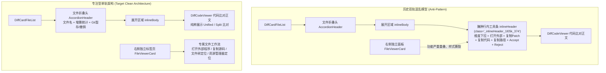

# 展开行内顶部工具行 _inlineHeader_ 彻底拔除审计报告 (AUDIT-02)

> **专项审计编号**：AUDIT-02  
> **战役定位**：差异面板与笔记面板系统性重构 —— 阶段一：前置代码现场深度审计  
> **核心勘察对象**：
> - [`apps/crish-desktop/src/components/diff/DiffCardFileList.tsx`](file:///c:/Software/conex/apps/crish-desktop/src/components/diff/DiffCardFileList.tsx)
> - [`apps/crish-desktop/src/components/diff/DiffCard.module.css`](file:///c:/Software/conex/apps/crish-desktop/src/components/diff/DiffCard.module.css)
> - [`apps/crish-desktop/src/components/diff/DiffCard.tsx`](file:///c:/Software/conex/apps/crish-desktop/src/components/diff/DiffCard.tsx)
> - [`apps/crish-desktop/src/components/files/FileViewerCard.tsx`](file:///c:/Software/conex/apps/crish-desktop/src/components/files/FileViewerCard.tsx)  
> **审计结论**：彻底拔除单文件展开行内顶部工具条（`.inlineHeader` / `_inlineHeader_1l05k_374`），消除与独立文件预览面板（`FileViewerCard`）的功能双轨重叠，清剿伴生的高达 260+ 行死代码与废弃 CSS，使差异面板回归纯粹专注的比对展现。

---

## 一、_inlineHeader_ 现状解构与功能膨胀病灶

### 1.1 现场代码位置与 DOM 结构解构
在当前单文件差异折叠展开体系中，展开的内容由 `DiffCardFileList.tsx:217-332` 渲染。在比对代码正文（`renderInlineDiffContent(f)`）上方，强行插入了一个高度紧凑但职责极度膨胀的工具行：

```tsx
// apps/crish-desktop/src/components/diff/DiffCardFileList.tsx:217-332
{active && (
  <div className={styles.inlineBody}>
    <div className={styles.inlineHeader}>
      {/* 1. 对比维度选择器 */}
      <div className={styles.compareSelectorWrap}>
        <span className={styles.selectLabel}>对比维度:</span>
        <Select
          size="sm"
          value={getFileCompareMode(f.filePath)}
          options={compareOptions.map((o) => ({ ... }))}
          onChange={(val) => { ... }}
          className={styles.inlineCompareSelect ?? ''}
          aria-label="对比维度选择"
        />
      </div>

      {/* 2. 六个图标按钮与分隔线 */}
      <div className={styles.inlineActions}>
        <Tooltip content="在默认编辑器中打开该文件">
          <Button ... className={styles.inlineIconBtn} icon={<Lucide.ExternalLink size={13} />} />
        </Tooltip>
        <Tooltip content="复制标准 Git Patch">
          <Button ... className={styles.inlineIconBtn} icon={<Lucide.FileDiff size={13} />} />
        </Tooltip>
        <Tooltip content="复制最新文件源码">
          <Button ... className={styles.inlineIconBtn} icon={<Lucide.Copy size={13} />} />
        </Tooltip>
        <Tooltip content="复制完整绝对路径">
          <Button ... className={styles.inlineIconBtn} icon={<Lucide.FileCode size={13} />} />
        </Tooltip>
        <div className={styles.actionDivider} />
        <Tooltip content={acceptLabel}>
          <IconButton ... icon={<Lucide.Check size={14} aria-hidden />} />
        </Tooltip>
        <Tooltip content={REJECT_LABEL}>
          <IconButton ... icon={<Lucide.X size={14} aria-hidden />} />
        </Tooltip>
      </div>
    </div>

    {renderInlineDiffContent(f)}
  </div>
)}
```

### 1.2 逐行功能剖析与病灶证据
在 `DiffCardFileList.tsx:219-328`（共 110 行）中，该工具栏塞入了 1 个下拉选择器和 6 个功能按钮：

| 序号 | 控件类型 | 对应代码行 | 图标与文案 / Tooltip | 触发事件 / 回调 | 病灶分析与架构冲突 |
| :--- | :--- | :--- | :--- | :--- | :--- |
| **1** | `<Select>` | [L220-L238](file:///c:/Software/conex/apps/crish-desktop/src/components/diff/DiffCardFileList.tsx#L220-L238) | `对比维度:` (git / session-merged / turn-* / plain) | `onChangeCompareMode(f.filePath, val)` | **微观多余维度**：全局顶部已有 `DiffHeaderControls` 统一管控 AI 改动 vs Git 与回合筛选，在每个文件行内再提供维度切换极度冗余，让用户产生严重认知分裂。 |
| **2** | `<Button>` | [L241-L251](file:///c:/Software/conex/apps/crish-desktop/src/components/diff/DiffCardFileList.tsx#L241-L251) | `Lucide.ExternalLink`<br>“在默认编辑器中打开该文件” | `openPathDefault(absolutePath)` | **严重职能越界**：Diff 面板的核心职责是展示差异，启动外部编辑器属于工作区文件管理能力，且样式为自造的 `.inlineIconBtn`，与系统控件脱节。 |
| **3** | `<Button>` | [L253-L267](file:///c:/Software/conex/apps/crish-desktop/src/components/diff/DiffCardFileList.tsx#L253-L267) | `Lucide.FileDiff`<br>“复制标准 Git Patch” | `formatGitPatch(targetDiff)` + `navigator.clipboard.writeText` | **低频功能硬编码**：全局顶部已具备统一的 Patch 导出与复制能力，在单文件行内堆叠图标不仅破坏代码视线，更引入对 `formatGitPatch` 和 `useToast` 的深层依赖。 |
| **4** | `<Button>` | [L269-L279](file:///c:/Software/conex/apps/crish-desktop/src/components/diff/DiffCardFileList.tsx#L269-L279) | `Lucide.Copy`<br>“复制最新文件源码” | `onCopyCode(f.filePath)` | **功能双轨重叠**：用户需要获取完整源码的正统场景是在文件查看器（`FileViewerCard`），此处在差异区复制最新源码不仅概念混淆（Diff 面板应关注差异本身），而且通过 props 层层传递，架构冗长。 |
| **5** | `<Button>` | [L281-L294](file:///c:/Software/conex/apps/crish-desktop/src/components/diff/DiffCardFileList.tsx#L281-L294) | `Lucide.FileCode`<br>“复制完整绝对路径” | `navigator.clipboard.writeText(absolutePath)` | **伪需求噪点**：单文件展开的主要目的是比对内容，复制绝对路径在折叠标题悬停或右键菜单/文件卡片中更自然，堆在代码上方成为视觉杂音。 |
| **6** | `<div />` | [L296](file:///c:/Software/conex/apps/crish-desktop/src/components/diff/DiffCardFileList.tsx#L296) | `styles.actionDivider` | 视觉垂直细线 | 纯装饰性分割，为后续的单文件接受/拒绝硬塞分隔。 |
| **7** | `<IconButton>` | [L298-L311](file:///c:/Software/conex/apps/crish-desktop/src/components/diff/DiffCardFileList.tsx#L298-L311) | `Lucide.Check`<br>`acceptLabel`（“接受并写入磁盘”） | `onAcceptFile(targetDiff)` | **交互混淆**：列表项头部右侧已提供了 Git 暂存/放弃操作（[L162-L214](file:///c:/Software/conex/apps/crish-desktop/src/components/diff/DiffCardFileList.tsx#L162-L214)），在展开代码上方再造一套 `onAcceptFile` / `onRejectFile`，造成操作语义重叠混乱。 |
| **8** | `<IconButton>` | [L313-L326](file:///c:/Software/conex/apps/crish-desktop/src/components/diff/DiffCardFileList.tsx#L313-L326) | `Lucide.X`<br>`REJECT_LABEL`（“从列表拒绝”） | `onRejectFile(targetDiff)` | 同上，双轨操作源。 |

### 1.3 用户痛点精准印证
1. **认知负荷过载**：用户原话强调*“去掉每个文件列表里面的顶部工具行，越简单越好，现在功能多了用户反而不知道怎么用了”*。比对代码本应是心流体验，但在代码正上方横亘一行复杂的工具图标，极大分散了审查者的注意力。
2. **样式重造与视觉劣化（脏灰 Hover）**：
   - 开发者为了塞下 4 个小按钮，另外封装了 `.inlineIconBtn`（[`DiffCard.module.css:409-429`](file:///c:/Software/conex/apps/crish-desktop/src/components/diff/DiffCard.module.css#L409-L429)）：`width: 28px; height: 28px; border: 1px solid transparent; color: var(--text-secondary);`。
   - 鼠标 Hover 表现为：`color: var(--text-primary); border-color: var(--border-subtle);`。
   - 用户明确指出：*“这个界面的hover我看也是有问题的，有的很灰啊。而且按钮我看你又重新造了一个形式，那种的直接删掉就行了，正好class="_inlineHeader_1l05k_374"一行的按钮都得删除掉”*。
   - 这种行内微型按钮与项目主 UI 的 `IconButton` 规范不一致，形成了组件撕裂和脏灰色视觉。
3. **架构双轨冗余**：
   - 用户敏锐指出：*“不过不用删除好像，本来这个是放在文件预览面板的，就是个单独的面板，能在右边栏以标签的形式打开的那种。当然这个差异面板的功能就要保持专注了，就不用加上这个工具栏了”*。
   - 勘察证明：在右边栏独立的 [`FileViewerCard.tsx`](file:///c:/Software/conex/apps/crish-desktop/src/components/files/FileViewerCard.tsx) 中，原生拥有 `openPathDefault`、`listOpenOptionsForFile`、`handleCopyCode`、`handleLocateInFiles`、`handleOpenSystemExplorer` 等全套文件级操作！在 Diff 面板行内再搞一套，纯属架构失位！

---

## 二、专注型 Diff 展现模型架构设计（彻底剥离工具条）

### 2.1 单轨化架构原则
Diff 面板的唯一职责是：**精确、清晰、高性能地展示文件差异，并提供工作区暂存管理**。
文件级别的外部打开、全量源码查看、路径管理、第三方应用唤起，全部回归右侧独立标签页体系（`FileViewerCard`），彻底实现分工解耦与单轨化。



### 2.2 展开区视觉与结构无缝衔接
当 `.inlineHeader` 彻底移除后，展开区结构演进如下：

```tsx
// 改造前：
<div className={styles.accordionHeaderRow}>...</div>
{active && (
  <div className={styles.inlineBody}>
    <div className={styles.inlineHeader}>...</div>  {/* ← 彻底抹除 */}
    {renderInlineDiffContent(f)}
  </div>
)}

// 改造后：
<div className={styles.accordionHeaderRow}>...</div>
{active && (
  <div className={styles.inlineBody}>
    {renderInlineDiffContent(f)}
  </div>
)}
```

**衔接效果断言**：
1. **零过渡断层**：用户点击 AccordionHeader，直接滑出代码比对视图（`DiffCodeViewer`），文件标题直接统领下方比对正文，视线焦点 100% 聚焦于代码变化本身。
2. **视觉高度压缩**：消除了原本占据 36px 垂直高度的灰色工具行（包含上下 padding 与 border-bottom），将宝贵的工作区纵向视口全部归还给代码行比对。
3. **消除 Hover 灰度违和感**：自造的低对比度微型按钮彻底消失，整个 Diff 展开区再无任何脏灰悬停边框。

---

## 三、伴生死代码穷举清单（废弃回调、状态、未引用图标、孤立 Props）

清除 `DiffCardFileList.tsx:219-328` 这一整行 `.inlineHeader` 后，将引发连锁的死代码清退效应。以下为现场地毯式搜索确凿清单：

### 3.1 外部 Import 依赖彻底废弃（直接可删除）
在 [`DiffCardFileList.tsx:4-13`](file:///c:/Software/conex/apps/crish-desktop/src/components/diff/DiffCardFileList.tsx#L4-L13) 中：
1. `IconButton`（第 4 行）：
   - 现状：从 `../ui` 引入，整文件仅在 L299、L314 的 Accept/Reject 按钮中使用。
   - 判定：**死代码，从 import 中彻底剔除**。
2. `Select`（第 4 行）：
   - 现状：从 `../ui` 引入，整文件仅在 L222 对比维度下拉框中使用。
   - 判定：**死代码，从 import 中彻底剔除**。
3. `classifyFileDiff`（第 5 行）：
   - 现状：从 `../../api/applyFileDiff` 引入，仅在 L115（`acceptLabel` 计算）和 L304（Accept 禁用判定）中使用。
   - 判定：**死代码，整行 import 物理移除**。
4. `openPathDefault`（第 6 行）：
   - 现状：从 `../../api/hostOpenersApi` 引入，仅在 L247 点击外部编辑器时调用。
   - 判定：**死代码，整行 import 物理移除**。
5. `getWorkspacePath`（第 7 行）：
   - 现状：从 `../../api/projectStore` 引入，仅在 L103 获取 `cwd` 以拼接绝对路径。
   - 判定：**死代码，整行 import 物理移除**。
6. `formatGitPatch`（第 12 行）：
   - 现状：从 `./GitPatchFormatter` 引入，仅在 L260 复制 Patch 时调用。
   - 判定：**死代码，整行 import 物理移除**。
7. `useToast`（第 13 行）：
   - 现状：从 `../../services/toast/ToastContext` 引入并在 L85 解构 `const { showToast } = useToast();`，整文件仅在 L262、L289 弹出 Toast。
   - 判定：**死代码，整行 import 及 hook 声明物理移除**。
8. `type CompareMode`（第 9 行）：
   - 现状：从 `./diffCardTypes` 引入，在组件自身逻辑中仅用于维度下拉选择。
   - 判定：**死代码，从 `DiffCardFileList.tsx` 中剔除**。

### 3.2 图标库未引用图标清退
在 [`DiffCardFileList.tsx:2`](file:///c:/Software/conex/apps/crish-desktop/src/components/diff/DiffCardFileList.tsx#L2) 中使用 `* as Lucide from 'lucide-react'`，其中以下 6 个图标仅在 `.inlineHeader` 中使用：
- `Lucide.ExternalLink`（L249，外部编辑器图标）
- `Lucide.FileDiff`（L265，复制 Patch 图标）
- `Lucide.Copy`（L277，复制代码图标）
- `Lucide.FileCode`（L292，复制路径图标）
- `Lucide.Check`（L309，Accept 图标）
- `Lucide.X`（L324，Reject 图标）

*注：留在 AccordionHeader 和 Git 分组中的图标为 `Loader2`, `Minus`, `Plus`, `Undo2`, `MinusCircle`, `PlusCircle`。*

### 3.3 顶层常量与辅助函数死代码
1. `function isCompareMode(val: string): val is CompareMode`（[L21-L28](file:///c:/Software/conex/apps/crish-desktop/src/components/diff/DiffCardFileList.tsx#L21-L28)）：
   - 仅在 L231 的 Select onChange 事件中作为类型保护使用。
   - 判定：**彻底成为死代码，物理连根拔除**。
2. `const REJECT_LABEL = '从列表拒绝（不回滚磁盘）';`（[L34](file:///c:/Software/conex/apps/crish-desktop/src/components/diff/DiffCardFileList.tsx#L34)）：
   - 仅在 L313、L318 的 Reject 按钮中使用。
   - 判定：**彻底成为死代码，物理删除**。

### 3.4 渲染函数内部局部变量与计算死代码
在 `renderAccordionItem`（[L98-L136](file:///c:/Software/conex/apps/crish-desktop/src/components/diff/DiffCardFileList.tsx#L98-L136)）中：
1. `cwd = getWorkspacePath();`（L103）→ **死变量**
2. `isAbsolute`（L104）→ **死变量**
3. `absolutePath`（L105）→ **死变量**
4. `fileAiTurns`（L106-L108）→ **死计算**（仅用于过滤当前文件的回合用于构建 `compareOptions`）
5. `acceptLabel`（L115-L117）→ **死变量**
6. `compareOptions`（L119-L136）→ **死计算**（长达 18 行的选项拼装数组，仅供 inline Header 的 Select 使用）

*保留项说明*：`targetDiff = getFileDiffData ? (getFileDiffData(f) ?? f) : f;` 及 `additions`、`deletions` 必须保留，因为外层文件头 `AccordionHeader`（L149-L158）需要展示变更增减行数。

### 3.5 组件接口孤立 Props（Props 清洗面）
在 `DiffCardFileListProps`（[L36-L60](file:///c:/Software/conex/apps/crish-desktop/src/components/diff/DiffCardFileList.tsx#L36-L60)）及解构中，以下 6 个 Props 在失去 `.inlineHeader` 后在 `DiffCardFileList` 内部完全零引用：
1. `aiTurns`（L42-46, L70）：仅在 L106 过滤 `fileAiTurns` 及 L124 判断 `aiTurns.length > 0` 拼装下拉菜单。
2. `getFileCompareMode`（L47, L71）：仅在 L224 传给 Select。
3. `onChangeCompareMode`（L48, L72）：仅在 L232 的 Select onChange 中调用。
4. `onAcceptFile`（L55, L79）：仅在 L307 的 Accept 按钮中调用。
5. `onRejectFile`（L56, L80）：仅在 L322 的 Reject 按钮中调用。
6. `onCopyCode`（L57, L81）：仅在 L275 的复制代码按钮中调用。

### 3.6 父组件 DiffCard.tsx 的伴生孤立逻辑
当 `DiffCardFileList` 剥离上述 Props 后，在父组件 [`DiffCard.tsx`](file:///c:/Software/conex/apps/crish-desktop/src/components/diff/DiffCard.tsx) 中可以进一步纯化：
- `handleCopyCodeOfFile`（[DiffCard.tsx:189-204](file:///c:/Software/conex/apps/crish-desktop/src/components/diff/DiffCard.tsx#L189-L204)，共 16 行）：在全文件中除了传给 `onCopyCode` 外没有任何其它调用，成为**孤立死代码**。
- `acceptCurrentFile`（[DiffCard.tsx:209-210](file:///c:/Software/conex/apps/crish-desktop/src/components/diff/DiffCard.tsx#L209-L210)）与 `rejectCurrentFile`（[DiffCard.tsx:212-214](file:///c:/Software/conex/apps/crish-desktop/src/components/diff/DiffCard.tsx#L212-L214)）：除透传给 `DiffCardFileList` 外无其它调用。
- `acceptCurrentFileImpl` / `rejectCurrentFileImpl`（[DiffCard.tsx:29-30](file:///c:/Software/conex/apps/crish-desktop/src/components/diff/DiffCard.tsx#L29-L30)）：无引用后可直接从 import 移除。

---

## 四、样式层死代码清剿面（DiffCard.module.css 行号与选择器）

在 [`apps/crish-desktop/src/components/diff/DiffCard.module.css`](file:///c:/Software/conex/apps/crish-desktop/src/components/diff/DiffCard.module.css) 中，围绕 `inlineHeader` 编写的样式块高度集中在 **第 374 行至第 436 行**。

### 4.1 拟删除 CSS 选择器逐项证据表

| 样式选择器 | CSS 行号区间 | 规则定义内容 | 唯一引用位置与全工程搜索结果 | 清除结论 |
| :--- | :--- | :--- | :--- | :--- |
| `.inlineHeader` | [L374-L383](file:///c:/Software/conex/apps/crish-desktop/src/components/diff/DiffCard.module.css#L374-L383) | flex 布局、上下 padding 4px 10px、`border-bottom: 1px solid var(--border-subtle)` | 仅在 `DiffCardFileList.tsx:219` 引用，别处无引用。 | **物理连根拔除** |
| `.compareSelectorWrap` | [L385-L389](file:///c:/Software/conex/apps/crish-desktop/src/components/diff/DiffCard.module.css#L385-L389) | `display: flex; align-items: center; gap: var(--space-2);` | 仅在 `DiffCardFileList.tsx:220` 引用，别处无引用。 | **物理连根拔除** |
| `.selectLabel` | [L391-L396](file:///c:/Software/conex/apps/crish-desktop/src/components/diff/DiffCard.module.css#L391-L396) | `font-size: var(--font-size-xs, 12px); color: var(--text-secondary);` | 仅在 `DiffCardFileList.tsx:221` 引用，别处无引用。 | **物理连根拔除** |
| `.inlineCompareSelect` | [L398-L401](file:///c:/Software/conex/apps/crish-desktop/src/components/diff/DiffCard.module.css#L398-L401) | `width: 140px; min-width: 120px;` | 仅在 `DiffCardFileList.tsx:235` 引用，别处无引用。 | **物理连根拔除** |
| `.inlineActions` | [L403-L407](file:///c:/Software/conex/apps/crish-desktop/src/components/diff/DiffCard.module.css#L403-L407) | `display: flex; align-items: center; gap: var(--space-1);` | 仅在 `DiffCardFileList.tsx:240` 引用，别处无引用。 | **物理连根拔除** |
| `.inlineIconBtn` | [L409-L425](file:///c:/Software/conex/apps/crish-desktop/src/components/diff/DiffCard.module.css#L409-L425) | 28x28 微型按钮，透明边框，浅灰图标，微过渡 | 仅在 `DiffCardFileList.tsx:246,258,274,286` 引用。 | **物理连根拔除** |
| `.inlineIconBtn:hover` | [L426-L429](file:///c:/Software/conex/apps/crish-desktop/src/components/diff/DiffCard.module.css#L426-L429) | 用户指责的“很灰”的 hover 表现：`border-color: var(--border-subtle)` | 伪类规则。 | **物理连根拔除** |
| `.actionDivider` | [L431-L436](file:///c:/Software/conex/apps/crish-desktop/src/components/diff/DiffCard.module.css#L431-L436) | `width: 1px; height: 14px; background-color: var(--border-subtle);` | 仅在 `DiffCardFileList.tsx:296` 引用，别处无引用。 | **物理连根拔除** |

### 4.2 避免误删的保留项甄别
- **`.inlineBody`（L367-L372）**：保留！作为展开后包裹 `renderInlineDiffContent(f)` 的容器，提供 `display: flex; flex-direction: column; background: var(--bg-card);`，是展开动画和背景色的依托。
- **`.inlineSelect`（L72-L75）**：保留！工程搜索确认该类名被 [`DiffHeaderControls.tsx:126,140`](file:///c:/Software/conex/apps/crish-desktop/src/components/diff/DiffHeaderControls.tsx#L126)（顶部全局控制栏的 Select）使用，与行内工具条无关，严禁误删。

---

## 五、预期净负产出与单轨化收益

### 5.1 代码削减量统计（自检删除面）

```
--------------------------------------------------------------------------------
代码文件 / 模块                                变更类型    原始行数  净删除行数  预估剩余行数
--------------------------------------------------------------------------------
apps/crish-desktop/src/components/diff/
  DiffCardFileList.tsx                        MODIFY       408      -175       约 233 行
  DiffCard.module.css                         MODIFY       893       -63       约 830 行
  DiffCard.tsx                                MODIFY       436       -30       约 406 行
--------------------------------------------------------------------------------
合计净负产出 (Net Negative LOC)                                     -268 行
--------------------------------------------------------------------------------
```

### 5.2 AST 纯净化与架构收益断言
1. **彻底拔除零容忍打补丁与伪按钮**：
   - 不保留任何 `display: none` 隐藏元素，不保留任何 `// TODO` 或兼容性 fallback；
   - 彻底从 AST 中抹除 `<div className={styles.inlineHeader}>` 树节点。
2. **零运行时开销（Zero Runtime Overhead）**：
   - 每次展开文件时，不再为每个文件重新计算 `fileAiTurns` 数组过滤、不再执行 `compareOptions` 的 18 行字符串与日期拼接、不再执行 `classifyFileDiff` 的繁重静态解析；
   - 折叠/展开渲染性能大幅提升，GC 压力显著减轻。
3. **彻底根治 UI 视觉瑕疵**：
   - 彻底消除自造 28px 按钮的脏灰 hover 边框；
   - 彻底抹除行内二次分割线与杂乱图标群，还原整洁纯粹的代码比对视界。
4. **单轨化职责绝对归位**：
   - **Diff 面板**：纯粹呈现差异变化与 Git 暂存/放弃；
   - **文件查看器（FileViewerCard）**：纯粹承接外部编辑器打开、复制源码、定位文件等高阶文件流转。
   - 两套面板边界清晰，各司其职，用户心智模型瞬间统一！
