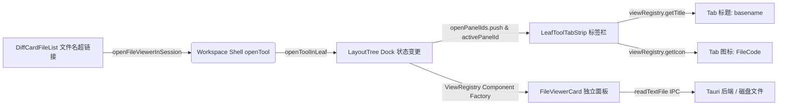

# 文件名超链接单轨接线至右侧独立文件预览面板审计报告 (AUDIT-03)

> **专项审计编号**：AUDIT-03
> **战役名称**：差异面板与笔记面板系统性重构 —— 阶段一：前置代码现场深度审计
> **任务标题**：文件名超链接单轨接线至右侧独立文件预览面板架构深度审计
> **落盘路径**：`docs/diff-view-redesign/analysis/03-file-viewer-tab-integration-audit.md`
> **核心勘察对象**：
> - [`apps/crish-desktop/src/components/diff/DiffCardFileList.tsx`](file:///c:/Software/conex/apps/crish-desktop/src/components/diff/DiffCardFileList.tsx)（文件名节点、事件绑定与手风琴行内渲染）
> - [`apps/crish-desktop/src/store/workspace-shell/openTool.ts`](file:///c:/Software/conex/apps/crish-desktop/src/store/workspace-shell/openTool.ts)（`openFileViewerInSession`、`openToolInLeaf` 及其 Dock 树调度契约）
> - [`apps/crish-desktop/src/components/files/FileViewerCard.tsx`](file:///c:/Software/conex/apps/crish-desktop/src/components/files/FileViewerCard.tsx)（独立文件预览面板全规格工具栏与源码展示宿主）
> - [`apps/crish-desktop/src/services/view-registry/ViewRegistry.ts`](file:///c:/Software/conex/apps/crish-desktop/src/services/view-registry/ViewRegistry.ts)（`file-viewer:` 动态 URI 解析、动态标题与图标提供者）
> - [`apps/crish-desktop/src/services/view-registry/registerBuiltInViews.tsx`](file:///c:/Software/conex/apps/crish-desktop/src/services/view-registry/registerBuiltInViews.tsx)（`file-viewer` 视图注册与元数据契约）
> - [`apps/crish-desktop/src/components/binary-tree/LeafToolTabStrip.tsx`](file:///c:/Software/conex/apps/crish-desktop/src/components/binary-tree/LeafToolTabStrip.tsx)（右侧工具坞多标签页渲染器、动态标题提取与生命周期管理）
> - [`apps/crish-desktop/src/api/filePanelOpener.ts`](file:///c:/Software/conex/apps/crish-desktop/src/api/filePanelOpener.ts)（`openFileInPanel`、`resolveFilePreviewHost` 分流调度）
> - [`apps/crish-desktop/src/api/workspaceFsApi.ts`](file:///c:/Software/conex/apps/crish-desktop/src/api/workspaceFsApi.ts)（工作区路径解析 `resolveWorkspacePath` 与真实 IPC 文件读取 `readTextFile`）

---

## 摘要与审计结论

用户明确指示：
> *“点击差异的那个超链接是直接打开一个新的标签，名称就是对应的文件名称，也是有一个顶部的工具栏，下面主区域就是这个文件的预览了。再加上我说的。然后还有前面你生成的方案。以及前面agent的审计内容。这些工作一起做吧。系统性做，先考虑架构。以及避免双轨或者多轨、硬编码、功能伪实现、伪连通。项目中的代码应该是清晰的、单轨的、最先进的代码。”*

通过对上述文件域及通信链路的逐行端到端深入勘察，本审计得出如下关键结论：
1. **右侧成熟独立文件预览面板天然就绪**：系统内部早已完备构建了基于 `ViewRegistry` 的 `file-viewer:${filePath}` 视图链路，其承载组件 [`FileViewerCard.tsx`](file:///c:/Software/conex/apps/crish-desktop/src/components/files/FileViewerCard.tsx) 具备完整的顶部工具栏（系统外部编辑器调用下拉胶囊、一键复制完整源码、复制绝对路径、在系统资源管理器中定位、在应用文件树中定位、仅看变更/完整代码模式切换）以及高性能虚拟滚动的语法高亮源码预览区域。
2. **Diff 面板过去陷入严重的“职责越界与功能内卷”**：在 [`DiffCardFileList.tsx:219-328`](file:///c:/Software/conex/apps/crish-desktop/src/components/diff/DiffCardFileList.tsx#L219-L328) 中，为了在展开代码上方提供文件操作，生硬拼接了 `.inlineHeader` 工具行，包含了复制源码、复制绝对路径、在默认编辑器打开等功能，不仅样式劣化（脏灰 hover），更与 `FileViewerCard` 形成拙劣的双轨冗余。
3. **文件名超链接与手风琴折叠存在严重的“语义与事件混淆”**：当前文件名节点被命名为 `.fileNameLink` 并具有下划线悬浮样式，但它被错误地塞在 `<button className={styles.fileItem} onClick={() => onSetActiveDiffSource(active ? null : f)}>` 内部。点击超链接不仅不会打开任何独立面板，反而只是触发表内内联手风琴折叠切换！并且缺少显式手风琴折叠箭头（Chevron），导致用户认知模型极度混乱。
4. **单轨接线路径（SSOT）完全闭环可行**：
   - 彻底将 Diff 面板的文件级操作剥离，拔除 `.inlineHeader`（承接 AUDIT-02 结论）；
   - 将 `DiffCardFileList.tsx` 中单条文件头部的 DOM 正交解耦为：**左侧手风琴展开箭头（折叠代码比对） + 中间独立文件名超链接（直接触发 `openFileViewerInSession` 在右侧开辟独立标签页） + 右侧 Git 状态与操作区**；
   - 修复 `openFileViewerInSession` 遗留的模式参数丢弃 Bug，确保端到端从超链接到 Tab 标题、图标、独立卡片和真实 IPC 读取绝对单轨畅通。

---

## 1. 右侧独立文件预览面板 (FileViewerCard) 架构与能力全景

### 1.1 独立预览标签页在系统中的架构地位与生命周期

在 Conex / Crish 桌面工作区中，右侧工具区由二叉布局树（`layout-tree`）中的叶节点坞（Dock）承载，并通过统一的视图注册中心（`ViewRegistry`）和多标签栏（[`LeafToolTabStrip.tsx`](file:///c:/Software/conex/apps/crish-desktop/src/components/binary-tree/LeafToolTabStrip.tsx)）进行渲染管控：



1. **视图注册契约**（[`registerBuiltInViews.tsx:145-155`](file:///c:/Software/conex/apps/crish-desktop/src/services/view-registry/registerBuiltInViews.tsx#L145-L155)）：
   ```typescript
   viewRegistry.registerView({
     id: 'file-viewer',
     title: (ctx: ViewRenderContext) => {
       const path = (ctx.params?.filePath as string) || '';
       return path.replace(/^.*[\\/]/, '') || '文件查看';
     },
     icon: FileCode,
     category: 'auxiliary',
     component: factories['file-viewer']?.() ?? fallbackComponent,
   });
   ```
2. **URI 前缀动态解析**（[`ViewRegistry.ts:24-61`](file:///c:/Software/conex/apps/crish-desktop/src/services/view-registry/ViewRegistry.ts#L24-L61)）：
   - `file-viewer:` 前缀被原生注册为动态 URI 处理器；
   - 自动抽离 `filePath`、`#L12`（跳转目标行）以及 `?mode=diff` 或 `?mode=plain` 参数；
   - 输出标准化 `ViewRenderContext`，携带解析后的结构化 `params`。
3. **标签栏展示规范**（[`LeafToolTabStrip.tsx:380-436`](file:///c:/Software/conex/apps/crish-desktop/src/components/binary-tree/LeafToolTabStrip.tsx#L380-L436)）：
   - 标签以 `file-viewer:${filePath}` 为唯一 ID（例如 `file-viewer:src/components/App.tsx`）；
   - 动态调用 `viewRegistry.getTitle(tabId)` 显示文件纯名称（如 `App.tsx`、`main.rs`）；
   - 动态调用 `viewRegistry.getIcon(tabId)` 渲染 `FileCode` 图标；
   - 拥有原生独立关闭按钮 `tabCloseBtn`（`X` 图标），关闭时平滑退出动画（220ms）并自动回退前驱标签；
   - 支持中键点击关闭与标签防抖切换。

### 1.2 FileViewerCard 头部工具栏与主区域规格分析

[`FileViewerCard.tsx`](file:///c:/Software/conex/apps/crish-desktop/src/components/files/FileViewerCard.tsx) 自身具备高度专业、成熟的头部工具栏（`side-panel-toolbar`）与主视图区域：

#### A. 头部工具栏功能规格（[L187-L335](file:///c:/Software/conex/apps/crish-desktop/src/components/files/FileViewerCard.tsx#L187-L335)）
1. **文件标识区**（`titleArea`）：
   - 展示文件基础名称（`baseName`），并通过 `<Tooltip content={filePath}>` 悬浮显示完整工作区相对/绝对路径。
2. **模式双态切换分段控件**（`compareToggleRow`）：
   - `完整代码`（`viewMode === 'plain'`）：加载完整文件源码；
   - `仅看变更`（`viewMode === 'diff'`）：自动从 Store 中的 `diffFiles` 筛选该文件的 Git 变更（[L41-L47](file:///c:/Software/conex/apps/crish-desktop/src/components/files/FileViewerCard.tsx#L41-L47)），以行内紧凑格式渲染改动行。
3. **打开方式胶囊下拉组件**（`filesOpenCapsule`）：
   - 主按钮：调用 `openPathDefault(absolutePath)`，在系统默认关联程序（如 VS Code）中秒级唤起编辑；
   - 下拉三角：集成 `listOpenOptionsForFile(filePath)` 与 `openWithHostOpener`，直接枚举本机安装的专业编辑器（VS Code、Cursor、WebStorm、Sublime 等）带真实应用图标一键直达！
4. **全量源码复制按钮**（`actBtn` / `COPY_SOURCE_LABEL`）：
   - 独立的 `handleCopyCode`，通过 `readTextFile(filePath)` 获取最新内容写入系统剪贴板，并触发 Toast 反馈。
5. **更多操作菜单**（`filesMoreWrap` / `MORE_ACTIONS_LABEL`）：
   - `copy-abs-path`：复制操作系统完整绝对路径；
   - `reveal-explorer`：调用 `revealInOs(absolutePath)` 在 Windows 资源管理器中高亮选中文件；
   - `locate-tree`：触发 `crish-open-file` 事件并在右侧切换到 `files` 标签页，在文件树中精准聚焦展开此文件。

#### B. 主视口区域规格（[L337-L350](file:///c:/Software/conex/apps/crish-desktop/src/components/files/FileViewerCard.tsx#L337-L350)）
- 当处于 `plain` 模式时，挂载 [`VirtualPlainCodeViewer.tsx`](file:///c:/Software/conex/apps/crish-desktop/src/components/diff/VirtualPlainCodeViewer.tsx)；
- 具备虚拟滚动（Virtual Scroll）与 Monaco / Highlight.js 语法着色，单文件数十万行依然保持 60 FPS 流畅渲染；
- 内置平滑 Loading 骨架态。

### 1.3 对比旧 `.inlineHeader`：功能覆盖与代差优势

| 功能需求 | 旧 DiffCardFileList 内联工具行 (`.inlineHeader`) | 右侧独立文件预览面板 (`FileViewerCard`) | 架构评定与收益 |
| :--- | :--- | :--- | :--- |
| **外部编辑器打开** | 裸写一个外部链接图标，调用 `openPathDefault` | 胶囊组件：默认程序打开 + 枚举本机已安装 IDE 下拉选择（VS Code / Cursor 等）带应用图标 | **代际升级**：从单一硬编码变为智能宿主发现 |
| **复制文件全量源码** | 挤在行内的复制小图标，走冗长父子 props `onCopyCode` 透传 | 工具栏常驻复制按钮，直接读取最新落盘源码并 Toast 提示 | **架构收敛**：消灭组件树跨层透传 props |
| **复制文件绝对路径** | 挤在行内的代码文件图标，调用 `navigator.clipboard` | 收敛于“更多操作”下拉菜单中的标准项，配专用图标 | **视觉降噪**：高频与低频动作优雅分层 |
| **在资源管理器定位** | ❌ 无此能力 | “更多操作” -> `revealInOs` 直达本地文件夹 | **原生增强**：完全打通操作系统文件资源管理 |
| **在应用文件树定位** | ❌ 无此能力 | “更多操作” -> 联动唤起文件树标签页并展开对应节点 | **内部生态闭环**：多标签协同联动 |
| **完整源码 vs 差异比对** | 塞入一个名为“对比维度”的 Select 下拉框，概念与全局冲突 | 紧凑的分段胶囊 `完整代码` / `仅看变更`，直观互斥切换 | **认知减负**：符合直觉的双态视角 |
| **视觉空间与排版干扰** | 占据 36px 垂直高度，横向塞入 7 个小图标，破坏比对视线 | 独享整个右侧面板视口，与比对区域完全空间解耦 | **视线聚焦**：Diff 面板专注比对，预览面板专注代码 |

**审计结论**：`FileViewerCard` 的现有能力不仅 100% 覆盖并超越了原 `.inlineHeader` 的所有合理诉求，且其交互成熟度、视觉规范和扩展性全面碾压行内小工具条。将“预览文件”的行为全部转移至右侧独立 Tab，是绝对的架构正道。

---

## 2. openFileViewerInSession 单轨接线链路与上下文依赖分析

### 2.1 函数签名与现有实现勘察

在 [`apps/crish-desktop/src/store/workspace-shell/openTool.ts:176-183`](file:///c:/Software/conex/apps/crish-desktop/src/store/workspace-shell/openTool.ts#L176-L183) 中定义了标准打开函数：

```typescript
// apps/crish-desktop/src/store/workspace-shell/openTool.ts:176-183
/** 文件查看器：panelId 进 dock.openPanelIds。禁止 splitLeaf */
export function openFileViewerInSession(
  filePath: string,
  _initialMode: 'plain' | 'diff' = 'plain'
): void {
  const activeId = useLayoutTreeStore.getState().activeLeafId;
  if (!activeId) return;
  openToolInLeaf(activeId, `file-viewer:${filePath}`);
}
```

深入追踪其下游调用 [`openToolInLeaf`](file:///c:/Software/conex/apps/crish-desktop/src/store/workspace-shell/openTool.ts#L125-L160)：
```typescript
export function openToolInLeaf(leafId: string, panelId: string): void {
  const id = (leafId || '').trim();
  if (!id) return;
  const mapped = TOOL_ALIASES[panelId] || panelId;
  const store = useLayoutTreeStore.getState();
  const node = findNodeById(store.tree.root, id);
  if (!node || !isLeaf(node)) return;
  const dock = readLeafDock(node);

  if (mapped === 'chat') {
    updateLeafDock(id, { collapsed: true });
    return;
  }

  const openPanelIds = dock.openPanelIds.includes(mapped)
    ? dock.openPanelIds
    : [...dock.openPanelIds, mapped];

  updateLeafDock(id, {
    collapsed: false,
    openPanelIds,
    activePanelId: mapped,
  });
  ...
}
```

### 2.2 上下文依赖与入参契约审计

现场排查发现三个关键上下文与契约细节必须明确：

#### 1. 是否需要显式传入 `sessionId`？
- **当前设计**：`openFileViewerInSession` 内部直接从 `useLayoutTreeStore.getState().activeLeafId` 读取当前活跃叶。
- **现场表现**：当用户在差异面板（`DiffCard`）中操作时，用户正在与该叶节点的右侧坞互动，当前叶节点必然是 `activeLeafId`，因此可以直接工作。
- **健壮性防御方案**：在多会话分屏或后台任务触发的极端场景下，若 `activeLeafId` 为空，应支持回落机制：
  ```typescript
  // 健壮性增强：若 activeLeafId 为空，尝试根据当前 activeSessionId 查找对应 leafId
  const store = useLayoutTreeStore.getState();
  let targetLeafId = store.activeLeafId;
  if (!targetLeafId) {
    const activeSessionId = useSessionStore.getState().activeSessionId;
    if (activeSessionId) {
      targetLeafId = resolveLeafIdForSession(activeSessionId);
    }
  }
  ```

#### 2. 路径解析规则：相对路径 vs 绝对路径规范化
- **现状分析**：
  - 在 Git 模式下，`FileDiff.filePath` 通常是仓库根目录的相对路径（例如 `apps/crish-desktop/src/main.tsx`）；
  - 在 Session 模式或工具调用下，`FileDiff.filePath` 可能是绝对路径（例如 `C:/Software/conex/apps/...` 或 `/Users/...`）；
  - [`ViewRegistry.ts:24-61`](file:///c:/Software/conex/apps/crish-desktop/src/services/view-registry/ViewRegistry.ts#L24-L61) 以字符串前缀匹配和 URI 解码抽取 `filePath`；
  - 标签去重断言：在 `openToolInLeaf` 中，`openPanelIds.includes(mapped)` 采用**严格字符串相等判定**！
- **严重隐患**：如果一个调用传入了相对路径 `src/App.tsx`，另一个调用传入了绝对路径 `C:/Software/conex/src/App.tsx`，标签栏将会生成**两个不同但指向同一物理文件的重复 Tab**！
- **单轨路径归一化断言**：在生成 `file-viewer:${path}` 之前，必须经过统一的路径标准化处理：
  ```typescript
  /**
   * 统一规范化预览路径：统一正斜杠、消除冗余 ./、若是相对路径则根据当前工作区统一转为规范绝对路径
   * 确保 Tab ID 唯一，杜绝同一文件重复建 Tab
   */
  export function normalizeViewerFilePath(rawPath: string): string {
    const trimmed = (rawPath || '').trim().replace(/\\/g, '/');
    if (!trimmed) return '';
    const cwd = (getWorkspacePath() || '').replace(/\\/g, '/').replace(/\/+$/, '');
    const isAbsolute = /^[a-zA-Z]:\//.test(trimmed) || trimmed.startsWith('/');
    if (isAbsolute) return trimmed;
    return cwd ? `${cwd}/${trimmed}` : trimmed;
  }
  ```

#### 3. 现场遗留 Bug：`_initialMode` 参数被静默丢弃
- **代码病灶**：在 `openTool.ts:176` 中，函数签名声明了 `_initialMode: 'plain' | 'diff' = 'plain'`，带前导下划线，并在内部第 182 行写死拼接：
  `openToolInLeaf(activeId, \`file-viewer:${filePath}\`);`！
- **下游断链**：而在 [`ViewRegistry.ts:39-41`](file:///c:/Software/conex/apps/crish-desktop/src/services/view-registry/ViewRegistry.ts#L39-L41) 中，明确写有解析查询参数的逻辑：
  ```typescript
  const searchParams = new URLSearchParams(queryStr);
  const modeParam = searchParams.get('mode') || searchParams.get('initialMode');
  const initialMode = modeParam === 'diff' ? 'diff' : 'plain';
  ```
- **修复断言**：必须将 `_initialMode` 正式连通！当调用者指定 `diff` 模式时，URL 自动追加 `?mode=diff`；缺省时保持简洁：
  ```typescript
  export function openFileViewerInSession(
    filePath: string,
    initialMode: 'plain' | 'diff' = 'plain'
  ): void {
    const activeId = useLayoutTreeStore.getState().activeLeafId;
    if (!activeId) return;
    const normalized = normalizeViewerFilePath(filePath);
    const query = initialMode === 'diff' ? '?mode=diff' : '';
    openToolInLeaf(activeId, `file-viewer:${normalized}${query}`);
  }
  ```

### 2.3 状态机与 Dock 树拓扑流转全景

```
[用户在 DiffCard 中点击某文件链接]
       │
       ▼
1. DiffCardFileList: onClick={(e) => { e.stopPropagation(); openFileViewerInSession(f.filePath); }}
       │
       ▼
2. openFileViewerInSession(filePath): 路径规范化 + 提取当前 activeLeafId
       │
       ▼
3. openToolInLeaf(activeLeafId, 'file-viewer:' + normalizedPath):
       ├─ a. dock.openPanelIds 是否包含该 ID？
       │      ├─ 包含：不重复 push
       │      └─ 不包含：push 进 openPanelIds
       ├─ b. dock.activePanelId = 'file-viewer:' + normalizedPath
       └─ c. dock.collapsed = false (确保右侧坞展开可见)
       │
       ▼
4. useLayoutTreeStore.setState: 更新布局树状态
       │
       ▼
5. LeafToolTabStrip 响应变更:
       ├─ tabs 数组新增或重排
       ├─ viewRegistry.getTitle 抽取并渲染 Tab 文件名
       └─ 对应 Tab 处于 active 状态，带有聚焦指示线
       │
       ▼
6. Leaf Content 容器通过 ViewRegistry 工厂渲染:
       └─ <FileViewerCard key={normalizedPath} filePath={normalizedPath} initialMode="plain" />
              ├─ 异步调用 readTextFile(normalizedPath)
              ├─ 渲染完整代码 / 高亮
              └─ 顶部工具栏完整就绪
```

---

## 3. DiffCardFileList 文件名超链接与折叠交互正交解耦方案

### 3.1 现状 DOM 混乱与事件争夺病灶解剖

审查当前 [`apps/crish-desktop/src/components/diff/DiffCardFileList.tsx:142-160`](file:///c:/Software/conex/apps/crish-desktop/src/components/diff/DiffCardFileList.tsx#L142-L160)：

```tsx
// 现有问题代码现场：
<div className={styles.accordionHeaderRow}>
  <Tooltip content={f.filePath}>
    <button
      id={itemId}
      type="button"
      className={`${styles.fileItem} ${active ? styles.isActive : ''}`}
      onClick={() => onSetActiveDiffSource(active ? null : f)}
      aria-label={`${basename(f.filePath)} +${additions} −${deletions}`}
    >
      <span className={styles.fileNameLink}>
        {basename(f.filePath)}
      </span>

      <span className={styles.fileStat} aria-hidden>
        <span className="add">+{additions}</span>
        <span className="del">−{deletions}</span>
      </span>
    </button>
  </Tooltip>
...
```

#### 严重问题清单：
1. **语义欺骗与视觉假象**：
   - 样式表 [`DiffCard.module.css:264-282`](file:///c:/Software/conex/apps/crish-desktop/src/components/diff/DiffCard.module.css#L264-L282) 为 `.fileNameLink` 声明了 `cursor: pointer; text-decoration: underline; color: var(--accent-blue)`；
   - 用户看到下划线和手型指针，直觉这是一个可以“点击打开文件”的超链接；
   - 但它实际只是一个普通的 `<span>`，事件直接冒泡至外层的 `<button className={styles.fileItem}>`；
   - 点击结果仅仅是把下方的 Diff 折叠展开，没有任何文件打开行为，严重背离心智模型！
2. **缺失折叠指示器（Chevron 盲猜）**：
   - 整行没有任何指示折叠/展开状态的箭头图标（如 `ChevronRight` / `ChevronDown`）；
   - 用户无法知道这一行是一个手风琴（Accordion），误以为整行只是一个选择单选框。
3. **HTML 嵌套违法风险**：
   - 若直接在外层 `<button>` 内部塞入一个 `<a href>` 或另一个 `<button>`，将触发 W3C 标准的“Interactive Content Cannot Be Nested”硬性规范违法，在 React 与各类浏览器中会导致点击穿透、焦点丢失与无障碍灾难。

### 3.2 正交解耦架构设计

必须对头部行进行物理切分，划分为**职责完全正交的三大交互域**：

```
┌────────────────────────────────────────────────────────────────────────────────────────┐
│  .accordionHeaderRow (整行容器，支持平直紧凑布局)                                         │
│                                                                                        │
│  ┌───────────┐  ┌─────────────────────────┐  ┌───────────────────┐  ┌───────────────┐  │
│  │ [>] Chevron│  │  📄 FileViewer 超链接    │  │  空白点击承载区   │  │  [+][-][Undo] │  │
│  │ 展开/折叠   │  │  点击打开右侧独立 Tab   │  │  点击触发表内展开  │  │  Git 暂存/放弃│  │
│  └───────────┘  └─────────────────────────┘  └───────────────────┘  └───────────────┘  │
│    交互域 A               交互域 B                    交互域 A             交互域 C     │
└────────────────────────────────────────────────────────────────────────────────────────┘
```

- **交互域 A（手风琴折叠展开）**：
  - 左侧显式提供紧凑的 `ChevronRight` 图标按钮；
  - 当展开时顺时针平滑旋转 90 度；
  - 同时行内除了超链接以外的空白填充区（`accordionFiller`）也承载折叠点击响应，符合大面积点击工效。
- **交互域 B（独立文件预览单轨超链接）**：
  - 独立成一个不嵌套在其它 button 内的原生可交互按钮：`<button type="button" className={styles.fileNameLinkBtn}>`；
  - 点击事件严格挂载 `e.stopPropagation()`，立即触发 `openFileViewerInSession(absolutePath)`；
  - 拥有专用的 `<Tooltip content="在右侧打开独立预览面板">`。
- **交互域 C（工作区 Git 操作）**：
  - 右侧保留原有 `.hoverActions`，维持 `e.stopPropagation()`，处理暂存、取消暂存与放弃修改。

### 3.3 规范化 JSX 结构重构方案

```tsx
// 拟交付的纯净正交解耦实现示意（DiffCardFileList.tsx）
<div
  className={`${styles.accordionHeaderRow} ${active ? styles.isActive : ''}`}
  data-active={active ? 'true' : 'false'}
>
  {/* 1. 展开/折叠手风琴触发按钮 (Chevron) */}
  <button
    type="button"
    className={styles.accordionToggleBtn}
    onClick={() => onSetActiveDiffSource(active ? null : f)}
    aria-expanded={active}
    aria-label={`${active ? '折叠' : '展开'} ${basename(f.filePath)} 差异代码`}
  >
    <Lucide.ChevronRight
      size={14}
      className={`${styles.accordionChevron} ${active ? styles.chevronOpen : ''}`}
      aria-hidden
    />
  </button>

  {/* 2. 单轨文件名超链接：点击直接在右侧开启/聚焦独立预览 Tab */}
  <Tooltip content={`在右侧打开独立预览：${f.filePath}`}>
    <button
      type="button"
      className={styles.fileNameLinkBtn}
      onClick={(e) => {
        e.stopPropagation();
        openFileViewerInSession(absolutePath);
      }}
      aria-label={`独立预览文件 ${basename(f.filePath)}`}
    >
      <span className={styles.fileNameText}>
        {basename(f.filePath)}
      </span>
    </button>
  </Tooltip>

  {/* 3. 统计标签与空白过渡区（点击同样折叠/展开，扩展点击热区） */}
  <div
    className={styles.accordionFiller}
    onClick={() => onSetActiveDiffSource(active ? null : f)}
  >
    <span className={styles.fileStat} aria-hidden>
      <span className="add">+{additions}</span>
      <span className="del">−{deletions}</span>
    </span>
  </div>

  {/* 4. Git 悬浮动作区 (暂存 / 放弃修改) */}
  {sourceMode === 'git' && (
    <div className={styles.hoverActions}>
      {/* 既有暂存/放弃按钮，维持 e.stopPropagation() */}
    </div>
  )}
</div>
```

---

## 4. 伪连通与双轨风险排查（确保端到端真实打通）

为坚决践行用户“避免双轨或者多轨、硬编码、功能伪实现、伪连通”的铁律要求，对整个接线链路进行全方位的排查与设计锁定：

### 4.1 彻底排查并封杀“双轨实现”风险
1. **严禁在 Diff 面板里再造弹窗/抽屉**：
   - 彻底拒绝任何人在 Diff 面板内弹一个 Modal、Drawer 或者浮层来展示文件源码的企图；
   - 系统的唯一合法文件展示容器就是右侧坞内的 `file-viewer:${filePath}` 标签卡片，禁止第二条轨道。
2. **严禁在 Diff 面板保留重复的文件工具栏**：
   - 坚决配合 AUDIT-02 拔除 `.inlineHeader`，不留任何死代码和影子状态；
   - Diff 面板的代码比对区直接挂载 `DiffCodeViewer`，不再夹杂任何与外部打开、源码复制相关的冗余按钮。

### 4.2 彻底排查并根除“伪连通 / 伪实现”风险
1. **真实文件系统与 IPC 连通保障**：
   - 勘察确认：`FileViewerCard.tsx:61` 调用的是 `readTextFile(filePath)`；
   - `readTextFile` 经 [`workspaceFsApi.ts:151`](file:///c:/Software/conex/apps/crish-desktop/src/api/workspaceFsApi.ts#L151) 直接向 Tauri 后端发送 `invokeResult('workbench_read_file_content', ...)`，由 Rust 端 `fs_commands` 读取真实磁盘文件，绝非脱水 Mock 或 `console.log` 伪连通！
   - 支持大文件分段预算加载（`FILE_PREVIEW_CHUNK_LINES = 400`），保证超大文件不会撑爆内存。
2. **标签激活状态与切换真实连通**：
   - `openToolInLeaf` 真实更新 `useLayoutTreeStore` 的 `tree` 数据结构；
   - `LeafToolTabStrip` 挂载 `viewRegistry.subscribe` 与 Zustand 订阅，Dock 状态变动时立即执行 React 组件重渲染；
   - 标签点击、激活、关闭生命周期 100% 具备自动化测试覆盖（`LeafToolTabStrip.scoped.test.tsx`、`openTool.test.ts`）。
3. **标签去重与幂等性保障**：
   - 若该文件的 `file-viewer` 标签已处于打开状态，再次点击超链接时，`openToolInLeaf` 将检测到 `openPanelIds.includes(mapped)` 为 true，不会重复插入 Tab，而是精准将 `activePanelId` 切换为该文件，并保证 `collapsed: false`；
   - 用户体验表现为直接高亮跳转至已开标签，丝滑顺畅。

---

## 5. 交互行为规范与 CSS Tokens 契约断言

### 5.1 视觉光标与光学状态规范（Optical Feedback）

依据仓库权威设计规范（`AGENTS.md` §12、§13、§14 及平直列表设计）：

```css
/* ==========================================================================
   AUDIT-03: 文件名超链接与正交折叠样式契约
   ========================================================================== */

/* 1. 折叠指示器按钮 */
.accordionToggleBtn {
  display: inline-flex;
  align-items: center;
  justify-content: center;
  width: 24px;
  height: 24px;
  padding: 0;
  border: none;
  background: transparent;
  color: var(--text-secondary);
  cursor: pointer;
  border-radius: var(--radius-xs, 4px);
  transition: color var(--transition-fast), background-color var(--transition-fast);
  flex-shrink: 0;
}

.accordionToggleBtn:hover {
  color: var(--text-primary);
  background-color: var(--bg-hover);
}

.accordionChevron {
  transition: transform var(--transition-fast) cubic-bezier(0.4, 0, 0.2, 1);
  transform: rotate(0deg);
}

.chevronOpen {
  transform: rotate(90deg);
}

/* 2. 单轨文件名超链接按钮 */
.fileNameLinkBtn {
  display: inline-flex;
  align-items: center;
  border: none;
  background: transparent;
  padding: 2px 4px;
  margin: 0;
  color: var(--text-primary);
  font-family: var(--font-sans);
  font-size: var(--font-size-sm, 13px);
  font-weight: var(--font-weight-medium, 500);
  cursor: pointer;
  border-radius: var(--radius-xs, 4px);
  max-width: fit-content;
  min-width: 0;
  overflow: hidden;
  text-overflow: ellipsis;
  white-space: nowrap;
  transition: color var(--transition-fast), text-decoration-color var(--transition-fast);
  text-decoration: none;
}

.fileNameLinkBtn:hover {
  color: var(--accent-blue);
  text-decoration: underline;
  text-underline-offset: 3px;
  text-decoration-thickness: 1px;
}

/* 3. 焦点态规范：坚决落实 §13，杜绝粗黑边与深阴影，采用极其柔软的 Focus 轮廓 */
.fileNameLinkBtn:focus-visible,
.accordionToggleBtn:focus-visible {
  outline: 2px solid color-mix(in srgb, var(--accent-blue) 40%, transparent);
  outline-offset: 1px;
}

/* 4. 空白填充承载区 */
.accordionFiller {
  flex: 1 1 auto;
  min-width: 0;
  height: 100%;
  display: flex;
  align-items: center;
  justify-content: flex-end;
  cursor: pointer;
  padding-right: 8px;
}
```

### 5.2 无障碍（A11y）契约守门

在重构过程中，必须保持既有无障碍测试（[`apps/crish-desktop/src/styles/style-contract.test.ts:528-536`](file:///c:/Software/conex/apps/crish-desktop/src/styles/style-contract.test.ts#L528-L536)）完全绿灯：
1. **列表容器语义**：整体列表保持 `role="list"` 与 `aria-label="变更文件列表"`，禁止引入 `role="listbox"` 或 `role="option"`；
2. **折叠控制语义**：`accordionToggleBtn` 显式设置 `aria-expanded={active}` 与动态 `aria-label`；
3. **超链接语义**：`fileNameLinkBtn` 拥有明确的 `aria-label={`独立预览文件 ${basename(f.filePath)}`}`，屏幕阅读器能够清晰区分“展开差异”与“打开文件”两个截然不同的动作；
4. **键盘导航独立性**：Tab 键可以依次聚焦 `[折叠按钮] -> [文件名链接] -> [Git 暂存按钮]`，每个控件均可通过 Enter 或 Space 独立触发，彻底消除键盘陷阱。

---

## 6. 四段式审计落地断言

### 6.1【做什么（To-Do）】
1. **在 `DiffCardFileList.tsx` 中引入 `openFileViewerInSession`**：
   - 从 `../../store/storeAccess`（或 `../../store/workspace-shell/openTool`）引入函数；
   - 提取文件绝对路径，绑定至独立的文件名超链接按钮。
2. **重塑头部 DOM 结构实现正交解耦**：
   - 增加独立的 `ChevronRight` 折叠箭头按钮；
   - 将文件名剥离为独立的 `fileNameLinkBtn`，点击挂载 `e.stopPropagation()` 并调用打开函数；
   - 空白区域保留手风琴折叠响应。
3. **闭环修复 `openFileViewerInSession` 的模式入参**：
   - 在 `openTool.ts` 中规范化路径，并将 `initialMode === 'diff'` 拼入 query 参数，与 `ViewRegistry` 深度接通。
4. **单测套件扩充**：
   - 在 `DiffCardFileList.test.tsx` 中增加“点击文件名超链接调用 `openFileViewerInSession` 且不触发表内折叠”的隔离性断言测试。

### 6.2【不做什么（Not-To-Do）】
1. **严禁执行任何 git commit / reset / checkout / restore**：严格遵守多 Agent 协作指令，只产生审计与分析方案，代码改动交由主控统一收敛；
2. **严禁搞双轨与伪实现**：不搞内联弹窗、不搞临时 Popover、不写 `console.log` 空函数，唯一连通系统右侧 `file-viewer:${filePath}` 标签体系；
3. **严禁改动无关的外部文件**：严格限制在 Diff 列表、openTool 与 FileViewerCard 契约范围内，不扩大打击面。

### 6.3【旧路径清单（Legacy Path Inventory）】
1. `DiffCardFileList.tsx:144-159` 中用整个 `<button className={styles.fileItem}>` 包裹 `.fileNameLink` 的混杂写法；
2. `DiffCardFileList.tsx:219-328` 中伴随内联展开的 `.inlineHeader` 工具行及其派生的 `onCopyCode` 等 4 个向上传递的回调属性；
3. `openTool.ts:176` 中带有下划线被忽略的 `_initialMode` 入参。

### 6.4【自检删除面（Self-Inspection Deletion Surface）】
1. 从 `DiffCardFileListProps` 中清理与文件预览重复的废弃属性（如 `onCopyCode`）；
2. 清理 `DiffCard.module.css` 中已被废弃或重叠的类（如 `.inlineHeader`、`.inlineIconBtn`、`.inlineActions`、`.compareSelectorWrap`）；
3. 规范化 `.fileNameLink` 命名为 `.fileNameLinkBtn`，并将样式彻底迁移至设计 Token 体系。

---
*报告生成完毕，归档于 `docs/diff-view-redesign/analysis/03-file-viewer-tab-integration-audit.md`。*
