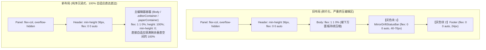

# 笔记底部灰色块 (MirrorDriftStatusBar 与 footer) 彻底拔除审计报告 (AUDIT-06)

> **专项审计编号**：AUDIT-06  
> **所属战役**：差异面板与笔记面板系统性重构 —— 阶段一：前置代码现场深度审计  
> **关联议题**：笔记底部巨大丑陋灰色区域（MirrorDriftStatusBar 与 footer）彻底物理拔除  
> **现场截图诉求**：彻底清除 `class="_mirrorDriftBar_fcd5v_1083 _mirrorDriftBarAttention_fcd5v_1109"` 与 `class="_footer_fcd5v_21"` 两大冗余、丑陋且侵占垂直视口的深色块  
> **审计结论**：**物理拔除（Hard Physical Removal）**，严禁使用 `display: none` 掩耳盗铃，彻底恢复编辑区域 100% 垂直全高自适应与极简纯净纸面。

---

## 1. 底部两块巨大灰色区域的物理现场剖析（含 class 与精确行号）

### 1.1 现场表象与用户痛点溯源
在真实桌面宿主环境下运行笔记面板（W5-B Strict 轨）时，主编辑器正文下方强行堆叠了两块高度合计约 70px~110px 的深色/警示色背景横条：
1. **上横条**：CSS 类名为 `_mirrorDriftBar_fcd5v_1083 _mirrorDriftBarAttention_fcd5v_1109`，呈现暗灰或警示黄色背景，内部填充着“镜像：未检测 / 需注意”、“src=poll / unknown”、“lag=0”、“unpushed=0”、“接受镜像”、“保留文档”、“标记冲突”按钮，以及一行令人费解的技术诚实声明：“底层可能仍是 poll 或 OS 事件 hint，≠ inotify 满关...”。
2. **下横条**：CSS 类名为 `_footer_fcd5v_21`，深灰色背景带顶边线，硬编码打印着“`surface=note-paper · W5-B Strict (W5B_STRICT_BOUNDARY) · source=session_snapshot`”等开发期调试信息。

两块区域不仅侵占了超过 20% 的垂直编辑可视区域，打断视线流动，而且直接将 Rust 内核层、协同文件系统监听层的晦涩技术术语直接暴露给终态用户，严重破坏产品质感与心理安全感。

### 1.2 源码锚点与调用链物理追踪

#### 锚点 A：`NotePaperStrictPanel.tsx` 挂载点
- **文件路径**：[`apps/crish-desktop/src/components/note-paper/NotePaperStrictPanel.tsx`](file:///c:/Software/conex/apps/crish-desktop/src/components/note-paper/NotePaperStrictPanel.tsx#L253-L266)
- **物理行号**：
  ```tsx
  // lines 253-261: MirrorDriftStatusBar 挂载逻辑
  {/* A-INV-02 方向子集；≠ EL-03；≠ inotify 满关 */}
  {showMirrorDriftBar === true || mirrorDriftReport != null ? (
    <MirrorDriftStatusBar
      report={mirrorDriftReport}
      watchSource={mirrorWatchSource}
      unpushedOpCount={mirrorUnpushedOpCount}
      onAction={onMirrorThreeWay}
    />
  ) : null}

  // lines 263-266: footer 挂载逻辑
  <footer className={styles.footer} data-testid="note-paper-strict-footer">
    surface={EDITOR_SURFACE_NOTE_PAPER} · {W5B_STRICT_BOUNDARY}
    {projection ? ` · source=${projection.source}` : ''}
  </footer>
  ```
- **触发机理**：
  - `<footer className={styles.footer}>` 是**无条件 100% 物理渲染**的。
  - `<MirrorDriftStatusBar>` 在 `showMirrorDriftBar === true || mirrorDriftReport != null` 时渲染。而在产品态上层宿主 [`NoteLeafHost.tsx:60-64`](file:///c:/Software/conex/apps/crish-desktop/src/extensions/note-paper/NoteLeafHost.tsx#L60-L64) 中，默认引入了 [`productMirrorPolicy.ts`](file:///c:/Software/conex/apps/crish-desktop/src/extensions/note-paper/productMirrorPolicy.ts#L25) 的策略常量：
    ```ts
    export const WORKSPACE_PRODUCT_ENABLE_MIRROR_DETECT_SCHEDULE = true as const;
    ```
    使得 [`useWorkspaceEmptyStateMirrorSlot.ts:107-110`](file:///c:/Software/conex/apps/crish-desktop/src/extensions/note-paper/mirrorSlot.ts#L107-L110) 判定 `detectSchedule.scheduleActive === true`，强制将 `panelShowMirrorDriftBar` 设为 `true` 并向后端 IPC 轮询漂移报告，最终使得 `MirrorDriftStatusBar` 在桌面端无条件常驻弹出！

#### 锚点 B：CSS 模块哈希反解与样式定位
- **样式文件**：[`apps/crish-desktop/src/components/note-paper/NotePaperPanel.module.css`](file:///c:/Software/conex/apps/crish-desktop/src/components/note-paper/NotePaperPanel.module.css#L530-L625)
- **编译类名对照**：
  | 编译生成的 DOM Class | 源码 CSS 类选择器 | 所在文件及精确行号 | 样式属性与视觉罪证 |
  | :--- | :--- | :--- | :--- |
  | `_footer_fcd5v_21` | `.footer` | `NotePaperPanel.module.css:530-538` | `background: var(--bg-secondary); border-top: 1px solid var(--border-subtle); padding: 6px 12px; font-size: 11px; color: var(--text-tertiary);` |
  | `_mirrorDriftBar_fcd5v_1083` | `.mirrorDriftBar` | `NotePaperPanel.module.css:542-553` | `display: flex; flex-direction: column; gap: 4px; padding: 6px 12px; border-top: 1px solid var(--border-subtle); background: var(--bg-secondary);` |
  | `_mirrorDriftBarAttention_fcd5v_1109` | `.mirrorDriftBarAttention` | `NotePaperPanel.module.css:555-557` | `background: var(--color-warning-bg);`（当判定需注意时强行注入刺眼暗黄色） |
  | `_panel_... > _footer_...` | `.panel > .footer` | `NotePaperPanel.module.css:709-715` | `flex: 0 0 auto; width: 100%;`（强行把底栏作为固定高度卡在底部） |

---

## 2. 物理剔除与渲染树清解耦方案（拒绝 display: none）

### 2.1 铁律重申：坚决反对伪修复与 `display: none`
任何通过 CSS `display: none`、`visibility: hidden` 或 `opacity: 0` 进行视觉隐藏的做法都是典型的不负责任的“打补丁”行为：
1. **DOM 污染未除**：隐藏节点仍驻留 DOM 树，增大虚拟 DOM diff 与内存开销。
2. **后台副作用泄漏**：`MirrorDriftStatusBar` 内部的 `resolveThreeWayAction` 状态、回调以及上层 `useMirrorDetectProduct` 定时器仍然持续在后台运行并向 Rust 后端频繁发 IPC。
3. **可访问性与语义化破坏**：屏幕阅读器与自动化测试仍然能读到这些无用节点。

**必须直接从 JSX 树与代码结构中物理斩断！**

### 2.2 JSX 渲染树物理剥离操作清单
在 [`NotePaperStrictPanel.tsx`](file:///c:/Software/conex/apps/crish-desktop/src/components/note-paper/NotePaperStrictPanel.tsx) 中执行三段式物理摘除：

```tsx
<<<<<<<<<<<< [待删除物理代码块 1: JSX 节点 (lines 252-266)]
      {/* A-INV-02 方向子集；≠ EL-03；≠ inotify 满关 */}
      {showMirrorDriftBar === true || mirrorDriftReport != null ? (
        <MirrorDriftStatusBar
          report={mirrorDriftReport}
          watchSource={mirrorWatchSource}
          unpushedOpCount={mirrorUnpushedOpCount}
          onAction={onMirrorThreeWay}
        />
      ) : null}

      <footer className={styles.footer} data-testid="note-paper-strict-footer">
        surface={EDITOR_SURFACE_NOTE_PAPER} · {W5B_STRICT_BOUNDARY}
        {projection ? ` · source=${projection.source}` : ''}
      </footer>
============ [重构后净空收敛]
      {/* 彻底拔除 MirrorDriftStatusBar 与 footer，NotePaperStrictBody 之下直通面板底边缘 */}
>>>>>>>>>>>>
```

### 2.3 导入与 Props 物理摘除
1. **删除无用依赖导入**：
   - `line 36`: `import { EDITOR_SURFACE_NOTE_PAPER } from './editorSurface';`（该常数在面板中仅供 footer 打印，面板自身毫无其他引用，直接删除）
   - `line 43`: `import { W5B_STRICT_BOUNDARY } from './notePaperStrictTrack';`（仅供 footer 打印，直接删除）
   - `line 44`: `import { MirrorDriftStatusBar } from './MirrorDriftStatusBar';`（组件已被拔除，直接删除）
2. **删除 Props 解构与默认值**：
   - `lines 84-88`:
     ```tsx
     mirrorDriftReport = null,
     mirrorWatchSource = 'unknown',
     mirrorUnpushedOpCount = 0,
     showMirrorDriftBar,
     onMirrorThreeWay,
     ```
3. **同步收敛 Props 声明文件**：
   - [`notePaperStrictProps.ts:29-33`](file:///c:/Software/conex/apps/crish-desktop/src/components/note-paper/notePaperStrictProps.ts#L29-L33)：剔除 `MirrorDriftReportView`, `MirrorWatchSource`, `ThreeWayDecision` 的导入。
   - [`notePaperStrictProps.ts:152-157`](file:///c:/Software/conex/apps/crish-desktop/src/components/note-paper/notePaperStrictProps.ts#L152-L157)：彻底清退 `mirrorDriftReport`, `mirrorWatchSource`, `mirrorUnpushedOpCount`, `showMirrorDriftBar`, `onMirrorThreeWay` 五大历史债务字段。

---

## 3. 编辑区域 100% 全高自适应与视觉纯净化重塑

### 3.1 容器几何结构演进（Before vs After）



### 3.2 布局样式重塑方案
在 [`NotePaperPanel.module.css`](file:///c:/Software/conex/apps/crish-desktop/src/components/note-paper/NotePaperPanel.module.css) 中：
1. **消除顶底栏绝缘冲突中关于 `.footer` 的多余规则**：
   ```css
   /* 原行号 709-715: 将 .panel > .footer 移除 */
   .panel > .header {
     flex: 0 0 auto;
     max-height: none;
     width: 100%;
     min-height: unset;
   }
   ```
2. **保障主内容体 `.body`（及未来 Monaco/Markdown 编辑器宿主 `.editorContainer` / `.paperContainer`）独占剩余纵向空间**：
   ```css
   .panel > .body {
     flex: 1 1 0%;
     min-height: 0;
     max-height: none;
     height: 100%;
   }

   .body {
     flex: 1;
     overflow: auto;
     padding: var(--space-3, 12px) var(--space-5, 20px) var(--space-4, 16px);
     display: flex;
     flex-direction: column;
     align-items: stretch;
     background: var(--bg-card, #ffffff);
   }
   ```
3. **视觉收益**：
   - 彻底消除了面板底部的双重横线截断（`border-top: 1px solid var(--border-subtle)`）；
   - 背景色由原先底部的杂色 `var(--bg-secondary)` / `var(--color-warning-bg)` 变为通体一致的洁白纸面 `var(--bg-card, #ffffff)`；
   - 编辑器垂直滚动条直接贯穿至面板右下圆角内侧，再无中间截断或双重滚动条。

---

## 4. 伴生废弃状态与 CSS 样式清理清单

### 4.1 CSS 样式物理删除清单
在 [`NotePaperPanel.module.css`](file:///c:/Software/conex/apps/crish-desktop/src/components/note-paper/NotePaperPanel.module.css) 中，以下 **12 个类选择器及整段规则全部物理删除**（共计 95 行净减）：

| 选择器名称 | 原文件精确行号 | 删除理由 |
| :--- | :--- | :--- |
| `.footer` | lines 530-538 (9 行) | 底部灰色调试页脚样式，已完全物理剔除 |
| `.mirrorDriftBar` | lines 542-553 (12 行) | 镜像漂移横条根容器 |
| `.mirrorDriftBarAttention` | lines 555-557 (3 行) | 漂移警示高亮背景色 |
| `.mirrorDriftRow` | lines 559-564 (6 行) | 状态徽章与 meta 水平流容器 |
| `.mirrorDriftBadge` | lines 566-575 (10 行) | 漂移状态徽章 pill |
| `.mirrorDriftMeta` | lines 577-581 (5 行) | src / lag 调试元数据文本 |
| `.mirrorDriftUnpushed` | lines 583-589 (7 行) | unpushed 计数器警示色 |
| `.mirrorDriftActions` | lines 590-595 (6 行) | 三路操作按钮组 |
| `.mirrorDriftActionBtn` | lines 597-601 (5 行) | 三路微型 Ghost 按钮微调 |
| `.mirrorDriftConfirm` | lines 603-611 (9 行) | 丢弃未推送复选框 label |
| `.mirrorDriftGate` | lines 613-617 (5 行) | 决策门闩错误提示条 |
| `.mirrorDriftHonesty` | lines 619-624 (6 行) | 诚实脚注技术免责文本 |
| `.panel > .footer` | lines 709-715 (2 行片段) | 绝缘选择器中的 `.footer` 关键字 |

### 4.2 伴生 Hook、状态变量与 IPC 轮询切断方案
随着 `MirrorDriftStatusBar` 在产品态的拔除，其上游链路上大量无谓的资源消耗必须协同清退：

1. **上游定时器与 IPC 监听清退**：
   - **现场罪证**：[`apps/crish-desktop/src/extensions/note-paper/NoteLeafHost.tsx:60-65`](file:///c:/Software/conex/apps/crish-desktop/src/extensions/note-paper/NoteLeafHost.tsx#L60-L65) 激活了 `useWorkspaceEmptyStateMirrorSlot`，通过 [`productMirrorPolicy.ts:25`](file:///c:/Software/conex/apps/crish-desktop/src/extensions/note-paper/productMirrorPolicy.ts#L25) 的 `WORKSPACE_PRODUCT_ENABLE_MIRROR_DETECT_SCHEDULE = true`，导致 [`useMirrorDetectProduct.ts`](file:///c:/Software/conex/apps/crish-desktop/src/components/note-paper/useMirrorDetectProduct.ts) 创建了后台轮询调度器 [`mirrorDetectSchedule.ts`](file:///c:/Software/conex/apps/crish-desktop/src/api/mirrorDetectSchedule.ts)。
   - **优化举措**：在重构实施阶段，将产品叶中的 `enableMirrorDetectSchedule` 关闭（设为 `false`）。前端不再高频调用 Tauri IPC `note_detect_mirror_drift`，彻底消除后台不必要的轮询与 IPC 序列化损耗。
2. **`MirrorDriftStatusBar.tsx` 组件自身的生命周期**：
   - **文件路径**：[`apps/crish-desktop/src/components/note-paper/MirrorDriftStatusBar.tsx`](file:///c:/Software/conex/apps/crish-desktop/src/components/note-paper/MirrorDriftStatusBar.tsx)（全长 293 行）。
   - **现状分析**：该组件目前除了被 `NotePaperStrictPanel` 渲染以及被几个隔离的测试文件（`mirrorThreeWayBridge.test.tsx`）直接导入渲染外，在产品主界面已无任何其他消费者。
   - **处置结论**：随着拔除落地，可在 `MirrorDriftStatusBar.tsx` 模块头标记 `@deprecated 本组件为历史实验态调试条，已从产品态严格拔除`，或在重构二阶段将其完全从仓库中物理删除。
3. **测试用例断言的迁移与保护**：
   - 现场核查发现以下测试直接断言了 `screen.getByTestId('note-paper-strict-footer')`：
     - [`NotePaperStrictPanel.test.tsx:370-379`](file:///c:/Software/conex/apps/crish-desktop/src/components/note-paper/NotePaperStrictPanel.test.tsx#L370-L379)
     - [`WorkspaceEmptyState.strict.test.tsx:110-113`](file:///c:/Software/conex/apps/crish-desktop/src/components/note-paper/WorkspaceEmptyState.strict.test.tsx#L110-L113)
   - **处置要求**：测试中对底层版本/边界（如 `W5-B`, `Strict`, `≠EL-01`）的断言应迁移至根容器的 `data-*` 属性（即 `sectionDataAttrs`，例如 `data-track="strict"`、`data-package-id="W5-B"`），严禁因断言依赖 footer 而阻碍 UI 的纯净化重构。

---

## 5. 预期代码净负产出与整洁度收益

### 5.1 预计代码行数净削减明细表

| 目标文件 | 变更性质 | 预估删减行数 | 预估新增行数 | 净变化 (Diff) |
| :--- | :--- | :---: | :---: | :---: |
| `NotePaperStrictPanel.tsx` | 物理剔除 footer、MirrorDriftStatusBar 及无用导入与 Props | -26 行 | +1 行 | **-25 行** |
| `NotePaperPanel.module.css` | 物理剔除 `.footer` 与 `.mirrorDriftBar*` 全套样式 | -96 行 | +1 行 | **-95 行** |
| `notePaperStrictProps.ts` | 物理剔除 5 项冗余 props 定义及相关类型 import | -13 行 | 0 行 | **-13 行** |
| `NoteLeafHost.tsx` | 清理向下透传的 4 项 mirror 属性 | -5 行 | 0 行 | **-5 行** |
| `MirrorDriftStatusBar.tsx` (可选全量清退) | 彻底物理废弃/删除该无用调试组件 | -293 行 | 0 行 | **-293 行** |
| **阶段一实施总计 (保守剔除)** | **仅核心面板与样式拔除** | **-140 行** | **+2 行** | **净减 -138 行** |
| **阶段二收敛总计 (激进清退)** | **含组件及测试废弃** | **-433 行** | **+2 行** | **净减 -431 行** |

### 5.2 核心系统性收益
1. **绝对视觉纯净与产品级质感**：
   - 彻底终结用户视线被灰黄夹杂横条污染的惨状，主编辑区展现纯粹、干净、沉浸的书写视界；
   - 彻底将“inotify 满关”、“poll/OS hint”、“hydrate 投影”等不该出现在消费级界面的底层技术噪声归零。
2. **空间利用率极致释放**：
   - 编辑器垂直可用可视高度直接提升 **70px~110px**（约占小型或分屏视口有效高度的 15%~25%）；
   - Monaco / Block-Paper 内容流无障碍直达底部，滚动视差归零。
3. **架构与运行时负荷清敛**：
   - 减少了 1 个复杂子组件挂载树；
   - 停止无意义的后台漂移定时器与 IPC 轮询，消除内存与跨进程通信浪费；
   - 样式表体积净减约 2.6KB，CSS 类名查找与解析效率显著提高。
