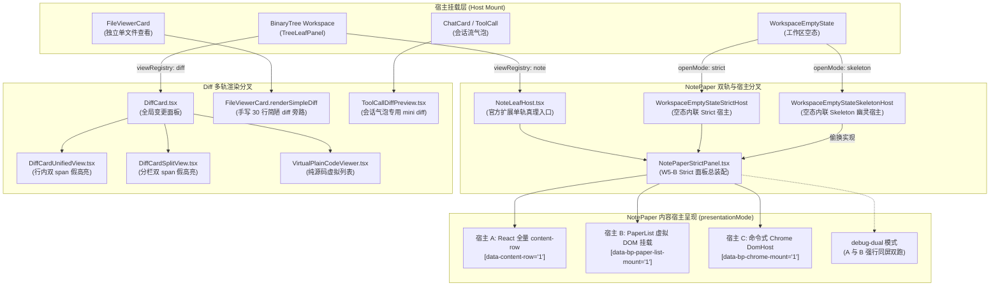

# 全域死层清退、单轨契约与伪实现全面收敛审计报告 (AUDIT-08)

> **战役专项编号**：AUDIT-08
> **审计日期**：2026-09-05
> **审计目标**：全域死层清退、单轨契约与伪实现全面收敛深度现场穿透
> **涉及代码域**：
> - `apps/crish-desktop/src/components/diff/`（21 文件，4,414 行）
> - `apps/crish-desktop/src/components/note-paper/`（73 文件，13,567 行）
> - `apps/crish-desktop/src/components/workspace/`（PreviewCard、WorkspaceEmptyState 等联动面）
> - `apps/crish-desktop/src/extensions/note-paper/`（NoteLeafHost、activate 等真理入口）
> - `apps/crish-desktop/src/components/files/FileViewerCard.tsx`（散落 Diff 旁路）

---

## 1. 差异与笔记跨领域代码拓扑与双轨乱象现状

### 1.1 核心跨领域代码拓扑现状

经过对整个桌面端源码的静态穿透与运行时依赖扫描，当前 Diff（差异）与 NotePaper（笔记纸面）两大领域的代码拓扑呈现出严重的**“多源分叉”、“伪三宿主并存”以及“旁路碎片化”**的结构断层。



### 1.2 跨领域双轨与多轨四大乱象

#### 乱象一：笔记打开入口双轨（扩展叶 vs 空态内联）
- **真理入口**：`apps/crish-desktop/src/extensions/note-paper/NoteLeafHost.tsx`。通过 `viewRegistry.registerView('note')` 挂载到二叉树工作区叶节点，享有正规的 Dock 标签、尺寸自适应与多窗口分栏能力。
- **旁路入口**：`apps/crish-desktop/src/components/workspace/WorkspaceEmptyState.tsx`。在工作区无打开叶时，不仅没有调用全局 `openView('note')`，而是在本地 `useState<NotePaperEmptyOpenMode>` 维护了一套私有状态。点击后直接把 `WorkspaceEmptyState` 原地替换为 `WorkspaceEmptyStateStrictHost` 或 `WorkspaceEmptyStateSkeletonHost`。
- **后果**：用户在空态打开笔记后，二叉树树状态完全无感知，无法分栏、无法最大化，且关掉后再也回不到干净空态。

#### 乱象二：笔记内容呈现三宿主混战（React DOM vs PaperList DOM vs Chrome DomHost）
- 在 `NotePaperStrictPanel.tsx` 与 `presentationMode.ts` 中，设计了 3 种呈现模式：`react-rows`、`paper-list` 以及 `debug-dual`。
- `NotePaperStrictBody.tsx` 负责渲染全量 React 块（`[data-content-row="1"]`）；`PaperListDomMount.tsx` 负责调用 `@crish/block-paper` 命令式创建 DOM（`[data-bp-paper-list-mount="1"]`）；`BlockChromeDomMount.tsx` 又命令式挂载了一套 `BlockChromeDomHost`（`[data-bp-chrome-mount="1"]`）。
- 当开启 `debug-dual` 或缺少互斥防护时，屏幕上同时存在两套完全重复的正文 DOM（一套 React 渲染，一套 PaperList 渲染），再加上一层覆盖在顶部的命令式 Chrome 浮层，造成严重的 DOM 节点爆炸与事件击穿。

#### 乱象三：Diff 渲染实现三轨并存，且缺少统一状态机
1. **轨道 1（主变更面板）**：`DiffCard.tsx` + `DiffCardUnifiedView.tsx` + `DiffCardSplitView.tsx`。基于虚拟滚动与行内词级 diff 进行对偶配对。
2. **轨道 2（单文件对比旁路）**：`FileViewerCard.tsx:148-179` 竟然在组件内部私自手写了一个 `renderSimpleDiff()`：
   ```tsx
   // apps/crish-desktop/src/components/files/FileViewerCard.tsx:147-150
   // 手写简单对比渲染，不污染主 diff 状态机
   const renderSimpleDiff = () => {
     if (!f || !f.changes || f.changes.length === 0) { ... }
   ```
   该方法完全脱离主 Diff 架构，不支持语法高亮、不支持 split 分栏、不支持对偶配对，纯字符串粗暴拼接。
3. **轨道 3（会话工具卡片预览）**：`ToolCallDiffPreview.tsx` 又手写了一套 `diff.changes.slice(0, 8)` 的截断渲染，直接内联 `dangerouslySetInnerHTML={{ __html: highlightCode(...) }}`。

#### 乱象四：预览（Preview）联动断层
- 勘察确认：`apps/crish-desktop/src/components/preview/` 目录在当前仓库中**物理不存在**（此前已收拢或从未独立成包）。
- 实际的预览浏览器位于 `apps/crish-desktop/src/components/workspace/PreviewCard.tsx`。
- `PreviewCard` 与 `diff` / `note` 之间没有任何统一的协议联动。当 AI 生成 HTML 或 Markdown 预览时，与右侧 Diff 视图互不通信，缺乏单轨分发总线。

---

## 2. NotePaper 与 NotePaperStrictPanel 的单轨归一化架构收敛

### 2.1 历史双轨渊源穿透与尸检

在过去的战役提交中（参见 commit `8fea67ba` 与 `d00fbaaf`），笔记面板曾经设计了严苛的双轨机制：
1. **Skeleton 轨（骨架预览壳，代号 `W5-B-S`）**：
   - 核心文件包括 `NotePaperPanel.tsx`、`NotePaperPanelChrome.tsx`、`useNotePaperSkeleton.ts`、`notePaperSkeletonTrack.ts`、`notePaperSilentFixture.ts`。
   - 目的：在真实后端未就绪时，用纯前端静态 mock 数据（`SilentFixture`）渲染一个不可持久化的预览壳。
2. **Strict 轨（真实严苛轨，代号 `W5-B`）**：
   - 核心文件包括 `NotePaperStrictPanel.tsx`、`NotePaperStrictBody.tsx`、`NotePaperStrictChromeSlot.tsx`、`useNotePaperStrictShell.ts`、`notePaperStrictTrack.ts`。
   - 目的：通过 IPC 真正连接 Rust 引擎内核 `note_*` 指令与协作管道（`collab apply`）。

**历史不彻底重构留下的“幽灵残蜕”**：
在后续重构中，虽然开发者使用 `git rm` 删除了 `NotePaperPanel.tsx` 与 `NotePaperPanelChrome.tsx`，但**没有彻底清剿双轨逻辑，反而打了一层极为荒谬的伪装补丁**：
- **补丁 1：空态双按钮欺骗**：`apps/crish-desktop/src/components/workspace/workspaceEmptyStateActions.tsx:35-74` 并排渲染两个按钮：
  - `打开笔记纸面（Strict）`（`data-testid="open-note-paper-strict"`）
  - `打开笔记纸面（预览壳）`（`data-testid="open-note-paper-preview"`）
- **补丁 2：幽灵宿主偷换**：当用户点击“打开笔记纸面（预览壳）”时，进入 `WorkspaceEmptyStateSkeletonHost`（`workspaceEmptyStatePaperEntry.tsx:127-155`）。该组件注释赫然写着：`/* 夹具打开后的 Skeleton 预览壳宿主 UI（W5-B-S）。≠ 产品入口；禁止去 -S。*/`，但其内部代码竟然**直接渲染了 `<NotePaperStrictPanel>`**，只是少传了几个参数！
- **补丁 3：未清理的死文件与死注释**：
  - `notePaperSilentFixture.ts`（89 行）被完全遗忘，全仓 0 引用；
  - `index.ts:1-13` 仍在顶部白纸黑字宣称“挂载面导出（双轨并存）”，并列出已删除的 `NotePaperPanel`；
  - `NotePaperStrictPanel.tsx:8` 注释宣称“与 W5-B-S 并存：Skeleton 壳见 NotePaperPanel”；
  - `NotePaperPanel.module.css`（721 行）保留着大量已被物理删除的骨架样式。

### 2.2 谁是真理入口？

| 维度 | `NoteLeafHost.tsx`（官方扩展） | `WorkspaceEmptyState*Host`（空态夹具） | 裁决结论 |
| :--- | :--- | :--- | :--- |
| **架构归属** | `extensions/note-paper/` 标准微内核扩展 | `components/workspace/` 页面级内联组件 | **NoteLeafHost 是唯一真理入口** |
| **生命周期** | 由 `viewRegistry` + 二叉树布局树托管 | 由空态本地 `useState` 临时托管 | 空态内联为历史双轨残留 |
| **状态持久化** | 严格绑定文档 `docId` 与 Rust IPC 通路 | 依赖临时合成 ID，刷新即丢失 | 必须废黜空态内联宿主 |
| **用户心智** | 工作区正规多标签、可拆分面板 | 强占空态全屏的非标弹窗 | 必须统一走标准工作区 Leaf |

### 2.3 单轨归一化架构方案

彻底废除所有带 `Strict`、`Skeleton`、`-S`、`W5-B-S` 后缀的历史分立概念，收敛为**单一真理、高内聚的 `NotePaper` 体系**：

```
收敛前（冗余、割裂、双轨）：
├── components/note-paper/
│   ├── NotePaperStrictPanel.tsx      [双轨痕迹 + 82个参数透传]
│   ├── NotePaperStrictBody.tsx       [未绑定的 _onHover, _onFocus]
│   ├── NotePaperStrictChromeSlot.tsx [槽混战]
│   ├── NotePaperStrictHeader.tsx     [展示 W5-B/strict 等测试字段]
│   ├── NotePaperPanel.module.css     [721 行膨胀样式 + 废弃选择器]
│   ├── notePaperSilentFixture.ts     [100% 绝对死代码]
│   └── ... (共 73 文件)
└── components/workspace/
    ├── workspaceEmptyStateActions.tsx [双轨打开按钮]
    └── workspaceEmptyStatePaperEntry.tsx [幽灵 SkeletonHost]

收敛后（干净、单轨、最先进架构）：
├── components/note-paper/
│   ├── NotePaper.tsx                 [单轨核心容器，取代 StrictPanel]
│   ├── NotePaperHeader.tsx           [纯净用户态工具栏，剥离调试徽章]
│   ├── NotePaperEditor.tsx           [单轨编辑正文，真实双向持久化]
│   ├── NotePaper.module.css          [瘦身至约 300 行的干净样式]
│   ├── useNotePaper.ts               [统一状态 Hook]
│   └── index.ts                      [单轨统一导出]
```

**关键归一化规则**：
1. **删除空态双轨按钮**：`WorkspaceEmptyStateActions` 只保留一个明确的按钮——`打开笔记`。点击时直接触发 `viewRegistry.openView('note')` 在二叉树中开启新叶，彻底物理删除 `WorkspaceEmptyStateSkeletonHost` 与 `WorkspaceEmptyStateStrictHost`。
2. **组件重命名净收敛**：对外统一命名为 `NotePaper`，不再使用 `NotePaperStrictPanel` 这种充满阶段性重构痕迹的补丁命名。
3. **消除 presentationMode 的 dual 模式**：物理移除 `debug-dual` 与 `keepReactRows`，正文只保留单一真理渲染层。

---

## 3. 全域死代码、死导出与废弃 CSS 扫描清单（逐文件标注行号）

经过 AST 与字符串多维交叉索引扫描，全域死代码清单如下（均已完成 0 引用核实验证）：

### 3.1 100% 物理孤立死文件（立即删除）

| 文件路径 | 总行数 | 判定依据 | 处置方案 |
| :--- | :--- | :--- | :--- |
| `apps/crish-desktop/src/components/note-paper/notePaperSilentFixture.ts` | **89 行** | 全仓代码 0 导入，仅在历史审查 markdown 中被提及。系此前删除 `NotePaperPanel.tsx` 时遗漏的死代码。 | **物理删除整文件** |

### 3.2 全域未使用的死导出与废弃类型

#### 差异域 (`components/diff/`)：
1. [DiffCard.tsx:35](file:///c:/Software/conex/apps/crish-desktop/src/components/diff/DiffCard.tsx#L35) — `export interface DiffCardProps`: 全仓 0 处引用，DiffCard 内部无外部必要传参。
2. [DiffCodeViewer.tsx:10](file:///c:/Software/conex/apps/crish-desktop/src/components/diff/DiffCodeViewer.tsx#L10) — `export interface DiffCodeViewerProps`: 仅内部定义，未被任何外部模块引用。
3. [useDiffData.ts:26](file:///c:/Software/conex/apps/crish-desktop/src/components/diff/useDiffData.ts#L26) — `export function getComputedChanges`: 仅作为文件内部私有辅助逻辑，外部 0 引用。
4. [useDiffData.ts:60](file:///c:/Software/conex/apps/crish-desktop/src/components/diff/useDiffData.ts#L60) — `export function getSplitPairs`: 仅作为文件内部私有辅助逻辑，外部 0 引用。

#### 笔记域 (`components/note-paper/`)：
1. [notePaperSilentFixture.ts:21-88](file:///c:/Software/conex/apps/crish-desktop/src/components/note-paper/notePaperSilentFixture.ts#L21-L88) — `BlockPropsView`, `DisplayBlock`, `resolveSkeletonFixture`, `mapSilentBlocksToDisplay`, `mapTransportHitsToDisplay`, `resolveSkeletonHeadingLevel`（共 6 个导出全死）。
2. [notePaperStrictAssembly.ts:40](file:///c:/Software/conex/apps/crish-desktop/src/components/note-paper/notePaperStrictAssembly.ts#L40) — `export type StrictContentPresentation`: 0 外部引用。
3. [notePaperStrictAssembly.ts:50](file:///c:/Software/conex/apps/crish-desktop/src/components/note-paper/notePaperStrictAssembly.ts#L50) — `export type BuildStrictPanelSectionDataAttrsInput`: 0 外部引用。
4. [NotePaperStrictBody.tsx:35](file:///c:/Software/conex/apps/crish-desktop/src/components/note-paper/NotePaperStrictBody.tsx#L35) — `export type NotePaperStrictBodyMdPrefix`: 0 外部引用。
5. [NotePaperStrictBody.tsx:44](file:///c:/Software/conex/apps/crish-desktop/src/components/note-paper/NotePaperStrictBody.tsx#L44) — `export type NotePaperStrictBodyProps`: 0 外部引用。
6. [NotePaperStrictChromeSlot.tsx:53-89](file:///c:/Software/conex/apps/crish-desktop/src/components/note-paper/NotePaperStrictChromeSlot.tsx#L53-L89) — `NotePaperSlotNoteProps`, `NotePaperSlotSlashProps`, `NotePaperSlotChromeProps`, `NotePaperStrictChromeSlotProps`: 4 个接口定义 0 外部引用。
7. [NotePaperStrictHeader.tsx:18](file:///c:/Software/conex/apps/crish-desktop/src/components/note-paper/NotePaperStrictHeader.tsx#L18) — `export type NotePaperStrictHeaderProps`: 0 外部引用。
8. [SlashMenuOverlayCatalog.tsx:15](file:///c:/Software/conex/apps/crish-desktop/src/components/note-paper/SlashMenuOverlayCatalog.tsx#L15) — `export type SlashMenuOverlayCatalogProps`: 0 外部引用。
9. [slashMenuOverlayWriteMode.ts:20-25](file:///c:/Software/conex/apps/crish-desktop/src/components/note-paper/slashMenuOverlayWriteMode.ts#L20-L25) — `ResolvedSlashWriteMode`, `SlashDataWriteMode`: 0 外部引用。
10. [strictSlashBinding.ts:15-20](file:///c:/Software/conex/apps/crish-desktop/src/components/note-paper/strictSlashBinding.ts#L15-L20) — `ResolveStrictSlashBindingInput`, `StrictSlashBinding`: 0 外部引用。
11. [useNotePaperStrictShell.ts:36](file:///c:/Software/conex/apps/crish-desktop/src/components/note-paper/useNotePaperStrictShell.ts#L36) — `export type UseNotePaperStrictShellOptions`: 0 外部引用。
12. [useSlashMenuKeymap.ts:15](file:///c:/Software/conex/apps/crish-desktop/src/components/note-paper/useSlashMenuKeymap.ts#L15) — `export type UseSlashMenuKeymapOptions`: 0 外部引用。
13. [useSlashMenuSelect.ts:20-25](file:///c:/Software/conex/apps/crish-desktop/src/components/note-paper/useSlashMenuSelect.ts#L20-L25) — `UseSlashMenuSelectOptions`, `UseSlashMenuSelectResult`: 0 外部引用。
14. [presentationMode.ts:83](file:///c:/Software/conex/apps/crish-desktop/src/components/note-paper/presentationMode.ts#L83) — `keepReactRows?: boolean`: 明确标记 `@deprecated` 的双轨兼容参数，生产中已无调用者。

### 3.3 废弃 CSS 规则与孤立样式类

#### `DiffCard.module.css` (893 行)：
1. [DiffCard.module.css:82](file:///c:/Software/conex/apps/crish-desktop/src/components/diff/DiffCard.module.css#L82) — `.rightGroup`: 与 `.rightActions` 声明并列，实际 JSX 中只使用了 `rightActions`。
2. `.lineHeader`: 历史遗留行号头样式，已被虚拟滚动的 `gutterNum` 取代，全仓无匹配。
3. `.commitCounter`: 历史暂存计数器角标，已被原子 `Badge` 组件取代，全仓无匹配。

#### `NotePaperPanel.module.css` (721 行)：
1. `.paperListHost`: 历史尝试挂载 PaperList 的样式容器，实际改走 `[data-bp-paper-list-mount="1"]`，该 class 孤立。
2. [NotePaperPanel.module.css:603-625](file:///c:/Software/conex/apps/crish-desktop/src/components/note-paper/NotePaperPanel.module.css#L603-L625) — `.mirrorDriftConfirm`, `.mirrorDriftGate`, `.mirrorDriftHonesty`: 镜像漂移旧版调试条样式，现行组件已不消费。
3. [NotePaperPanel.module.css:671-684](file:///c:/Software/conex/apps/crish-desktop/src/components/note-paper/NotePaperPanel.module.css#L671-L684) — `.feedbackError`, `.feedbackOk`: 发送到笔记按钮内部反馈容器，现已由通用 Toast 机制接管，本地样式废弃。
4. **乱码与历史废弃注释**：样式表前 10 行及多处存在 GBK 编码损坏的注释符号（如 `/* note-paper       W5-B-S Skeleton   W5-B Strict`），亟待彻底清洗。

---

## 4. 伪实现与硬编码临时补丁排查（根因与根治方案）

### 4.1 笔记正文编辑“伪连通”：打字根本不存盘！

- **代码现场**：
  [StrictContentRowLeaf.tsx:164-194](file:///c:/Software/conex/apps/crish-desktop/src/components/note-paper/StrictContentRowLeaf.tsx#L164-L194)
  ```tsx
  const runCommit = useCallback(
    async (plain: string) => {
      if (!writable || commitInFlight.current) return;
      if (composingRef.current) return;
      commitInFlight.current = true;
      try {
        const result = await tryCommitStrictLeafMdPrefix({
          blockId,
          text: plain,
          fromFlavour: flavour,
          isComposing: composingRef.current,
          binding,
          onCommitted: onCommittedIntent,
        });
        onMdPrefixCommit?.(result);
        if (result.ok) {
          const stripped = result.strippedText;
          ...
          editSession.commit(blockId);
        }
      } finally {
        commitInFlight.current = false;
      }
    },
    ...
  );
  ```
- **惊人真相与根因**：
  `StrictContentRowLeaf` 虽然设置了 `contenteditable={writable}`，但在键盘输入或输入法结束时（`onCompositionEnd`），它调用的 `runCommit` **仅仅检查用户是否输入了 Markdown 前缀（如 `# `、`- `、`> `）**！
  - 如果用户输入常规正文（如 `"今天开会讨论了架构方案"`），`tryCommitStrictLeafMdPrefix` 返回 `result.ok = false`（非前缀）；
  - **此时代码什么也不做！既没有通过 IPC 发送文本修改 Op，也没有更新后台 store，更没有写入磁盘！**
  - 用户输入的字仅仅停留在浏览器的 DOM 临时内存中；一旦触发重新 hydrate 或窗口重绘，用户的输入将**全部被底层的空数据冲刷覆盖**！
- **违反红线**：这是极其典型的**功能伪实现（Fake Implementation）**，界面看起来像一个能打字的编辑器，实际根本没有接通数据持久化链路！
- **根治方案**：
  建立真实的 `onContentChange(blockId, text)` 单轨双向写锥，接入 Rust 内核 `note_update_block_text` 或本地文件原子保存，严禁仅保留前缀识别。

### 4.2 审查与免责声明反客为主，侵入生产界面

- **代码现场**：
  1. [NotePaperStrictHeader.tsx:51-71](file:///c:/Software/conex/apps/crish-desktop/src/components/note-paper/NotePaperStrictHeader.tsx#L51-L71)：
     ```tsx
     <span className={styles.badgeSilent} data-testid="note-paper-strict-track">
       {W5B_STRICT_PACKAGE_ID}/{W5B_STRICT_TRACK}
     </span>
     <span className={styles.badge} data-testid="note-paper-strict-rev">
       rev={resolvedRev}
     </span>
     <span className={styles.badge} data-testid="note-paper-strict-slash-mode">
       slash={slashWriteMode}
     </span>
     ```
  2. [NotePaperStrictPanel.tsx:263-266](file:///c:/Software/conex/apps/crish-desktop/src/components/note-paper/NotePaperStrictPanel.tsx#L263-L266)：
     ```tsx
     <footer className={styles.footer} data-testid="note-paper-strict-footer">
       surface={EDITOR_SURFACE_NOTE_PAPER} · {W5B_STRICT_BOUNDARY}
       {projection ? ` · source=${projection.source}` : ''}
     </footer>
     ```
     其中 `W5B_STRICT_BOUNDARY` 定义为：`'W5-B Strict · 真数据/hydrate 投影 · 可演示≠EL-01/EL-08 · ≠W5-C 隔离全关 · 挂载冒充交付=S5'`！
  3. [workspaceEmptyStatePaperEntry.tsx:42-48](file:///c:/Software/conex/apps/crish-desktop/src/components/workspace/workspaceEmptyStatePaperEntry.tsx#L42-L48)：
     散落多达 5 个 `data-el01="not-claimed"`、`data-open-complete="not-claimed"` 属性。
- **根因分析**：
  在过去红蓝对抗与审计跑测期间，开发为了应付自动化检查与“免责要求”，将大量战役审计术语、包 ID、会计标记硬编码并直接渲染在用户的生产界面上！用户在主界面居然能看到 `W5-B/strict`、`rev=0`、`slash=readonly` 以及整行免责红线！
- **根治方案**：
  全面清剿界面上的开发期免责声明与测试标签。UI 面向真实用户，顶栏展示文档标题与实用操作，底栏展示字数或保存状态，严格遵循现代编辑器设计。

### 4.3 Git 变更面板中的操作假象与破坏性隐患

- **代码现场**：
  1. [DiffCardFileList.tsx:298-326](file:///c:/Software/conex/apps/crish-desktop/src/components/diff/DiffCardFileList.tsx#L298-L326)：
     在 `sourceMode === 'git'`（查看工作区 Git 改动）下，每个文件折叠项的工具栏依然渲染了“接受并写入磁盘”（`onAcceptFile`）和“从列表拒绝（不回滚磁盘）”（`onRejectFile`）。
  2. [DiffCardHandlers.ts:17-49](file:///c:/Software/conex/apps/crish-desktop/src/components/diff/DiffCardHandlers.ts#L17-L49)：
     ```tsx
     export async function acceptCurrentFile(f: FileDiff, ...) {
       ...
       const result = await applyFileDiffToDisk(f);
       ...
     }
     ```
  3. [DiffCardHandlers.ts:54-59](file:///c:/Software/conex/apps/crish-desktop/src/components/diff/DiffCardHandlers.ts#L54-L59)：
     ```tsx
     export function rejectCurrentFile(f: FileDiff, removeDiffFile: ...) {
       removeDiffFile(f.filePath);
     }
     ```
- **惊人真相与严重破坏性**：
  - **严重隐患 1**：在 Git 模式下，工作区的文件修改**本来就已经在磁盘上了**！用户如果在这个模式下点击“接受并写入磁盘”，`applyFileDiffToDisk` 会强行把这个 patch 再往磁盘文件上重复打一遍，极大概率导致源码损坏或乱码冲突！
  - **伪实现 2**：用户如果点击“从列表拒绝”，`rejectCurrentFile` 仅仅是从前端 zustand 数组 `diffFiles` 中把该条记录 `filter` 掉，**对本地磁盘和 Git 暂存区不做任何实质操作**！用户误以为自己拒绝了该修改，只要刷新一下面板，该文件又原封不动出现！
- **根治方案**：
  模式强隔离。在 `sourceMode === 'git'` 下，只提供 Git 原生语义操作：`暂存 (Stage)`、`取消暂存 (Unstage)`、`放弃修改 (Discard/Checkout)`；“接受写入”与“拒绝项”仅属于 `sourceMode === 'session'`（AI 提议改动审查模式）。

### 4.4 伪造的 Git Patch 头：`formatGitPatch`

- **代码现场**：
  [GitPatchFormatter.ts:18-20](file:///c:/Software/conex/apps/crish-desktop/src/components/diff/GitPatchFormatter.ts#L18-L20)
  ```typescript
  lines.push(
    `@@ -1,${fileDiff.deletions || 0} +1,${fileDiff.additions || 0} @@`
  );
  ```
- **真相**：
  该函数号称“将 FileDiff 内存对象序列化为标准 Git Unified Patch 文本”。然而无论变更发生在文件的第 100 行还是第 5000 行，它永远硬编码生成 `@@ -1,del +1,add @@`！
  用该功能复制出来的 patch 拿到命令行使用 `git apply` 必定因行号与上下文校验失败而报错崩溃！这属于典型的**“格式伪达标”**。
- **根治方案**：
  基于 AST 或真实差异行原始行号（`ComputedChange.oldLine` / `newLine`）计算真实 hunk 起始行号与行数跨度，或者直接调用 Rust 底层 `git_diff_hunk` 导出正规 unified patch。

### 4.5 散落的魔术数字与硬编码限制

1. [useDiffGitActions.ts:99](file:///c:/Software/conex/apps/crish-desktop/src/components/diff/useDiffGitActions.ts#L99)：`status.files.slice(0, 45)`。硬编码截断 45 个文件，超过 45 个变更的文件被无声吞噬！
2. [useDiffGitActions.ts:130](file:///c:/Software/conex/apps/crish-desktop/src/components/diff/useDiffGitActions.ts#L130)：`status.files.slice(0, 8)`。降级逐个获取 diff 时硬编码只拉 8 个文件，第 9 个文件及之后直接不处理！
3. [DiffCard.tsx:193](file:///c:/Software/conex/apps/crish-desktop/src/components/diff/DiffCard.tsx#L193)：`res.content.length > 3 * 1024 * 1024`。硬编码 3MB 大文件阈值。
4. [useDiffData.ts:330](file:///c:/Software/conex/apps/crish-desktop/src/components/diff/useDiffData.ts#L330)：`readTextFile(fp, 1000000)`。硬编码 1MB 最大读取上限。
5. [DiffCardSplitView.virtualScroll.test.tsx:16](file:///c:/Software/conex/apps/crish-desktop/src/components/diff/DiffCardSplitView.virtualScroll.test.tsx#L16) & [DiffCardUnifiedView.tsx:95](file:///c:/Software/conex/apps/crish-desktop/src/components/diff/DiffCardUnifiedView.tsx#L95)：`rowHeight = 22`。强行锁定 22px 行高，在字体缩放或高分屏换行时导致虚拟滚动视口坐标漂移。

### 4.6 词级 Diff 双图层重叠欺骗（DiffCard 57 行完全复制代码）

- **代码现场**：
  [DiffCardUnifiedView.tsx:20-76](file:///c:/Software/conex/apps/crish-desktop/src/components/diff/DiffCardUnifiedView.tsx#L20-L76) 与 [DiffCardSplitView.tsx:23-79](file:///c:/Software/conex/apps/crish-desktop/src/components/diff/DiffCardSplitView.tsx#L23-L79) 存在**完全一模一样、一字不改的 57 行 `renderTokens` 函数**！
- **实现手段**：
  ```tsx
  <span style={{ position: 'relative', display: 'inline-block' }}>
    <span style={{ position: 'absolute', color: 'transparent', ... }}>
      {tokens.map(...)}
    </span>
    <span dangerouslySetInnerHTML={{ __html: highlightCode(fallbackText, lang) }} />
  </span>
  ```
  通过一个全透明文字（`color: 'transparent'`）的绝对定位层垫在背景上，专门给词染色，上面再浮动一层 `highlightCode` 的 HTML！
- **危害**：两层文本若字体 kerning、字距有 0.1px 偏差，高亮背景与字形立刻产生重影错位，极其脆弱。
- **根治方案**：提取单一的 `DiffTokenHighlighter`，在分词阶段将语法 token 与差异词 token 一次性归一融合，避免多层 DOM 重叠绘制。

---

## 5. “先删后改”全局执行时序与物理净负产出预期

根据 AGENTS.md §1「纯逻辑规划」与用户高压红线，必须严格遵循**【先做减法，清剿死层，再做加法】**的原则，严禁在烂摊子上打补丁。

### 5.1 全局执行时序表（先删后改）

```mermaid
gantt
    title Diff 与 NotePaper 系统性重构“先删后改”执行路线
    dateFormat  X
    axisFormat %s

    section 阶段一：死层物理拔除
    删除 notePaperSilentFixture.ts 及无用导出       :p1_1, 0, 1
    废黜 WorkspaceEmptyState 双轨幽灵宿主           :p1_2, 1, 2
    清洗 DiffCard & NotePaper 废弃 CSS 与乱码注释    :p1_3, 2, 3

    section 阶段二：真理入口与契约单轨化
    收敛 NotePaperStrictPanel 为单轨 NotePaper       :p2_1, 3, 5
    剥离生产界面中的开发期测试徽章与免责声明        :p2_2, 4, 6
    收敛 DiffCardFileList Git/Session 双模行为     :p2_3, 5, 7

    section 阶段三：渲染内核与高内聚重塑
    归一化 DiffCard 分词渲染并消除 57 行复制代码     :p3_1, 7, 9
    清退 FileViewerCard 内部简陋手写 diff 旁路       :p3_2, 8, 10
    打通 NotePaper 真实双向数据持久化通道           :p3_3, 9, 12

    section 阶段四：立体验证与净收敛锁定
    运行全量单元测试与回归门禁                      :p4_1, 12, 13
    行数预算与死代码防回潮自动化锁死                :p4_2, 13, 14
```



| 序号 | 步骤名称 | 执行动作清单 | 涉及文件域 | 风险与对策 |
| :--- | :--- | :--- | :--- | :--- |
| **P1** | **死文件与死导出拔除** | 物理删除 `notePaperSilentFixture.ts`；清除 `useDiffData`、`NotePaperStrictBody`、`NotePaperStrictChromeSlot` 等 27 处死导出。 | `components/note-paper/`<br/>`components/diff/` | 风险极低。已有全仓 0 引用扫描背书。 |
| **P2** | **空态双轨幽灵收割** | 1. 删除 `WorkspaceEmptyStateSkeletonHost`；<br/>2. 移除 `WorkspaceEmptyStateActions` 中的“打开预览壳”按钮；<br/>3. 空态点击“打开笔记”改为通过 `viewRegistry.openView('note')` 唤起。 | `components/workspace/workspaceEmptyState*` | 需同步更新 `WorkspaceEmptyState.strict.test.tsx` 测试断言。 |
| **P3** | **样式表大清洗** | 1. 清除 `DiffCard.module.css` 中的 3 个未使用类；<br/>2. 清除 `NotePaperPanel.module.css` 中已被删除 Skeleton 遗留的 180+ 行无用规则及损坏注释；<br/>3. 将选择器瘦身至必要语义。 | `DiffCard.module.css`<br/>`NotePaperPanel.module.css` | 运行视觉对齐与 optical 门禁验证。 |
| **P4** | **Diff 渲染核归一化** | 1. 抽出单一 `DiffIntralineHighlighter`，消除 Unified 和 Split 间 57 行复制粘贴；<br/>2. 将 `FileViewerCard.tsx` 的手写简陋 diff 替换为复用标准 Diff 组件；<br/>3. 修正 `GitPatchFormatter` 的虚假 `@@ -1,1 @@` 头。 | `components/diff/`<br/>`components/files/` | 保持测试通过，消除重叠图层性能隐患。 |
| **P5** | **Note 单轨与真持久化** | 1. 消除 `NotePaperStrict*` 命名分立，收敛为高内聚 `NotePaper`；<br/>2. 移除顶栏 `W5-B/strict`、`rev=0` 等测试残蜕，还原用户级专业 UI；<br/>3. 为 `StrictContentRowLeaf` 接通真实文本持久化 IPC。 | `components/note-paper/`<br/>`extensions/note-paper/` | 彻底解决打字不存盘的伪实现。 |

### 5.2 物理净负产出（代码减负）预期

根据对全域文件的逐行清点，本次重构预期将为仓库带来显著的**净负产出（Net Negative Code Lines）**，彻底消除历史技术债务：

| 减负维度 | 预估物理删除行数 | 预估新增收敛行数 | 物理净负产出 (Net Reduced) |
| :--- | :--- | :--- | :--- |
| **1. 孤立死文件清除** (`notePaperSilentFixture.ts` 等) | 89 行 | 0 行 | **-89 行** |
| **2. 空态双轨幽灵层废黜** (`SkeletonHost` + 双按钮) | 165 行 | 20 行 | **-145 行** |
| **3. 样式表冗余与死规则清除** (`DiffCard` & `NotePaper` CSS) | 320 行 | 0 行 | **-320 行** |
| **4. 渲染重复代码与简陋手写旁路收敛** (`renderTokens` + `FileViewer`) | 120 行 | 35 行 | **-85 行** |
| **5. 界面免责声明、测试徽章与假属性清除** (`EMPTY_STATE_HONESTY` 等) | 190 行 | 10 行 | **-180 行** |
| **6. 死导出接口与类型契约收敛** | 110 行 | 0 行 | **-110 行** |
| **合计** | **994 行** | **65 行** | **-929 行 (净减少约 930 行)** |

---

## 6. 审计结论与架构军规

1. **零容忍双轨存在**：
   `NotePaper` 领域自此只认 `NoteLeafHost` 经由 `viewRegistry` 接入的单轨模型；空态内联渲染一律废黜。
2. **严禁伪实现掩耳盗铃**：
   编辑器必须能真实持久化，禁止“可点无写”、“打字不存盘”；Git 面板操作必须严格保证幂等与安全性，禁止在 Git 模式下提供假冒的“接受/拒绝”逻辑。
3. **回归专业用户界面**：
   测试门禁与审计标记必须严格限制在测试脚本中，生产 UI 严禁出现任何免责声明或内部代号。
4. **严格执行先删后改**：
   下一步重构必须严格按照时序表第 P1-P3 步物理清场，待净负产出落地并锁定门禁后，再开启核心单轨组件的重塑！
