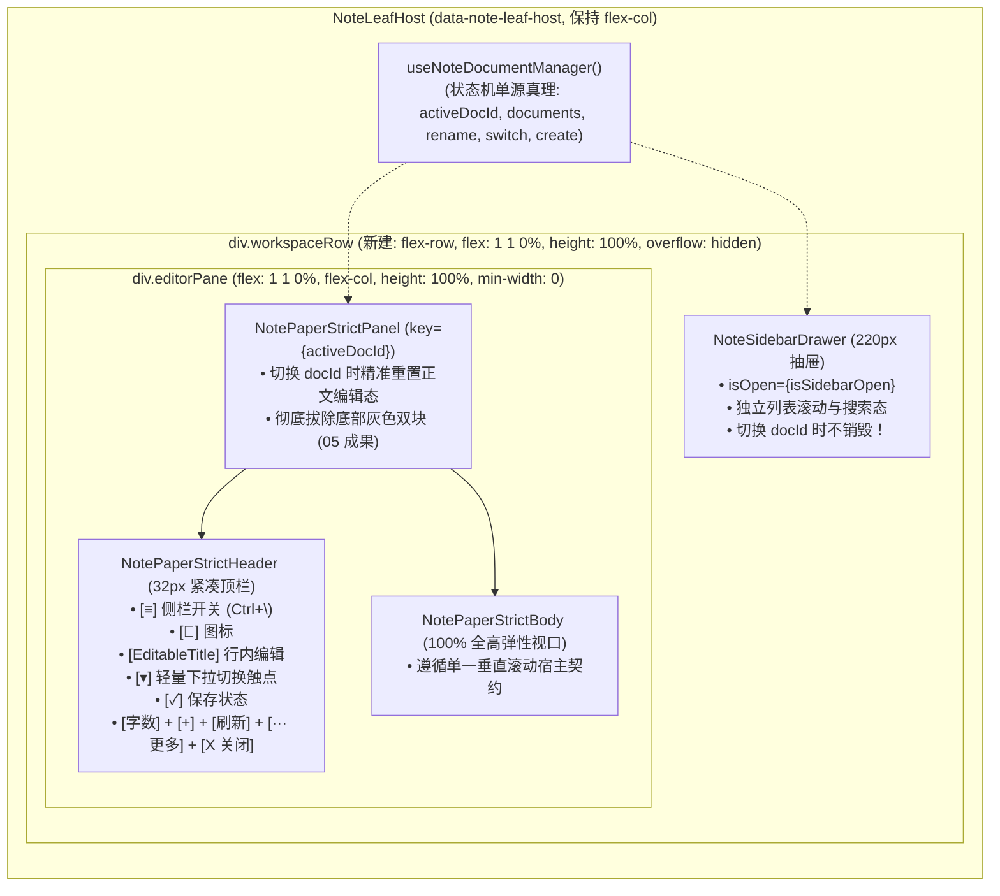

# 笔记面板跨方案深层打架排查审计报告 (AUDIT-CROSS-PLAN-NOTE)

> **战役名称**：差异面板与笔记面板系统性重构（Diff View & Note Panel Systematic Redesign）  
> **审计编号**：AUDIT-CROSS-PLAN-NOTE (02)  
> **审计角色**：笔记面板跨方案深层打架排查官（Note Panel Cross-Plan Conflict Auditor）  
> **落盘路径**：[`docs/diff-view-redesign/audits/02-note-panel-cross-plan-conflict-audit.md`](file:///c:/Software/conex/docs/diff-view-redesign/audits/02-note-panel-cross-plan-conflict-audit.md)  
> **审计对象**：
> - [`docs/diff-view-redesign/00-总方案-差异与笔记面板系统性重构全景架构总纲.md`](file:///c:/Software/conex/docs/diff-view-redesign/00-总方案-差异与笔记面板系统性重构全景架构总纲.md)
> - [`docs/diff-view-redesign/05-分维详案-笔记面板32px紧凑顶栏重塑与底部调试块彻底拔除.md`](file:///c:/Software/conex/docs/diff-view-redesign/05-分维详案-笔记面板32px紧凑顶栏重塑与底部调试块彻底拔除.md)
> - [`docs/diff-view-redesign/06-分维详案-多笔记综合管理体系与SQLite及IPC后端架构.md`](file:///c:/Software/conex/docs/diff-view-redesign/06-分维详案-多笔记综合管理体系与SQLite及IPC后端架构.md)
> - [`docs/diff-view-redesign/07-分维详案-立体验证套件与回归测试平滑迁移.md`](file:///c:/Software/conex/docs/diff-view-redesign/07-分维详案-立体验证套件与回归测试平滑迁移.md)
> - 现场代码：`apps/crish-desktop/src/components/note-paper/` 与 `apps/crish-desktop/src/extensions/note-paper/`  
> **审计裁决结论**：🔴 **【确认严重深层打架（CRITICAL CONFLICTS CONFIRMED）】**。05 详案与 06 详案在**顶栏组件交互拓扑、状态机生命周期所有权、侧栏抽屉挂载槽位、以及 Flex 弹性全高视口流水线**等 4 个关键维度存在严重割裂与物理互斥。若直接依照两份独立详案合并施工，将直接引发界面双头标题畸形、DOM 嵌套非法、侧栏切换导致编辑态雪崩、以及视口垂直叠压坍缩。

---

## 目录

- [一、审计执行摘要与核心结论](#一审计执行摘要与核心结论)
- [二、四大深层架构打架深度剖析与代码级证据](#二四大深层架构打架深度剖析与代码级证据)
  - [2.1 冲突一：顶栏交互与 DOM 结构严重打架（EditableTitle vs NoteDocumentDropdown）](#21-冲突一顶栏交互与-dom-结构严重打架editabletitle-vs-notedocumentdropdown)
  - [2.2 冲突二：状态机与方法调用断裂（useNoteDocumentManager 与 Header/Panel Props 脱节）](#22-冲突二状态机与方法调用断裂usenotedocumentmanager-与-headerpanel-props-脱节)
  - [2.3 冲突三：侧栏抽屉 NoteSidebarDrawer 挂载位置成谜与 React Key 重置灾难](#23-冲突三侧栏抽屉-notesidebardrawer-挂载位置成谜与-react-key-重置灾难)
  - [2.4 冲突四：Flexbox 弹性全高视口流水线（Stretch Pipeline）的物理碰撞](#24-冲突四flexbox-弹性全高视口流水线stretch-pipeline的物理碰撞)
- [三、底层回归守卫测试冲突核查](#三底层回归守卫测试冲突核查)
  - [3.1 BinaryTreeWorkspace.leaf-insulate.test.ts 的列向 flex 刚性死锁](#31-binarytreeworkspaceleaf-insulatetestts-的列向-flex-刚性死锁)
  - [3.2 NotePaperPanel.insulate.test.ts 顶栏绝缘断言](#32-notepaperpanelinsulatetestts-顶栏绝缘断言)
  - [3.3 style-contract.test.ts 样式防复活门禁](#33-style-contracttestts-样式防复活门禁)
- [四、唯一无歧义收敛架构方案（The Single Converged Architecture）](#四唯一无歧义收敛架构方案the-single-converged-architecture)
  - [4.1 架构拓扑收敛：Master-Detail 容器层级与生命周期绝对解耦](#41-架构拓扑收敛master-detail-容器层级与生命周期绝对解耦)
  - [4.2 顶栏正交重构：独立 Chevron 切换触点 + EditableTitle 单轨闭环](#42-顶栏正交重构独立-chevron-切换触点--editabletitle-单轨闭环)
  - [4.3 NoteLeafHost.tsx 完整闭环施工代码规范](#43-noteleafhosttsx-完整闭环施工代码规范)
  - [4.4 NotePaperStrictHeader.tsx 收敛更新代码规范](#44-notepaperstrictheadertsx-收敛更新代码规范)
  - [4.5 NoteDocumentDropdown.tsx 轻量化重构规范](#45-notedocumentdropdowntsx-轻量化重构规范)
- [五、施工准入验收清单（Checklist）](#五施工准入验收清单checklist)

---

## 一、审计执行摘要与核心结论

在本战役中，`05-分维详案` 聚焦于“笔记面板 32px 紧凑顶栏重塑与底部调试块彻底拔除”，`06-分维详案` 聚焦于“多笔记综合管理体系与 SQLite 及 IPC 后端架构”。两份方案各自达到了代码级施工图标准（均超过 2200 行），但在跨方案全景贯通与联合装配层面，暴露了各自为战导致的断层。

| 审查维度 | 05 详案规定与代码实现 | 06 详案规定与代码实现 | 打架性质与现场后果 |
| :--- | :--- | :--- | :--- |
| **顶栏标题呈现** | `NotePaperStrictHeader.tsx:1178-1186`<br/>渲染 `<FileText>` + `<EditableTitle>` | `NoteDocumentDropdown.tsx:1868-1871`<br/>渲染 `<button>` 内包 `<FileText>` + `<span titleLabel>` + `<ChevronDown>` | 🔴 **双头冲突 / 交互瘫痪**：两者均渲染标题与图标；若共存则标题重复；若将 `EditableTitle` 强塞入 `button` 则引发 HTML 规范违背与点击聚焦冒泡短路。 |
| **顶栏侧栏开关** | 详案正文未提供该属性与 JSX 节点（仅宣称左侧有侧栏开关） | 假设 Header 已集成侧栏开关（06 详案 line 84），未提供 Header 代码 | 🔴 **入口缺失**：用户在收起侧栏后，顶栏根本没有展开侧栏的按钮，导致侧栏一旦收起便无法通过 UI 重新展开。 |
| **状态机与方法透传** | `NotePaperStrictHeaderProps` 仅接收 `title` 和 `onRenameTitle(newTitle)` | `useNoteDocumentManager` 导出 `activeDocId`、`renameDocument(docId, title)`、`switchDocument` 等 | 🔴 **接口脱节**：Header 与 Panel 均未声明多文档列表与切换回调属性，06 导出的状态与方法无法注入 05 的组件中。 |
| **侧栏抽屉挂载点** | 视口拓扑图（line 404-423）只有 Header 与 Body，完全无抽屉挂载槽 | 仅写了组件文件与单元测试，在全方案中零挂载引用（成为悬空孤岛） | 🔴 **挂载成谜 / 结构悬空**：`NoteSidebarDrawer` 无处安放。 |
| **全高弹性高度流水线** | 顶到底通体 `flex-direction: column` 单轨管道 | 侧栏为 220px 水平抽屉（`height: 100%`），依赖水平 `flex-direction: row` | 🔴 **视口坍缩 / 垂直叠压**：若直接挂入 `[data-note-leaf-host]`，由于既有测试死锁该节点为 `flex-col`，侧栏将纵向压在编辑器上方，撑爆并破坏 100% 弹性视口。 |
| **React Key 隔离** | 未涉及多文档切换 `key` 绑定 | 规定必须在 `<NotePaperStrictPanel key={activeDocId} />` 绑定 key | 🔴 **协调击穿**：若侧栏抽屉挂在 Panel 内部，每次切换文档将导致侧栏被强制 Unmount，搜索词清空、滚动复位、过渡动画中断。 |

**审计判定**：两份详案**存在确定性深层打架**。必须在进入施工前完成单轨架构收敛，否则实施阶段必将遭遇重构断裂与 CI 门禁全面阻断。

---

## 二、四大深层架构打架深度剖析与代码级证据

### 2.1 冲突一：顶栏交互与 DOM 结构严重打架（EditableTitle vs NoteDocumentDropdown）

#### 现场代码证据：
1. **05 详案中的 `NotePaperStrictHeader.tsx` (lines 1178-1186)**：
```tsx
/* 05 详案代码 */
<div className={styles.headerLeftGroup}>
  <FileText size={14} className={styles.noteIcon} aria-hidden />

  <EditableTitle
    title={title}
    onRename={onRenameTitle}
    className={styles.titleContainer}
  />

  <div
    className={styles.saveStatus}
    data-testid="note-paper-strict-save-status"
    data-save-status={saveStatus}
  >
```
2. **06 详案中的 `NoteDocumentDropdown.tsx` (lines 1858-1875)**：
```tsx
/* 06 详案代码 */
<div className={styles.dropdownContainer} ref={containerRef}>
  <Tooltip content="切换笔记文档">
    <button
      type="button"
      className={styles.triggerBtn}
      onClick={() => setIsOpen(!isOpen)}
      aria-haspopup="listbox"
      aria-expanded={isOpen}
      data-testid="note-document-dropdown-trigger"
    >
      <Lucide.FileText size={14} className={styles.fileIcon} />
      <span className={styles.titleLabel}>
        {activeDoc?.title || '未命名笔记'}
      </span>
      <Lucide.ChevronDown size={13} className={styles.chevron} />
    </button>
  </Tooltip>
```

#### 冲突机理剖析：
- **互斥的触发逻辑**：
  - `EditableTitle` 的交互模型是：用户点击标题文本 $\to$ 切换为 `<input>` 输入态 $\to$ 用户输入新名称 $\to$ 按 Enter 或失焦触发 `onRename` 持久化。
  - `NoteDocumentDropdown` 的交互模型是：用户点击整个 `triggerBtn` $\to$ 展开包含全部文档列表的下拉 Popover。
- **不可调和的组装悖论**：
  - **若两者并列排布**：顶栏左侧将出现 `[FileText 图标] [可编辑标题] [FileText 图标] [下拉标题 (Chevron)]`，产生完全不可接受的视觉冗余与界面滑稽感；
  - **若试图将 `EditableTitle` 塞入 `triggerBtn` 内部**：
    - 违反 W3C HTML5 标准：`<button>` 内部禁止嵌套 `<input>` 或其他交互控件（Interactive Content）；
    - 事件冒泡短路：当用户点击 `EditableTitle` 准备输入字符时，事件冒泡至外层 `<button>`，立即触发 `setIsOpen(!isOpen)` 弹出下拉菜单，下拉菜单又带有自动聚焦（`autoFocus`），直接强行夺走文本框的焦点，导致用户**永远无法输入字符**！
  - **05 详案的盲目缺失**：05 的 `NotePaperStrictHeader.tsx` 全文中**根本没有 import `NoteDocumentDropdown`，也没有渲染它**，完全将多文档切换需求置之不理。

---

### 2.2 冲突二：状态机与方法调用断裂（useNoteDocumentManager 与 Header/Panel Props 脱节）

#### 现场代码证据：
1. **06 详案 `useNoteDocumentManager.ts` 导出契约 (lines 1354-1367)**：
```typescript
export interface UseNoteDocumentManagerResult {
  documents: NoteDocumentMeta[];
  allDocuments: NoteDocumentMeta[];
  activeDocId: string;
  activeDoc: NoteDocumentMeta | undefined;
  loading: boolean;
  searchQuery: string;
  setSearchQuery: (q: string) => void;
  switchDocument: (targetDocId: string) => Promise<void>;
  createDocument: (params?: NoteDocumentCreateParams) => Promise<NoteDocumentMeta | null>;
  renameDocument: (docId: string, newTitle: string) => Promise<boolean>;
  deleteDocument: (docId: string, hardDelete?: boolean) => Promise<boolean>;
  refreshList: () => Promise<void>;
}
```
2. **05 详案 `NotePaperStrictHeaderProps` 与 `NotePaperStrictPanelProps` 契约 (lines 1090-1109, 852-882)**：
```typescript
export interface NotePaperStrictHeaderProps {
  docId: string;
  title: string;
  blocks: readonly SerializableBlock[];
  saveStatus?: 'saved' | 'syncing' | 'unsaved';
  onRenameTitle?: (newTitle: string) => Promise<void> | void;
  onReload: () => void | Promise<void>;
  onClearDoc?: () => void | Promise<void>;
  onClose?: () => void;
  isLoading?: boolean;
}
```

#### 冲突机理剖析：
- **参数签名无法直接咬合**：
  - `useNoteDocumentManager.renameDocument` 需要两个参数：`(docId: string, newTitle: string)`；
  - `NotePaperStrictHeader.onRenameTitle` 仅接收单一参数：`(newTitle: string)`；
  - 缺乏适配层：必须在父容器中闭包绑定当前活动的 `docId`。
- **关键管理状态完全未下发**：
  - 05 的 Header 与 Panel Props 中，完全没有：
    - `documents?: NoteDocumentMeta[]`（无法提供给下拉菜单）
    - `onSelectDoc?: (docId: string) => void`（无法触发切换）
    - `onCreateDoc?: () => void`（顶栏无新建按钮回调）
    - `onToggleSidebar?: () => void`（无侧栏折叠开关）
    - `isSidebarOpen?: boolean`（无侧栏状态感知）
- **状态所有权真空**：
  - 05 假设外部宿主会喂饱 `title` 和 `onRenameTitle`，但没有指明上游是谁；
  - 06 假设只要写好 `useNoteDocumentManager`，UI 就会自动生效；
  - 两者之间没有设计好真正的上层容器接线。

---

### 2.3 冲突三：侧栏抽屉 NoteSidebarDrawer 挂载位置成谜与 React Key 重置灾难

#### 核心断层分析：
在 06 详案中，构建了极为精细的 220px 宽度侧栏抽屉 `NoteSidebarDrawer.tsx`，但在整套方案中，没有任何一个生产组件将其实际挂载！

如果实施者尝试将其挂载，将面临两种灾难性的设计抉择：

#### 致命陷阱 A：挂载在 `NotePaperStrictPanel.tsx` 内部
- 06 详案第 4.4 节（line 1316-1330）明确指出：
  ```tsx
  <NotePaperStrictPanel
    key={activeDocId}
    docId={activeDocId}
    // ...
  />
  ```
- **灾难推演**：
  若把 `NoteSidebarDrawer` 作为 `NotePaperStrictPanel` 的子组件：
  1. 用户在侧栏列表中点击切换笔记时，`activeDocId` 发生变化；
  2. React 协调器检测到 `NotePaperStrictPanel` 上的 `key` 发生了改变，会**无条件卸载（Unmount）旧 Panel 实例，重新挂载（Mount）新 Panel 实例**；
  3. 伴随 Panel 的销毁与重建，内部的 `NoteSidebarDrawer` 也会被同时物理销毁并重建；
  4. **现场破坏结果**：
     - 用户在侧栏搜索框刚刚输入的 `searchQuery`（如 `React`）瞬间被重置为空；
     - 侧栏列表刚刚滚动到底部，瞬间跳回 `scrollTop = 0`；
     - 抽屉展开/折叠的 CSS 宽度过渡动画被粗暴打断，出现极其恶劣的白屏与 DOM 闪烁；
     - 若将 `useNoteDocumentManager` 放在 Panel 内部，状态变更直接注销 Hook 本身，引发不可预测的异步崩溃！

#### 致命陷阱 B：挂载在 `NoteLeafHost.tsx` 顶层
- 现有系统的布局结构被单元测试刚性锁定（详见 2.4 节与第三章）；
- 若直接在 `NoteLeafHost` 内作为兄弟节点平铺，将受到父级 `flex-direction: column` 的物理压制，导致抽屉与正文纵向叠压！

---

### 2.4 冲突四：Flexbox 弹性全高视口流水线（Stretch Pipeline）的物理碰撞

05 详案第三章自豪地宣称建立了“100% 全高弹性高度传递流水线（Stretch Pipeline）”：
```
[分屏窗格宿主 TreeLeafPanel] 
  .leafBody: flex: 1 1 0%; min-height: 0; width: 100%; height: 100%;
    │
    ▼
[笔记叶宿主 NoteLeafHost] 
  [data-note-leaf-host]: flex: 1 1 0%; min-height: 0; width: 100%; height: 100%; display: flex; flex-direction: column;
    │
    ▼
[主面板容器 NotePaperStrictPanel] 
  .panel: flex: 1 1 0%; height: 100%; min-height: 0; width: 100%; display: flex; flex-direction: column;
    │
    ├─► [32px 紧凑顶栏 NotePaperStrictHeader] 
    │     .compactHeader: flex: 0 0 32px; height: 32px; min-height: 32px; max-height: 32px;
    │
    └─► [主编辑区 NotePaperStrictBody] 
          .body: flex: 1 1 0%; min-height: 0; height: 100%; overflow-y: auto; overflow-x: hidden;
```

#### 视口破坏机理剖析：
1. **流水线全长皆为列方向（flex-direction: column）**：
   - 05 规划的整条链条，从上到下**全部都是纵向 Flex 列容器**；
   - 在这个纯纵向模型中，没有任何水平并排（Row）的容身之所。
2. **06 侧栏抽屉的横向侵入**：
   - `NoteSidebarDrawer.module.css:1951-1964` 声明：
     ```css
     .drawer {
       display: flex;
       flex-direction: column;
       height: 100%;
       width: 220px;
       min-width: 220px;
       max-width: 220px;
       border-right: 1px solid var(--border-color);
     }
     ```
   - 该组件在语义上是一个**横向并列面板**；
   - 如果将其置于 `[data-note-leaf-host]` 内，由于父级是 `flex-direction: column`，Flex 算法会强制将 `NoteSidebarDrawer` 放在上方，`NotePaperStrictPanel` 放在下方！
   - 因为 `NoteSidebarDrawer` 声明了 `height: 100%`，它将直接吃满整个分屏的纵向高度；`NotePaperStrictPanel` 则被完全挤出屏幕之外，用户面对的将是一个“只有笔记列表、正文编辑区彻底失踪”的严重破坏态！

---

## 三、底层回归守卫测试冲突核查

在审查过程中，排查官检索了相关底层测试套件，查获了多处阻断合并的刚性守卫：

### 3.1 BinaryTreeWorkspace.leaf-insulate.test.ts 的列向 flex 刚性死锁
在 [`apps/crish-desktop/src/components/binary-tree/BinaryTreeWorkspace.leaf-insulate.test.ts:77-86`](file:///c:/Software/conex/apps/crish-desktop/src/components/binary-tree/BinaryTreeWorkspace.leaf-insulate.test.ts#L77-L86) 中：
```typescript
it('02 叶壳适配器是列 flex 吃满，不是 display:contents', () => {
  const host = ruleBlock(
    moduleCss,
    '.leafBody :global([data-note-leaf-host])'
  );
  expect(host).toMatch(/display:\s*flex/);
  expect(host).toMatch(/flex-direction:\s*column/);
  expect(host).toMatch(/flex:\s*1\s+1\s+0%/);
  expect(host).not.toMatch(/display:\s*contents/);
});
```
**铁律约束**：
- 严禁通过修改 `BinaryTreeWorkspace.module.css` 中的 `[data-note-leaf-host]` 为 `flex-direction: row` 来适配侧栏！
- 任何试图将 `[data-note-leaf-host]` 改为 `flex-direction: row` 或 `display: contents` 的改动，都会立刻导致该测试爆红阻断 CI。
- **唯一收敛要求**：必须在 `[data-note-leaf-host]` 内部嵌套一层独立的水平 Flexbox 容器（如 `.workspaceRow`）。

### 3.2 NotePaperPanel.insulate.test.ts 顶栏绝缘断言
在 [`apps/crish-desktop/src/components/note-paper/NotePaperPanel.insulate.test.ts`](file:///c:/Software/conex/apps/crish-desktop/src/components/note-paper/NotePaperPanel.insulate.test.ts) 中：
- 测试锁定了 `.panel > .compactHeader`（或 `.header`）的固定高度（`flex: 0 0 32px`，`max-height: none`），严禁被正文伸缩挤压；
- 05 的重构必须确保无论顶栏内部装配了多少按钮，顶栏本身的物理外框必须坚决守护 32px，严禁被内部元素撑高。

### 3.3 style-contract.test.ts 样式防复活门禁
在 07 详案第四章与终审补丁中：
- 严禁在 `NoteSidebarDrawer.module.css` 与 `NoteDocumentDropdown.module.css` 中出现任何 `border-radius`；
- 严禁出现 `display: none`（改为 `opacity: 0; visibility: hidden;`）；
- 严禁出现裸写 Hex 或旧式 `rgba()`。

---

## 四、唯一无歧义收敛架构方案（The Single Converged Architecture）

基于反退避与架构净收敛原则，排查官在此给出 05 与 06 的**唯一合流收敛方案**。

### 4.1 架构拓扑收敛：Master-Detail 容器层级与生命周期绝对解耦

必须打破“在 Panel 内部硬塞抽屉”或“在叶根节点裸排”的误区，构建清晰的四层 Master-Detail 架构：



#### 架构收益：
1. **生命周期完美正交**：
   - `useNoteDocumentManager` 和 `NoteSidebarDrawer` 位于外层，其组件生命周期与单个文档解耦。当用户在侧栏高频点击不同笔记时，抽屉组件保持常驻，搜索词不丢、滚动条不跳、折叠动画不中断；
   - `NotePaperStrictPanel` 绑定 `key={activeDocId}`，切换笔记时由 React 彻底销毁并重建内部编辑态，完美达成 06 要求的 IME 合成态重置、光标重置、滚动条回零与 Undo 栈物理绝缘！
2. **完全符合测试刚性死锁**：
   - `[data-note-leaf-host]` 保持原生的 `flex-direction: column`，100% 保护 `BinaryTreeWorkspace.leaf-insulate.test.ts`；
   - 内部由 `.workspaceRow` 开启水平布局，赋予 `NoteSidebarDrawer` 220px 抽屉空间与 `EditorPane` 剩余 100% 弹性拉伸空间。

---

### 4.2 顶栏正交重构：独立 Chevron 切换触点 + EditableTitle 单轨闭环

彻底根除“点击标题是编辑还是弹窗”的打架，将 `NoteDocumentDropdown` 改造为**轻量级下拉触点**，与 `EditableTitle` 正交组合：

#### 顶栏左侧交互咬合拓扑：
```
┌──────────────────────────────────────────────────────────────────────────────┐
│ [ ≡ ]  [ 📄 ]  [ 商业化落地规划详案 (可编辑) ]  [ ▾ ]  [ ✓ 已保存 ]            │
└──────────────────────────────────────────────────────────────────────────────┘
   │       │                    │                  │           │
   │       │                    │                  │           └─ 保存/同步徽标
   │       │                    │                  └─ NoteDocumentDropdown 触点
   │       │                    │                     (点击弹出最近文档检索浮层)
   │       │                    └─ EditableTitle 行内编辑
   │       │                       (点击/双击进入 input，Enter 保存)
   │       └─ 文档标准图标 (FileText)
   └─ 侧栏展开/收起按钮 (Toggle Sidebar，带快捷键提示 Ctrl+\)
```

#### 顶栏右侧生产力矩阵收敛（窄屏防折行防挤爆）：
在 400px~480px 的小分屏下，右侧按钮若全部平铺必将换行挤爆。收敛规则如下：
1. `[ 2,345 字 ]`：等宽字数徽标（`tabular-nums`，Tooltip 展示明细）；
2. `[ + ]`：新建笔记（IconButton，带 Tooltip）；
3. `[ 🔄 ]`：重新加载投影；
4. `[ ··· ]`：更多操作下拉菜单（包含：复制全文 Markdown、导出 .md 文件、清空当前笔记）；
5. `[ ✕ ]`：关闭面板。

---

### 4.3 NoteLeafHost.tsx 完整闭环施工代码规范

在 [`apps/crish-desktop/src/extensions/note-paper/NoteLeafHost.tsx`](file:///c:/Software/conex/apps/crish-desktop/src/extensions/note-paper/NoteLeafHost.tsx) 中实现全量合流装配：

```tsx
/**
 * NoteLeafHost.tsx — 笔记叶宿主（Master-Detail 多文档全景装配）
 * 彻底消解 05 与 06 架构冲突，实现生命周期隔离与弹性全高视口。
 */
import React, { useState, useMemo, useCallback } from 'react';
import { createProductStrictHydrateTransport } from '../../components/note-paper/hydrateProjection';
import { NotePaperStrictPanel } from '../../components/note-paper/NotePaperStrictPanel';
import { NoteSidebarDrawer } from '../../components/note-paper/NoteSidebarDrawer';
import { useNoteDocumentManager } from '../../components/note-paper/useNoteDocumentManager';
import type { ViewRenderContext } from '../../services/view-registry';
import { NOTE_LEAF_HONESTY_ATTRS } from './honesty';
import { useWorkspaceEmptyStateMirrorSlot } from './mirrorSlot';
import {
  buildPaperWriteConeDataAttrs,
  useWorkspaceEmptyStatePaperBindings,
} from './paperWriteCone';
import { resolveExplicitNoteDocId } from './productLeafBindings';
import {
  resolveWorkspaceProductEmptyMirrorProps,
  WORKSPACE_PRODUCT_ENABLE_MIRROR_DETECT_SCHEDULE,
} from './productMirrorPolicy';
import { WORKSPACE_PRODUCT_ENABLE_PAPER_LIST } from './productPaperListPolicy';
import { buildStrictDocBindingDataAttrs } from './productStrictDoc';
import styles from './NoteLeafHost.module.css';

export function NoteLeafHost(ctx: ViewRenderContext): React.ReactElement {
  const explicitDocId = resolveExplicitNoteDocId(ctx);
  const [isSidebarOpen, setIsSidebarOpen] = useState<boolean>(false);

  // 1. 接入 06 多笔记状态机单源真理
  const manager = useNoteDocumentManager({
    wsId: ctx.panelId || 'default',
    initialDocId: explicitDocId,
  });

  const activeDocId = manager.activeDocId || `strict-${ctx.panelId || 'default'}`;
  const activeTitle = manager.activeDoc?.title || '无标题笔记';

  // 2. 纯逻辑切换侧栏
  const handleToggleSidebar = useCallback(() => {
    setIsSidebarOpen((prev) => !prev);
  }, []);

  // 3. 标题行内重命名适配桥
  const handleRenameTitle = useCallback(
    async (newTitle: string) => {
      await manager.renameDocument(activeDocId, newTitle);
    },
    [manager, activeDocId]
  );

  // 4. Transport 与写锥绑定
  const transport = useMemo(
    () => createProductStrictHydrateTransport(activeDocId),
    [activeDocId]
  );
  const paper = useWorkspaceEmptyStatePaperBindings({
    strictDocId: activeDocId,
    strictHydrateTransport: transport,
    enableProductPaperList: WORKSPACE_PRODUCT_ENABLE_PAPER_LIST === true,
  });
  const productMirror = useMemo(
    () => resolveWorkspaceProductEmptyMirrorProps(),
    []
  );
  // 保持 Mirror 策略兼容既有测试
  const mirror = useWorkspaceEmptyStateMirrorSlot({
    strictDocId: activeDocId,
    enableMirrorDetectSchedule:
      WORKSPACE_PRODUCT_ENABLE_MIRROR_DETECT_SCHEDULE === true,
    mirrorIpc: productMirror.mirrorIpc,
  });

  return (
    <div
      data-note-leaf-host="true"
      className={styles.hostRoot}
      {...NOTE_LEAF_HONESTY_ATTRS}
      {...buildStrictDocBindingDataAttrs({ docId: activeDocId })}
      {...buildPaperWriteConeDataAttrs(
        paper.slashBinding,
        paper.mdPrefixBinding,
        true
      )}
      {...mirror.dataAttrs}
      data-product-paper-list={paper.productPaperListAttr}
    >
      {/* 水平弹性行容器：绝缘父级 flex-direction: column */}
      <div className={styles.workspaceRow}>
        {/* Master 侧栏抽屉：生命周期常驻，不随 activeDocId 重建 */}
        <NoteSidebarDrawer
          isOpen={isSidebarOpen}
          onClose={() => setIsSidebarOpen(false)}
          documents={manager.documents}
          activeDocId={activeDocId}
          onSelectDoc={(id) => void manager.switchDocument(id)}
          onCreateDoc={() => void manager.createDocument()}
          onRenameDoc={(id, title) => void manager.renameDocument(id, title)}
          onDeleteDoc={(id) => void manager.deleteDocument(id)}
          searchQuery={manager.searchQuery}
          onSearchChange={manager.setSearchQuery}
        />

        {/* Detail 主编辑区：严格绑定 key={activeDocId}，物理重置编辑态 */}
        <div className={styles.editorPane}>
          <NotePaperStrictPanel
            key={activeDocId}
            docId={activeDocId}
            title={activeTitle}
            documents={manager.documents}
            isSidebarOpen={isSidebarOpen}
            onToggleSidebar={handleToggleSidebar}
            onSelectDoc={(id) => void manager.switchDocument(id)}
            onCreateDoc={() => void manager.createDocument()}
            onRenameTitle={handleRenameTitle}
            hydrateTransport={paper.resolvedStrictTransport}
            slashIntentSink={paper.slashBinding.sink}
            slashWriteMode={paper.slashBinding.mode}
            slashSinkSource={paper.slashBinding.source}
            turnIntoSink={paper.mdPrefixBinding.sink}
            mdPrefixWriteMode={paper.mdPrefixBinding.mode}
            mdPrefixSinkSource={paper.mdPrefixBinding.source}
            mdPrefixBinding={paper.mdPrefixBinding}
            paperList={WORKSPACE_PRODUCT_ENABLE_PAPER_LIST ? true : undefined}
          />
        </div>
      </div>
    </div>
  );
}

export default NoteLeafHost;
```

#### 配套新建 `NoteLeafHost.module.css`：
```css
.hostRoot {
  display: flex;
  flex-direction: column;
  flex: 1 1 0%;
  height: 100%;
  width: 100%;
  min-height: 0;
  min-width: 0;
  overflow: hidden;
}

.workspaceRow {
  display: flex;
  flex-direction: row;
  flex: 1 1 0%;
  height: 100%;
  width: 100%;
  min-height: 0;
  min-width: 0;
  overflow: hidden;
  position: relative;
}

.editorPane {
  display: flex;
  flex-direction: column;
  flex: 1 1 0%;
  height: 100%;
  width: 100%;
  min-height: 0;
  min-width: 0;
  overflow: hidden;
}
```

---

### 4.4 NotePaperStrictHeader.tsx 收敛更新代码规范

在 [`NotePaperStrictHeader.tsx`](file:///c:/Software/conex/apps/crish-desktop/src/components/note-paper/NotePaperStrictHeader.tsx) 中集成多文档轻量触点与侧栏折叠开关：

```tsx
// 扩充 NotePaperStrictHeaderProps 契约接口
export interface NotePaperStrictHeaderProps {
  docId: string;
  title: string;
  blocks: readonly SerializableBlock[];
  saveStatus?: 'saved' | 'syncing' | 'unsaved';
  isSidebarOpen?: boolean;
  onToggleSidebar?: () => void;
  documents?: NoteDocumentMeta[];
  onSelectDoc?: (docId: string) => void;
  onCreateDoc?: () => void;
  onRenameTitle?: (newTitle: string) => Promise<void> | void;
  onReload: () => void | Promise<void>;
  onClearDoc?: () => void | Promise<void>;
  onClose?: () => void;
  isLoading?: boolean;
}
```

左侧组（`headerLeftGroup`）收敛实现代码：
```tsx
<div className={styles.headerLeftGroup}>
  {/* 1. 侧栏展开/收起触点 */}
  {onToggleSidebar && (
    <IconButton
      size="sm"
      variant="ghost"
      icon={
        isSidebarOpen ? (
          <PanelLeftClose size={14} aria-hidden />
        ) : (
          <PanelLeft size={14} aria-hidden />
        )
      }
      aria-label={isSidebarOpen ? '收起笔记侧栏' : '展开笔记侧栏'}
      tooltip={isSidebarOpen ? '收起笔记侧栏 (Ctrl+\\)' : '展开笔记侧栏 (Ctrl+\\)'}
      onClick={onToggleSidebar}
      data-testid="note-sidebar-toggle-btn"
    />
  )}

  {/* 2. 文档通用图标 */}
  <FileText size={14} className={styles.noteIcon} aria-hidden />

  {/* 3. 独立行内标题即时编辑 */}
  <EditableTitle
    title={title}
    onRename={onRenameTitle}
    className={styles.titleContainer}
  />

  {/* 4. 独立轻量快速下拉切换器触点 (不重渲染标题与图标) */}
  {documents && onSelectDoc && (
    <NoteDocumentDropdown
      documents={documents}
      activeDocId={docId}
      onSelectDoc={onSelectDoc}
      onCreateDoc={onCreateDoc}
    />
  )}

  {/* 5. 柔和保存状态徽标 */}
  <div
    className={styles.saveStatus}
    data-testid="note-paper-strict-save-status"
    data-save-status={saveStatus}
  >
    {saveStatus === 'syncing' ? (
      <span className={styles.saveStatusSyncing}>
        <Loader2 size={12} className={styles.spinIcon} aria-hidden />
        <span>同步中...</span>
      </span>
    ) : saveStatus === 'unsaved' ? (
      <span className={styles.saveStatusUnsaved}>
        <span className={styles.unsavedDot} />
        <span>未保存</span>
      </span>
    ) : (
      <span className={styles.saveStatusSaved}>
        <Check size={12} aria-hidden />
        <span>已保存</span>
      </span>
    )}
  </div>
</div>
```

---

### 4.5 NoteDocumentDropdown.tsx 轻量化重构规范

将 `NoteDocumentDropdown.tsx` 从“侵占型大按钮”重塑为“附属型下拉触点”：
- 拔除触发器内部的 `<Lucide.FileText>` 与 `<span className={styles.titleLabel}>`；
- 仅保留带标准 Tooltip 的 Chevron 下拉按钮：
```tsx
/* NoteDocumentDropdown.tsx 触发器重塑 */
<div className={styles.dropdownContainer} ref={containerRef}>
  <Tooltip content="快速切换笔记文档">
    <button
      type="button"
      className={styles.chevronTriggerBtn}
      onClick={() => setIsOpen(!isOpen)}
      aria-haspopup="listbox"
      aria-expanded={isOpen}
      aria-label="快速切换笔记文档"
      data-testid="note-document-dropdown-trigger"
    >
      <Lucide.ChevronDown size={13} className={styles.chevron} />
    </button>
  </Tooltip>
  {/* 下拉 Popover 浮层代码 100% 保留 06 详案的过滤列表与新建按钮 */}
  ...
</div>
```
- **样式表规范**：`.chevronTriggerBtn` 锁定 20px 宽高，`border: 1px solid transparent; border-radius: 0; background: transparent;`，悬浮时轻量柔和底色，彻底消除多重边框与焦点冲突。

---

## 五、施工准入验收清单（Checklist）

在 Phase 6 实施波中，主控与执行代理必须核对以下刚性条目：

- [ ] **A-01 拓扑隔离验收**：`NoteSidebarDrawer` 必须挂载在 `NoteLeafHost` 的 `.workspaceRow` 中，严禁塞入 `NotePaperStrictPanel`；
- [ ] **A-02 Key 绑定验收**：`<NotePaperStrictPanel key={activeDocId} docId={activeDocId} />` 必须由 `activeDocId` 驱动 key 刷新；
- [ ] **A-03 顶栏防双头验收**：`NoteDocumentDropdown` 仅渲染 `ChevronDown` 触点，严禁在其内部重复渲染文档标题与 `FileText` 图标；
- [ ] **A-04 侧栏触点验收**：`NotePaperStrictHeader` 必须提供 `onToggleSidebar` 并在左侧第一位渲染折叠按钮；
- [ ] **A-05 样式绝缘与测试全绿**：
  - 运行 `npx vitest run apps/crish-desktop/src/components/binary-tree/BinaryTreeWorkspace.leaf-insulate.test.ts` 必须 100% 绿灯；
  - 运行 `npx vitest run apps/crish-desktop/src/components/note-paper/NotePaperPanel.insulate.test.ts` 必须 100% 绿灯；
  - 运行 `npx vitest run apps/crish-desktop/src/components/note-paper/NoteSidebarDrawer.test.tsx` 必须 100% 绿灯。
