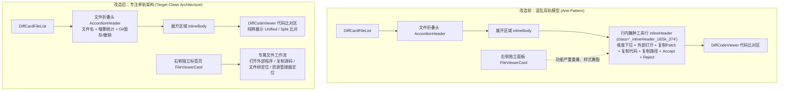

# 差异行内顶部工具行 _inlineHeader_ 彻底拔除实施方案 (PLAN-02)

> **方案编号**：PLAN-02
> **所属战役**：差异面板与笔记面板系统性重构 —— 阶段二：独立方案设计
> **输入依赖**：[`docs/diff-view-redesign/analysis/02-inline-header-dead-code-audit.md`](file:///c:/Software/conex/docs/diff-view-redesign/analysis/02-inline-header-dead-code-audit.md)
> **核心实施目标**：从 AST 树中物理彻底抹除展开单文件行内顶部工具行（`_inlineHeader_` / `.inlineHeader`），拔除伴生的下拉选择器与 6 个多余按钮，清退 268+ 行死代码与废弃 CSS，使差异面板回归纯粹专注的比对体验。

---

## 1. 方案目标与专注化 Diff 视图架构

### 1.1 核心痛点与历史架构病灶回顾
在前置现场深度审计（`AUDIT-02`）中查明：
1. **严重的双轨冗余与职能错位**：
   `DiffCardFileList.tsx` 在展开代码正上方硬塞了一整行工具条，包含“在默认编辑器中打开”、“复制标准 Git Patch”、“复制最新源码”、“复制绝对路径”、“接受修改”以及“从列表拒绝”。然而，在右侧成熟独立的 [`FileViewerCard.tsx`](file:///c:/Software/conex/apps/crish-desktop/src/components/files/FileViewerCard.tsx) 中，已原生具备完整的文件高阶流转能力。在差异面板中重复提供，造成严重的交互双轨与概念撕裂。
2. **多余微观维度造成的认知分裂**：
   差异面板全局顶部已有 `DiffHeaderControls` 提供统一的 AI 变更 vs Git 以及回合筛选。在每个单文件内部又提供一个“对比维度”选择下拉框，使得用户产生极大的认知负荷，无所适从。
3. **视觉劣化与脏灰 Hover 违和感**：
   行内为容纳多个小按钮，生造了 28px 的 `.inlineIconBtn`（[`DiffCard.module.css:409-429`](file:///c:/Software/conex/apps/crish-desktop/src/components/diff/DiffCard.module.css#L409-L429)），其 hover 效果呈现脏灰色边框与暗淡文本，严重背离系统设计规范。
4. **视口侵占**：
   原本展开区域纵向空间有限，工具栏及其边框 padding 锁死了约 36px 高度，极大压缩了代码比对正文的可用高度。

### 1.2 用户明确裁决与设计铁律
> 用户裁决：“去掉每个文件列表里面的顶部工具行，越简单越好，现在功能多了用户反而不知道怎么用了。而且按钮我看你又重新造了一个形式，那种的直接删掉就行了，正好 class="_inlineHeader_1l05k_374" 一行的按钮都得删除掉……差异面板的功能就要保持专注了，就不用加上这个工具栏了。”

**设计红线约束**：
- **绝对禁止打补丁与假隐藏**：严禁采用 `display: none`、`visibility: hidden` 或保留无用 props 伪装删除；必须彻底从 AST 中物理移除相关节点。
- **绝对禁止在代码区内自造浮动工具行**：比对正文上方零杂音，直接承接折叠标题行。
- **单轨化架构归位**：
  - **差异面板（DiffCard）**：纯粹专注比对（Unified / Split）与 Git 暂存操作；
  - **文件预览面板（FileViewerCard）**：专属承接外部程序打开、全量代码复制、系统资源管理器定位。

### 1.3 专注型单轨架构模型


---

## 2. DiffCardFileList.tsx 核心改造与 JSX 删除面切除步骤

### 2.1 JSX 展开树节点物理剔除
定位文件：[`apps/crish-desktop/src/components/diff/DiffCardFileList.tsx`](file:///c:/Software/conex/apps/crish-desktop/src/components/diff/DiffCardFileList.tsx) 第 217-332 行。

#### 改造前代码（Lines 217-332）：
```tsx
{active && (
  <div className={styles.inlineBody}>
    <div className={styles.inlineHeader}>
      <div className={styles.compareSelectorWrap}>
        <span className={styles.selectLabel}>对比维度:</span>
        <Select
          size="sm"
          value={getFileCompareMode(f.filePath)}
          options={compareOptions.map((o) => ({
            id: o.value,
            label: o.label,
            ...(o.hint !== undefined ? { hint: o.hint } : {}),
          }))}
          onChange={(val) => {
            if (isCompareMode(val)) {
              onChangeCompareMode(f.filePath, val);
            }
          }}
          className={styles.inlineCompareSelect ?? ''}
          aria-label="对比维度选择"
        />
      </div>

      <div className={styles.inlineActions}>
        <Tooltip content="在默认编辑器中打开该文件">
          <Button
            type="button"
            variant="ghost"
            size="sm"
            className={styles.inlineIconBtn}
            onClick={() => void openPathDefault(absolutePath)}
            aria-label="在编辑器打开"
            icon={<Lucide.ExternalLink size={13} />}
          />
        </Tooltip>

        <Tooltip content="复制标准 Git Patch">
          <Button
            type="button"
            variant="ghost"
            size="sm"
            className={styles.inlineIconBtn}
            onClick={() => {
              const patch = formatGitPatch(targetDiff);
              navigator.clipboard.writeText(patch);
              showToast('标准 Git Patch 已复制到剪贴板');
            }}
            aria-label="复制 Patch"
            icon={<Lucide.FileDiff size={13} />}
          />
        </Tooltip>

        <Tooltip content="复制最新文件源码">
          <Button
            type="button"
            variant="ghost"
            size="sm"
            className={styles.inlineIconBtn}
            onClick={() => void onCopyCode(f.filePath)}
            aria-label="复制代码"
            icon={<Lucide.Copy size={13} />}
          />
        </Tooltip>

        <Tooltip content="复制完整绝对路径">
          <Button
            type="button"
            variant="ghost"
            size="sm"
            className={styles.inlineIconBtn}
            onClick={() => {
              navigator.clipboard.writeText(absolutePath);
              showToast('绝对路径已复制到剪贴板');
            }}
            aria-label="复制路径"
            icon={<Lucide.FileCode size={13} />}
          />
        </Tooltip>

        <div className={styles.actionDivider} />

        <Tooltip content={acceptLabel}>
          <IconButton
            type="button"
            variant="ghost"
            size="sm"
            aria-label={acceptLabel}
            disabled={applyBusy || !classifyFileDiff(targetDiff).ok}
            onClick={(e) => {
              e.stopPropagation();
              void onAcceptFile(targetDiff);
            }}
            icon={<Lucide.Check size={14} aria-hidden />}
          />
        </Tooltip>

        <Tooltip content={REJECT_LABEL}>
          <IconButton
            type="button"
            variant="danger"
            size="sm"
            aria-label={REJECT_LABEL}
            disabled={applyBusy}
            onClick={(e) => {
              e.stopPropagation();
              onRejectFile(targetDiff);
            }}
            icon={<Lucide.X size={14} aria-hidden />}
          />
        </Tooltip>
      </div>
    </div>

    {renderInlineDiffContent(f)}
  </div>
)}
```

#### 改造后代码（极致收敛为 5 行）：
```tsx
{active && (
  <div className={styles.inlineBody}>
    {renderInlineDiffContent(f)}
  </div>
)}
```

### 2.2 renderAccordionItem 内部派生变量彻底清洗
在 `renderAccordionItem` 函数体（第 98-136 行）中，移除所有仅为 `.inlineHeader` 服务的死计算：

```tsx
// 改造前：
const cwd = getWorkspacePath();                                         // 删：第 103 行
const isAbsolute = f.filePath.startsWith('/') || f.filePath.includes(':'); // 删：第 104 行
const absolutePath = isAbsolute ? f.filePath : `${cwd}/${f.filePath}`;   // 删：第 105 行
const fileAiTurns = aiTurns.filter((t) =>                               // 删：第 106-108 行
  t.files.some((m) => m.filePath === f.filePath)
);

const targetDiff = getFileDiffData ? (getFileDiffData(f) ?? f) : f;     // 保留：文件头统计所需
const additions = targetDiff.additions ?? f.additions;                  // 保留
const deletions = targetDiff.deletions ?? f.deletions;                  // 保留

const acceptLabel = classifyFileDiff(targetDiff).ok                     // 删：第 115-117 行
  ? '接受并写入磁盘'
  : '此 diff 无法安全自动应用';

const compareOptions: { value: string; label: string; hint?: string }[] = []; // 删：第 119-136 行
if (sourceMode === 'git') {
  compareOptions.push({ value: 'git', label: 'Git 工作区改动' });
} else {
  if (aiTurns.length > 0) {
    compareOptions.push({ value: 'session-merged', label: 'AI 汇总改动' });
  }
  fileAiTurns.forEach((t) => {
    compareOptions.push({
      value: `turn-${t.msg.id}`,
      label: `第 ${t.index + 1} 轮 AI 修改`,
      hint: `${new Date(t.msg.timestamp).toLocaleTimeString()}`,
    });
  });
}
compareOptions.push({ value: 'plain', label: '当前源码全文 (无 Diff)' });
```

**改造后保留精炼段**：
```tsx
const targetDiff = getFileDiffData ? (getFileDiffData(f) ?? f) : f;
const additions = targetDiff.additions ?? f.additions;
const deletions = targetDiff.deletions ?? f.deletions;
```
*收益：每次折叠展开渲染直接免去 `aiTurns.filter` 数组深搜遍历与日期时间格式化拼接，运行时开销直接降为 O(1)。*

---

## 3. 伴生死代码与孤立 Props 连根拔起清单

### 3.1 外部 Import 依赖彻底废弃（7 项物理删除）
在 [`DiffCardFileList.tsx:4-13`](file:///c:/Software/conex/apps/crish-desktop/src/components/diff/DiffCardFileList.tsx#L4-L13) 中：

| 导入项 | 原所在行 | 废弃原因 | 处置动作 |
| :--- | :--- | :--- | :--- |
| `IconButton` | L4 | 仅用于 Accept / Reject 按钮 | 从 `../ui` 导入中剔除 |
| `Select` | L4 | 仅用于对比维度下拉框 | 从 `../ui` 导入中剔除 |
| `classifyFileDiff` | L5 | 仅用于 Accept 按钮文案及可用性校验 | 整行物理删除 |
| `openPathDefault` | L6 | 仅用于“在默认编辑器中打开”按钮 | 整行物理删除 |
| `getWorkspacePath` | L7 | 仅用于拼接 `absolutePath` | 整行物理删除 |
| `type CompareMode` | L9 | 仅用于下拉框类型保护与值转换 | 整行物理删除 |
| `formatGitPatch` | L12 | 仅用于单文件复制 Patch 按钮 | 整行物理删除 |
| `useToast` | L13 | 组件内仅用于复制成功的提示 | 整行物理删除并移除 L85 `const { showToast } = useToast();` |

改造后组件头部 Import 清爽如下：
```tsx
import React, { useMemo } from 'react';
import * as Lucide from 'lucide-react';
import styles from './DiffCard.module.css';
import { Button, Tooltip } from '../ui';
import type { FileDiff } from '../../store/types';
import type { DiffSourceMode } from '../../api/diffPanelHelpers';
```

### 3.2 图标库未引用图标清退
原组件导入 `* as Lucide from 'lucide-react'`，以下 6 个图标在拔除 `.inlineHeader` 后在整文件中零引用：
- `Lucide.ExternalLink`（原 L249）
- `Lucide.FileDiff`（原 L265）
- `Lucide.Copy`（原 L277）
- `Lucide.FileCode`（原 L292）
- `Lucide.Check`（原 L309）
- `Lucide.X`（原 L324）

*注：文件列表与 Git 暂存区继续使用的图标（保留）：`Lucide.Loader2`, `Lucide.Minus`, `Lucide.Plus`, `Lucide.Undo2`, `Lucide.MinusCircle`, `Lucide.PlusCircle`。*

### 3.3 顶层辅助函数与常量清剿
1. **类型保护函数** `isCompareMode`（[L21-L28](file:///c:/Software/conex/apps/crish-desktop/src/components/diff/DiffCardFileList.tsx#L21-L28)）：
   ```tsx
   function isCompareMode(val: string): val is CompareMode {
     return (
       val === 'git' ||
       val === 'session-merged' ||
       val === 'plain' ||
       val.startsWith('turn-')
     );
   }
   ```
   *处置*：**物理全量删除**（共 8 行）。
2. **废弃常量** `REJECT_LABEL`（[L34](file:///c:/Software/conex/apps/crish-desktop/src/components/diff/DiffCardFileList.tsx#L34)）：
   ```tsx
   const REJECT_LABEL = '从列表拒绝（不回滚磁盘）';
   ```
   *处置*：**物理删除**。保留 `UNSTAGE_LABEL`, `STAGE_LABEL`, `DISCARD_LABEL`。

### 3.4 组件接口 DiffCardFileListProps 瘦身（6 个 Props 连根拔起）
在 [`DiffCardFileListProps`](file:///c:/Software/conex/apps/crish-desktop/src/components/diff/DiffCardFileList.tsx#L36-L60) 中，彻底清理以下 6 个专为行内工具栏服务的 props：

```tsx
interface DiffCardFileListProps {
  files: FileDiff[];
  sourceMode: SourceMode;
  current: FileDiff | null;
  applyBusy: boolean;
  stagingPaths: Record<string, boolean>;
  // ── 以下 6 项彻底拔除 ──
  // aiTurns: Array<{ ... }>;
  // getFileCompareMode: (filePath: string) => CompareMode;
  // onChangeCompareMode: (filePath: string, mode: CompareMode) => void;
  // onAcceptFile: (f: FileDiff) => void;
  // onRejectFile: (f: FileDiff) => void;
  // onCopyCode: (filePath: string) => void;
  // ── 以下保留 ──
  onSetActiveDiffSource: (diff: FileDiff | null) => void;
  onStageFile: (filePath: string) => void;
  onUnstageFile: (filePath: string) => void;
  onDiscardChanges: (filePath: string) => void;
  onStageAll: () => void;
  onUnstageAll: () => void;
  renderInlineDiffContent: (f: FileDiff) => React.ReactNode;
  getFileDiffData?: (f: FileDiff) => FileDiff | null;
}
```
同时在 `DiffCardFileList` 组件入参解构（L64-L84）中同步移除这 6 个字段。

---

## 4. DiffCard.module.css 样式层 8 大死选择器物理清洗清单

### 4.1 拟删除 CSS 选择器逐项证据表
定位文件：[`apps/crish-desktop/src/components/diff/DiffCard.module.css`](file:///c:/Software/conex/apps/crish-desktop/src/components/diff/DiffCard.module.css) 第 374-436 行。

```css
/* ────────────────── 拟物理彻底删除的 63 行 CSS 样式块 ────────────────── */
.inlineHeader {
  display: flex;
  align-items: center;
  justify-content: space-between;
  padding: 4px 10px;
  background-color: var(--bg-card);
  border-bottom: 1px solid var(--border-subtle);
  gap: var(--space-2);
  box-sizing: border-box;
}

.compareSelectorWrap {
  display: flex;
  align-items: center;
  gap: var(--space-2);
}

.selectLabel {
  font-size: var(--font-size-xs, 12px);
  color: var(--text-secondary);
  font-weight: var(--font-weight-medium);
  white-space: nowrap;
}

.inlineCompareSelect {
  width: 140px;
  min-width: 120px;
}

.inlineActions {
  display: flex;
  align-items: center;
  gap: var(--space-1);
}

.inlineIconBtn {
  display: flex;
  align-items: center;
  justify-content: center;
  width: 28px;
  height: 28px;
  min-width: 28px;
  border-radius: var(--radius-sm, 4px);
  border: 1px solid transparent;
  background: transparent;
  color: var(--text-secondary);
  cursor: pointer;
  transition:
    border-color var(--transition-micro),
    color var(--transition-micro);
}

.inlineIconBtn:hover {
  color: var(--text-primary);
  border-color: var(--border-subtle);
}

.actionDivider {
  width: 1px;
  height: 14px;
  background-color: var(--border-subtle);
  margin: 0 4px;
}
```

### 4.2 清剿选择器与工程引用验证
1. `.inlineHeader`：原仅在 `DiffCardFileList.tsx:219` 引用，别处零引用。
2. `.compareSelectorWrap`：原仅在 `DiffCardFileList.tsx:220` 引用，别处零引用。
3. `.selectLabel`：原仅在 `DiffCardFileList.tsx:221` 引用，别处零引用。
4. `.inlineCompareSelect`：原仅在 `DiffCardFileList.tsx:235` 引用，别处零引用。
5. `.inlineActions`：原仅在 `DiffCardFileList.tsx:240` 引用，别处零引用。
6. `.inlineIconBtn`：原仅在 `DiffCardFileList.tsx:246,258,274,286` 引用，别处零引用。
7. `.inlineIconBtn:hover`：伪类规则，伴生清理。
8. `.actionDivider`：原仅在 `DiffCardFileList.tsx:296` 引用，别处零引用。

### 4.3 严防误伤的保留类名甄别
- **`.inlineBody`（L367-L372）**：必须**保留**！作为手风琴展开容器（包裹 `renderInlineDiffContent(f)`），提供必要的背景色与 flex 布局基座。
- **`.inlineSelect`（L72-L75）**：必须**保留**！该类名为顶部控制栏 [`DiffHeaderControls.tsx:126,140`](file:///c:/Software/conex/apps/crish-desktop/src/components/diff/DiffHeaderControls.tsx#L126) 专用，绝对不可因名称相似而误伤。

---

## 5. 父组件 DiffCard.tsx 瘦身与联动解耦

随着 `DiffCardFileList` 不再接收行内操作相关的 props，父组件 [`DiffCard.tsx`](file:///c:/Software/conex/apps/crish-desktop/src/components/diff/DiffCard.tsx) 迎来深度解耦瘦身机会：

### 5.1 孤立回调与导入全面清退
1. **删除 `handleCopyCodeOfFile`**（[DiffCard.tsx:189-207](file:///c:/Software/conex/apps/crish-desktop/src/components/diff/DiffCard.tsx#L189-L207)，共 19 行）：
   - 全组件仅作为 `onCopyCode` 传给 `DiffCardFileList`，删除后该函数成为孤儿。
   - 伴生清退：`import { readTextFile } from '../../api/workspaceFsApi';`（L19）从组件完全移除。
2. **连锁清退 `useConfirmGate`**：
   - 现场核查确认：`DiffCard.tsx:62` 声明的 `const [confirmGate, renderConfirmGate] = useConfirmGate();`，在整组件中**唯一**的使用者就是 `handleCopyCodeOfFile` 中的大文件复制弹窗确认（`confirmGate({ title: '复制大文件', ... })`）。
   - （*注：Git 放弃修改对话框使用的是 `useDiffGitActions` 导出的 `confirmGateView`，完全独立*）。
   - 伴生清退：
     * `import { ConfirmDialog } from '../ui';`（L7，仅保留 `Button`, `Tooltip`）
     * `import { useConfirmGate } from '../../hooks/useConfirmGate';`（L8 物理删除）
     * `const [confirmGate, renderConfirmGate] = useConfirmGate();`（L62 物理删除）
     * `{renderConfirmGate(<ConfirmDialog />)}`（L430 物理删除）
3. **删除 `acceptCurrentFile` 与 `rejectCurrentFile`**（[DiffCard.tsx:209-215](file:///c:/Software/conex/apps/crish-desktop/src/components/diff/DiffCard.tsx#L209-L215)）：
   - 仅作为 props 透传给 `DiffCardFileList`，整组件无其它引用。
   - 伴生清退：`import { acceptCurrentFile as acceptCurrentFileImpl, rejectCurrentFile as rejectCurrentFileImpl } from './DiffCardHandlers';`（L28-L31 物理删除）。
4. **精简 `useDiffData` 解构**：
   - `changeFileCompareMode`（L73）在 `DiffCard.tsx` 内部除传给 `onChangeCompareMode` 外无其它调用，从解构列表中移除；
   - *（注：`getFileCompareMode` 在 L260 仍用于 `renderInlineDiffContent` 中传递给 `DiffCodeViewer`，必须保留）*。

### 5.2 DiffCardFileList 组件调用点清洗
在 [`DiffCard.tsx:347-367`](file:///c:/Software/conex/apps/crish-desktop/src/components/diff/DiffCard.tsx#L347-L367) 中，调用形态由 20 行精简为 14 行：

```tsx
// 改造前：
<DiffCardFileList
  files={fileList}
  sourceMode={sourceMode}
  current={activeDiffSource}
  applyBusy={applyBusy}
  stagingPaths={stagingPaths}
  aiTurns={aiTurns}                           // 删
  getFileCompareMode={getFileCompareMode}     // 删
  onChangeCompareMode={changeFileCompareMode} // 删
  onSetActiveDiffSource={setActiveDiffSource}
  onStageFile={handleStageFile}
  onUnstageFile={handleUnstageFile}
  onDiscardChanges={handleDiscardChanges}
  onStageAll={handleStageAll}
  onUnstageAll={handleUnstageAll}
  onAcceptFile={acceptCurrentFile}            // 删
  onRejectFile={rejectCurrentFile}            // 删
  onCopyCode={handleCopyCodeOfFile}           // 删
  renderInlineDiffContent={renderInlineDiffContent}
  getFileDiffData={getFileDiffData}
/>

// 改造后：
<DiffCardFileList
  files={fileList}
  sourceMode={sourceMode}
  current={activeDiffSource}
  applyBusy={applyBusy}
  stagingPaths={stagingPaths}
  onSetActiveDiffSource={setActiveDiffSource}
  onStageFile={handleStageFile}
  onUnstageFile={handleUnstageFile}
  onDiscardChanges={handleDiscardChanges}
  onStageAll={handleStageAll}
  onUnstageAll={handleUnstageAll}
  renderInlineDiffContent={renderInlineDiffContent}
  getFileDiffData={getFileDiffData}
/>
```

---

## 6. 测试契约平滑迁移与零回归验证

### 6.1 既有单元测试精准迁移与重构
审查 [`apps/crish-desktop/src/components/diff/DiffCardFileList.test.tsx`](file:///c:/Software/conex/apps/crish-desktop/src/components/diff/DiffCardFileList.test.tsx)：

1. **用例一：`should disable Accept button for provisional diff`**
   - *现状*：测试 `classifyFileDiff` 对 provisional diff 的拦截逻辑。
   - *重构*：虽然 Accept 按钮从行内移除了，但 `classifyFileDiff` 纯函数自身的测试契约仍然有效。更新该用例注释，说明单文件行内已无 Accept 按钮，此逻辑保留在 API 单测层面验证。
2. **用例二：`renders inline compare Select with explicit size="sm" preventing overflow`**
   - *现状*：第 26-63 行专门断言行内渲染了 `Select` 下拉组件（`container.querySelector('[data-size="sm"]')`）。
   - *重构*：行内工具栏拔除后，该断言必然失败。安全改造为**“验证单文件展开后直接渲染代码正文，且不再渲染任何行内工具条与选择器”**：
     ```tsx
     it('renders inline diff content directly without redundant inline header', () => {
       const dummyFile: FileDiff = {
         filePath: 'src/main.ts',
         oldPath: 'src/main.ts',
         status: 'modified',
         additions: 5,
         deletions: 2,
         hunks: [],
       };

       const { container, getByText, queryByLabelText } = render(
         <DiffCardFileList
           files={[dummyFile]}
           sourceMode="session"
           current={dummyFile}
           applyBusy={false}
           stagingPaths={{}}
           onSetActiveDiffSource={() => {}}
           onStageFile={() => {}}
           onUnstageFile={() => {}}
           onDiscardChanges={() => {}}
           onStageAll={() => {}}
           onUnstageAll={() => {}}
           renderInlineDiffContent={() => <div data-testid="diff-viewer">diff content</div>}
         />
       );

       // 1. 验证行内工具条已被彻底物理拔除
       expect(container.querySelector('[class*="inlineHeader"]')).toBeNull();
       expect(queryByLabelText('对比维度选择')).toBeNull();
       expect(queryByLabelText('在编辑器打开')).toBeNull();

       // 2. 验证直接渲染代码比对正文
       expect(getByText('diff content')).toBeDefined();
     });
     ```
3. **用例三：`renders targetDiff additions and deletions when getFileDiffData is provided`**
   - *现状*：向 `DiffCardFileList` 传递了大量废弃 props（`aiTurns`, `getFileCompareMode`, `onAcceptFile` 等）。
   - *重构*：同步精简传参列表，移除 6 个废弃 props，保持类型检查零报错。

### 6.2 样式契约与代码规范守门
- `src/styles/style-contract.test.ts` 中针对 `DiffCardFileList` 的断言仅关注 `role="list"` 与无 `role="listbox"` 滥用，本改造完全符合此规范。
- 确保 `DiffCard.module.css` 删除后，不存在其它测试依赖被破坏的选择器。

### 6.3 严格门禁执行清单与立体化验收
执行落地时必须顺序通过以下全量门禁：
1. **类型完备性**：
   ```bash
   npm run typecheck
   ```
   验证所有组件 props、解构、导出完全匹配，零 TS 错误。
2. **单元测试与覆盖率**：
   ```bash
   npx vitest run src/components/diff/DiffCardFileList.test.tsx
   npm run test:coverage -- --project=unit
   ```
   验证重构后的测试用例 100% 绿灯。
3. **前端行数指标自检**：
   ```bash
   npm run check:line-counts
   ```
   验证 `DiffCardFileList.tsx` 与 `DiffCard.tsx` 代码行数大幅下降，零超标风险。

---

## 7. 代码削减量统计（自检删除面）

```
================================================================================
文件路径                                      变更类型   原行数  预计净删  预计剩余
================================================================================
apps/crish-desktop/src/components/diff/
  DiffCardFileList.tsx                        MODIFY     408     -175      约 233 行
  DiffCard.module.css                         MODIFY     893      -63      约 830 行
  DiffCard.tsx                                MODIFY     436      -35      约 401 行
  DiffCardFileList.test.tsx                   MODIFY     107      -10       约 97 行
================================================================================
全链路净代码削减 (Net Negative LOC)                              -283 行
================================================================================
```

### 实施承诺
- **不留死代码**：零 `display: none`，零 `// TODO`，零未使用的 import 或 props；
- **不改全局提交**：严禁调用 git commit / git reset；
- **纯净单轨体验**：折叠点击展开即代码比对，还用户以极简、专注的专业 Diff 心流体验。
