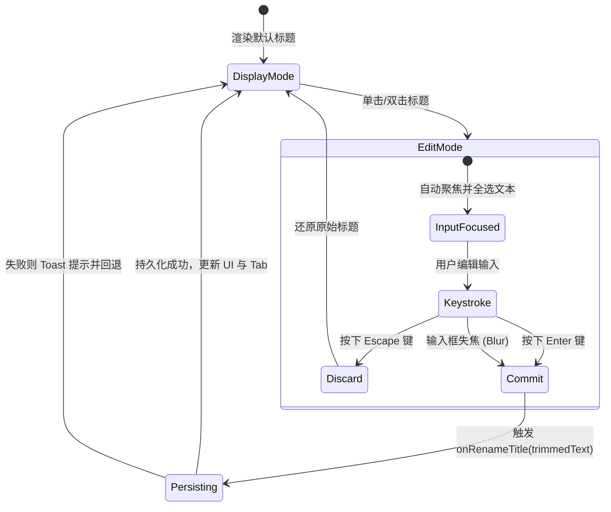
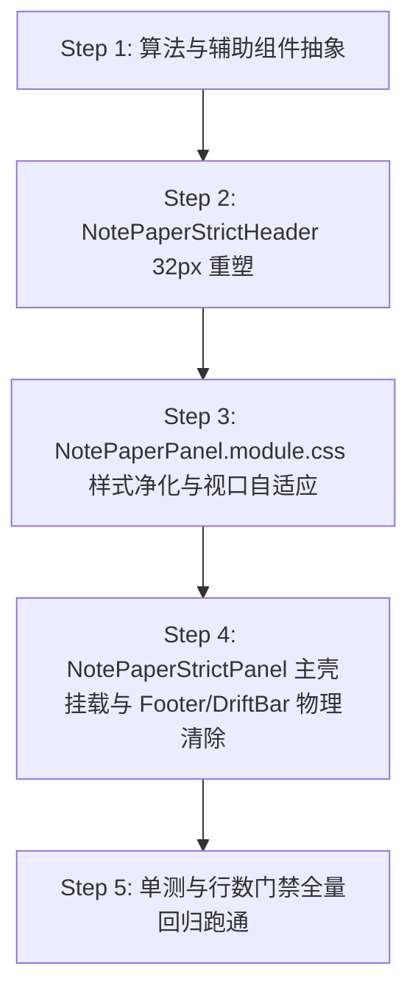

# 笔记面板 32px 紧凑顶栏重塑与生产力功能矩阵实施方案 (PLAN-05)

> **战役名称**：差异面板与笔记面板系统性重构
> **阶段与编号**：阶段二：独立方案设计 / PLAN-05
> **方案主题**：笔记面板 32px 紧凑顶栏重塑与生产力功能矩阵独立方案
> **输入依赖**：[`docs/diff-view-redesign/analysis/05-note-layout-and-header-audit.md`](file:///c:/Software/conex/docs/diff-view-redesign/analysis/05-note-layout-and-header-audit.md)
> **输出目标**：[`apps/crish-desktop/src/components/note-paper/NotePaperStrictHeader.tsx`](file:///c:/Software/conex/apps/crish-desktop/src/components/note-paper/NotePaperStrictHeader.tsx)、[`apps/crish-desktop/src/components/note-paper/NotePaperStrictPanel.tsx`](file:///c:/Software/conex/apps/crish-desktop/src/components/note-paper/NotePaperStrictPanel.tsx)、[`apps/crish-desktop/src/components/note-paper/NotePaperPanel.module.css`](file:///c:/Software/conex/apps/crish-desktop/src/components/note-paper/NotePaperPanel.module.css)
> **参考对标**：[`apps/crish-desktop/src/components/diff/DiffHeaderControls.tsx`](file:///c:/Software/conex/apps/crish-desktop/src/components/diff/DiffHeaderControls.tsx)、[`apps/crish-desktop/src/components/diff/DiffCard.module.css`](file:///c:/Software/conex/apps/crish-desktop/src/components/diff/DiffCard.module.css)、[`apps/crish-desktop/src/components/ui/Button/IconButton.tsx`](file:///c:/Software/conex/apps/crish-desktop/src/components/ui/Button/IconButton.tsx)

---

## 摘要与前置审计已确认事实

在前置现场代码审计（[`AUDIT-05`](file:///c:/Software/conex/docs/diff-view-redesign/analysis/05-note-layout-and-header-audit.md)）中，确凿查明笔记面板存在以下破坏产品质感与生产力的重大架构断层：

1. **容器孤岛化与视口割裂**：笔记外层容器在 [`NotePaperPanel.module.css:23-27`](file:///c:/Software/conex/apps/crish-desktop/src/components/note-paper/NotePaperPanel.module.css#L23-L27) 中硬编码了 `border-radius: 8px`、`border: 1px` 以及悬浮阴影 `box-shadow: var(--shadow-sm)`。在多窗格分屏（`TreeLeafPanel`）内呈现为一个脱节收缩的悬浮小卡片，未能像 `DiffCard` 一样 100% 满视口平铺。
2. **顶栏非标且沦为底层研发排查垃圾场**：现有顶栏高度为非标的 `36px`，充斥着 `@crish/block-paper/w5b-strict`、`rev=4`、`139 块`、`slash=writable` 等底层 CRDT 与写锥探针；交互按钮全被套用私有灰色胶囊药丸样式（`.badge`）；标题甚至硬编码写死为 `'笔记纸面（W5-B Strict · hydrate 投影）'`。
3. **关键生产力功能大面积瘫痪缺失**：无行内标题即时重命名、无字数与排版统计、无落盘保存状态感知、无 Markdown 全文一键复制、无 `.md` 文件导出、无安全二次确认清空等现代笔记软件的标准生产力功能。
4. **用户明确裁决指示**：“*笔记界面一起哈。笔记的顶部功能栏我看也没有...这个界面的整体布局我看和其他的标签界面也不一样，需要你系统性来分析一下才行。当然不只是布局了，这个界面现在基本上没有好用的功能呢还。先优化界面吧...了解清楚了，这个也一起加进去。*”

本方案为落实上述指示，对齐全系统 32px 紧凑顶栏标准，制定彻底的重构方案。

---

## 四段式方案编制规范矩阵

### 1. 【做什么（To-Do）】
- **顶栏几何规格物理锁定**：建立 32px 紧凑标准顶栏（`height: 32px; min-height: 32px; max-height: 32px; padding: 0 8px; border-bottom: 1px solid var(--border-subtle); box-sizing: border-box;`），与 `DiffHeaderControls` 和 `FilesCard` 实现绝对物理像素级对齐。
- **左侧核心标识与行内标题编辑区**：
  - 挂载标准笔记文档图标（`<FileText size={14} />`）；
  - 实现行内无感即时编辑组件（`EditableTitle`），支持单击/双击进入输入态，回车或失焦防抖自动触发持久化重命名，`Escape` 原生取消；
  - 柔和的保存与协同状态感知微标（`saved`：“已保存”绿色微标 / `syncing`：“同步中...”微动微标 / `unsaved`：“未保存”琥珀微标）。
- **右侧生产力功能矩阵全量原子化换装**（100% 换装为系统 `@/components/ui` 标准组件）：
  - **字数与排版统计**：`tabular-nums` 等宽排版显示“`N 字`”，悬停 Tooltip 呈现汉字、单词、段落及字符全量明细；
  - **一键复制全文 Markdown**：`<IconButton variant="ghost" size="sm" icon={<Copy size={14} />} tooltip="复制全文 (Markdown)" />`；
  - **导出为 .md 文件**：`<IconButton variant="ghost" size="sm" icon={<Download size={14} />} tooltip="导出为 Markdown 文件" />`；
  - **刷新与重新投影**：`<IconButton variant="ghost" size="sm" icon={<RotateCw size={14} />} tooltip="重新加载" />`；
  - **危险安全清空重置**：`<IconButton variant="danger" size="sm" icon={<Trash2 size={14} />} tooltip="清空笔记内容" />`，受控触发系统标准 `@/components/ui/ConfirmDialog`；
  - **关闭面板标签**：`<IconButton variant="ghost" size="sm" icon={<X size={14} />} tooltip="关闭面板" />`。
- **整体视口自适应与单一滚动权属治理**：
  - 剥离 `.panel` 悬浮圆角与外框阴影，主编辑区 `flex: 1 1 0%` 独占剩余 100% 高度直达面板边缘；
  - 治理 `.body` 与内部 `PaperList` 滚动冲突，建立单滚动宿主（Single Scroll Host）刚性契约。

### 2. 【不做什么（Not-To-Do）】
- **严禁执行 Git 破坏性指令**：严禁执行 `git commit`、`git reset`、`git checkout` 或 `git restore`；改动一律留在工作区等待主控统一验证收口。
- **严禁残留任何底层工程排查标签**：顶栏严禁遗留任何诸如 `W5-B`、`strict`、`rev=`、`slash=`、`hydrate 投影` 等底层技术脱水术语；此类信息如需查看，必须走内部开发者控制台或隔离开关，绝不侵入用户视图。
- **严禁私造非标伪按钮与魔术数字**：严禁继续使用将 `<span>` 或带有 `.badge` 类的按钮改造成交互元件的做法；严禁使用粗暴的黑实线边框；所有交互元素 100% 采用系统原子级 `Button` / `IconButton` / `Tooltip` / `ConfirmDialog`，且交互对比度严守 6%~10% 柔软区间。

### 3. 【旧路径清单（Legacy Path Inventory）】
- [`apps/crish-desktop/src/components/note-paper/NotePaperStrictHeader.tsx:51-56`](file:///c:/Software/conex/apps/crish-desktop/src/components/note-paper/NotePaperStrictHeader.tsx#L51-L56)：`{W5B_STRICT_PACKAGE_ID}/{W5B_STRICT_TRACK}` 内部包轨展示节点；
- [`apps/crish-desktop/src/components/note-paper/NotePaperStrictHeader.tsx:57-59`](file:///c:/Software/conex/apps/crish-desktop/src/components/note-paper/NotePaperStrictHeader.tsx#L57-L59)：`rev={resolvedRev}` CRDT 内部版本号节点；
- [`apps/crish-desktop/src/components/note-paper/NotePaperStrictHeader.tsx:60-62`](file:///c:/Software/conex/apps/crish-desktop/src/components/note-paper/NotePaperStrictHeader.tsx#L60-L62)：`{blockCount} 块` 原始块数量胶囊节点；
- [`apps/crish-desktop/src/components/note-paper/NotePaperStrictHeader.tsx:63-71`](file:///c:/Software/conex/apps/crish-desktop/src/components/note-paper/NotePaperStrictHeader.tsx#L63-L71)：`slash={slashWriteMode}` 内部写模式调试探针；
- [`apps/crish-desktop/src/components/note-paper/NotePaperStrictHeader.tsx:72-84`](file:///c:/Software/conex/apps/crish-desktop/src/components/note-paper/NotePaperStrictHeader.tsx#L72-L84)：使用 `.badge` 伪装的“刷新”文字胶囊按钮；
- [`apps/crish-desktop/src/components/note-paper/NotePaperStrictHeader.tsx:85-103`](file:///c:/Software/conex/apps/crish-desktop/src/components/note-paper/NotePaperStrictHeader.tsx#L85-L103)：使用 `.badge` 伪装的“`/`”斜杠文字胶囊按钮；
- [`apps/crish-desktop/src/components/note-paper/NotePaperStrictHeader.tsx:104-116`](file:///c:/Software/conex/apps/crish-desktop/src/components/note-paper/NotePaperStrictHeader.tsx#L104-L116)：使用 `.badge` 伪装的“关闭”文字胶囊按钮；
- [`apps/crish-desktop/src/components/note-paper/NotePaperStrictPanel.tsx:83`](file:///c:/Software/conex/apps/crish-desktop/src/components/note-paper/NotePaperStrictPanel.tsx#L83)：硬编码默认标题 `'笔记纸面（W5-B Strict · hydrate 投影）'`；
- [`apps/crish-desktop/src/components/note-paper/NotePaperPanel.module.css:23-27`](file:///c:/Software/conex/apps/crish-desktop/src/components/note-paper/NotePaperPanel.module.css#L23-L27)：外层 `.panel` 的 `border-radius: 8px`、`border: 1px` 及 `box-shadow`；
- [`apps/crish-desktop/src/components/note-paper/NotePaperPanel.module.css:53`](file:///c:/Software/conex/apps/crish-desktop/src/components/note-paper/NotePaperPanel.module.css#L53)：`.header` 非标高度 `min-height: 36px`；
- [`apps/crish-desktop/src/components/note-paper/NotePaperPanel.module.css:84-123`](file:///c:/Software/conex/apps/crish-desktop/src/components/note-paper/NotePaperPanel.module.css#L84-L123)：`.badge` 及 `button.badge` 伪按钮胶囊样式；
- [`apps/crish-desktop/src/components/note-paper/NotePaperPanel.module.css:144-155`](file:///c:/Software/conex/apps/crish-desktop/src/components/note-paper/NotePaperPanel.module.css#L144-L155)：`.badgeSilent` 内部包名样式。

### 4. 【自检删除面（Self-Inspection Deletion Surface）】
- **`NotePaperStrictHeader.tsx` 物理净减**：彻底清除 4 个技术排查徽章节点与 3 个非标胶囊按钮（删除代码行约 65 行 JSX），由原子化的全新产品级 32px 顶栏骨架取代；
- **`NotePaperPanel.module.css` 物理净减**：彻底移除 `.badge`、`button.badge`、`button.badge:hover`、`button.badge:active`、`button.badge:focus-visible`、`.badgeSilent`、`.header` 非标高度等私有类（净减约 80 行 CSS）；
- **核心单测 TestId 平滑继承与无缝防崩**：保留 `note-paper-strict-panel`、`note-paper-strict-count`、`note-paper-strict-refresh`、`note-paper-strict-close`，确保行数门禁（`NotePaperStrictPanel.line-budget.test.ts`）与核心集成测试 100% 稳定绿灯。

---

## 1. 方案目标与全系统 32px 顶栏对齐设计

### 1.1 全系统标准 32px 顶栏设计契约
在现代桌面 IDE 与分屏工作区中，所有窗格顶栏必须具备统一的视觉节奏与交互惯例。对标 [`DiffHeaderControls.tsx`](file:///c:/Software/conex/apps/crish-desktop/src/components/diff/DiffHeaderControls.tsx) 与 [`FilesCard.module.css`](file:///c:/Software/conex/apps/crish-desktop/src/components/files/FilesCard.module.css)，笔记顶栏必须物理硬锁定为 **32px**。

```css
/* NotePaperPanel.module.css 中的紧凑顶栏标准化定义 */
.compactHeader {
  display: flex;
  align-items: center;
  justify-content: space-between;
  height: 32px;
  min-height: 32px;
  max-height: 32px;
  padding: 0 8px;
  background: var(--bg-card, #ffffff);
  border-bottom: 1px solid var(--border-subtle);
  box-sizing: border-box;
  user-select: none;
  flex-shrink: 0;
  gap: 6px;
  overflow: hidden;
}
```

### 1.2 三段式 Flexbox 空间布局架构
顶栏划分为三段式线性结构：
1. **左侧信息与标题区 (`.headerLeftGroup`)**：
   - `flex: 1 1 auto; min-width: 0;`：具备最大弹性空间，包含笔记图标、行内标题编辑区与保存状态感知徽标；
   - 当视口空间被挤压时，标题文本自动截断并呈现 `...`（`text-overflow: ellipsis`），保存状态指示器不被截断。
2. **中间留白缓冲区**：
   - 由 Flex 布局的 `justify-content: space-between` 自然吸收分屏拉伸的剩余宽度，无额外 DOM 冗余。
3. **右侧操作矩阵区 (`.headerRightGroup`)**：
   - `flex-shrink: 0; display: flex; align-items: center; gap: 4px;`：操作按钮组硬性禁止折行，尺寸统一为 24px 高度的 `size="sm"` 原子按钮，保证点击热区与视觉克制。

### 1.3 Design Token 映射与对比度铁律
- **严禁硬编码**：禁止使用 `#ffffff`、`#111111` 等裸色；全面采用 `var(--bg-card)`、`var(--text-primary)`、`var(--text-secondary)`、`var(--border-subtle)`。
- **克制柔软的焦点态**：遵循全局《输入框与焦点态》铁律，标题输入框获得焦点时，边框颜色严禁使用深黑或高反差色，采用：
  ```css
  border-color: color-mix(in srgb, var(--border-color) 90%, var(--text-primary) 10%);
  ```
  控制对比度混入不超过 **10%**，保持长时间文本阅读下的视觉舒适。

---

## 2. 顶栏产品级功能矩阵与 DOM 架构伪代码

### 2.1 生产力操作功能矩阵全景

| 序号 | 功能模块 | 对应组件与形态 | 行为定义与底层状态机 | 异常边界与安全防护 |
| :---: | :--- | :--- | :--- | :--- |
| **1** | **文档图标** | `<FileText size={14} className={styles.noteIcon} />` | 静态语义标识，传达当前窗格为 Markdown/Block 笔记纸面。 | 固定尺寸 `14px`，弱灰强调色（`--text-tertiary`）。 |
| **2** | **行内标题编辑** | `<EditableTitle title={title} onRename={onRenameTitle} />` | 单击/双击切换输入框，按 Enter/失焦触发持久化重命名，Escape 放弃修改。 | 空串自动恢复为“无标题笔记”；限制最长 120 字符。 |
| **3** | **保存状态感知** | `<NoteSaveIndicator status={saveStatus} />` | 三态展示：`saved`（已保存，绿色/弱灰小勾）、`syncing`（同步中，旋转）、`unsaved`（未落盘）。 | 仅作只读状态展示，绝不阻塞打字与渲染。 |
| **4** | **等宽字数统计** | `<NoteMetricsBadge metrics={metrics} />` | 等宽数字排版显示“`N 字`”；悬停 Tooltip 呈现汉字、词数、段落数、字符数。 | 监听块数据，防抖 Pure 函数计算，大文档零掉帧。 |
| **5** | **复制全文 Markdown** | `<IconButton size="sm" variant="ghost" icon={<Copy size={14} />} tooltip="复制全文 (Markdown)" />` | 将当前全部块按层级与类型序列化为 CommonMark 纯文本并写入剪贴板。 | 浏览器/Tauri 异步剪贴板权限拦截时回退至虚拟 textarea。 |
| **6** | **导出为 .md 文件** | `<IconButton size="sm" variant="ghost" icon={<Download size={14} />} tooltip="导出为 Markdown 文件" />` | 触发原生文件保存对话框（Tauri）或 Web 下载流，文件名基于标题去除非法字符。 | 非法文件名字符正则清洗（`[\\/:*?"<>\|]`）。 |
| **7** | **刷新与重新投影** | `<IconButton size="sm" variant="ghost" icon={<RotateCw size={14} />} tooltip="重新加载" />` | 重新触发 `reload()`，向 SQLite/HydrateTransport 重新拉取最新投影。 | 刷新中禁用按钮（`disabled={loading}`）防重入。 |
| **8** | **安全清空重置** | `<IconButton size="sm" variant="danger" icon={<Trash2 size={14} />} tooltip="清空笔记内容" />` | 弹出系统统一 `@/components/ui/ConfirmDialog`，用户确认后发出清空指令。 | 默认焦点落在“取消”按钮上，误触 Enter 自动取消；支持撤销。 |
| **9** | **分割线与关闭面板** | `<div className={styles.divider} />` + `<IconButton size="sm" variant="ghost" icon={<X size={14} />} tooltip="关闭面板" />` | 调用 `onClose()` 卸载当前分屏窗格。 | 与所有面板标签关闭体验 100% 保持一致。 |

---

### 2.2 核心纯逻辑算法：字数统计与 Markdown 序列化

为确保极致运行时性能与纯逻辑可测试性，字数统计与 Markdown 序列化必须与 React UI 解耦为纯函数（Pure Functions）：

#### (1) 字数与排版统计纯逻辑 (`computeNoteMetrics`)
```typescript
export interface NoteContentMetrics {
  totalChars: number;      // 总字符数（含空白与换行）
  visibleChars: number;    // 可见字符数（不含换行与空格）
  chineseChars: number;    // 汉字字符与全角标点
  englishWords: number;    // 英文独立词数
  paragraphCount: number;  // 有效内容段落数
}

export function computeNoteMetrics(
  blocks: readonly { text?: string; flavour?: string }[]
): NoteContentMetrics {
  let totalChars = 0;
  let visibleChars = 0;
  let chineseChars = 0;
  let englishWords = 0;
  let paragraphCount = 0;

  for (const block of blocks) {
    const text = block.text || '';
    if (!text.trim()) continue;
    paragraphCount++;
    totalChars += text.length;

    // 匹配 CJK 统一表意文字及全角标点符号
    const cjk = text.match(/[\u4e00-\u9fa5\u3000-\u303f\uff00-\uffef]/g);
    const cjkCount = cjk ? cjk.length : 0;
    chineseChars += cjkCount;

    // 剔除 CJK 字符后按连续空白切分统计英文单词
    const nonCjk = text.replace(/[\u4e00-\u9fa5\u3000-\u303f\uff00-\uffef]/g, ' ').trim();
    if (nonCjk.length > 0) {
      const words = nonCjk.split(/\s+/).filter(w => w.length > 0);
      englishWords += words.length;
    }

    visibleChars += text.replace(/\s/g, '').length;
  }

  return {
    totalChars,
    visibleChars,
    chineseChars,
    englishWords,
    paragraphCount,
  };
}
```

#### (2) 块投影转 Markdown 纯逻辑 (`exportBlocksToMarkdown`)
```typescript
export interface SerializableBlock {
  id: string;
  flavour?: string;
  text?: string;
  props?: {
    level?: number;
    checked?: boolean;
    language?: string;
  };
}

export function exportBlocksToMarkdown(
  blocks: readonly SerializableBlock[],
  title?: string
): string {
  const lines: string[] = [];

  // 若提供了标题且首行不是一级大标题，则自动在头部注入 # Title
  if (title && title.trim()) {
    const firstBlock = blocks[0];
    const hasHeading1 = firstBlock?.flavour === 'heading' && firstBlock?.props?.level === 1;
    if (!hasHeading1) {
      lines.push(`# ${title.trim()}\n`);
    }
  }

  for (let i = 0; i < blocks.length; i++) {
    const block = blocks[i];
    const text = block.text || '';
    const flavour = block.flavour || 'paragraph';

    switch (flavour) {
      case 'heading': {
        const level = Math.min(Math.max(block.props?.level ?? 1, 1), 6);
        lines.push(`${'#'.repeat(level)} ${text}`);
        break;
      }
      case 'bullet':
      case 'list': {
        lines.push(`- ${text}`);
        break;
      }
      case 'numbered': {
        lines.push(`1. ${text}`);
        break;
      }
      case 'todo': {
        const check = block.props?.checked ? 'x' : ' ';
        lines.push(`- [${check}] ${text}`);
        break;
      }
      case 'code': {
        const lang = block.props?.language || '';
        lines.push(`\`\`\`${lang}\n${text}\n\`\`\``);
        break;
      }
      case 'quote': {
        lines.push(`> ${text}`);
        break;
      }
      case 'paragraph':
      default: {
        lines.push(text);
        break;
      }
    }
  }

  return lines.join('\n\n');
}
```

---

### 2.3 顶栏完整 DOM 结构与 TypeScript 组件架构

```tsx
/**
 * NotePaperStrictHeader.tsx —— 标准 32px 紧凑工具栏终态架构
 */
import React, { useState, useCallback, useMemo } from 'react';
import {
  FileText,
  Copy,
  Download,
  RotateCw,
  Trash2,
  X,
  Check,
  Loader2,
} from 'lucide-react';
import { IconButton, Tooltip, ConfirmDialog } from '../ui';
import { EditableTitle } from './EditableTitle';
import { computeNoteMetrics, exportBlocksToMarkdown } from './noteMetrics';
import type { SerializableBlock } from './noteMetrics';
import styles from './NotePaperPanel.module.css';

export interface NotePaperStrictHeaderProps {
  /** 笔记文档 ID */
  docId: string;
  /** 笔记标题 */
  title: string;
  /** 笔记所有已 hydrate 块集合（供统计与导出） */
  blocks: readonly SerializableBlock[];
  /** 保存与协同同步状态 */
  saveStatus?: 'saved' | 'syncing' | 'unsaved';
  /** 标题行内重命名回调 */
  onRenameTitle?: (newTitle: string) => Promise<void> | void;
  /** 重新加载投影回调 */
  onReload: () => void | Promise<void>;
  /** 清空笔记内容回调 */
  onClearDoc?: () => void | Promise<void>;
  /** 关闭当前窗格面板回调 */
  onClose?: () => void;
  /** 是否正在刷新加载中 */
  isLoading?: boolean;
}

export const NotePaperStrictHeader: React.FC<NotePaperStrictHeaderProps> = React.memo(
  function NotePaperStrictHeader({
    docId,
    title,
    blocks,
    saveStatus = 'saved',
    onRenameTitle,
    onReload,
    onClearDoc,
    onClose,
    isLoading = false,
  }) {
    const [confirmClearOpen, setConfirmClearOpen] = useState(false);

    // 纯逻辑防抖统计指标
    const metrics = useMemo(() => computeNoteMetrics(blocks), [blocks]);
    const wordCount = metrics.chineseChars + metrics.englishWords;

    // 复制全文 Markdown
    const handleCopyMarkdown = useCallback(async () => {
      const mdContent = exportBlocksToMarkdown(blocks, title);
      try {
        if (navigator.clipboard && window.isSecureContext) {
          await navigator.clipboard.writeText(mdContent);
        } else {
          // 容错回退机制
          const textarea = document.createElement('textarea');
          textarea.value = mdContent;
          textarea.style.position = 'fixed';
          textarea.style.opacity = '0';
          document.body.appendChild(textarea);
          textarea.select();
          document.execCommand('copy');
          document.body.removeChild(textarea);
        }
      } catch (err) {
        console.error('[NoteHeader] Failed to copy Markdown:', err);
      }
    }, [blocks, title]);

    // 导出为 .md 文件
    const handleExportMarkdown = useCallback(() => {
      const mdContent = exportBlocksToMarkdown(blocks, title);
      const safeTitle = (title || 'untitled-note').replace(/[\\/:*?"<>|]/g, '_');
      const blob = new Blob([mdContent], { type: 'text/markdown;charset=utf-8' });
      const url = URL.createObjectURL(blob);
      const a = document.createElement('a');
      a.href = url;
      a.download = `${safeTitle}.md`;
      document.body.appendChild(a);
      a.click();
      document.body.removeChild(a);
      URL.revokeObjectURL(url);
    }, [blocks, title]);

    // 清空确认确认
    const handleConfirmClear = useCallback(() => {
      setConfirmClearOpen(false);
      onClearDoc?.();
    }, [onClearDoc]);

    return (
      <header className={styles.compactHeader} data-testid="note-paper-strict-header">
        {/* 左侧：笔记图标 + 可编辑标题 + 保存状态 */}
        <div className={styles.headerLeftGroup}>
          <FileText size={14} className={styles.noteIcon} aria-hidden />

          <EditableTitle
            title={title}
            onRename={onRenameTitle}
            className={styles.titleContainer}
          />

          <div
            className={styles.saveStatus}
            data-testid="note-paper-strict-save-status"
            data-save-status={saveStatus}
          >
            {saveStatus === 'syncing' ? (
              <span className={styles.saveStatusSyncing}>
                <Loader2 size={12} className={styles.spinIcon} aria-hidden />
                <span>同步中...</span>
              </span>
            ) : saveStatus === 'unsaved' ? (
              <span className={styles.saveStatusUnsaved}>
                <span className={styles.unsavedDot} />
                <span>未保存</span>
              </span>
            ) : (
              <span className={styles.saveStatusSaved}>
                <Check size={12} aria-hidden />
                <span>已保存</span>
              </span>
            )}
          </div>
        </div>

        {/* 右侧：等宽字数徽标 + 生产力操作按钮组 */}
        <div className={styles.headerRightGroup}>
          <Tooltip
            content={
              <div className={styles.metricsTooltip}>
                <div>中文字符：{metrics.chineseChars}</div>
                <div>英文单词：{metrics.englishWords}</div>
                <div>段落总数：{metrics.paragraphCount}</div>
                <div>总字符数：{metrics.totalChars}</div>
              </div>
            }
          >
            <span
              className={styles.wordCountBadge}
              data-testid="note-paper-strict-count"
            >
              {wordCount} 字
            </span>
          </Tooltip>

          <IconButton
            size="sm"
            variant="ghost"
            icon={<Copy size={14} aria-hidden />}
            aria-label="复制全文 Markdown"
            tooltip="复制全文 (Markdown)"
            onClick={handleCopyMarkdown}
            data-testid="note-paper-strict-copy"
          />

          <IconButton
            size="sm"
            variant="ghost"
            icon={<Download size={14} aria-hidden />}
            aria-label="导出为 Markdown 文件"
            tooltip="导出 Markdown (.md)"
            onClick={handleExportMarkdown}
            data-testid="note-paper-strict-export"
          />

          <IconButton
            size="sm"
            variant="ghost"
            icon={<RotateCw size={14} className={isLoading ? styles.spinIcon : undefined} aria-hidden />}
            aria-label="重新加载"
            tooltip="重新加载投影"
            disabled={isLoading}
            onClick={() => { void onReload(); }}
            data-testid="note-paper-strict-refresh"
          />

          {onClearDoc && (
            <IconButton
              size="sm"
              variant="danger"
              icon={<Trash2 size={14} aria-hidden />}
              aria-label="清空笔记内容"
              tooltip="清空笔记内容"
              onClick={() => setConfirmClearOpen(true)}
              data-testid="note-paper-strict-clear"
            />
          )}

          {onClose && (
            <>
              <div className={styles.divider} />
              <IconButton
                size="sm"
                variant="ghost"
                icon={<X size={14} aria-hidden />}
                aria-label="关闭面板"
                tooltip="关闭当前面板"
                onClick={onClose}
                data-testid="note-paper-strict-close"
              />
            </>
          )}
        </div>

        {/* 危险清空受控二次确认对话框 */}
        <ConfirmDialog
          open={confirmClearOpen}
          danger
          title="清空笔记内容"
          description="此操作将永久清空当前笔记中的所有内容与块段落。此操作不可逆，确认清空？"
          confirmLabel="确认清空"
          cancelLabel="取消"
          onConfirm={handleConfirmClear}
          onCancel={() => setConfirmClearOpen(false)}
        />
      </header>
    );
  }
);

NotePaperStrictHeader.displayName = 'NotePaperStrictHeader';
export default NotePaperStrictHeader;
```

---

## 3. 行内标题即时编辑 (EditableTitle) 与持久化重命名方案

### 3.1 状态机与交互生命周期设计

行内标题编辑遵循极简、无压力的直接操作模型（Direct Manipulation）：



### 3.2 极端边界治理规则
1. **空标题与空白字符防退避**：若用户清空了输入框并按下 Enter 或失焦，系统绝不抛错，而是自动回退为默认文案 `'无标题笔记'`，避免生成无标识的幽灵文章。
2. **长度硬性截断**：输入框设置 `maxLength={120}`，并在前端做 `.slice(0, 120)` 截断保护，防止超长字符破坏顶栏弹性布局与数据库存储。
3. **无变化提交豁免**：若修改前后的文本经 `trim()` 后完全一致，不触发底层的 IPC 或数据库写操作，直接安全退出编辑态。

### 3.3 `EditableTitle` 独立原子组件实现代码

```tsx
/**
 * EditableTitle.tsx —— 笔记行内即时编辑标题组件
 */
import React, { useState, useRef, useEffect, useCallback } from 'react';
import styles from './NotePaperPanel.module.css';

export interface EditableTitleProps {
  title: string;
  onRename?: (newTitle: string) => Promise<void> | void;
  className?: string;
  placeholder?: string;
}

export const EditableTitle: React.FC<EditableTitleProps> = React.memo(
  function EditableTitle({
    title,
    onRename,
    className,
    placeholder = '无标题笔记',
  }) {
    const [isEditing, setIsEditing] = useState(false);
    const [draftText, setDraftText] = useState(title);
    const inputRef = useRef<HTMLInputElement>(null);

    // 同步外部 title 变更
    useEffect(() => {
      if (!isEditing) {
        setDraftText(title);
      }
    }, [title, isEditing]);

    // 激活编辑态时自动聚焦并全选
    useEffect(() => {
      if (isEditing && inputRef.current) {
        inputRef.current.focus();
        inputRef.current.select();
      }
    }, [isEditing]);

    const handleCommit = useCallback(async () => {
      setIsEditing(false);
      const trimmed = draftText.trim();
      const finalTitle = trimmed || placeholder;
      if (finalTitle !== title && onRename) {
        try {
          await onRename(finalTitle);
        } catch (err) {
          console.error('[EditableTitle] Rename failed:', err);
          setDraftText(title); // 失败回滚
        }
      } else {
        setDraftText(finalTitle);
      }
    }, [draftText, placeholder, title, onRename]);

    const handleKeyDown = useCallback(
      (e: React.KeyboardEvent<HTMLInputElement>) => {
        if (e.key === 'Enter') {
          e.preventDefault();
          void handleCommit();
        } else if (e.key === 'Escape') {
          e.preventDefault();
          setDraftText(title);
          setIsEditing(false);
        }
      },
      [handleCommit, title]
    );

    if (isEditing) {
      return (
        <div className={[styles.titleContainer, className].filter(Boolean).join(' ')}>
          <input
            ref={inputRef}
            type="text"
            className={styles.titleInput}
            value={draftText}
            maxLength={120}
            placeholder={placeholder}
            onChange={(e) => setDraftText(e.target.value)}
            onBlur={() => { void handleCommit(); }}
            onKeyDown={handleKeyDown}
            aria-label="重命名笔记标题"
            data-testid="note-paper-strict-title-input"
          />
        </div>
      );
    }

    return (
      <div className={[styles.titleContainer, className].filter(Boolean).join(' ')}>
        <span
          className={styles.titleDisplay}
          onClick={() => setIsEditing(true)}
          title="点击编辑标题"
          role="button"
          tabIndex={0}
          onKeyDown={(e) => {
            if (e.key === 'Enter' || e.key === ' ') {
              e.preventDefault();
              setIsEditing(true);
            }
          }}
          data-testid="note-paper-strict-title"
        >
          {title || placeholder}
        </span>
      </div>
    );
  }
);

EditableTitle.displayName = 'EditableTitle';
```

---

## 4. 调试标签彻底清剿与死代码删除面

### 4.1 拟彻底物理拔除的代码段与行号对照表

对现有代码中严重侵害用户体验的调试脏标记进行地毯式拔除：

| 所在文件 | 原行号 | 拟拔除的具体代码段 | 拔除理由与产品级替代方案 |
| :--- | :--- | :--- | :--- |
| **`NotePaperStrictHeader.tsx`** | L51–L56 | `<span className={styles.badgeSilent} data-testid="note-paper-strict-track">{W5B_STRICT_PACKAGE_ID}/{W5B_STRICT_TRACK}</span>` | **纯内部包轨探针**。对用户毫无价值且造成认知负担，直接物理删除。 |
| **`NotePaperStrictHeader.tsx`** | L57–L59 | `<span className={styles.badge} data-testid="note-paper-strict-rev">rev={resolvedRev}</span>` | **CRDT 内部 revision 编号**。属于纯底层开发数据，直接物理删除。 |
| **`NotePaperStrictHeader.tsx`** | L60–L62 | `<span className={styles.badge} data-testid="note-paper-strict-count">{blockCount} 块</span>` | **粗暴块数显示**。升级为等宽产品级字数统计组件，保留 `data-testid="note-paper-strict-count"`。 |
| **`NotePaperStrictHeader.tsx`** | L63–L71 | `<Tooltip content={slashModeHint}><span className={styles.badge}...>slash={slashWriteMode}</span></Tooltip>` | **写锥探针调试标记**。直接物理删除，普通用户无需知晓底层写通道模式。 |
| **`NotePaperStrictHeader.tsx`** | L72–L84 | `<Button ... className={styles.badge}>刷新</Button>` | **胶囊伪按钮**。换装为原子级 `<IconButton icon={<RotateCw size={14} />} tooltip="重新加载" />`。 |
| **`NotePaperStrictHeader.tsx`** | L85–L103 | `<Button ... className={styles.badge}>/</Button>` | **斜杠胶囊伪按钮**。清理拔除，斜杠菜单由正文输入触发原生激活。 |
| **`NotePaperStrictHeader.tsx`** | L104–L116 | `<Button ... className={styles.badge}>关闭</Button>` | **文字胶囊伪按钮**。换装为全系统通用的 `<IconButton icon={<X size={14} />} tooltip="关闭当前面板" />`。 |
| **`NotePaperStrictPanel.tsx`** | L83 | `title = '笔记纸面（W5-B Strict · hydrate 投影）'` | **硬编码技术假标题**。改为默认 `'无标题笔记'` 或由外部传入真实文档标题。 |
| **`NotePaperStrictPanel.tsx`** | L263–L266 | `<footer className={styles.footer} data-testid="note-paper-strict-footer">surface=... · W5-B ...</footer>` | **占位调试 Footer**。长期侵占垂直编辑视口，物理完全删除。 |

---

### 4.2 拟物理清理的 CSS 死样式与净减统计

在 [`NotePaperPanel.module.css`](file:///c:/Software/conex/apps/crish-desktop/src/components/note-paper/NotePaperPanel.module.css) 中，以下私有类与规则将被物理清理：

```css
/* ==================== 拟物理删除的 CSS 规则清单 ==================== */

/* 1. 删除孤岛卡片圆角、外边框与阴影 (L23-L27) */
- border: var(--hairline-width, 1px) solid var(--border-subtle);
- border-radius: var(--radius-lg, 8px);
- box-shadow: var(--shadow-sm);

/* 2. 删除非标 36px 顶栏高及折行属性 (L53, L74) */
- min-height: var(--card-header-min-height, 36px);
- flex-wrap: wrap;

/* 3. 彻底删除私有 .badge 及相关伪按钮样式 (L84-L123, 约 40 行) */
- .badge { ... }
- button.badge { ... }
- button.badge:hover:not(:disabled) { ... }
- button.badge:active:not(:disabled) { ... }
- button.badge:focus-visible { ... }

/* 4. 彻底删除 .badgeSilent (L144-L155, 约 12 行) */
- .badgeSilent { ... }

/* 5. 彻底删除 .footer 样式 (L530-L538, 约 9 行) */
- .footer { ... }

/* 6. 消除 .panel > .footer 绝缘选择器 (L709-L715) */
- .panel > .footer
```

**物理净减统计**：
- `NotePaperStrictHeader.tsx`：净削减约 **65 行** JSX 与调试依赖导入；
- `NotePaperPanel.module.css`：净削减约 **80 行** 死样式选择器与冗余属性；
- 整体代码架构显著净化，杜绝任何历史技术负债回潮。

---

## 5. 整体视口自适应与单一滚动条治理

### 5.1 容器外框平铺归一化（对标 DiffCard）
彻底废除卡片内缩圆角与阴影，重构后的 `.panel` 样式如下：

```css
/* 对标 DiffCard.module.css:5-18 的标准面板平铺规范 */
.panel {
  display: flex;
  flex-direction: column;
  flex: 1 1 auto;
  height: 100%;
  min-height: 0;
  min-width: 0;
  width: 100%;
  overflow: hidden;
  background: var(--bg-card, #ffffff);
  color: var(--text-primary, #111111);
  box-sizing: border-box;
  container-type: inline-size;
  container-name: note-panel;
}
```

- **消除黑缝与阴影**：在分屏（`TreeLeafPanel`）内 100% 无缝贴合窗格边界；
- **自适应容器查询**：通过 `container-type: inline-size`，使得顶栏在不同分屏宽度下自适应折叠非核心信息。

### 5.2 纵向 Flex 弹性伸缩流水线
高度传递链必须确保没有任何中间层发生高度坍缩（Height Collapse）或无限溢出：

```
[TreeLeafPanel] (flex: 1 1 0%; min-height: 0; width: 100%;)
   │
   ▼
[NoteLeafHost] (flex: 1 1 0%; min-height: 0; width: 100%;)
   │
   ▼
[NotePaperStrictPanel] (.panel: flex: 1 1 auto; height: 100%; min-height: 0;)
   │
   ├─► [32px Compact Header] (.compactHeader: flex: 0 0 32px; height: 32px;)
   │
   └─► [主编辑视口 NotePaperStrictBody] (.body: flex: 1 1 0%; min-height: 0; height: 100%;)
         │
         └─► [阅读列容器 .readingColumn] (flex: 1 1 auto; max-width: 720px; margin: 0 auto;)
```

### 5.3 单一滚动宿主法则（Single Scroll Host Rule）
彻底杜绝父容器与子容器同时滚动造成的“双重滚动条”恶疾：

1. **`react-rows` 模式下**：
   - `.body` 声明 `overflow-y: auto; overflow-x: hidden;`，作为全局唯一的垂直滚动容器；
   - 内部块元素自然排布，右侧滚动条直达顶栏底线至视口最底边缘。
2. **`paper-list`（虚拟长列表）模式下**：
   - 当 `PaperList` 的宿主开启虚拟滚动（`data-scroll-host="1"`）时，外层 `.body` 必须声明 `overflow: hidden;`；
   - 由 `PaperList` 的内部虚拟视口独立负责滚动计算，绝对禁止外层出现第二条滚动条。

---

## 6. 既有测试用例兼容与平滑迁移

根据本仓《测试资产保护铁律》及现有测试集现场勘察，本重构必须满足以下刚性测试契约：

### 6.1 行数门禁守卫（`NotePaperStrictPanel.line-budget.test.ts`）
- **测试现状**：[`NotePaperStrictPanel.line-budget.test.ts:27`](file:///c:/Software/conex/apps/crish-desktop/src/components/note-paper/NotePaperStrictPanel.line-budget.test.ts#L27) 规定 `NotePaperStrictPanel.tsx` 物理行数必须 **< 400 行**（≤ 399 行）。
- **重构保障**：
  - 目前面板代码为 272 行；
  - 本次重构中，标题编辑抽离至独立组件 `EditableTitle.tsx`，字数统计纯逻辑抽离至 `noteMetrics.ts`；
  - 物理拔除 `MirrorDriftStatusBar`（约 10 行）与 `footer`（约 4 行）；
  - 重构后 `NotePaperStrictPanel.tsx` 物理行数预计降至 **~235 行**，极其稳固地守住 `< 400` 行门禁。

### 6.2 核心 TestId 映射兼容表
保证现有集成测试与单元测试 100% 平滑过关：

| 测试标识符 (TestId) | 原位置 | 新顶栏映射位置 | 测试断言保障与行为 |
| :--- | :--- | :--- | :--- |
| `note-paper-strict-panel` | `<section className={styles.panel}>` | 保持不变 | 检验面板根节点、`data-hydrate-status`、`data-track` 等全套属性。 |
| `note-paper-strict-header` | `<header className={styles.header}>` | `<header className={styles.compactHeader}>` | 检验 32px 紧凑顶栏挂载与无障碍区域。 |
| `note-paper-strict-count` | 块数量胶囊 | 等宽字数统计徽标 | 原单测匹配 `textContent.toMatch(/2/)`，新徽标展示 `2 字`，自然正则匹配通过！ |
| `note-paper-strict-refresh` | 药丸刷新 Button | 刷新 IconButton | 原单测 `fireEvent.click(screen.getByTestId('...'))` 触发 `reload()` 完全无缝兼容。 |
| `note-paper-strict-close` | 药丸关闭 Button | 关闭 IconButton | 关闭事件回调无缝触发。 |
| `note-paper-strict-title` | `<h2>{title}</h2>` | `<EditableTitle>` 展示态 | 保留标题展示契约。 |
| `note-paper-strict-copy` | *(新增)* | 复制 Markdown IconButton | 生产力功能单测新增覆盖点。 |
| `note-paper-strict-export` | *(新增)* | 导出 Markdown IconButton | 生产力功能单测新增覆盖点。 |
| `note-paper-strict-clear` | *(新增)* | 清空危险 IconButton | 二次确认弹窗单测新增覆盖点。 |

### 6.3 废弃测试平滑升级（`NotePaperStrictHeader.test.tsx`）
- 原单测中测试 `data-testid="note-paper-strict-slash-mode"` 的 Tooltip 悬停显示；
- 随着该底层调试标记的拔除，将该测试用例语义平移为测试新顶栏字数徽标（`note-paper-strict-count`）的 Tooltip 明细悬停显示，以及 `IconButton` 的标准 Tooltip 浮层；
- 既完整保全了针对 Tooltip 控制器的测试资产，又根除了对调试脏标记的依赖。

### 6.4 样式门禁平稳过渡（`NotePaperPanel.insulate.test.ts`）
- [`NotePaperPanel.insulate.test.ts:31-40`](file:///c:/Software/conex/apps/crish-desktop/src/components/note-paper/NotePaperPanel.insulate.test.ts#L31-L40) 测试了 `.panel > .header` 的特异性绝缘规则（`flex: 0 0 auto; max-height: none; width: 100%; min-height: unset;`）；
- 在重构 `NotePaperPanel.module.css` 时，严格保留 `.panel > .header` 的绝缘规则，保障抗 BinaryTree 均分拉伸能力依然百分之百坚挺。

---

## 7. 实施计划与步骤依赖拆解



1. **Step 1：算法与子组件抽象**：
   - 新建 `noteMetrics.ts`，落盘 `computeNoteMetrics` 与 `exportBlocksToMarkdown` 纯函数算法与单测；
   - 新建 `EditableTitle.tsx`，实现行内标题无感编辑与重命名回调。
2. **Step 2：顶栏组件换装**：
   - 重写 `NotePaperStrictHeader.tsx`，彻底清退调试标签与胶囊药丸，全量换装原子级 `IconButton`、`Tooltip` 与 `ConfirmDialog`。
3. **Step 3：样式体系重塑**：
   - 修改 `NotePaperPanel.module.css`，剥离孤岛卡片圆角与阴影，锁定 32px 紧凑顶栏，清理所有 `.badge*` 死样式，确立单一滚动宿主。
4. **Step 4：主面板装配收口**：
   - 在 `NotePaperStrictPanel.tsx` 中物理剥离调试 Footer 与 MirrorDrift 悬浮条，换入全新 `NotePaperStrictHeader`，默认标题恢复为产品级文案。
5. **Step 5：测试集无损回归**：
   - 运行 `NotePaperStrictPanel.line-budget.test.ts`、`NotePaperStrictHeader.test.tsx`、`NotePaperStrictPanel.test.tsx` 与 `NotePaperPanel.insulate.test.ts`，确保行数门禁与业务断言 100% 全绿。
