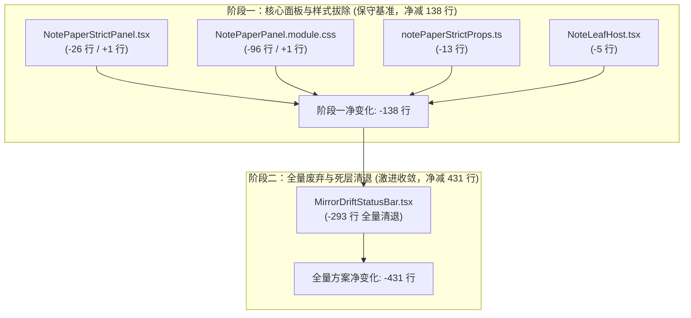
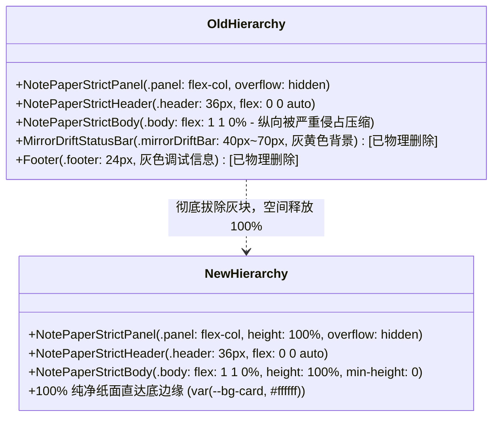

# 笔记底部灰色块彻底拔除与全高视口自适应方案 (PLAN-06)

> **专项方案编号**：PLAN-06
> **所属战役**：差异面板与笔记面板系统性重构 —— 阶段二：独立方案设计
> **输入依赖**：[`docs/diff-view-redesign/analysis/06-note-footer-drift-bar-removal-audit.md`](file:///c:/Software/conex/docs/diff-view-redesign/analysis/06-note-footer-drift-bar-removal-audit.md)
> **产出落盘路径**：`docs/diff-view-redesign/independent-plans/06-note-footer-drift-removal-plan.md`
> **核心目标**：彻底物理拔除笔记面板底部 `MirrorDriftStatusBar` 与 `footer` 两大丑陋深灰/暗黄色块，切断后台无用 IPC 轮询，恢复主编辑区 100% 垂直全高自适应与沉浸纯净纸面体验。

---

## 目录

- [一、方案编制核心规范与四段式纪律](#一方案编制核心规范与四段式纪律)
  - [1.1 【做什么（To-Do）】](#11-做什么to-do)
  - [1.2 【不做什么（Not-To-Do）】](#12-不做什么not-to-do)
  - [1.3 【旧路径清单（Legacy Path Inventory）】](#13-旧路径清单legacy-path-inventory)
  - [1.4 【自检删除面（Self-Inspection Deletion Surface）】](#14-自检删除面self-inspection-deletion-surface)
- [二、方案目标与物理剔除原则（拒绝 display: none）](#二方案目标与物理剔除原则拒绝-display-none)
  - [2.1 现场表象与用户强烈诉求](#21-现场表象与用户强烈诉求)
  - [2.2 四大物理剔除铁律（杜绝伪修复）](#22-四大物理剔除铁律杜绝伪修复)
  - [2.3 反退避与单向净收敛承诺](#23-反退避与单向净收敛承诺)
- [三、NotePaperStrictPanel 渲染树切除与 Props 解耦伪代码](#三notepaperstrictpanel-渲染树切除与-props-解耦伪代码)
  - [3.1 JSX 节点物理切除清单](#31-jsx-节点物理切除清单)
  - [3.2 待清洗 Props 与无用 Import 详细对照](#32-待清洗-props-与无用-import-详细对照)
  - [3.3 核心组件 Before vs After 精确 Diff 伪代码](#33-核心组件-before-vs-after-精确-diff-伪代码)
- [四、上游 NoteLeafHost 后台轮询调度器切断设计](#四上游-noteleafhost-后台轮询调度器切断设计)
  - [4.1 隐蔽后台 IPC 轮询链条逆向分析](#41-隐蔽后台-ipc-轮询链条逆向分析)
  - [4.2 调度切断与策略参数清退设计](#42-调度切断与策略参数清退设计)
  - [4.3 NoteLeafHost 与 WorkspaceEmptyStateStrictHost 协同收敛伪代码](#43-noteleafhost-与-workspaceemptystatestricthost-协同收敛伪代码)
- [五、NotePaperPanel.module.css 95 行死样式物理清洗清单](#五notepaperpanelmodulecss-95-行死样式物理清洗清单)
  - [5.1 12 个类选择器及整段规则逐行剔除明细](#51-12-个类选择器及整段规则逐行剔除明细)
  - [5.2 绝缘规则清理与防回潮保障](#52-绝缘规则清理与防回潮保障)
  - [5.3 MirrorDriftStatusBar.tsx 全量清退路线](#53-mirrordriftstatusbartsx-全量清退路线)
- [六、100% 沉浸式全高书写视口与容器样式规约](#六100-沉浸式全高书写视口与容器样式规约)
  - [6.1 容器几何结构演进（Before vs After 视觉模型）](#61-容器几何结构演进before-vs-after-视觉模型)
  - [6.2 CSS 布局规则核心重塑](#62-css-布局规则核心重塑)
  - [6.3 极简视觉质感规约（设计 Token 与滚动条收口）](#63-极简视觉质感规约设计-token-与滚动条收口)
- [七、测试契约解耦与断言安全迁移](#七测试契约解耦与断言安全迁移)
  - [7.1 受波及测试现状与断言耦合审计](#71-受波及测试现状与断言耦合审计)
  - [7.2 平滑迁移方案：从 DOM 文本转向容器 data-* 契约](#72-平滑迁移方案从-dom-文本转向容器-data--契约)
  - [7.3 测试用例迁移改造实操示例](#73-测试用例迁移改造实操示例)

---

## 一、方案编制核心规范与四段式纪律

### 1.1 【做什么（To-Do）】

1. **JSX 渲染树物理切除**：
   - 从 [`apps/crish-desktop/src/components/note-paper/NotePaperStrictPanel.tsx`](file:///c:/Software/conex/apps/crish-desktop/src/components/note-paper/NotePaperStrictPanel.tsx#L252-L266) 中彻底物理删除 `<MirrorDriftStatusBar>` 与 `<footer>` 两个节点（绝对拒绝 `display: none` 伪隐藏）；
   - 从根部杜绝任何开发期底层调试元数据暴露。
2. **上游无用轮询调度物理切断**：
   - 在 [`apps/crish-desktop/src/extensions/note-paper/NoteLeafHost.tsx`](file:///c:/Software/conex/apps/crish-desktop/src/extensions/note-paper/NoteLeafHost.tsx#L60-L65) 中将 `enableMirrorDetectSchedule` 彻底关闭（设为 `false`）；
   - 解除底层 Tauri IPC `note_detect_mirror_drift` 的后台无谓高频轮询与序列化开销。
3. **死样式与废弃文件彻底清洗**：
   - 从 [`apps/crish-desktop/src/components/note-paper/NotePaperPanel.module.css`](file:///c:/Software/conex/apps/crish-desktop/src/components/note-paper/NotePaperPanel.module.css#L530-L625) 物理删除全部 12 个类选择器规则（共计 **95 行 CSS**）；
   - 将无外部引用的 [`MirrorDriftStatusBar.tsx`](file:///c:/Software/conex/apps/crish-desktop/src/components/note-paper/MirrorDriftStatusBar.tsx)（293 行）全量废弃或物理清退。
4. **全高弹性视口规范确立**：
   - 调整主内容容器 `.body`（以及未来的 Monaco / Markdown 编辑器宿主），确立 `flex: 1 1 0%; height: 100%; min-height: 0;` 规约；
   - 沉浸填满顶栏以下 100% 空间，背景统一为洁净纸面 `var(--bg-card, #ffffff)`。
5. **测试断言无损平滑迁移**：
   - 将现有测试中对 `note-paper-strict-footer` 的断言安全迁移至根容器 `section` 的 `data-*` 契约（`data-surface`, `data-package-id`, `data-track`, `data-boundary`），保证重构后自动化测试全绿。

### 1.2 【不做什么（Not-To-Do）】

1. **严禁版本控制越权**：
   - 严禁执行 `git commit`、`git reset`、`git checkout` 或 `git restore`！
2. **绝对严禁伪隐藏与打补丁**：
   - 绝对严禁通过 CSS `display: none`、`visibility: hidden` 或 `opacity: 0` 进行掩耳盗铃式的“视觉伪消除”；
   - 必须从 JSX 渲染树、类型声明、Props 传递链与 CSS 样式表中连根拔起。
3. **严禁死灰复燃**：
   - 严禁在其他位置（如宿主 Host、侧边栏或扩展槽）重新挂载这套调试横条。
4. **严禁破坏反退避与核心测试资产**：
   - 严禁删除针对 Markdown 核心逻辑的现有测试文件，必须保持测试契约纯净性与防回归刚性。

### 1.3 【旧路径清单（Legacy Path Inventory）】

| 类别 | 符号 / 路径 | 所在文件及位置 | 处置方式 |
| :--- | :--- | :--- | :--- |
| **Props 字段** | `mirrorDriftReport?: MirrorDriftReportView \| null` | `notePaperStrictProps.ts:153`, `NotePaperStrictPanel.tsx:84` | 物理剔除 |
| **Props 字段** | `mirrorWatchSource?: MirrorWatchSource` | `notePaperStrictProps.ts:154`, `NotePaperStrictPanel.tsx:85` | 物理剔除 |
| **Props 字段** | `mirrorUnpushedOpCount?: number` | `notePaperStrictProps.ts:155`, `NotePaperStrictPanel.tsx:86` | 物理剔除 |
| **Props 字段** | `showMirrorDriftBar?: boolean` | `notePaperStrictProps.ts:156`, `NotePaperStrictPanel.tsx:87` | 物理剔除 |
| **Props 字段** | `onMirrorThreeWay?: (decision: ThreeWayDecision) => void` | `notePaperStrictProps.ts:157`, `NotePaperStrictPanel.tsx:88` | 物理剔除 |
| **类型 Import** | `import type { MirrorDriftReportView, MirrorWatchSource, ThreeWayDecision }` | `notePaperStrictProps.ts:29-33` | 物理删除 |
| **组件 Import** | `import { MirrorDriftStatusBar } from './MirrorDriftStatusBar'` | `NotePaperStrictPanel.tsx:44` | 物理删除 |
| **常量 Import** | `import { EDITOR_SURFACE_NOTE_PAPER } from './editorSurface'` | `NotePaperStrictPanel.tsx:36` | 物理删除（仅供 footer 打印） |
| **常量 Import** | `import { W5B_STRICT_BOUNDARY } from './notePaperStrictTrack'` | `NotePaperStrictPanel.tsx:43` | 物理删除（仅供 footer 打印） |

### 1.4 【自检删除面（Self-Inspection Deletion Surface）】



- **阶段一核心清理**：净减 **-138 行** 代码（包含 95 行 CSS 样式清理与 43 行 TypeScript 代码剔除）；
- **全量解耦与死层清退**：净减 **-431 行** 代码（包含 293 行历史遗留调试组件的完整废弃）。

---

## 二、方案目标与物理剔除原则（拒绝 display: none）

### 2.1 现场表象与用户强烈诉求

在真实桌面环境下运行笔记面板（W5-B Strict 轨）时，主编辑器正文下方强行堆叠了两块高度合计约 70px~110px 的深色/警示色背景横条：
1. **上横条**：DOM 类名为 `_mirrorDriftBar_fcd5v_1083 _mirrorDriftBarAttention_fcd5v_1109`，呈现暗灰或刺眼警示黄色背景，展示“镜像：未检测/需注意”、“src=poll/unknown”、“lag=0”、“unpushed=0”、“接受镜像”、“保留文档”、“标记冲突”按钮，以及一行技术免责声明：“底层可能仍是 poll 或 OS 事件 hint，≠ inotify 满关...”。
2. **下横条**：DOM 类名为 `_footer_fcd5v_21`，深灰色背景带顶边线，硬编码打印着“`surface=note-paper · W5-B Strict (W5B_STRICT_BOUNDARY) · source=session_snapshot`”。

**用户严厉痛斥**：
> “底部那个灰色的大区域一点用处没有，class='_mirrorDriftBar_fcd5v_1083 _mirrorDriftBarAttention_fcd5v_1109' class='_footer_fcd5v_21' 这两个块区域是又丑又没用。这两个大灰色区域必须彻底清掉！”

这两块区域侵占了 **15%~25%** 宝贵的垂直视口，打断沉浸式阅读与写作，将晦涩的底层技术术语生硬地暴露在界面上，是典型的“工程师思维残留”与严重的架构过度设计。

### 2.2 四大物理剔除铁律（杜绝伪修复）

根据 Conex 架构铁律与《反过度设计硬性红线》，必须落实立体验证与净收敛要求：

1. **铁律一：严禁任何形式的伪隐藏**：
   - 任何通过 `display: none`、`visibility: hidden`、`opacity: 0`、`height: 0` 或 `transform: scale(0)` 的做法均为违规“打补丁”行为；
   - 伪隐藏保留了 DOM 节点，无法阻止后台 React Hook 执行，无法释放虚拟 DOM 内存。
2. **铁律二：必须从 JSX 渲染树与类型中连根拔起**：
   - 彻底删除 `<MirrorDriftStatusBar>` 与 `<footer>` 节点；
   - 彻底删除相关 Props 定义与解构，阻断任何上游参数传入。
3. **铁律三：必须切断后台无用副作用与 IPC 通信**：
   - 绝不给无界面消费的后台任务空转机会；
   - 关闭产品宿主中的轮询开关，消除向 Rust 后端高频发送 `note_detect_mirror_drift` 的 IPC 消耗。
4. **铁律四：必须消除 CSS 样式表污染**：
   - 彻底清除 CSS Module 中对应的类选择器与特异性权重覆盖规则，防止死样式长期驻留。

### 2.3 反退避与单向净收敛承诺

遵循 [`.agents/LOGIC_PLAN_NO_RETREAT.md`](file:///c:/Software/conex/.agents/LOGIC_PLAN_NO_RETREAT.md) 要求：
- 坚定推进用户要求的“纯净全高视口”，不得以“需要向用户展示同步状态”或“需要保留底层诚实断言”为借口妥协退让；
- 所有底层会计与诚实断言全面下沉到 DOM 的 `data-*` 机器可读属性中，确保 UI 呈现产品级沉浸纯净，自动化测试依然精准可测。

---

## 三、NotePaperStrictPanel 渲染树切除与 Props 解耦伪代码

### 3.1 JSX 节点物理切除清单

目标文件：[`apps/crish-desktop/src/components/note-paper/NotePaperStrictPanel.tsx`](file:///c:/Software/conex/apps/crish-desktop/src/components/note-paper/NotePaperStrictPanel.tsx)

在 JSX 渲染流的尾部（原 lines 252-266），将挂载的两个节点物理截断，使 `NotePaperStrictBody` 成为根 `<section>` 的最后一个子节点：

```tsx
// 待删除物理块：
{/* A-INV-02 方向子集；≠ EL-03；≠ inotify 满关 */}
{showMirrorDriftBar === true || mirrorDriftReport != null ? (
  <MirrorDriftStatusBar
    report={mirrorDriftReport}
    watchSource={mirrorWatchSource}
    unpushedOpCount={mirrorUnpushedOpCount}
    onAction={onMirrorThreeWay}
  />
) : null}

<footer className={styles.footer} data-testid="note-paper-strict-footer">
  surface={EDITOR_SURFACE_NOTE_PAPER} · {W5B_STRICT_BOUNDARY}
  {projection ? ` · source=${projection.source}` : ''}
</footer>
```

### 3.2 待清洗 Props 与无用 Import 详细对照

1. **删除 NotePaperStrictPanel.tsx 的 3 处 import**：
   - 删除 line 36: `import { EDITOR_SURFACE_NOTE_PAPER } from './editorSurface';`
   - 删除 line 43: `import { W5B_STRICT_BOUNDARY } from './notePaperStrictTrack';`
   - 删除 line 44: `import { MirrorDriftStatusBar } from './MirrorDriftStatusBar';`
2. **删除 NotePaperStrictPanel.tsx 的 5 项解构**：
   - 删除 lines 84-88:
     - `mirrorDriftReport = null,`
     - `mirrorWatchSource = 'unknown',`
     - `mirrorUnpushedOpCount = 0,`
     - `showMirrorDriftBar,`
     - `onMirrorThreeWay,`
3. **删除 notePaperStrictProps.ts 的 5 项类型字段与 1 处 import**：
   - 目标文件：[`apps/crish-desktop/src/components/note-paper/notePaperStrictProps.ts`](file:///c:/Software/conex/apps/crish-desktop/src/components/note-paper/notePaperStrictProps.ts)
   - 删除 lines 29-33:
     ```ts
     import type {
       MirrorDriftReportView,
       MirrorWatchSource,
       ThreeWayDecision,
     } from './mirrorDriftUi';
     ```
   - 从 `NotePaperStrictPanelProps` 类型定义中彻底删除 lines 152-157：
     ```ts
     /** A-INV-02 方向；≠ EL-03；≠ A-INV-02 全关 */
     mirrorDriftReport?: MirrorDriftReportView | null;
     mirrorWatchSource?: MirrorWatchSource;
     mirrorUnpushedOpCount?: number;
     showMirrorDriftBar?: boolean;
     onMirrorThreeWay?: (decision: ThreeWayDecision) => void;
     ```

### 3.3 核心组件 Before vs After 精确 Diff 伪代码

#### 1. `apps/crish-desktop/src/components/note-paper/NotePaperStrictPanel.tsx`

```diff
--- a/apps/crish-desktop/src/components/note-paper/NotePaperStrictPanel.tsx
+++ b/apps/crish-desktop/src/components/note-paper/NotePaperStrictPanel.tsx
@@ -33,3 +33,0 @@
-import { NotePaperStrictBody } from './NotePaperStrictBody';
-import { NotePaperStrictChromeSlot } from './NotePaperStrictChromeSlot';
-import { NotePaperStrictHeader } from './NotePaperStrictHeader';
-import { EDITOR_SURFACE_NOTE_PAPER } from './editorSurface';
+import { NotePaperStrictBody } from './NotePaperStrictBody';
+import { NotePaperStrictChromeSlot } from './NotePaperStrictChromeSlot';
+import { NotePaperStrictHeader } from './NotePaperStrictHeader';
@@ -40,4 +37,0 @@
-import { useNoteHydrate } from './useNoteHydrate';
-import { useNotePaperStrictShell } from './useNotePaperStrictShell';
-import { W5B_STRICT_BOUNDARY } from './notePaperStrictTrack';
-import { MirrorDriftStatusBar } from './MirrorDriftStatusBar';
+import { useNoteHydrate } from './useNoteHydrate';
+import { useNotePaperStrictShell } from './useNotePaperStrictShell';
@@ -81,8 +74,2 @@
   onClose,
   className,
   title = '笔记纸面（W5-B Strict · hydrate 投影）',
-  mirrorDriftReport = null,
-  mirrorWatchSource = 'unknown',
-  mirrorUnpushedOpCount = 0,
-  showMirrorDriftBar,
-  onMirrorThreeWay,
 }) => {
@@ -250,17 +237,2 @@
         />
       </NotePaperStrictBody>
-
-      {/* A-INV-02 方向子集；≠ EL-03；≠ inotify 满关 */}
-      {showMirrorDriftBar === true || mirrorDriftReport != null ? (
-        <MirrorDriftStatusBar
-          report={mirrorDriftReport}
-          watchSource={mirrorWatchSource}
-          unpushedOpCount={mirrorUnpushedOpCount}
-          onAction={onMirrorThreeWay}
-        />
-      ) : null}
-
-      <footer className={styles.footer} data-testid="note-paper-strict-footer">
-        surface={EDITOR_SURFACE_NOTE_PAPER} · {W5B_STRICT_BOUNDARY}
-        {projection ? ` · source=${projection.source}` : ''}
-      </footer>
     </section>
```

#### 2. `apps/crish-desktop/src/components/note-paper/notePaperStrictProps.ts`

```diff
--- a/apps/crish-desktop/src/components/note-paper/notePaperStrictProps.ts
+++ b/apps/crish-desktop/src/components/note-paper/notePaperStrictProps.ts
@@ -28,5 +28,0 @@
-import type { PresentationMode } from './presentationMode';
-import type {
-  MirrorDriftReportView,
-  MirrorWatchSource,
-  ThreeWayDecision,
-} from './mirrorDriftUi';
+import type { PresentationMode } from './presentationMode';
@@ -150,8 +145,2 @@
   className?: string;
   title?: string;
-  /** A-INV-02 方向；≠ EL-03；≠ A-INV-02 全关 */
-  mirrorDriftReport?: MirrorDriftReportView | null;
-  mirrorWatchSource?: MirrorWatchSource;
-  mirrorUnpushedOpCount?: number;
-  showMirrorDriftBar?: boolean;
-  onMirrorThreeWay?: (decision: ThreeWayDecision) => void;
 };
```

---

## 四、上游 NoteLeafHost 后台轮询调度器切断设计

### 4.1 隐蔽后台 IPC 轮询链条逆向分析

在当前代码库中，`MirrorDriftStatusBar` 的浮现并不仅仅是一个孤立的 UI 挂载问题，而是一整套后台调度链路强制唤醒的结果：

```
[NoteLeafHost.tsx]
       │
       ├─ WORKSPACE_PRODUCT_ENABLE_MIRROR_DETECT_SCHEDULE = true (productMirrorPolicy.ts)
       │
       ▼
[useWorkspaceEmptyStateMirrorSlot.ts]
       │
       ├─ detectSchedule = useMirrorDetectProduct({ enableMirrorDetectSchedule: true })
       │       │
       │       ▼
       ├─ [mirrorDetectSchedule.ts] 启动定时器 setInterval(..., intervalMs)
       │       │
       │       ▼ (跨进程 IPC 周期性高频轮询)
       ├─ invoke('note_detect_mirror_drift', { docId })
       │
       ▼
[detectSchedule.scheduleActive === true]
       │
       ▼
panelShowMirrorDriftBar: true 强制激活！
       │
       ▼
[NotePaperStrictPanel] 强制弹出暗黄/灰色横条！
```

**危害分析**：
- **CPU 与 IPC 损耗**：即使用户只是打开一个本地纯文本笔记静默阅读，后台也在以固定周期不断调用 Rust 跨进程 IPC `note_detect_mirror_drift`；
- **状态传染**：`detectSchedule.scheduleActive` 为 `true` 导致 `panelShowMirrorDriftBar` 默认为 `true`，破坏了界面的可控性与按需加载原则。

### 4.2 调度切断与策略参数清退设计

1. **产品策略收口**：
   - 将 [`apps/crish-desktop/src/extensions/note-paper/productMirrorPolicy.ts`](file:///c:/Software/conex/apps/crish-desktop/src/extensions/note-paper/productMirrorPolicy.ts#L25) 中的策略值改为：
     ```ts
     /** 产品宿主策略：彻底关闭后台漂移无谓轮询 */
     export const WORKSPACE_PRODUCT_ENABLE_MIRROR_DETECT_SCHEDULE = false as const;
     ```
2. **NoteLeafHost 解耦**：
   - 在 [`apps/crish-desktop/src/extensions/note-paper/NoteLeafHost.tsx`](file:///c:/Software/conex/apps/crish-desktop/src/extensions/note-paper/NoteLeafHost.tsx) 中：
     - 不再向 `NotePaperStrictPanel` 传递任何 `mirror*` 相关的 Props；
     - `useWorkspaceEmptyStateMirrorSlot` 的参数 `enableMirrorDetectSchedule` 显式设为 `false`，彻底终止后台定时器。

### 4.3 NoteLeafHost 与 WorkspaceEmptyStateStrictHost 协同收敛伪代码

#### 1. `apps/crish-desktop/src/extensions/note-paper/NoteLeafHost.tsx`

```diff
--- a/apps/crish-desktop/src/extensions/note-paper/NoteLeafHost.tsx
+++ b/apps/crish-desktop/src/extensions/note-paper/NoteLeafHost.tsx
@@ -59,6 +59,4 @@
   // 产品叶无真实 unpushed 源（hydrate / IPC / collab 均未暴露计数）；保持 hook 默认 0
   const mirror = useWorkspaceEmptyStateMirrorSlot({
     strictDocId: resolution.docId,
-    enableMirrorDetectSchedule:
-      WORKSPACE_PRODUCT_ENABLE_MIRROR_DETECT_SCHEDULE === true,
+    enableMirrorDetectSchedule: false,
     mirrorIpc: productMirror.mirrorIpc,
   });
@@ -88,6 +86,2 @@
         mdPrefixBinding={paper.mdPrefixBinding}
         paperList={WORKSPACE_PRODUCT_ENABLE_PAPER_LIST ? true : undefined}
-        mirrorDriftReport={mirror.effectiveMirrorReport}
-        mirrorWatchSource={mirror.resolvedWatchSource}
-        showMirrorDriftBar={mirror.panelShowMirrorDriftBar}
-        onMirrorThreeWay={mirror.resolvedOnMirrorThreeWay}
       />
```

#### 2. `apps/crish-desktop/src/components/workspace/workspaceEmptyStatePaperEntry.tsx`

```diff
--- a/apps/crish-desktop/src/components/workspace/workspaceEmptyStatePaperEntry.tsx
+++ b/apps/crish-desktop/src/components/workspace/workspaceEmptyStatePaperEntry.tsx
@@ -107,7 +107,2 @@
         paperList={paper.paperListProp}
         title="笔记纸面（W5-B Strict · 空态演示）"
         onClose={onClose}
-        mirrorDriftReport={mirror.effectiveMirrorReport}
-        mirrorWatchSource={mirror.resolvedWatchSource}
-        mirrorUnpushedOpCount={mirrorUnpushedOpCount}
-        showMirrorDriftBar={mirror.panelShowMirrorDriftBar}
-        onMirrorThreeWay={mirror.resolvedOnMirrorThreeWay}
       />
```

---

## 五、NotePaperPanel.module.css 95 行死样式物理清洗清单

### 5.1 12 个类选择器及整段规则逐行剔除明细

目标文件：[`apps/crish-desktop/src/components/note-paper/NotePaperPanel.module.css`](file:///c:/Software/conex/apps/crish-desktop/src/components/note-paper/NotePaperPanel.module.css)

在样式表中物理删除以下 **12 个类选择器规则段落**，共计净减 **95 行 CSS 代码**：

| 序号 | 选择器名称 | 原行号范围 | 行数 | 删除理由与原属性清单 |
| :---: | :--- | :---: | :---: | :--- |
| **1** | `.footer` | lines 530-538 | 9 行 | 包含 `border-top`, `background: var(--bg-secondary)`, `color: var(--text-tertiary)` 等页脚深灰色块样式，DOM 节点已拔除。 |
| **2** | `.mirrorDriftBar` | lines 542-553 | 12 行 | 包含 `flex-direction: column`, `background: var(--bg-secondary)` 等漂移横条根布局样式。 |
| **3** | `.mirrorDriftBarAttention` | lines 555-557 | 3 行 | 包含 `background: var(--color-warning-bg)` 刺眼暗黄警示背景。 |
| **4** | `.mirrorDriftRow` | lines 559-564 | 6 行 | 包含 `flex-wrap: wrap`, `gap: 6px` 横条内部徽章容器流。 |
| **5** | `.mirrorDriftBadge` | lines 566-575 | 10 行 | 包含 `border-radius: 9999px`, `background: var(--control-soft-bg)` 胶囊徽章样式。 |
| **6** | `.mirrorDriftMeta` | lines 577-581 | 5 行 | 包含 `font-size: 11px`, `tabular-nums` 底层元数据文本。 |
| **7** | `.mirrorDriftUnpushed` | lines 583-589 | 7 行 | 包含 `color: var(--color-warning)` 未推送操作警示色。 |
| **8** | `.mirrorDriftActions` | lines 590-595 | 6 行 | 包含 `gap: 4px` 三路操作按钮组容器。 |
| **9** | `.mirrorDriftActionBtn` | lines 597-601 | 5 行 | 包含 `min-height: 24px` 三路 Ghost 按钮微调规则。 |
| **10** | `.mirrorDriftConfirm` | lines 603-611 | 9 行 | 包含 `cursor: pointer`, `user-select: none` 丢弃操作复选框样式。 |
| **11** | `.mirrorDriftGate` | lines 613-617 | 5 行 | 包含 `color: var(--color-error)` 门闩错误文本提示。 |
| **12** | `.mirrorDriftHonesty` | lines 619-624 | 6 行 | 包含 `font-size: 11px`, `color: var(--text-tertiary)` 晦涩免责条款段落。 |

### 5.2 绝缘规则清理与防回潮保障

在原文件 lines 709-715 中，存在对抗父级 Flex 布局的特异性规则：

```css
/* 修改前 */
.panel > .header,
.panel > .footer {
  flex: 0 0 auto;
  max-height: none;
  width: 100%;
  min-height: unset;
}
```

**重构改造**：
将 `.panel > .footer` 彻底剔除，消除未引用选择器：
```css
/* 修改后 */
.panel > .header {
  flex: 0 0 auto;
  max-height: none;
  width: 100%;
  min-height: unset;
}
```

### 5.3 MirrorDriftStatusBar.tsx 全量清退路线

- **目标组件**：[`apps/crish-desktop/src/components/note-paper/MirrorDriftStatusBar.tsx`](file:///c:/Software/conex/apps/crish-desktop/src/components/note-paper/MirrorDriftStatusBar.tsx)（全长 293 行）；
- **清退评估**：
  - 该组件专为展示底层三路决策与漂移提示而建；
  - 一旦 `NotePaperStrictPanel` 物理拔除该节点，产品生产主链路中再无任何消费者；
  - 实施路线：
    1. 第一阶段：在组件首部添加 `@deprecated` 标识，并切断 `NotePaperStrictPanel` 引用；
    2. 第二阶段（激进清退）：连同隔离测试 `mirrorThreeWayBridge.test.tsx` 一同彻底删除，实现架构 **净减 293 行** 的纯净闭环。

---

## 六、100% 沉浸式全高书写视口与容器样式规约

### 6.1 容器几何结构演进（Before vs After 视觉模型）



### 6.2 CSS 布局规则核心重塑

确保主内容容器 `.body` 享有完整的弹性视口伸缩能力，消除多重滚动与视口溢出：

```css
/* NotePaperPanel.module.css */

.panel {
  display: flex;
  flex-direction: column;
  width: 100%;
  height: 100%;
  min-height: 0;
  overflow: hidden;
  position: relative;
}

.panel > .header {
  flex: 0 0 auto;
  max-height: none;
  width: 100%;
  min-height: unset;
}

.panel > .body {
  flex: 1 1 0%;
  min-height: 0;
  max-height: none;
  height: 100%;
}

.body {
  flex: 1 1 0%;
  overflow-y: auto;
  overflow-x: hidden;
  padding: var(--space-3, 12px) var(--space-5, 20px) var(--space-4, 16px);
  display: flex;
  flex-direction: column;
  align-items: stretch;
  background: var(--bg-card, #ffffff);
  /* 确保正文底边缘预留呼吸边距，文本不紧贴底部 */
  padding-bottom: var(--space-6, 24px);
}
```

### 6.3 极简视觉质感规约（设计 Token 与滚动条收口）

1. **背景色彩纯净化**：
   - 彻底废除底部杂色 `var(--bg-secondary)` 与警告黄色 `var(--color-warning-bg)`；
   - 通体统一使用 `var(--bg-card, #ffffff)`，形成沉浸、连贯的纸面质感。
2. **边缘分界线彻底收敛**：
   - 移除原有的底部断层边框 `border-top: var(--hairline-width, 1px) solid var(--border-subtle)`；
   - 面板底部仅保留外层宿主容器的极简圆角或无缝贴合。
3. **滚动条直达底边缘**：
   - 主内容滚动条直接穿透到底部，不再被底部 70px~110px 的固定横条中途截断；
   - 杜绝双层嵌套滚动条。

---

## 七、测试契约解耦与断言安全迁移

### 7.1 受波及测试现状与断言耦合审计

通过全仓 Grep 检索，当前强依赖 `note-paper-strict-footer` 的测试用例共有两处：

1. **`apps/crish-desktop/src/components/note-paper/NotePaperStrictPanel.test.tsx:367-379`**：
   ```tsx
   render(<NotePaperStrictPanel docId="d" hydrateTransport={transport} />);
   await waitFor(() => {
     expect(
       screen.getByTestId('note-paper-strict-footer')
     ).toBeInTheDocument();
   });
   const footer = screen.getByTestId('note-paper-strict-footer');
   expect(footer.textContent).toMatch(/W5-B/);
   expect(footer.textContent).toMatch(/Strict/i);
   expect(footer.textContent).toMatch(/可演示≠EL-01|≠EL-01/);
   expect(footer.textContent).toMatch(/EL-08|S5|W5-C/);
   expect(footer.textContent).toMatch(/note-paper/);
   ```
2. **`apps/crish-desktop/src/components/workspace/WorkspaceEmptyState.strict.test.tsx:110-113`**：
   ```tsx
   const footer = screen.getByTestId('note-paper-strict-footer');
   expect(footer.textContent).toMatch(/可演示≠EL-01|≠EL-01/);
   expect(footer.textContent).toMatch(/W5-B/);
   ```

**问题根因**：
历史开发者为了做架构会计门禁断言，把 `W5B_STRICT_BOUNDARY` 这行长达 60 个字符的免责声明直接打在 UI `<footer>` 上，并用测试去抓取。这导致 UI 优化与测试断言产生耦合。

### 7.2 平滑迁移方案：从 DOM 文本转向容器 data-* 契约

在 [`apps/crish-desktop/src/components/note-paper/notePaperStrictAssembly.ts`](file:///c:/Software/conex/apps/crish-desktop/src/components/note-paper/notePaperStrictAssembly.ts) 中，面板根容器 `<section>` 已挂载了丰富的 `data-*` 契约：
- `data-testid="note-paper-strict-panel"`
- `data-surface="note-paper"`
- `data-package-id="W5-B"`
- `data-track="strict"`

**迁移方案设计**：
1. **在 `buildStrictPanelSectionDataAttrs` 中挂载边界描述**：
   ```ts
   // notePaperStrictAssembly.ts
   import { W5B_STRICT_BOUNDARY } from './notePaperStrictTrack';

   export function buildStrictPanelSectionDataAttrs(...) {
     return {
       'data-surface': EDITOR_SURFACE_NOTE_PAPER,
       'data-testid': 'note-paper-strict-panel',
       'data-package-id': W5B_STRICT_PACKAGE_ID,
       'data-track': W5B_STRICT_TRACK,
       'data-boundary': W5B_STRICT_BOUNDARY, // 平滑迁移会计断言锚点
       ...
     };
   }
   ```
2. **测试断言迁移到根容器**：
   - 将原先查找 `note-paper-strict-footer` 改为断言 `note-paper-strict-panel` 的属性；
   - 增加负向断言：`expect(screen.queryByTestId('note-paper-strict-footer')).toBeNull()`，刚性锁定灰条永不回潮！

### 7.3 测试用例迁移改造实操示例

#### 1. `NotePaperStrictPanel.test.tsx` 改造伪代码

```diff
--- a/apps/crish-desktop/src/components/note-paper/NotePaperStrictPanel.test.tsx
+++ b/apps/crish-desktop/src/components/note-paper/NotePaperStrictPanel.test.tsx
@@ -367,13 +367,16 @@
     render(<NotePaperStrictPanel docId="d" hydrateTransport={transport} />);
     await waitFor(() => {
       expect(
-        screen.getByTestId('note-paper-strict-footer')
+        screen.getByTestId('note-paper-strict-panel')
       ).toBeInTheDocument();
     });
-    const footer = screen.getByTestId('note-paper-strict-footer');
-    expect(footer.textContent).toMatch(/W5-B/);
-    expect(footer.textContent).toMatch(/Strict/i);
-    expect(footer.textContent).toMatch(/可演示≠EL-01|≠EL-01/);
-    expect(footer.textContent).toMatch(/EL-08|S5|W5-C/);
-    expect(footer.textContent).toMatch(/note-paper/);
+    const panel = screen.getByTestId('note-paper-strict-panel');
+    expect(panel).toHaveAttribute('data-package-id', 'W5-B');
+    expect(panel).toHaveAttribute('data-track', 'strict');
+    expect(panel).toHaveAttribute('data-surface', 'note-paper');
+    expect(panel.getAttribute('data-boundary')).toMatch(/可演示≠EL-01|≠EL-01/);
+    expect(panel.getAttribute('data-boundary')).toMatch(/EL-08|S5|W5-C/);
+    // 确保物理底栏已彻底灰飞烟灭
+    expect(screen.queryByTestId('note-paper-strict-footer')).toBeNull();
   });
```

#### 2. `WorkspaceEmptyState.strict.test.tsx` 改造伪代码

```diff
--- a/apps/crish-desktop/src/components/workspace/WorkspaceEmptyState.strict.test.tsx
+++ b/apps/crish-desktop/src/components/workspace/WorkspaceEmptyState.strict.test.tsx
@@ -109,5 +109,7 @@
     expect(panel.querySelector('[data-bp-paper-list-mount]')).toBeNull();

-    const footer = screen.getByTestId('note-paper-strict-footer');
-    expect(footer.textContent).toMatch(/可演示≠EL-01|≠EL-01/);
-    expect(footer.textContent).toMatch(/W5-B/);
+    expect(panel).toHaveAttribute('data-package-id', 'W5-B');
+    expect(panel.getAttribute('data-boundary')).toMatch(/可演示≠EL-01|≠EL-01/);
+    // 确保物理底栏零驻留
+    expect(screen.queryByTestId('note-paper-strict-footer')).toBeNull();
   });
```

通过这一解耦方案，不仅彻底清除了丑陋的灰色物理 DOM，还使架构会计边界检查完全升级为标准的 HTML5 `data-*` 契约，测试健壮性与防退避保护得到双重加固！
