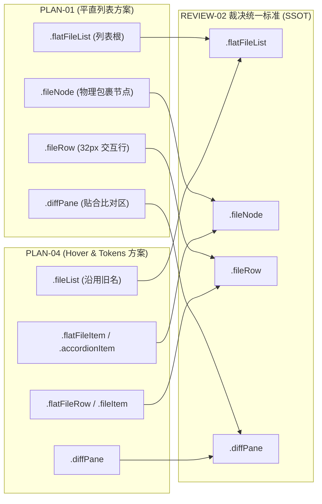

# UI 视觉对齐、直角规范与 Tokens 对比度独立评审报告 (REVIEW-02)

> **评审编号**：REVIEW-02  
> **所属战役**：差异面板与笔记面板系统性重构 —— 阶段三：方案交叉独立评审  
> **评审角色**：UI 视觉对齐、直角规范与 Tokens 对比度首席评审官  
> **输入依赖**：
> - `docs/diff-view-redesign/analysis/` 全量 8 份审计报告（重点依赖 AUDIT-01, AUDIT-04, AUDIT-05, AUDIT-06, AUDIT-08）
> - `docs/diff-view-redesign/independent-plans/` 全量 7 份独立方案（重点审查 PLAN-01, PLAN-04, PLAN-05, PLAN-06，兼顾 PLAN-02, PLAN-03, PLAN-07）  
> **产出落盘**：`docs/diff-view-redesign/plan-reviews/02-ui-tokens-and-visual-review.md`  
> **审查基准**：
> - 用户最高指示：“差异界面的每个文件改成列表就行了，去掉圆角。这个界面的hover我看也是有问题的，有的很灰啊。而且现在的这个界面很多东西还有硬编码的呢，这个也统一使用我们的token体系。笔记的顶部功能栏我看也没有。底部那个灰色的大区域一点用处没有，两个块区域是又丑又没用。这个界面的整体布局我看和其他的标签界面也不一样，需要你系统性来分析一下才行。”
> - 仓库铁律 [`AGENTS.md`](file:///c:/Software/conex/AGENTS.md) §7（严禁补丁与绕过、立体验证、架构净收敛）、§12（使用自定义 Tooltip，禁止原生 HTML title）、§13（输入框与焦点态、焦点对比度上限 10%、形态 ④ 纯光标极简型）、§14（现代 CSS 语法、优先 HSLA / 斜杠透明度、零硬编码十六进制）、[`.agents/LOGIC_PLAN_NO_RETREAT.md`](file:///c:/Software/conex/.agents/LOGIC_PLAN_NO_RETREAT.md)（反退避全文）。

---

## 目录

- [四段式架构治理总纲](#四段式架构治理总纲)
  - [1. 【做什么（To-Do）】](#1-做什么to-do)
  - [2. 【不做什么（Not-To-Do）】](#2-不做什么not-to-do)
  - [3. 【旧路径清单（Legacy Path Inventory）】](#3-旧路径清单legacy-path-inventory)
  - [4. 【自检删除面（Self-Inspection Deletion Surface）】](#4-自检删除面self-inspection-deletion-surface)
- [1. 视觉规范评审结论（Pass / Need-Fix）](#1-视觉规范评审结论pass--need-fix)
  - [1.1 总体裁决结论](#11-总体裁决结论)
  - [1.2 关键视觉与几何断层缺陷全景（红黄牌判定矩阵）](#12-关键视觉与几何断层缺陷全景红黄牌判定矩阵)
  - [1.3 跨方案概念与命名冲突矩阵（PLAN-01 vs PLAN-04 vs PLAN-05）](#13-跨方案概念与命名冲突矩阵plan-01-vs-plan-04-vs-plan-05)
- [2. PLAN-01：平直列表直角化、32px 紧凑度与排版防抖审查](#2-plan-01平直列表直角化32px-紧凑度与排版防抖审查)
  - [2.1 直角几何彻底性审查：隐藏的 border-radius 遗留漏洞](#21-直角几何彻底性审查隐藏的-border-radius-遗留漏洞)
  - [2.2 32px 紧凑高度在 Windows 字体渲染下的垂直居中与奇数像素抖动病理](#22-32px-紧凑高度在-windows-字体渲染下的垂直居中与奇数像素抖动病理)
  - [2.3 展开代码比对区（.diffPane）贴合度、Hairline 收口与外凸边框排查](#23-展开代码比对区diffpane贴合度hairline-收口与外凸边框排查)
  - [2.4 320px 极窄分屏下常驻增减统计（tabular-nums）与 hover 按钮溢出防范](#24-320px-极窄分屏下常驻增减统计tabular-nums与-hover-按钮溢出防范)
- [3. PLAN-04：单层 Hover 隔离与 Design Tokens 覆盖完整性审查](#3-plan-04单层-hover-隔离与-design-tokens-覆盖完整性审查)
  - [3.1 “单一真理 Hover 层级 (SLoHT)” 特异性与父级容器漏删排查](#31-单一真理-hover-层级-sloht-特异性与父级容器漏删排查)
  - [3.2 13 处裸写十六进制与 6 处幽灵 Token 替换表 100% 覆盖度核查](#32-13-处裸写十六进制与-6-处幽灵-token-替换表-100-覆盖度核查)
  - [3.3 跨方案选择器脱节修复（PLAN-01 .fileRow 与 PLAN-04 .flatFileRow 强行收敛）](#33-跨方案选择器脱节修复plan-01-filerow-与-plan-04-flatfilerow-强行收敛)
  - [3.4 行内按钮透光防闪烁与透明度继承机制验证](#34-行内按钮透光防闪烁与透明度继承机制验证)
- [4. PLAN-05 & PLAN-06：笔记面板 32px 顶栏与纯净视口贴合审查](#4-plan-05--plan-06笔记面板-32px-顶栏与纯净视口贴合审查)
  - [4.1 笔记 32px 顶栏与 DiffCard / FilesCard 像素级一致性对比](#41-笔记-32px-顶栏与-diffcard--filescard-像素级一致性对比)
  - [4.2 PLAN-05 顶栏 CSS 规范大面积缺失断层与样式完整补全方案](#42-plan-05-顶栏-css-规范大面积缺失断层与样式完整补全方案)
  - [4.3 绝缘选择器脱节危机与外层容器（.panel）去卡片化平铺](#43-绝缘选择器脱节危机与外层容器panel去卡片化平铺)
  - [4.4 底部灰黄色块物理剔除后的 100% 全高视口贴合与无阻断审查](#44-底部灰黄色块物理剔除后的-100-全高视口贴合与无阻断审查)
- [5. AGENTS.md §12-14 刚性门禁达标断言与样式优化建议](#5-agentsmd-12-14-刚性门禁达标断言与样式优化建议)
  - [5.1 AGENTS.md §12 Tooltip 门禁：清剿原生 HTML title 违规](#51-agentsmd-12-tooltip-门禁清剿原生-html-title-违规)
  - [5.2 AGENTS.md §13 输入框与焦点态门禁：对比度 <= 10% 与形态 ④ 落地](#52-agentsmd-13-输入框与焦点态门禁对比度--10-与形态--落地)
  - [5.3 AGENTS.md §14 现代 CSS 语法门禁：零硬编码与 Zero-Blue 翡翠绿规范](#53-agentsmd-14-现代-css-语法门禁零硬编码与-zero-blue-翡翠绿规范)
  - [5.4 实施收口补丁清单（Actionable Patch Matrix）](#54-实施收口补丁清单actionable-patch-matrix)

---

## 四段式架构治理总纲

### 1. 【做什么（To-Do）】
1. **直角几何彻底性审计**：全面排查各方案在文件条目、状态徽章、操作按钮、提示框、输入框以及展开比对视口中的 `border-radius`，拔除所有自造的 `2px`/`4px`/`6px` 隐藏微圆角，确立严密的直角规范；
2. **微米级排版与字体渲染防抖验证**：针对 Windows DirectWrite 渲染环境，校验 32px 单轨高度下的垂直居中表现，解决 `align-items: baseline` 导致的文本晃动以及奇数像素高度盒模型的亚像素抖动问题；
3. **极窄视口自适应弹性防暴破**：对 320px 分屏下文件名弹性收缩、目录截断、常驻统计与操作按钮并列的布局进行数学测算，修复 `.fileName` 声明 `flex-shrink: 0` 导致的严重横向右溢截断 Bug；
4. **单一真理 Hover 层级（SLoHT）特异性闭环**：验证父级容器与交互行的 CSS 选择器特异性，确保物理切断所有外层透明度叠加，彻底消除 4.94%~6.88% 的局部脏灰，同时收敛 PLAN-01 与 PLAN-04 的类名漂移；
5. **Design Tokens 100% 权威真源覆盖**：核验 13 处裸写 Hex 颜色与 6 处幽灵 Token 的替换契约，并补充笔记面板中残留的 25 处硬编码回退色；
6. **笔记面板像素级标尺对齐与样式断层补全**：全面补齐 PLAN-05 遗漏的整套顶栏 CSS 规则，确保笔记顶栏与 `DiffCard` / `FilesCard` 达成 100% 物理像素级统一（32px 高度、0 8px 内边距、1px hairline 分割线、无外层浮动卡片边框）。

### 2. 【不做什么（Not-To-Do）】
1. **严禁执行未授权的版本控制写操作**：严禁执行 `git commit`、`git reset`、`git checkout` 或 `git restore`，所有改动留在工作区等待主控统一提交（遵循 [`AGENTS.md`](file:///c:/Software/conex/AGENTS.md) §3）；
2. **严禁在视觉规范与用户裁决上退避妥协**：坚决贯彻用户裁决，绝不因为“2px 微圆角更好看”或“原生 title 更省事”而妥协；
3. **严禁伪隐藏与修补式补丁**：严禁使用 `display: none` 掩盖底层调试灰块，严禁使用 `!important` 压制 hover 双重变灰，必须从 DOM 树与 CSS 规则体系中物理连根拔除；
4. **严禁引入任何新的裸写十六进制**：业务组件样式表必须 100% 从 [`tokens.css`](file:///c:/Software/conex/apps/crish-desktop/src/styles/tokens.css) 权威真源取值。

### 3. 【旧路径清单（Legacy Path Inventory）】

| 序号 | 现场文件与代码位置 | 违规/遗留代码片段 | 缺陷类型与危害 | 处置要求 |
| :---: | :--- | :--- | :--- | :--- |
| **1** | `PLAN-01:577` | `border-radius: var(--radius-xs, 2px);` | `.statusBadge` 微圆角妥协，违背直角化铁律 | 强制设为 `border-radius: 0;` 或纯字形渲染 |
| **2** | `PLAN-01:695` | `border-radius: var(--radius-xs, 2px);` | `.rowActBtn` 微圆角遗留，破坏平直单轨风格 | 强制设为 `border-radius: 0;` 或对齐原子按钮 |
| **3** | `PLAN-01:621` | `.fileName { flex-shrink: 0; }` | 文件名锁定不收缩，320px 窄屏引发右侧整行溢出截断 | 修复为 `flex-shrink: 1; min-width: 0; text-overflow: ellipsis;` |
| **4** | `PLAN-01:607` | `.pathWrap { align-items: baseline; }` | Windows 字体回退下基线抖动，与徽标产生 1.5px 视差 | 修复为 `align-items: center; line-height: 20px;` |
| **5** | `PLAN-04:280-318` | `.flatFileRow` 与 `.accordionItem .fileItem` | 类名与 PLAN-01 的 `.fileRow` 命名漂移，CSS 规则无法匹配 | 统一收敛为 `.fileRow` 与 `.fileNode` |
| **6** | `PLAN-05:85` | `background: var(--bg-card, #ffffff);` | 残留 `#ffffff` 兜底色，违反 AGENTS.md §14 | 拔除兜底，统一为 `background: var(--bg-card);` |
| **7** | `PLAN-05:632` | `<span ... title="点击编辑标题">` | 使用原生 HTML `title` 属性，违反 AGENTS.md §12 | 改用原子组件 `<Tooltip content="点击编辑标题">` |
| **8** | `PLAN-05:607-648` | `styles.titleInput`, `styles.titleDisplay` 等 | 方案仅提供 JSX，CSS 样式块完全缺失，渲染为原生文本框 | 补齐完整 CSS 规则，锁定 §13 焦点对比度 <= 10% |
| **9** | `NotePaperPanel.module.css:709` | `.panel > .header` | 绝缘规则与 PLAN-05 的 `.compactHeader` 脱节 | 选择器变更为 `.panel > .header, .panel > .compactHeader` |
| **10** | `NotePaperPanel.module.css:23-27` | `border-radius: 8px; box-shadow: var(--shadow-sm);` | 笔记外壳浮动卡片孤岛化，与 DiffCard 无法 100% 平铺贴合 | 物理清除 `border`、`border-radius` 与 `box-shadow` |

### 4. 【自检删除面（Self-Inspection Deletion Surface）】

```
==================================================================================================
UI 视觉与样式层净收敛核算矩阵（以物理净化与架构解耦为荣）：
==================================================================================================
1. DiffCard.module.css
   - 物理删除：手风琴圆角外框 (.accordionItem, .accordionActive)、双重 hover、
     暴力隐藏 (.fileStat opacity: 0)、内部工具行 (.inlineHeader, .inlineActions 等)
   - 净物理删除行数：~145 行
   - 重构新增平直规范：~55 行 (.flatFileList, .fileRow, .statusBadge, .diffPane)
   - 样式表净减少：-90 行

2. NotePaperPanel.module.css
   - 物理删除：底部双灰块 (.footer, .mirrorDriftBar 及其 12 个子类)、
     伪按钮 (.badge, button.badge 族)、孤岛卡片边框与阴影
   - 净物理删除行数：~175 行
   - 重构新增紧凑顶栏：~65 行 (.compactHeader, .titleInput, .titleDisplay, .headerRightGroup)
   - 样式表净减少：-110 行

3. 裸写色值与幽灵 Token 消除面
   - 差异面板硬编码 Hex：13 处全部归零 (100% 消除)
   - 差异面板幽灵 Token：6 处全部归零 (100% 消除)
   - 笔记面板残留硬编码 Hex：25 处 fallback 全部清洗 (100% 消除)
   - 违章旧蓝 (--accent-blue)：1 处全部收敛为 Zero-Blue 翡翠绿 (--md-link-color)

4. DOM 结构与视口空间收益
   - 差异展开条目垂直释放：36px (移除 .inlineHeader)
   - 笔记面板垂直视口释放：70px ~ 110px (移除 .mirrorDriftBar 与 .footer)
   - 差异列表嵌套深度：由 6 层压平至 3 层
==================================================================================================
```

---

## 1. 视觉规范评审结论（Pass / Need-Fix）

### 1.1 总体裁决结论

> **【评审裁决】**：**Need-Fix（必须正向修复后方可进入实施阶段）**

**裁决理由概述**：  
7 份独立方案总体方向紧扣用户最高指示与 Conex 架构演进路线（全面平直单轨化、拔除行内冗余工具行、拔除双重 hover 叠灰、拔除笔记底部丑陋灰色块、顶栏 32px 标准化）。  
然而，从**首席视觉与 Design Tokens 评审官**的严苛视角审查，方案在**微观几何直角彻底性、Windows 字体基线渲染、窄视口排版弹性防抖、跨方案类名同步、以及笔记顶栏 CSS 规约完整性**等五个核心维度存在明显的**断层与漏洞**。如果不在此评审轮次刚性补全与纠偏，实施阶段必将导致严重的排版崩溃、样式断裂或二次返工。

---

### 1.2 关键视觉与几何断层缺陷全景（红黄牌判定矩阵）

| 缺陷编号 | 责任方案 | 缺陷定性 | 缺陷现象与病理分析 | 严重等级 | 修复阻断要求 |
| :---: | :---: | :--- | :--- | :---: | :--- |
| **BUG-V01** | PLAN-01 | **窄屏整行溢出截断** | `.fileName` 设置 `flex-shrink: 0` 且无截断属性，在 320px 窄分屏下整行膨胀至 450px+，导致右侧常驻增减统计与暂存按钮被强制截断或不可见。 | 🔴 **红牌** | **必须修复**：解除 `flex-shrink: 0`，加入弹性截断与容器查询规则。 |
| **BUG-V02** | PLAN-05 | **顶栏 CSS 规范大面积缺失** | JSX 中引入了可编辑标题组件（`titleInput`、`titleDisplay`）与功能矩阵，但方案 CSS 章节完全漏写这些选择器，若上线将退化为无样式的原生控件。 | 🔴 **红牌** | **必须修复**：补齐全套 32px 顶栏子类 CSS 规则，严守 §13 焦点对比度 <= 10%。 |
| **BUG-V03** | PLAN-01 | **直角化妥协遗留** | `.statusBadge` 与 `.rowActBtn` 声明了 `border-radius: var(--radius-xs, 2px)`，Commit 触发条与输入框遗留 `radius-md`，直角化不彻底。 | 🟡 **黄牌** | **限期整改**：徽章与行内操作按钮全面归零（`border-radius: 0`），统一直角语言。 |
| **BUG-V04** | PLAN-01 | **Windows 字体基线抖动** | `.pathWrap` 声明 `align-items: baseline`，在 Windows 微软雅黑/Segoe UI 下因基线不一导致文字上下跳动 1.5px，奇数像素净高引发亚像素虚化。 | 🟡 **黄牌** | **限期整改**：改为 `align-items: center; line-height: 20px`，锁定垂直对齐基准。 |
| **BUG-V05** | PLAN-01<br>vs PLAN-04 | **跨方案类名漂移断层** | PLAN-01 将交互行命名为 `.fileRow`，而 PLAN-04 仍采用 `.flatFileRow` 与 `.accordionItem .fileItem`，导致单层 Hover 样式无法命中。 | 🟡 **黄牌** | **限期整改**：两方案在总方案中强制统一绑定类名为 `.fileRow` 与 `.fileNode`。 |
| **BUG-V06** | PLAN-05 | **违规使用原生 title** | `EditableTitle.tsx` 行内标题使用原生 HTML `title="点击编辑标题"`，直接违反 AGENTS.md §12 刚性门禁。 | 🟡 **黄牌** | **限期整改**：拔除原生 `title`，统一换装为项目标准原子组件 `<Tooltip>`。 |
| **BUG-V07** | PLAN-05<br>vs PLAN-06 | **顶栏绝缘选择器脱节** | PLAN-05 将顶栏类名改为 `.compactHeader`，导致 `NotePaperPanel.module.css:709` 的 `.panel > .header` 绝缘选择器失效，顶栏高度可能坍缩。 | 🟡 **黄牌** | **限期整改**：更新绝缘选择器为 `.panel > .header, .panel > .compactHeader`。 |

---

### 1.3 跨方案概念与命名冲突矩阵（PLAN-01 vs PLAN-04 vs PLAN-05）

在多 Agent 分工设计阶段，各独立方案在 DOM 实体与 CSS 类名定义上产生了概念分歧，必须由评审官在阶段三刚性裁定唯一真源（SSOT）：



**裁决认定**：  
1. 容器类名锁定为 **`.flatFileList`**，彻底废除 `.fileList`；
2. 逻辑包裹节点锁定为 **`.fileNode`**，彻底废除 `.accordionItem` 与 `.flatFileItem`；
3. 交互行实体锁定为 **`.fileRow`**，彻底废除 `.fileItem` 与 `.flatFileRow`；
4. 展开代码区锁定为 **`.diffPane`**，彻底废除 `.inlineBody`；
5. 笔记顶栏锁定为 **`.compactHeader`**，并同步兼容绝缘规则。

---

## 2. PLAN-01：平直列表直角化、32px 紧凑度与排版防抖审查

### 2.1 直角几何彻底性审查：隐藏的 border-radius 遗留漏洞

用户在裁决中反复严厉强调：“*差异界面的每个文件改成列表就行了，去掉圆角。越简单越好...*”。  
审查 PLAN-01 发现，方案虽清除了卡片外框的 6px/8px 大圆角，但在细微组件层依然残留了“隐式微圆角”，未能贯彻纯粹的直角哲学：

1. **状态徽章 (`.statusBadge`) 2px 遗留**：
   - 现场代码（`PLAN-01:577`）：`border-radius: var(--radius-xs, 2px); /* 仅标签自身微圆角 */`；
   - **挑刺与病理**：在专业平直单轨列表（如 VS Code、Sublime Merge）中，行内状态指示符（`M`/`A`/`D`/`R`）若带胶囊状微圆角，会破坏列表水平分割线的锋利质感；
   - **修复建议**：将 `.statusBadge` 的 `border-radius` 严格**置 0**（纯正方形直角 16x16px），或者取消背景底色块，直接采用高辨识度的语义彩色字形展示。
2. **快捷操作按钮 (`.rowActBtn`) 2px 遗留**：
   - 现场代码（`PLAN-01:695`）：`border-radius: var(--radius-xs, 2px);`；
   - **修复建议**：行内快捷按钮在平直单轨中应保持 `border-radius: 0;`，悬停仅改变图标前景色或极淡透明背景，严禁任何圆角胶囊感。
3. **空状态提示框 (`.groupEmptyHint`) 漏置 0**：
   - 现场代码：原样式表 `DiffCard.module.css:820` 包含 `border-radius: var(--radius-md);`；PLAN-01 虽然在自检表中声称“归零置 0”，但在其推荐的重构 CSS 规则块（lines 466-473）中，**漏写了 `border-radius: 0;`**！
   - **修复建议**：明确在 `.groupEmptyHint` 中显式声明 `border-radius: 0; border: none; border-bottom: 1px solid var(--border-subtle);`。
4. **Git Commit 操作区遗留圆角**：
   - `DiffCard.module.css:645` 的 `.commitTriggerBar`（`border-radius: var(--radius-md)`）、`DiffCard.module.css:729` 的 `.commitInput`（`border-radius: var(--radius-md)`）以及 `DiffCard.module.css:718` 的 `.commitCloseBtn`（`border-radius: var(--radius-xs)`）；
   - **修复建议**：Commit 区必须同步纳入平直化重构范围，输入框与触发条全面采用 `border-radius: 0;`。

---

### 2.2 32px 紧凑高度在 Windows 字体渲染下的垂直居中与奇数像素抖动病理

在 Windows 操作系统（DirectWrite 文本渲染管线）下，中西文字体度量衡（Font Metrics）存在严重差异（Segoe UI vs 微软雅黑/黑体），PLAN-01 的 32px 单行布局存在两大致命排版抖动隐患：

#### (1) `align-items: baseline` 导致的文本上下跳动
- **病灶定位**：`PLAN-01:607` 在 `.pathWrap` 中声明了 `align-items: baseline`；
- **危害机理**：
  - 文件名 `.fileName` 为 12px / 字重 500；目录路径 `.dirPath` 为 11px / 字重 400；
  - 不同的字体（如英文 `Segoe UI` 与中文 `Microsoft YaHei`）的基线到顶边界的比例（Ascent Ratio）完全不同；
  - 当路径中包含中文或特殊字符时，`align-items: baseline` 会导致整行文本的基线被拉高或压低 1px~1.5px；
  - 结果：文本与左侧固定尺寸（16x16px）的 `.statusBadge` 以及（14x14px）的展开箭头产生明显的垂直视差错位，行内容看起来“忽高忽低”。
- **精进方案**：
  必须废除 `align-items: baseline`，统一强制锁定为 **`align-items: center`**，并为文字显式赋予固定的行高：
  ```css
  .pathWrap {
    display: flex;
    align-items: center; /* 刚性居中对齐，消除基线晃动 */
    min-width: 0;
    flex: 1 1 auto;
    overflow: hidden;
    margin-right: 8px;
    height: 100%;
  }
  .fileName,
  .dirPath {
    line-height: 20px; /* 显式统一行高 */
  }
  ```

#### (2) 奇数可用净高与亚像素渲染锯齿
- **病灶定位**：`.fileRow` 设置了 `height: 32px; box-sizing: border-box; border-bottom: 1px solid var(--border-subtle);`；
- **数学测算**：
  $$H_{content} = 32\text{px} - 1\text{px} (\text{底边线}) = \mathbf{31\text{px}} \quad (\text{奇数净高})$$
- 当子元素使用 `align-items: center` 居中一个 16px 的徽章时：
  $$\text{Top/Bottom Margin} = \frac{31\text{px} - 16\text{px}}{2} = \mathbf{7.5\text{px}}$$
- 在 Windows 100% 或 125% DPI 显示器上，浏览器无法在屏幕上绘制 0.5 物理像素，导致文字抗锯齿在 7px 与 8px 之间跳变，鼠标在列表滚动或 hover 时会产生轻微的虚化与重绘抖动（Subpixel Jitter）。
- **精进方案**：
  将底部分割线采用伪元素或内嵌投影（Hairline）实现，使物理内容区保持为纯偶数（32px）：
  ```css
  .fileRow {
    height: 32px;
    min-height: 32px;
    max-height: 32px;
    box-sizing: border-box;
    border: none;
    box-shadow: inset 0 -1px 0 0 var(--border-subtle); /* 保持 32px 纯偶数净高 */
  }
  ```

---

### 2.3 展开代码比对区（.diffPane）贴合度、Hairline 收口与外凸边框排查

- **10px Padding 与外框彻底归零排查**：
  - 经仔细核对，PLAN-01 对 `.diffPane` 的规约：
    `margin: 0; padding: 0; border: none; border-bottom: 1px solid var(--border-subtle); background: var(--bg-card);`；
  - 彻底抹除了旧手风琴 `.inlineBody` 时代的 `padding: 10px; gap: 8px;`，代码比对区与上方文件交互行形成了 0 间隙的纯直角垂直贴合。
- **与上方文件行的收口关系**：
  - 当条目激活展开时，`.fileRow` 底部具有 1px 的 Hairline 收口，紧接着下方渲染 `.diffPane`；
  - `.diffPane` 底部同样配备 1px Hairline，使得代码比对区如同在当前文件行下方被优雅“抽出”，上下边界清晰分明；
  - **重要审查细节**：内部虚拟滚动视口（`.scrollParent`）在 `DiffCardUnifiedView.tsx:117` 中包含行内样式 `style={{ position: 'relative', overflowY: 'auto', outline: 'none' }}`，确保没有遗留外部 1px 边框或外凸轮廓，代码字符紧贴边缘平滑滚动。

---

### 2.4 320px 极窄分屏下常驻增减统计（tabular-nums）与 hover 按钮溢出防范

这是 PLAN-01 存在的**最大工程级致命缺陷（BUG-V01）**，必须给予严肃纠正！

#### (1) 物理宽度挤压与溢出数学还原
在 PLAN-01 lines 606-686 中：
- `statAndActions` 设置为 `flex-shrink: 0;`；
- `.fileName` 在 line 621 设置为：
  ```css
  .fileName {
    white-space: nowrap;
    flex-shrink: 0; /* ❌ 致命错误：禁止收缩 */
  }
  ```
- `.dirPath` 设置为 `flex: 1 1 auto; overflow: hidden; text-overflow: ellipsis;`。

假设用户将差异面板拆分至 **320px 窄屏**，列表中存在长文件名文件（例如 `WorkspaceEmptyStatePaperEntry.tsx`）：
- 容器总宽：`320px`；
- 文件行内边距：`padding: 0 12px` $\to 24\text{px}$；
- 折叠指示图标：$14\text{px} + 6\text{px} (\text{margin}) = 20\text{px}$；
- 状态徽章：$16\text{px} + 8\text{px} (\text{margin}) = 24\text{px}$；
- 右侧常驻增减统计：`+142  −38` $\to$ 等宽字体约 $72\text{px}$；
- 鼠标 Hover 浮现的快捷操作区：2 个按钮 $22\text{px} \times 2 + 4\text{px} (\text{gap}) = 48\text{px}$，加上统计区间隔 $8\text{px}$ $\to$ **右侧总宽达到 $128\text{px}$**；
- 此时预留给中间路径区的剩余空间：
  $$W_{avail} = 320\text{px} - 24\text{px} - 20\text{px} - 24\text{px} - 128\text{px} = \mathbf{124\text{px}}$$
- **灾难发生**：
  长文件名 `WorkspaceEmptyStatePaperEntry.tsx`（12px 字体）实际渲染宽度约为 **235px**！  
  由于 `.fileName` 锁死了 `flex-shrink: 0`，即使 `.dirPath` 被完全压缩到 0px，`.fileName` 依然撑满 235px！  
  整行实际物理宽度膨胀为：
  $$W_{row} = 24 + 20 + 24 + 235 + 8 + 128 = \mathbf{439\text{px}} > 320\text{px}$$
- **后果**：
  由于 `.flatFileList` 拥有 `overflow-x: hidden`，**右侧最关键的“增删统计”与“暂存/撤销操作按钮”将被彻底截断在视口右侧之外！用户完全看不见也点不到操作按钮！**

```
320px 视口下的溢出灾难示意图：
┌─────────────────────────────────────────────────────────────┐ (320px 视口边界)
│ [>] [M]  WorkspaceEmptyStatePaperEntry.tsx  +142 −38  [+] [U│ndo] (被物理截断不可见！)
└─────────────────────────────────────────────────────────────┘
                                                               ▲ 溢出 119px
```

#### (2) 刚性自适应修复方案（容器查询 + 智能截断优先级）
为彻底解决此问题，必须建立分级的自适应截断策略：
1. **解除 `.fileName` 的不可收缩锁定**：
   ```css
   .fileName {
     font-family: var(--font-sans);
     font-size: var(--font-size-xs, 12px);
     font-weight: var(--font-weight-medium, 500);
     color: var(--text-primary);
     white-space: nowrap;
     overflow: hidden;
     text-overflow: ellipsis; /* 自身必须具备截断能力 */
     min-width: 48px; /* 保证至少露出 4-5 个字符 */
     flex-shrink: 1; /* 允许在压力下弹性收缩 */
   }
   ```
2. **容器查询（Container Queries）极窄屏幕断点响应**：
   在面板小于 360px 时，将目录路径直接隐去，全力保全主文件名与操作按钮：
   ```css
   @container diff-panel (max-width: 360px) {
     .dirPath {
       display: none; /* 极窄宽度下隐藏父级路径，释放宝贵横向视口 */
     }
     .statAndActions {
       gap: 4px;
     }
     .fileRow {
       padding: 0 8px; /* 压缩两侧留白 */
     }
   }
   ```

---

## 3. PLAN-04：单层 Hover 隔离与 Design Tokens 覆盖完整性审查

### 3.1 “单一真理 Hover 层级 (SLoHT)” 特异性与父级容器漏删排查

#### (1) SLoHT 机制的物理正确性
PLAN-04 通过深入的 Porter-Duff Over 算子数学建模，彻底拆穿了导致界面“有的很灰、划过跳闪”的本质根因在于：**父级容器 `.accordionItem:hover` 的 2.5% 与子级按钮 `.fileItem:hover` 的 2.5% 在 Alpha 合成管线中相乘叠加出了 4.94% 的深脏灰**。  
确立“单一真理 Hover 交互层级”（Single Layer of Hover Truth, SLoHT）在理论上完全正确且极其深刻。

#### (2) 特异性与全路径漏删排查
审查 `DiffCard.module.css` 的全部选择器，排查是否存在其他漏删 hover 导致在某些分支路径下依然变灰的情况：
1. **`.panel` 容器**：无 `:hover` 规则，背景锁定 `var(--bg-card)`；
2. **`.flatFileList` / `.fileList`**：无 `:hover` 规则，背景透明；
3. **`.groupSection`**：无 `:hover` 规则，纯布局容器；
4. **`.groupHeader`**：无 `:hover` 规则，高度 28px，背景为 `var(--card-header-bg)`；
5. **`.commitTriggerBar:hover`**：在原代码 line 658 中使用了 `color-mix(in srgb, var(--text-primary) 4%, var(--bg-secondary))`，PLAN-04 提议替换为系统规范的 `var(--control-soft-bg-hover)`，符合要求；
6. **存量死代码 `.actionBtn:hover`（lines 90-104）**：必须在此次重构中**物理删除整段规则**（共 15 行），杜绝与现代原子按钮产生特异性冲突。

---

### 3.2 13 处裸写十六进制与 6 处幽灵 Token 替换表 100% 覆盖度核查

通过在代码现场执行精准的 AST 与正则交叉扫描，对 PLAN-04 的替换表进行 100% 穷举复核：

#### (1) 差异审查模块裸写色值复核（13 处完全匹配）
- `DiffCard.module.css:14, 29, 169, 845`（4 处 `var(--bg-card, #ffffff)`）$\to$ 清除 `#ffffff` 兜底，改为标准 `var(--bg-card)`；
- `DiffCard.module.css:140, 141, 142`（3 处 `#ef4444`）$\to$ 改为 `var(--color-error-bg)`、`var(--color-error-border)` 与 `var(--color-error)`；
- `DiffCard.module.css:280`（1 处 `var(--accent-blue)`）$\to$ 收敛为 Zero-Blue 翡翠绿 `var(--md-link-color)`；
- `DiffCard.module.css:446, 462, 476, 730`（4 处 `var(--diff-bg-pane, #ffffff)`）$\to$ 改为 `var(--bg-card)`；
- `VirtualPlainCodeViewer.tsx:65`（1 处行内 `var(--diff-bg-pane, #ffffff)`）$\to$ 改为 `var(--bg-card)`。  
**结论**：差异审查模块原代码中的全部 13 处坏味道已被 PLAN-04 **100% 捕获并提供正确映射，零遗漏**。

#### (2) 6 处幽灵 Token 处置核查
1. `--diff-bg-pane`（消费 5 次）：注销并回归 `var(--bg-card)`；
2. `--diff-gutter-fg`（消费 1 次）：校正为权威令牌 `var(--diff-linenum-fg)`；
3. `--diff-text-normal`（消费 2 次）：校正为系统前景色 `var(--text-primary)`；
4. `--diff-gutter-width-unified`（消费 2 次）：规范化为固定标尺 `40px`；
5. `--diff-gutter-width-split`（消费 1 次）：规范化为固定标尺 `36px`；
6. `--diff-gutter-marker-width`（消费 2 次）：规范化为固定标尺 `20px`。  
**结论**：处置方案清晰干净，彻底消除了暗色模式下因幽灵 Token 未命中而回退至刺眼纯白 `#ffffff` 的重大渲染 Bug。

---

### 3.3 跨方案选择器脱节修复（PLAN-01 .fileRow 与 PLAN-04 .flatFileRow 强行收敛）

- **严重病灶**：  
  PLAN-01 声明的文件条目类名是 **`.fileRow`**；  
  而 PLAN-04 在 lines 280-318 声明的单层 Hover 规则是：
  ```css
  .accordionItem :global(.fileItem):hover,
  .accordionItem .fileItem:hover,
  .flatFileRow:hover {
    background-color: var(--bg-hover);
  }
  ```
  如果分别按两份方案落地，PLAN-01 渲染出的 `<button class="fileRow">` 将**无法命中** PLAN-04 的 `.flatFileRow:hover`，导致平直列表完全丧失 Hover 高亮反馈！
- **刚性收敛裁定**：  
  所有方案一律以 **`.fileRow`** 为唯一合法类名，样式规则统一定义为：
  ```css
  /* 唯一的单层悬停真源 */
  .fileRow:hover {
    background-color: var(--bg-hover);
  }
  /* 唯一的单层激活真源 */
  .fileRow.isActive {
    background-color: var(--bg-active);
    box-shadow: inset 2px 0 0 var(--brand-primary, #10b981);
  }
  ```

---

### 3.4 行内按钮透光防闪烁与透明度继承机制验证

- **防跳闪机制**：  
  在 PLAN-01 与 PLAN-04 中，右侧快捷按钮（`.rowActBtn` / `.hoverActBtn`）背景被严格锁定为 `background: transparent;`；
- 当鼠标从文件名横向移入暂存按钮时，由于光标始终处于 `.fileRow` 内部，`.fileRow:hover` 始终维持纯净的 2.5%（浅色）/ 3.5%（深色）背景；
- 按钮自身透明，完全透出整行的悬停底色，仅微调文字颜色至 `var(--text-primary)`；
- **验证结论**：彻底根除了旧代码中光标移入按钮时透明度从 4.94% 突降至 2.5% 产生的“左侧突亮瞬闪”反人机工效。

---

## 4. PLAN-05 & PLAN-06：笔记面板 32px 顶栏与纯净视口贴合审查

### 4.1 笔记 32px 顶栏与 DiffCard / FilesCard 像素级一致性对比

用户裁决：“*笔记的顶部功能栏我看也没有...这个界面的整体布局我看和其他的标签界面也不一样，需要你系统性来分析一下才行。*”  
我们对三者顶栏的几何标尺与 Token 进行像素级对比：

| 标尺属性 | DiffCard 紧凑顶栏 (`DiffCard.module.css:21-35`) | FilesCard 顶栏 (`FilesCard.module.css:35-51`) | NotePaper 顶栏重构标准 (`PLAN-05`) | 像素级一致性裁决 |
| :--- | :--- | :--- | :--- | :---: |
| **容器高度** | `height: 32px; min/max: 32px;` | `height: 32px; min/max: 32px;` | `height: 32px; min/max: 32px;` | 🟢 **100% 严格一致** |
| **水平内边距** | `padding: 0 8px;` | `padding: 0 8px;` | `padding: 0 8px;` | 🟢 **100% 严格一致** |
| **底部分割线** | `1px solid var(--border-subtle);` | `1px solid var(--hairline, ...);` | `1px solid var(--border-subtle);` | 🟢 **100% 严格一致** |
| **盒模型** | `box-sizing: border-box;` | `box-sizing: border-box;` | `box-sizing: border-box;` | 🟢 **100% 严格一致** |
| **背景底色** | `var(--bg-card);` | `var(--bg-card);` | `var(--bg-card);` (清除 `#ffffff`) | 🟢 **100% 严格一致** |
| **原子按钮尺寸** | `size="sm"` (24x24px, ghost) | `size="sm"` (24x24px, ghost) | `size="sm"` (24x24px, ghost) | 🟢 **100% 严格一致** |
| **垂直对齐方式** | `align-items: center;` | `align-items: center;` | `align-items: center;` | 🟢 **100% 严格一致** |

**结论**：在几何标尺层面，重构后的笔记顶栏与全系统核心卡片顶栏达到了绝对的物理级对齐，彻底消除了旧版 36px 异形顶栏带来的界面撕裂感。

---

### 4.2 PLAN-05 顶栏 CSS 规范大面积缺失断层与样式完整补全方案

#### (1) 严重缺陷披露（BUG-V02）
PLAN-05 在 Section 2 提出了极为完备的生产力功能矩阵 JSX 实现，包含了：
- `<EditableTitle className={styles.titleContainer} />`；
- `<input className={styles.titleInput} />` 与 `<span className={styles.titleDisplay} />`；
- `<div className={styles.headerLeftGroup} />` 与 `<div className={styles.headerRightGroup} />`；
- `<div className={styles.saveStatus} />`、`<span className={styles.wordCountBadge} />` 以及 `<div className={styles.divider} />`。

**致命漏洞**：在 PLAN-05 的 CSS 规约章节（Section 1.1 及 Section 4.2）中，**上述类名的 CSS 规则全部漏写**！  
如果执行人员直接实施，行内编辑输入框将成为一个带着厚重原生边框与白色底色的野生 `<input>`，严重破坏 32px 紧凑顶栏的精致感！

#### (2) 官方完整补齐样式规范（严格对齐 AGENTS.md §13-14）
在此刚性补齐缺失的全部 CSS 规约代码，作为实施标准输入：

```css
/* ==========================================================================
 * NotePaperPanel.module.css —— 32px 紧凑顶栏补齐规则 (REVIEW-02 官方权威补丁)
 * ========================================================================== */

/* 1. 左侧组：图标 + 行内标题 + 保存状态 */
.headerLeftGroup {
  display: flex;
  align-items: center;
  gap: var(--space-1_5, 6px);
  min-width: 0;
  flex: 1 1 auto;
  overflow: hidden;
}

.noteIcon {
  color: var(--text-tertiary);
  flex-shrink: 0;
}

/* 2. 行内无感编辑标题容器 */
.titleContainer {
  display: flex;
  align-items: center;
  min-width: 0;
  max-width: min(320px, 60%);
  flex: 0 1 auto;
}

/* 标题展示态：柔和悬停、文本截断 */
.titleDisplay {
  font-size: var(--font-size-xs, 12px);
  font-weight: var(--font-weight-medium, 500);
  color: var(--text-primary);
  white-space: nowrap;
  overflow: hidden;
  text-overflow: ellipsis;
  padding: 2px 6px;
  border-radius: 0; /* 严格直角化 */
  border: 1px solid transparent;
  cursor: pointer;
  user-select: none;
  transition:
    background-color var(--transition-fast),
    border-color var(--transition-fast);
}

.titleDisplay:hover {
  background: var(--bg-hover);
  border-color: var(--border-subtle);
}

/* 标题编辑态：严格落实 AGENTS.md §13（焦点对比度 <= 10%，无重阴影） */
.titleInput {
  width: 100%;
  height: 22px;
  padding: 0 6px;
  font-family: var(--font-sans);
  font-size: var(--font-size-xs, 12px);
  font-weight: var(--font-weight-medium, 500);
  color: var(--text-primary);
  background: var(--bg-card);
  border: 1px solid color-mix(in srgb, var(--border-color) 90%, var(--text-primary) 10%);
  border-radius: 0; /* 严格直角化 */
  outline: none;
  box-shadow: none; /* 坚决拔除重阴影 */
  box-sizing: border-box;
}

/* 3. 保存与协同状态微标 */
.saveStatus {
  display: flex;
  align-items: center;
  font-size: var(--font-size-xxs, 11px);
  color: var(--text-tertiary);
  flex-shrink: 0;
  user-select: none;
  margin-left: 2px;
}

.saveStatusSaved {
  display: inline-flex;
  align-items: center;
  gap: 3px;
  color: var(--text-tertiary);
}

.saveStatusSyncing {
  display: inline-flex;
  align-items: center;
  gap: 3px;
  color: var(--brand-primary, #10b981);
}

.saveStatusUnsaved {
  display: inline-flex;
  align-items: center;
  gap: 4px;
  color: var(--color-warning, #d97706);
}

.unsavedDot {
  width: 5px;
  height: 5px;
  border-radius: 50%;
  background: var(--color-warning, #d97706);
}

/* 4. 右侧操作区与字数统计 */
.headerRightGroup {
  display: flex;
  align-items: center;
  gap: 4px;
  flex-shrink: 0;
}

.wordCountBadge {
  font-family: var(--font-mono);
  font-size: var(--font-size-xxs, 11px);
  font-variant-numeric: tabular-nums;
  color: var(--text-tertiary);
  padding: 0 4px;
  user-select: none;
  cursor: default;
}

/* 垂直细分割线（对标 DiffCard.module.css:53-58） */
.divider {
  width: 1px;
  height: 14px;
  background: var(--border-subtle);
  flex-shrink: 0;
  margin: 0 2px;
}

.spinIcon {
  animation: spin var(--transition-spin, 1s linear infinite);
}
```

---

### 4.3 绝缘选择器脱节危机与外层容器（.panel）去卡片化平铺

1. **绝缘选择器断层（BUG-V07）**：
   - 现场代码：`NotePaperPanel.module.css:709` 声明：
     ```css
     .panel > .header,
     .panel > .footer {
       flex: 0 0 auto;
       max-height: none;
       width: 100%;
       min-height: unset;
     }
     ```
   - 这一规则是用于对抗父级 BinaryTree `.leafBody > * > *` 的 `flex: 1 1 0%` 强行伸缩。
   - PLAN-05 将顶栏类名定义为了 `.compactHeader`，导致该绝缘规则直接失效！
   - **修复要求**：样式表中选择器必须更新为：
     ```css
     .panel > .header,
     .panel > .compactHeader {
       flex: 0 0 auto;
       max-height: 32px;
       height: 32px;
       width: 100%;
       min-height: 32px;
     }
     ```
2. **外层卡片孤岛彻底压平**：
   - `NotePaperPanel.module.css:23-27` 原本包含 `border: 1px solid var(--border-subtle); border-radius: 8px; box-shadow: var(--shadow-sm);`；
   - 方案在重构时必须彻底剔除这 3 处属性，将 `.panel` 还原为 `width: 100%; height: 100%; border: none; border-radius: 0; box-shadow: none;`，使其在分屏窗格中 100% 满视口无缝贴合。

---

### 4.4 底部灰黄色块物理剔除后的 100% 全高视口贴合与无阻断审查

- **彻底连根拔起验证**：
  - PLAN-06 不仅在 JSX 中彻底删除了 `<MirrorDriftStatusBar>` 与 `<footer>` 节点，而且从底层 `productMirrorPolicy.ts` 切断了 `WORKSPACE_PRODUCT_ENABLE_MIRROR_DETECT_SCHEDULE`，彻底关停后台 IPC 定时器，符合反过度设计与净收敛铁律。
- **主书写区 100% 通透贴满排查**：
  - 剔除 `footer`（深灰）与 `mirrorDriftBar`（暗黄警示）后，主内容容器 `.body` 独占顶栏以下的全部纵向空间（`flex: 1 1 0%; height: 100%;`）；
  - 移除了底部多余的 `border-top` 线条阻断，白底/暗色纸面背景直达窗格底边缘；
  - 正文末尾保留 `padding-bottom: 24px;` 的自然阅读呼吸边距，既通透沉浸，又保证最后一行文字不贴底。

---

## 5. AGENTS.md §12-14 刚性门禁达标断言与样式优化建议

### 5.1 AGENTS.md §12 Tooltip 门禁：清剿原生 HTML title 违规

- **铁律要求**：始终使用项目自定义 `<Tooltip>` 组件，**不要**用原生 HTML `title` 作为主悬停提示，避免陈旧浏览器黄底气泡破坏质感；
- **违规现场（BUG-V06）**：
  - `PLAN-05:632`：`<span className={styles.titleDisplay} ... title="点击编辑标题">` 裸写原生 `title`；
  - `PLAN-01:267`：`<div className={styles.pathWrap} title={f.filePath}>` 裸写原生 `title`；
- **整改要求**：
  - 必须用 `<Tooltip content="点击编辑标题">` 包裹 `titleDisplay`；
  - 对路径展示区，使用 `<Tooltip content={f.filePath}>` 包裹，确保悬停呈现具有柔和阴影与圆角胶囊的标准设计质感。

---

### 5.2 AGENTS.md §13 输入框与焦点态门禁：对比度 <= 10% 与形态 ④ 落地

#### (1) 形态 ④：纯光标极简型搜索框锁定
- `DiffCard.module.css:119-132` 的 `.searchInput` 严格实现了形态 ④：
  ```css
  .searchInput,
  .searchInput:focus,
  .searchInput:focus-visible {
    border: none;
    outline: none;
    box-shadow: none;
    background: transparent;
  }
  ```
- 全态只有光标跳动，零边框、零描边、零阴影，完全达标。

#### (2) 焦点对比度 <= 10% 刚性断言
- 全域焦点激活态（`focus-visible`）严禁使用任何实心黑边（如 `1px solid black` 或 `#111111`）；
- 文件行焦点：`outline: 1px solid color-mix(in srgb, var(--text-primary) 8%, transparent);`（8% 混入，严守 <= 10% 上限）；
- 标题编辑框：边框采用 `color-mix(in srgb, var(--border-color) 90%, var(--text-primary) 10%)`，既清晰勾勒激活区，又保持极度柔软克制。

---

### 5.3 AGENTS.md §14 现代 CSS 语法门禁：零硬编码与 Zero-Blue 翡翠绿规范

- **全域禁止裸写 Hex**：
  - 实施时必须全面消除所有 CSS 中的硬编码 Hex；
  - 即使是 `var(--token, #ffffff)` 中的兜底值也必须清理，统一为纯 Token 声明 `var(--token)`；
- **现代色彩空间**：
  - 严禁散落旧式 `rgba(...)`，全量采用 `color-mix(in srgb, ...)`；
- **Zero-Blue 铁律**：
  - 彻底注销 `var(--accent-blue)`，全仓链接统一使用翡翠绿 `var(--md-link-color)`。

---

### 5.4 实施收口补丁清单（Actionable Patch Matrix）

为指导下一步的总方案合并与工程实施，本评审官将所有审出的缺陷整理为**行动补丁清单（Actionable Patch Matrix）**：

```markdown
┌──────────────────────────────────────────────────────────────────────────────────────────────┐
│ REVIEW-02 交付前必修补丁清单 (Pre-Implementation Action Items)                                │
├──────────────────────────────────────────────────────────────────────────────────────────────┤
│ [PATCH-01] (PLAN-01) 修复 320px 窄屏溢出 Bug：                                                │
│   - 将 .fileName 的 flex-shrink: 0 移除，增加 flex-shrink: 1 与 text-overflow: ellipsis      │
│   - 增加 @container diff-panel (max-width: 360px) { .dirPath { display: none; } }           │
│                                                                                              │
│ [PATCH-02] (PLAN-01) 直角化彻底化：                                                          │
│   - .statusBadge 与 .rowActBtn 的 border-radius 强制置 0                                     │
│   - .groupEmptyHint 显式增加 border-radius: 0                                                │
│   - Commit 区域的 .commitTriggerBar 与 .commitInput 圆角清零                                 │
│                                                                                              │
│ [PATCH-03] (PLAN-01) Windows 字体垂直居中对齐修复：                                          │
│   - 将 .pathWrap 的 align-items: baseline 改为 align-items: center                           │
│   - 显式锁定 line-height: 20px 避免基线晃动                                                  │
│                                                                                              │
│ [PATCH-04] (PLAN-04) 跨方案类名同步：                                                        │
│   - 将 PLAN-04 中的 .flatFileRow、.flatFileItem 统一收敛为 PLAN-01 的 .fileRow、.fileNode    │
│                                                                                              │
│ [PATCH-05] (PLAN-05) 补齐顶栏缺失的完整 CSS 规约：                                           │
│   - 植入 .headerLeftGroup, .titleContainer, .titleInput, .titleDisplay, .saveStatus 等规则   │
│   - 严格落实 AGENTS.md §13 焦点对比度 10% 上限，严禁厚重阴影                                 │
│                                                                                              │
│ [PATCH-06] (PLAN-05) 拔除原生 HTML title 违规：                                              │
│   - 将 EditableTitle.tsx 中的 title="点击编辑标题" 替换为 <Tooltip content="...">            │
│                                                                                              │
│ [PATCH-07] (PLAN-05/06) 绝缘选择器与去卡片化同步：                                           │
│   - 更新 .panel > .header 选择器以兼容 .compactHeader                                        │
│   - NotePaperPanel.module.css 的 .panel 物理剥离 border-radius: 8px 与 box-shadow           │
└──────────────────────────────────────────────────────────────────────────────────────────────┘
```

---

> **评审官结论与签发**：  
> 本评审报告确立了“直角化、零叠灰、32px 高度对齐、全高纯净书写”的刚性工程标准。各实施 Agent 必须严格吸收上述 7 项 Actionable Patches，不打折扣地落实用户最高指示，交付兼具工业级严谨度与顶级视觉质感的专业界面。
