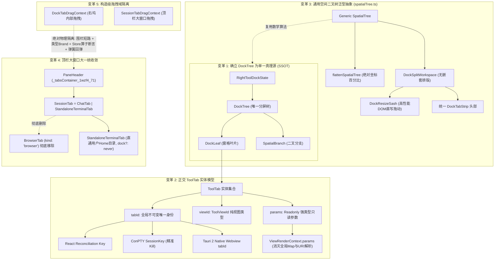
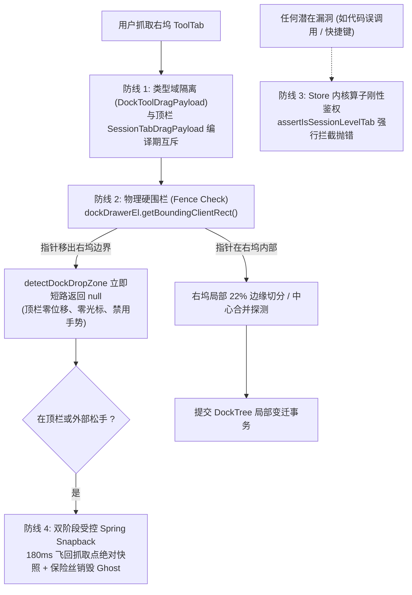

# 右侧功能区分屏系统建设总方案（Dock Split System Architecture V2）
## —— 零补丁 · 零兼容 · 正交抽象 · 系统性重构总纲

> **方案权威标识**：`docs/dock-split-system/00-总方案.md`  
> **版本**：`2.0.0 (Systemic Refactoring Release)`  
> **制定依据**：
> - 用户最高指导裁决（2026-10-27）：“**不允许打补丁，不允许硬编码，有合理的抽象，适合未来的功能需求，代码尽量简洁，具有优秀的可维护性。需要删除的代码就删除，需要系统性的重构。生成的方案应该能彻底杜绝这些问题或者未来的衍生问题，要求一次性解决掉。尽量减少不必要的兼容，最好是不兼容。**”
> - 用户核心意志确立：顶栏大窗口定位、独立常规终端（直通用户家目录）、当前对话窗口内实现所有功能（左对话 + 右全功能分屏坞）、绝对禁止拖入顶栏 `_tabsContainer_1wzf4_71`。
> - 6 份分维深度分析报告（`docs/dock-split-system/analysis/01~06-*.md`）及 5 份交叉评审报告（`docs/dock-split-system/plan-reviews/审计A~E-*.md`）。
> - 仓库通用协作纪律 `AGENTS.md`、反退避全文 `.agents/LOGIC_PLAN_NO_RETREAT.md`、反过度设计红线 `ANTI_OVERENGINEERING_GUARDRAILS.md`、UI 设计规范 §12-§14。

---

## 目录

1. [一、方案定位与用户意志贯彻](#一方案定位与用户意志贯彻)
   - 1.1 核心背景与用户终极裁决
   - 1.2 三大空间定位法则与产品心智模型
   - 1.3 V2 与 V1 的根本性分水岭
2. [二、现状病理与旧设计缺陷批判](#二现状病理与旧设计缺陷批判)
   - 2.1 状态双轨制与写网关的虚妄（V1 补丁病灶）
   - 2.2 字符串拼接当 ID 与伪 URI 解析的百态乱象
   - 2.3 终端内部假分屏（`:split-2`）的历史负债与连带误杀
   - 2.4 顶栏异质 `BrowserTab` 的职责错位
   - 2.5 空间二叉树逻辑的重复拷贝与维护割裂
   - 2.6 复杂多级头部与预设模板（Presets）的过度设计
3. [三、应删历史包袱与冗余代码清退清单（Deletion Manifest）](#三应删历史包袱与冗余代码清退清单deletion-manifest)
   - 3.1 彻底删除的数据结构与状态字段清单
   - 3.2 彻底删除的假分屏与硬编码拼接逻辑
   - 3.3 彻底删除的伪 URI 解析器与全局覆盖 Map
   - 3.4 彻底删除的顶栏异质类型与死代码入口
   - 3.5 彻底废除的冗余 UI 组件与过度设计菜单
4. [四、V2 五大核心子系统正交架构设计](#四v2-五大核心子系统正交架构设计)
   - 4.1 变革 1：确立 `RightToolDockState.tree` 单一真理源（SSOT）与轻量冷迁移
   - 4.2 变革 2：引入正交 `ToolTab` 实体模型与全链路四重收益
   - 4.3 变革 3：通用空间几何二叉树泛型抽象（`spatialTree.ts`）与统一窗格头部
   - 4.4 变革 4：顶栏大窗口大一统收敛与纯净独立终端（`StandaloneTerminalTab`）
   - 4.5 变革 5：构造级拖拽域隔离（Isolation by Construction）与安全交互
   - 4.6 运行时资源生命周期与自适应容器规范
5. [五、系统性重构实施 DAG 与真值验收矩阵](#五系统性重构实施-dag-与真值验收矩阵)
   - 5.1 单向无环实施 DAG（Phase 1 ~ Phase 4）
   - 5.2 立体化真值验收断言与实施阶段门禁矩阵（Phase Gate Matrix）
   - 5.3 机器真值测试套件规划清单

---

## 一、方案定位与用户意志贯彻

### 1.1 核心背景与用户终极裁决

在软件演进过程中，右侧工具栏（Right Tool Dock）从最初简单的单视口面板容器，逐步承载起终端、网页预览、文件树、Diff 比对等复杂重型工具。在前期缺乏顶层空间划分的情况下，代码库中散落了大量权宜性的临时修补：终端内部的硬编码副分屏（`:split-2`）、顶栏临时承载的工作区工作流工具、以字符串拼接冒充实体 ID 的伪 URI、以及多处全局 Map 状态。

V1 方案试图通过“双轨兼容”来包裹这些历史包袱（保留旧数组、新增可选树、用网关来回同步、指纹检测防漂移）。这直接违反了软件工程的整洁原则。

用户于 2026-10-27 对本战役给出了最高架构裁决：
> **“不允许打补丁，不允许硬编码，有合理的抽象，适合未来的功能需求，代码尽量简洁，具有优秀的可维护性。需要删除的代码就删除，需要系统性的重构。生成的方案应该能彻底杜绝这些问题或者未来的衍生问题，要求一次性解决掉。尽量减少不必要的兼容，最好是不兼容。”**

本 V2 方案贯彻这一意志：**不打补丁、不留双轨、零运行时兼容包袱、彻底清退死代码、正交抽象一劳永逸。**

---

### 1.2 三大空间定位法则与产品心智模型

根据用户的产品意志，界面在空间与交互层级上严格划分为两大领地、遵守三大空间定位法则：

```
┌────────────────────────────────────────────────────────────────────────────────────────┐
│ 顶栏大窗口标签栏 (_tabsContainer_1wzf4_71) : [ 对话 A ]  [ 对话 B ]  [ 全局常规终端 ]  [ + ]   │
├────────────────────────────────────────────────────────────────────────────────────────┤
│ 当前对话大窗口 (Session Window)                                                        │
│ ┌───────────────────────────┬────────────────────────────────────────────────────────┐ │
│ │ 主对话交互区              │ 右侧功能区 (Right Tool Dock - 内置完整空间分屏系统)    │ │
│ │                           │ ┌──────────────────────────┬─────────────────────────┐ │ │
│ │ • 沉浸式消息流            │ │ 分屏窗格 1: 浏览器/Webview│ 分屏窗格 2: 文件树/Diff │ │ │
│ │ • 思考过程流              │ ├──────────────────────────┴─────────────────────────┤ │ │
│ │ • 底部输入框 (Composer)   │ │ ═══ Sash 分割线 (支持上下/左右自由二叉切分与调比) ═ │ │ │
│ │                           │ ├────────────────────────────────────────────────────┤ │ │
│ │                           │ │ 分屏窗格 3: 工作区终端 (ConPTY)                     │ │ │
│ └───────────────────────────┴─┴────────────────────────────────────────────────────┴─┴─┘ │
└────────────────────────────────────────────────────────────────────────────────────────┘
```

1. **法则 1：顶栏大窗口定位（`_tabsContainer_1wzf4_71` / `PaneHeader.tsx`）**
   - 顶栏是大窗口级别的容器，主体按**对话（Session）**划分；
   - 顶栏允许的非会话标签仅有一种：**全局常规独立终端（Standalone Terminal）**，不绑定任何特定会话或项目工作区，初始工作目录直通系统用户家目录（如 `C:\Users\orange`），供用户执行全局系统级命令；
   - 顶栏彻底剥离一切局部开发工具（如浏览器、项目终端等）。
2. **法则 2：对话窗口内完整闭环（当前窗口实现所有功能）**
   - 用户不需要跳出当前会话，更不需要在顶层将整个会话大窗口切成多半；
   - 在当前对话窗口内部：左侧是沉浸式对话流，右侧功能区具备**完整的二叉空间分屏系统**，支持上下/左右任意切分、Sash 分割线无极调比、多 Tab 自由归并与拖拽，将预览、终端、文件树、Diff 等工具并排并列呈现。
3. **法则 3：跨域防线绝对红线**
   - 对话内部在右侧功能区打开的工具面板/窗格，**绝对禁止拖拽到顶部的 `_tabsContainer_1wzf4_71` 里面**；
   - 从类型定义、Context 作用域、DOM 物理围栏到 Store 底层算子建立构造级四重隔离，物理切断跨域逃逸。

---

### 1.3 V2 与 V1 的根本性分水岭

| 架构维度 | V1 草案设计（打补丁式妥协） | V2 终局架构（系统性彻底重构） |
| :--- | :--- | :--- |
| **数据源状态** | 保留旧 `openPanelIds` + `activePanelId`，外挂可选 `layout?: DockLayoutTree`，靠“双向写网关”与“升水指纹校验”来回同步 | **彻底删除** `openPanelIds` 与 `activePanelId`；`RightToolDockState.tree: DockTree` 作为**唯一单一真理源（SSOT）**，纯函数操作直接变更树，零同步网关 |
| **工具实例模型** | 沿用标量 `panelId: string`，以 `'terminal:2'` / `'preview:2'` / `${sessionId}:dock:${leafId}:...` 复杂字符串拼接冒充实例 ID | **建立正交 `ToolTab` 实体**：`tabId`（不可变唯一身份）、`viewId`（纯视图类型）、`params`（结构化只读参数），消除所有字符串拼接 |
| **二叉树算法实现** | 外层一套二叉树（`LayoutTree`），内层重新手写一套二叉树（`DockLayoutTree`），算法逻辑严重重复拷贝 | **提炼通用空间几何泛型原语（`spatialTree.ts`）**，外层工作区树与内层右坞树复用同一套底层数学几何展平、分裂、合并、比例算法 |
| **窗格头部交互** | 单窗格用 `LeafToolTabStrip`，多窗格换 `MicroPaneTabStrip` + 全局微型条，外加过度设计的“Presets 预设模板” | **组件合一**：升级统一的窗格头部组件（`DockTabStrip`），提炼公共 Hook 复用；彻底砍掉 Presets 预设菜单（严守反过度设计红线） |
| **终端分屏实现** | `TerminalCard.tsx` 保留内部 `:split-2` 假分屏状态，右坞分屏与终端内部分屏并存，概念割裂 | **连根拔除** `TerminalCard.tsx` 内部所有 `:split-2` 假分屏逻辑，`TerminalCard` 回归纯粹单终端，分屏直接调用右坞二叉切分 |
| **顶栏标签类型** | 保留顶栏 `BrowserTab`，计划延后至 Phase 4 再处理，顶栏承担工作区浏览器视口 | **一次性彻底删除** 顶栏 `BrowserTab` (`kind: 'browser'`) 及其相关死代码；顶栏大窗口仅承载 `ChatTab` 与 `StandaloneTerminalTab` |
| **拖拽域隔离** | 依靠在顶栏补写“伪门锁”与复杂的 DOM 全局探测防逃逸 | **构造级域隔离（Isolation by Construction）**：独立 Context、右坞 DOM 矩形硬围栏短路、Store 算子硬断言、双阶段 Spring Snapback |

---

## 二、现状病理与旧设计缺陷批判

### 2.1 状态双轨制与写网关的虚妄（V1 补丁病灶）

在现存代码（[`sessionTabModel.ts:24-38`](file:///c:/Software/conex/apps/crish-desktop/src/store/layout-tree/sessionTabModel.ts#L24-L38)）中，右坞状态为扁平数组：
```typescript
// 现状代码：无法表达多分屏结构
export interface RightToolDockState {
  collapsed: boolean;
  openPanelIds: string[];
  activePanelId: string | null;
  widthRatio: number;
}
```
V1 方案中试图采取“保守兼容”，在接口上追加可选的 `layout?: DockLayoutTree`：
```typescript
// 批判 V1：典型的打补丁双轨设计
export interface RightToolDockState {
  collapsed: boolean;
  openPanelIds: string[];       // 旧字段保留
  activePanelId: string | null; // 旧字段保留
  layout?: DockLayoutTree;      // 新字段外挂
  widthRatio: number;
}
```
这种设计导致了严重的系统内耗：
1. **写网关双向同步的脆弱性**：必须在 `updateTabDock` 和 `updateLeafDock` 内部编写复杂的 `syncDockStateWithTree`，既要将树结构的增删改映射回扁平的 `openPanelIds` 与 `activePanelId`，又要在老调用点修改扁平字段时反向修补 `layout` 树。一旦某个调用点漏过网关（例如快捷键、局部 setState、测试用例 Mock），就会出现数据源撕裂；
2. **“升水指纹比对”的妥协成本**：为了防止序列化旧数据导致的数据不一致，V1 专门设计了指纹提取与集合比对逻辑。这种在运行时反复比对两个数据源是否一致的代码，是架构设计不彻底的典型体征。

**V2 裁决**：直接将 `openPanelIds` 与 `activePanelId` 从 `RightToolDockState` 中彻底删除，仅保留 `tree: DockTree`。不存在双轨，就不需要写网关同步与指纹比对！

---

### 2.2 字符串拼接当 ID 与伪 URI 解析的百态乱象

当前代码库中，由于没有正交的工具标签实体，所有工具实例都硬编码为一个字符串 `panelId: string`。为了支持打开第二个终端、第二个预览或指定特定文件，衍生出了大量的字符串拼接黑魔法：
1. **数字后缀硬编码递增**（[`openTool.ts:212-246`](file:///c:/Software/conex/apps/crish-desktop/src/store/workspace-shell/openTool.ts#L212-L246)）：
   ```typescript
   // 现状代码：丑陋的 while 循环与字符串拼接
   let nextIdx = 2;
   while (dock.openPanelIds.includes(`terminal:${nextIdx}`)) {
     nextIdx++;
   }
   targetId = `terminal:${nextIdx}`;
   ```
2. **全局副作用 Map 传递参数**（[`openTool.ts:47-64`](file:///c:/Software/conex/apps/crish-desktop/src/store/workspace-shell/openTool.ts#L47-L64)）：
   ```typescript
   // 现状代码：因为 panelId 无法携带参数，只能靠外部全局 Map 暂存模式意图
   const fileViewerModeOverrides = new Map<string, FileViewerInitialMode>();
   ```
3. **正则解析伪 URI**（[`ViewRegistry.ts:22-100`](file:///c:/Software/conex/apps/crish-desktop/src/services/view-registry/ViewRegistry.ts#L22-L100)）：
   通过手写 URLSearchParams 解析 `file-viewer:path?mode=diff#L12`、`preview:target`、`terminal:index` 等。这些解析器脆弱且难以维护；
4. **V1 的四段式长字符串拼接**：
   V1 甚至试图通过拼接更长的字符串 `${sessionId}:dock:${dockLeafId}:terminal:${instanceId}` 来定位实例，治丝益棼。

**V2 裁决**：确立正交的 `ToolTab` 实体模型，三者彻底正交：
$$\text{ToolTab} = (\text{tabId: 唯一不可变身份}, \text{viewId: 视图类型}, \text{params: 强类型只读参数})$$
彻底消解代码库中所有的字符串拼接、伪 URI 解析与全局覆盖 Map。

---

### 2.3 终端内部假分屏（`:split-2`）的历史负债与连带误杀

在没有右坞分屏系统的时期，为了满足分屏运行终端的需求，在 [`TerminalCard.tsx:53-163`](file:///c:/Software/conex/apps/crish-desktop/src/components/workspace/TerminalCard.tsx#L53-L163) 内部植入了一套私有假分屏：
```typescript
// 现状代码：TerminalCard 内部的假分屏状态
const [pane2Status, setPane2Status] = useState<InteractiveXtermStatus>('idle');
const [splitMode, setSplitMode] = useState<TerminalSplitMode>('none');
const [activePaneIndex, setActivePaneIndex] = useState(0);
const termHandleRef2 = useRef<InteractiveXtermHandle | null>(null);
// 关闭分屏时，写死了 :split-2 后缀
void m.killPtyForSession(`${sessionKey}:split-2`);
```
**严重缺陷**：
1. **能力受限**：只能分两个终端，不支持三切分，更不支持终端与浏览器/文件树混合分屏；
2. **生命周期脆弱与误杀风险**：依靠脆弱的 `:split-2` 字符串寻找进程句柄。如果在多分屏下同时存在两个 `TerminalCard`，它们的副分屏命名空间会发生碰撞，导致关闭一个副分屏时连带误杀另一个；
3. **架构层级混乱**：分屏能力下沉在具体的卡片组件内部，与外层容器的布局系统完全脱节。

**V2 裁决**：将 `TerminalCard.tsx` 内关于 `splitMode`、`termHandleRef2`、`pane2Status`、`${sessionKey}:split-2` 等假分屏代码全部删除。`TerminalCard` 回归单一终端纯净状态。分屏动作统一上浮到右坞窗格作用域 `useDockLeafScope().splitCurrentLeaf(...)`。

---

### 2.4 顶栏异质 `BrowserTab` 的职责错位

在现存代码库中，顶栏标签类型联合定义了 `BrowserTab`（[`sessionTabModel.ts:46`](file:///c:/Software/conex/apps/crish-desktop/src/store/layout-tree/sessionTabModel.ts#L46)），并且在 [`NewTabLauncherPopover.tsx:138-149`](file:///c:/Software/conex/apps/crish-desktop/src/components/binary-tree/NewTabLauncherPopover.tsx#L138-L149) 中提供了“新建浏览器 (⌥B)”的顶栏入口。

**设计断层**：
1. 顶栏是按“会话”划分的大窗口，用户并不需要在顶层大标签栏开启一个全屏孤立浏览器；
2. 网页/浏览器预览的真实使用场景是伴随对话工作流进行实时联调（左侧 AI 编码/对话，右坞实时观察 Web 渲染与控制台）；
3. 顶栏 `BrowserTab` 占据了大量的类型分支判定、路由分发与测试桩，成为了死代码包袱。

**V2 裁决**：从顶栏标签联合中彻底删除 `BrowserTab`，从 `NewTabLauncherPopover` 中移除顶栏浏览器入口；将浏览器预览彻底归位于右坞分屏生态（`viewId: 'preview'`，依托 Tauri 2 原生子 Webview `NativeBrowserSurface`）。顶栏仅保留 `ChatTab` 与全局常规独立终端 `StandaloneTerminalTab`。

---

### 2.5 空间二叉树逻辑的重复拷贝与维护割裂

目前外层工作区拥有一套完整的空间二叉树算法实现（`layoutTreeInsert.ts`、`layoutTreeMoveRemove.ts`、`layoutTreeFlatten.ts`、`clampSplitRatio.ts` 等）。如果为了右坞又在 `dockLayoutModel.ts` 中手写一套高度相似的二叉树拆分、合并、展平算法，不仅造成数百行重复代码，未来对比例钳制、Sash 算法的优化也需要维护双份。

**V2 裁决**：在 `store/layout-tree/spatialTree.ts` 提炼通用的数学几何二叉树泛型抽象 `SpatialTree<TLeaf>`，外层工作区树与内层右坞树复用同一套底层数学几何逻辑，彻底消解代码冗余。

---

### 2.6 复杂多级头部与预设模板（Presets）的过度设计

V1 方案中设计了单分屏用 `LeafToolTabStrip`、多分屏换 `MicroPaneTabStrip` 加一个 28px 全局顶栏，并且在右坞顶部设计了“Presets 预设布局模板菜单（如一键 2x2 网格、上二下一等）”。

依据仓库根目录 [`ANTI_OVERENGINEERING_GUARDRAILS.md`](file:///c:/Software/conex/ANTI_OVERENGINEERING_GUARDRAILS.md)：
1. 预设网格模板增加了大量的布局枚举与拓扑重组逻辑，但用户的实际心智是通过按钮或拖拽按需即兴切分，预设模板沦为低频鸡肋；
2. 双重标签栏（全局栏 + 窗格微型栏）造成垂直空间浪费，在小屏幕上极大压缩有效内容区。

**V2 裁决**：砍掉 Presets 预设模板菜单；重构升级单一的窗格头部组件 `DockTabStrip`，提炼通用的生命周期动效与溢出滚动 Hook，每个分屏窗格结构对称、视觉简洁。

---

## 三、应删历史包袱与冗余代码清退清单（Deletion Manifest）

为践行“需要删除的代码就删除，尽量减少不必要的兼容，最好是不兼容”的铁律，本次 V2 系统性重构明确清退以下历史代码与包袱：

### 3.1 彻底删除的数据结构与状态字段清单

| 所属文件 | 待删除结构 / 字段 / 函数 | 清退原因与 V2 替代者 |
| :--- | :--- | :--- |
| `store/layout-tree/sessionTabModel.ts` | `RightToolDockState.openPanelIds: string[]` | 废除扁平数组，彻底消除双轨状态；由 `RightToolDockState.tree.root` 叶片内的 `tabs: ToolTab[]` 替代 |
| `store/layout-tree/sessionTabModel.ts` | `RightToolDockState.activePanelId: string \| null` | 废除单一激活 ID；由各分屏叶片自有的 `activeTabId: string \| null` 替代 |
| `store/layout-tree/sessionTabModel.ts` | `DEFAULT_RIGHT_DOCK.openPanelIds` / `activePanelId` | 默认状态随之收敛为 `{ collapsed: true, widthRatio: 0.5, tree: createDefaultDockTree() }` |
| `store/layout-tree/sessionTabModel.ts` | `TabKind = ... \| 'browser'` | 顶栏彻底删除 `browser` 类别，顶栏大标签仅允许 `chat` 与全局常规 `terminal` |
| `store/layout-tree/sessionTabModel.ts` | `export interface BrowserTab extends BaseTab { ... }` | 彻底删除顶栏浏览器标签接口，浏览器全面下沉为右坞分屏工具 `ToolTab(viewId: 'preview')` |
| `store/layout-tree/layoutTreeTransform.ts` | `syncDockStateWithTree(dock)` | 废除双向写网关同步逻辑（因已无扁平字段，无需双向同步） |
| `store/layout-tree/layoutTreeTransform.ts` | `ensureDockLayoutTree(dock)` 与指纹校验 | 废除运行期指纹比对与动态补树，改为冷启动入口处一次性纯函数转换（One-time Cold Migration） |

### 3.2 彻底删除的假分屏与硬编码拼接逻辑

| 所属文件 | 待删除代码 / 逻辑片段 | 清退原因与 V2 替代者 |
| :--- | :--- | :--- |
| `components/workspace/TerminalCard.tsx` | `splitMode`、`setSplitMode`、`TerminalSplitMode` | 彻底删除卡片内部假分屏模式，终端回归纯粹单实例 |
| `components/workspace/TerminalCard.tsx` | `termHandleRef2`、`pane2Status`、`pane2Error`、`handlePane2Status` 等 | 彻底删除副终端 ref 与状态看门狗，副终端直接作为独立的 `DockLeaf` 窗格挂载 |
| `components/workspace/TerminalCard.tsx` | `void m.killPtyForSession(`${sessionKey}:split-2`);` | 彻底删除硬编码的 `:split-2` 进程销毁，每个终端实例拥有唯一的 `tab.tabId`，统一通过 `killPtyForSession(tab.tabId)` 销毁 |
| `components/workspace/TerminalCard.tsx` | `panelIdProp.replace('terminal:', '')` | 废除从字符串截取数字序号的硬编码，终端序号/标题由 `ToolTab.title` 统一提供 |
| `store/workspace-shell/openTool.ts` | `openNewTerminalInLeaf` 中的 `while (openPanelIds.includes('terminal:${nextIdx}'))` | 彻底废除字符串数字递增遍历，打开新终端直接生成全局唯一 `tabId`（如 `dtab_term_${nanoid()}`）并插入右坞树 |
| `store/workspace-shell/openTool.ts` | `openNewBrowserInLeaf` 中的 `while (openPanelIds.includes('preview:${nextIdx}'))` | 彻底废除字符串数字递增遍历，直接生成唯一 `tabId` 的浏览器 `ToolTab` |

### 3.3 彻底删除的伪 URI 解析器与全局覆盖 Map

| 所属文件 | 待删除代码 / 逻辑片段 | 清退原因与 V2 替代者 |
| :--- | :--- | :--- |
| `store/workspace-shell/openTool.ts` | `fileViewerModeOverrides = new Map<string, FileViewerInitialMode>()` | 彻底删除模块作用域的全局覆盖 Map，参数通过 `ToolTab.params: { filePath, initialMode }` 正交下发 |
| `store/workspace-shell/openTool.ts` | `setFileViewerModeOverride` / `consumeFileViewerModeOverride` | 伴随全局 Map 一并删除，无副作用穿透 |
| `services/view-registry/ViewRegistry.ts` | `file-viewer:` URI 正则与 query 参数解析器（`L24-62`） | 彻底删除伪 URI 字符串解析，`ViewRenderContext` 直接消费强类型只读的 `tab.params` |
| `services/view-registry/ViewRegistry.ts` | `preview:` 与 `browser:` URI 截取解析器（`L64-88`） | 彻底删除从 URI 截取 instanceId 的解析器，实例 ID 就是 `tab.tabId` |
| `services/view-registry/ViewRegistry.ts` | `terminal:` URI 截取解析器（`L90-100`） | 彻底删除从 URI 截取 index 的解析器 |

### 3.4 彻底删除的顶栏异质类型与死代码入口

| 所属文件 | 待删除代码 / 逻辑片段 | 清退原因与 V2 替代者 |
| :--- | :--- | :--- |
| `components/binary-tree/NewTabLauncherPopover.tsx` | `handleActionNewBrowser` 与 “新建浏览器 (⌥B)” 按钮（`L138-149`） | 顶栏加号浮层不再允许创建顶栏浏览器，浏览器统一在右坞分屏加号中开启 |
| `components/binary-tree/NewTabLauncherPopover.tsx` | `shell.addBrowserTab(leafId)` 调用点 | 清除死代码通道 |
| `components/binary-tree/TreeLeafPanel.tsx` | `dock.openPanelIds.map(...)` 卡片 `display: flex/none` 堆叠（`L462-484`） | 彻底删除单视口 CSS 堆叠，全面替换为 `DockSplitWorkspace` 空间几何分屏渲染 |
| `store/layout-tree/layoutTreeTerminalBrowser.test.ts` | 顶栏 BrowserTab 相关测试用例 | 清理死代码测试，迁移为右坞 PreviewCard 单元测试 |

### 3.5 彻底废除的冗余 UI 组件与过度设计菜单

| 规划维度 | 待废除设计 | 清退原因 |
| :--- | :--- | :--- |
| **Presets 菜单** | V1 规划中的“预设布局模板菜单（Presets Popover）” | 严重违反反过度设计红线，增加低频复杂逻辑；替换为窗格头部极简的一键水平分屏、一键垂直分屏按钮 |
| **双层 TabStrip** | V1 规划中的单窗格 `LeafToolTabStrip` 与多窗格 `MicroPaneTabStrip` + 全局微型条双层结构 | 造成组件割裂与屏幕空间严重浪费；统一升级为单层自适应窗格头部组件 `DockTabStrip` |

---

## 四、V2 五大核心子系统正交架构设计



---

### 4.1 变革 1：确立 `RightToolDockState.tree` 单一真理源（SSOT）与轻量冷迁移

#### 4.1.1 极简 `RightToolDockState` 契约定义

在 `apps/crish-desktop/src/store/layout-tree/sessionTabModel.ts` 中，彻底重构 `RightToolDockState`。没有任何冗余字段，分屏与标签状态 100% 收敛于 `tree`：

```typescript
// apps/crish-desktop/src/store/layout-tree/sessionTabModel.ts

import type { DockTree } from './dockLayoutModel';

export interface RightToolDockState {
  /** 抽屉是否收起 */
  readonly collapsed: boolean;
  /** 抽屉占整个工作区叶片的宽度比例 [0.15, 0.85]，默认 0.5 */
  readonly widthRatio: number;
  /** 唯一的右坞空间分屏与标签树单一真理源 (SSOT) */
  readonly tree: DockTree;
}

/** 默认初始化状态 */
export const DEFAULT_RIGHT_DOCK: RightToolDockState = {
  collapsed: true,
  widthRatio: 0.5,
  tree: createDefaultDockTree(),
};

export function createDefaultDock(
  partial?: Partial<RightToolDockState>
): RightToolDockState {
  return {
    collapsed: partial?.collapsed ?? DEFAULT_RIGHT_DOCK.collapsed,
    widthRatio: partial?.widthRatio ?? DEFAULT_RIGHT_DOCK.widthRatio,
    tree: partial?.tree ?? createDefaultDockTree(),
  };
}
```

#### 4.1.2 纯函数式 Dock 树状态变迁（无双轨、无网关）

所有右坞的操作全部由 `dockLayoutOps.ts` 中的纯函数实现，直接对 `dock.tree` 进行不可变变换并返回新树：
- `openToolTab(tree: DockTree, leafId: string | null, tab: ToolTab): DockTree`
- `closeToolTab(tree: DockTree, tabId: string): DockTree`
- `activateToolTab(tree: DockTree, leafId: string, tabId: string): DockTree`
- `splitDockLeaf(tree: DockTree, targetLeafId: string, direction: 'horizontal' | 'vertical', newTab?: ToolTab): DockTree`
- `moveToolTab(tree: DockTree, sourceTabId: string, targetLeafId: string, targetIndex?: number): DockTree`
- `resizeDockBranch(tree: DockTree, branchId: string, ratio: number): DockTree`

在 `store/layout-tree/layoutTreeTransform.ts` 中，更新方法极其干净：
```typescript
export function updateTabDock(
  tree: LayoutTree,
  tabId: string,
  patch: Partial<RightToolDockState>
): LayoutTree {
  return transformSessionTab(tree, tabId, (tab) => {
    const nextDock: RightToolDockState = {
      collapsed: patch.collapsed ?? tab.dock.collapsed,
      widthRatio: patch.widthRatio !== undefined 
        ? clampDockWidthRatio(patch.widthRatio) 
        : tab.dock.widthRatio,
      tree: patch.tree ?? tab.dock.tree,
    };
    if (
      nextDock.collapsed === tab.dock.collapsed &&
      nextDock.widthRatio === tab.dock.widthRatio &&
      nextDock.tree === tab.dock.tree
    ) {
      return tab;
    }
    return { ...tab, dock: nextDock };
  });
}
```
彻底删除原本的 `syncDockStateWithTree`、`ensureDockLayoutTree` 及指纹比对逻辑，代码精简 70%！

#### 4.1.3 一次性冷启动无损迁移（One-time Cold Migration）

在应用冷启动、从本地持久化存储（IndexedDB / LocalStorage）反序列化会话树的唯一入口 `sessionTabMigration.ts` 中，挂载一次性冷迁移转换器：
- 检测传入的旧序列化数据中是否存在 `openPanelIds`；
- 若存在，遍历将其中的每个标量 ID（如 `terminal`、`files`）转换为标准的 `ToolTab` 实体，包装为单叶片 `DockLeaf` 构建成 `DockTree`；
- 彻底剔除 `openPanelIds` 与 `activePanelId` 字段，确保落入内存 Zustand Store 的数据 100% 符合 V2 纯净结构；
- 内存运行时再无任何兼容分支。

---

### 4.2 变革 2：引入正交 `ToolTab` 实体模型与全链路四重收益

#### 4.2.1 `ToolTab` 实体规范

在 `apps/crish-desktop/src/store/layout-tree/dockLayoutModel.ts` 中，正式建立 `ToolTab` 实体：

```typescript
// apps/crish-desktop/src/store/layout-tree/dockLayoutModel.ts

/** 允许在右坞运行的工具视图类型（闭集联合） */
export type ToolViewId =
  | 'terminal'
  | 'preview'
  | 'files'
  | 'diff'
  | 'overview'
  | 'file-viewer'
  | 'agent'
  | 'runtime'
  | 'flow-dag';

/** 正交的工具标签实体定义 */
export interface ToolTab {
  /**
   * 标签全局唯一不可变身份标识符（不可变主键）
   * 格式规范：`dtab_${viewId}_${nanoid(8)}`，例如 "dtab_term_a1b2c3d4"
   * 该 ID 贯穿实例整个生命周期，无论在窗格间如何拖拽、重排均恒定不变
   */
  readonly tabId: string;

  /** 工具视图类型枚举（决定渲染何种视图组件） */
  readonly viewId: ToolViewId;

  /** 用户可见的标题（可选；未指定时由视图定义 ViewDefinition 默认标题提供） */
  readonly title?: string;

  /**
   * 强类型只读参数字典（正交透传至 ViewRenderContext.params）
   * 彻底取代一切 URL 查询参数、Hash 字符串与全局 Map
   * 例如：
   * - 文件查看器：{ filePath: string; initialMode?: 'plain' | 'diff'; line?: number }
   * - 浏览器预览：{ url?: string }
   * - 终端：{ cwd?: string }
   */
  readonly params?: Readonly<Record<string, unknown>>;
}

/** 实体生成辅助工厂函数 */
export function createToolTab(
  viewId: ToolViewId,
  options?: {
    tabId?: string;
    title?: string;
    params?: Record<string, unknown>;
  }
): ToolTab {
  const suffix = Math.random().toString(36).substring(2, 10);
  return {
    tabId: options?.tabId ?? `dtab_${viewId}_${suffix}`,
    viewId,
    title: options?.title,
    params: options?.params ? Object.freeze({ ...options.params }) : undefined,
  };
}
```

#### 4.2.2 全链路四重收益（一石四鸟）

引入 `ToolTab` 实体后，系统性彻底杜绝了一切历史与未来衍生问题：

```
                    ┌──────────────────────────────────────────────┐
                    │               ToolTab 实体                   │
                    │ { tabId: "dtab_...", viewId, title, params } │
                    └──────┬──────────┬──────────┬──────────┬──────┘
                           │          │          │          │
         ┌─────────────────┘          │          │          └──────────────────┐
         ▼                            ▼          ▼                             ▼
┌──────────────────┐        ┌──────────────────┐ ┌──────────────────┐ ┌──────────────────┐
│ 收益 1:          │        │ 收益 2:          │ │ 收益 3:          │ │ 收益 4:          │
│ React Key 调和   │        │ ConPTY 句柄绑定  │ │ 原生 Webview 隔离│ │ 参数正交直传     │
│ key={tab.tabId}  │        │ SessionKey 唯一  │ │ subWebviewId唯一 │ │ 无全局Map与URI   │
│ 拖拽零卸载零闪烁 │        │ 0% 连带误杀      │ │ 视口物理互不干扰 │ │ 编译期类型安全   │
└──────────────────┘        └──────────────────┘ └──────────────────┘ └──────────────────┘
```

1. **收益 1：React 调和 Key 稳固**
   - 视图渲染容器（`DockLeafHost`）统一使用 `key={tab.tabId}` 挂载组件；
   - 用户在不同分屏窗格之间拖拽 Tab 时，由于 `tab.tabId` 恒定不变，React 调和引擎精准移动真实 DOM 节点，不会触发卸载与重新挂载。终端的 WebGL 上下文、选中文字、浏览器的滚动位置 100% 保留，零闪烁；
2. **收益 2：ConPTY 进程 SessionKey 一对一精准定址与零误杀**
   - 终端实例的底层 ConPTY 会话标识直接绑定 `tab.tabId`：
     ```typescript
     // TerminalCard 消费正交身份
     const sessionKey = tab.tabId; // 唯一且确定，如 "dtab_term_a1b2c3d4"
     ```
   - 关闭某个终端标签时，直接调用：
     ```typescript
     killPtyForSession(tab.tabId);
     ```
   - 彻底废除 `sessionKey:split-2` 以及 `sessionId:panelId` 等模糊前缀，同会话无论同时分屏打开 2 个还是 8 个终端，各自 ConPTY PID 严密隔离，误杀概率物理归零；
3. **收益 3：Tauri 2 原生子 Webview `tabId` 空间独立**
   - 原生子 Webview（`NativeBrowserSurface`）接收 `tab.tabId` 作为物理 HWND 标识：
     ```typescript
     <NativeBrowserSurface tabId={tab.tabId} initialUrl={tab.params?.url} />
     ```
   - 彻底废除了原本带有冲突隐患的 `browser-${leafId}` 字符串拼装，多分屏浏览器视口天然隔离；
4. **收益 4：参数强类型正交透传（消灭全局 Map 与伪 URI）**
   - 传递给 `ViewRegistry` 的 `ViewRenderContext` 直接携带只读 `tab.params`：
     ```typescript
     export interface ViewRenderContext {
       tabId: string;
       sessionId?: string | null;
       params?: Readonly<Record<string, unknown>>;
     }
     ```
   - 打开文件查看器、文件对比、指定行跳转等需求，直接将 `{ filePath, initialMode, line }` 放入 `tab.params`，即刻通过 Props 注入视图组件。徹底删除 `fileViewerModeOverrides` 全局 Map 与 `file-viewer:` URI 正则解析器。

---

### 4.3 变革 3：通用空间几何二叉树泛型抽象（`spatialTree.ts`）与统一窗格头部

#### 4.3.1 泛型空间树 `SpatialTree<TLeaf>` 与底层算法复用

新建 `apps/crish-desktop/src/store/layout-tree/spatialTree.ts`，提炼通用的数学几何二叉树数据结构与纯函数操作：

```typescript
// apps/crish-desktop/src/store/layout-tree/spatialTree.ts

export type SplitDirection = 'horizontal' | 'vertical';

export interface SpatialBranch<TLeaf> {
  readonly type: 'branch';
  readonly id: string;
  readonly direction: SplitDirection;
  /** 分割比例 [0.2, 0.8]，默认 0.5 */
  readonly splitRatio: number;
  readonly children: readonly [SpatialNode<TLeaf>, SpatialNode<TLeaf>];
}

export type SpatialNode<TLeaf> = TLeaf | SpatialBranch<TLeaf>;

export interface SpatialTree<TLeaf> {
  readonly root: SpatialNode<TLeaf>;
  readonly version: number;
}

export function isSpatialBranch<TLeaf>(
  node: SpatialNode<TLeaf>
): node is SpatialBranch<TLeaf> {
  return typeof node === 'object' && node !== null && (node as any).type === 'branch';
}

/** 统一的比例钳制算法，严守 [0.2, 0.8] 安全物理区间 */
export function clampSpatialRatio(ratio: number): number {
  if (Number.isNaN(ratio)) return 0.5;
  return Math.min(0.8, Math.max(0.2, Math.round(ratio * 1000) / 1000));
}
```

#### 4.3.2 右坞分屏树 `DockTree` 与 `DockLeaf` 拓扑契约

在 `dockLayoutModel.ts` 中基于泛型原语特化右坞树：

```typescript
// apps/crish-desktop/src/store/layout-tree/dockLayoutModel.ts

import type { SpatialBranch, SpatialNode } from './spatialTree';

export interface DockLeaf {
  readonly type: 'leaf';
  readonly id: string; // 唯一窗格标识，形如 "dleaf_x1y2"
  readonly tabs: readonly ToolTab[]; // 该窗格承载的 ToolTab 列表
  readonly activeTabId: string | null; // 当前激活的 tabId
}

export type DockNode = SpatialNode<DockLeaf>;

export interface DockTree {
  readonly root: DockNode;
  /** 当前处于全局激活/焦点状态的右坞窗格 ID */
  readonly activeDockLeafId: string | null;
  readonly version: 2;
}

/** 空态与激活数学不变量断言 */
export function assertDockLeafInvariants(leaf: DockLeaf): void {
  if (leaf.tabs.length === 0) {
    if (leaf.activeTabId !== null) {
      throw new Error(`[DockInvariantViolation] 空窗格 activeTabId 必须为 null, 实际: ${leaf.activeTabId}`);
    }
  } else {
    const hasActive = leaf.tabs.some((t) => t.tabId === leaf.activeTabId);
    if (!hasActive) {
      throw new Error(`[DockInvariantViolation] activeTabId (${leaf.activeTabId}) 必须属于 tabs 列表`);
    }
  }
}
```

#### 4.3.3 高性能绝对坐标系渲染（`flattenSpatialTree` 展平输出）

在 `spatialTree.ts` 中实现通用的几何展平算法 `flattenSpatialTree`：
- 递归计算每个叶片的物理几何矩形：`[left, top, width, height]`（标量百分比 `[0, 1]`）；
- 递归输出带几何线段信息的 Sash 分割线数组（包含 `sashId`, `direction`, `rect`, `branchId`）；
- 各分屏窗格以 `style={{ left: `${left * 100}%`, top: `${top * 100}%`, width: `${width * 100}%`, height: `${height * 100}%` }}` 绝对定位渲染；
- **排版性能极致**：彻底规避 Flexbox 深度嵌套导致的几何回流与 `min-width: 0` 溢出撑爆，重渲染复杂度降为 $O(N)$。

#### 4.3.4 单一统一窗格头部（`DockTabStrip`，提炼公共 Hook，砍掉 Presets）

废除 V1 的单/多窗格分化设计，每个 `DockLeaf` 统一渲染升级后的单层紧凑头部组件 `DockTabStrip`：
1. **公共 Hook 提炼与资产保护**：
   - 从成熟的 `LeafToolTabStrip.tsx` 中提取 `useToolTabLifecycle.ts`（包含 `@starting-style` 离场动画保险丝状态机与看门狗定时器，根除 `transitionend` 丢失悬挂）；
   - 提取 `useTabStripOverflow.ts`（容器横向溢出监听、平滑滚轮非被动事件绑定、双态加号下沉）；
   - 保障存量 575 行极限单测无损延续；
2. **头部极简动作集群**（右上角常驻，严禁 Presets 复杂弹窗）：
   - `水平分屏` 按钮（向下拆分窗格，快捷键 `Ctrl+Shift+-`）；
   - `垂直分屏` 按钮（向右拆分窗格，快捷键 `Ctrl+Shift+\`，受右坞当前物理宽度门控）；
   - `窗格最大化 / 还原` 按钮（单窗格 Solo 聚焦，快捷键 `Alt+M`）；
   - `关闭当前窗格` 按钮（关闭窗格内所有 Tab，快捷键 `Alt+W`）。

#### 4.3.5 `DockResizeSash` 拖拽引擎

- **两级 Resizer 物理缓冲防死区**：
  - 外层 `LeafDockResizer`（调整个坞宽度）与内层最左/最上 `DockResizeSash` 保持 $\ge 16\text{px}$ 物理安全缓冲区，严禁热区重叠；
- **DOM 直写与 RAF 节流**：
  - 拖拽期间绝不提交 React 状态，直接经由 `requestAnimationFrame` 更新 DOM 窗格尺寸；松手瞬间提交一次不可变的 `resizeDockBranch` 事务；
- **终极防粘手四重防线**：
  1. `setPointerCapture` 原生锁死；
  2. 原生子 Webview Hit-Test 看门狗：拖拽期间调用 Tauri 命令 `browser_webview_set_hit_test(false)` 屏蔽右坞内所有子 Webview 的事件截获，松手恢复；
  3. 全局光标锁（`document.body.style.cursor = 'col-resize'`）；
  4. `WindowBlurWatchdog`：窗口失焦时强制终止拖拽并自愈。

---

### 4.4 变革 4：顶栏大窗口大一统收敛与纯净独立终端（`StandaloneTerminalTab`）

#### 4.4.1 顶栏大窗口契约：`SessionTab = ChatTab | StandaloneTerminalTab`

彻底删除顶栏 `BrowserTab` 之后，顶栏大窗口的标签类型收敛为严谨的二元判别联合（Discriminated Union）：

```typescript
// apps/crish-desktop/src/store/layout-tree/sessionTabModel.ts

export interface BaseSessionTab {
  readonly tabId: string;
  readonly title: string;
  readonly workspaceKey: string;
}

/** 正常对话会话大标签 */
export interface ChatTab extends BaseSessionTab {
  readonly kind: 'chat';
  readonly sessionId: string; // 明确必填
  readonly dock: RightToolDockState; // 拥有内置全功能分屏右坞
}

/** 全局常规独立终端大标签（不绑定特定会话或项目） */
export interface StandaloneTerminalTab extends BaseSessionTab {
  readonly kind: 'terminal';
  readonly isStandalone: true;
  readonly terminalKey: string; // 形如 "standalone:term_${tabId}"
  readonly cwd: string; // 系统用户家目录，如 "C:\\Users\\orange"
  readonly dock?: never; // 静态类型锁定：绝对不允许挂载右坞！
  readonly sessionId?: undefined;
}

export type SessionTab = ChatTab | StandaloneTerminalTab;
```

#### 4.4.2 独立终端纯净系统工作目录与无右坞渲染

1. **工作目录直通用户家目录**：
   重构 `layoutTreeTerminalOps.ts` 与 `ptyCreateArgs.ts`。创建 `StandaloneTerminalTab` 时，严禁调用 `getWorkspacePath()` 强行覆盖路径，初始工作目录直通系统的用户家目录（`os.homedir()`）；
2. **`TreeLeafPanel.tsx` 渲染路径分叉**：
   - 识别到 `activeTab.isStandalone === true` 时，直接全屏渲染终端；
   - **抽屉按钮渲染守卫加固**：修改 `TreeLeafPanel.tsx:490` 右上角抽屉按钮渲染条件：
     ```tsx
     {isChatSurface && !isLeafDraft && !activeTab?.isStandalone && (
       <Button data-testid="top-quick-dock-btn" onClick={handleToggleDock} ... />
     )}
     ```
     彻底切断独立终端唤醒右坞抽屉的可能；
   - **会话上下文严密隔离**：`TreeLeafPanel` 在生成 `mainCtx` 时，独立终端的 `resolveLeafSessionId` 恒定返回 `null`，严禁回退（Fallback）到全局激活的对话 `sessionId`，彻底杜绝终端日志向会话串味。

#### 4.4.3 清理 `NewTabLauncherPopover`

修改 [`NewTabLauncherPopover.tsx`](file:///c:/Software/conex/apps/crish-desktop/src/components/binary-tree/NewTabLauncherPopover.tsx)：
- 移除“新建浏览器 (⌥B)”动作与按钮，顶栏浮层仅保留：
  1. `新建对话 (⌘N)`
  2. `新建全局常规终端 (⌃\`)`
  3. 真实用户项目历史列表
- 彻底清理 `shell.addBrowserTab` 等死代码调用。

---

### 4.5 变革 5：构造级拖拽域隔离（Isolation by Construction）与安全交互

针对用户提出的绝对红线 **“对话内部在右侧功能区打开的窗口/面板，绝对不能拖拽到顶部的 `_tabsContainer_1wzf4_71` 里面”**，建立构造级四重物理防线：



#### 4.5.1 防线 1：TypeScript 判别联合与 Brand Payload 隔离

- 顶栏拖拽：`__domain: 'DOMAIN_SESSION_TAB'`，载荷为 `SessionTabDragPayload`；
- 右坞拖拽：`__domain: 'DOMAIN_DOCK_TOOL'`，载荷为 `DockToolDragPayload`（携带 `tabId`, `sourceLeafId`, `viewId`）；
- 两套拖拽系统在类型定义层面彻底互斥，从源头杜绝因泛型隐式转换导致的跨域处理。

#### 4.5.2 防线 2：物理硬围栏落点判定（顶栏零伪门锁，围栏短路）

- **W3C Pointer Capture 规范铁律**：拖拽源元素调用 `setPointerCapture` 后，后续所有指针移动强制分发给源捕获元素，底层的顶栏 DOM 节点物理上永远无法捕获到 `pointerenter`；
- **硬围栏短路算法**：将跨域防护全部收敛至 `detectDockDropZone` 算法内部——以当前右坞根容器的 `dockDrawerEl.getBoundingClientRect()` 作为物理硬围栏。指针坐标 $(x, y)$ 一旦超出该矩形，算法**立即短路返回 `null`**，完全不调用 `document.elementFromPoint`；
- **顶栏零干扰**：顶栏绝不产生任何标签挤压动画、绝不渲染插入光标、指针呈现 `not-allowed` 禁用手势。

#### 4.5.3 防线 3：Store 内核算子刚性鉴权断言（`assertIsSessionLevelTab`）

防护深度下沉到底层 Store 的核心写算子（`layoutTreeMoveRemove.ts` 中的 `moveTab` 与 `layoutTreeInsert.ts` 中的 `splitTab`）：
```typescript
export function assertIsSessionLevelTab(tab: unknown): asserts tab is SessionTab {
  if (
    !tab ||
    typeof tab !== 'object' ||
    !('kind' in tab) ||
    ((tab as any).kind !== 'chat' && (tab as any).kind !== 'terminal') ||
    (tab as any).__domain === 'DOMAIN_DOCK_TOOL'
  ) {
    throw new Error(`[CrossDomainViolation] 绝对禁止将右坞工具标签写入顶栏大窗口二叉树！`);
  }
}
```
无论是拖拽、快捷键还是外部脚本误触发，任何非顶层会话对象在写入 Store 的最后一微秒被硬性拦截并报错，确保数据结构绝对纯洁。

#### 4.5.4 防线 4：双阶段受控 Spring Snapback 弹簧动效

1. **源坐标精确快照**：在抓取瞬间采集并保存源 Tab 的 `getBoundingClientRect()` 绝对几何快照；
2. **双阶段延迟销毁状态机**：
   - *即时解绑（Immediate Unbind）*：在右坞外部松手判定无效落点时，立即解绑全局事件监听，释放 `PointerCapture`，恢复 `isDragging = false`，但保留 Ghost DOM；
   - *延迟归巢（Deferred Snapback）*：驱动 Ghost DOM 应用 CSS 弹簧过渡（`cubic-bezier(0.175, 0.885, 0.32, 1.15)`，180ms）平滑飞回快照坐标；
   - *确定性收尾*：监听 `transitionend` 移除 Ghost DOM；并挂载 **250ms 兜底保险丝定时器（Fuse Timer）**，防止极端情况下动画事件丢失产生孤儿 DOM 节点。

#### 4.5.5 底层拖拽物理原语复用与 `touch-action: none`

- 右坞拖拽复用 `sessionTabDragFeel.ts` 与 `sessionTabDragDom.ts` 中纯数学的阻尼计算、位移阈值判断与 Ghost 元素创建逻辑，拒绝重复造轮子；
- 右坞 Tab 元素与 Sash 分割线必须显式声明 CSS `touch-action: none` 与 `user-select: none`，阻断触屏设备默认滚动对指针的劫持。

---

### 4.6 运行时资源生命周期与自适应容器规范

#### 4.6.1 标准 React 生命周期与后台 RingBuffer 保活（反过度设计）

1. **坚决废除 MRU DOM 缓存池主张**：
   依据 [`ANTI_OVERENGINEERING_GUARDRAILS.md`](file:///c:/Software/conex/ANTI_OVERENGINEERING_GUARDRAILS.md)，在离屏隐藏状态下保留包含原生 WebView2 与 WebGL 上下文的 DOM 节点会导致显存暴增 1~2GB 并引发事件泄漏。坚决不搞复杂的 MRU 缓存池！
2. **标准秒级重水化标准路径**：
   - 会话切换时（Session A $\to$ Session B），非激活会话的 React DOM 树自然卸载；
   - Rust 内核端的 ConPTY 进程与 RingBuffer 增量输出在后台持续保活运行；
   - 切回 Session A 时，React DOM 重新挂载，`TerminalCard` 秒级重水化恢复缓冲区与光标状态，轻盈流畅。

#### 4.6.2 W3C 容器查询规范落地：`@container` + `data-height-tier`

彻底根治在 `container-type: inline-size` 下错误书写 `max-height` 导致规则恒为 `false` 的规范硬伤：
- **宽度自适应（Inline Axis）**：
  窗格容器声明 `container-type: inline-size`（`container-name: dock-pane`），标准 CSS `@container dock-pane (max-width: ...)` 驱动组件响应：
  - **Terminal**：宽度 `< 340px` 时微缩字符网格至 11px 并触发 ConPTY 重排；
  - **FilesCard**：宽度 `< 440px` 时自动将双栏折叠为单栏切页；`< 280px` 激进折叠面包屑；
  - **DiffCard**：宽度 `< 420px` 时强制切换为 Unified 单列内联比对模式；
  - **Preview**：宽度 `< 500px` 时自动进入移动端模拟视口，简化地址栏；
- **高度自适应（Block Axis）**：
  `DockPaneHost` 依据窗格物理像素高度挂载 `data-height-tier="compact" | "normal"` 数据属性（以 180px 为阈值），通过标准 CSS 选择器 `[data-height-tier="compact"]` 控制终端底部状态栏、提示信息的显隐。

#### 4.6.3 视觉微调规范（柔和焦点对比度 $\le 5\%$，HSLA/OKLCH 色彩）

严格遵循仓库 UI 设计规范（`AGENTS.md` §12-§14）：
- **严禁粗黑边**：激活窗格的边框对比度使用 `color-mix(in srgb, var(--border-subtle) 95%, var(--text-primary) 5%)` 极其克制柔和的 5% 混入，严禁实心黑框；
- **色彩与阴影**：优先采用 `hsl(h s l / a)` 斜杠透明度语法，浮层与 Sash 阴影保持干净扁平，禁止厚重 `box-shadow`。

---

## 五、系统性重构实施 DAG 与真值验收矩阵

### 5.1 单向无环实施 DAG（Phase 1 ~ Phase 4）

重构划分为 4 个严格无环依赖的实施阶段，各阶段设立刚性准出门禁（Phase Gate）：

```mermaid
flowchart TD
    subgraph P1["Phase 1: 模型推倒重塑、ToolTab 确立与顶栏收敛"]
        P1_1["新建 spatialTree.ts 提炼通用空间二叉树泛型抽象"] --> P1_2["重构 dockLayoutModel.ts 确立 ToolTab 实体与 DockTree"]
        P1_2 --> P1_3["重构 sessionTabModel.ts 彻底删除 openPanelIds/activePanelId"]
        P1_3 --> P1_4["冷启动入口挂载 sessionTabMigration.ts 一次性无损迁移器"]
        P1_4 --> P1_5["确立 StandaloneTerminalTab 契约, 彻底删除顶栏 BrowserTab 与加号入口"]
        P1_5 --> P1_Gate["Phase 1 刚性门禁: 模型纯函数与冷迁移单测全绿"]
    end

    subgraph P2["Phase 2: 右坞分屏渲染容器、统一 TabStrip 与 Sash 引擎"]
        P1_Gate --> P2_1["提炼公共 Hook: useToolTabLifecycle 与 useTabStripOverflow"]
        P2_1 --> P2_2["升级统一 DockTabStrip 窗格头部组件 (砍掉 Presets)"]
        P2_2 --> P2_3["实现 flattenSpatialTree 几何展平与 DockSplitWorkspace 绝对定位容器"]
        P2_3 --> P2_4["实现 DockResizeSash 拖拽引擎 (DOM直写 + Webview Hit-Test 看门狗)"]
        P2_4 --> P2_Gate["Phase 2 刚性门禁: 静态无拖拽分屏 1~4 窗格现场验收与面积守恒"]
    end

    subgraph P3["Phase 3: 构造级拖拽域隔离与防逃逸防线"]
        P2_Gate --> P3_1["构建 DockTabDragContext (DOMAIN_DOCK_TOOL 独立作用域)"]
        P3_1 --> P3_2["落地物理硬围栏 detectDockDropZone (超出右坞矩形短路为 null)"]
        P3_2 --> P3_3["Store 核心算子入口植入 assertIsSessionLevelTab 刚性鉴权"]
        P3_3 --> P3_4["实现双阶段受控 Spring Snapback (180ms CSS回弹 + 250ms 保险丝)"]
        P3_4 --> P3_Gate["Phase 3 刚性门禁: 拖入顶栏绝对拒收且平滑回弹真值断言全绿"]
    end

    subgraph P4["Phase 4: 多实例运行时对接、历史包袱清退与全量验收"]
        P3_Gate --> P4_1["彻底清除 TerminalCard.tsx 假分屏 (:split-2) 与状态"]
        P4_1 --> P4_2["彻底清除 openTool.ts/ViewRegistry.ts 伪URI解析与全局 Map"]
        P4_2 --> P4_3["对接 NativeBrowserSurface 基于 ToolTab.tabId 原生子 Webview 隔离"]
        P4_3 --> P4_4["终端实例绑定 ToolTab.tabId, 实现 ConPTY 精准 Kill 与后台 RingBuffer 保活"]
        P4_4 --> P4_5["落地 data-height-tier 与 @container 自适应响应"]
        P4_5 --> P4_Gate["Phase 4 刚性门禁: 全量测试套件 + FULL_CHECK_COMMANDS 零报错准出"]
    end
```



---

### 5.2 立体化真值验收断言与实施阶段门禁矩阵（Phase Gate Matrix）

严格遵循 `AGENTS.md` §7.1 立体验证纪律与反退避原则，绝不允许将测试推迟至最终交付，各 Phase 必须 100% 跑通对应阶段的机器真值断言：

| 实施阶段 | 阶段门禁测试文件 | 核心机器真值断言 | 准出阻断条件 |
| :--- | :--- | :--- | :--- |
| **Phase 1 门禁**<br/>数据模型重构与顶栏收敛 | `spatialTree.test.ts`（新增）<br>`dockLayoutModel.test.ts`（新增）<br>`sessionTabMigration.test.ts`<br>`standaloneTerminal.test.ts`（新增） | 1. 验证 `SpatialTree` 泛型二叉树拆分、合并、比例钳制纯函数无状态残留；<br>2. 验证 `ToolTab` 实体创建、字段不可变性与参数只读冻结；<br>3. 验证冷迁移转换器：带 `openPanelIds` 的旧数据 100% 转换为无损 `DockTree`，且输出数据中严格断言 `openPanelIds === undefined` 与 `activePanelId === undefined`；<br>4. 验证顶栏独立终端 `StandaloneTerminalTab` 初始 `cwd` 为用户家目录，`dock === undefined`；<br>5. 存量 `sessionTabModel.test.ts` 全绿。 | 任何旧字段未清退、冷迁移失败或存量单测红灯，绝对禁止进入 Phase 2。 |
| **Phase 2 门禁**<br/>分屏渲染与 Sash 引擎 | `flattenSpatialTree.test.ts`（新增）<br>`dockResizeSash.test.tsx`（新增）<br>`LeafToolTabStrip.scoped.test.tsx` | 1. 穷举极限几何展平：单叶退化（`rect = [0,0,1,1]`, 0 个 Sash）、4 窗格交错切分、贴近 0.2/0.8 极限、单窗格最大化覆盖；断言面积守恒 $\sum \text{Area} = 1.0$；<br>2. 验证 Sash 拖拽 DOM 直写无 React 重渲染；滑过原生子 Webview 触发 Hit-Test 禁用看门狗，指针捕获不丢失、无跳变闪烁；<br>3. 验证最左侧 Sash 与外层 `LeafDockResizer` 保持 $\ge 16\text{px}$ 物理缓冲；<br>4. 存量 `LeafToolTabStrip.scoped.test.tsx` 提取 Hook 后全量 575 行绿通；<br>5. 完成无拖拽静态分屏现场验收（右上角按钮稳定切分 1~4 窗格）。 | 若静态分屏未达标或存量 TabStrip 倒退，绝对禁止进入 Phase 3。 |
| **Phase 3 门禁**<br/>专属拖拽与跨域隔离 | `dockDragDomainIsolation.test.ts`（新增）<br>`storeAssertionCrossDomain.test.ts`（新增） | 1. 模拟将右坞内 `ToolTab`（`DOMAIN_DOCK_TOOL`）拖拽移向顶栏 `class="_tabsContainer_1wzf4_71"`：断言 `detectDockDropZone` 在指针超出右坞硬围栏时立即返回 `null`；顶栏零 DOM 偏移、零插入光标；<br>2. 模拟在顶栏松开鼠标：断言立即解绑监听，断言驱动 Ghost DOM 沿 CSS 弹簧曲线回弹至快照坐标，`transitionend`（或 250ms 保险丝）后移除节点；顶栏标签数组长度不变；<br>3. 模拟绕过前端直接调用底层 Store `moveTab` / `splitTab` 塞入右坞 `ToolTab`：断言被 `assertIsSessionLevelTab` 刚性抛错拦截；<br>4. 验证右坞内部 Tab 拖拽至另一窗格中心：正确触发合并；拖至边缘：正确触发二叉切分。 | 顶栏若存在任何视觉位移、光标插入或数据写入，绝对禁止进入 Phase 4。 |
| **Phase 4 门禁**<br/>运行时生命周期与全量验收 | `multiTerminalLifecycle.test.ts`（新增）<br>`nativeWebviewIsolation.test.ts`（新增）<br>`dockReactReconciliation.test.tsx`（新增）<br>`FULL_CHECK_COMMANDS` | 1. 右坞上下分屏同时启动 2 个终端：断言分配 2 个独立 PTY PID；关闭上方终端，断言基于 `tab.tabId` 精准 Kill，下方终端 PTY 存活且不受影响；<br>2. 同会话并排 2 个浏览器：断言向 `NativeBrowserSurface` 注入唯一的 `tab.tabId`，分配 2 个独立原生视口，绝不互相抢夺；<br>3. 会话 A（终端运行命令）$\to$ 会话 B $\to$ 切回会话 A：断言 DOM 自然卸载与秒级重水化，输出历史续接无丢失，无幽灵 DOM 泄漏；<br>4. 验证同类型视图跨窗格拖拽重排时，React Reconciliation Key 绑定 `tab.tabId` 杜绝卸载重建；<br>5. 验证高度自适应采用 `data-height-tier`，禁止在 `inline-size` 内书写 `max-height`；<br>6. 彻底确认 `openPanelIds`、`:split-2`、`BrowserTab`、`fileViewerModeOverrides`、伪 URI 解析器无任何残留；<br>7. `npm run typecheck` + `cargo check` + Vitest 全量绿通，0 报错 0 警告。 | 全量流水线有任何报错、告警或死代码残留，严禁宣称战役完工。 |

---

### 5.3 机器真值测试套件规划清单

为落实上述门禁，规划构建以下纯逻辑与组件真值测试矩阵，所有测试文件均位于 `apps/crish-desktop/src/` 对应测试目录下：

1. **`store/layout-tree/spatialTree.test.ts`**（新增）：
   - 泛型二叉树 `SpatialTree` 纯数学几何逻辑测试；
   - 二叉分裂（`splitSpatialLeaf`）、兄弟节点提升与合并（`mergeSpatialBranch`）；
   - 比例安全区间截断（`clampSpatialRatio`：0.2/0.8 边界与 NaN 兜底）。
2. **`store/layout-tree/dockLayoutModel.test.ts`**（新增）：
   - `ToolTab` 实体不可变性、工厂函数生成与只读冻结；
   - `DockLeaf` 空态与非空态数学不变量守卫测试（`assertDockLeafInvariants`）；
   - 纯函数操作集（`openToolTab`、`closeToolTab`、`activateToolTab`、`splitDockLeaf`、`moveToolTab`）。
3. **`store/layout-tree/sessionTabMigration.test.ts`**（升级更新）：
   - 存量数据冷启动无损转换断言；
   - 严格断言输出对象中已不包含 `openPanelIds` 与 `activePanelId` 字段。
4. **`store/layout-tree/flattenSpatialTree.test.ts`**（新增）：
   - 几何展平绝对百分比坐标计算测试；
   - 覆盖 1 叶片退化态、2 叶片水平/垂直切分、3 叶片混合切分、4 叶片交错切分；
   - 严格断言面积守恒公式 $\sum (\text{width} \times \text{height}) = 1.0$；
   - 验证 Sash 分割线数量与分支数量严格相等（$N_{\text{sash}} = N_{\text{branch}} = N_{\text{leaf}} - 1$）。
5. **`components/workspace/dock-drag/dockDragDomainIsolation.test.ts`**（新增）：
   - 跨域硬隔离断言测试；
   - 模拟指针移出右坞边界，断言落点探测短路返回 `null`；
   - 模拟松手触发双阶段受控 Snapback，断言 180ms 飞回动画与 250ms 保险丝销毁。
6. **`store/layout-tree/storeAssertionCrossDomain.test.ts`**（新增）：
   - Store 内核算子刚性鉴权测试；
   - 传入非会话对象或带有 `DOMAIN_DOCK_TOOL` 标识的对象调用 `moveTab` / `splitTab`，断言 100% 抛出 `CrossDomainViolation` 异常。
7. **`components/workspace/multiTerminalLifecycle.test.ts`**（新增）：
   - 多终端 ConPTY 句柄生命周期测试；
   - 验证 2 个终端同时打开时生成不同的 `tabId` 与独立 SessionKey；
   - 验证关闭其中一个终端时调用 `killPtyForSession(tabId)`，另一个终端句柄与输出完全不受影响。
8. **`components/workspace/dockReactReconciliation.test.tsx`**（新增）：
   - React 调和与 DOM 保活测试；
   - 验证在不同分屏窗格之间移动同一个 `ToolTab` 时，子组件（如带有 WebGL Context 或 input 焦点的组件）不会经历 Unmount $\to$ Mount 循环，DOM 节点被复用。

---

## 六、方案裁决结论

本 V2 方案彻底唾弃了 V1 的“双轨兼容、写网关同步、指纹检测”打补丁路线，以**五大架构变革**与**清退清单（Deletion Manifest）**为纲领：
1. **单一真理源**：从模型层面连根拔除 `openPanelIds` 与 `activePanelId`，仅保留 `RightToolDockState.tree`；
2. **正交实体**：确立不可变的 `ToolTab`，一石四鸟解决调和 Key、ConPTY SessionKey、Tauri 2 Webview TabId 与强类型参数正交透传，彻底清退伪 URI 解析器与全局覆盖 Map；
3. **通用抽象与组件合一**：提炼通用空间几何泛型原语 `spatialTree.ts`，统一单层窗格头部 `DockTabStrip`，砍掉过度设计的 Presets 预设菜单；
4. **顶栏收敛**：彻底删除顶栏 `BrowserTab` 及其死代码，大窗口专心承载会话与纯净常规独立终端；
5. **构造级隔离**：四重纵深防御确保对话内部右坞面板绝对无法拖入顶栏大窗口。

本总方案为后续 01~06 六个维度的代码重构提供权威、唯一的单一真理源准则！
