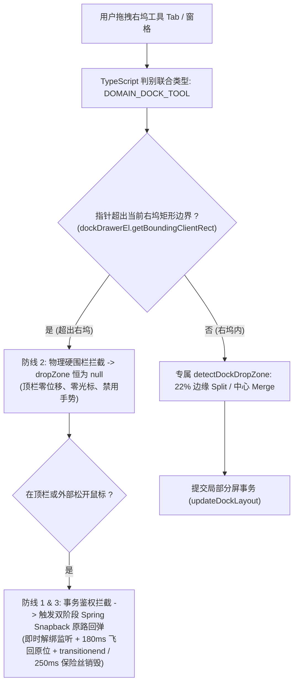
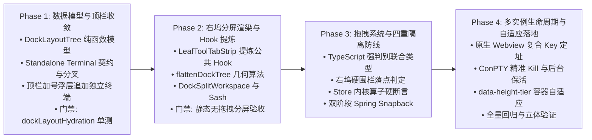

# 右侧功能区分屏系统建设总方案（Dock Split System Architecture）

> **方案权威标识**：`docs/dock-split-system/00-总方案.md`  
> **制定依据**：
> - 用户意志裁决（顶栏大窗口定位、独立常规终端、当前对话窗口内实现所有功能、右坞分屏、绝对禁止拖入顶栏 `_tabsContainer_1wzf4_71`）
> - 6 份专业分维深度分析报告（`docs/dock-split-system/analysis/01~06-*.md`）
> - 5 份交叉专项审计报告（`docs/dock-split-system/plan-reviews/审计A~E-*.md`，已全面整合修正）
> - 仓库通用协作纪律 `AGENTS.md`、反退避全文 `.agents/LOGIC_PLAN_NO_RETREAT.md`、反过度设计红线 `ANTI_OVERENGINEERING_GUARDRAILS.md`、UI 设计规范 §12-§14
> **核心原则**：纯逻辑规划、架构净收敛、杜绝补丁与过度设计、四重跨域硬隔离、零进程/内存泄漏。

---

## 目录

1. [方案定位与用户意志贯彻](#一方案定位与用户意志贯彻)
2. [现状病理与六大架构断层深度剖析](#二现状病理与六大架构断层深度剖析)
3. [四大核心子系统架构设计](#三四大核心子系统架构设计)
   - 3.1 树形分屏数据模型契约（DockLayoutTree）
   - 3.2 右坞分屏渲染容器与高帧率拖动引擎（DockSplitWorkspace & DockResizeSash）
   - 3.3 顶栏大窗口收敛与独立常规终端（Standalone Terminal）
   - 3.4 专属拖拽体系与四重跨域隔离防线（DockToolDragContext）
   - 3.5 复合实例定址与运行时生命周期自愈（Composite Key & PTY Lifecycle）
   - 3.6 紧凑空间自适应容器查询与交互流（Micro TabStrip & @container）
4. [单向 DAG 实施阶段规划 (Phase 1 ~ Phase 4)](#四单向-dag-实施阶段规划)
5. [立体化真值验收断言与实施阶段门禁矩阵 (Phase Gate Matrix)](#五立体化真值验收断言与实施阶段门禁矩阵)

---

## 一、方案定位与用户意志贯彻

### 1.1 用户核心意志与产品心智

用户在需求沟通与补充澄清中给出了三条刚性定论：
1. **顶栏大窗口定位（`class="_tabsContainer_1wzf4_71"` / `PaneHeader.tsx`）**：
   - 顶栏是**大窗口级别**的容器，主体按**对话（Session）**划分；
   - 顶栏允许存在工具标签，但必须是**不绑定任何会话/项目工作区的全局常规终端（Standalone Terminal）**，供用户随时执行独立全局系统指令；
2. **对话窗口内闭环（当前窗口实现所有功能）**：
   - 用户不需要跳出当前会话，更不需要在顶层将整个会话大窗口切成多半；
   - 在当前对话窗口内：左侧是对话流与输入框，右侧功能区（Right Tool Dock）必须具备**全功能分屏系统**，支持上下/左右自由切分，同时并排显示浏览器预览、终端、文件树、Diff 等；
3. **跨域防线绝对红线**：
   - 对话内部在右侧功能区打开的窗口/面板，**绝对不能拖拽到顶部的 `_tabsContainer_1wzf4_71` 里面**！

```
┌────────────────────────────────────────────────────────────────────────────────────────┐
│ 顶栏大窗口标签栏 (_tabsContainer_1wzf4_71) : [ 对话 A ]  [ 对话 B ]  [ 全局终端 ]  [ + ]   │
├────────────────────────────────────────────────────────────────────────────────────────┤
│ 当前对话大窗口 (Session Window)                                                        │
│ ┌───────────────────────────┬────────────────────────────────────────────────────────┐ │
│ │ 主对话交互区              │ 右侧功能区 (Right Tool Dock - 内置分屏系统)            │ │
│ │                           │ ┌──────────────────────────┬─────────────────────────┐ │ │
│ │ • 消息流                  │ │ 分屏 1: 浏览器/网页预览   │ 分屏 2: 文件树/代码 Diff │ │ │
│ │ • 思考过程                │ ├──────────────────────────┴─────────────────────────┤ │ │
│ │ • 底部输入框 (Composer)   │ │ ═══ Sash 分割线 (可拖拽调节上下/左右比例) ════════ │ │ │
│ │                           │ ├────────────────────────────────────────────────────┤ │ │
│ │                           │ │ 分屏 3: 工作区绑定终端 (ConPTY)                     │ │ │
│ └───────────────────────────┴─┴────────────────────────────────────────────────────┴─┴─┘ │
└────────────────────────────────────────────────────────────────────────────────────────┘
```

---

## 二、现状病理与六大架构断层深度剖析

结合 6 位专职子 Agent 的源码白盒审计与 5 份交叉专项审计，当前代码存在以下断层：

1. **顶栏多态标签与内核工作区强行绑定**：
   - `createTerminalTabForStore`（`layoutTreeTerminalOps.ts:25-30`）无差别调用 `getWorkspacePath()` 强行把当前项目工作区根目录硬编码注入 `cwd`，且标题硬编码为 `Terminal: <项目名>`；
   - `ptyCreateArgs.ts:11-30` 抹杀外部传入的 `cwd`，造成无法打开纯粹用户家目录的系统级常规终端。
2. **右坞状态模型扁平，从源头阻断分屏**：
   - `RightToolDockState`（`sessionTabModel.ts:24-31`）仅包含 `openPanelIds: string[]` 和单一 `activePanelId: string | null`；
   - `TreeLeafPanel.tsx:462-484` 对工具面板强行采用 `display: isPanelActive ? 'flex' : 'none'` 卡片堆叠，本质为单视口切换器，完全缺失二叉树或网格拓扑。
3. **拖拽系统单例全局穿透，无跨域防护**：
   - 现存 `SessionTabDragContext` 是面向外层会话树的单例，落点判定直接在全屏幕 `document.elementFromPoint` 探测，若右坞加入拖拽极易发生向顶栏 `_tabsContainer_1wzf4_71` 逃逸；
   - 顶栏没有对非会话源建立类型过滤网关与物理隔离守卫。
4. **React Reconciliation 与 SlotOutlet 静态 Key 碰撞**：
   - `SlotOutlet` 内部直接使用定义 ID（如 `key="terminal"`）作为调和 Key；分屏同时打开两个同类工具（如 2 个终端）时直接触发 React 调和冲突与状态串味。
5. **ConPTY 终端命名空间坍塌与误杀（Collateral Kill）**：
   - `TerminalCard` 的 `sessionKey` 对 `terminal` 退化为 `sessionForPanel`，多个分屏终端争夺同一个底层 ConPTY 句柄，关闭其中一个窗格会导致同会话其他终端被连带误杀。
6. **右坞有限空间缺乏容器查询自适应与分屏动作集群**：
   - 右坞在 320px~450px 窄宽时，如果左右分屏会导致内容严重挤压，现存代码缺乏容器查询 `@container` 与自适应退化机制，亦缺少一键向右/向下分屏的微型交互。

---

## 三、四大核心子系统架构设计

### 3.1 树形分屏数据模型契约（DockLayoutTree）

在 `apps/crish-desktop/src/store/layout-tree/dockLayoutModel.ts` 建立专属轻量化纯逻辑二叉树：

```typescript
export type DockLayoutNode = DockLayoutLeaf | DockLayoutBranch;

export interface DockLayoutLeaf {
  type: 'leaf';
  id: string;                   // 唯一窗格标识，如 "dock_leaf_a1b2"
  panelIds: string[];           // 该窗格内的工具标签，如 ['preview', 'diff']
  activePanelId: string | null; // 该窗格当前激活工具；窗格内无标签时必须为 null
}

export interface DockLayoutBranch {
  type: 'branch';
  id: string;                           // 分支节点 ID
  direction: 'horizontal' | 'vertical'; // horizontal: 左右分屏; vertical: 上下分屏
  splitRatio: number;                   // 分割比例 [0.2, 0.8]，默认 0.5
  children: [DockLayoutNode, DockLayoutNode];
}

export interface DockLayoutTree {
  root: DockLayoutNode;
  /** 当前处于焦点状态的右坞窗格 ID；若右坞无工具则为 null（防止与外层 LayoutTreeStoreState.activeLeafId 命名冲突） */
  activeDockLeafId: string | null;
  version: 1;
}
```

* **严格空态不变量（Empty State Invariants）**：
  数学不变量保证类型与视觉严丝合缝：
  $$\text{leaf.panelIds.length} === 0 \iff \text{leaf.activePanelId} === \text{null}$$
  严禁使用空字符串 `""` 充当非空值。当全树面板总数清零时，`syncDockStateWithTree` 强制注入 `collapsed: true` 与 `activePanelId: null`，杜绝悬空幽灵窗格。

* **比例范围与像素级安全兜底（Pixel Guard）**：
  - `splitRatio` 严格收紧至 `[0.2, 0.8]`（收回原草案脆弱的 `[0.1, 0.9]`，防止 300px 坞宽下分出 30px 不可用窗格）；
  - 补充物理像素兜底：拖拽反算比例时，任意窗格物理宽度必须 $\ge 120\text{px}$，高度必须 $\ge 80\text{px}$；低于阈值时 Sash 拖拽硬性拒绝位移。

* **写网关双向强一致（Write Gateway Invariant）**：
  - 代码库中所有写右坞状态的路径**必须统一经过 `updateTabDock` / `updateLeafDock`**（`layoutTreeTransform.ts` 作为单一写网关），严禁任何组件或快捷键直接绕过 `layout` 读写 `dock.openPanelIds` / `dock.activePanelId`：
    1. **树到投影**：若 `patch.layout` 存在，强制执行 `syncDockStateWithTree`，派生 `openPanelIds` 与 `activePanelId` 覆盖写入；
    2. **投影到树**：若存量入口仅修改 `openPanelIds` 或 `activePanelId`，写网关自动触发内联自愈，同步更新内部 `DockLayoutTree`，彻底消解存量 8 处调用引发的状态撕裂。

* **防御性升水与一致性指纹校验（Hydration Consistency Guard）**：
  `ensureDockLayoutTree(dock)` 负责将无 `layout` 的旧数据升水为单叶树。为防止“升级 $\to$ 降级旧版修改面板 $\to$ 再次升级”时陈旧的 `dock.layout` 僵尸数据静默抹杀用户的最新改动，升水时**必须校验树内面板集合与 `dock.openPanelIds` 是否一致**：
  - 提取树内全部叶片面板集合 `treePanels` 与 `dock.openPanelIds` 对比；
  - 仅当两者集合完全对齐时才直接复用 `dock.layout`；
  - 一旦发现脱节，强制以最新的 `dock.openPanelIds` 扁平数组重新升水重建树结构，确保数据向后兼容零隐患。

* **纯函数操作集**：
  提供 `splitDockLeaf`、`closeDockPanel`、`mergeDockBranch`、`resizeDockBranch`、`reorderDockTab`、`activateDockPanel`，空窗格自动向上修剪并平滑填充兄弟窗格。

---

### 3.2 右坞分屏渲染容器与高帧率拖动引擎（DockSplitWorkspace & DockResizeSash）

在 `TreeLeafPanel.tsx` 的 `leafDockDrawer` 内部，移除原本单一的卡片堆叠（`dockPanelPane`），挂载分屏工作区容器 `DockSplitWorkspace`：

1. **绝对坐标系 Canvas 渲染（`flattenDockTree`）**：
   - 纯函数展平计算，接收整树 `(tree: DockLayoutTree)`，递归输出规范化的 `leaves: FlatDockLeaf[]`（包含 `leafId`, `panelIds`, `activePanelId`, `rect`, `isActive`）与带几何线段的 `branches: FlatDockBranch[]`（包含 `sash: { x, y, length, direction }`）；
   - 各窗格以 `[0, 1] × [0, 1]` 标量比例绝对定位（`left/top/width/height %`），彻底规避 Flexbox 深度嵌套引起的级联排版开销与 `min-width` 溢出撑爆。
2. **两级 Resizer 层级关系与物理防死区缓冲（Hierarchy & Deadzone Buffer）**：
   - **外层 `LeafDockResizer`**：位于 `leafBody` 层级（`leafDockDrawer` 左外侧边缘），负责调整**整个右侧功能区抽屉的宽度**（相对主聊天视口）；
   - **内层 `DockResizeSash`**：位于 `DockSplitWorkspace` 内部，仅负责**右坞内部各子分屏窗格之间的比例切分**；
   - **层级解耦与热区防重叠**：两者职责、DOM 深度与状态机完全正交。最左侧垂直分屏 `DockResizeSash` 必须与外层 `LeafDockResizer` 保持 $\ge 16\text{px}$ 物理安全缓冲距离，严禁热区重叠导致用户调节内部分屏时误触外坞拉伸。
3. **存量交互资产保护与公共 Hook 提炼（Asset Preservation）**：
   - 严禁粗暴删除或另起炉灶重写 `LeafToolTabStrip.tsx`（454 行成熟生产资产、配套 575 行极限测试）。在 Phase 2 实施前，**必须先将核心能力提炼为公共 Hook 后再复用**：
     1. `useToolTabLifecycle.ts`：承载关闭动效保险丝状态机（`closingIdsRef` 记录 + CSS `@starting-style` 离场过渡 + `fuseTimersRef` 超时看门狗，根治 `transitionend` 丢失泄漏）；
     2. `useTabTrackScroll.ts`：承载 `ResizeObserverManager` 容器横向溢出测算与双态加号下沉（流式跟随 vs 贴右固定）；
     3. `useNonPassiveWheel`：横向滚轮非被动事件平滑转换；
     4. `useTablistKeyboard`：WAI-ARIA 标准标签栏键盘导航漫游。
   - 提炼后，原 `LeafToolTabStrip` 与分屏窗格微型条 `MicroPaneTabStrip` 共同复用上述底层 Hook，保证现有 575 行 `LeafToolTabStrip.scoped.test.tsx` 持续 100% 绿通，杜绝任何体验倒退。
4. **DockResizeSash 分割线高性能拖拽引擎**：
   - **DOM 直写与 RAF 节流**：拖拽调整尺寸期间，绝不触发 Zustand commit 与 React 顶层重渲染，直接通过 `requestAnimationFrame` 更新 DOM 窗格百分比位置；单窗格最大化（Solo Mode）时挂载保护守卫，禁止直写覆盖全屏样式；
   - **终极防粘手四重防线**：`setPointerCapture` 原生锁死 + 全局原生 Webview Hit-Test 禁用（见 §3.5）+ 全局 Cursor 锁 + `WindowBlurWatchdog` 异常中断快速自愈；
   - **ConPTY 防闪烁队列**：拖拽期间挂起 xterm 的高频 `fit()`，松手后在 50ms 窗口内统一排空。

---

### 3.3 顶栏大窗口收敛与独立常规终端（Standalone Terminal）

1. **类型解耦与纯净工作目录**：
   - 在 `SessionTab` 中确立 `StandaloneTerminalTab` 契约：
     ```typescript
     export interface StandaloneTerminalTab extends BaseTab {
       kind: 'terminal';
       isStandalone: true;       // 标明为全局常规终端
       terminalKey: string;     // 形如 "standalone:term_<tabId>"
       cwd: string;             // 明确取用户 Home 目录，如 C:\Users\orange
       dock?: undefined;        // 绝对不挂载右坞功能区！
     }
     ```
   - 修复 `layoutTreeTerminalOps.ts` 与 `ptyCreateArgs.ts`：当处于 Standalone 模式时，严禁使用项目根 `workspace_root` 覆盖，直通系统家目录。
2. **顶栏大窗口渲染路径分叉与抽屉彻底切断**：
   - `TreeLeafPanel.tsx` 识别 `activeTab.isStandalone === true` 时，直接 100% 铺满视口渲染终端；
   - **抽屉按钮渲染守卫加固**：修改 `TreeLeafPanel.tsx:490` 右上角抽屉按钮渲染条件，由原本宽泛的 `isChatSurface && !isLeafDraft` 增加刚性前置守卫：`isChatSurface && !isLeafDraft && !activeTab?.isStandalone`；同时 `dockOpen` 强制为 `false`，彻底根除用户在独立终端右上角误唤醒右坞抽屉的隐患；
   - **会话上下文隔离（Context Sanitization）**：独立终端的 `activeTab.sessionId === undefined`，`TreeLeafPanel.tsx` 在构建 `mainCtx` 时，`resolveLeafSessionId` 必须返回 `null` 或专属 `standalone-{tabId}` 标识，**严禁回退（Fallback）至全局激活的聊天会话 ID（`globalActiveSessionId`）**，根绝终端与聊天会话串味。
3. **顶栏加号浮层（`NewTabLauncherPopover`）平滑演进时序**：
   - **严禁早产删除导致“功能真空”**：Phase 1 仅在顶栏加号浮层中**追加**【新建独立常规终端】（`⌃\``）选项，**严禁在 Phase 1 提前删除现有的工作区终端与浏览器入口**；
   - 必须等待 Phase 2 右坞分屏微型 TabStrip 的加号菜单完全落成后，才将工作区局部工具入口平滑移出顶栏，确保用户在任何重构阶段均有连续可用的工具开启途径。

---

### 3.4 专属拖拽体系与四重跨域隔离防线（DockToolDragContext）

针对用户指出的核心红线 **“对话内窗口绝对不能拖拽到 `class="_tabsContainer_1wzf4_71"`”**，建立物理级四重纵深防御：



1. **防线 1（TypeScript 判别联合类型强隔离）**：
   - 废除无物理隔离能力的纯概念“URL 协议”，采用 TypeScript 判别联合类型（Discriminated Union）建立不可伪造的 Brand Payload：
     - 顶栏拖拽：`__domain: 'DOMAIN_SESSION_TAB'`，载荷为 `SessionTabDragPayload`；
     - 右坞拖拽：`__domain: 'DOMAIN_DOCK_TOOL'`，载荷为 `DockToolDragPayload`；
   - 类型签名在编译期彻底阻断泛型隐式转换，两套拖拽系统互不兼容，从根本上防止代码复用时的越界穿透。
2. **防线 2（落点探测物理硬围栏，彻底废黜顶栏伪门锁）**：
   - **物理真相裁决**：W3C Pointer Events 规范规定，一旦拖拽源元素调用 `setPointerCapture`，后续所有指针事件强制分发给源捕获元素，底下的顶栏 DOM 节点**物理上永远不可能收到 `pointerenter` / `pointermove`**。因此彻底废除在 `tabsContainer` 上挂载无用伪门锁的设计；
   - **真实有效的硬围栏防线**：将跨域防御全部收敛到 `detectDockDropZone` 算法内部——以当前右坞宿主容器的 `dockDrawerEl.getBoundingClientRect()` 作为物理硬围栏。指针一旦超出右坞边界，算法**立即短路返回 `null`**，完全不调用全局 `document.elementFromPoint` 探测顶栏；顶栏绝不产生任何标签挤压动画、绝不渲染插入光标、指针呈现 `not-allowed` 禁用手势。
3. **防线 3（Store 内核算子刚性鉴权断言）**：
   - 断言不只停留在外层 `sessionTabDropCommit.ts`，必须**深度下沉至底层的 Store 核心算子**（`layoutTreeMoveRemove.ts` 的 `moveTab` 与 `layoutTreeInsert.ts` 的 `splitTab`）；
   - 入口前置植入 `assertIsSessionLevelTab(tab)`：断言标签必须是真会话标签或显式标记为 `isStandalone: true` 的全局独立终端；任何试图将右坞工具（`DOMAIN_DOCK_TOOL`）写入顶层大窗口二叉树的调用，无论来自拖拽、全局 `commitDrop` 还是快捷键，均在状态机落盘的最后一微秒被硬性拦截并报错。
4. **防线 4（双阶段受控 Spring Snapback 与异常自愈）**：
   - **源坐标精确快照**：在 `pointerdown` 抓取瞬间，必须采集并保存源 Tab 的 `getBoundingClientRect()` 绝对几何快照（而非单纯鼠标点击坐标）；
   - **双阶段延迟销毁状态机**：
     1. *即时解绑阶段（Immediate Unbind）*：松手（`pointerup`）判定无效落点时，立即解绑全局 `pointermove` / `pointerup`，释放 `PointerCapture`，恢复 `isDragging = false`，但**严禁立即执行 `ghostEl.remove()`**；
     2. *延迟归巢阶段（Deferred Snapback）*：驱动 Ghost DOM 应用 CSS 弹簧过渡（`cubic-bezier(0.175, 0.885, 0.32, 1.15)`，180ms）平滑飞回快照坐标；
     3. *确定性收尾*：监听 `transitionend` 事件触发实际 DOM 销毁；并挂载 **250ms 兜底保险丝定时器（Fuse Timer）**，防止动画事件丢失造成 DOM 孤儿节点堆积。
5. **触控与移动手势硬防线（`touch-action: none`）**：
   - 右坞 Tab 元素、TabStrip 容器及分屏 Sash 元素**必须显式声明 CSS `touch-action: none` 与 `user-select: none`**；
   - 彻底阻断触屏设备上浏览器默认平移滚动对指针手势的劫持，根除由于派发 `pointercancel` 导致的拖拽一碰即碎与状态突变崩溃。

---

### 3.5 复合实例定址与运行时生命周期自愈（Composite Key & PTY Lifecycle）

1. **四维正交定址坐标（Composite Key Architecture）**：
   - 确立统一命名空间规范：
     $$\text{CompositeKey} = \text{sessionId} + \text{":dock:"} + \text{dockLeafId} + \text{":"} + \text{panelId} + \text{":"} + \text{instanceId}$$
   - 例如：`session_123:dock:leaf_a:terminal:pty_1` 与 `session_123:dock:leaf_b:terminal:pty_2`；
   - **调和 Key 与物理定址 Key 彻底解耦**：
     - React Reconciliation Key 保持绑定逻辑身份（`tabId` 或 `instanceId`），确保窗格拖拽重排或拓扑合并时 React 节点得以复用，杜绝终端 WebGL 选区丢失与浏览器刷新闪烁；
     - Composite Key 作为属性透传（`ViewRenderContext.instanceKey`），专门用于底层的 ConPTY 句柄绑定与原生 Webview 命名空间寻址。
2. **分层分屏作用域上下文（`DockLeafScopeContext`）**：
   - 在 `LeafScopeContext`（会话级）内层，为每个分屏窗格包裹 `DockLeafScopeProvider`，提供专职 `useDockLeafScope()`：
     - 显式区分窗格内操作（`openTabInCurrentDockLeaf`）与跨窗格分屏（`splitAndOpenTool`）；
     - DOM 范围查询、按键监听与状态读写严格限制在当前窗格 DOM 边界内，彻底消解上下文遮蔽与调用歧义。
3. **原生子 Webview（Tauri 2 NativeBrowserSurface）真实技术底座**：
   - **架构事实澄清理正**：右坞浏览器预览组件底层是 **Tauri 2 原生子 Webview（`NativeBrowserSurface`，Windows WebView2 HWND 物理子窗口），绝非 `<iframe>`**；
   - **复合 TabId 根除视口互抢（Collision Fix）**：重构 `PreviewCard.tsx`，传递给 `NativeBrowserSurface` 的 `tabId` 必须基于复合 Key 生成（含 `dockLeafId` + `instanceId`，例如 `${sessionId}:${dockLeafId}:browser`），严禁退化为 `${effectiveLeafId}-browser`，杜绝同会话多分屏浏览器争夺同一个 OS 原生视口的致命灾难；
   - **空域穿透与 Sash 拖动看门狗**：原生子 Webview 物理上凌驾于所有 DOM 之上。在 `DockResizeSash` 拖拽调整分屏期间，必须调用 Tauri 命令 `browser_webview_set_hit_test(false)` 广播禁用右坞内所有子 Webview 的 Hit-Test，松手后恢复，根除鼠标偏离进入 Webview 导致的主窗口拖动粘手死锁。
4. **确定性资源收割与 PTY 析构精准化（Precision Kill）**：
   - **彻底重构 `killDockTerminalPty`**：废弃现行仅凭 `panelId + sessionForPanel` 的单例析构逻辑（该逻辑在多分屏下会 100% 连带误杀同会话的兄弟终端 ConPTY 进程）；重写为必须接收唯一复合实例 Key `(sessionId, dockLeafId, panelId, instanceId)`，实施外科手术式精准关闭；
   - **拒绝过度设计，回归标准 React 生命周期**：
     - **坚决废除“MRU 保留 2 个 DOM 节点池”的主张**（该主张严重违背 `ANTI_OVERENGINEERING_GUARDRAILS.md`，离屏挂载原生 Webview 会导致显存暴增 1~2GB 并引发事件泄漏）；
     - **轻量秒级重水化标准路径**：会话切换（Session A $\to$ Session B）时，非激活会话的 React DOM 树自然卸载；Rust 端 ConPTY 进程与 RingBuffer 增量输出 100% 后台保活；切回时 React DOM 重新挂载，`TerminalCard` 秒级重水化恢复缓冲区，轻盈流畅零负担；
   - **会话关闭与孤儿清理**：会话彻底销毁时，级联关闭名下全部 PTY 进程与文件监听器，Windows Job Object 兜底杀绝孤儿进程。

---

### 3.6 紧凑空间自适应容器查询与交互流（Micro TabStrip & @container）

1. **两级头部交互解耦**：
   - **单工具时**：平滑退化为现有 `LeafToolTabStrip` 经典样式；
   - **多分屏时**：右坞顶层收敛为 28px 超紧凑全局控制条；每个分屏窗格拥有自己独立的 28px `MicroPaneTabStrip`，右上角常驻动作集群：
     - `向右分屏`（`Ctrl+Shift+\`，受宽度守卫门控）
     - `向下分屏`（`Ctrl+Shift+-`）
     - `临时单窗格最大化 / 还原`（`Alt+M`，保留后台分屏树拓扑）
     - `关闭窗格`（`Alt+W`）
2. **严守 W3C 容器查询规范与数据属性分级（Data-Tier Bridging）**：
   - **彻底根治规范硬伤**：W3C CSS Containment Level 3 规范明确规定，`container-type: inline-size` 仅建立内联轴（宽度）查询，在其中书写的 `max-height` / `min-height` 查询恒为 `false`。因此：
     - **高度自适应**：严禁在 `inline-size` 下书写高度查询；改由 `DockPaneHost` 依据窗格物理高度挂载 `data-height-tier="compact" | "normal"` 数据属性，通过标准 CSS 选择器 `[data-height-tier="compact"]` 控制终端状态栏等的显隐；若使用容器查询则容器类型必须明确为 `container-type: size`；
     - **宽度自适应**：保持 `container-type: inline-size`（`container-name: dock-pane`），同时配合 `data-width-tier`，既支持标准 `@container` 响应，又打通了 jsdom 单元测试断言与低版本回退通道：
       - **Terminal**：宽度 `< 340px` 时微缩字符网格至 11px 并触发 ConPTY 重排，高度 compact 隐藏状态栏；
       - **FilesCard**：宽度 `< 440px` 时隐藏 SplitResizer，双栏自动退化为单栏切页；`< 280px` 激进折叠面包屑；
       - **DiffCard**：宽度 `< 420px` 时强制切换为 Unified 单列内联比对模式；
       - **Preview**：宽度 `< 500px` 时自动进入移动端模拟视口，简化地址栏。
3. **全键盘流转与视觉柔和焦点（严守 `AGENTS.md` §13）**：
   - `Alt + 方向键` 空间感知无障碍穿梭；
   - 激活窗格边框严禁粗黑边，使用 `color-mix(in srgb, var(--border-subtle) 95%, var(--text-primary) 5%)` 极其柔和的 5% 微混对比度。

---

## 四、单向 DAG 实施阶段规划

根据任务依赖关系与审计改进要求，划分为 4 个严格无环的实施阶段，各阶段设立刚性准出门禁（Phase Gate）：



* **Phase 1（核心契约、升水管道与顶栏收敛）**：
  - 新建 `dockLayoutModel.ts` 纯函数二叉树模型，确立 `activePanelId: string | null` 与 `activeDockLeafId: string | null`；
  - 改造 `layoutTreeTransform.ts`，落地 `updateTabDock` / `updateLeafDock` 统一写网关，实现内层二叉树与外层扁平状态的双向互锁；
  - 改造 `layoutTreeTerminalOps.ts` 与 `ptyCreateArgs.ts`，落地纯净家目录 Standalone Terminal；并在 `TreeLeafPanel.tsx` 建立渲染分叉（隐藏抽屉按钮、`sessionId` 隔离）；
  - 重构 `NewTabLauncherPopover.tsx`：**仅增加【新建独立常规终端】按钮，绝对不提前删除现有的工作区终端与浏览器入口**；
  - **Phase 1 强阻断门禁**：编写并全绿通过 `dockLayoutModel.test.ts` 与 `dockLayoutHydration.test.ts`（覆盖升水指纹校验，防止降级再升级抹杀面板改动），存量迁移测试零破坏。
* **Phase 2（渲染容器、Hook 提炼与平滑切分）**：
  - **提炼存量资产公共 Hook（强制前置）**：在触碰任何 Tab 动画、溢出、键盘逻辑之前，必须先从 `LeafToolTabStrip.tsx` 中提取 `useToolTabLifecycle.ts` 与 `useTabTrackScroll.ts`，确保 575 行 `LeafToolTabStrip.scoped.test.tsx` 持续 100% 绿通；
  - 落地 `flattenDockTree` 几何展平计算与 `flattenDockTree.test.ts`（穷举极限拓扑）；
  - 实现 `DockSplitWorkspace.tsx` 与 `DockResizeSash.tsx`（落实 $\ge 16\text{px}$ 缓冲与原生 Webview Hit-Test 看门狗）；
  - 接入 `TreeLeafPanel.tsx`，支持通过动作按钮及快捷键进行上下与左右切分；
  - **Phase 2 强阻断门禁**：通过“无拖拽静态切分验收门禁”（右上角按钮静态切分 1~4 窗格，几何计算与面积守恒正确，Sash 双向平滑拖动且单测 `dockResizeSash.test.tsx` 绿通，DOM 结构彻底冻结）。
* **Phase 3（专属拖拽与四重隔离防线）**：
  - 实现 `DockToolDragContext.tsx`，以 `DOMAIN_DOCK_TOOL` 强判别联合类型隔离数据载荷；
  - 落地基于右坞 `getBoundingClientRect()` 物理硬围栏的 `detectDockDropZone` 算法（超出右坞即判定为 `null`，不依赖任何顶栏 DOM 事件监听）；
  - 在底层 Store 核心算子 `moveTab` 与 `splitTab` 入口植入 `assertIsSessionLevelTab` 刚性鉴权断言，全面覆盖所有可能的提交链路；
  - 落地双阶段受控 Spring Snapback 弹簧动效（即时解绑 + 180ms CSS 过渡 + `transitionend` 销毁 + 250ms 保险丝兜底）；
  - 在右坞 Tab 元素与 Sash 上声明 `touch-action: none`；
  - **Phase 3 强阻断门禁**：`dockDragDomainIsolation.test.ts` 与 `standaloneTerminal.test.ts` 100% 绿通，拖入顶栏绝对拒收且原路平滑回弹。
* **Phase 4（原生运行时生命周期与容器查询自适应）**：
  - 改造 `PreviewCard.tsx`，为 `NativeBrowserSurface` 注入基于复合 Key 生成的 `tabId`，根除同会话双浏览器视口互抢；
  - 重构 `killDockTerminalPty`，改为接收唯一复合实例 Key，精准销毁目标 PTY；
  - 落实轻量秒级重水化生命周期（不引入复杂的 MRU DOM 缓存池，依赖 Rust RingBuffer 后台保活）；
  - 接入自适应方案：宽度采用 `@container (max-width: ...)`，高度采用 `data-height-tier` 数据属性驱动，严禁在 `inline-size` 内书写 `max-height`；
  - 验证全键盘流转（`Alt + 方向键` 空间穿梭）；
  - **Phase 4 强阻断门禁**：`multiTerminalLifecycle.test.ts`、`sessionSwitchSuspend.test.ts`、`dockReactReconciliation.test.tsx` 及 `FULL_CHECK_COMMANDS` 全量流水线绿通。

---

## 五、立体化真值验收断言与实施阶段门禁矩阵（Phase Gate Matrix）

严格遵循 `AGENTS.md` §7.1 立体验证纪律与反退避原则，绝不允许将测试推迟至最终交付，各 Phase 必须 100% 跑通对应阶段的机器真值断言：

| 实施阶段 | 阶段门禁测试文件 | 核心机器真值断言 | 准出阻断条件 |
| :--- | :--- | :--- | :--- |
| **Phase 1 门禁**<br/>数据模型与顶栏收敛 | `dockLayoutModel.test.ts`<br>`dockLayoutHydration.test.ts` | 1. 验证 `split`、`close`、`merge`、`reorder` 纯函数无状态残留；<br>2. 比例严格限制在 $[0.2, 0.8]$，物理尺寸低于 120px/80px 拒绝位移；<br>3. 验证空态不变量：`panelIds.length === 0 ↔ activePanelId === null`；<br>4. 验证老旧数据 100% 升水；<br>5. 验证升水指纹校验：若 `dock.layout` 面板集合与 `openPanelIds` 脱节，强制以扁平数组重新升水重建，杜绝降级后再升级的僵尸覆盖；<br>6. 存量 `sessionTabMigration.test.ts` 与 `sessionTabModel.test.ts` 全绿。 | 任何升水失败或存量单测红灯，绝对禁止进入 Phase 2。 |
| **Phase 2 门禁**<br/>分屏渲染与 Sash 引擎 | `flattenDockTree.test.ts`（新增）<br>`dockResizeSash.test.tsx` | 1. 穷举极限几何展平：单叶退化（`rect = [0,0,1,1]`, 0 个 Sash）、4 窗格交错切分、贴近 0.2/0.8 极限、单窗格最大化覆盖；断言面积守恒 $\sum \text{Area} = 1.0$；<br>2. 验证 Sash 拖拽 DOM 直写无 React 重渲染；滑过原生子 Webview 触发 Hit-Test 禁用看门狗，指针捕获不丢失、无跳变闪烁；<br>3. 验证最左侧 Sash 与外层 `LeafDockResizer` 保持 $\ge 16\text{px}$ 物理缓冲；<br>4. 存量 `LeafToolTabStrip.scoped.test.tsx` 提取 Hook 后全量保持绿通；<br>5. 完成无拖拽静态分屏现场验收（右上角按钮稳定切分 1~4 窗格）。 | 若静态分屏未达标或存量 TabStrip 倒退，绝对禁止进入 Phase 3。 |
| **Phase 3 门禁**<br/>拖拽系统与四重隔离 | `dockDragDomainIsolation.test.ts`<br>`standaloneTerminal.test.ts` | 1. 模拟将右坞内工具（`DOMAIN_DOCK_TOOL`）拖拽移向顶栏 `class="_tabsContainer_1wzf4_71"`：断言 `detectDockDropZone` 在指针超出右坞硬围栏时立即返回 `null`；顶栏零 DOM 偏移、零插入光标；<br>2. 模拟在顶栏松开鼠标：断言立即解绑监听，断言驱动 Ghost DOM 沿 CSS 弹簧曲线回弹至快照坐标，`transitionend`（或 250ms 保险丝）后移除节点；顶栏标签数组长度不变；<br>3. 模拟绕过前端直接调用底层 Store `moveTab` / `splitTab` 塞入右坞工具：断言被 `assertIsSessionLevelTab` 刚性抛错拦截；<br>4. 验证顶栏独立常规终端初始 `cwd` 为用户家目录，全屏独占，抽屉按钮不渲染，且 `sessionId` 隔离不串味。 | 顶栏若存在任何视觉位移或误吸入，绝对禁止进入 Phase 4。 |
| **Phase 4 门禁**<br/>运行时生命周期与自适应 | `multiTerminalLifecycle.test.ts`<br>`sessionSwitchSuspend.test.ts`<br>`dockReactReconciliation.test.tsx`（新增）<br>`FULL_CHECK_COMMANDS` | 1. 右坞上下分屏同时启动 2 个终端：断言分配 2 个独立 PTY PID；关闭上方终端，断言基于复合实例 Key 精准 Kill，下方终端 PTY 存活且不受影响；<br>2. 同会话并排 2 个浏览器：断言传递复合 `tabId` 给 `NativeBrowserSurface`，分配 2 个独立原生视口，绝不互相抢夺；<br>3. 会话 A（终端在跑命令）$\to$ 会话 B $\to$ 切回会话 A：断言 DOM 自然卸载与秒级重水化，输出历史续接无丢失，无幽灵 DOM 泄漏；<br>4. 验证同类型视图分屏时，React Reconciliation Key 绑定 TabId 杜绝不必要的重挂载；<br>5. 验证高度自适应采用 `data-height-tier`（禁用 `inline-size` 内写 `max-height`）；<br>6. `npm run typecheck` + `cargo check` + 快层 Vitest 全绿，0 报错 0 警告。 | 全量流水线有任何报错或告警，严禁宣称战役完工。 |

---
战役总方案修订完成，作为后续各维度落地实施的权威单一真理标准！
