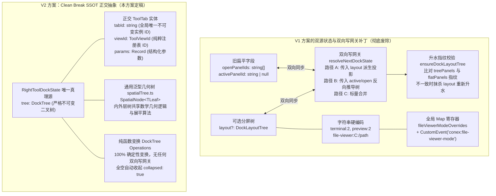
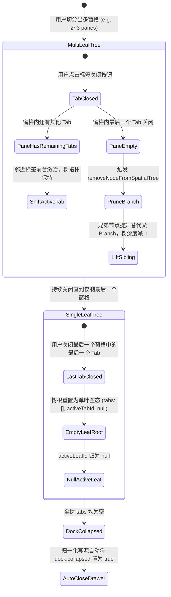

# 01-分屏引擎模型与数据契约下沉分析（V2 彻底去补丁、去兼容、正交抽象版）

> **战役代号**：`dock-split-system`  
> **文档定位**：第一轮现状调研与分维架构深度重构分析 — 状态树模型、数据契约下沉与纯逻辑算法规范（V2 定稿版）  
> **权威协作遵循**：仓库根目录 `AGENTS.md`、`.agents/LOGIC_PLAN_NO_RETREAT.md`、`ANTI_OVERENGINEERING_GUARDRAILS.md`、`docs/dock-split-system/00-战役纪律与导引.md`  
> **编写时间**：2026-10-27  

---

## 一、执行摘要与战役最高意志（彻底去补丁、去兼容宣言）

### 1.1 业务诉求与用户意志

在现代智能协作工作区中，用户对多任务并行、沉浸式开发与深度调试提出了极其明确的核心诉求：
1. **当前会话内部完整闭环**：用户希望在**当前的对话窗口内实现所有功能**，无需在顶层切分多个主会话大窗口，也无需在跳出当前上下文的环境下使用支撑工具。左侧保持为沉浸式对话流（思考过程、消息流与输入框），右侧功能区（Right Tool Dock，即 `leafDockDrawer`）内部必须具备**原生完备的分屏系统（Split Screen System）**。
2. **多工具并发协同**：右侧功能区内需要同时并排展示多个工具（例如“上浏览器预览 + 下终端调试”，或“左代码文件树 + 右 Diff 变更比对”，乃至三屏网格），支持自由的水平/垂直二叉切分、Sash 分割线无极拖拽调比、多 Tab 标签自由拖拽重组。
3. **顶栏绝对隔离红线**：顶栏（`PaneHeader.tsx` 的 `styles.tabsContainer`）是按**会话（Session）**划分的大窗口标签栏。会话内部右坞中打开的任何工具窗口，**绝对不能拖拽或泄露到顶栏中**；右坞分屏系统在逻辑、数据与物理渲染上必须完全收敛于当前会话内部。

### 1.2 根因批判：对上一版（V1）“双轨状态与双向写网关”打补丁方案的深刻剖析

在用户明确提出“**不允许打补丁，不允许硬编码，有合理的抽象，代码尽量简洁，杜绝衍生问题，尽量减少不必要的兼容，最好是不兼容**”的最高铁律后，我们对上一版（V1）方案进行了深度白盒审计，发现 V1 方案存在极其严重的**“打补丁与兼容包袱”**问题：



#### 批判点 1：双轨字段状态撕裂与伪 SSOT
V1 方案为了兼容旧版代码，在 `RightToolDockState` 中同时保留了 `openPanelIds: string[]`、`activePanelId: string | null` 和可选的 `layout?: DockLayoutTree`。这是典型的“双头状态源”，导致系统在运行时有两个地方记录工具列表与激活状态。即便设计了自动同步，只要两个地方可以独立被读取或写入，就必然出现“投影漂移”与状态撕裂。

#### 批判点 2：双向写网关（`resolveNextDockState` 路径 A/B/C）的复杂性与脆弱性
V1 方案发明了包含 3 条分支路径的双向写网关：路径 A 处理分屏树并派生扁平字段；路径 B 监听旧调用传入的扁平字段，反向在内层树中进行查找、移除、添加和激活；路径 C 处理标量。这种反向推导算法逻辑繁重、边界极其隐蔽，一旦某次调用传入了不一致的 `openPanelIds`，就会破坏用户的多分屏树拓扑。

#### 批判点 3：升水指纹比对（`ensureDockLayoutTree`）抹杀用户新改动隐患
V1 方案为了防止“僵尸快照”，在 `ensureDockLayoutTree` 中比对整树 `treePanels` 与 `dock.openPanelIds` 的哈希指纹，一旦两者不一致就强制**废弃整棵 `layout`** 并退化为单叶树。这意味着：如果未来某处遗留代码或插件无意触碰了 `openPanelIds`，用户精心编排的多窗格分屏布局将被瞬间抹杀！

#### 批判点 4：字符串拼接硬编码与全局微任务补丁
现有代码与 V1 方案均使用 `string[]` 存储面板，把“视图类型（`viewId`）”、“实例身份（`tabId`）”、“实例参数（`params`）”强行揉在一个字符串中（如 `'terminal'`, `'terminal:2'`, `'preview:2'`, `'file-viewer:C:/tmp/a.ts'`）。这导致：
- 新建终端/浏览器时必须在 `openTool.ts:213-219, 239-245` 写 `while` 循环递增拼数字；
- 文件预览器无法随路径携带 `initialMode: 'plain' | 'diff'`，被迫在 `openTool.ts:47-64` 引入全局模块级 `fileViewerModeOverrides` Map 寄存器，并在 L330-341 依靠 `queueMicrotask` 派发全局 `CustomEvent('conex:file-viewer-mode')` 临时补丁。

### 1.3 V2 架构重构纲领（Clean Break SSOT）

本 V2 方案坚决执行用户“不留兼容包袱、彻底系统性重构”的裁决：
1. **彻底废除双轨状态**：直接从 `RightToolDockState` 中**删除** `openPanelIds` 和 `activePanelId` 两个字段，仅保留 `tree: DockTree` 作为唯一真理源。
2. **根除双向写网关**：彻底砍掉 `resolveNextDockState`、`syncDockStateWithTree` 与 `ensureDockLayoutTree` 指纹比对。所有右坞操作 100% 直接以纯函数变换 `dock.tree`。
3. **正交 `ToolTab` 实体模型**：每个分屏叶片持有 `ToolTab[]`，彻底解耦 `tabId`（不可变实例 ID）、`viewId`（视图类型注册 ID）、`params`（结构化只读参数），消灭 `'terminal:2'` 拼字与全局 Map 补丁。
4. **抽象通用空间二叉树泛型原语（`spatialTree.ts`）**：将二叉几何分割、矩形递推、比例钳制、节点遍历抽象为泛型数学原语，让外层工作区 `LayoutTree` 与内层右坞 `DockTree` 共享底层核心算法，杜绝代码重复。
5. **极简存储反序列化**：对于 `localStorage` 历史数据，反序列化入口若发现无 `dock.tree` 则直接赋值为 `DEFAULT_RIGHT_DOCK`（单叶空态），零包袱、零兼容代码！

---

## 二、通用空间二叉树泛型原语设计（`spatialTree.ts`）

### 2.1 架构抽象目标与消除重复

外层工作区画布（`LayoutTree`）与右坞功能区（`DockTree`）在几何本质上是完全同构的二叉空间剖分系统（Binary Space Partitioning, BSP）：
- 它们均由分支节点（`branch`，拥有 `direction: 'horizontal' | 'vertical'`、严格两个子节点 `children: [node, node]` 和浮点分割比例 `splitRatio`）与叶子节点（`leaf`）构成；
- 它们的几何展平计算、Sash 分割线位置推导、节点替换/删除/兄弟提升逻辑在数学上完全一致；
- 差异仅在于**叶子内部承载的实体数据**：外层叶子承载会话标签（`SessionTab`），内层叶子承载工具标签（`ToolTab`）。

通过提炼通用的 `spatialTree.ts`，我们将二叉树的拓扑操作与几何算法集中下沉为单一来源（SSOT），彻底消除两套独立的二叉树算法实现。

### 2.2 泛型数据契约与几何数学定义

```typescript
/**
 * 通用空间二叉树泛型原语 — 契约定义
 * 建议路径：apps/crish-desktop/src/store/spatial-tree/types.ts
 */

/** 空间分割方向：horizontal = 左右并排（垂线分割）；vertical = 上下并排（水平线分割） */
export type SplitDirection = 'horizontal' | 'vertical';

/** 归一化矩形包围盒：坐标与尺寸均为 [0.0, 1.0] 的标量比例 */
export interface NormalizedRect {
  readonly x: number;
  readonly y: number;
  readonly width: number;
  readonly height: number;
}

/** 分割线（Sash）在归一化坐标系下的线段位置 */
export interface SashSegment {
  readonly x: number;
  readonly y: number;
  readonly length: number;
  readonly direction: SplitDirection;
}

/** 通用二叉分支节点 */
export interface SpatialBranch<TLeaf> {
  readonly type: 'branch';
  readonly id: string;
  readonly direction: SplitDirection;
  readonly children: readonly [SpatialNode<TLeaf>, SpatialNode<TLeaf>];
  readonly splitRatio: number; // 严格受限于 [MIN_SPLIT_RATIO, MAX_SPLIT_RATIO]
}

/** 通用空间节点：叶子节点必须具有 type: 'leaf' 和 id: string */
export type SpatialNode<TLeaf extends { readonly type: 'leaf'; readonly id: string }> =
  | TLeaf
  | SpatialBranch<TLeaf>;

/** 通用空间树根包装 */
export interface SpatialTree<TLeaf extends { readonly type: 'leaf'; readonly id: string }> {
  readonly root: SpatialNode<TLeaf>;
  readonly version: number;
}

/** 几何展平输出项 */
export interface FlattenedSpatialItem<TLeaf> {
  readonly leaf: TLeaf;
  readonly rect: NormalizedRect;
}

export interface FlattenedSpatialBranch<TLeaf> {
  readonly branch: SpatialBranch<TLeaf>;
  readonly rect: NormalizedRect;
  readonly sash: SashSegment;
}

export interface FlattenedSpatialTree<TLeaf> {
  readonly leaves: readonly FlattenedSpatialItem<TLeaf>[];
  readonly branches: readonly FlattenedSpatialBranch<TLeaf>[];
}
```

### 2.3 空间几何展平与无极调整通用算法（`flattenSpatialTree`）

定义视口参考平面为单位正方形 $\Omega = [0, 1] \times [0, 1] \subset \mathbb{R}^2$。  
任意节点 $N$ 对应的几何包围盒记为 $R(N) = (x, y, w, h)$。

- **根节点初始条件**：$R(\text{root}) = (0, 0, 1, 1)$。
- **水平分割递推关系（`direction === 'horizontal'`，垂线分割）**：
  设分支 $B$ 的包围盒为 $(x, y, w, h)$，分割比为 $\alpha = \text{splitRatio} \in [0.2, 0.8]$：
  $$R(\text{child}_0) = \left( x, \ y, \ w \cdot \alpha, \ h \right)$$
  $$R(\text{child}_1) = \left( x + w \cdot \alpha, \ y, \ w \cdot (1 - \alpha), \ h \right)$$
  分割线（Sash）位置：起点为 $(x + w \cdot \alpha, y)$，长度为 $h$，方向为垂直线段。
- **垂直分割递推关系（`direction === 'vertical'`，水平线分割）**：
  设分支 $B$ 的包围盒为 $(x, y, w, h)$，分割比为 $\alpha = \text{splitRatio} \in [0.2, 0.8]$：
  $$R(\text{child}_0) = \left( x, \ y, \ w, \ h \cdot \alpha \right)$$
  $$R(\text{child}_1) = \left( x, \ y + h \cdot \alpha, \ w, \ h \cdot (1 - \alpha) \right)$$
  分割线（Sash）位置：起点为 $(x, y + h \cdot \alpha)$，长度为 $w$，方向为水平线段。

```typescript
/**
 * 通用空间树展平算法（纯数学、零 DOM 依赖）
 * 建议路径：apps/crish-desktop/src/store/spatial-tree/flattenSpatialTree.ts
 */
export function flattenSpatialTree<TLeaf extends { readonly type: 'leaf'; readonly id: string }>(
  root: SpatialNode<TLeaf>,
  initialRect: NormalizedRect = { x: 0, y: 0, width: 1, height: 1 }
): FlattenedSpatialTree<TLeaf> {
  const leaves: FlattenedSpatialItem<TLeaf>[] = [];
  const branches: FlattenedSpatialBranch<TLeaf>[] = [];

  function traverse(node: SpatialNode<TLeaf>, rect: NormalizedRect): void {
    if (node.type === 'leaf') {
      leaves.push({ leaf: node, rect });
      return;
    }

    const { direction, splitRatio, children } = node;

    if (direction === 'horizontal') {
      const w0 = rect.width * splitRatio;
      const w1 = rect.width - w0;
      const sashX = rect.x + w0;

      branches.push({
        branch: node,
        rect,
        sash: {
          x: sashX,
          y: rect.y,
          length: rect.height,
          direction: 'horizontal',
        },
      });

      traverse(children[0], { x: rect.x, y: rect.y, width: w0, height: rect.height });
      traverse(children[1], { x: sashX, y: rect.y, width: w1, height: rect.height });
    } else {
      const h0 = rect.height * splitRatio;
      const h1 = rect.height - h0;
      const sashY = rect.y + h0;

      branches.push({
        branch: node,
        rect,
        sash: {
          x: rect.x,
          y: sashY,
          length: rect.width,
          direction: 'vertical',
        },
      });

      traverse(children[0], { x: rect.x, y: rect.y, width: rect.width, height: h0 });
      traverse(children[1], { x: rect.x, y: sashY, width: rect.width, height: h1 });
    }
  }

  traverse(root, initialRect);
  return { leaves, branches };
}
```

### 2.4 通用树拓扑遍历与纯函数操作原语

通用纯函数集中收口于 `spatialTreeOps.ts`：
- **`findNodeInSpatialTree<TLeaf>(root, id)`**：先序遍历快速查找节点。
- **`collectLeavesFromSpatialTree<TLeaf>(root)`**：收集整树所有叶子数组。
- **`replaceNodeInSpatialTree<TLeaf>(root, targetId, replacement)`**：不可变替换，返回新根。
- **`removeNodeFromSpatialTree<TLeaf>(root, targetId)`**：当叶子被删除时，自动将兄弟节点（sibling）提升至父分支位置，完成拓扑收缩。
- **`clampSplitRatio(ratio, min = 0.20, max = 0.80)`**：统一比例边界钳制。

---

## 三、右坞分屏引擎核心契约：`DockTree` 与 `ToolTab` 实体模型

### 3.1 字符串拼接历史根因与正交抽象推导

现有系统在设计之初将工具面板 ID 定义为简单的 `string`。随着功能膨胀，为了支持“同类工具多开”（终端、浏览器）与“传参”（文件查看器路径、模式），开发者不得不在字符串上不断打补丁：
- 多终端多开：拼出 `'terminal:2'`, `'terminal:3'`；
- 浏览器多开：拼出 `'preview:2'`；
- 文件查看器：拼出 `'file-viewer:C:/path/to/file.ts'`。

这种做法破坏了关系数据模型的**第一范式（1NF）**，把三个正交的维度混淆在一起：
1. **视图类型（View ID）**：在注册表中声明的组件渲染器身份（如 `'terminal'`）；
2. **实例身份（Tab ID）**：在分屏窗格中的唯一标签句柄，伴随该标签的整个生命周期；
3. **实例参数（Params）**：实例运行所需的结构化不可变属性（如 `{ filePath, initialMode }` 或 `{ url }`）。

V2 架构通过引入正交的 `ToolTab` 实体，彻底根除字符串拼接与解析逻辑。

### 3.2 `ToolTab` 结构化实体模型

```typescript
/**
 * 右坞功能区视图注册表合法 ID
 */
export type ToolViewId =
  | 'terminal'
  | 'preview'
  | 'files'
  | 'diff'
  | 'overview'
  | 'file-viewer'
  | 'agent'
  | 'runtime'
  | 'flow-dag';

/**
 * 正交工具标签实体 — ToolTab
 * 建议路径：apps/crish-desktop/src/store/dock-tree/types.ts
 */
export interface ToolTab {
  /**
   * 全局唯一且不可变的实例 ID。
   * 格式规范：`dtab_${viewId}_${timestamp}_${random}`，伴随标签生命周期始终。
   * 严禁拼入任何参数或状态！
   */
  readonly tabId: string;

  /**
   * 纯粹的视图类型注册 ID，对应具体的工具渲染器
   */
  readonly viewId: ToolViewId;

  /**
   * 可选的自定义标签标题覆盖（如未提供，则由视图注册表根据 params 动态派生）
   */
  readonly title?: string;

  /**
   * 强类型的结构化实例只读参数。
   * 例如：
   * - file-viewer: { filePath: string; initialMode?: 'plain' | 'diff' }
   * - terminal: { cwd?: string; terminalKey?: string }
   * - preview: { url?: string }
   */
  readonly params?: Readonly<Record<string, unknown>>;
}
```

### 3.3 `DockLeaf` 窗格契约与数学不变量

每个右坞叶子节点（`DockLeaf`）代表一个物理窗格（Pane）。一个窗格可以包含多个 `ToolTab`（呈现为窗格顶部的标签栏），并且在任一时刻至多激活一个标签：

```typescript
/**
 * 右坞独立窗格 — DockLeaf
 */
export interface DockLeaf {
  readonly type: 'leaf';
  /** 窗格全局唯一 ID，如 "dock-leaf-x8k2" */
  readonly id: string;
  /** 窗格内打开的工具标签列表（有序） */
  readonly tabs: readonly ToolTab[];
  /**
   * 当前处于前台激活的标签 ID。
   * 【严格充要条件不变量】：tabs.length === 0 ⇔ activeTabId === null
   * 当 tabs.length > 0 时，activeTabId 必须精准存在于 tabs.map(t => t.tabId) 中。
   */
  readonly activeTabId: string | null;
}
```

### 3.4 `DockTree` 与 `RightToolDockState` 最终契约定义

彻底删除 `openPanelIds` 和 `activePanelId`！`RightToolDockState` 只保留单一真理源：

```typescript
/**
 * 完整右坞分屏树
 */
export type DockBranch = SpatialBranch<DockLeaf>;
export type DockNode = SpatialNode<DockLeaf>;

export interface DockTree {
  readonly root: DockNode;
  /**
   * 当前获得用户操作焦点的窗格 ID。
   * 【不变量】：
   * - 若全树所有叶子的 tabs 均为空，则 activeLeafId 必须为 null；
   * - 否则 activeLeafId 必须指向包含该焦点的 DockLeaf。
   */
  readonly activeLeafId: string | null;
  /** 数据结构契约版本号 */
  readonly version: 1;
}

/**
 * 右坞状态真源 — Clean Break SSOT
 * 位于：apps/crish-desktop/src/store/layout-tree/sessionTabModel.ts
 */
export interface RightToolDockState {
  /** 抽屉是否收起 */
  readonly collapsed: boolean;
  /** 抽屉宽度占叶内容区比例 (0.2 ~ 0.8) */
  readonly widthRatio: number;
  /**
   * 【唯一真理来源 SSOT】右坞专有二叉分屏树。
   * 彻底废除 openPanelIds 与 activePanelId 字段！
   */
  readonly tree: DockTree;
}

/** 默认右坞状态工厂 */
export const DEFAULT_RIGHT_DOCK: RightToolDockState = {
  collapsed: true,
  widthRatio: 0.5,
  tree: {
    version: 1,
    activeLeafId: null,
    root: {
      type: 'leaf',
      id: 'dock-leaf-default',
      tabs: [],
      activeTabId: null,
    },
  },
};
```

### 3.5 单例视图 vs 多实例视图的优雅抽象与生命周期契约

在业务层调用 `openToolInDock` 时，引擎根据视图的注册元数据（`ViewDefinition`）执行正交调度：

| 视图类型分类 | 代表工具 | 判等与命中逻辑 | 再次打开时的调度行为 |
| :--- | :--- | :--- | :--- |
| **基础全局单例** | `files`, `diff`, `overview`, `agent`, `runtime`, `flow-dag` | 树中存在 `tab.viewId === targetViewId` | **直接聚焦**：激活该标签所在窗格，将该标签置为前台，不创建重复标签 |
| **路径参数化单例** | `file-viewer` | 树中存在 `tab.viewId === 'file-viewer'` 且 `normalize(tab.params.filePath) === normalize(targetPath)` | **聚焦并热更新参数**：直接激活该标签，若传入了新的 `initialMode`（如从 plain 切换为 diff），直接纯函数更新该标签的 `params`。**彻底消灭全局 Map 寄存器与微任务 CustomEvent！** |
| **多实例独立并发** | `terminal`, `preview` | 默认新建或用户显式请求新建（如 `openNewTerminal`） | **分配全新 `tabId`**：生成独立不可变的 `tabId`（如 `dtab_term_9k2a`），在活跃窗格中追加标签或切分新窗格。PTY 进程直接以 `tabId` 挂载，彻底告别 `'terminal:2'` 拼字！ |

---

## 四、`DockTree` 不可变纯函数操作集算法详解

分屏树的所有状态变更必须全部收口于下列无副作用的纯函数。输入合法的 `DockTree`，输出全新的不可变 `DockTree`。

### 4.1 核心纯函数签名一览

```typescript
/**
 * 纯逻辑操作集签名
 * 建议路径：apps/crish-desktop/src/store/dock-tree/operations.ts
 */

// 1. 打开/聚焦/分屏工具标签（高层业务门面）
export function openToolInDock(
  tree: DockTree,
  viewId: ToolViewId,
  options?: {
    params?: Record<string, unknown>;
    title?: string;
    targetLeafId?: string;
    splitDirection?: SplitDirection; // 若提供，则切分新窗格打开
    splitPosition?: 'before' | 'after';
    forceNewInstance?: boolean;      // 针对 terminal/preview，强制开新标签
  }
): { nextTree: DockTree; activeTabId: string };

// 2. 窗格定向切分
export function splitDockLeaf(
  tree: DockTree,
  targetLeafId: string,
  options: {
    direction: SplitDirection;
    position: 'before' | 'after';
    newTab: ToolTab;
    splitRatio?: number; // 默认 0.5
  }
): DockTree;

// 3. 关闭指定标签（带自动修剪与提升）
export function closeDockTab(
  tree: DockTree,
  leafId: string,
  tabId: string
): DockTree;

// 4. 激活指定标签
export function activateDockTab(
  tree: DockTree,
  leafId: string,
  tabId: string
): DockTree;

// 5. 设置当前焦点窗格
export function setActiveDockLeaf(
  tree: DockTree,
  leafId: string | null
): DockTree;

// 6. 标签搬移与重排（窗格内重排或跨窗格移动）
export function moveDockTab(
  tree: DockTree,
  sourceLeafId: string,
  tabId: string,
  targetLeafId: string,
  targetIndex?: number
): DockTree;

// 7. 调整分支比例（带物理像素与比例双重钳制）
export function resizeDockBranch(
  tree: DockTree,
  branchId: string,
  newRatio: number,
  containerPx?: { width: number; height: number }
): DockTree;

// 8. 热更新标签参数（如切换文件查看模式）
export function updateToolTabParams(
  tree: DockTree,
  tabId: string,
  paramsPatch: Record<string, unknown>
): DockTree;
```

### 4.2 核心操作算法设计

#### 算法 1：`openToolInDock`（单例命中、热更新与多分屏接入）
```typescript
export function openToolInDock(
  tree: DockTree,
  viewId: ToolViewId,
  options?: {
    params?: Record<string, unknown>;
    title?: string;
    targetLeafId?: string;
    splitDirection?: SplitDirection;
    splitPosition?: 'before' | 'after';
    forceNewInstance?: boolean;
  }
): { nextTree: DockTree; activeTabId: string } {
  const leaves = collectLeavesFromSpatialTree<DockLeaf>(tree.root);

  // 1. 单例性检测（Singleton Check）
  const isSingleton = isViewSingleton(viewId);
  if (!options?.forceNewInstance && isSingleton) {
    for (const leaf of leaves) {
      const hit = leaf.tabs.find((t) => {
        if (t.viewId !== viewId) return false;
        if (viewId === 'file-viewer') {
          // 路径参数化单例：严格按归一化路径比对
          const targetPath = options?.params?.filePath;
          return (
            typeof targetPath === 'string' &&
            normalizeViewerFilePath(t.params?.filePath as string) ===
              normalizeViewerFilePath(targetPath)
          );
        }
        return true;
      });

      if (hit) {
        // 命中已有单例：若带有新 params，就地热更新；并将该标签置为活跃
        let updatedTree = activateDockTab(tree, leaf.id, hit.tabId);
        if (options?.params) {
          updatedTree = updateToolTabParams(updatedTree, hit.tabId, options.params);
        }
        return { nextTree: updatedTree, activeTabId: hit.tabId };
      }
    }
  }

  // 2. 构造全新正交 ToolTab 实体
  const newTab: ToolTab = {
    tabId: generateToolTabId(viewId),
    viewId,
    title: options?.title,
    params: options?.params ? { ...options.params } : undefined,
  };

  // 3. 确定目标窗格
  const resolvedTargetLeafId =
    options?.targetLeafId ??
    tree.activeLeafId ??
    leaves[0]?.id ??
    'dock-leaf-default';

  // 4. 若请求了分屏切分（splitDirection）
  if (options?.splitDirection) {
    const nextTree = splitDockLeaf(tree, resolvedTargetLeafId, {
      direction: options.splitDirection,
      position: options.splitPosition ?? 'after',
      newTab,
    });
    return { nextTree, activeTabId: newTab.tabId };
  }

  // 5. 常规在目标窗格中追加标签
  const targetLeaf = leaves.find((l) => l.id === resolvedTargetLeafId);
  if (!targetLeaf) {
    // 树处于空根态：替换为单叶
    const newLeaf: DockLeaf = {
      type: 'leaf',
      id: resolvedTargetLeafId,
      tabs: [newTab],
      activeTabId: newTab.tabId,
    };
    return {
      nextTree: { ...tree, root: newLeaf, activeLeafId: newLeaf.id },
      activeTabId: newTab.tabId,
    };
  }

  const updatedLeaf: DockLeaf = {
    ...targetLeaf,
    tabs: [...targetLeaf.tabs, newTab],
    activeTabId: newTab.tabId,
  };

  const nextTree: DockTree = {
    ...tree,
    root: replaceNodeInSpatialTree(tree.root, targetLeaf.id, updatedLeaf),
    activeLeafId: updatedLeaf.id,
  };
  return { nextTree, activeTabId: newTab.tabId };
}
```

#### 算法 2：`closeDockTab`（自动修剪、兄弟提升与空树折叠）
```typescript
export function closeDockTab(
  tree: DockTree,
  leafId: string,
  tabId: string
): DockTree {
  const leaf = findNodeInSpatialTree<DockLeaf>(tree.root, leafId);
  if (!leaf || leaf.type !== 'leaf') return tree;

  const tabIndex = leaf.tabs.findIndex((t) => t.tabId === tabId);
  if (tabIndex < 0) return tree;

  const nextTabs = leaf.tabs.filter((t) => t.tabId !== tabId);

  // 场景 A：窗格内仍有其他标签
  if (nextTabs.length > 0) {
    let nextActiveTabId = leaf.activeTabId;
    if (leaf.activeTabId === tabId) {
      // 激活邻近标签（优先选前一个，否则选后一个）
      const fallbackIdx = Math.max(0, tabIndex - 1);
      nextActiveTabId = nextTabs[fallbackIdx]!.tabId;
    }
    const updatedLeaf: DockLeaf = {
      ...leaf,
      tabs: nextTabs,
      activeTabId: nextActiveTabId,
    };
    return {
      ...tree,
      root: replaceNodeInSpatialTree(tree.root, leaf.id, updatedLeaf),
    };
  }

  // 场景 B：窗格变为空窗格（tabs.length === 0）
  // 检查该窗格是否为整树唯一的根节点
  if (tree.root.id === leaf.id) {
    // 退化为单叶空态
    const emptyRoot: DockLeaf = {
      type: 'leaf',
      id: leaf.id,
      tabs: [],
      activeTabId: null,
    };
    return {
      ...tree,
      root: emptyRoot,
      activeLeafId: null,
    };
  }

  // 场景 C：多窗格分屏中某个叶子被关闭清空，执行拓扑修剪（提升兄弟节点）
  const prunedRoot = removeNodeFromSpatialTree<DockLeaf>(tree.root, leaf.id);
  if (!prunedRoot) {
    return {
      ...tree,
      root: {
        type: 'leaf',
        id: 'dock-leaf-fallback',
        tabs: [],
        activeTabId: null,
      },
      activeLeafId: null,
    };
  }

  // 重新定位活跃窗格焦点
  const remainingLeaves = collectLeavesFromSpatialTree<DockLeaf>(prunedRoot);
  const nextActiveLeafId =
    tree.activeLeafId === leaf.id
      ? remainingLeaves[0]?.id ?? null
      : tree.activeLeafId;

  return {
    ...tree,
    root: prunedRoot,
    activeLeafId: nextActiveLeafId,
  };
}
```

### 4.3 状态机收敛与空树自动折叠机理



**外层收口铁律（Auto-Collapse Invariant）**：  
在任何更新 `RightToolDockState` 的操作中，若经过纯函数变换后全树所有叶子的 `tabs` 数组长度之和为 0，则外层状态的 `collapsed` 字段**强制自动收拢为 `true`**。  
此规则消除了任何组件层手动判断 `openPanelIds.length === 0` 的零碎胶水代码，彻底保证 UI 视口绝对不会渲染无 Tab 的空抽屉。

---

## 五、应删旧代码与冗余字段精确清理清单（精准定位至文件:行号）

实施 V2 重构时，以下遗留兼容字段、废弃逻辑与打补丁代码必须**物理删除**：

### 5.1 领域模型与类型契约层清理

| 文件路径 | 待删除代码行号 | 待删除内容与删除理由 |
| :--- | :--- | :--- |
| `apps/crish-desktop/src/store/layout-tree/sessionTabModel.ts` | `L27-28` | **直接物理删除** `RightToolDockState` 中的 `openPanelIds: string[]` 和 `activePanelId: string \| null`。彻底斩断双源状态根源。 |
| `apps/crish-desktop/src/store/layout-tree/sessionTabModel.ts` | `L35-36` | **删除** `DEFAULT_RIGHT_DOCK` 中对 `openPanelIds` 与 `activePanelId` 的初始化，改为 `tree: DEFAULT_DOCK_TREE`。 |
| `apps/crish-desktop/src/store/workspace-shell/types.ts` | `L10-12` | **删除** `RightToolDockState` 镜像定义中的冗余扁平字段。统一收口至 `sessionTabModel.ts`。 |

### 5.2 布局树展平中的僵尸折叠域与死代码清理

由于外层 `LayoutTree` 自架构重构后树上**只有 chat 叶**（见 `types.ts:28`），所有的功能区工具均已下沉至右坞抽屉。然而 `layoutTreeFlatten.ts` 中仍残留大量历史“功能区在顶层二叉树”时的折叠压缩死代码：

| 文件路径 | 待删除代码行号 | 待删除内容与死代码分析 |
| :--- | :--- | :--- |
| `apps/crish-desktop/src/store/layout-tree/layoutTreeFlatten.ts` | `L22-23` | `type CollapsedDomain = 'chat' \| 'tool'`。外层树无 tool 叶，属于完全失效的类型定义，**直接删除**。 |
| `apps/crish-desktop/src/store/layout-tree/layoutTreeFlatten.ts` | `L26-33` | `function leafMatchesCollapsedDomain(leaf, collapsedDomain)`。由于 `leaf.panelId` 恒为 `'chat'`，`isTool` 恒为 `false`，代码毫无意义，**直接删除**。 |
| `apps/crish-desktop/src/store/layout-tree/layoutTreeFlatten.ts` | `L38-50` | `function isCollapsedSubtree(node, collapsedDomain)`。死代码递归，**直接删除**。 |
| `apps/crish-desktop/src/store/layout-tree/layoutTreeFlatten.ts` | `L98-100` | `leafMatchesCollapsedDomain ? ... : rect`。三元恒走 false 分支，**删除**条件判断，直接赋 `rect`。 |
| `apps/crish-desktop/src/store/layout-tree/layoutTreeFlatten.ts` | `L115-148` | `firstCollapsed` / `secondCollapsed` 四分支条件压缩分支。死逻辑分支，**全部物理删除**，直接简化为纯粹的按 `splitRatio` 几何划分。 |

### 5.3 废弃的顶层 Tool 叶判断逻辑清理

| 文件路径 | 待删除代码行号 | 待删除内容与死代码分析 |
| :--- | :--- | :--- |
| `apps/crish-desktop/src/store/layout-tree/panelIdentity.ts` | `L1-11` | 整文件仅 11 行（`isPrimaryPanelCheck`, `setPrimaryPanelChecker`, `isPrimaryPanel`）。顶层外层树早已无非 primary 叶，该模块已沦为历史残渣，**全文件彻底删除**。 |

### 5.4 工具打开层历史数字拼接与全局 Map 补丁清理

| 文件路径 | 待删除代码行号 | 待删除内容与架构毒点分析 |
| :--- | :--- | :--- |
| `apps/crish-desktop/src/store/workspace-shell/openTool.ts` | `L36-41` | `LeafDockView` 类型声明（包含 `openPanelIds` 与 `activePanelId`），**彻底删除**。 |
| `apps/crish-desktop/src/store/workspace-shell/openTool.ts` | `L47-64` | `fileViewerModeOverrides = new Map<string, FileViewerInitialMode>()` 全局寄存器及 set/consume 方法。**彻底物理删除**！参数直接封装入 `ToolTab.params`。 |
| `apps/crish-desktop/src/store/workspace-shell/openTool.ts` | `L204-228` | `openNewTerminalInLeaf`：其中的 `while (dock.openPanelIds.includes(terminal:nextIdx))` 字符串拼装循环，**彻底删除**。改为分配新 `ToolTab`。 |
| `apps/crish-desktop/src/store/workspace-shell/openTool.ts` | `L230-253` | `openNewBrowserInLeaf`：其中的 `while (dock.openPanelIds.includes(preview:nextIdx))` 字符串拼装循环，**彻底删除**。改为分配新 `ToolTab`。 |
| `apps/crish-desktop/src/store/workspace-shell/openTool.ts` | `L323-341` | `openFileViewerInSession` 中的 `setFileViewerModeOverride` 登记与 `queueMicrotask` 派发全局 `conex:file-viewer-mode` 事件的微任务补丁。**彻底物理删除**！ |

### 5.5 废除 V1 提出的双向写网关与升水指纹校验函数

上一版 V1 规划中的以下函数与逻辑，**绝对禁止引入代码库**：
- ❌ 禁止实现 `resolveNextDockState`（双向推导写网关）；
- ❌ 禁止实现 `ensureDockLayoutTree`（指纹比对升水）；
- ❌ 禁止实现 `syncDockStateWithTree`（向旧扁平字段反向同步）；
- ❌ 禁止实现任何形式的局部 `openPanelIds` 投影字段。

### 5.6 本地持久化（LocalStorage）旧数据迁移：Clean Break

对于本地存储的历史数据，绝不设计层层复杂的降级升水比对：
```typescript
/**
 * 历史数据反序列化防御入口（简洁优雅 Clean Break）
 * 位于 sessionTabMigration.ts 或 normalizeSessionTab
 */
export function normalizeDockState(raw: unknown): RightToolDockState {
  if (!raw || typeof raw !== 'object') {
    return DEFAULT_RIGHT_DOCK;
  }
  const dock = raw as Record<string, unknown>;
  // 若包含合法的 V2 分屏树，则校验通过
  if (dock.tree && typeof dock.tree === 'object' && (dock.tree as DockTree).version === 1) {
    return {
      collapsed: Boolean(dock.collapsed),
      widthRatio: typeof dock.widthRatio === 'number' ? clampDockWidthRatio(dock.widthRatio) : 0.5,
      tree: dock.tree as DockTree,
    };
  }
  // 否则一律视为旧版遗留数据，干净重置为默认单叶空态，不留任何兼容包袱！
  return DEFAULT_RIGHT_DOCK;
}
```

---

## 六、存量调用点系统性重构映射表

全面梳理重构后外部业务调用点对新契约的接入方式：

### 6.1 `openTool.ts` 彻底重构映射表

| 现有函数 / 违规调用 | V2 重构后实现契约 | 收益与变更点 |
| :--- | :--- | :--- |
| `openToolInLeaf(leafId, panelId)` | `openToolInLeaf(leafId, viewId, options?)`：内部调用 `openToolInDock(dock.tree, viewId, { targetLeafId })` 产生新树，经 `updateLeafDock(leafId, { collapsed: false, tree: nextTree })` 写入。 | 纯函数驱动；单例自动聚焦，多实例按需新建；消灭 `mapped` 别名字符串修剪 |
| `openNewTerminalInLeaf(leafId)` | `openToolInLeaf(leafId, 'terminal', { forceNewInstance: true })` | 分配全新不可变 `ToolTab`，PTY Registry 直接绑定 `tabId`，消灭 `terminal:2` 循环拼字 |
| `openNewBrowserInLeaf(leafId)` | `openToolInLeaf(leafId, 'preview', { forceNewInstance: true, params: { url } })` | 分配全新 `ToolTab`，消灭 `preview:2` 拼字 |
| `openFileViewerInSession(path, mode)` | `openToolInLeaf(activeId, 'file-viewer', { params: { filePath: trimmed, initialMode } })` | 单例路径命中自动前台激活，并通过 `updateToolTabParams` 实时更新 `initialMode`。**消灭全局 Map 与 CustomEvent！** |
| `collapseActiveTabRightDock(collapsed)` | 仅更新 `collapsed: boolean`；若展开且树处于全空态，调用 `openToolInDock(tree, 'overview')` 装填默认视图。 | 状态机自洽，不破坏内层树结构 |

### 6.2 `useTreePanelEvents.ts` 事件桥重构映射表

| 监听事件 | 现有处理逻辑 | V2 重构后处理逻辑 |
| :--- | :--- | :--- |
| `open-tool-panel` | `openToolRouted(detail.panelId)` | `openToolRouted(detail.viewId, { params: detail.params })` |
| `open-agent-panel` | `openToolRouted('agent')` | `openToolRouted('agent')` |
| `open-overview` / `open-tasks` | `openToolRouted('overview')` | `openToolRouted('overview')` |
| `crish-open-file` | `openToolRouted('files')` | `openToolRouted('files')` |
| `crish-open-terminal` | `openToolRouted('terminal')` | `openToolRouted('terminal')`（若需新建终端则传 `forceNewInstance: true`） |
| `toggle-right-panel` | 读取 `dock.openPanelIds` 与 `activePanelId` 手动拼装 patch | 仅对 `dock.collapsed` 取反；若展开时全树空标签，自动装填 `overview` 标签。 |

### 6.3 `TreeLeafPanel.tsx` 渲染容器多窗格化重构映射表

| 组件区域 | 现有代码 | V2 重构后架构与渲染契约 |
| :--- | :--- | :--- |
| `leafDockDrawer` 容器内部 | 渲染单一 `LeafToolTabStrip` 与一组 `dockPanelPane`（以 `display: none` 隐藏非活动面板） | 调用 `flattenSpatialTree(dock.tree.root)`，在抽屉内部进行百分比绝对定位：<br/>1. 遍历 `leaves`，为每个叶子窗格渲染独立的 `DockLeafPane`（内含该窗格专属的标签条与 Outlet）；<br/>2. 遍历 `branches`，渲染带拖拽监听的 `DockSash` 分割线。 |
| 抽屉展开判定守卫 | `dockOpen = !dock.collapsed && Boolean(dock.activePanelId)` | `dockOpen = !dock.collapsed && hasAnyActiveTabs(dock.tree.root)`。消灭对扁平 `activePanelId` 的依赖。 |
| 面板选择回调 | `handleSelectToolTab(id)` | `handleSelectToolTab(leafId, tabId)`：直接调用 `activateDockTab(dock.tree, leafId, tabId)`。 |
| 面板关闭回调 | `handleCloseToolTab(id)` | `handleCloseToolTab(leafId, tabId)`：调用 `closeDockTab(dock.tree, leafId, tabId)`，触发修剪与可能的自动折叠。 |

### 6.4 `LeafToolTabStrip.tsx` 窗格级标签条重构映射表

- **数据源重构**：不再接收 `openPanelIds: string[]` 与 `activePanelId: string`，改为接收窗格 ID `leafId: string`、标签列表 `tabs: readonly ToolTab[]` 与活动标签 `activeTabId: string | null`。
- **渲染与事件**：
  - 标签项遍历 `tabs.map(tab => ...)`，直接读取 `tab.title ?? getRegisteredViewTitle(tab.viewId, tab.params)`；
  - 点击标签：触发 `onSelectTab(leafId, tab.tabId)`；
  - 关闭标签：触发 `onCloseTab(leafId, tab.tabId)`；
  - 窗格专属工具栏：包含“向右分屏”、“向下分屏”、“最大化此窗格”等按钮，直接触发 `splitDockLeaf`。

### 6.5 `PaneHeader.tsx` 顶栏会话隔离与防跨域拖拽屏障

- **领域标签（Drag Domain Invariant）**：
  - 会话顶栏大窗口拖拽：数据载荷带 `domain: 'session-workspace'`；
  - 右坞工具标签拖拽：数据载荷带 `domain: 'dock-internal'`。
- **物理拦截**：
  在 `PaneHeader.tsx` 的 drop target 判定中，施加类型守卫：
  ```typescript
  canDrop: (item: DragPayload) => item.domain === 'session-workspace'
  ```
  若检测到 `item.domain === 'dock-internal'`，直接返回 `false`，严禁任何内部工具被拖入顶栏会话条！

---

## 七、纯逻辑单元测试与形式化断言规范

按照仓库测试资产保护铁律，重构必须具备 100% 可在 Node.js / Vitest 环境运行的纯逻辑单元测试套件：

### 7.1 通用空间二叉树单测矩阵（`spatialTree.test.ts`）

```typescript
describe('SpatialTree Generic Primitives', () => {
  it('单叶树展平：输出单个 item，rect 严格等于 (0, 0, 1, 1)', () => {
    const leaf = { type: 'leaf' as const, id: 'L1' };
    const { leaves, branches } = flattenSpatialTree(leaf);
    expect(leaves).toHaveLength(1);
    expect(leaves[0].rect).toEqual({ x: 0, y: 0, width: 1, height: 1 });
    expect(branches).toHaveLength(0);
  });

  it('水平二分展平：两叶宽度之和严格为 1，面积守恒误差小于 1e-6', () => {
    const root = createSpatialBranch('horizontal', 0.6, { type: 'leaf', id: 'L1' }, { type: 'leaf', id: 'L2' });
    const { leaves, branches } = flattenSpatialTree(root);
    expect(leaves[0].rect.width).toBeCloseTo(0.6);
    expect(leaves[1].rect.width).toBeCloseTo(0.4);
    expect(branches[0].sash.x).toBeCloseTo(0.6);
    expect(branches[0].sash.direction).toBe('horizontal');
  });

  it('节点删除与兄弟提升：删除 L1 时，L2 自动成为新根节点', () => {
    const root = createSpatialBranch('vertical', 0.5, { type: 'leaf', id: 'L1' }, { type: 'leaf', id: 'L2' });
    const nextRoot = removeNodeFromSpatialTree(root, 'L1');
    expect(nextRoot?.id).toBe('L2');
  });
});
```

### 7.2 右坞分屏纯函数操作单测矩阵（`dockTreeOperations.test.ts`）

```typescript
describe('DockTree Pure Functional Operations', () => {
  it('splitDockLeaf 水平切分：目标窗格被替换为 Branch，新叶承载指定 ToolTab', () => {
    const tree = createDefaultDockTree();
    const tab1: ToolTab = { tabId: 'tab-1', viewId: 'terminal' };
    const tab2: ToolTab = { tabId: 'tab-2', viewId: 'preview' };
    const treeWithTab1 = openToolInDock(tree, 'terminal').nextTree;
    const splitTree = splitDockLeaf(treeWithTab1, treeWithTab1.activeLeafId!, {
      direction: 'horizontal',
      position: 'after',
      newTab: tab2,
    });
    const leaves = collectLeavesFromSpatialTree<DockLeaf>(splitTree.root);
    expect(leaves).toHaveLength(2);
    expect(leaves[1].tabs[0].tabId).toBe('tab-2');
  });

  it('closeDockTab 关闭标签：窗格内还有剩余标签时，邻近标签自动激活', () => {
    // 验证 leaf.activeTabId 平滑切换，树拓扑不发生突变
  });

  it('closeDockTab 多窗格中关闭最后一个标签：该窗格自动被修剪，树收缩合并', () => {
    // 验证兄弟窗格提升，activeLeafId 安全重新定向
  });
});
```

### 7.3 单例/多实例与参数热更新单测矩阵（`dockToolLifecycle.test.ts`）

```typescript
describe('ToolTab Lifecycle & Parameter Management', () => {
  it('单例工具（files/diff/agent）重复打开时：绝不新增标签，直接置顶激活已有标签', () => {
    const tree = createDefaultDockTree();
    const { nextTree: t1, activeTabId: id1 } = openToolInDock(tree, 'files');
    const { nextTree: t2, activeTabId: id2 } = openToolInDock(t1, 'files');
    expect(id1).toBe(id2);
    const leaves = collectLeavesFromSpatialTree<DockLeaf>(t2.root);
    expect(leaves[0].tabs).toHaveLength(1);
  });

  it('file-viewer 同路径重复打开时：热更新 params.initialMode，无需全局 Map 与微任务', () => {
    const tree = createDefaultDockTree();
    const filePath = 'C:/src/App.tsx';
    const { nextTree: t1 } = openToolInDock(tree, 'file-viewer', { params: { filePath, initialMode: 'plain' } });
    const { nextTree: t2 } = openToolInDock(t1, 'file-viewer', { params: { filePath, initialMode: 'diff' } });
    const tab = findToolTabInTree(t2, 'file-viewer', filePath);
    expect(tab?.params?.initialMode).toBe('diff');
  });

  it('多实例工具（terminal/preview）：forceNewInstance 必须生成全局独立的新 tabId', () => {
    const tree = createDefaultDockTree();
    const { nextTree: t1, activeTabId: id1 } = openToolInDock(tree, 'terminal');
    const { nextTree: t2, activeTabId: id2 } = openToolInDock(t1, 'terminal', { forceNewInstance: true });
    expect(id1).not.toBe(id2);
    expect(id2).toMatch(/^dtab_terminal_/);
    const leaves = collectLeavesFromSpatialTree<DockLeaf>(t2.root);
    expect(leaves[0].tabs).toHaveLength(2);
  });
});
```

### 7.4 几何展平与数学守恒断言矩阵（`spatialFlatten.test.ts`）

```typescript
describe('Spatial Flatten Mathematical Invariants', () => {
  it('任意复杂嵌套切分：所有叶子面积之和恒等于 1.0 (误差 < 1e-6)', () => {
    // 构造 2x2 四窗格树，断言 sum(width * height) === 1.0
  });

  it('任意窗格之间严格不重叠（交集测度为 0）', () => {
    // 遍历两两叶子矩形，断言 hasOverlap(rectA, rectB) === false
  });

  it('Sash 分割线位置与边界：坐标严格等于切分点，垂直分割线水平跨度为 0', () => {
    // 验证线段起点与终点严格落在父容器边界内
  });
});
```

### 7.5 边界防御与自动收起单测矩阵（`dockAutoCollapse.test.ts`）

```typescript
describe('Dock Auto-Collapse & Empty Boundary', () => {
  it('关闭全树最后一个标签后：树退化为单叶空态，activeLeafId 为 null，dock.collapsed 变为 true', () => {
    let tree = createDefaultDockTree();
    const { nextTree: t1, activeTabId } = openToolInDock(tree, 'overview');
    const t2 = closeDockTab(t1, t1.activeLeafId!, activeTabId);
    expect(t2.activeLeafId).toBeNull();
    const leaves = collectLeavesFromSpatialTree<DockLeaf>(t2.root);
    expect(leaves).toHaveLength(1);
    expect(leaves[0].tabs).toHaveLength(0);
    expect(leaves[0].activeTabId).toBeNull();
  });
});
```

---

## 八、总结与后续落地指导

### 8.1 方案对比（现有实现 vs V1 补丁方案 vs V2 彻底根治方案）

| 比较维度 | 现有代码实现 | V1 补丁方案（已废除） | V2 彻底根治方案（本方案） |
| :--- | :--- | :--- | :--- |
| **状态真理源** | 仅扁平字段 `openPanelIds` 与 `activePanelId` | 双源状态：`layout?` + 扁平字段 | **绝对单一真理源（SSOT）**：仅 `tree: DockTree`，物理删除旧字段 |
| **状态同步开销** | 无 | 复杂的双向写网关（`resolveNextDockState` 路径 A/B/C）与升水比对 | **零同步开销**：100% 纯函数单向流转换，无网关、无升水指纹校验 |
| **标签标识模型** | 字符串硬编码：`terminal:2`, `preview:2`, `file-viewer:path` | 仍沿用 `panelIds: string[]` 字符串拼接 | **正交实体模型**：`ToolTab` 彻底分离 `tabId`, `viewId`, `params` |
| **多开与传参机制** | 循环拼数字；全局 Map 寄存器 + 微任务 CustomEvent | 继承现有循环拼数字与全局 Map | 独立分配唯一 `tabId`；直接在 `ToolTab.params` 中就地热更新 |
| **二叉树底层算法** | 仅外层树有一套实现，内含已过时的 tool 折叠死代码 | 右坞内部重新抄写一套二叉树算法 | **抽象通用空间泛型二叉树 `spatialTree.ts`**，内外层共享数学几何逻辑 |
| **历史数据迁移** | 无 | `ensureDockLayoutTree`，若不一致则强杀 `layout` 重新升水 | **Clean Break**：LocalStorage 无 `dock.tree` 则直接赋值默认单叶空态 |

### 8.2 下沉数据契约对后续任务的支撑

1. **对渲染层（Agent 2 容器改造）的支撑**：
   `flattenSpatialTree` 输出高精度的归一化绝对坐标（`rect`）与分割线（`sash`），渲染层仅需简单的 CSS 百分比定位与 CSS Flex 布局，彻底消除层层嵌套的 DOM 回流损耗。
2. **对拖拽交互层（Agent 4 专属协议）的支撑**：
   正交的 `ToolTab` 与 `leafId` 使得拖拽源载荷结构清晰确定（`{ domain: 'dock-internal', sourceLeafId, tabId }`）。落点计算可基于 `spatialTreeOps` 的四向边缘探测，实现精准的窗格内重排（reorder）与跨窗格切分（split）。
3. **架构净收敛**：
   通过彻底物理删除 8 处绕过网关的存量读写路径、清理 `layoutTreeFlatten.ts` 的折叠域死代码、废除 `panelIdentity.ts` 与 `openTool.ts` 的数字循环，本重构将为 Conex 工作区带来纯净、正交、高可维护性的分屏架构基础！
