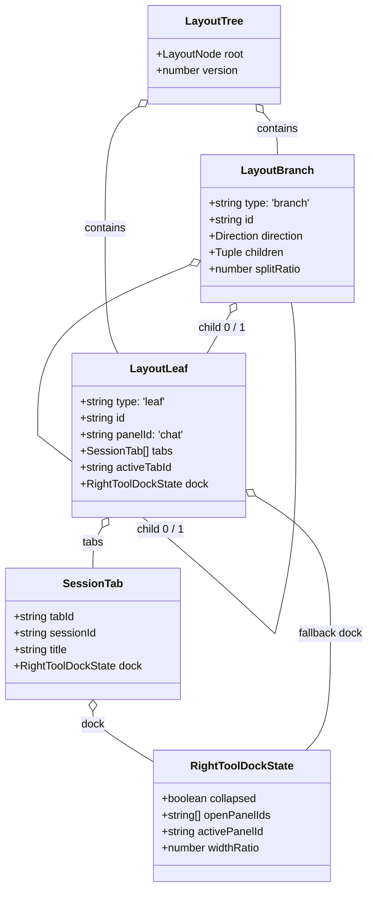
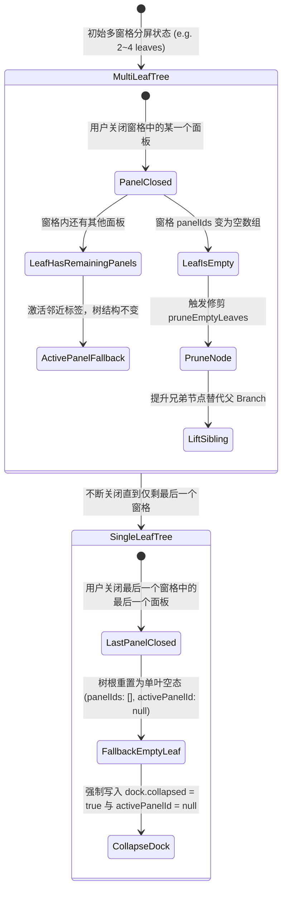
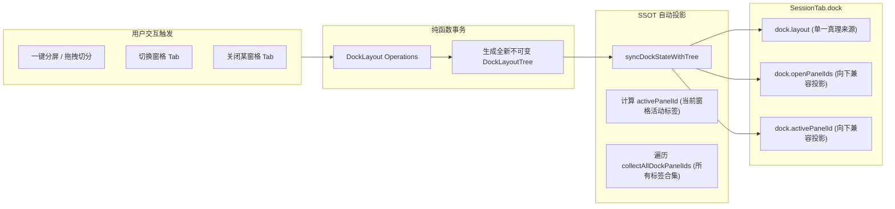

# 01-分屏引擎模型与数据契约下沉分析

> **战役代号**：`dock-split-system`  
> **文档定位**：第一轮现状调研与分维架构深度分析 — 状态树模型、数据契约下沉与纯逻辑算法规范  
> **权威协作遵循**：仓库根目录 `AGENTS.md`、`.agents/LOGIC_PLAN_NO_RETREAT.md`、`docs/dock-split-system/00-战役纪律与导引.md`、`docs/agent-roles/general_task/三原则.md`  
> **编写时间**：2026-10-27  

---

## 一、执行摘要与战役背景

### 1.1 业务诉求与用户意志

在现有的工作区架构中，分屏能力位于顶层工作区（Workspace Canvas）级别，每个大分屏叶片（`LayoutLeaf`）代表一片独立的对话窗格（Chat Pane）。随着用户多任务与深度调试诉求的升级，用户提出了明确的核心架构诉求：
1. **会话内部完整闭环**：用户希望在**当前的对话窗口内实现所有功能**，无需频繁在顶层切分会话，也无需在多个大窗口之间跳出。左侧保持为沉浸式对话流（思考过程、消息流与输入框），右侧功能区（Right Tool Dock，即 `leafDockDrawer`）内部必须具备**完整的分屏系统（Split Screen System）**。
2. **多工具并发协同**：右侧功能区内需要同时并排展示多个工具（如“上浏览器预览 + 下终端调试”，或“左代码文件树 + 右 Diff 变更比对”，乃至三屏网格），支持自由的水平/垂直二叉切分、Sash 分割线无极拖拽调比、多 Tab 标签自由拖拽重组。
3. **顶栏绝对隔离红线**：顶栏（`PaneHeader.tsx` 的 `styles.tabsContainer`，即类名 `_tabsContainer_1wzf4_71`）是按**会话（Session）**划分的大窗口标签栏。对话内部在右侧功能区打开的工具窗口，**绝对不能拖拽到顶栏中去**；右坞分屏系统在逻辑、数据与物理渲染上必须完全收敛于当前会话内部。

### 1.2 本分析报告的核心任务

本报告作为战役的第一份核心分析成果，聚焦于**分屏引擎模型与数据契约的下沉设计**：
- 剖析现有工作区二叉树模型（`LayoutTree` / `LayoutLeaf` / `LayoutBranch`）的架构机理与优缺点，确凿指出将其强行直接套用在右坞存在的过度设计与语义冲突。
- 提出专门面向右侧功能区的轻量化二叉分屏数据契约（`DockLayoutTree`），确立纯函数操作集（split, merge, remove, resize, reorderTab 等）。
- 设计该数据契约在现有 `SessionTab.dock: RightToolDockState` 中的嵌入方案与无损向后兼容策略。
- 给出支持水平与垂直双向二叉分割的纯逻辑几何展平算法与数学不变式规范，保证 100% 可在 Node.js / Vitest 环境中进行纯逻辑单元测试。

---

## 二、现存工作区二叉树模型深度解构与局限性分析

### 2.1 现有体系结构与关键源码索引

现存的二叉树布局系统位于 `apps/crish-desktop/src/store/layout-tree/`，其核心设计参考了 VS Code 的 `SerializableGrid` 范式，其源码骨架与职责划分如下：

| 文件路径 | 关键代码行号 | 核心职责与类型定义 |
| :--- | :--- | :--- |
| `src/store/layout-tree/types.ts` | `L24-40` | `LayoutLeaf`：叶子节点，强制 `panelId: 'chat'`，持有 `tabs: SessionTab[]` 与 `dock?: RightToolDockState` |
| `src/store/layout-tree/types.ts` | `L43-52` | `LayoutBranch`：严格二叉分支，包含 `direction: 'horizontal' \| 'vertical'`、`children: [LayoutNode, LayoutNode]`、`splitRatio: number` |
| `src/store/layout-tree/types.ts` | `L58-61` | `LayoutTree`：整树根节点包装，包含 `root: LayoutNode` 与 `version: number` |
| `src/store/layout-tree/types.ts` | `L115-122` | 分割比安全钳制：`MIN_SPLIT_RATIO = 0.12`，`MAX_SPLIT_RATIO = 0.88`，`clampSplitRatio(ratio)` |
| `src/store/layout-tree/sessionTabModel.ts` | `L24-39` | `RightToolDockState`：`collapsed: boolean`、`openPanelIds: string[]`、`activePanelId: string \| null`、`widthRatio: number` |
| `src/store/layout-tree/sessionTabModel.ts` | `L48-78` | 会话标签多态联合：`UnifiedTab = ChatTab \| TerminalTab \| BrowserTab` |
| `src/store/layout-tree/sessionTabModel.ts` | `L447-465` | `sessionIdTaken`：全树会话 ID 唯一性排他性校验 |
| `src/store/layout-tree/layoutTreeFlatten.ts` | `L63-150` | `flattenTree`：带 `CollapsedDomain`（'chat' \| 'tool'）压缩逻辑的几何展平遍历 |
| `src/store/layout-tree/layoutTreeInsert.ts` | `L57-73` | `splitLeaf`：叶子二分原语；`splitTab`：跨叶拆分标签 |
| `src/store/layout-tree/layoutTreeMoveRemove.ts` | `L22-78` | `moveLeaf` / `moveNode`：节点拓扑搬移；`removeNodeFromTree`：节点删除与兄弟提升 |
| `src/store/layout-tree/layoutTreeTransform.ts` | `L43-93` | `resizeBranch`、`updateTabDock`、`updateLeafDock`：纯函数局部更新 |
| `src/components/binary-tree/TreeLeafPanel.tsx` | `L424-488` | `TreeLeafPanel` 渲染：`leafDockDrawer` 内部目前为单标签条 `LeafToolTabStrip` 与单面板 Outlet |



### 2.2 现有模型的优点与可继承资产

现有二叉树核心经过多轮重构与严苛测试（Vitest 单元测试覆盖率达标），具备以下高度优秀的架构资产：
1. **严格的二叉树拓扑（Strict Binary Topology）**：
   每个分支节点有且仅有两个子节点（`children: [LayoutNode, LayoutNode]`），消除了多叉树在插入、删除与调整大小时子节点权重重归一化的复杂性。任何 $N$ 窗格的复杂切分均可形式化表达为深度至多为 $N$ 的二叉树。
2. **纯函数不可变状态流（Immutable Functional Transforms）**：
   所有节点替换操作（如 `replaceNode`、`removeBranch`）均为纯函数操作，返回全新的树引用，未引入就地可变副作用（in-place mutation），天然支持 React 渲染管道、时间旅行撤销重做（Undo/Redo）及快照持久化。
3. **比例化标量几何表示（Scalar Ratio Geometry）**：
   分割线位置使用浮点数标量比例（`splitRatio: number`，取值 `0.0 ~ 1.0`）而非物理像素尺寸。当父级容器由于窗口缩放、侧边栏折叠发生尺寸跳变时，内部窗格完全按比例自适应弹性形变，无需逐层监听 ResizeObserver 计算补偿。
4. **展平算法与渲染解耦（Flat Projection Decoupling）**：
   通过 `flattenTree` 将嵌套递归树展平为一维扁平列表（`leaves` 与 `branches`），利用绝对定位（`left%, top%, width%, height%`）进行 GPU 硬件加速合成，避免了 DOM 树层层嵌套带来的回流性能开销。

### 2.3 直接套用到右坞的过度设计与不适应点剖析

如果直接将上述顶层 `LayoutTree` / `LayoutLeaf` 搬移或复用到右坞内部，会引发严重的架构断层与过度设计（违反 `ANTI_OVERENGINEERING_GUARDRAILS.md`），具体表现为以下五大硬伤：

#### 1. 语义错位与类型爆炸（Leaf Semantic Mismatch & Recursive Nesting）
- 现有 `LayoutLeaf` 强制固定 `panelId: 'chat'`（`types.ts:28`），其内部持有的是 `tabs: SessionTab[]`。`SessionTab` 包含 `sessionId`、`workspaceKey` 以及嵌套的 `dock: RightToolDockState`（`sessionTabModel.ts:48-78`）。
- 若直接套用在右坞，右坞内的工具窗格（如终端、浏览器、文件树）将被迫包装为一个个伪造的 `LayoutLeaf`，进而被迫构造虚假的 `SessionTab`。
- 更荒谬的是，`SessionTab` 自身又包含 `dock: RightToolDockState`，直接导致数据结构产生无限递归套娃（`leaf.tabs[i].dock.layout.root.tabs[j].dock...`），破坏类型的单射性与清晰度。

#### 2. 会话身份与全局排他断言冲突（Session Identity & Uniqueness Assertion）
- 现有模型的核心业务铁律是“全树真会话排他”：`sessionIdTaken`（`sessionTabModel.ts:447-465`）与 `findDuplicateRealSessionIds` 严密监控全树，禁止同一个 `sessionId` 在多个叶子中重复出现。
- 然而在右侧功能区中，工具面板（如浏览器 `preview:url`、文件浏览器 `files`、终端 `terminal`）是在**当前会话**语境下并发运行的支撑组件。右坞分屏需要的是管理工具实例（Panel IDs），其作用域严格受限于当前会话，完全不存在也不应遵循顶层会话排他性校验。

#### 3. 草稿物化与生命周期耦合（Draft Promotion Over-engineering）
- 现有模型包含了大量关于会话草稿的复杂状态机逻辑：`PENDING_DRAFT_SESSION_ID`、`mintDraftSessionId`、`materializeDraftSession`、`promoteDraftTab`（`sessionTabModel.ts:16-20, 101-115`，`layoutTreeTransform.ts:96-100`）。
- 右侧功能区的工具面板生命周期完全不同：它涉及的是真实运行时实例的创建、复用与清理（如 PTY 进程调用 `killDockTerminalPty` 在 `TreeLeafPanel.tsx:231`、WebView iframe 保持或销毁、Diff 编辑器状态挂载）。草稿机制对右坞纯属无意义的包袱。

#### 4. 折叠域零尺寸压缩冗余（Collapsed Domain Redundancy）
- 现有 `layoutTreeFlatten.ts:22-62, 115-148` 实现了 `CollapsedDomain = 'chat' | 'tool'` 的动态计算：当功能区折叠时，将工具叶的宽度压缩为 0，分支重新分配给对话叶。
- 在新的右坞分屏架构中，整个右坞作为一个整体抽屉受 `RightToolDockState.collapsed` 控制。右坞展开时，内部的所有分屏窗格均为同质的工具窗格（Tool Panes），绝不需要在右坞内部再次进行 chat/tool 域分类折叠压缩。

#### 5. 拖拽边界击穿风险（Domain Leakage & Escape Vulnerability）
- 现有拖拽源模型 `TreeDragSource`（`types.ts:102-110`）缺少所属层级（Layer/Domain）的物理屏障标记。
- 如果简单复用一套树模型，拖拽处理函数将无法从类型与数据层刚性区分“顶栏会话拖拽”与“右坞工具拖拽”，稍有不慎就会导致右坞工具被错误拖入顶栏 `_tabsContainer_1wzf4_71`，直接击穿用户的最高铁律。

---

## 三、右坞轻量级分屏数据契约设计（DockLayoutTree）

为彻底解决上述问题，必须将分屏引擎的数学抽象提炼为专门面向工具坞的轻量化契约：**`DockLayoutTree`**。它保留二叉树与比例切分的数学精髓，但彻底剥离会话、草稿与工作区域。

### 3.1 核心数据结构定义

```ts
/**
 * 右侧功能区分屏数据契约 — DockLayoutTree
 * 路径建议：apps/crish-desktop/src/store/dock-layout/types.ts
 */

/** 分割方向：horizontal = 左右并排（垂线分割）；vertical = 上下并排（水平线分割） */
export type DockSplitDirection = 'horizontal' | 'vertical';

/** 拖拽落点方位：用于向已有窗格边缘插入新分割或放入窗格中心组成多标签 */
export type DockDropPosition = 'left' | 'right' | 'top' | 'bottom' | 'center';

/** 叶子节点：右坞内的一个独立工具窗格（内部可包含多个工具 Tab） */
export interface DockLayoutLeaf {
  type: 'leaf';
  /** 窗格全局唯一 ID，如 "dock-leaf-1w8z" */
  id: string;
  /**
   * 窗格内打开的工具面板 ID 列表（有序）
   * 例如：['terminal', 'preview:https://localhost:3000', 'files']
   */
  panelIds: string[];
  /**
   * 当前处于前台激活的面板 ID；若 panelIds 为空则必须为 null。
   * 【数学不变量】panelIds.length === 0 ↔ activePanelId === null
   */
  activePanelId: string | null;
}

/** 分支节点：严格二叉分割容器 */
export interface DockLayoutBranch {
  type: 'branch';
  /** 分支全局唯一 ID，如 "dock-branch-3k9a" */
  id: string;
  /** 分割方向 */
  direction: DockSplitDirection;
  /** 严格二叉子节点：children[0] 为左/上，children[1] 为右/下 */
  children: [DockLayoutNode, DockLayoutNode];
  /** 第一个子节点在当前分支中的占比 (0.2 ~ 0.8)，第二个子节点为 1 - splitRatio */
  splitRatio: number;
}

/** 布局节点联合类型 */
export type DockLayoutNode = DockLayoutLeaf | DockLayoutBranch;

/** 完整右坞分屏树 */
export interface DockLayoutTree {
  /** 树根节点 */
  root: DockLayoutNode;
  /**
   * 当前具有用户键盘/鼠标焦点的叶子窗格 ID；若右坞无工具/空树则为 null
   * 【防变量遮蔽】重命名为 activeDockLeafId，彻底消除与外层 LayoutTreeStoreState.activeLeafId 的同名冲突
   * 新增工具面板时，默认插入此活跃窗格
   */
  activeDockLeafId: string | null;
  /** 数据结构契约版本号 */
  version: 1;
}

/** 树展平叶子渲染元数据 */
export interface FlatDockLeaf {
  leafId: string;
  panelIds: string[];
  activePanelId: string | null;
  /** 归一化百分比矩形 (0.0 ~ 1.0)，相对于右坞内容区视口 */
  rect: { x: number; y: number; width: number; height: number };
  /** 是否为当前拥有焦点的窗格 (leafId === tree.activeDockLeafId) */
  isActive: boolean;
}

/** 树展平分割线渲染元数据 */
export interface FlatDockBranch {
  branchId: string;
  direction: DockSplitDirection;
  splitRatio: number;
  /** 分支节点覆盖的归一化百分比矩形 */
  rect: { x: number; y: number; width: number; height: number };
  /** 分割线（Sash）在百分比坐标系下的几何线段位置 */
  sash: {
    x: number;
    y: number;
    length: number;
    direction: DockSplitDirection;
  };
}

/** 展平输出载荷 */
export interface FlattenedDockLayout {
  leaves: FlatDockLeaf[];
  branches: FlatDockBranch[];
}
```

### 3.2 节点身份与命名空间隔离规范

为防范跨域污染，右坞分屏系统严格建立独立的命名空间与唯一标识规则：
1. **Node ID 规范**：
   - 叶子节点：`dock-leaf-${timestamp}-${randomSuffix}`（例如 `dock-leaf-m8z9-a1b2`）。
   - 分支节点：`dock-branch-${timestamp}-${randomSuffix}`。
   - 严禁借用顶层工作区 `node-` 或 `leaf-` 前缀，从前缀层面实现强类型可识别。
2. **Panel ID 规范**：
   - 基础单例工具：`overview`、`files`、`diff`、`agent`、`runtime`、`note` 等。
   - 实例多开工具：`terminal:${termKey}`、`preview:${url}`。
   - 统一由面板解析器（`parseDockPanelId(pid)`）萃取工具类型与实例参数。
3. **隔离防线**：
   - 顶栏拖拽事件（`TreeDragSource`）使用 `domain: 'workspace'`；
   - 右坞拖拽事件（`DockDragSource`）使用 `domain: 'dock'`，载荷为 `{ domain: 'dock', sourceLeafId: string, panelId: string }`；
   - 顶栏的 DropTarget 遇到 `domain === 'dock'` 时一律在最顶层直接拒绝（`canDrop = () => false`），形成物理级阻断防线。

### 3.3 状态机与不可变纯函数操作集（API 签名与行为契约）

分屏树的所有状态突变严格由下列纯函数驱动，任何函数均不得产生外部副作用，且必须保证：输入有效树 $\rightarrow$ 输出合法的树结构。

```ts
/**
 * 纯函数操作集签名与行为契约
 * 路径建议：apps/crish-desktop/src/store/dock-layout/operations.ts
 */

// 1. 分割现有叶子：在 targetLeafId 侧边切出新窗格，将指定 panelId 移入或新建入新叶子
export function splitDockLeaf(
  tree: DockLayoutTree,
  targetLeafId: string,
  options: {
    direction: DockSplitDirection;
    position: 'before' | 'after';
    panelId: string;
    splitRatio?: number; // 默认 0.5
  }
): DockLayoutTree;

// 2. 关闭面板：从指定叶子中移除 panelId；若叶子因此变空，自动修剪（Prune）该叶子并合并其父分支
export function closeDockPanel(
  tree: DockLayoutTree,
  leafId: string,
  panelId: string
): DockLayoutTree;

// 3. 合并分支：删除目标分支，将保留的子节点提升（提升到原分支位置）
export function mergeDockBranch(
  tree: DockLayoutTree,
  branchId: string,
  keepIndex: 0 | 1
): DockLayoutTree;

// 4. 调整分割线比例：调节指定 branch 的 splitRatio，带 [0.2, 0.8] 钳制及最小物理像素保护
export function resizeDockBranch(
  tree: DockLayoutTree,
  branchId: string,
  newRatio: number,
  containerPx?: { width: number; height: number }
): DockLayoutTree;

// 5. 窗格内标签重排：在同一个叶子窗格内调整 panelIds 顺序
export function reorderDockTab(
  tree: DockLayoutTree,
  leafId: string,
  fromIndex: number,
  toIndex: number
): DockLayoutTree;

// 6. 跨窗格移动面板：将面板从源叶子移动到目标叶子的指定位置；若源叶子变空则自动修剪
export function moveDockPanel(
  tree: DockLayoutTree,
  sourceLeafId: string,
  panelId: string,
  targetLeafId: string,
  targetIndex?: number
): DockLayoutTree;

// 7. 激活面板：设置指定叶子中的 activePanelId，并将其所在叶子设为 activeDockLeafId
export function activateDockPanel(
  tree: DockLayoutTree,
  leafId: string,
  panelId: string
): DockLayoutTree;

// 8. 设置焦点叶子：仅切换 activeDockLeafId（若为 null 表示无焦点）
export function setActiveDockLeaf(
  tree: DockLayoutTree,
  leafId: string | null
): DockLayoutTree;

// 9. 打开工具面板（高层门面）：若面板已在树中打开，则将其置顶激活；若未打开，则加入 activeDockLeafId
export function openDockPanel(
  tree: DockLayoutTree,
  panelId: string,
  preferredLeafId?: string
): DockLayoutTree;
```

#### 空叶修剪与根兜底状态转移机理

当用户逐个关闭工具面板时，分屏树的状态机遵循严格的对称双向收敛原则：


- **空叶退化态处理**：
  当用户关闭右坞中最后一个面板时，分屏树修剪为单叶空态 `{ type: 'leaf', id: 'dock-leaf-empty', panelIds: [], activePanelId: null }`，且 `activeDockLeafId: null`。此时 `syncDockStateWithTree` 必须强制写入 `collapsed: true`、`activePanelId: null` 以及 `openPanelIds: []`。
- **外层消费者必须遵守的契约**：
  在 `apps/crish-desktop/src/components/binary-tree/TreeLeafPanel.tsx`（约 114-118 行）中，`dockOpen` 的判定绝不能仅依靠 `Boolean(dock.activePanelId)`，必须增加 `dock.openPanelIds.length > 0` 守卫（例如 `dock.collapsed !== true && Boolean(dock.activePanelId) && (dock.layout ? hasAnyPanels(dock.layout.root) : dock.openPanelIds.length > 0)`）。
  若缺少该守卫，一旦 `activePanelId` 在异常边界或第三方补丁中残留非空字符串，界面将误判 `dockOpen === true`，并在右坞内渲染无 Tab 承载的悬空面板或 100% 灰色空白窗格，形成严重的视觉灾难。

### 3.4 写入规范与双向同步契约（写网关收口）

在复杂状态树与多组件消费场景下，最危险的隐患是“双轨写入”与“投影漂移”。为了从根本上消除状态撕裂，确立以下刚性写入规范：

#### 1. 单一写网关原则（Write Gateway Invariant）
所有对 `SessionTab.dock` 状态的修改路径，**必须统一收口经过 `updateTabDock` / `updateLeafDock`**（定义于 `apps/crish-desktop/src/store/layout-tree/layoutTreeTransform.ts`）。
严禁任何 UI 组件、自定义 Hook 或业务逻辑层直接就地（In-place）修改 `dock` 对象，或绕过网关分发未同步的局部字段。

#### 2. 存量直接读写违规路径清单与整改收口
审计实地核查发现，当前代码库中存在 **8 处直接读写 `openPanelIds` 与 `activePanelId` 的存量违规路径**，必须在分屏落地阶段统一收口至写网关：

| 序号 | 违规代码位置 | 违规操作特征 | 整改收口方案 |
| :---: | :--- | :--- | :--- |
| 1 | `apps/crish-desktop/src/hooks/useTreePanelEvents.ts:70-74` | 快捷栏展开右坞时，手动构造 `{ activePanelId: 'overview', openPanelIds: ... }` 补丁写入 | 改由写网关分发，若无树则通过 `ensureDockLayoutTree` 升水，并调用 `openDockPanel` 同步更新内层树 |
| 2 | `apps/crish-desktop/src/hooks/useTreePanelEvents.ts:161-180` | `Ctrl+1/2` 快速切换面板：计算目标 ID 后直接调用 `updateTabDock(activeTabId, { activePanelId: targetId })` | 改为调用 `activateDockPanel`，由写网关自动双向联动 |
| 3 | `apps/crish-desktop/src/components/binary-tree/TreeLeafPanel.tsx:224` | 单击 Tab 标签回调 `handleSelectToolTab`：直接执行 `updateLeafDock(leaf.id, { activePanelId: panelId })` | 传递 `leafId`，调用 `activateDockPanel` 更新内层所属窗格，避免全局面板漂移 |
| 4 | `apps/crish-desktop/src/components/binary-tree/TreeLeafPanel.tsx:232-237` | Tab 关闭回调 `handleCloseToolTab`：直接调用扁平函数 `computeNextDockAfterClose` 写入 `{ openPanelIds, activePanelId }` | 改为调用 `closeDockPanel(dock.layout, leafId, panelId)`，触发纯函数自动修剪与提升 |
| 5 | `apps/crish-desktop/src/components/binary-tree/TreeLeafPanel.tsx:248-253` | 顶部快捷图标开关 `handleToggleDock`：硬编码写入 `{ activePanelId: dock.activePanelId \|\| 'overview', openPanelIds: ... }` | 统一通过网关判断 `collapsed` 与面板激活状态，维护树的一致性 |
| 6 | `apps/crish-desktop/src/store/workspace-shell/openTool.ts:166-174` | 业务层 `openToolInLeaf`：读取 `dock.openPanelIds`，直接构造包含 `collapsed: false, openPanelIds, activePanelId` 的补丁 | 改为调用 `openDockPanel(dock.layout, panelId)`，在活跃分屏窗格中安全打开 |
| 7 | `apps/crish-desktop/src/store/workspace-shell/openTool.ts:349-357` | 折叠/展开 API `collapseActiveTabRightDock`：直接修改 `activePanelId` 与 `openPanelIds` | 仅切换 `collapsed` 状态，严禁粗暴清空或篡改底层面板集合 |
| 8 | `apps/crish-desktop/src/store/layout-tree/layoutTreeTransform.ts:59-72` | 底层 `updateTabDock` 实现仅为 `{ ...hit.tab.dock, ...patch }` 浅层合并，缺少双向互锁校验 | 在写网关内部实现双向守卫核心逻辑，确保内外层绝对同步 |

#### 3. 写网关双向守卫契约（Bidirectional Guard Contract）
`layoutTreeTransform.ts` 中的 `updateTabDock` 与 `updateLeafDock` 必须实现以下双向守卫状态机逻辑：

```ts
/**
 * 写网关内部双向同步契约伪码
 * 路径：apps/crish-desktop/src/store/layout-tree/layoutTreeTransform.ts
 */
export function resolveNextDockState(
  prevDock: RightToolDockState,
  patch: Partial<RightToolDockState>
): RightToolDockState {
  // 路径 A：调用方显式传入了内层分屏树 patch.layout
  if (patch.layout) {
    const validTree = isValidDockLayoutTree(patch.layout)
      ? patch.layout
      : ensureDockLayoutTree({ ...prevDock, ...patch });
    
    // 强制执行 SSOT 单向投影：派生 openPanelIds 与 activePanelId 覆盖写入
    return syncDockStateWithTree({ ...prevDock, ...patch }, validTree);
  }

  // 路径 B：存量调用方仅传入了扁平投影字段（如 patch.activePanelId 或 patch.openPanelIds）
  if (patch.activePanelId !== undefined || patch.openPanelIds !== undefined) {
    // 1. 获取或自愈当前树
    let currentTree = ensureDockLayoutTree(prevDock);

    // 2. 反向同步 activePanelId 到内层活跃窗格
    if (patch.activePanelId !== undefined) {
      if (patch.activePanelId === null) {
        // 无激活面板，若有活跃叶子则置空
        if (currentTree.activeDockLeafId) {
          currentTree = setActiveDockLeaf(currentTree, null);
        }
      } else {
        // 激活指定面板：优先在 activeDockLeafId 中激活，或全局寻路激活
        currentTree = activateDockPanel(
          currentTree,
          currentTree.activeDockLeafId ?? 'dock-leaf-primary',
          patch.activePanelId
        );
      }
    }

    // 3. 反向同步 openPanelIds（处理存量工具追加/移除）
    if (patch.openPanelIds !== undefined) {
      const existingPanels = new Set(collectAllDockPanelIds(currentTree.root));
      const targetPanels = new Set(patch.openPanelIds);

      // 移除已不在列表中的面板
      for (const p of existingPanels) {
        if (!targetPanels.has(p)) {
          const leaf = findLeafContainingPanel(currentTree.root, p);
          if (leaf) currentTree = closeDockPanel(currentTree, leaf.id, p);
        }
      }
      // 追加新增面板到活跃叶
      for (const p of patch.openPanelIds) {
        if (!existingPanels.has(p)) {
          currentTree = openDockPanel(currentTree, p, currentTree.activeDockLeafId ?? undefined);
        }
      }
    }

    // 4. 将反向修复后的内层树连同 patch 统一投影写回
    return syncDockStateWithTree({ ...prevDock, ...patch }, currentTree);
  }

  // 路径 C：仅更新基础标量（如 widthRatio、collapsed 等）
  return { ...prevDock, ...patch };
}
```
通过该网关，任何来自新分屏系统的调用（路径 A）与来自存量组件的局部调用（路径 B）均可在底层实现零冲突融合，彻底阻断状态撕裂与幽灵面板漏洞。

---

## 四、与 SessionTab.dock 的嵌入模型与向后兼容方案

### 4.1 RightToolDockState 渐进式演进契约

目前代码中 `RightToolDockState` 位于 `apps/crish-desktop/src/store/layout-tree/sessionTabModel.ts:24-31`：
```ts
// 现有定义
export interface RightToolDockState {
  collapsed: boolean;
  openPanelIds: string[];
  activePanelId: string | null;
  widthRatio: number;
}
```

演进后的契约定义为：
```ts
// 增强后契约
export interface RightToolDockState {
  /** 抽屉是否收起 */
  collapsed: boolean;
  /** 抽屉宽度占叶内容区比例 (0.2 ~ 0.8) */
  widthRatio: number;
  
  /**
   * 【单一真理来源 SSOT】右坞专有二叉分屏树。
   * 当包含分屏或新会话打开时优先使用；
   * 旧版本数据或未分屏会话可通过 ensureDockLayoutTree 零损升级。
   */
  layout?: DockLayoutTree;

  /**
   * 【投影/兼容字段】全坞所有打开面板的去重合集（按叶片先序遍历排列）。
   * 保持该字段的存在，确保旧版 UI（快捷图标红点、面板统计）与第三方插件零破坏。
   */
  openPanelIds: string[];

  /**
   * 【投影/兼容字段】当前全局/活动窗格中激活的主面板 ID。
   */
  activePanelId: string | null;
}
```

### 4.2 零损迁移与动态降级管道（Upgrade & Fallback Pipeline）

为确保用户从旧版本升级、或者从 LocalStorage 读取历史会话时**绝对不丢数据、绝对不白屏**，必须设计防御性归一化管道：

```ts
/**
 * 保证获取到合法的 DockLayoutTree
 * 纯函数，单测完备，覆盖各种边界脏数据与跨版本偏航
 */
export function ensureDockLayoutTree(dock?: Partial<RightToolDockState> | null): DockLayoutTree {
  // 1. 如果已存在结构合法的 layout，必须进行面板集合一致性校验（Consistency Hash / Alignment Check）
  if (dock?.layout && isValidDockLayoutTree(dock.layout)) {
    // 收集树内所有叶子的 panelIds 并排序去重
    const treePanels = Array.from(new Set(collectAllDockPanelIds(dock.layout.root))).sort();
    // 对 dock.openPanelIds 进行有效性过滤、排序去重
    const flatPanels = Array.isArray(dock.openPanelIds)
      ? Array.from(new Set(dock.openPanelIds.filter((id) => typeof id === 'string' && id.trim() !== ''))).sort()
      : [];

    // 检查树中包含的面板集合是否与扁平 dock.openPanelIds 完全一致
    const isAligned =
      treePanels.length === flatPanels.length &&
      treePanels.every((id, idx) => id === flatPanels[idx]);

    if (isAligned) {
      return dock.layout;
    }

    // 【防僵尸快照覆盖机制】
    // 若不一致（例如用户在旧版本客户端中关闭或新建了工具，旧版代码仅更新了 dock.openPanelIds 而保留了旧的 dock.layout），
    // 严禁短路返回陈旧的 dock.layout，否则将导致用户在旧版本的新改动被静默抹杀、已关闭面板幽灵复活！
    // 此时强制废弃陈旧 layout，以最新的 dock.openPanelIds 重新升水为单叶树。
  }

  // 2. 否则，从旧版 openPanelIds 与 activePanelId 无损升水 (Hydrate)
  const legacyPanels = Array.isArray(dock?.openPanelIds)
    ? dock.openPanelIds.filter((id) => typeof id === 'string' && id.trim() !== '')
    : [];

  const legacyActive =
    typeof dock?.activePanelId === 'string' && legacyPanels.includes(dock.activePanelId)
      ? dock.activePanelId
      : legacyPanels[0] ?? null;

  const defaultLeafId = 'dock-leaf-primary';

  return {
    version: 1,
    activeDockLeafId: legacyPanels.length > 0 ? defaultLeafId : null,
    root: {
      type: 'leaf',
      id: defaultLeafId,
      panelIds: legacyPanels,
      activePanelId: legacyActive,
    },
  };
}

/**
 * 校验树结构完整性（防数据损坏与非法结构）
 */
export function isValidDockLayoutTree(tree: unknown): tree is DockLayoutTree {
  if (!tree || typeof tree !== 'object') return false;
  const t = tree as Record<string, unknown>;
  if (
    t.version !== 1 ||
    (t.activeDockLeafId !== null && typeof t.activeDockLeafId !== 'string') ||
    !t.root
  ) {
    return false;
  }
  
  function validateNode(node: unknown): boolean {
    if (!node || typeof node !== 'object') return false;
    const n = node as Record<string, unknown>;
    if (n.type === 'leaf') {
      const hasValidPanels = Array.isArray(n.panelIds);
      const hasValidActive = n.activePanelId === null || typeof n.activePanelId === 'string';
      // 数学不变量：panelIds 为空时 activePanelId 必须为 null
      const satisfiesInvariant =
        hasValidPanels && (n.panelIds as unknown[]).length === 0 ? n.activePanelId === null : true;
      return typeof n.id === 'string' && hasValidPanels && hasValidActive && satisfiesInvariant;
    }
    if (n.type === 'branch') {
      return (
        typeof n.id === 'string' &&
        (n.direction === 'horizontal' || n.direction === 'vertical') &&
        Array.isArray(n.children) &&
        n.children.length === 2 &&
        typeof n.splitRatio === 'number' &&
        n.splitRatio >= 0.2 &&
        n.splitRatio <= 0.8 &&
        validateNode(n.children[0]) &&
        validateNode(n.children[1])
      );
    }
    return false;
  }

  return validateNode(t.root);
}
```

### 4.3 SSOT 单一真理源与双向投影同步机制

为了满足架构整洁性并兼顾对现有代码库的平滑支撑，我们制定**单一真理源（SSOT）投影规则**：

1. **写路径（Write Path）**：
   - 所有的分屏操作（开面板、关面板、拆分、调比、换 Tab）一律**只操作 `dock.layout`**。
   - 任何产出新 `DockLayoutTree` 的纯函数在回写 `RightToolDockState` 时，由统一辅助函数同步更新投影字段：
     ```ts
     export function syncDockStateWithTree(
       prevDock: RightToolDockState,
       nextTree: DockLayoutTree
     ): RightToolDockState {
       const allPanelIds = collectAllDockPanelIds(nextTree.root);
       const activeLeaf = nextTree.activeDockLeafId
         ? findDockLeafById(nextTree.root, nextTree.activeDockLeafId)
         : null;
       const nextActive = activeLeaf?.activePanelId ?? allPanelIds[0] ?? null;
       const isEmpty = allPanelIds.length === 0;

       return {
         ...prevDock,
         layout: nextTree,
         openPanelIds: allPanelIds,
         activePanelId: isEmpty ? null : nextActive,
         // 若所有面板都已关闭，且此前是展开态，则安全收起抽屉并将 activePanelId 设为 null
         collapsed: isEmpty ? true : prevDock.collapsed,
       };
     }
     ```
2. **读路径（Read Path）**：
   - 多窗格分屏渲染组件直接消费 `dock.layout`（经 `flattenDockTree` 输出）。
   - 外部快速检查（如判断抽屉是否有面板、计算红点角标、或全局快捷键）可直接消费 `dock.openPanelIds` 与 `dock.activePanelId`，无需遍历整树，获得 $O(1)$ 的读取性能。



---

## 五、树展平（Flatten）与几何计算纯逻辑算法规范

分屏树在 UI 上的呈现不是通过层层嵌套的 `<div>` Flex 布局，而是通过**几何展平（Tree Flattening）**，计算出各个窗格与分割线在归一化视口内的百分比坐标。

### 5.1 归一化百分比视口空间数学建模

定义右侧功能区内容区的矩形视口为参考平面：
$$\Omega = [0, 1] \times [0, 1] \subset \mathbb{R}^2$$
任意节点 $N$ 对应的几何包围盒记为：
$$R(N) = \{ (x, y, w, h) \mid x, y \in [0, 1], \ w, h \in (0, 1], \ x + w \le 1, \ y + h \le 1 \}$$

- **根节点初始条件**：
  $$R(\text{root}) = (0, 0, 1, 1)$$
- **水平分割递推关系（`direction === 'horizontal'`，左右并排）**：
  设分支 $B$ 的包围盒为 $(x, y, w, h)$，分割比为 $\alpha = \text{splitRatio} \in (0, 1)$：
  $$R(\text{child}_0) = \left( x, \ y, \ w \cdot \alpha, \ h \right)$$
  $$R(\text{child}_1) = \left( x + w \cdot \alpha, \ y, \ w \cdot (1 - \alpha), \ h \right)$$
  分割线（Sash）位置：垂直线段，起始于 $(x + w \cdot \alpha, y)$，长度为 $h$。
- **垂直分割递推关系（`direction === 'vertical'`，上下并排）**：
  设分支 $B$ 的包围盒为 $(x, y, w, h)$，分割比为 $\alpha = \text{splitRatio} \in (0, 1)$：
  $$R(\text{child}_0) = \left( x, \ y, \ w, \ h \cdot \alpha \right)$$
  $$R(\text{child}_1) = \left( x, \ y + h \cdot \alpha, \ w, \ h \cdot (1 - \alpha) \right)$$
  分割线（Sash）位置：水平线段，起始于 $(x, y + h \cdot \alpha)$，长度为 $w$。

### 5.2 递归展平与 Sash 几何计算算法（完整纯函数规范）

该算法具备 100% 确定性，不引入任何浏览器 DOM 变量，可脱离 UI 环境独立运行：

```ts
/**
 * 纯逻辑树展平与几何计算算法
 * 路径建议：apps/crish-desktop/src/store/dock-layout/flatten.ts
 */

export interface NormalizedRect {
  x: number;
  y: number;
  width: number;
  height: number;
}

export function flattenDockTree(tree: DockLayoutTree): FlattenedDockLayout {
  const leaves: FlatDockLeaf[] = [];
  const branches: FlatDockBranch[] = [];

  function traverse(node: DockLayoutNode, rect: NormalizedRect) {
    if (node.type === 'leaf') {
      leaves.push({
        leafId: node.id,
        panelIds: node.panelIds,
        activePanelId: node.activePanelId,
        rect,
        isActive: node.id === tree.activeDockLeafId,
      });
      return;
    }

    const { direction, splitRatio, children, id } = node;

    if (direction === 'horizontal') {
      const w0 = rect.width * splitRatio;
      const w1 = rect.width - w0;
      const sashX = rect.x + w0;

      branches.push({
        branchId: id,
        direction,
        splitRatio,
        rect,
        sash: {
          x: sashX,
          y: rect.y,
          length: rect.height,
          direction: 'horizontal',
        },
      });

      traverse(children[0], { x: rect.x, y: rect.y, width: w0, height: rect.height });
      traverse(children[1], { x: sashX, y: rect.y, width: w1, height: rect.height });
    } else {
      const h0 = rect.height * splitRatio;
      const h1 = rect.height - h0;
      const sashY = rect.y + h0;

      branches.push({
        branchId: id,
        direction,
        splitRatio,
        rect,
        sash: {
          x: rect.x,
          y: sashY,
          length: rect.width,
          direction: 'vertical',
        },
      });

      traverse(children[0], { x: rect.x, y: rect.y, width: rect.width, height: h0 });
      traverse(children[1], { x: rect.x, y: sashY, width: rect.width, height: h1 });
    }
  }

  traverse(tree.root, { x: 0, y: 0, width: 1, height: 1 });
  return { leaves, branches };
}
```

### 5.3 纯逻辑不变式与形式化断言规范

所有关于 `DockLayoutTree` 的计算与变更，必须满足以下数学不变量（可在单元测试中逐条断言校验）：

1. **面积守恒律（Area Conservation Invariant）**：
   所有叶子节点的归一化面积之和恒等于 1：
   $$\left| \sum_{L \in \text{Leaves}} (L.\text{rect.width} \times L.\text{rect.height}) - 1.0 \right| < 10^{-6}$$
2. **空间无重叠与完全覆盖律（Disjoint Partition Invariant）**：
   任意两不同叶子 $L_i, L_j$（$i \neq j$）的几何交集测度为 0：
   $$\text{Area}(L_i \cap L_j) = 0$$
   且所有叶子的闭包之并构装满整个视口：
   $$\bigcup_{L \in \text{Leaves}} \overline{L.\text{rect}} = [0, 1] \times [0, 1]$$
3. **比例有界性律（Ratio Clamping Invariant）**：
   对树中任意分支 $B$，其 `splitRatio` 均严格满足：
   $$0.20 \le B.\text{splitRatio} \le 0.80$$
   - **收紧至 [0.2, 0.8] 的数学与可用性推导**：
     在右侧功能区典型宽度 300px 下，若比例放宽至 0.1，窗格物理宽度仅为 30px，扣除左右内边距（8px）后仅剩 14px，每行只能容纳 1 个字符，导致 xterm 的 `fitAddon` 重排时列数 $\le 0$ 引发 ConPTY 崩溃，文件树图标无法显示，TabStrip 按钮完全挤压重叠失效。
     将比例下限收紧至 0.2 时，窗格物理宽度为 60px，恰好可容纳终端最小字符宽度（约 8 字符宽），是右坞空间内保证基本可用性的刚性红线。
4. **焦点单射律（Active Leaf Injection Invariant）**：
   当树非空且存在打开面板时，`tree.activeDockLeafId` 必须能在整树中找到且仅找到一个对应的叶子节点。若该叶子被销毁，必须有退避算法将其指派给临近的存活叶子；当树退化为空树时，`tree.activeDockLeafId === null`。
5. **物理像素兜底守卫律（Pixel Guard Invariant）**：
   在拖拽反算（`resizeDockBranch`）与动态缩放层，必须施加显式物理像素兜底：
   $$\text{MIN\_DOCK\_PANE\_WIDTH} = 120\text{px}, \quad \text{MIN\_DOCK\_PANE\_HEIGHT} = 80\text{px}$$
   若比例调整导致任意子叶片物理像素低于此阈值，拖拽事件强制钳位，Sash 拒绝进一步前移。
6. **空窗格状态严格单射律（Empty Leaf Invariant）**：
   对任意叶子节点 $L$，面板数组与激活态必须保持双向等价映射：
   $$L.\text{panelIds.length} = 0 \iff L.\text{activePanelId} = \text{null}$$

### 5.4 物理像素投射与 Sash 拖拽反算数学模型

在实际 DOM 渲染时，右坞内容区具有动态像素尺寸 $W_{\text{px}} \times H_{\text{px}}$。
- **渲染投射**：
  窗格 $L$ 的 CSS 绝对定位值计算公式：
  $$\text{style.left} = (L.\text{rect.x} \cdot 100)\%$$
  $$\text{style.top} = (L.\text{rect.y} \cdot 100)\%$$
  $$\text{style.width} = (L.\text{rect.width} \cdot 100)\%$$
  $$\text{style.height} = (L.\text{rect.height} \cdot 100)\%$$
- **Sash 拖拽更新反算与像素级双重守卫**：
  当用户按住某个 Branch 的 Sash 进行鼠标拖拽时，记录起始鼠标位置 $(X_0, Y_0)$ 与当前鼠标位置 $(X_t, Y_t)$：
  - 若 `direction === 'horizontal'`：
    分支总物理宽度 $W_{\text{branch}} = B.\text{rect.width} \times W_{\text{px}}$。
    物理位移量 $\Delta X = X_t - X_0$。
    结合物理像素守卫 $\text{MIN\_DOCK\_PANE\_WIDTH} = 120\text{px}$ 动态计算上下界：
    $$\alpha_{\min} = \max\left(0.20, \ \frac{\text{MIN\_DOCK\_PANE\_WIDTH}}{W_{\text{branch}}}\right)$$
    $$\alpha_{\max} = \min\left(0.80, \ 1 - \frac{\text{MIN\_DOCK\_PANE\_WIDTH}}{W_{\text{branch}}}\right)$$
    新比例计算公式：
    $$\alpha_{\text{new}} = \text{clamp}\left( \alpha_0 + \frac{\Delta X}{W_{\text{branch}}}, \ \alpha_{\min}, \ \alpha_{\max} \right)$$
  - 若 `direction === 'vertical'`：
    分支总物理高度 $H_{\text{branch}} = B.\text{rect.height} \times H_{\text{px}}$。
    物理位移量 $\Delta Y = Y_t - Y_0$。
    结合物理像素守卫 $\text{MIN\_DOCK\_PANE\_HEIGHT} = 80\text{px}$ 动态计算上下界：
    $$\beta_{\min} = \max\left(0.20, \ \frac{\text{MIN\_DOCK\_PANE\_HEIGHT}}{H_{\text{branch}}}\right)$$
    $$\beta_{\max} = \min\left(0.80, \ 1 - \frac{\text{MIN\_DOCK\_PANE\_HEIGHT}}{H_{\text{branch}}}\right)$$
    新比例计算公式：
    $$\beta_{\text{new}} = \text{clamp}\left( \alpha_0 + \frac{\Delta Y}{H_{\text{branch}}}, \ \beta_{\min}, \ \beta_{\max} \right)$$

---

## 六、现有代码影响域与修改点清单（精确到行号证据）

下沉分屏系统涉及的具体代码影响面、既有缺陷与重构切入点清单如下：

### 6.1 Store 与数据模型层

| 文件路径 | 现有代码行号证据 | 现状与问题分析 | 改进方案 |
| :--- | :--- | :--- | :--- |
| `apps/crish-desktop/src/store/layout-tree/sessionTabModel.ts` | `L24-39` (`RightToolDockState`) | 仅有扁平的 `openPanelIds: string[]` 与 `activePanelId: string \| null`，不支持分屏结构 | 增设 `layout?: DockLayoutTree` 字段；将 `openPanelIds` 与 `activePanelId` 设为派生兼容字段 |
| `apps/crish-desktop/src/store/layout-tree/sessionTabModel.ts` | `L290-347` (`normalizeSessionTab`) | 针对旧版 localStorage 的反序列化缺少分屏树验证与升级 | 接入 `ensureDockLayoutTree`，对反序列化的会话数据进行自动无损升水与一致性指纹核查 |
| `apps/crish-desktop/src/store/workspace-shell/openTool.ts` | `L149-188` (`openToolInLeaf`) | 每次打开工具时强制将 `openPanelIds` 追加并设 `activePanelId`，覆盖单面板渲染 | 改为调用分屏树纯函数 `openDockPanel(dock.layout, panelId)`，支持在分屏活跃窗格中开启 |
| `apps/crish-desktop/src/store/layout-tree/layoutTreeTransform.ts` | `L59-72, L94-124` (`updateTabDock` / `updateLeafDock`) | 原仅做 `{ ...dock, ...patch }` 浅层合并，缺少双向互锁校验 | 升级为单一写网关，统一处理 `layout` 派生投影与局部字段反向同步，消除存量 8 处绕过网关直接写入导致的状态撕裂 |

### 6.2 组件渲染与交互层

| 文件路径 | 现有代码行号证据 | 现状与问题分析 | 改进方案 |
| :--- | :--- | :--- | :--- |
| `apps/crish-desktop/src/components/binary-tree/TreeLeafPanel.tsx` | `L433-440` (`styles.leafDockDrawer`) | 抽屉内部仅渲染单一的 `LeafToolTabStrip` 与单一的一组 `dockPanelPane` | 抽屉内部改造为分屏容器，消费 `flattenDockTree(dock.layout)`，遍历渲染多个窗格与 Sash |
| `apps/crish-desktop/src/components/binary-tree/TreeLeafPanel.tsx` | `L462-484` (`dock.openPanelIds.map`) | 用 `display: isPanelActive ? 'flex' : 'none'` 实现单面板展示 | 每个分屏 Leaf 窗格内部拥有自己的标签栏与 Outlet，实现多窗格真正并排可见 |
| `apps/crish-desktop/src/components/binary-tree/LeafToolTabStrip.tsx` | `L100-450` (`LeafToolTabStrip`) | 仅面向全局单抽屉设计，且加号菜单与关闭直接作用于抽屉全局 | 改造为支持传递 `leafId`，标签选中/关闭/分屏操作作用于所属的具体窗格 |
| `apps/crish-desktop/src/components/binary-tree/PaneHeader.tsx` | `L445-470` (`tabsContainer`) | 会话级大窗口顶栏 | 严格保持纯净，增设拖拽守卫，拦截一切来自右坞内部的拖拽放置（Drop） |

---

## 七、纯逻辑单元测试用例设计规范（防回归与魔鬼边界）

根据仓库严苛的单测铁律，分屏引擎下沉必须配套 100% 纯逻辑单测，测试套件不依赖 DOM 与浏览器 API。

### 7.1 数据契约与纯函数测试矩阵（`dockLayoutOperations.test.ts`）

```ts
describe('DockLayout Operations (Pure Logic Suite)', () => {
  // 1. 拆分操作测试
  it('splitDockLeaf 水平拆分：应将目标叶替换为 horizontal branch，生成两个叶子且比例正确', () => { ... });
  it('splitDockLeaf 垂直拆分：应正确设置 vertical 方向及子节点顺序', () => { ... });
  it('splitDockLeaf 连续多次拆分：应维持严格二叉树深度递增', () => { ... });

  // 2. 关闭与自动修剪测试
  it('closeDockPanel 仅剩一个面板时关闭：应将叶子 panelIds 变为空数组，activePanelId 为 null', () => { ... });
  it('closeDockPanel 多窗格中关闭空叶：应自动提升兄弟节点并修剪已死分支', () => { ... });
  it('closeDockPanel 根分支一侧被修剪：原保留侧应成为新的 root', () => { ... });
  it('closeDockPanel 关闭全部面板：树退化为单叶空态，activeDockLeafId 为 null，且 sync 强制 collapsed: true', () => { ... });

  // 3. 标签搬移与重排测试
  it('reorderDockTab 同窗格重排：标签顺序按 index 正确交换，activePanelId 保持稳定', () => { ... });
  it('moveDockPanel 跨窗格搬移：面板应从 source 移出并进入 target，源窗格若变空应被修剪', () => { ... });

  // 4. 比例调整与安全钳制测试
  it('resizeDockBranch 比例极值：传入 0.05 应被 clamp 至 0.20，传入 0.95 应被 clamp 至 0.80', () => { ... });
  it('resizeDockBranch 物理像素兜底：在 300px 视口下应受 MIN_DOCK_PANE_WIDTH = 120px 进一步动态钳位', () => { ... });
});
```

### 7.2 几何计算测试矩阵（`dockLayoutFlatten.test.ts`）

```ts
describe('DockLayout Flatten & Geometry (Mathematical Invariants)', () => {
  it('单叶树展平：应输出单一 FlatDockLeaf，rect 必为 { x: 0, y: 0, width: 1, height: 1 }，isActive 按 activeDockLeafId 判定', () => { ... });
  it('水平二分展平：两叶 width 分别等于 splitRatio 与 1 - splitRatio，高度均为 1，面积之和严格为 1', () => { ... });
  it('2x2 四分屏展平：所有 4 个叶片面积之和严格等于 1.0 (容差 1e-6)', () => { ... });
  it('Sash 几何线段断言：水平分割的 Sash 必须垂直贯穿，垂直分割的 Sash 必须水平贯穿', () => { ... });
});
```

### 7.3 升级与兼容性测试矩阵（`dockLayoutMigration.test.ts`）

```ts
describe('DockLayout Backward Compatibility & Hydration', () => {
  it('升级仅有 openPanelIds 的旧数据：应平滑生成版本为 1 的单叶分屏树，activeDockLeafId 指向主叶', () => { ... });
  it('升级 null / undefined 脏数据：应安全回退为空单叶，activeDockLeafId 为 null，不抛异常', () => { ... });
  it('升水指纹比对：当 dock.layout 包含的面板与 dock.openPanelIds 不一致时，强制以 openPanelIds 重构，防旧版僵尸覆盖', () => { ... });
  it('双向同步验证：修改分屏树后，openPanelIds 与 activePanelId 投影字段应准确自动更新', () => { ... });
  it('写网关双向守卫：传入 layout 自动派生投影，传入投影字段自动反向同步内层树', () => { ... });
});
```

---

## 八、总结与下一阶段（方案设计）落地建议

1. **解耦彻底**：将分屏数学抽象与会话/工作区大窗口彻底解耦，通过轻量级 `DockLayoutTree` 契约，使右坞分屏系统成为一个独立自洽的子系统。
2. **渐进兼容**：通过在 `RightToolDockState` 中增设 `layout?: DockLayoutTree` 并保持 `openPanelIds` 与 `activePanelId` 作为自动同步投影，最大化复用存量业务代码，达成零风险平滑演进。
3. **防线铸牢**：严格确立顶栏会话大窗口（`_tabsContainer_1wzf4_71`）与右坞内部分屏工具窗格的领域边界（Domain Boundary），在数据结构和拖拽协议上阻断逃逸可能。
4. **下一阶段输入**：本报告输出的 `DockLayoutTree` 契约与纯函数规范，将直接作为 Agent 2（容器改造与渲染）及 Agent 4（专属拖拽协议）的核心数据底座，为第二轮总方案（Independent Plans）打下坚实的基础。
