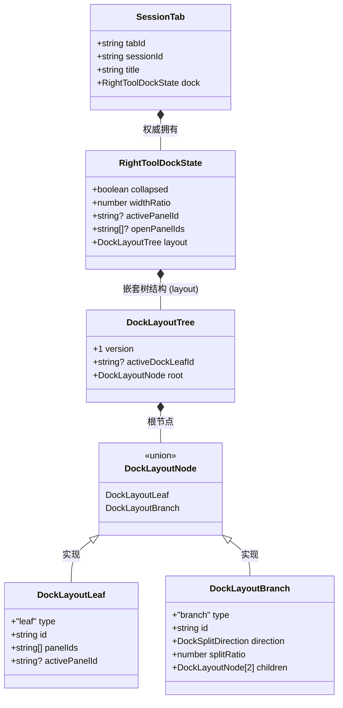
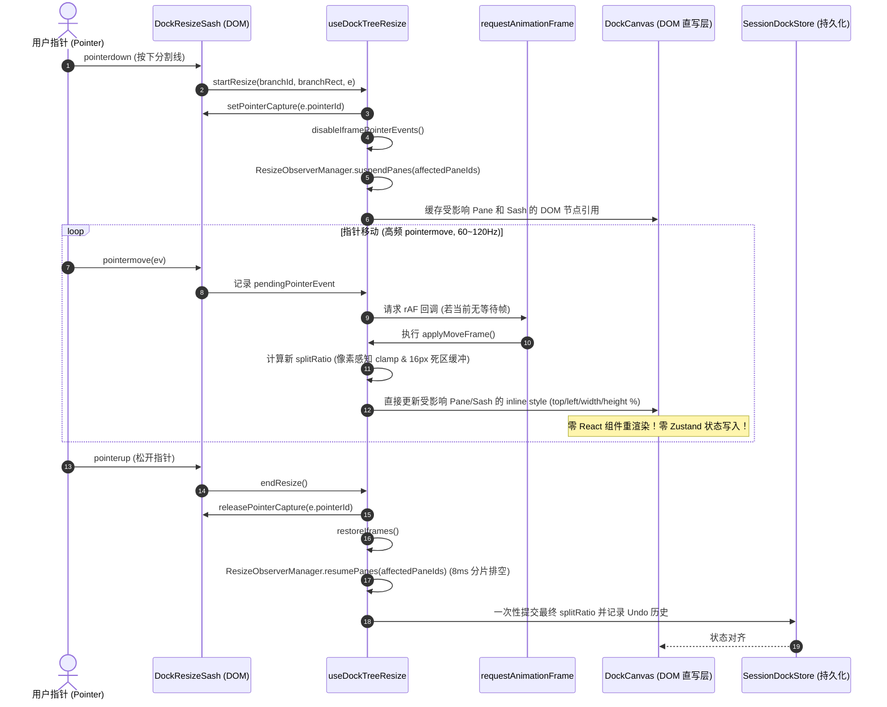
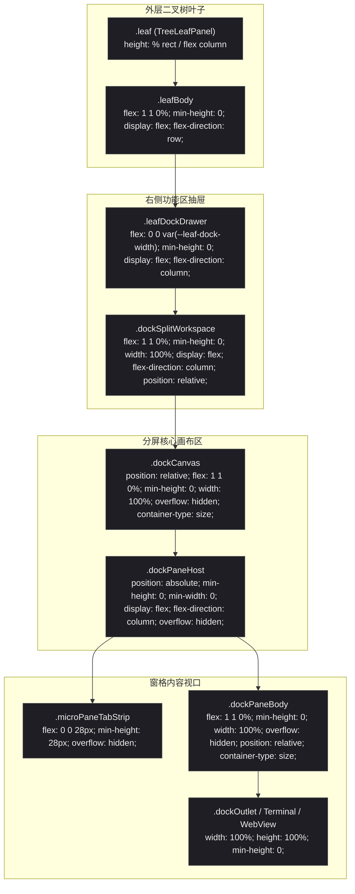
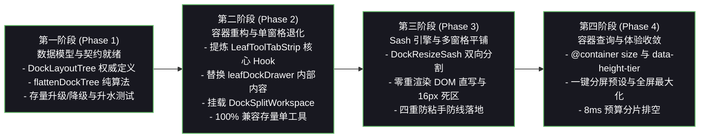

# 02-右坞容器与分屏渲染架构深度分析与设计

> **战役代号**：`dock-split-system`  
> **文档性质**：第一轮现状调研与分维架构深度分析报告（已吸收审计 A、E 裁决完成终态修正）  
> **关联任务**：【任务书：02-右坞容器与分屏渲染架构分析】  
> **遵循规范**：仓库根目录 `AGENTS.md`、`.agents/LOGIC_PLAN_NO_RETREAT.md`、`docs/dock-split-system/00-战役纪律与导引.md`、`docs/agent-roles/general_task/三原则.md`  

---

## 一、执行摘要与战役使命

在当前的 Conex / Crish 架构中，工作区（`BinaryTreeWorkspace`）支持顶层会话维度的二叉树多窗格平铺与分割线调整。然而，用户核心意志明确要求：
1. **顶栏大窗口聚焦对话**：顶层大标签栏（`PaneHeader` 中的 `_tabsContainer_1wzf4_71`）收敛为会话（Session）与独立通用工具（如全局独立常规终端）的大窗口标签，**严禁将对话内部的工具窗口拖入顶栏**；
2. **对话窗口内部功能闭环**：用户期望在当前对话窗口内部直接实现所有生产力工具的高效协同，左侧专注对话交互流（消息树、思考链、输入框），右侧功能区（Right Tool Dock）必须具备**完整的一等公民分屏系统（Split Screen System）**；
3. **右坞承载多工具分屏**：用户能够在有限的右坞空间（300px~800px）内，同时上下或左右并排展示原生 ConPTY 终端、Webview 浏览器预览、文件管理器、Git Diff 对比、运行时监控等多工具，支持流畅的分割线（Sash）拖拽调比、窗口落点指示、窗格内多标签切换以及一键最大化/还原。

本报告针对**右坞容器（`leafDockDrawer`）与分屏渲染架构**进行全方位的白盒代码审查、根因剖析与架构推演，提出承上启下的**右坞分屏工作区（`DockSplitWorkspace`）**渲染引擎与**坞内分割线（`DockResizeSash`）**高性能交互方案，全面吸收并消解架构审计 A 与工程审计 E 发现的命名漂移、边界模糊与资产复用断层，为后续详案设计与工程落地提供坚实的技术支撑。

---

## 二、现有右坞渲染拓扑与核心缺陷深度剖析

### 2.1 现有 DOM 拓扑树与渲染链路分析

在现有的二叉树工作区中，单个叶子面板（`TreeLeafPanel.tsx`）的 DOM 结构如下所示：

```text
BinaryTreeWorkspace (.section)
  └── .canvas (container-type: size; container-name: tree-canvas)
        ├── TreeResizeSash (.sash) [顶层分支间的分割线]
        └── TreeLeafPanel (.leaf) [绝对定位: top/left/width/height %]
              ├── PaneHeader (会话大标签栏，高 36px)
              ├── Button (.topSidePanelBtn) [右上角展开/收起右坞按钮]
              └── .leafBody [flex 容器，卡片背景与圆角框线]
                    ├── .leafChatColumn [左侧聊天主视口，flex: 1 1 0%]
                    │     ├── UnitChromeActions (快捷操作栏)
                    │     └── SlotOutlet (渲染主视图，通常为 'chat')
                    │
                    │ ── [以下当 dockOpen === true 时条件渲染] ──
                    ├── LeafDockResizer (.leafDockResizer) [聊天区与右坞之间的分割线，控制整个右坞抽屉宽度]
                    └── .leafDockDrawer (.leafDockDrawer .chat-side-panel) [右坞抽屉外壳]
                          ├── LeafToolTabStrip (右坞顶部工具标签栏，高 36px)
                          └── AppErrorBoundary > Suspense
                                └── {dock.openPanelIds.map(...)}
                                      └── .dockPanelPane [工具面板卡片，display: flex / none]
                                            └── SlotOutlet (渲染单一活动工具视图)
```

#### 现存核心代码行号证据

1. **抽屉显隐与宽度比例判定**（`apps/crish-desktop/src/components/binary-tree/TreeLeafPanel.tsx:113-118`）：
   ```typescript
   113: const dock = activeTab?.dock ?? leaf.dock ?? COLLAPSED_DOCK;
   114: const dockOpen =
   115:   isChatSurface &&
   116:   !isLeafDraft &&
   117:   dock.collapsed !== true &&
   118:   Boolean(dock.activePanelId);
   ```
2. **坞宽度内联变量驱动**（`TreeLeafPanel.tsx:199-206`）：
   ```typescript
   199: useLayoutEffect(() => {
   200:   const el = leafBodyRef.current;
   201:   if (!el || !dockOpen) return;
   202:   const w = el.clientWidth;
   203:   if (w <= 0) return;
   204:   const px = Math.max(200, Math.min(w * 0.7, (dock.widthRatio || 0.5) * w));
   205:   el.style.setProperty('--leaf-dock-width', `${px}px`);
   206: }, [dockOpen, dock.widthRatio]);
   ```
3. **单一上下文与视图实例化**（`TreeLeafPanel.tsx:270-271, 298-315`）：
   ```typescript
   270: const toolPanelId = dock.activePanelId || 'overview';
   271: const toolResolved = viewRegistry.resolveView(toolPanelId);
   ...
   298: const toolCtx: ViewRenderContext = useMemo(
   299:   () => ({
   300:     panelId: toolPanelId,
   301:     leafId: leaf.id,
   302:     sessionId: sessionForPanel ?? undefined,
   303:     isActive,
   304:     openView: handleOpenTool,
   305:     params: toolResolved.params,
   306:   }),
   307:   [toolPanelId, leaf.id, sessionForPanel, isActive, handleOpenTool, toolResolved.params]
   308: );
   ```
4. **抽屉容器与单卡片显隐渲染**（`TreeLeafPanel.tsx:433-486`）：
   ```typescript
   433: <div
   434:   className={`${styles.leafDockDrawer} ${
   435:     isMaximized ? styles.maximized : ''
   436:   } chat-side-panel`}
   ...
   441:   <LeafToolTabStrip
   442:     leafId={leaf.id}
   443:     sessionId={sessionForPanel}
   444:     sessionTabId={sessionTabId}
   445:     tabs={dock.openPanelIds}
   446:     activeTab={dock.activePanelId ?? ''}
   ...
   462:   {dock.openPanelIds.length > 0
   463:     ? dock.openPanelIds.map((pid) => {
   464:         const isPanelActive = pid === toolPanelId;
   465:         return (
   466:           <div
   467:             key={pid}
   468:             className={styles.dockPanelPane}
   469:             style={{
   470:               ...dockPaneFlexStyle,
   471:               display: isPanelActive ? 'flex' : 'none',
   472:             }}
   473:             data-panel-id={pid}
   474:             data-active-panel={isPanelActive ? 'true' : 'false'}
   475:             aria-hidden={!isPanelActive}
   476:           >
   477:             {renderToolOutlet(pid)}
   478:           </div>
   479:         );
   480:       })
   481:     : renderToolOutlet(toolPanelId)}
   ```

---

### 2.2 核心缺陷一：扁平数组与单一 `activePanelId` 的模型锁死

在 `apps/crish-desktop/src/store/layout-tree/sessionTabModel.ts:24-31` 中，现有的 `RightToolDockState` 契约定义为：

```typescript
export interface RightToolDockState {
  collapsed: boolean;
  openPanelIds: string[];
  activePanelId: string | null;
  widthRatio: number;
}
```

#### 缺陷成因与后果
- **纯一维扁平结构**：`openPanelIds: string[]` 仅仅是一个字符串 ID 数组，没有任何几何信息（无拓扑分支节点、无分割方向 `direction`、无切分比例 `splitRatio`、无窗格矩形 `rect`）。
- **单值聚焦阻断多屏**：`activePanelId: string | null` 强行将右坞限定为“全区只允许一个激活面板”。整个数据契约从根本上就不支持两个或更多面板同时处于“可见（Visible）”状态。
- **状态不持久化**：即使前端在 DOM 层面强制渲染多个面板，一旦会话切换或序列化落盘，树结构信息完全丢失，无法恢复分屏布局。

---

### 2.3 核心缺陷二：`dockPanelPane` 的单活动卡片隐藏堆叠与替换边界澄清

观察 `TreeLeafPanel.tsx:462-484` 的 DOM 结构：
```tsx
style={{
  ...dockPaneFlexStyle,
  display: isPanelActive ? 'flex' : 'none',
}}
```

#### 白盒核查事实与替换边界硬性澄清
1. **白盒核查事实**：
   查阅 `apps/crish-desktop/src/components/binary-tree/BinaryTreeWorkspace.module.css:415-460`，代码中**根本不存在 `leafDockOutlet` 这个类名或选择器**！
   现有右坞的真实 DOM 结构为：`.leafDockDrawer`（flex-column 容器）内部直接包含 `LeafToolTabStrip`（顶部工具条，高 36px）以及包裹在 `AppErrorBoundary > Suspense` 下的多个 `.dockPanelPane`（通过 `display: isPanelActive ? 'flex' : 'none'` 进行单视口显隐切换）。
2. **替换边界明确界定**：
   - 未来引入的 `DockSplitWorkspace` 将替换 `leafDockDrawer` 内部的**全部内容**（包括顶部的 `LeafToolTabStrip` 和所有的 `.dockPanelPane`）；
   - 但**绝不替换 `leafDockDrawer` 本身的容器 `div`**！`leafDockDrawer` 作为 `leafBody` 的直接 Flex 子项，必须保持其外壳地位、宽度 CSS 变量 `--leaf-dock-width` 继承以及整体最大化类名 `.maximized`。

#### 缺陷成因与后果
- **隐藏堆叠而非空间并排**：为了在切换标签时保留组件内部状态（如保持终端的 xterm 实例或浏览器的 iframe 状态），现有实现采用了简单的 `display: none` / `display: flex` 切换。这种“卡片堆叠（Card Stack）”机制导致整个抽屉内容区被唯一的活动面板 100% 独占。
- **缺失中间容器**：抽屉内部直接裸挂多个 `.dockPanelPane`，缺乏一个具备独立尺寸计算与几何坐标系的画布容器（如 `DockCanvas`）。
- **生命周期隐患**：当 `dock.openPanelIds` 中的多个面板需要同时工作时，单一的 `toolCtx`（`TreeLeafPanel.tsx:298-315`）会将所有子视图的 `panelId` 和 `params` 混淆绑定在顶层 `activePanelId` 上，导致非活动面板无法独立接收和响应参数更新。

---

### 2.4 核心缺陷三：`LeafToolTabStrip` 的全局独占与分屏上下文断层

在 `TreeLeafPanel.tsx:441-452` 中，`LeafToolTabStrip` 作为横梁直接挂载在 `.leafDockDrawer` 的顶部。

#### 缺陷成因与后果
- **宏观标签栏无法适配微观窗格**：`LeafToolTabStrip` 假定右坞只有一套标签列表。一旦右坞切分为上下或左右两个分屏，用户在分屏 A 打开了终端和浏览器，在分屏 B 打开了文件树和 Diff：
  - 顶层的单个 `LeafToolTabStrip` 无法表达“属于窗格 A 的标签”与“属于窗格 B 的标签”；
  - 用户点击顶栏标签时，无法感知该标签应当在哪个分屏区域被激活；
  - 关闭某个标签时，`computeNextDockAfterClose`（`treeLeafPanelModel.ts:187-205`）只会全局挑最后一个面板激活，直接破坏分屏各区域的独立状态。

---

### 2.5 核心缺陷四：外层 `LeafDockResizer` 与内层分割线的职责越界与协同空白

在现有代码中，`LeafDockResizer.tsx:20-139` 负责调整整个右坞相对于左侧聊天列的宽度：
- `LeafDockResizer` 监听 `pointerdown`，通过设置 `--leaf-dock-width` 实时驱动 `.leafDockDrawer` 的 flex 基础宽度；
- 该 Resizer 是纵向的（`col-resize`），硬编码了左右拖拽算法（`startX - ev.clientX`）；
- 一旦右坞内部也引入分割线（Sash），如果内部 Sash 没有严格的作用域隔离与事件锁定，内层 Sash 的拖拽极易穿透或与外层 `LeafDockResizer` 产生冲突；同时，当外层 Resizer 缩放右坞总宽时，内部分屏窗格若依赖固定像素，必将产生严重的溢出或父子尺寸跳动（Thrashing）。

---

## 三、右坞内部多窗格容器（`DockSplitWorkspace`）架构设计

### 3.1 目标 DOM 拓扑树与组件分层

为了彻底破除上述结构缺陷，必须在 `.leafDockDrawer` 内部建立一个完全自治、与外层会话树解耦的**二级分屏工作区微内核**。我们设计并命名该核心容器为 **`DockSplitWorkspace`**。

#### 目标 DOM 拓扑架构

```text
TreeLeafPanel (.leaf)
  ├── PaneHeader (会话大窗口顶栏)
  └── .leafBody
        ├── .leafChatColumn (左侧对话工作流视口)
        │     └── ...
        ├── LeafDockResizer (.leafDockResizer) [聊天区与右坞主分割线，控制整个右坞抽屉宽度]
        │
        └── .leafDockDrawer (.leafDockDrawer .chat-side-panel) [右侧功能区抽屉外壳，保留此容器]
              │
              ├── DockSplitWorkspace (.dockSplitWorkspace) [★ 替换抽屉内原有 TabStrip 和 dockPanelPane]
              │     ├── DockToolbar (.dockToolbar) [坞全局功能栏: 布局预设/分屏快捷动作/最大化/关闭]
              │     │
              │     └── DockCanvas (.dockCanvas) [★ 绝对定位几何画布，container-type: size]
              │           │
              │           ├── DockPaneHost (.dockPaneHost) [分屏窗格 1: 绝对定位 top/left/width/height %]
              │           │     ├── MicroPaneTabStrip (.microPaneTabStrip) [窗格微型标签条，复用下沉 Hook，高 28px]
              │           │     │     ├── ToolTabs [窗格内的多面板标签: 终端 1, 终端 2]
              │           │     │     └── PaneActions [窗格本地操作: 分屏、关闭、最大化]
              │           │     └── DockPaneBody (.dockPaneBody) [窗格内容视口]
              │           │           └── SlotOutlet (渲染 Terminal 视图，独立 ViewRenderContext)
              │           │
              │           ├── DockResizeSash (.dockResizeSash) [★ 坞内分割线，绝对定位 %]
              │           │     └── [双向支持: horizontal (左右切分 col-resize) / vertical (上下切分 row-resize)]
              │           │
              │           └── DockPaneHost (.dockPaneHost) [分屏窗格 2: 绝对定位 top/left/width/height %]
              │                 ├── MicroPaneTabStrip (.microPaneTabStrip)
              │                 │     ├── ToolTabs [标签: 浏览器预览]
              │                 │     └── PaneActions
              │                 └── DockPaneBody (.dockPaneBody)
              │                       └── SlotOutlet (渲染 Preview 视图，独立 ViewRenderContext)
              │
              └── DockDropOverlay (.dockDropOverlay) [坞内拖拽分屏落点指示高亮遮罩]
```

#### 组件职责分层与边界

| 组件名称 | 角色定位 | 核心职责 |
| :--- | :--- | :--- |
| **`DockSplitWorkspace`** | 坞内分屏总调度容器 | 挂载于 `leafDockDrawer` 内部，完全替换原有的 `LeafToolTabStrip` 和所有 `.dockPanelPane`。管理坞内布局状态树（`DockLayoutTree`），响应外层最大化/折叠指令，装配拖拽落点检测上下文。 |
| **`DockToolbar`** | 坞全局控制栏 | 提供全局一键分屏（水平二分、垂直二分、场景预设）、右坞全屏最大化/还原、关闭右坞等宏观动作。在单窗格时可与窗格头合并，消除纵向空间浪费。 |
| **`DockCanvas`** | 纯几何定位画布 | 具备 `position: relative; width: 100%; height: 100%; container-type: size;`，作为所有子窗格与 Sash 的基准坐标系，负责接收 live resize DOM 直写。 |
| **`DockPaneHost`** | 分屏叶子宿主 | 对应坞内树的一个叶子节点（`DockLayoutLeaf`）。拥有独立的局部 `MicroPaneTabStrip` 与独立 `ViewRenderContext`，隔离不同工具的事件与生命周期。 |
| **`DockResizeSash`** | 坞内高性能分割线 | 挂载于分支节点（`DockLayoutBranch`）两个子节点之间。在 Canvas 坐标系内支持水平（纵向线、左右切分）与垂直（横向线、上下切分）高灵敏度平滑拖拽。 |
| **`DockDropOverlay`** | 坞内拖拽投影层 | `pointer-events: none` 绝对定位半透明高亮层，根据拖拽悬停坐标动态展示 Top / Bottom / Left / Right / Center 放置预期。 |

---

### 3.2 坞内二叉树扁平化渲染流水线（`flattenDockTree`）

为了实现超高帧率（60~120 FPS）的流畅拖拽与渲染，必须**杜绝嵌套 Flexbox 或深度递归 DOM 树**。我们继承并复用外层成熟的 `flattenTree` 思想，全面对齐文档 01 的类型契约，设计坞内专属的 `flattenDockTree` 算法。

#### 1. 数据结构契约定义（全量对齐文档 01）

```typescript
/** 分割方向：horizontal = 左右并排（垂线分割）；vertical = 上下并排（水平线分割） */
export type DockSplitDirection = 'horizontal' | 'vertical';

/** 坞内叶子节点：拥有独立的多个工具标签与当前活动标签 */
export interface DockLayoutLeaf {
  type: 'leaf';
  /** 窗格全局唯一标识，如 "dock-leaf-1w8z" */
  id: string;
  /** 窗格内打开的工具面板 ID 列表（有序），如 ['terminal', 'preview'] */
  panelIds: string[];
  /** 当前处于前台激活的面板 ID；若 panelIds 为空则为 null */
  activePanelId: string | null;
}

/** 坞内分支节点：严格二叉分割容器 */
export interface DockLayoutBranch {
  type: 'branch';
  /** 分支全局唯一标识，如 "dock-branch-3k9a" */
  id: string;
  /** 分割方向 */
  direction: DockSplitDirection;
  /** 严格二叉子节点：children[0] 为左/上，children[1] 为右/下 */
  children: [DockLayoutNode, DockLayoutNode];
  /** 第一个子节点在当前分支中的占比 (0.2 ~ 0.8) */
  splitRatio: number;
}

/** 布局节点联合类型 */
export type DockLayoutNode = DockLayoutLeaf | DockLayoutBranch;

/** 完整右坞分屏树契约 */
export interface DockLayoutTree {
  /** 树根节点 */
  root: DockLayoutNode;
  /** 当前具有用户焦点的叶子窗格 ID；若为空树则为 null */
  activeDockLeafId: string | null;
  /** 数据结构契约版本号 */
  version: 1;
}
```

#### 2. 扁平化投影几何计算（`flattenDockTree`）

输入整树 `tree: DockLayoutTree`（以读取 `activeDockLeafId` 计算 `isActive`），以全量画布矩形 `{ x: 0, y: 0, width: 1, height: 1 }` 开始递归，输出一维平铺的叶子窗格列表与分割线列表：

```typescript
/** 树展平叶子渲染元数据 */
export interface FlatDockLeaf {
  leafId: string;
  panelIds: string[];
  activePanelId: string | null;
  /** 归一化百分比矩形 (0.0 ~ 1.0)，相对于右坞内容区视口 */
  rect: { x: number; y: number; width: number; height: number };
  /** 是否为当前拥有焦点的窗格 (leafId === tree.activeDockLeafId) */
  isActive: boolean;
}

/** 树展平分割线渲染元数据 */
export interface FlatDockBranch {
  branchId: string;
  direction: DockSplitDirection;
  splitRatio: number;
  /** 分支节点覆盖的归一化百分比矩形 */
  rect: { x: number; y: number; width: number; height: number };
  /** 分割线（Sash）在百分比坐标系下的几何线段位置 */
  sash: {
    x: number;
    y: number;
    length: number;
    direction: DockSplitDirection;
  };
}

/** 展平输出载荷 */
export interface FlattenedDockLayout {
  leaves: FlatDockLeaf[];
  branches: FlatDockBranch[];
}

export function flattenDockTree(tree: DockLayoutTree): FlattenedDockLayout {
  const leaves: FlatDockLeaf[] = [];
  const branches: FlatDockBranch[] = [];

  function traverse(
    node: DockLayoutNode,
    rect: { x: number; y: number; width: number; height: number }
  ) {
    if (node.type === 'leaf') {
      leaves.push({
        leafId: node.id,
        panelIds: node.panelIds,
        activePanelId: node.activePanelId,
        rect,
        isActive: node.id === tree.activeDockLeafId,
      });
      return;
    }

    const { direction, splitRatio, children, id } = node;

    if (direction === 'horizontal') {
      // 左右切分：垂直分割线
      const w0 = rect.width * splitRatio;
      const w1 = rect.width - w0;
      const sashX = rect.x + w0;

      branches.push({
        branchId: id,
        direction,
        splitRatio,
        rect,
        sash: {
          x: sashX,
          y: rect.y,
          length: rect.height,
          direction: 'horizontal',
        },
      });

      traverse(children[0], { x: rect.x, y: rect.y, width: w0, height: rect.height });
      traverse(children[1], { x: sashX, y: rect.y, width: w1, height: rect.height });
    } else {
      // 上下切分：水平分割线
      const h0 = rect.height * splitRatio;
      const h1 = rect.height - h0;
      const sashY = rect.y + h0;

      branches.push({
        branchId: id,
        direction,
        splitRatio,
        rect,
        sash: {
          x: rect.x,
          y: sashY,
          length: rect.width,
          direction: 'vertical',
        },
      });

      traverse(children[0], { x: rect.x, y: rect.y, width: rect.width, height: h0 });
      traverse(children[1], { x: rect.x, y: sashY, width: rect.width, height: h1 });
    }
  }

  traverse(tree.root, { x: 0, y: 0, width: 1, height: 1 });
  return { leaves, branches };
}
```

---

### 3.3 窗格宿主（`DockPaneHost`）与多实例生命周期隔离

在多窗格并存状态下，每个 `DockPaneHost` 拥有独立的上下文，保证多个工具实例之间互不干扰：

```tsx
export const DockPaneHost: React.FC<{
  leaf: FlatDockLeaf;
  sessionId: string;
  outerLeafId: string;
  isActive: boolean;
  onActivate: (leafId: string) => void;
}> = React.memo(({ leaf, sessionId, outerLeafId, isActive, onActivate }) => {
  const paneRef = useRef<HTMLDivElement>(null);
  const { rect, activePanelId, panelIds, leafId } = leaf;

  // 1. 采用 layoutEffect 写 inline style，保证 live resize 时不会被 React re-render 冲刷
  // 门禁：拖拽中或单窗格最大化中禁止百分比 style 冲刷覆盖
  useLayoutEffect(() => {
    const el = paneRef.current;
    if (
      !el ||
      document.body.classList.contains('dock-split-resizing') ||
      el.getAttribute('data-solo-active') === 'true'
    ) {
      return;
    }
    el.style.left = `${rect.x * 100}%`;
    el.style.top = `${rect.y * 100}%`;
    el.style.width = `${rect.width * 100}%`;
    el.style.height = `${rect.height * 100}%`;
  }, [rect.x, rect.y, rect.width, rect.height]);

  // 2. 为当前活动工具生成独立的 ViewRenderContext
  const currentPanelId = activePanelId || panelIds[0] || 'overview';
  const currentViewResolved = viewRegistry.resolveView(currentPanelId);
  const paneCtx: ViewRenderContext = useMemo(() => ({
    panelId: currentPanelId,
    leafId: `${outerLeafId}#${leafId}`, // 局部唯一命名空间
    sessionId,
    isActive,
    params: currentViewResolved.params,
  }), [currentPanelId, outerLeafId, leafId, sessionId, isActive, currentViewResolved.params]);

  return (
    <div
      ref={paneRef}
      className={styles.dockPaneHost}
      data-dock-leaf-id={leafId}
      data-dock-pane-id={leafId}
      data-active={isActive ? 'true' : 'false'}
      onPointerDownCapture={() => onActivate(leafId)}
    >
      <MicroPaneTabStrip
        leafId={leafId}
        panelIds={panelIds}
        activePanelId={activePanelId}
        showSplitButtons={true}
      />
      <div className={styles.dockPaneBody}>
        <AppErrorBoundary compact title={`坞窗格 [${currentPanelId}] 异常`}>
          <Suspense fallback={<div className={styles.emptyState}>加载中…</div>}>
            <SlotOutlet
              slotKey="workspace.dock.panel"
              context={paneCtx}
              entryKey={currentViewResolved.definition?.id || currentPanelId}
              fallback={<div className={styles.emptyState}>未知面板：{currentPanelId}</div>}
            />
          </Suspense>
        </AppErrorBoundary>
      </div>
    </div>
  );
});
```

---

### 3.4 状态流与单一真理源（SSOT）契约绑定

坞内布局树（`DockLayoutTree`）必须成为当前会话标签（`SessionTab`）内部的权威状态，其绑定关系如下：



- **单向数据流与向下兼容**：
  - 当 `layout` 仅有 1 个 `DockLayoutLeaf` 时，其 `panelIds` 等价于旧版的 `openPanelIds`，`activePanelId` 等价于旧版的 `activePanelId`，天然无损兼容旧版本配置。
  - 会话切换时，树结构从对应会话的 `activeTab.dock.layout` 整体装载，实现不同会话拥有完全独立的右坞分屏状态。

---

### 3.5 无分屏退化态、全屏最大化模式与直写门禁

1. **单窗格退化态（Zero-Overhead Single Pane）**：
   - 当用户未进行分屏（树中仅有一个叶子）时，`flattenDockTree` 产出 1 个 `leaf`（rect 为 `0, 0, 1, 1`）和 0 个 `sash`。
   - 此时 `DockPaneHost` 自动隐藏局部 Header，将 Tab 栏提升至顶层 `DockToolbar`，整体视觉与现有单卡片模式 100% 一致，无额外 DOM 嵌套开销。
2. **最大化模式（Maximized Mode）**：
   - 沿用 `TreeLeafPanel.tsx:435` 的 `isMaximized` 逻辑，通过 CSS `.leafDockDrawer.maximized` 覆盖整个 `.leaf` 视口；
   - 支持**双层最大化**：
     - **右坞整体全屏**：右坞占据整个对话叶子空间，但内部依然保持多窗格分屏；
     - **单个分屏窗格最大化**：用户双击某分屏窗格头或点击窗格最大化按钮，该特定窗格在 `DockCanvas` 内提升 `z-index: 10` 并撑满 100%（`position: absolute; inset: 0; width: 100%; height: 100%;`），再次点击恢复分屏，极其符合开发者心智。
3. **最大化与 DOM 直写防冲刷门禁（Maximization Style Guard）**：
   - 审计 A 揭露的关键风险：单窗格最大化时，若该窗格通过 CSS 变为 `inset: 0; width: 100%; height: 100%`，用户一旦在未退出最大化前触发外层 resize 或误触 Sash，DOM 直写逻辑会以旧百分比比例覆盖内联 style，导致最大化瞬间被击穿撕裂。
   - **刚性门禁防护**：在 `DockCanvas` 设置 `data-has-solo="true"` 属性；在拖拽 Live Resize 的 `paintDockFlatLayout` 与 `useLayoutEffect` 中设立硬阻断守卫：
     ```typescript
     if (canvasEl.getAttribute('data-has-solo') === 'true' || el.getAttribute('data-solo-active') === 'true') {
       // 最大化状态下直接跳过百分比直写，维持 100% 满屏定位
       return;
     }
     ```
   - 最大化激活期间，所有 `DockResizeSash` 自动附加 `pointer-events: none; opacity: 0;`，彻底杜绝意外触发。

---

### 3.6 现有 `LeafToolTabStrip`（454 行）交互资产迁移与 Hook 提炼方案

白盒核查表明，`apps/crish-desktop/src/components/binary-tree/LeafToolTabStrip.tsx` 沉淀了 **454 行** 极其成熟的人机交互逻辑，并由 **575 行** 专项极限单测（`LeafToolTabStrip.scoped.test.tsx`）进行严格防护。在 Phase 2 渲染容器重构中，**严禁粗暴废弃或另起炉灶双轨维护**，必须提炼为公共 Hook 再复用。

#### 核心能力的 Hook 提炼矩阵

| 序号 | 核心交互能力 | 现存代码实现位置 | 提炼目标 Hook | 核心职责与封装边界 |
| :---: | :--- | :--- | :--- | :--- |
| **1** | **Tab 关闭保险丝状态机** | `LeafToolTabStrip.tsx:139-160, 212-277` | **`useToolTabLifecycle.ts`** | 接管 `closingIdsRef`、`fuseTimersRef` 计时器、`@starting-style` 入场与 `[data-leaving]` 离场过渡。提供 `triggerCloseTab` 与 `finalizeClose`，配合 `readTransitionMs * 3` 兜底超时保险丝，根治浏览器 `transitionend` 丢失引发的“幽灵 Tab 内存泄漏”。 |
| **2** | **溢出测算与双态加号** | `LeafToolTabStrip.tsx:163-179, 408-422` | **`useTabStripOverflow.ts`** | 基于 `ResizeObserverManager` 测算容器横向溢出。在未溢出时在 Tab 序列后流式展示加号（inFlow），溢出时自动下沉收敛至右侧固定操作区（pinned）。 |
| **3** | **横向滚轮重定向** | `LeafToolTabStrip.tsx:182-191` | **`useNonPassiveWheel.ts`** *(直接复用)* | 拦截纵向滚轮并将其转化为原生平滑横向滚动，采用原生非被动（`passive: false`）监听，消除 Chromium 控制台告警。 |
| **4** | **WAI-ARIA 键盘漫游** | `LeafToolTabStrip.tsx:206-210` | **`useTablistKeyboard.ts`** *(直接复用)* | 遵循 WAI-ARIA Tablist 规范，支持 `ArrowLeft/Right/Home/End` 键盘导航与即时激活。 |

#### 实施纪律与资产防护铁律
1. **先提炼后开发**：必须在 Phase 2 开工前完成上述 Hook 的提炼，Phase 2 新建的微型标签条 `MicroPaneTabStrip` 全量复用上述 Hook，杜绝双轨代码冗余；
2. **测试零倒退**：提炼完成后，必须确保原有的 575 行 `LeafToolTabStrip.scoped.test.tsx` 持续保持 100% 绿通；
3. **保留专有工具条**：
   - `SidePanelNavToolbar`（专用于 Webview 浏览器的后退/前进/刷新工具条，`LeafToolTabStrip.tsx:23`）下沉挂载至 Webview 窗格内部；
   - `SidePanelLauncherHub`（零标签时的快捷启动磁贴，`LeafToolTabStrip.tsx:447`）保留为空态窗格下的 Micro Launcher。

---

## 四、坞内分屏分割线（`DockResizeSash`）高性能拖拽引擎设计

### 4.1 三类分割线的对比与复用策略

在 Crish 系统中，目前存在外层 `TreeResizeSash`、叶主 `LeafDockResizer`，本次引入第三类：坞内 `DockResizeSash`。三者的职责与行为对比必须极其严谨：

| 维度 | 外层工作区分割线 (`TreeResizeSash`) | 叶主抽屉分割线 (`LeafDockResizer`) | 坞内分屏分割线 (`DockResizeSash`) |
| :--- | :--- | :--- | :--- |
| **几何位置** | 工作区 `canvas` 顶层，各大 Leaf 之间 | 对话聊天列与右坞抽屉之间 | 右坞内部，各子工具窗格之间 |
| **切分方向** | 双向（`horizontal` / `vertical`） | **单向**（仅纵向调节宽度） | **双向**（`horizontal` 左右 / `vertical` 上下） |
| **定位基准** | 全局 Canvas 百分比（`0~1`） | `leafBody` 内 Flex 边框绝对占位 | **右坞 Canvas 百分比（`0~1`）** |
| **坐标系尺寸** | 整个窗口工作区（如 1400px~2560px） | 单个 Leaf 宽度（如 800px~1600px） | **右坞紧凑空间（300px~800px）** |
| **拖拽状态写源** | Live 写 DOM，松手 commit `layoutTreeStore` | Live 写 `--leaf-dock-width`，松手 commit | **Live 写 DOM，松手 commit `SessionTab.dock`** |
| **冲突防护** | 局部属性与光标覆盖 | 屏蔽 iframe，全局 body 类名 | **双向防劫持 + 指针锁定 + 局部作用域防穿透** |

#### `LeafDockResizer` 与 `DockResizeSash` 的层级关系与热区防重叠要求

1. **层级与控制域划分**：
   - `LeafDockResizer`（现有组件，`LeafDockResizer.tsx`）：挂载于 `TreeLeafPanel` 的 `.leafBody` 层级，控制**整个右坞抽屉的宽度**，是一个 flex 比例控制器，位于 `DockSplitWorkspace` 外部；
   - `DockResizeSash`（新建组件，`DockResizeSash.tsx`）：挂载于 `DockCanvas` 内，控制**右坞内部各分屏窗格的相对尺寸**，完全处于 `DockSplitWorkspace` 的 Canvas 归一化百分比坐标系内。
2. **热区防重叠要求（Sash Collision Buffer）**：
   - 现存 `LeafDockResizer` 拥有约 8px 的隐式指针捕获热区（`::before { left: -2px; width: 8px; }`）；
   - 当右坞进行水平左右分屏且最左侧窗格的 `splitRatio` 较小（如接近 `0.2`）时，`DockResizeSash` 会极其贴近右坞左边界；
   - **物理缓冲硬性要求**：`DockResizeSash` 最左边缘与 `LeafDockResizer` 热区之间**必须保持 $\ge 16\text{px}$ 的物理安全缓冲（Deadzone Buffer）**。若通过像素换算发现内部分割线距离左边缘不足 24px（8px 热区 + 16px 缓冲），拖拽 Clamp 算法必须强制锁定，防止两个 Handle 在像素层面重叠导致用户本想调整内部分屏却误触了外层右坞宽度的伸缩。
3. **全局拖拽状态类名统一（彻底消除 Classname Chaos）**：
   - 外层右坞抽屉拖拽时，`document.body` 挂载 `:global(.leaf-dock-resizing)`；
   - 坞内分屏拖拽时，`document.body` 挂载 `:global(.dock-split-resizing)`；
   - 坞内 Tab 拖拽时，挂载 `data-drag-domain="dock-tool"`；
   - 各状态互不干扰，严禁使用模糊的 `dock-resizing` 类名。

#### 复用与改写决策
- **绝不直接裸用 `TreeResizeSash`**：`TreeResizeSash` 深度依赖全局 `useLayoutTreeStore` 和 `flattenTree`，若强行复用会导致全局外层树与局部坞内树产生严重的概念混淆与循环依赖。
- **抽象独立 Hook：`useDockTreeResize`**：
  提取 `useTreeResize.ts` 中经过实战验证的**DOM 直写技术**、**指针锁定（Pointer Capture）**、**受影响窗格识别**与**RAF 节流驱动**，将其改写为轻量、纯粹、高内聚的 `useDockTreeResize` Hook，专职服务于 `DockResizeSash`。

---

### 4.2 零重渲染实时布局驱动（Live Resize via RAF & Direct DOM Style）

在拖拽分屏线期间，若每一帧都触发 React 组件重渲染或 Zustand Store 写入，在包含 xterm.js 终端、Monaco Editor 或 Webview 的复杂界面下，帧率必然跌至 20 FPS 以下，产生极其严重的卡顿与“不跟手”现象。

#### 核心拖拽时序与零重渲染设计



#### DOM 直写执行核心代码推演

```typescript
function paintDockFlatLayout(
  leaves: FlatDockLeaf[],
  branches: FlatDockBranch[],
  canvasEl: HTMLElement
): void {
  // 门禁：单窗格最大化时不执行直写
  if (canvasEl.getAttribute('data-has-solo') === 'true') {
    return;
  }

  // 遍历受影响的 leaf，直接以 inline style 写入百分比，无 React diff 损耗
  for (const leaf of leaves) {
    const el = canvasEl.querySelector<HTMLElement>(`[data-dock-leaf-id="${leaf.leafId}"]`);
    if (!el) continue;
    const { rect } = leaf;
    el.style.left = `${rect.x * 100}%`;
    el.style.top = `${rect.y * 100}%`;
    el.style.width = `${rect.width * 100}%`;
    el.style.height = `${rect.height * 100}%`;
  }

  // 遍历受影响的分支 sash，直接写入位置
  for (const branch of branches) {
    const el = canvasEl.querySelector<HTMLElement>(`[data-dock-branch-id="${branch.branchId}"]`);
    if (!el) continue;
    const { sash } = branch;
    if (sash.direction === 'horizontal') {
      el.style.left = `${sash.x * 100}%`;
      el.style.top = `${sash.y * 100}%`;
      el.style.height = `${sash.length * 100}%`;
      el.style.width = '';
    } else {
      el.style.top = `${sash.y * 100}%`;
      el.style.left = `${sash.x * 100}%`;
      el.style.width = `${sash.length * 100}%`;
      el.style.height = '';
    }
  }
}
```

---

### 4.3 终极防粘手四重防线（Anti-Sticky Defense）

在分屏拖拽场景中，用户反馈最强烈的 bug 是“**粘手**”——即当鼠标拖过 Webview 浏览器或特定 iframe 区域并松开鼠标左键时，事件被子页面彻底吞噬，导致鼠标移回界面后分屏线依然牢牢吸附在光标上。

针对此问题，`DockResizeSash` 部署**四重防线**：

```text
┌────────────────────────────────────────────────────────────────────────┐
│                        终极防粘手四重防线体系                           │
├────────────────────────────────────────────────────────────────────────┤
│ 1. 指针捕获锁 (Pointer Capture)                                        │
│    handleEl.setPointerCapture(e.pointerId)                             │
│    强制后续所有原生指针事件（move, up, cancel）不论光标落点均重定向到 Sash │
├────────────────────────────────────────────────────────────────────────┤
│ 2. 全局/局部 Iframe 物理静音 (disableIframePointerEvents)               │
│    遍历页面内所有 iframe, webview, object, embed 元素                   │
│    强制设置 style.pointerEvents = 'none'，彻底切断事件黑洞             │
├────────────────────────────────────────────────────────────────────────┤
│ 3. 全局光标覆盖与透明遮罩 (Global Drag Overlay & Cursor Lock)           │
│    动态插入 <style> 强制 * { cursor: col-resize !important; }           │
│    防止光标在跨越文本、输入框或边框时发生视觉跳闪                      │
├────────────────────────────────────────────────────────────────────────┤
│ 4. 异常中断看门狗 (WindowBlurWatchdog & PointerCancel 兜底)            │
│    多路监听 window.onblur, pointercancel, lostpointercapture            │
│    当发生 Alt+Tab 切窗或系统手势打断时，在 150ms 内强制安全收敛状态机   │
└────────────────────────────────────────────────────────────────────────┘
```

#### 行号技术继承
- 继承 `LeafDockResizer.tsx:55-68` 的优雅指针捕获与 iframe 禁用逻辑；
- 继承 `useTreeResize.ts:243-247` 的捕获降级防护；
- 继承 `apps/crish-desktop/src/utils/ResizeObserverManager.ts:100-140` 的 `WindowBlurWatchdog` 看门狗机制。

---

### 4.4 窗格级 ResizeObserver 挂起与 8ms 分片排空

当右坞同时渲染 ConPTY 终端与浏览器时，拖拽 Sash 会引发高频的尺寸变化。若 xterm.js 绑定的 `ResizeObserver` 在每一帧都执行 `fit()`，会触发密集的 DOM 字体测高（`getBoundingClientRect`），产生高达 120ms 的单帧 Long Task。

#### 解决方案：Gated Resizing & SlicedTaskFlusher
1. **启动拖拽时精确定位受影响窗格**：
   通过树遍历函数 `collectDockSubtreePaneIds(root, branchId)`，仅识别本次拖拽分支下的子窗格 ID；
2. **挂起受影响窗格**：
   调用 `ResizeObserverManager.getInstance().suspendPanes(affectedPaneIds)`，临时屏蔽其内部组件的测高回调；
3. **松手后时间预算分片排空**：
   调用 `resumePanes(affectedPaneIds)`。底层 `SlicedTaskFlusher`（`ResizeObserverManager.ts:14-97`）以每物理帧 **8.0ms**（`DEFAULT_TIME_BUDGET_MS`）为时间预算，分片排空积压的尺寸适配任务，超出预算的任务自动顺延至下一帧 rAF，彻底消除松手瞬间的卡顿掉帧。

---

### 4.5 键盘可访问性与双击居中重置

为了符合现代高品质桌面软件的人机交互规范（参考 `TreeResizeSash.tsx:107-189`），`DockResizeSash` 原生集成：
1. **键盘精准微调**：
   - 聚焦于 Sash 时，按 `ArrowLeft` / `ArrowUp` 步进减少 2%（`0.02`）；
   - 按 `ArrowRight` / `ArrowDown` 步进增加 2%；
   - 按 `Home` / `End` 快速跳至允许的最小/最大极值；
2. **双击居中（Double Click to Equal Split）**：
   - 监听 `onDoubleClick`，立即重置当前分支的 `splitRatio = 0.5`，左右或上下完美均分。

---

## 五、有限空间（300px~800px）下的 CSS 盒模型与自适应防御

### 5.1 布局基石裁决：绝对定位 Canvas 体系 vs Flex/Grid 深度对比

右坞的物理宽度通常仅在 **300px 至 800px** 之间波动。在如此狭窄的容器内实现多窗格切分，布局方案的选择直接决定了系统的稳定性上限。

| 评估维度 | 方案 A：绝对定位 Canvas 体系（★ 本案裁决采用） | 方案 B：嵌套 Flexbox 体系 | 方案 C：CSS Grid 体系 |
| :--- | :--- | :--- | :--- |
| **坐标系性质** | 纯几何二维映射（基于 `0~1` 百分比） | 一维级联伸缩（`flex-grow` / `basis`） | 二维网格轨道（`grid-template`） |
| **拖拽性能** | **极高**（直接写 `left/top/width/height %`，O(1) 无级联重排） | **低**（Sash 拖动改变 basis 会引发祖先与后代级联 Reflow） | **中**（动态改 `grid-template-columns` 计算开销大） |
| **Sash 渲染** | 浮动发丝 Sash 绝对定位，居中重叠，零布局挤压 | Sash 作为 Flex Item 必须占位，增加像素换算复杂度 | 难以将可交互 Sash 完美对齐到网格间隙 |
| **最小尺寸限制** | 可由 JS 算法精准限制，不受 CSS 自动隐式拉伸干扰 | 极易受 `min-content` 隐式限制破坏，导致超出溢出 | 网格项最小宽度破坏整体轨道比例 |
| **多层嵌套能力** | 扁平化（Flatten）后所有窗格并列平铺，无 DOM 深度 | 随着分屏增加，DOM 嵌套层级指数级加深 | 复杂分屏需要 Subgrid，浏览器兼容性与性能难以控制 |

**架构裁决**：坚决采用与外层 `BinaryTreeWorkspace` 相同设计哲学的**绝对定位 Canvas 体系（Absolute Positioning Canvas System）**，实现架构设计模式的大一统与认知资产的最大化复用。

---

### 5.2 尺寸继承链完整性契约（防止高度塌陷与链条断裂）

在复杂 Web / Electron / Tauri 应用中，最容易导致窗格渲染为 0px（空白消失）或出现非预期双重滚动条的根因是**高度继承链断裂**。

#### 严格贯穿式高度契约规范



#### 铁律防线
1. **每一级父子容器必须声明 `min-height: 0;` 与 `min-width: 0;`**：
   在 CSS Flexbox 规范中，flex item 的默认 `min-width` 和 `min-height` 为 `auto`。当内容（如长路径文本、代码块）超出时，`auto` 会强行撑大父容器，造成高度链爆裂。通过在从外到内的所有层级显式声明 `min-height: 0; min-width: 0;`，硬性斩断任何内容的非法扩张。
2. **内容视口采用 `flex: 1 1 0%; overflow: hidden; position: relative;`**：
   保证内部无论是 xterm Canvas 还是 iframe，都能精确根据父级剩余空间撑满，绝不外溢。

---

### 5.3 横向溢出硬阻断与容器查询（Container Queries）自适应

#### 1. 狭窄环境挑战
在右坞总宽为 400px 时，进行左右并排分屏，单个窗格的宽度将骤降至 **190px 左右**。
在 190px 的极限宽度下：
- 原本包含“图标 + 面板标题 + 分屏按钮 + 关闭按钮”的标签项必然横向超标；
- 若出现水平滚动条，将严重挤压本来就局促的垂直操作空间。

#### 2. CSS 容器查询（Container Queries）防御方案
在 `DockCanvas` 声明 `container-type: size; container-name: dock-canvas;`，并在 `DockPaneBody` 声明 `container-type: size; container-name: dock-pane;`：

```css
/* 窗格内部样式根据自身实时像素宽度与高度自适应，而非监听 window resize */
@container dock-pane (max-width: 260px) {
  /* 隐藏标签文字，仅保留 16px 图标 */
  .dockTabTitle {
    display: none !important;
  }
  
  /* 紧凑内边距 */
  .dockTabItem {
    padding: 0 var(--space-1) !important;
  }
  
  /* 折叠次要操作按钮至下拉菜单 */
  .dockPaneSecondaryActions {
    display: none !important;
  }
}

@container dock-pane (max-width: 180px) {
  /* 极窄模式：窗格头高度收缩为 24px */
  .microPaneTabStrip {
    height: 24px !important;
    min-height: 24px !important;
  }
}
```

---

### 5.4 外坞宽度缩放与内部分屏比例的协同（Jitter Defense）

当用户拖拽外层 `LeafDockResizer` 改变整个右坞的宽度（例如从 300px 拖至 700px）时：
- **百分比自然响应**：由于内部窗格与 Sash 均基于 `DockCanvas` 的百分比（`0~1`）绝对定位，当外部画布伸缩时，内部各窗格将以亚像素级的平滑度自动跟随放大或缩小，**完全不需要执行任何 JS 计算或 DOM 重排**！
- **抗抖动（Jitter Defense）门控**：
  在外层拖拽期间，`document.body` 会添加 `leaf-dock-resizing` 类名；在内层拖拽期间添加 `dock-split-resizing` 类名。此时必须在 CSS 中冻结坞内所有元素的 transition：
  ```css
  :global(.leaf-dock-resizing) .dockPaneHost,
  :global(.leaf-dock-resizing) .dockResizeSash,
  :global(.dock-split-resizing) .dockPaneHost,
  :global(.dock-split-resizing) .dockResizeSash {
    transition: none !important;
  }
  ```
  这彻底杜绝了 CSS 过渡动画与直接鼠标位移互相打架造成的“左右抽搐跳动”。

---

### 5.5 像素感知最小尺寸硬约束（Pixel-Aware Min-Child Clamp）

为防止用户将分割线拖拽至最边缘导致某个窗格宽度或高度坍塌为 0px（引发内部终端或浏览器引擎崩溃）：
- **最小安全像素标准**：
  - 单个窗格最小物理宽度：`MIN_DOCK_PANE_WIDTH = 120px`；
  - 单个窗格最小物理高度：`MIN_DOCK_PANE_HEIGHT = 80px`；
- **拖拽动态 Clamp 计算公式**（继承自 `treeResizeClamp.ts:15-35`）：
  ```typescript
  export function clampDockSplitRatio(
    rawRatio: number,
    parentPx: number,
    minPx: number
  ): number {
    if (parentPx <= 0) return 0.5;
    const minRatio = Math.min(0.4, minPx / parentPx);
    const maxRatio = 1 - minRatio;
    if (minRatio >= maxRatio) return 0.5; // 容器极小，强制均分保底
    return Math.max(minRatio, Math.min(maxRatio, rawRatio));
  }
  ```

---

## 六、现有代码改动面评估与逐步迁移路线图

### 6.1 改动文件清单与行号映射表

| 文件路径 | 现存责任行号 | 改动性质 | 具体改造方案 |
| :--- | :--- | :--- | :--- |
| `apps/crish-desktop/src/components/binary-tree/TreeLeafPanel.tsx` | `433-486` | **结构替换** | 移除 `leafDockDrawer` 内部原有的 `LeafToolTabStrip` 与单一活动面板映射（`.dockPanelPane`），将其替换为 `<DockSplitWorkspace leafId={leaf.id} sessionId={effectiveSessionId} dock={dock} ... />`。保留 `.leafDockDrawer` 本身容器 div。 |
| `apps/crish-desktop/src/components/binary-tree/BinaryTreeWorkspace.module.css` | `415-469` | **样式扩充** | 保持 `.leafDockDrawer`，新增 `.dockSplitWorkspace`、`.dockCanvas`、`.dockPaneHost`、`.dockResizeSash`、`.dockDropOverlay` 等一系列高性能类名与容器查询。 |
| `apps/crish-desktop/src/store/layout-tree/sessionTabModel.ts` | `24-38` | **模型扩充** | 将 `RightToolDockState` 扩展支持 `layout?: DockLayoutTree`，建立单向升级与缺省回退机制。 |
| `apps/crish-desktop/src/components/binary-tree/LeafDockResizer.tsx` | `40, 68` | **无损协同** | 保留并对齐 `leaf-dock-resizing` 状态广播，确保外层与内层 Sash 拖拽状态机互锁。 |
| `apps/crish-desktop/src/hooks/useToolTabLifecycle.ts` | *(新建)* | **提炼 Hook** | 从 `LeafToolTabStrip.tsx` 提炼 Tab 关闭保险丝状态机（`closingIdsRef` + `fuseTimersRef` + `@starting-style` + `[data-leaving]`）。 |
| `apps/crish-desktop/src/hooks/useTabStripOverflow.ts` | *(新建)* | **提炼 Hook** | 从 `LeafToolTabStrip.tsx` 提炼基于 `ResizeObserverManager` 的动态溢出感知与双态加号。 |
| `apps/crish-desktop/src/components/binary-tree/DockSplitWorkspace.tsx` | *(新建)* | **核心组件** | 坞内多窗格二叉树渲染总容器，实现 `flattenDockTree` 渲染流与激活调度。 |
| `apps/crish-desktop/src/components/binary-tree/DockResizeSash.tsx` | *(新建)* | **核心组件** | 坞内专用水平/垂直分割线，集成指针锁定、防 iframe 劫持、双击重置与键盘 A11y。 |
| `apps/crish-desktop/src/hooks/useDockTreeResize.ts` | *(新建)* | **专属 Hook** | 坞内拖拽控制器微内核，负责 DOM 直写驱动、RAF 节流与松手原子提交。 |

---

### 6.2 渐进式交付阶段（Phase 1 ~ Phase 4）



---

### 6.3 风险矩阵与针对性防护

| 风险场景 | 严重级别 | 潜在技术影响 | 针对性防御方案 |
| :--- | :---: | :--- | :--- |
| **Iframe 事件黑洞** | **极高** | 拖拽 Sash 经过 Webview 浏览器时指针粘连卡死 | 部署 `setPointerCapture` + `disableIframePointerEvents` + `WindowBlurWatchdog` 三层联防。 |
| **极窄空间尺寸崩溃** | **高** | 坞宽仅 300px 时进行并排分屏导致面板宽度为负或 0px | 像素感知 Clamp（`MIN_DOCK_PANE_WIDTH = 120px`），触达极值强行锁定。 |
| **高度链塌陷导致空白** | **高** | 某些深层组件 `height: 0` 无法展示内容 | 严格推行高度契约（所有父子容器 `min-height: 0; min-width: 0; flex: 1 1 0%`）。 |
| **Sash 边缘热区重叠误触** | **高** | 内层 Sash 靠近左边界时误触发外层右坞抽屉拉伸 | 强制设立 $\ge 16\text{px}$ 物理安全死区缓冲（Deadzone Buffer），并在 Clamp 算法中硬拦截。 |
| **高频 Resize 拖慢主线程** | **中** | xterm.js 或 Monaco 在拖拽中频繁 `fit()` 引起掉帧 | 拖拽中挂起 ResizeObserver，松手后通过 `SlicedTaskFlusher` 在 8ms 时间预算内分片排空。 |
| **最大化样式被直写冲刷** | **中** | 单窗格最大化时因拖拽或 resize 导致内联样式被旧百分比覆盖击穿 | 建立单窗格最大化门禁守卫，`data-has-solo="true"` 期间强制跳过百分比直写。 |
| **历史数据兼容风险** | **低** | 老版本持久化中只有 `openPanelIds` 导致反序列化崩溃 | 编写数据适配器，当 `layout` 为空时自动以 `openPanelIds` 与 `activePanelId` 派生单叶子根树。 |

---

## 七、结论与主控交接声明

本报告深入剖析了 `TreeLeafPanel.tsx` 现有右坞渲染的结构根因，提出了基于绝对定位 Canvas 与二叉树扁平化流水线的 **`DockSplitWorkspace`** 架构方案，并系统性地设计了兼具**零重渲染直写**与**四重防粘手**特性的 **`DockResizeSash`** 分割线引擎。

方案全面贯彻了契约一致性（统一采用 `DockLayoutTree`、`panelIds`、`activePanelId`、`layout` 与 `activeDockLeafId`）、明确了 `leafDockDrawer` 的内部替换边界、制定了 `LeafToolTabStrip` 454 行核心交互资产的 Hook 提炼复用路径，并确立了外层 `LeafDockResizer` 与内层 `DockResizeSash` 的 $\ge 16\text{px}$ 物理死区防碰撞缓冲。

该设计完全满足用户“**在当前对话窗口内部同时实现并排多工具分屏展示，顶层大窗口聚焦对话，内部工具绝不逃逸至顶栏**”的核心意志，具备极高的稳定性、扩展性与极致的交互流畅度，已为后续实现波提供了清晰坚实的架构蓝图。
