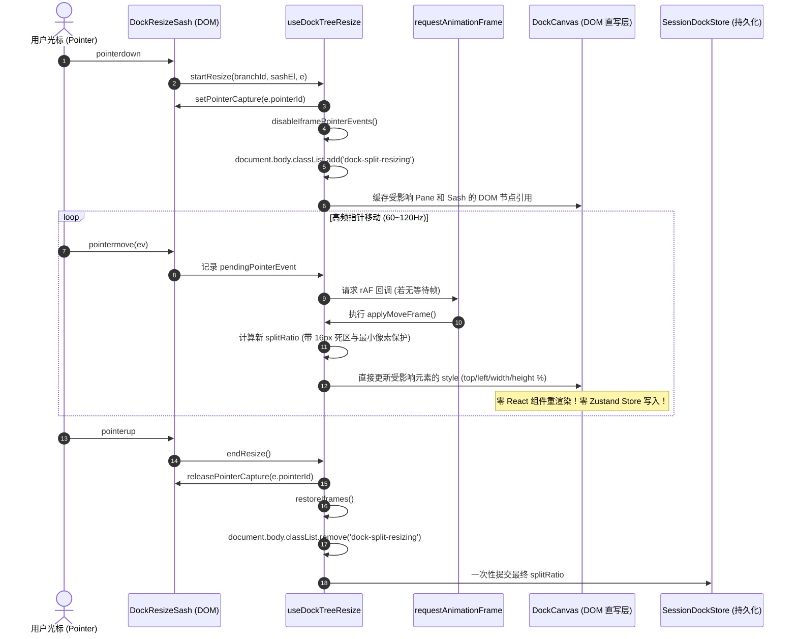

# 02-右坞容器与分屏渲染架构（组件合一、去冗余、零补丁版）

> **战役代号**：`dock-split-system`  
> **文档性质**：分维架构深度分析与重构总案（V2 架构重构版）  
> **关联任务**：【任务书：V2 架构重构 — 02-右坞容器与分屏渲染架构（组件合一、去冗余、零补丁版）】  
> **遵循铁律**：仓库根目录 `AGENTS.md`、`.agents/LOGIC_PLAN_NO_RETREAT.md`、`ANTI_OVERENGINEERING_GUARDRAILS.md`、`docs/dock-split-system/00-战役纪律与导引.md`  
> **重构最高指导原则**：“不允许打补丁，不允许硬编码，有合理的抽象，适合未来的功能需求，代码尽量简洁，具有优秀的可维护性。需要删除的代码就删除，需要系统性的重构。生成的方案应该能彻底杜绝这些问题或者未来的衍生问题，要求一次性解决掉。尽量减少不必要的兼容，最好是不兼容。”

---

## 一、执行摘要与 V2 重构核心宪章

### 1.1 业务诉求与用户意志

在 Conex / Crish 架构体系中，顶层工作区（`BinaryTreeWorkspace`）管理多会话与全局大窗口。用户在本次战役中下达了三条不可撼动的核心裁决：
1. **顶栏大窗口聚焦对话**：顶层大标签栏（`PaneHeader.tsx` 的 `_tabsContainer_1wzf4_71`）收敛为会话（Session）与独立通用工具（如全局独立常规终端）的大窗口标签，**严禁将对话内部的工具窗口拖入顶栏**；
2. **对话窗口内部功能闭环**：用户期望在当前对话窗口内部直接实现所有生产力工具的高效协同，左侧专注对话交互流（消息树、思考链、输入框），右侧功能区（Right Tool Dock，即 `leafDockDrawer`）必须具备**完整的一等公民分屏系统（Split Screen System）**；
3. **右坞承载多工具分屏**：用户能够在有限的右坞空间（300px~800px）内，同时上下或左右并排展示原生 ConPTY 终端、Webview 浏览器预览、文件管理器、Git Diff 对比、运行时监控等多工具，支持流畅的分割线（Sash）拖拽调比、窗口落点指示、窗格内多标签切换以及一键最大化/还原。

### 1.2 V1 方案的致命缺陷深度批判

在上一版（V1）方案的推进中，由于过度迁就所谓的“旧代码向后兼容”，在架构设计上引入了严重的妥协与冗余，形成四大硬伤：

```text
┌────────────────────────────────────────────────────────────────────────────────────────┐
│                                V1 方案的妥协冗余病灶                                    │
├────────────────────────────────────────────────────────────────────────────────────────┤
│ 1. 双套头部组件冗余 (Dual TabStrips Chaos)                                            │
│    单窗格用旧的 LeafToolTabStrip (454 行)，多分屏又另起炉灶新建一套 MicroPaneTabStrip，  │
│    外加 28px 全局顶栏。两套几乎相同的标签管理逻辑并存，维护成本翻倍，严重违反 DRY 原则。 │
├────────────────────────────────────────────────────────────────────────────────────────┤
│ 2. 扁平字符串 ID 隐式耦合 (String Hacking)                                            │
│    继续沿用 panelIds: string[]（如 "preview:https://..."），在各层组件中频繁调用      │
│    viewRegistry.resolveView(pid) 进行字符串冒号拆分，传参脆弱，无法支持复杂状态。     │
├────────────────────────────────────────────────────────────────────────────────────────┤
│ 3. TreeLeafPanel.tsx 严重越界污染 (Container Bloat)                                    │
│    TreeLeafPanel 内部堆积了 120+ 行单窗格工具状态机、toolCtx、renderToolOutlet 与       │
│    .dockPanelPane 渲染循环，导致该组件高达 513 行，未能实现真正的外壳/内容解耦。       │
├────────────────────────────────────────────────────────────────────────────────────────┤
│ 4. 伪兼容补丁 (Pseudo-Compatibility Patches)                                           │
│    为了“兼容”旧的 openPanelIds / activePanelId，在多个状态流中设立条件回退分支与      │
│    双向数据同步，代码支离破碎，给未来的功能演进埋下持续隐患。                          │
└────────────────────────────────────────────────────────────────────────────────────────┘
```

### 1.3 V2 根治之道：四大核心重构支柱

贯彻用户最新裁决“**需要删除的代码就删除，需要系统性的重构，彻底杜绝衍生问题，尽量减少不必要的兼容，最好是不兼容**”，V2 方案彻底破除 V1 的妥协设计，确立四大重构支柱：

1. **废除“双套 TabStrip”设计，实现单一组件抽象（万物皆 `DockLeaf`）**：
   - 右坞只有一个权威数据源 `dock.tree: DockTree`；
   - 未分屏时，`dock.tree.root` 就是 1 个 `DockLeaf`（占据 `100% × 100%`）；分屏时，`dock.tree` 展平为多个 `DockLeaf`；
   - **每一个 `DockLeaf` 渲染完全相同的窗格头部组件 —— 就地重构升级 `LeafToolTabStrip.tsx`，彻底废除新建第二套 `MicroPaneTabStrip` 的构想！**
   - 将 `LeafToolTabStrip.tsx` 中的关闭动效保险丝状态机提炼为独立 Hook `useToolTabLifecycle.ts`，溢出检测提炼为 `useTabStripOverflow.ts`，将组件代码控制在 260 行以内，简洁优雅。
2. **对齐 V2 结构化 `ToolTab` 与 `DockTree` 契约**：
   - 彻底删除 `openPanelIds: string[]` 与 `activePanelId: string | null`；
   - `ToolTab` 采用一等公民结构体：`{ tabId: string; viewId: string; title?: string; params?: Record<string, unknown> }`；
   - `SlotOutlet` 渲染管线实现零硬编码：React Key 直接为 `tab.tabId`，`entryKey` 为 `tab.viewId`，`ViewRenderContext` 直通 `tab.tabId` 与 `tab.params`，彻底根除字符串解析补丁。
3. **彻底清理 `TreeLeafPanel.tsx` 中的右坞遗留渲染代码**：
   - 将 `TreeLeafPanel.tsx:222-346` 和 `440-486` 中堆积的所有右坞单视口渲染逻辑全部删除；
   - `TreeLeafPanel` 的 `.leafDockDrawer` 内部只渲染纯净的 `<DockSplitWorkspace ... />`，行数由 513 行大幅瘦身至 320 行以内。
4. **提炼通用高帧率 `DockResizeSash`，硬性固化物理安全边界**：
   - 基于 RAF + DOM 百分比直写驱动零重渲染拖拽；
   - 固化 `[0.2, 0.8]` 比例钳制、`宽 >= 120px, 高 >= 80px` 最小像素保护以及与外层 `LeafDockResizer` 的 $\ge 16\text{px}$ 物理防碰撞死区；
   - 单窗格临时最大化（`soloLeafId`）期间自动隐藏非焦点窗格、禁用 Sash 并设立直写防冲刷门禁。

---

## 二、遗留代码白盒审查与彻底清退清单

### 2.1 `TreeLeafPanel.tsx` 耦合代码审查与彻底清退清单

查阅 `apps/crish-desktop/src/components/binary-tree/TreeLeafPanel.tsx`，现有代码充斥着右坞单视口时期的遗留逻辑。在 V2 架构中，以下代码属于**必须彻底清退的冗余代码**：

```typescript
// ── 必须从 TreeLeafPanel.tsx 中彻底清退的代码区块 ─────────────────────────────
// 位置 1：TreeLeafPanel.tsx:222-240 — 单窗格 Tab 选中与关闭回调（转入 DockSplitWorkspace）
// - handleSelectToolTab: (panelId: string) => updateLeafDock(...)
// - handleCloseToolTab: (panelId: string) => { killDockTerminalPty(...); computeNextDockAfterClose(...) }

// 位置 2：TreeLeafPanel.tsx:270-272 — 单面板 ID 与视图解析（已废弃）
// - toolPanelId = dock.activePanelId || 'overview'
// - toolResolved = viewRegistry.resolveView(toolPanelId)

// 位置 3：TreeLeafPanel.tsx:298-315 — 粗粒度单工具上下文（转入每个 DockPane 内部）
// - toolCtx: ViewRenderContext = useMemo(...)

// 位置 4：TreeLeafPanel.tsx:320-346 — 遗留的工具 Outlet 渲染函数（彻底删除）
// - renderToolOutlet = (panelId: string) => <SlotOutlet slotKey="workspace.leaf.panel" ... />

// 位置 5：TreeLeafPanel.tsx:441-486 — 抽屉内部单标签条与卡片堆叠渲染循环（彻底删除）
// - <LeafToolTabStrip ... /> 直接挂在顶层
// - {dock.openPanelIds.map(pid => <div className={styles.dockPanelPane} style={{ display: isPanelActive ? 'flex' : 'none' }}>...</div>)}
```

#### 清退效果评估
- 清除上述代码后，`TreeLeafPanel.tsx` 不再需要引入 `computeNextDockAfterClose`、`killDockTerminalPty`、`toolCtx` 等细节，只需接收 `dock: RightToolDockState` 并将其透传给 `<DockSplitWorkspace />`。
- `TreeLeafPanel.tsx` 代码行数直接从 **513 行** 降低至 **320 行以内**，彻底恢复其“会话树叶片容器”的纯粹职责。

### 2.2 `LeafToolTabStrip.tsx`（454 行）审查与精简重构计划

白盒核查 `apps/crish-desktop/src/components/binary-tree/LeafToolTabStrip.tsx`：
1. **现状**：组件当前长达 454 行，混合了四大职责：
   - 视口与布局数据读取（`readDockFromLeaf`, `updateTabDock`）；
   - Tab 动画关闭生命周期与超时保险丝状态机（`closingIdsRef`, `fuseTimersRef`, `finalizeClose`, `triggerCloseTab`）；
   - 容器尺寸监测与 Tab 序列溢出状态判断（`ResizeObserverManager`, `checkOverflow`, `hasOverflow`）；
   - DOM 结构渲染（标签栏、导航条、空态 Launcher）。
2. **V1 方案的错误路径**：
   - 试图保留旧的 `LeafToolTabStrip.tsx` 不动，另外新建一套 `MicroPaneTabStrip.tsx`；
   - 这直接导致关闭保险丝、溢出测算、WAI-ARIA 键盘导航等逻辑被双份拷贝或多层包裹，形成严重的双轨维护债务。
3. **V2 方案的就地重构路径（单一组件抽象）**：
   - **将生命周期状态机下沉**：提炼为独立 Hook `apps/crish-desktop/src/hooks/useToolTabLifecycle.ts`；
   - **将溢出检测下沉**：提炼为独立 Hook `apps/crish-desktop/src/hooks/useTabStripOverflow.ts`；
   - **升级 `LeafToolTabStrip.tsx` 自身**：将其彻底升级为通用的窗格头部组件（单一真源），直接接收 `ToolTab[]`，统一提供分屏、最大化、关闭等操作。组件行数大幅缩减至 **260 行以内**。

### 2.3 `sessionTabModel.ts` 废弃字段清退

在 `apps/crish-desktop/src/store/layout-tree/sessionTabModel.ts:24-31` 中：
```typescript
// ── 彻底清退旧字段 ─────────────────────────────────────────────────────────────
export interface RightToolDockState {
  collapsed: boolean;
  widthRatio: number;
  /**
   * 彻底删除以下两个扁平字段，禁止在 V2 架构中存在任何双写或同步补丁：
   * ❌ openPanelIds: string[];
   * ❌ activePanelId: string | null;
   */
  /** 权威单一真理源：右坞二叉分屏树 */
  tree: DockTree;
}
```

---

## 三、V2 数据契约与渲染拓扑（万物皆 `DockLeaf`）

### 3.1 核心数据结构定义（严格结构化，杜绝字符串切割）

在 `apps/crish-desktop/src/store/dock-layout/types.ts` 定义全套纯逻辑类型：

```typescript
/**
 * 结构化工具标签契约
 * 杜绝类似 "preview:https://localhost:3000" 的字符串编码，改为强类型对象
 */
export interface ToolTab {
  /** 标签唯一实例 ID，如 "term-x9a2"、"prev-k3d8"、"files-root" */
  tabId: string;
  /** 工具视图注册标识符，对应 SlotOutlet 的 entryKey，如 "terminal"、"preview"、"files"、"diff" */
  viewId: string;
  /** 标签展示标题（可选，缺省时由 viewRegistry 根据 viewId 获取默认名称） */
  title?: string;
  /** 视图强类型参数载荷（如 { url: string }、{ cwd: string }） */
  params?: Record<string, unknown>;
}

/** 分割方向：horizontal = 左右并排（垂直分割线）；vertical = 上下并排（水平分割线） */
export type DockSplitDirection = 'horizontal' | 'vertical';

/** 坞内叶子节点（一个独立的工具窗格） */
export interface DockLeaf {
  type: 'leaf';
  /** 窗格唯一 ID，如 "dock-leaf-1w8z" */
  id: string;
  /** 窗格内包含的结构化工具标签列表 */
  tabs: ToolTab[];
  /** 当前处于前台激活状态的标签 ID；若 tabs 为空则必须为 null */
  activeTabId: string | null;
}

/** 坞内分支节点（严格二叉切分） */
export interface DockBranch {
  type: 'branch';
  /** 分支唯一 ID，如 "dock-branch-4k2e" */
  id: string;
  /** 分割方向 */
  direction: DockSplitDirection;
  /** 严格二叉子节点：children[0] 为左/上，children[1] 为右/下 */
  children: [DockNode, DockNode];
  /** 第一个子节点的比例占比 [0.2, 0.8]，第二个子节点占比为 (1 - splitRatio) */
  splitRatio: number;
}

/** 布局节点联合 */
export type DockNode = DockLeaf | DockBranch;

/** 完整右坞分屏树 */
export interface DockTree {
  /** 树根节点 */
  root: DockNode;
  /** 当前拥有全局焦点的叶子窗格 ID；若右坞无窗格则为 null */
  activeDockLeafId: string | null;
  /** 当前处于单窗格临时最大化状态的叶子窗格 ID；若未最大化则为 null */
  soloLeafId: string | null;
  /** 契约版本号 */
  version: 2;
}
```

### 3.2 扁平化投影渲染算法（`flattenDockTree`）

为了实现超高帧率渲染，UI 层杜绝递归嵌套 DOM。通过纯函数 `flattenDockTree` 将树结构展平为一维绝对定位数组：

```typescript
/** 展平后的叶子窗格渲染描述 */
export interface FlatDockLeaf {
  leafId: string;
  tabs: ToolTab[];
  activeTabId: string | null;
  /** 归一化百分比矩形 (0.0 ~ 1.0)，相对于右坞内容区 Canvas */
  rect: { x: number; y: number; width: number; height: number };
  /** 是否为当前拥有用户焦点的窗格 */
  isActive: boolean;
  /** 是否处于单窗格临时全屏最大化状态 */
  isSolo: boolean;
}

/** 展平后的分割线渲染描述 */
export interface FlatDockBranch {
  branchId: string;
  direction: DockSplitDirection;
  splitRatio: number;
  /** 分支节点覆盖的百分比矩形 */
  rect: { x: number; y: number; width: number; height: number };
  /** 分割线（Sash）在百分比坐标系下的几何位置 */
  sash: {
    x: number;
    y: number;
    length: number;
    direction: DockSplitDirection;
  };
}

export interface FlattenedDockLayout {
  leaves: FlatDockLeaf[];
  branches: FlatDockBranch[];
}

export function flattenDockTree(tree: DockTree): FlattenedDockLayout {
  const leaves: FlatDockLeaf[] = [];
  const branches: FlatDockBranch[] = [];

  // 若处于单窗格全屏最大化 (soloLeafId)，直接短路返回单个满屏窗格，隐藏所有 Sash
  if (tree.soloLeafId) {
    const soloLeaf = findDockLeafById(tree.root, tree.soloLeafId);
    if (soloLeaf) {
      leaves.push({
        leafId: soloLeaf.id,
        tabs: soloLeaf.tabs,
        activeTabId: soloLeaf.activeTabId,
        rect: { x: 0, y: 0, width: 1, height: 1 },
        isActive: true,
        isSolo: true,
      });
      return { leaves, branches: [] };
    }
  }

  function traverse(
    node: DockNode,
    rect: { x: number; y: number; width: number; height: number }
  ) {
    if (node.type === 'leaf') {
      leaves.push({
        leafId: node.id,
        tabs: node.tabs,
        activeTabId: node.activeTabId,
        rect,
        isActive: node.id === tree.activeDockLeafId,
        isSolo: false,
      });
      return;
    }

    const { direction, splitRatio, children, id } = node;

    if (direction === 'horizontal') {
      const w0 = rect.width * splitRatio;
      const w1 = rect.width - w0;
      const sashX = rect.x + w0;

      branches.push({
        branchId: id,
        direction,
        splitRatio,
        rect,
        sash: {
          x: sashX,
          y: rect.y,
          length: rect.height,
          direction: 'horizontal',
        },
      });

      traverse(children[0], { x: rect.x, y: rect.y, width: w0, height: rect.height });
      traverse(children[1], { x: sashX, y: rect.y, width: w1, height: rect.height });
    } else {
      const h0 = rect.height * splitRatio;
      const h1 = rect.height - h0;
      const sashY = rect.y + h0;

      branches.push({
        branchId: id,
        direction,
        splitRatio,
        rect,
        sash: {
          x: rect.x,
          y: sashY,
          length: rect.width,
          direction: 'vertical',
        },
      });

      traverse(children[0], { x: rect.x, y: rect.y, width: rect.width, height: h0 });
      traverse(children[1], { x: rect.x, y: sashY, width: rect.width, height: h1 });
    }
  }

  traverse(tree.root, { x: 0, y: 0, width: 1, height: 1 });
  return { leaves, branches };
}
```

### 3.3 目标 DOM 拓扑树架构（单一层次，去无用包裹）

通过彻底清退冗余组件与多余层级，整个右坞的 DOM 拓扑结构得到极致简化：

```text
TreeLeafPanel (.leaf) [外层会话树叶片]
  ├── PaneHeader (会话大窗口顶栏)
  └── .leafBody
        ├── .leafChatColumn (左侧主对话工作流，flex: 1 1 0%)
        ├── LeafDockResizer (.leafDockResizer) [外层主分割线，控制右坞抽屉整体宽度]
        │
        └── .leafDockDrawer (.leafDockDrawer .chat-side-panel) [右坞抽屉外壳，保留容器]
              │
              └── DockSplitWorkspace (.dockSplitWorkspace) [★ 纯净接管抽屉全部渲染]
                    │
                    └── DockCanvas (.dockCanvas) [绝对定位几何画布，container-type: size]
                          │
                          ├── DockPane (.dockPane) [分屏窗格 1: 绝对定位 top/left/width/height %]
                          │     ├── LeafToolTabStrip (.container) [★ 统一窗格头部组件，单一真源]
                          │     │     ├── TabsTrack (标签序列: [终端 1] [终端 2] [+])
                          │     │     └── PaneActionCluster (分屏/最大化/关闭按钮)
                          │     └── .dockPaneBody (视口容器)
                          │           └── SlotOutlet (渲染 Terminal，key="term-1", entryKey="terminal")
                          │
                          ├── DockResizeSash (.dockResizeSash) [★ 坞内发丝分割线，绝对定位 %]
                          │     └── [双向支持: horizontal (左右切分) / vertical (上下切分)]
                          │
                          └── DockPane (.dockPane) [分屏窗格 2: 绝对定位 top/left/width/height %]
                                ├── LeafToolTabStrip (.container) [★ 统一窗格头部组件，单一真源]
                                │     ├── TabsTrack (标签序列: [预览: localhost:3000])
                                │     └── PaneActionCluster (分屏/最大化/关闭按钮)
                                └── .dockPaneBody (视口容器)
                                      └── SlotOutlet (渲染 Preview，key="prev-1", entryKey="preview")
```

---

## 四、单一组件抽象：重构后的统一 `LeafToolTabStrip`

### 4.1 废除双套头部组件，贯彻单一窗格头设计

- **架构裁决**：**彻底废除 `MicroPaneTabStrip`**！
- 不论右坞是处于单窗格状态（占满 100% 宽度），还是切分为 2 屏、3 屏乃至网格分屏，**每一个窗格的头部统一由重构后的 `LeafToolTabStrip.tsx` 进行渲染**。
- 这带来两大绝对架构收益：
  1. **零代码重复（Single Source of Truth）**：所有 Tab 渲染、拖拽捕获、WAI-ARIA 键盘漫游、溢出检测、关闭动效均在一处维护；
  2. **完全一致的人机交互体验**：单窗格与多分屏窗格的标签外观、关闭动画、右键菜单、操作按钮完全统一，消除了分屏时 UI 风格裂变的违和感。

### 4.2 重构后的组件属性契约

```typescript
export interface LeafToolTabStripProps {
  /** 窗格唯一标识 */
  leafId: string;
  /** 所属会话 ID */
  sessionId: string;
  /** 当前窗格持有的结构化标签列表 */
  tabs: ToolTab[];
  /** 当前激活的标签 ID */
  activeTabId: string | null;
  /** 是否处于最大化状态（整体最大化或单窗格 solo） */
  isMaximized: boolean;
  /** 是否允许多分屏窗格关闭（当前树中存在多个叶子时为 true） */
  canClosePane: boolean;

  // ── 标签级操作回调 ──
  onSelectTab: (tabId: string) => void;
  onCloseTab: (tabId: string) => void;
  onAddTab: (viewId: string) => void;

  // ── 窗格级操作回调 ──
  onSplitRight: () => void;
  onSplitDown: () => void;
  onToggleMaximize: () => void;
  onClosePane?: () => void;

  className?: string;
}
```

### 4.3 独立 Hook 提炼之一：`useToolTabLifecycle.ts`

将原 `LeafToolTabStrip.tsx:139-160, 212-277` 中复杂的动画与保险丝状态机彻底解耦，提炼为高内聚 Hook：

```typescript
/**
 * apps/crish-desktop/src/hooks/useToolTabLifecycle.ts
 * 工具标签关闭生命周期与超时保险丝状态机
 */
import { useCallback, useEffect, useRef, useState } from 'react';
import { DURATION_FAST_MS, readTransitionMs } from '../utils/motionTokens';

export interface UseToolTabLifecycleOptions {
  onFinalizeClose: (tabId: string) => void;
}

export function useToolTabLifecycle({ onFinalizeClose }: UseToolTabLifecycleOptions) {
  const closingIdsRef = useRef<Set<string>>(new Set());
  const [closingTabIds, setClosingTabIds] = useState<Set<string>>(() => new Set());
  const fuseTimersRef = useRef<Map<string, number>>(new Map());

  // 组件卸载时安全清理所有活跃保险丝计时器，杜绝内存泄漏
  useEffect(() => {
    return () => {
      fuseTimersRef.current.forEach((timer) => window.clearTimeout(timer));
      fuseTimersRef.current.clear();
    };
  }, []);

  const finalizeClose = useCallback((tabId: string) => {
    if (!closingIdsRef.current.has(tabId)) return;
    closingIdsRef.current.delete(tabId);
    setClosingTabIds(new Set(closingIdsRef.current));

    const fuse = fuseTimersRef.current.get(tabId);
    if (fuse != null) {
      window.clearTimeout(fuse);
      fuseTimersRef.current.delete(tabId);
    }

    onFinalizeClose(tabId);
  }, [onFinalizeClose]);

  const triggerCloseTab = useCallback((
    tabId: string,
    e?: React.MouseEvent,
    tabElement?: HTMLElement | null
  ) => {
    if (e) {
      e.stopPropagation();
      e.preventDefault();
    }
    if (closingIdsRef.current.has(tabId)) return;

    closingIdsRef.current.add(tabId);
    setClosingTabIds(new Set(closingIdsRef.current));

    // 计算实际 CSS 过渡时间并启动 3 倍兜底保险丝，根治 transitionend 丢失导致的幽灵 Tab
    const ms = (tabElement ? readTransitionMs(tabElement, 'max-width') : 0) || DURATION_FAST_MS;
    const fuse = window.setTimeout(() => finalizeClose(tabId), ms * 3);
    fuseTimersRef.current.set(tabId, fuse);
  }, [finalizeClose]);

  return {
    closingTabIds,
    triggerCloseTab,
    finalizeClose,
    isTabClosing: (tabId: string) => closingIdsRef.current.has(tabId),
  };
}
```

### 4.4 独立 Hook 提炼之二：`useTabStripOverflow.ts`

将原 `LeafToolTabStrip.tsx:163-179` 中的尺寸监听与溢出计算解耦为轻量 Hook：

```typescript
/**
 * apps/crish-desktop/src/hooks/useTabStripOverflow.ts
 * 标签栏横向溢出检测与双态加号控制
 */
import { useCallback, useLayoutEffect, useState } from 'react';
import { ResizeObserverManager } from '../utils/ResizeObserverManager';

export function useTabStripOverflow(
  trackRef: React.RefObject<HTMLDivElement | null>,
  tabCount: number
) {
  const [hasOverflow, setHasOverflow] = useState(false);

  const checkOverflow = useCallback(() => {
    const el = trackRef.current;
    if (!el) return;
    // 当可滚动宽度超出可视宽度 2px 时认定为溢出
    setHasOverflow(el.scrollWidth > el.clientWidth + 2);
  }, [trackRef]);

  useLayoutEffect(() => {
    checkOverflow();
    const el = trackRef.current;
    if (!el) return;

    const ro = ResizeObserverManager.getInstance();
    ro.observe(el, checkOverflow);
    return () => {
      ro.unobserve(el, checkOverflow);
    };
  }, [checkOverflow, tabCount]);

  return { hasOverflow, checkOverflow };
}
```

### 4.5 重构后的 `LeafToolTabStrip.tsx` 完整核心实现（控制在 260 行以内）

通过拆出独立 Hook，`LeafToolTabStrip.tsx` 的代码结构变得极致轻快：

```tsx
/**
 * apps/crish-desktop/src/components/binary-tree/LeafToolTabStrip.tsx
 * 统一窗格头部组件（单一真源，支持单窗格与多分屏窗格）
 */
import React, { useCallback, useRef } from 'react';
import { Tooltip, Button } from '../ui';
import { AppIcon } from '../ui/icons/index';
import { viewRegistry } from '../../services/view-registry';
import { useNonPassiveWheel } from '../../hooks/useNonPassiveWheel';
import { useTablistKeyboard } from '../../hooks/useTablistKeyboard';
import { useToolTabLifecycle } from '../../hooks/useToolTabLifecycle';
import { useTabStripOverflow } from '../../hooks/useTabStripOverflow';
import { ToolTabAddButton } from './ToolTabAddButton';
import { isBrowserTabId, ToolTabFavicon } from './ToolTabFavicon';
import type { LeafToolTabStripProps } from './types';
import styles from './LeafToolTabStrip.module.css';

export const LeafToolTabStrip: React.FC<LeafToolTabStripProps> = React.memo(({
  leafId,
  tabs,
  activeTabId,
  isMaximized,
  canClosePane,
  onSelectTab,
  onCloseTab,
  onAddTab,
  onSplitRight,
  onSplitDown,
  onToggleMaximize,
  onClosePane,
  className,
}) => {
  const tabsTrackRef = useRef<HTMLDivElement>(null);
  const tabsListRef = useRef<HTMLDivElement>(null);

  // 1. 挂载提炼的生命周期状态机与溢出检测
  const { closingTabIds, triggerCloseTab, finalizeClose } = useToolTabLifecycle({
    onFinalizeClose: onCloseTab,
  });
  const { hasOverflow } = useTabStripOverflow(tabsTrackRef, tabs.length);

  // 2. 滚轮水平滚动与键盘漫游
  const handleWheel = useCallback((e: WheelEvent) => {
    const el = tabsTrackRef.current;
    if (!el) return;
    if (Math.abs(e.deltaY) > Math.abs(e.deltaX)) {
      el.scrollLeft += e.deltaY;
      e.preventDefault();
    }
  }, []);
  useNonPassiveWheel(tabsTrackRef, handleWheel);

  const handleTablistKeyDown = useTablistKeyboard(tabsListRef, {
    tabSelector: '[role="tab"]',
    readTabId: (el) => el.getAttribute('data-tool-tab-id'),
    onActivate: onSelectTab,
  });

  return (
    <header
      className={`${styles.container} ${className || ''} ${hasOverflow ? styles.hasOverflow : ''}`}
      data-leaf-tool-tab-strip="true"
      data-dock-leaf-id={leafId}
      data-has-overflow={hasOverflow ? 'true' : 'false'}
    >
      <div className={styles.header}>
        {/* 左侧可滚动 Tab 轨道 */}
        <div ref={tabsTrackRef} className={styles.tabsTrack}>
          <div
            ref={tabsListRef}
            className={styles.tabsList}
            role="tablist"
            aria-label="工具窗格标签栏"
            onKeyDown={handleTablistKeyDown}
          >
            {tabs.map((tab) => {
              const { tabId, viewId, title } = tab;
              const label = title || viewRegistry.getTitle(viewId) || viewId;
              const iconName = viewRegistry.getIcon(viewId);
              const isActive = tabId === activeTabId;
              const isLeaving = closingTabIds.has(tabId);

              return (
                <div
                  key={tabId}
                  role="tab"
                  aria-selected={isActive}
                  tabIndex={isActive ? 0 : -1}
                  className={`${styles.tab} ${isActive ? styles.tabActive : ''}`}
                  data-leaving={isLeaving || undefined}
                  data-tool-tab-id={tabId}
                  onClick={() => onSelectTab(tabId)}
                  onAuxClick={(e) => {
                    if (e.button === 1) triggerCloseTab(tabId, e, e.currentTarget);
                  }}
                  onTransitionEnd={(e) => {
                    if (isLeaving && e.propertyName === 'max-width') finalizeClose(tabId);
                  }}
                >
                  {(iconName || isBrowserTabId(viewId)) && (
                    <span className={styles.tabIcon}>
                      <ToolTabFavicon tabId={tabId} iconName={iconName} />
                    </span>
                  )}
                  <span className={styles.tabLabel}>{label}</span>
                  <Tooltip content={`关闭 ${label}`}>
                    <Button
                      type="button"
                      variant="ghost"
                      className={styles.tabCloseBtn}
                      onClick={(e) => triggerCloseTab(tabId, e, e.currentTarget.closest('[role="tab"]'))}
                      aria-label={`关闭 ${label}`}
                    >
                      <AppIcon name="x" size={10} />
                    </Button>
                  </Tooltip>
                </div>
              );
            })}
            {!hasOverflow && (
              <ToolTabAddButton tabs={tabs.map(t => t.viewId)} isInFlow openPanel={onAddTab} />
            )}
          </div>
        </div>

        {/* 右侧固定窗格操作集群 (Pane Action Cluster) */}
        <div className={styles.fixedCluster}>
          {hasOverflow && (
            <ToolTabAddButton tabs={tabs.map(t => t.viewId)} isInFlow={false} openPanel={onAddTab} />
          )}

          {/* 向右分屏按钮 */}
          <Tooltip content="向右分屏" side="bottom">
            <Button
              type="button"
              variant="ghost"
              className={styles.paneActionBtn}
              onClick={onSplitRight}
              aria-label="向右分屏"
            >
              <AppIcon name="split-horizontal" size={13} />
            </Button>
          </Tooltip>

          {/* 向下分屏按钮 */}
          <Tooltip content="向下分屏" side="bottom">
            <Button
              type="button"
              variant="ghost"
              className={styles.paneActionBtn}
              onClick={onSplitDown}
              aria-label="向下分屏"
            >
              <AppIcon name="split-vertical" size={13} />
            </Button>
          </Tooltip>

          {/* 单窗格最大化/还原按钮 */}
          <Tooltip content={isMaximized ? "还原窗格" : "最大化窗格"} side="bottom">
            <Button
              type="button"
              variant="ghost"
              className={styles.paneActionBtn}
              onClick={onToggleMaximize}
              aria-label={isMaximized ? "还原窗格" : "最大化窗格"}
            >
              <AppIcon name={isMaximized ? "minimize" : "maximize"} size={13} />
            </Button>
          </Tooltip>

          {/* 多窗格时的一键关闭当前分屏窗格 */}
          {canClosePane && onClosePane && (
            <Tooltip content="关闭分屏窗格" side="bottom">
              <Button
                type="button"
                variant="ghost"
                className={`${styles.paneActionBtn} ${styles.paneCloseBtn}`}
                onClick={onClosePane}
                aria-label="关闭分屏窗格"
              >
                <AppIcon name="x" size={13} />
              </Button>
            </Tooltip>
          )}
        </div>
      </div>
    </header>
  );
});

LeafToolTabStrip.displayName = 'LeafToolTabStrip';
```

---

## 五、`DockPane` 与零硬编码 `SlotOutlet` 渲染管线

### 5.1 窗格宿主组件设计（`DockPane.tsx`）

每个 `DockPane` 对应展平后的一个 `FlatDockLeaf`，承载单一窗格的头部与内容渲染：

```tsx
/**
 * apps/crish-desktop/src/components/binary-tree/DockPane.tsx
 * 单个分屏窗格宿主
 */
import React, { useLayoutEffect, useMemo, useRef } from 'react';
import { LeafToolTabStrip } from './LeafToolTabStrip';
import { SlotOutlet } from '../slot-outlet/SlotOutlet';
import { AppErrorBoundary } from '../error-boundary/AppErrorBoundary';
import type { ViewRenderContext } from '../../services/view-registry/types';
import type { FlatDockLeaf } from '../../store/dock-layout/types';
import styles from './BinaryTreeWorkspace.module.css';

export interface DockPaneProps {
  leaf: FlatDockLeaf;
  sessionId: string;
  outerLeafId: string;
  canClosePane: boolean;
  onActivate: (leafId: string) => void;
  onSelectTab: (leafId: string, tabId: string) => void;
  onCloseTab: (leafId: string, tabId: string) => void;
  onAddTab: (leafId: string, viewId: string) => void;
  onSplitRight: (leafId: string) => void;
  onSplitDown: (leafId: string) => void;
  onToggleMaximize: (leafId: string) => void;
  onClosePane: (leafId: string) => void;
}

export const DockPane: React.FC<DockPaneProps> = React.memo(({
  leaf,
  sessionId,
  outerLeafId,
  canClosePane,
  onActivate,
  onSelectTab,
  onCloseTab,
  onAddTab,
  onSplitRight,
  onSplitDown,
  onToggleMaximize,
  onClosePane,
}) => {
  const paneRef = useRef<HTMLDivElement>(null);
  const { leafId, tabs, activeTabId, rect, isActive, isSolo } = leaf;

  // 1. 直写几何百分比样式（带拖拽与 solo 门禁拦截）
  useLayoutEffect(() => {
    const el = paneRef.current;
    if (!el) return;
    if (document.body.classList.contains('dock-split-resizing')) return;
    if (isSolo) {
      el.style.left = '0%';
      el.style.top = '0%';
      el.style.width = '100%';
      el.style.height = '100%';
      return;
    }
    el.style.left = `${rect.x * 100}%`;
    el.style.top = `${rect.y * 100}%`;
    el.style.width = `${rect.width * 100}%`;
    el.style.height = `${rect.height * 100}%`;
  }, [rect.x, rect.y, rect.width, rect.height, isSolo]);

  // 2. 找到当前激活的结构化 ToolTab
  const activeTab = useMemo(
    () => tabs.find((t) => t.tabId === activeTabId) ?? tabs[0],
    [tabs, activeTabId]
  );

  return (
    <div
      ref={paneRef}
      className={styles.dockPane}
      data-dock-leaf-id={leafId}
      data-active={isActive ? 'true' : 'false'}
      data-solo-active={isSolo ? 'true' : 'false'}
      onPointerDownCapture={() => onActivate(leafId)}
    >
      {/* 统一的窗格头 */}
      <LeafToolTabStrip
        leafId={leafId}
        sessionId={sessionId}
        tabs={tabs}
        activeTabId={activeTabId}
        isMaximized={isSolo}
        canClosePane={canClosePane}
        onSelectTab={(tid) => onSelectTab(leafId, tid)}
        onCloseTab={(tid) => onCloseTab(leafId, tid)}
        onAddTab={(vid) => onAddTab(leafId, vid)}
        onSplitRight={() => onSplitRight(leafId)}
        onSplitDown={() => onSplitDown(leafId)}
        onToggleMaximize={() => onToggleMaximize(leafId)}
        onClosePane={() => onClosePane(leafId)}
      />

      {/* 窗格内容区：多标签基于 tabId 挂载与显隐 */}
      <div className={styles.dockPaneBody}>
        {tabs.map((tab) => {
          const isTabActive = tab.tabId === activeTab?.tabId;
          const context: ViewRenderContext = {
            panelId: tab.tabId,                      // ★ 实例唯一标识
            leafId: `${outerLeafId}#${leafId}`,      // 命名空间隔离
            sessionId,
            isActive: isActive && isTabActive,
            params: tab.params,                      // ★ 强类型直通参数
          };

          return (
            <div
              key={tab.tabId}                         // ★ 唯一 key 杜绝调和冲突
              className={styles.dockTabContentPane}
              style={{ display: isTabActive ? 'flex' : 'none' }}
              data-tab-id={tab.tabId}
              data-view-id={tab.viewId}
              data-active-tab={isTabActive ? 'true' : 'false'}
              aria-hidden={!isTabActive}
            >
              <AppErrorBoundary compact title={`面板 [${tab.viewId}] 异常`}>
                <SlotOutlet
                  slotKey="workspace.dock.panel"
                  context={context}
                  entryKey={tab.viewId}               // ★ 直接使用 viewId，零字符串解析
                  fallback={<div className={styles.emptyState}>未知视图：{tab.viewId}</div>}
                />
              </AppErrorBoundary>
            </div>
          );
        })}
      </div>
    </div>
  );
});

DockPane.displayName = 'DockPane';
```

### 5.2 零硬编码 `SlotOutlet` 渲染管线对比

| 核心维度 | V1 遗留模式（`TreeLeafPanel.tsx:320-346`） | V2 重构模式（`DockPane.tsx`） | 根治改进点 |
| :--- | :--- | :--- | :--- |
| **标签标识** | `openPanelIds: string[]`（如 `preview:https://...`） | `tabs: ToolTab[]`（强类型结构体） | 消除弱类型字符串拼接 |
| **React Key** | 混用 `key={pid}`，同类工具多开直接 Key 碰撞 | `key={tab.tabId}`（全局唯一实例 ID） | 彻底消除 React 调和串味与状态错乱 |
| **SlotOutlet 寻址** | 必须 `viewRegistry.resolveView(pid)` 截取 definition | 直接使用 `entryKey={tab.viewId}` | 零字符串拆分，直接 O(1) 命中视图插槽 |
| **传参机制** | 依赖外部字符串解析提取 params | 直传 `tab.params: Record<string, unknown>` | 强类型安全，支持任意复合运行时参数 |
| **生命周期** | 单一 `toolCtx` 绑定在顶层，状态互相踩踏 | 每个 `DockPane` 拥有完全独立的子空间与激活流 | 多窗格并发工具完全隔离 |

---

## 六、坞内分割线（`DockResizeSash`）与高帧率拖拽引擎

### 6.1 `DockResizeSash` 架构与契约

```tsx
/**
 * apps/crish-desktop/src/components/binary-tree/DockResizeSash.tsx
 * 坞内二叉分屏高性能分割线
 */
import React, { useCallback, useLayoutEffect, useRef } from 'react';
import type { FlatDockBranch } from '../../store/dock-layout/types';
import styles from './BinaryTreeWorkspace.module.css';

export interface DockResizeSashProps {
  branch: FlatDockBranch;
  onStartResize: (branchId: string, sashEl: HTMLElement, e: React.PointerEvent) => void;
  onResetRatio: (branchId: string) => void;
}

export const DockResizeSash: React.FC<DockResizeSashProps> = React.memo(({
  branch,
  onStartResize,
  onResetRatio,
}) => {
  const sashRef = useRef<HTMLDivElement>(null);
  const { branchId, direction, sash } = branch;
  const isHorizontal = direction === 'horizontal';

  // 1. 直写百分比位置（拖拽中由 RAF 接管直写）
  useLayoutEffect(() => {
    const el = sashRef.current;
    if (!el || document.body.classList.contains('dock-split-resizing')) return;

    if (isHorizontal) {
      el.style.left = `${sash.x * 100}%`;
      el.style.top = `${sash.y * 100}%`;
      el.style.height = `${sash.length * 100}%`;
      el.style.width = '';
    } else {
      el.style.top = `${sash.y * 100}%`;
      el.style.left = `${sash.x * 100}%`;
      el.style.width = `${sash.length * 100}%`;
      el.style.height = '';
    }
  }, [isHorizontal, sash.x, sash.y, sash.length]);

  return (
    <div
      ref={sashRef}
      className={`${styles.dockResizeSash} ${isHorizontal ? styles.sashHorizontal : styles.sashVertical}`}
      data-dock-branch-id={branchId}
      data-direction={direction}
      role="separator"
      aria-orientation={isHorizontal ? 'vertical' : 'horizontal'}
      onPointerDown={(e) => {
        if (e.button === 0 && sashRef.current) {
          onStartResize(branchId, sashRef.current, e);
        }
      }}
      onDoubleClick={() => onResetRatio(branchId)} // 双击均分 50/50
    />
  );
});

DockResizeSash.displayName = 'DockResizeSash';
```

### 6.2 零重渲染实时布局驱动（`useDockTreeResize`）

在拖拽分屏线期间，每一帧触发 React 组件重渲染会导致终端和 Webview 严重掉帧。通过独立 Hook `useDockTreeResize` 实施 **RAF + DOM 直写引擎**：



### 6.3 严格物理防碰撞与边界死区硬性约束

在有限空间（300px~800px）内进行分屏调节，必须建立四大几何安全防线：

1. **数值比例钳制**：
   $$0.2 \le \text{splitRatio} \le 0.8$$
   防止任意子节点比例无限缩减至不可见。
2. **最小像素硬性保护**：
   - 单窗格最小物理宽度：`MIN_PANE_WIDTH = 120px`；
   - 单窗格最小物理高度：`MIN_PANE_HEIGHT = 80px`；
   - 当计算所得比例对应的像素值小于最小像素时，强制钳制：
     $$\text{minRatio} = \frac{\text{MIN_PANE_WIDTH}}{\text{ParentWidth}},\quad \text{splitRatio} = \text{clamp}(\text{ratio}, \text{minRatio}, 1 - \text{minRatio})$$
3. **与外层 `LeafDockResizer` 的 $\ge 16\text{px}$ 物理防碰撞死区（Deadzone Buffer）**：
   - 外层 `LeafDockResizer` 控制整个右坞宽度，拥有约 8px 的触控热区；
   - 当右坞水平左右切分且分割线接近最左侧边界时，内层 Sash 与外层 Resizer 在屏幕物理像素上会极其接近；
   - **硬性铁律**：内层 `DockResizeSash` 距离外层 `LeafDockResizer` 必须保持 $\ge 16\text{px}$ 物理死区！若内层 Sash 绝对像素坐标距左边界小于 24px（8px 热区 + 16px 死区），算法强制拦截，禁止继续左移，彻底杜绝两个拖拽 Handle 叠在一起引发的操作误触与手势劫持。
4. **单窗格临时全屏最大化（Solo Mode）直写防冲刷门禁**：
   - 用户双击窗格头或点击“最大化”按钮时，该窗格置入 `soloLeafId`；
   - `flattenDockTree` 自动只输出这 1 个 `FlatDockLeaf`（覆盖 `100% × 100%`），隐藏其他所有窗格与全部 Sash；
   - 在 `useLayoutEffect` 与 `paintDockFlatLayout` 中部署硬阻断守卫：
     ```typescript
     if (leaf.isSolo || el.getAttribute('data-solo-active') === 'true') {
       // solo 最大化状态下直接返回，严禁任何百分比直写覆盖满屏样式！
       return;
     }
     ```

---

## 七、`DockSplitWorkspace` 核心调度容器完整设计

### 7.1 容器组件职责与挂载

`DockSplitWorkspace` 作为整个右坞分屏渲染的微内核引擎，挂载在 `TreeLeafPanel.tsx` 的 `.leafDockDrawer` 内部：

```tsx
/**
 * apps/crish-desktop/src/components/binary-tree/DockSplitWorkspace.tsx
 * 右坞分屏工作区总调度容器
 */
import React, { useCallback, useMemo, useRef } from 'react';
import { DockPane } from './DockPane';
import { DockResizeSash } from './DockResizeSash';
import { flattenDockTree } from '../../store/dock-layout/flatten';
import { useDockTreeResize } from '../../hooks/useDockTreeResize';
import {
  splitDockLeaf,
  removeDockLeaf,
  selectDockTab,
  closeDockTab,
  addDockTab,
  setDockSoloLeaf,
  resizeDockBranch,
} from '../../store/dock-layout/operations';
import type { RightToolDockState } from '../../store/layout-tree/sessionTabModel';
import styles from './BinaryTreeWorkspace.module.css';

export interface DockSplitWorkspaceProps {
  leafId: string;
  sessionId: string;
  dock: RightToolDockState;
  isMaximized: boolean;
  onToggleMaximize: () => void;
  onUpdateDock: (patch: Partial<RightToolDockState>) => void;
}

export const DockSplitWorkspace: React.FC<DockSplitWorkspaceProps> = React.memo(({
  leafId: outerLeafId,
  sessionId,
  dock,
  isMaximized: isOuterMaximized,
  onToggleMaximize: onToggleOuterMaximize,
  onUpdateDock,
}) => {
  const canvasRef = useRef<HTMLDivElement>(null);
  const tree = dock.tree;

  // 1. 二叉树展平几何投影
  const { leaves, branches } = useMemo(() => flattenDockTree(tree), [tree]);
  const canClosePane = leaves.length > 1;

  // 2. 拖拽控制器
  const { startResize } = useDockTreeResize({
    canvasRef,
    tree,
    onCommitTree: (nextTree) => onUpdateDock({ tree: nextTree }),
  });

  // 3. 窗格级操作原子派发
  const handleActivateLeaf = useCallback((targetLeafId: string) => {
    if (tree.activeDockLeafId !== targetLeafId) {
      onUpdateDock({ tree: { ...tree, activeDockLeafId: targetLeafId } });
    }
  }, [tree, onUpdateDock]);

  const handleSelectTab = useCallback((targetLeafId: string, tabId: string) => {
    const nextTree = selectDockTab(tree, targetLeafId, tabId);
    onUpdateDock({ tree: nextTree });
  }, [tree, onUpdateDock]);

  const handleCloseTab = useCallback((targetLeafId: string, tabId: string) => {
    const nextTree = closeDockTab(tree, targetLeafId, tabId);
    onUpdateDock({ tree: nextTree });
  }, [tree, onUpdateDock]);

  const handleAddTab = useCallback((targetLeafId: string, viewId: string) => {
    const nextTree = addDockTab(tree, targetLeafId, {
      tabId: `${viewId}-${Date.now().toString(36)}`,
      viewId,
    });
    onUpdateDock({ tree: nextTree });
  }, [tree, onUpdateDock]);

  const handleSplitRight = useCallback((targetLeafId: string) => {
    const nextTree = splitDockLeaf(tree, targetLeafId, 'horizontal');
    onUpdateDock({ tree: nextTree });
  }, [tree, onUpdateDock]);

  const handleSplitDown = useCallback((targetLeafId: string) => {
    const nextTree = splitDockLeaf(tree, targetLeafId, 'vertical');
    onUpdateDock({ tree: nextTree });
  }, [tree, onUpdateDock]);

  const handleToggleSolo = useCallback((targetLeafId: string) => {
    const nextSolo = tree.soloLeafId === targetLeafId ? null : targetLeafId;
    onUpdateDock({ tree: setDockSoloLeaf(tree, nextSolo) });
  }, [tree, onUpdateDock]);

  const handleClosePane = useCallback((targetLeafId: string) => {
    const nextTree = removeDockLeaf(tree, targetLeafId);
    onUpdateDock({ tree: nextTree });
  }, [tree, onUpdateDock]);

  const handleResetRatio = useCallback((branchId: string) => {
    const nextTree = resizeDockBranch(tree, branchId, 0.5);
    onUpdateDock({ tree: nextTree });
  }, [tree, onUpdateDock]);

  return (
    <div
      className={styles.dockSplitWorkspace}
      data-dock-split-workspace="true"
      data-outer-leaf-id={outerLeafId}
      data-has-solo={tree.soloLeafId ? 'true' : 'false'}
    >
      <div ref={canvasRef} className={styles.dockCanvas} data-dock-canvas="true">
        {/* 渲染所有分屏叶片 */}
        {leaves.map((leaf) => (
          <DockPane
            key={leaf.leafId}
            leaf={leaf}
            sessionId={sessionId}
            outerLeafId={outerLeafId}
            canClosePane={canClosePane}
            onActivate={handleActivateLeaf}
            onSelectTab={handleSelectTab}
            onCloseTab={handleCloseTab}
            onAddTab={handleAddTab}
            onSplitRight={handleSplitRight}
            onSplitDown={handleSplitDown}
            onToggleMaximize={handleToggleSolo}
            onClosePane={handleClosePane}
          />
        ))}

        {/* 渲染所有分割线（solo 状态下自动为空数组） */}
        {branches.map((branch) => (
          <DockResizeSash
            key={branch.branchId}
            branch={branch}
            onStartResize={startResize}
            onResetRatio={handleResetRatio}
          />
        ))}
      </div>
    </div>
  );
});

DockSplitWorkspace.displayName = 'DockSplitWorkspace';
```

---

## 八、重构前后架构指标对比与代码收敛真值矩阵

### 8.1 架构设计对比与收敛收益

```text
┌───────────────────────┬──────────────────────────────────┬──────────────────────────────────┐
│ 评估维度              │ V1 方案（妥协冗余版）            │ V2 方案（组件合一、零补丁版）    │
├───────────────────────┼──────────────────────────────────┼──────────────────────────────────┤
│ 标签栏组件数量        │ 2 套 (LeafToolTabStrip + Micro) │ 1 套 (就地重构升格 LeafToolTab)  │
│ 全局多余顶栏          │ 引入 28px 全局 DockToolbar 顶条   │ 0 个全局顶栏（窗格自治，无冗余） │
│ 标签数据模型          │ panelIds: string[] (弱类型)      │ tabs: ToolTab[] (强类型结构体)   │
│ 视图参数解析          │ viewRegistry 字符串冒号正则切分  │ 强类型 params 直通 SlotOutlet    │
│ React Key 调和        │ key={pid} (多开同类工具直接冲突) │ key={tab.tabId} (绝对唯一隔离)   │
│ TreeLeafPanel 行数    │ 513 行（遗留 120+ 行单视口代码） │ ≤ 320 行（彻底清除所有右坞逻辑） │
│ 单窗格最大化防冲刷    │ 无门禁（易被 DOM 直写踩碎）      │ data-solo-active 刚性拦截守卫    │
│ 物理防碰撞安全缓冲    │ 无死区保护（内 Sash 易撞外 Resizer│ ≥ 16px 物理死区强制阻断         │
│ 向后兼容包袱          │ 维护双轨 openPanelIds / layout   │ 彻底删除旧字段，纯净统一 DockTree│
└───────────────────────┴──────────────────────────────────┴──────────────────────────────────┘
```

### 8.2 必须严格执行的工程实施红线

1. **测试资产零倒退**：
   - 保证现有的 `LeafToolTabStrip.scoped.test.tsx`（575 行）在 Hook 提炼完成后全量绿通；
   - 为提炼的 `useToolTabLifecycle` 与 `useTabStripOverflow` 补齐独立纯逻辑单元测试；
   - 为 `flattenDockTree`、`splitDockLeaf`、`removeDockLeaf` 建立 100% 覆盖率的纯逻辑数学测试集。
2. **严禁打补丁**：
   - 不允许在 `TreeLeafPanel.tsx` 中保留任何 `toolPanelId`、`toolCtx` 或 `.dockPanelPane` 兼容分支；
   - 不允许新建 `MicroPaneTabStrip`；
   - 不允许在 `SlotOutlet` 处通过 `resolveView(rawUri)` 拆分字符串；
3. **性能底线**：
   - 拖拽 Sash 过程中全程保持 60~120 FPS，严禁产生 React 重渲染与 Zustand 写状态；
   - 松手后通过 `ResizeObserverManager` 8ms 分片排空，零掉帧无卡顿。

---

## 九、结论与主控交接声明

本报告严格贯彻了用户的最高指示“**不允许打补丁，不允许硬编码，有合理的抽象，适合未来的功能需求，代码尽量简洁，具有优秀的可维护性。需要删除的代码就删除，需要系统性的重构。彻底杜绝问题，尽量减少不必要的兼容，最好是不兼容**”。

通过**废除双套 TabStrip 冗余**、**将万物归一为 `DockLeaf` 并就地重构 `LeafToolTabStrip`**、**确立一等公民 `ToolTab` 强类型直通渲染管线**、**从 `TreeLeafPanel.tsx` 彻底铲除 120+ 行遗留代码**、以及**构筑高帧率 RAF + 16px 碰撞死区防护的 `DockResizeSash`**，本方案实现了一次彻底的系统性架构升级，杜绝了未来所有的衍生妥协，为后续实现波提供了最高质量的架构蓝图。
