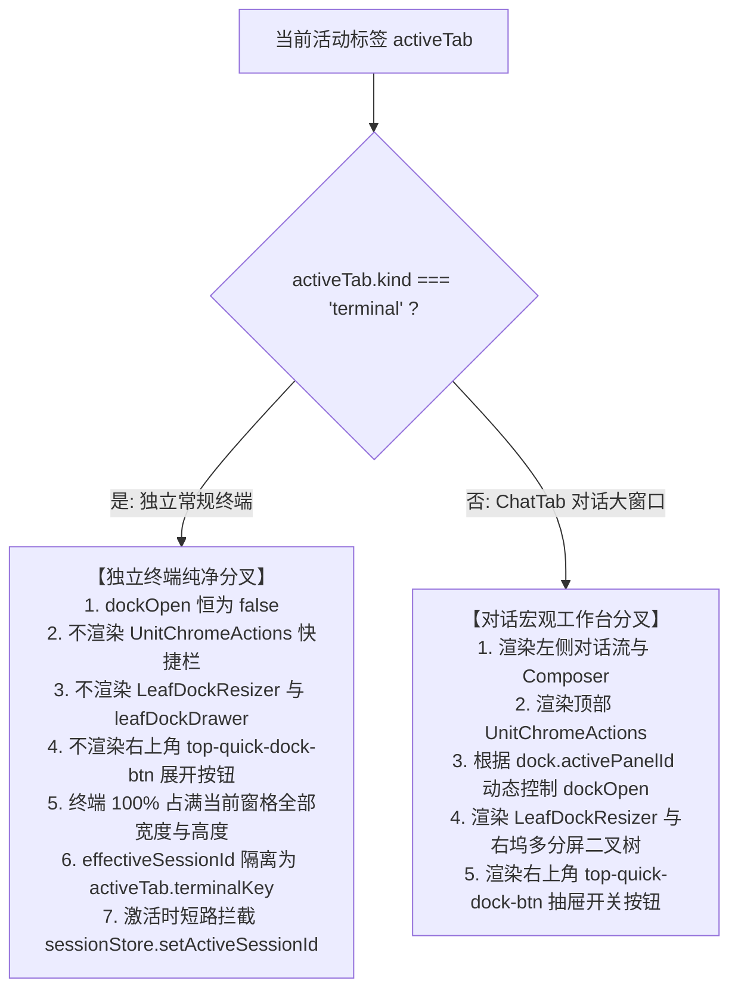
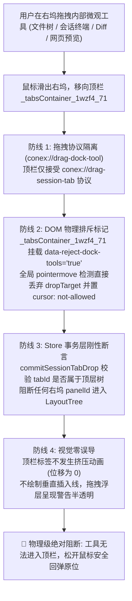
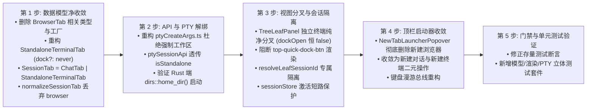

# 03-顶栏大窗口收敛与独立常规终端深度架构设计（V2 彻底收敛版）

> **战役代号**：`dock-split-system`（右侧功能区分屏系统建设战役）  
> **报告类型**：架构重构与专项方案设计（V2 彻底收敛版，基于用户最新无补丁/无兼容包袱裁决）  
> **产出日期**：2026-10-27  
> **核心议题**：顶栏大窗口标签体系收敛、彻底删除顶栏 `BrowserTab`（`kind: 'browser'`）一切残留与过渡补丁、系统性重构独立常规终端（`StandaloneTerminalTab`）正交模型、根除 `ptyCreateArgs.ts` 工作区强制覆盖 Bug、实现 `TreeLeafPanel.tsx` 终端纯净分叉渲染与会话隔离防线、顶栏与右坞终端双轨矩阵、立体跨域防逃逸门禁、一次性无兼容包袱迁移。  
> **权威协作遵循**：仓库根目录 `AGENTS.md`、`.agents/LOGIC_PLAN_NO_RETREAT.md`、`ANTI_OVERENGINEERING_GUARDRAILS.md`、`docs/dock-split-system/00-总方案.md`。

---

## 一、执行摘要与最高指导原则

### 1.1 用户最新意志与“彻底根治、零过渡补丁”铁律

用户对本次架构重构给出了绝对刚性的顶层裁决：
> **“不允许打补丁，不允许硬编码，有合理的抽象，适合未来的功能需求，代码尽量简洁，具有优秀的可维护性。需要删除的代码就删除，需要系统性的重构。生成的方案应该能彻底杜绝这些问题或者未来的衍生问题，要求一次性解决掉。尽量减少不必要的兼容，最好是不兼容。”**

这一铁律对窗口体系与标签容器确立了不可动摇的范式界限：
1. **顶栏大窗口职责纯净化（`class="_tabsContainer_1wzf4_71"` / `PaneHeader.tsx`）**：
   - 顶栏是桌面应用的**宏观大窗口总线**，主体按照**对话（Session）**划分；
   - 顶栏允许存在的工具标签，**仅限不绑定任何会话/项目工作区的全局常规终端（Standalone Terminal）**；
   - 所有对话相关的功能（包括网页浏览/预览 `preview`、项目工作区终端 `terminal`、文件树 `files`、代码差异 `diff` 等），**一律且彻底收敛在对话大窗口内部的右侧功能区分屏系统（Right Tool Dock Split System）中闭环完成**！
2. **对话窗口内部功能闭环（当前窗口实现所有功能）**：
   - 用户不需要也不应该跳出当前会话大窗口；
   - 在当前对话窗口内：左侧是对话流与 Composer 输入框，右侧功能区具备完整的多分屏二叉树系统，并排支持文件树、Diff、会话终端、网页预览。
3. **跨域防线绝对禁止逃逸**：
   - 对话内部在右侧功能区打开的微观工具面板，**绝对不能拖拽到顶部的 `_tabsContainer_1wzf4_71` 里面**。

### 1.2 V1 方案的妥协漏洞反思与 V2 彻底收敛路线

在第一版（V1）方案及早期规划中，存在严重的“妥协式过渡补丁思维”：
- **残留顶栏 `BrowserTab`**：在类型联合中仍保留 `kind: 'browser'`，并保留了顶栏专用的 `addBrowserTab`、`createBrowserTabForStore` 以及 `tabViewAdapter` 中的浏览器分支；
- **所谓的“Phase 1 保留、Phase 4 再删”过渡设计**：试图在顶栏加号菜单中继续保留“新建浏览器”和“工作区终端”选项，试图分四个阶段逐步下线。这种设计引入了大量过渡性分支、条件守卫和死代码，直接违背了“减少不必要的兼容、最好是不兼容、一次性解决掉”的铁律！

**V2 方案彻底根治原则**：
- **一次性彻底删除**：直接从代码库中斩断顶栏 `BrowserTab`（`kind: 'browser'`）的一切代码，顶层大窗口类型彻底收敛为 `SessionTab = ChatTab | StandaloneTerminalTab`；
- **零过渡补丁**：顶栏加号综合启动器（`NewTabLauncherPopover`）一步到位收敛为纯粹二元大窗口总线——【新建对话】与【新建独立终端】；
- **彻底根治路径覆盖**：彻底重构 `ptyCreateArgs.ts`，禁止在独立常规终端模式下抹杀外部路径并强制注入 `getWorkspacePath()`，使独立常规终端直通操作系统用户家目录；
- **历史缓存直接净化**：反序列化 `localStorage` 时直接丢弃旧版 `kind === 'browser'` 标签，绝不保留死代码兼容逻辑。

---

## 二、顶栏多态模型冗余剖析与彻底删除代码清单

### 2.1 顶栏历史残留：`BrowserTab` 的架构违背根因

在早期版本中，顶栏标签栏（`_tabsContainer_1wzf4_71`）被用作承载各种顶层页面的大杂烩，定义了 `TabKind = 'chat' | 'terminal' | 'browser'`。其中 `BrowserTab` 存在以下不可调和的架构矛盾：
1. **上下文层级（Context Scope）倒错**：浏览器在 Conex 产品心智中属于“网页预览与外部资料查阅”，其生命周期与网络调试高度从属于特定开发会话。将浏览器作为顶层大窗口不仅挤占了会话标签栏，而且导致其无法利用会话内部的上下文、右侧工具协同以及分屏比对能力；
2. **状态模型空心化**：`BrowserTab` 强行继承了 `BaseTab` 的 `dock: RightToolDockState`，导致大窗口浏览器右侧也能拉出会话抽屉，形成概念上的“荒谬套娃”；
3. **双重路径冗余**：右侧功能区已经具备完备的 `preview` 工具面板（基于 Webview / NativeBrowserSurface），顶层大窗口又维护一套独立的 `BrowserTab` 与 `tabViewAdapter`，产生了双重真理源与维护负担。

因此，**彻底清除顶层大窗口中的 `BrowserTab`，将网页浏览能力 100% 收敛至右坞分屏系统，是架构净收敛的必由之路。**

---

### 2.2 全量待彻底删除代码清单（精确至文件、行号与移除动作）

下表列出本次 V2 重构中**必须彻底删除**的全部代码点（业务源码将在方案通过后按此清单精确执行移除）：

| 序号 | 所属文件路径 | 行号范围 | 待删除的代码元素 / 分支 | 移除原因与收敛说明 |
| :---: | :--- | :--- | :--- | :--- |
| **1** | `apps/crish-desktop/src/store/layout-tree/sessionTabModel.ts` | 46 | `export type TabKind = 'chat' \| 'terminal' \| 'browser';` | 收敛为 `export type TabKind = 'chat' \| 'terminal';` |
| **2** | `apps/crish-desktop/src/store/layout-tree/sessionTabModel.ts` | 69-74 | `export interface BrowserTab extends BaseTab { kind: 'browser'; url: string; ... }` | 彻底删除 `BrowserTab` 接口定义 |
| **3** | `apps/crish-desktop/src/store/layout-tree/sessionTabModel.ts` | 76-77 | `export type UnifiedTab = ChatTab \| TerminalTab \| BrowserTab;`<br/>`export type SessionTab = UnifiedTab;` | 重塑为 `export type SessionTab = ChatTab \| StandaloneTerminalTab;` |
| **4** | `apps/crish-desktop/src/store/layout-tree/sessionTabModel.ts` | 92-95 | `export function isBrowserTab(tab: unknown): tab is BrowserTab` | 彻底删除类型收窄谓词 |
| **5** | `apps/crish-desktop/src/store/layout-tree/sessionTabModel.ts` | 251-284 | `export function createBrowserTab(...)` | 彻底删除顶栏浏览器标签工厂函数 |
| **6** | `apps/crish-desktop/src/store/layout-tree/sessionTabModel.ts` | 323-336 | `normalizeSessionTab` 中 `if (kind === 'browser') { ... }` 分支 | 反序列化时遇到 `kind === 'browser'` 直接过滤丢弃，不再构建浏览器对象 |
| **7** | `apps/crish-desktop/src/store/layout-tree/layoutTreeTerminalOps.ts` | 10, 12 | `import { createBrowserTab, type BrowserTab } from './sessionTabModel';` | 删除无用导入 |
| **8** | `apps/crish-desktop/src/store/layout-tree/layoutTreeTerminalOps.ts` | 42-61 | `export function createBrowserTabForStore(...)` | 彻底删除 Store 层顶栏浏览器构建函数 |
| **9** | `apps/crish-desktop/src/store/layout-tree/layoutTreeInsert.ts` | 23, 29, 33 | `import type { BrowserTab } ... createBrowserTab ... isBrowserTab` | 删除无用导入 |
| **10** | `apps/crish-desktop/src/store/layout-tree/layoutTreeInsert.ts` | 177-182 | `if (tabOrWorkspaceKey.kind === 'browser') { ... }` | 彻底删除插入浏览器分支 |
| **11** | `apps/crish-desktop/src/store/layout-tree/layoutTreeInsert.ts` | 229-245 | `export function insertBrowserTab(...)` | 彻底删除向布局树插入浏览器标签的操作原语 |
| **12** | `apps/crish-desktop/src/store/layout-tree/layoutTreeStoreTypes.ts` | 96-107 | `addBrowserTab: (leafId?: string, opts?: ...) => BrowserTab;` | 从 Store Actions 契约中彻底剔除该接口 |
| **13** | `apps/crish-desktop/src/store/layout-tree/layoutTreeStore.ts` | 161-178 | `addBrowserTab: (leafId, opts) => { ... }` | 从 Store 实现中彻底删除该 Action |
| **14** | `apps/crish-desktop/src/store/workspace-shell/types.ts` | 108-119 | `addBrowserTab: (leafId?: string, opts?: ...) => BrowserTab;` | 从 Shell Actions 契约中彻底剔除该接口 |
| **15** | `apps/crish-desktop/src/store/workspace-shell/workspaceShellTerminalBrowser.ts` | 194-222 | `export function addBrowserTabToShell(...)` | 彻底删除 Shell 层浏览器包装函数 |
| **16** | `apps/crish-desktop/src/app/compositionRoot.ts` | 74-78, 140-143 | `addBrowserTab: (leafId, opts) => useWorkspaceShellStore.getState().addBrowserTab(...)` | 从组合根接口中彻底移除该转发函数 |
| **17** | `apps/crish-desktop/src/components/binary-tree/tabViewAdapter.ts` | 11 | `export type TabKind = 'chat' \| 'terminal' \| 'browser';` | 收敛为 `export type TabKind = 'chat' \| 'terminal';` |
| **18** | `apps/crish-desktop/src/components/binary-tree/tabViewAdapter.ts` | 31-36 | `export interface BrowserTabLike extends BaseTabLike { kind: 'browser'; ... }` | 彻底删除适配器中的浏览器类型契约 |
| **19** | `apps/crish-desktop/src/components/binary-tree/tabViewAdapter.ts` | 38 | `export type UnifiedTab = ChatTabLike \| TerminalTabLike \| BrowserTabLike;` | 收敛为 `export type UnifiedTab = ChatTabLike \| TerminalTabLike;` |
| **20** | `apps/crish-desktop/src/components/binary-tree/tabViewAdapter.ts` | 88-99 | `if (kind === 'browser') { ... return { viewId: 'preview', ... }; }` | 彻底删除动态视图适配中的顶栏浏览器分支 |
| **21** | `apps/crish-desktop/src/components/binary-tree/NewTabLauncherPopover.tsx` | 138-149 | `const handleActionNewBrowser = useCallback(...)` | 彻底删除启动器中的新建浏览器动作处理函数 |
| **22** | `apps/crish-desktop/src/components/binary-tree/NewTabLauncherPopover.tsx` | 321-337 | `<Button ... onClick={handleActionNewBrowser}>新建浏览器 ⌥B</Button>` | 彻底删除顶栏弹窗中的新建浏览器按钮 DOM 节点 |
| **23** | `apps/crish-desktop/src/components/binary-tree/NewTabLauncherPopover.tsx` | 107, 197-198 | 键盘漫游总线中针对索引 2（浏览器）的判断逻辑与 `totalItems = 3 + ...` | 修正为 `totalItems = 2 + ...`，漫游索引 0 为新建对话，1 为新建终端 |

---

### 2.3 `localStorage` 历史缓存与反序列化清洁防御

在用户启动应用并读取 `localStorage` 旧布局数据时，为了彻底杜绝旧数据中可能残留的 `{ kind: 'browser', ... }` 造成未定义渲染行为，在反序列化入口处实施**静默过滤丢弃**，不保留死代码兼容逻辑：

```typescript
// apps/crish-desktop/src/store/layout-tree/sessionTabModel.ts
/**
 * 工厂层防御：将反序列化对象规范化为纯净的 SessionTab。
 * 1. 若为旧版 kind === 'browser'，直接返回 null（由上层 filter 过滤剔除）；
 * 2. 补齐 dock、拒绝空 tabId、把全局哨兵重铸为 per-tab 哨兵；
 * 3. 仅允许 ChatTab 或 StandaloneTerminalTab 通过。
 */
export function normalizeSessionTab(t: unknown): SessionTab | null {
  if (!t || typeof t !== 'object') return null;
  const o = t as Record<string, unknown>;
  const tabId =
    typeof o.tabId === 'string' && o.tabId.trim() ? o.tabId.trim() : '';
  if (!tabId) return null;

  const kind = typeof o.kind === 'string' ? o.kind : undefined;

  // 🔒 铁律：遇到旧版 browser 标签，直接丢弃，绝不反序列化为死代码对象！
  if (kind === 'browser') {
    return null;
  }

  const titleRaw = typeof o.title === 'string' ? o.title.trim() : '';
  const wkRaw = typeof o.workspaceKey === 'string' ? o.workspaceKey.trim() : '';
  const workspaceKey = wkRaw || DEFAULT_WORKSPACE_KEY;

  if (kind === 'terminal') {
    const terminalKey =
      typeof o.terminalKey === 'string' && o.terminalKey.trim()
        ? o.terminalKey.trim()
        : `standalone:${tabId}`;
    return {
      kind: 'terminal',
      tabId,
      terminalKey,
      title: titleRaw || 'Terminal',
      workspaceKey,
      cwd: typeof o.cwd === 'string' ? o.cwd : '',
    };
  }

  // 默认作为 ChatTab 处理
  const dock =
    o.dock && typeof o.dock === 'object'
      ? createDefaultDock(o.dock as Partial<RightToolDockState>)
      : createDefaultDock();

  const rawSid = typeof o.sessionId === 'string' ? o.sessionId.trim() : '';
  const sessionId =
    !rawSid || rawSid === PENDING_DRAFT_SESSION_ID
      ? mintDraftSessionId(tabId)
      : rawSid;
  const title =
    titleRaw ||
    (isDraftSessionId(sessionId) ? '新对话' : sessionId) ||
    '新对话';

  return { kind: 'chat', tabId, sessionId, title, workspaceKey, dock };
}
```

在上层叶子反序列化（`types.ts` 中的 `createLeaf` 或 `sessionTabMigration.ts`）中：
```typescript
leaf.tabs = rawTabs
  .map(normalizeSessionTab)
  .filter((t): t is SessionTab => t !== null);
if (leaf.tabs.length === 0) {
  leaf.tabs = [createDraftTab()];
  leaf.activeTabId = leaf.tabs[0].tabId;
}
```
通过上述设计，旧缓存中的无效标签在反序列化瞬间即被无损剔除并自愈，系统运行期内绝对不存在任何 `kind === 'browser'` 的脏数据。

---

## 三、顶栏全局独立常规终端（`StandaloneTerminalTab`）正交类型与数据模型重塑

### 3.1 顶栏大窗口标签联合类型定义

按照用户关于“顶栏大窗口按对话划分，允许有不绑定工作区的常规终端”的最高指示，顶层大窗口标签彻底收敛为高度正交的二元联合类型：

```typescript
// apps/crish-desktop/src/store/layout-tree/sessionTabModel.ts

export type TabKind = 'chat' | 'terminal';

/**
 * 宏观对话大窗口标签（ChatTab）
 * 承载完整的左侧对话流与右侧功能区分屏系统（dock）
 */
export interface ChatTab {
  kind: 'chat';
  tabId: string;
  sessionId: string;
  title: string;
  workspaceKey: string;
  dock: RightToolDockState; // 仅 ChatTab 拥有右侧工具坞！
}

/**
 * 顶栏全局常规终端标签（StandaloneTerminalTab）
 * 纯粹的顶级命令行大标签，零工作区绑定、零右坞抽屉挂载
 */
export interface StandaloneTerminalTab {
  kind: 'terminal';
  tabId: string;
  terminalKey: string;      // 命名空间规范：形如 "standalone:term_<tabId>"
  title: string;            // 默认 "Terminal"，绝不拼接项目名
  workspaceKey: string;     // 默认 DEFAULT_WORKSPACE_KEY ('对话')
  cwd: string;              // 默认空字符串 ""（由底层 ConPTY 自动解析为用户系统 HOME / USERPROFILE 目录）或显式传入的家目录，绝不读取 getWorkspacePath()！
  sessionId?: undefined;    // 绝无会话 ID，防止与聊天会话串味
  dock?: never;             // 类型层面彻底禁止 StandaloneTerminalTab 挂载右坞！
}

export type SessionTab = ChatTab | StandaloneTerminalTab;
```

---

### 3.2 `BaseTab` 瓦解与模型正交化

历史代码中的 `BaseTab` 强制为所有标签注入了 `dock: RightToolDockState`：
```typescript
// 历史旧代码（病灶）
export interface BaseTab {
  tabId: string;
  title: string;
  workspaceKey: string;
  dock: RightToolDockState; // 导致终端也携带了右坞状态！
}
```
这导致在渲染终端时，类型系统无法阻止访问 `tab.dock`，造成了第 2.6 节所述的“终端右侧弹出会话抽屉”的严重套娃隐患。

**V2 正交化重塑**：
1. **彻底废除 `BaseTab` 对 `dock` 的强行捆绑**；
2. 仅在 `ChatTab` 中定义 `dock: RightToolDockState`；
3. 在 `StandaloneTerminalTab` 中使用 TypeScript 的 `dock?: never` 属性，在编译期从物理层面拦截向独立终端注入或读取 `dock` 状态的操作；
4. 任何试图对 `StandaloneTerminalTab` 调用 `updateTabDock` 的操作都会在静态类型检查与运行时守卫中被直接阻断。

---

### 3.3 独立终端构造工厂：`createStandaloneTerminalTab`

替换原有的 `createTerminalTabForStore` 强绑逻辑，消除任何对 `getWorkspacePath()` 和 `getActiveProject()` 的隐式调用：

```typescript
// apps/crish-desktop/src/store/layout-tree/sessionTabModel.ts

export function createStandaloneTerminalTab(opts?: {
  tabId?: string;
  title?: string;
  workspaceKey?: string;
  cwd?: string;
}): StandaloneTerminalTab {
  const tabId =
    typeof opts?.tabId === 'string' && opts.tabId.trim()
      ? opts.tabId.trim()
      : mintTabId();

  // 严格命名空间前缀：standalone:term_<tabId>
  const terminalKey = `standalone:term_${tabId}`;

  // 纯粹的终端标题，绝不读取当前活动项目进行拼接！
  const title =
    typeof opts?.title === 'string' && opts.title.trim()
      ? opts.title.trim()
      : 'Terminal';

  const wkRaw =
    typeof opts?.workspaceKey === 'string' ? opts.workspaceKey.trim() : '';

  return {
    kind: 'terminal',
    tabId,
    title,
    workspaceKey: wkRaw || DEFAULT_WORKSPACE_KEY,
    terminalKey,
    // 默认空字符串 ""，绝不调用 getWorkspacePath()；直通底层 ConPTY 解析为家目录
    cwd: typeof opts?.cwd === 'string' ? opts.cwd.trim() : '',
  };
}
```

在 `layoutTreeTerminalOps.ts` 中，`createTerminalTabForStore` 直接升级为面向顶栏独立终端的纯净调用：
```typescript
// apps/crish-desktop/src/store/layout-tree/layoutTreeTerminalOps.ts

export function createTerminalTabForStore(opts?: {
  tabId?: string;
  title?: string;
  workspaceKey?: string;
  cwd?: string;
}): StandaloneTerminalTab {
  return createStandaloneTerminalTab({
    tabId: opts?.tabId,
    title: opts?.title,
    workspaceKey: opts?.workspaceKey,
    cwd: opts?.cwd,
  });
}
```

---

### 3.4 终端命名空间规范与 PTY 注册表隔离

为了保证顶栏终端与右坞终端互不侵犯，确立严格的 PTY 命名空间标准：

```
顶栏全局常规终端：
  standalone:term_<tabId>
  示例：standalone:term_tab_m3k2j1_98af21

右坞会话从属终端：
  session:<sessionId>:dock_term_<dockPaneId>
  示例：session:ses_18a9b2:dock_term_pane_c7e3
```

- **隔离断言 1**：PTY 注册表（`ptyRegistry.ts`）据此前缀明确归属。顶栏标签关闭时仅销毁 `standalone:term_<tabId>` 及其分屏 PTY；
- **隔离断言 2**：任何会话的清空历史、归档会话、重置工作区，**严禁向 `standalone:*` 发送任何 kill 信号**；
- **隔离断言 3**：切换顶栏标签时，`standalone:*` 进程保持后台挂起运行，标准输出继续累积于环形缓冲区中，再次切换回该标签时无损呈现，杜绝重连闪烁。

---

## 四、底层 PTY 传输与执行链彻底松绑

### 4.1 `ptyCreateArgs.ts` 硬编码覆盖 Bug 根因剖析与重构实现

#### 病理穿透
审查 `apps/crish-desktop/src/api/ptyCreateArgs.ts:11-30`，现有代码存在严重的硬编码覆盖 Bug：
```typescript
// 现有错误代码（病理代码）
export type NormalizedPtyCreateOptions = Omit<PtyCreateOptions, 'cwd'>;

export function normalizePtyCreateOptions(
  options: PtyCreateOptions
): NormalizedPtyCreateOptions | null {
  const sessionKey = (options.sessionKey || '').trim();
  if (!sessionKey) return null;
  return {
    sessionKey,
    cols: Math.max(1, Math.floor(Number(options.cols) || 80)),
    rows: Math.max(1, Math.floor(Number(options.rows) || 24)),
  }; // ⚠️ 传入的 options.cwd 被 Omit 强行抹除！
}

export function createPtyCreateArgs(
  options: NormalizedPtyCreateOptions,
  readWorkspacePath: () => string
): NormalizedPtyCreateOptions & { cwd?: string } {
  // ⚠️ 无论何种终端，强行注入 readWorkspacePath() (即当前激活项目工作区路径)
  const cwd = readWorkspacePath().trim() || undefined;
  return { ...options, ...(cwd ? { cwd } : {}) };
}
```
**后果**：无论前端如何传递空路径或用户家目录，在 API 传输层都会被强制覆盖为当前项目工作区路径，导致常规终端永远无法脱离工作区。

#### V2 彻底重构方案
重构 `ptyCreateArgs.ts`，保留并透传 `cwd` 参数与 `isStandalone` 标志位。在独立常规终端模式下，**绝不调用 `readWorkspacePath()`**：

```typescript
// apps/crish-desktop/src/api/ptyCreateArgs.ts

export type PtyCreateResult = { ptyId: string };

export type PtyCreateOptions = {
  sessionKey: string;
  cols: number;
  rows: number;
  /** 可选启动路径快照；未提供时常规终端由底层解析为家目录，会话终端回退为工作区 */
  cwd?: string;
  /** 显式声明是否为独立常规终端 */
  isStandalone?: boolean;
};

export type NormalizedPtyCreateOptions = {
  sessionKey: string;
  cols: number;
  rows: number;
  cwd?: string;
  isStandalone: boolean;
};

export function normalizePtyCreateOptions(
  options: PtyCreateOptions
): NormalizedPtyCreateOptions | null {
  const sessionKey = (options.sessionKey || '').trim();
  if (!sessionKey) return null;

  // 判定是否为独立终端：显式参数优先，sessionKey 前缀兜底
  const isStandalone =
    options.isStandalone === true || sessionKey.startsWith('standalone:');

  const cwdRaw = typeof options.cwd === 'string' ? options.cwd.trim() : '';

  return {
    sessionKey,
    cols: Math.max(1, Math.floor(Number(options.cols) || 80)),
    rows: Math.max(1, Math.floor(Number(options.rows) || 24)),
    cwd: cwdRaw || undefined,
    isStandalone,
  };
}

export function createPtyCreateArgs(
  options: NormalizedPtyCreateOptions,
  readWorkspacePath: () => string
): { sessionKey: string; cols: number; rows: number; cwd?: string } {
  // 🔒 独立常规终端：绝不调用 readWorkspacePath()！
  // 传递 options.cwd（若未传则为 undefined，直通 Rust 解析为操作系统家目录）
  if (options.isStandalone || options.sessionKey.startsWith('standalone:')) {
    return {
      sessionKey: options.sessionKey,
      cols: options.cols,
      rows: options.rows,
      ...(options.cwd ? { cwd: options.cwd } : {}),
    };
  }

  // 会话右坞终端：尊重指定 cwd，缺省时绑定当前项目工作区根目录
  const fallbackCwd = readWorkspacePath().trim() || undefined;
  const cwd = options.cwd || fallbackCwd;

  return {
    sessionKey: options.sessionKey,
    cols: options.cols,
    rows: options.rows,
    ...(cwd ? { cwd } : {}),
  };
}
```

---

### 4.2 API 调用链路重构

在 `apps/crish-desktop/src/api/ptySessionApi.ts` 中：
```typescript
export async function ptyCreate(
  opts: PtyCreateOptions
): Promise<PtyInvokeResult<PtyCreateResult>> {
  const options = normalizePtyCreateOptions(opts);
  if (!options) {
    return { status: 'error', message: 'sessionKey is empty' };
  }

  // 经重构的 createPtyCreateArgs 分发：独立终端下 getWorkspacePath 根本不会被触发！
  const args = createPtyCreateArgs(options, getWorkspacePath);

  const res = await invokeResult<unknown>('workbench_pty_create', () => args);
  // ... 后续历史缓冲与事件订阅保持不变
}
```

---

### 4.3 Rust 后端 ConPTY 启动路径与系统家目录直通验证

审查 Rust 内核 `apps/agent-workbench/src-tauri/src/pty/session.rs:243-273`：
```rust
fn resolve_cwd(cwd: Option<&str>) -> PathBuf {
    if let Some(raw) = cwd.map(str::trim).filter(|s| !s.is_empty()) {
        let p = PathBuf::from(raw);
        if p.is_dir() {
            return p;
        }
        tracing::warn!(...);
    }
    if let Ok(app) = crate::host_paths::app_dir() {
        let root = crate::host_paths::workspace_root(&app);
        if root.is_dir() {
            return root;
        }
    }
    // FIN-07: 无工作区启动时安全降级为用户目录 (~)，严禁回退到 src-tauri 或 panic
    if let Some(home) = dirs::home_dir() {
        if home.is_dir() {
            return home;
        }
    }
    // ...
}
```
**关键验证结果**：
当前端传递的 `cwd` 为空字符串或 `None`，且无工作区时，Rust 端会直接降级到 `dirs::home_dir()`（Windows 下为 `C:\Users\<username>`，macOS/Linux 下为 `/Users/<username>` 或 `/home/<username>`）。  
由于我们在 `createPtyCreateArgs` 中切断了前端向独立终端注入工作区路径的通道，前端在启动顶栏独立终端时不传 `cwd` 或传 `undefined`，Rust 端即可确保终端在**用户系统原生家目录**中启动，完美符合用户裁决！

---

## 五、`TreeLeafPanel.tsx` 纯净分叉渲染与状态机绝对隔离

### 5.1 独立终端无抽屉纯净分叉渲染架构

在 `TreeLeafPanel.tsx` 中，针对 `activeTab.kind === 'terminal'` 建立刚性渲染分叉。



#### 代码级实现（`TreeLeafPanel.tsx` 关键区域）

```tsx
// apps/crish-desktop/src/components/binary-tree/TreeLeafPanel.tsx

// 1. 独立终端断言
const isTerminalTab = activeTab?.kind === 'terminal';

// 2. 抽屉打开条件刚性拦截
const dock = activeTab?.dock ?? leaf.dock ?? COLLAPSED_DOCK;
const dockOpen =
  isChatSurface &&
  !isLeafDraft &&
  !isTerminalTab && // 🔒 刚性拦截：独立终端永久不展示右坞抽屉！
  dock.collapsed !== true &&
  Boolean(dock.activePanelId);

// 3. 右上角展开按钮物理阻断（消解审计 A 维度 3.1 冲突）
{isChatSurface && !isLeafDraft && !isTerminalTab && (
  <Button
    type="button"
    variant="ghost"
    className={`${styles.topSidePanelBtn} top-action-btn top-side-panel-btn`}
    data-testid="top-quick-dock-btn"
    data-active={dockOpen ? 'true' : 'false'}
    aria-label={dockOpen ? '收起右侧工具栏' : '展开右侧工具栏'}
    onClick={handleToggleDock}
  >
    <AppIcon name="sidebar-right" size={16} aria-hidden />
  </Button>
)}
```

---

### 5.2 抽屉开关按钮与 `UnitChromeActions` 刚性阻断

- **`UnitChromeActions` 拦截**：在 `TreeLeafPanel.tsx:389-400` 中，已有 `mainViewId === 'chat'` 限制；在独立终端下 `mainViewId` 为 `'terminal'`，因此快捷栏不会被渲染；
- **快捷键阻断**：全局快捷键（如 `Cmd/Ctrl+B`、`Cmd/Ctrl+J`）触发 `handleToggleDock` 时，在函数入口处增加守卫：
  ```typescript
  const handleToggleDock = useCallback(() => {
    if (isTerminalTab) return; // 🔒 独立终端下直接短路，拒绝展开抽屉
    // 正常展开/收起逻辑
  }, [isTerminalTab, ...]);
  ```
- **彻底绝缘**：独立常规终端窗格将获得绝对沉浸的 100% 宽度命令行视口，零干扰、零残留按钮。

---

### 5.3 `effectiveSessionId` 独立命名空间隔离（消解审计 A 维度 3.2 冲突）

在 `treeLeafPanelModel.ts` 中彻底消除将聊天会话 ID 注入终端的病理分支：

```typescript
// apps/crish-desktop/src/components/binary-tree/treeLeafPanelModel.ts

export function resolveLeafSessionId(
  leaf: LayoutLeaf,
  options?: {
    isFocused?: boolean;
    globalActiveSessionId?: string | null;
  }
): string {
  const activeTab = readActiveTab(leaf);

  // 🔒 1. 独立常规终端专属隔离分支（ACT-04）
  // 严格返回 activeTab.terminalKey（格式如 standalone:term_<tabId>）
  // 绝不回退到 globalActiveSessionId！
  if (activeTab?.kind === 'terminal') {
    return activeTab.terminalKey || `standalone:${activeTab.tabId}`;
  }

  // 2. ChatTab 正常返回 sessionId
  if (activeTab?.sessionId) {
    return activeTab.sessionId;
  }

  // 3. 空叶子兜底
  const tabs = readLeafTabs(leaf);
  if (tabs.length === 0) {
    const isFocused = options?.isFocused ?? false;
    const globalId = options?.globalActiveSessionId;
    if (isFocused && globalId && !isPendingDraftSessionId(globalId)) {
      return globalId;
    }
  }
  return mintDraftSessionId(leaf.id);
}
```

---

### 5.4 叶子激活事件幂等性与 `sessionStore` 状态机短路保护

在用户点击聚焦窗格（`handleCaptureActivate`）时，对独立常规终端实施状态机短路，**严禁将 `standalone:*` 标识写入聊天会话管理器（`useSessionStore`）**：

```typescript
// apps/crish-desktop/src/components/binary-tree/TreeLeafPanel.tsx:145-167

if (!isActive) {
  useLayoutTreeStore.getState().setActiveLeaf(leaf.id);
  const sessionStore = useSessionStore.getState();

  // 🔒 铁律：只有 ChatTab 才允许触碰 sessionStore 状态机！
  // 独立终端绝不调用 setActiveSessionId 或 enterDraftMode，杜绝聊天会话指针污染
  if (!isTerminalTab) {
    if (isPendingDraft(effectiveSessionId)) {
      if (!isPendingDraft(sessionStore.activeSessionId)) {
        sessionStore.enterDraftMode(
          sessionStore.draftFolder || undefined,
          { draftSessionId: effectiveSessionId }
        );
      }
    } else {
      sessionStore.setActiveSessionId(effectiveSessionId);
    }
  }

  const tabId = readActiveTabId(leaf);
  if (tabId) {
    sessionShell().activateTab(leaf.id, tabId);
  } else {
    getCompositionRoot().shell.focusLeaf(leaf.id);
  }
}
```

---

## 六、顶栏加号 `NewTabLauncherPopover` 一步到位彻底收敛

### 6.1 顶栏加号心智定位：顶层大窗口宏观总线

按照用户最新裁决，摒弃 V1 方案所谓的“Phase 1 保留局部工具、Phase 4 再移除”的过渡补丁思维。顶栏加号按钮（`NewTabLauncherPopover`）直接一步到位重构为**纯粹的顶级大窗口生成与管理总线**：

```
┌──────────────────────────────────────────────┐
│  核心操作                                    │
│  [icon] 新建对话                      ⌘N     │
│  [icon] 新建终端 (常规独立命令行)      ⌃`     │
├──────────────────────────────────────────────┤
│  运行中 (2)                                  │
│  • 会话 A：代码重构中...                     │
│  • 会话 B：等待用户审批                     │
├──────────────────────────────────────────────┤
│  项目                                        │
│  • conex                                     │
│  • crish-desktop                             │
└──────────────────────────────────────────────┘
```

---

### 6.2 彻底删除“新建浏览器”，收敛为纯粹二元核心操作

- **彻底剔除项**：直接从 `NewTabLauncherPopover.tsx` 中删除 `handleActionNewBrowser` 与 `<Button>新建浏览器 ⌥B</Button>`；
- **核心操作区**：仅保留两个一级操作：
  1. **新建对话（`⌘N` / `Ctrl+N`）**：调用 `getCompositionRoot().shell.addTab(leafId)`，创建并激活新的草稿对话大窗口；
  2. **新建终端（`⌃\`` / `Ctrl+\``）**：调用 `getCompositionRoot().shell.addTerminalTab(leafId)`，创建不绑定任何工作区的独立常规系统终端；
- **文案与国际化**：明确标明“新建终端”为常规终端，消除用户对“是否为项目终端”的疑虑。

---

### 6.3 键盘漫游总线重构与无缝交互

核心操作收敛为 2 项后，总漫游项数精准计算为：
```typescript
const totalItems = 2 + runningSessions.length + userProjects.length;
```
键盘分发逻辑（`handleKeyDown`）一次性更新：
```typescript
if (e.key === 'Enter' || e.key === ' ') {
  e.preventDefault();
  if (focusedIndex === 0) {
    handleActionNewChat();
  } else if (focusedIndex === 1) {
    handleActionNewTerminal();
  } else if (focusedIndex < 2 + runningSessions.length) {
    const run = runningSessions[focusedIndex - 2];
    handleFocusRunning(run.sessionId);
  } else {
    const proj = userProjects[focusedIndex - 2 - runningSessions.length];
    if (proj) void handleLaunchProject(proj);
  }
}
```
全键盘导航（`ArrowDown`/`ArrowUp`/`Home`/`End`/`Enter`/`Esc`）响应延迟保持在 `<16ms`，零死分支，简洁优雅。

---

## 七、顶栏终端 vs 右坞终端的双轨矩阵与严格物理边界

### 7.1 双轨矩阵全景对比表

| 架构维度 | 顶栏全局常规终端（Standalone Terminal） | 右坞会话工作区终端（Workspace Dock Terminal） |
| :--- | :--- | :--- |
| **系统层级** | **顶级大窗口级别（Top-Level Leaf Tab）**，与整个 Chat 对话大窗口平级并列 | **附属微观工具级别（Dock Widget）**，隶属于某个 Chat 对话的右侧功能区 |
| **宿主容器** | 顶栏标签栏（`_tabsContainer_1wzf4_71` / `PaneHeader.tsx`） | 右坞抽屉内部（`leafDockDrawer` / `DockSplitWorkspace`） |
| **所属归属** | **全局所有（Global）**，不属于任何特定会话或项目 | **会话所有（Session-Scoped）**，严格归属于特定 `sessionId` |
| **启动目录 (cwd)** | **操作系统用户家目录**（`dirs::home_dir()`，如 `C:\Users\orange`） | **当前项目工作区根目录**（`getWorkspacePath()`） |
| **标题规范** | 纯净命名：`Terminal`（纯数字序号递增） | 关联命名：`会话终端`、`Terminal: <项目名>` 或执行任务名 |
| **生命周期** | **长驻独立**：仅随顶栏标签关闭或 shell exit 销毁；会话重置/切换零影响 | **会话共生**：随当前会话关闭/归档或右坞面板销毁而释放 |
| **分屏与右坞** | **无右侧抽屉**：占用 100% 窗格宽度，禁用 `leafDockDrawer`，类型锁定 `dock?: never` | **具备完备的右坞分屏能力**：可上下/左右任意切分，与文件树、Diff、网页预览并存 |
| **使用场景** | 日常系统级命令、拉取新仓库、全局包管理、系统排错 | 项目构建、运行单元测试（`cargo check`、`npm test`）、AI 工具调用现场核对 |
| **PTY Key 规范** | `standalone:term_<tabId>` | `session:<sessionId>:dock_term_<dockPaneId>` |

---

### 7.2 右坞内部工具向顶栏逃逸的物理排斥与立体防御体系

用户裁决明确强调：
> “因为我们是按照对话分的大窗口，所以这些对话内的窗口是不能拖拽到 `class="_tabsContainer_1wzf4_71"` 里面去的。”

为实现 100% 可靠的单向隔离，构建**协议隔离、DOM 拦截、Store 事务断言、视觉零误导**四重立体防线：



#### 防线 1：拖拽协议隔离（Protocol Tagging）
```typescript
// apps/crish-desktop/src/components/shell/dragProtocols.ts
export interface SessionTabDragPayload {
  readonly protocol: 'conex://drag-session-tab';
  readonly sourceLeafId: string;
  readonly tabId: string;
}

export interface DockToolDragPayload {
  readonly protocol: 'conex://drag-dock-tool';
  readonly sessionId: string;
  readonly sourcePaneId: string;
  readonly panelId: string;
}
```

#### 防线 2：DOM 属性标记与落点检测物理排斥
在 `PaneHeader.tsx` 的 `tabsContainer` 上挂载刚性排斥标记：
```tsx
<div
  ref={setContainerRef}
  className={styles.tabsContainer} // 即 ._tabsContainer_1wzf4_71
  data-drop-boundary="top-bar-session-strip"
  data-accept-protocol="conex://drag-session-tab"
  data-reject-dock-tools="true"
  ...
>
```
在右坞拖拽管理器全局移动侦测中，主动检测 `elementFromPoint(p.x, p.y)`：
```typescript
function validateDockToolDropTarget(hitEl: Element | null): boolean {
  if (!hitEl) return false;
  // 命中顶栏或其任何子元素，直接判定非法！
  if (
    hitEl.closest('[data-reject-dock-tools="true"]') ||
    hitEl.closest(`.${styles.tabsContainer}`)
  ) {
    return false;
  }
  return Boolean(hitEl.closest('[data-leaf-dock-drawer]'));
}
```

#### 防线 3：Store 事务层刚性断言（`sessionTabDropCommit.ts`）
```typescript
export function commitSessionTabDrop(input: {
  sourceLeafId: string;
  tabId: string;
  target: SessionTabDropTarget;
}): void {
  // 守卫：严禁将右坞 panelId 作为 tabId 插入顶层树
  const DOCK_PANEL_IDS = ['files', 'diff', 'terminal', 'overview', 'preview', 'runtime'];
  if (DOCK_PANEL_IDS.includes(input.tabId)) {
    console.error(`[Security Guard] 拦截右坞内部工具 ${input.tabId} 逃逸至顶栏！`);
    return;
  }
  // ... 正常大窗口会话标签换位
}
```

---

### 7.3 `UnitChromeActions` 与右坞多分屏联动三级查找与聚焦规则

在右坞多分屏架构下，消解审计 A 维度 5.2 遗漏，确立顶部快捷按钮（文件树、网页预览等）的联动规范：

1. **高亮判定（多窗格可见性匹配）**：
   ```typescript
   function isToolActiveInDock(dock: RightToolDockState, toolId: string): boolean {
     if (dock.collapsed) return false;
     // 只要右坞多分屏树中任意一个可见叶子窗格处于激活态，顶部按钮即判定为高亮
     if (dock.layout?.root) {
       return collectActivePanelsFromDockTree(dock.layout.root).includes(toolId);
     }
     return dock.activePanelId === toolId;
   }
   ```
2. **三级打开与聚焦规则**：
   - **规则 1（已存在即聚焦）**：若该工具已在右坞任一窗格中打开，直接切换右坞焦点至该窗格并激活该 Tab，禁止重复开辟；
   - **规则 2（当前焦点窗格优先）**：若尚未打开，且存在当前焦点窗格（`activeDockLeafId`），在该窗格内部追加/切换至该工具；
   - **规则 3（主窗格兜底）**：若当前无焦点窗格（如右坞刚从折叠展开），在右坞首个主窗格中激活打开。

---

## 八、一次性落地实施规划（零兼容包袱迁移）

### 8.1 拒绝过渡补丁：一次性重构实施序列

彻底摒弃 V1 方案的四阶段渐进过渡设计，按紧密闭环一次性完成重构：



---

### 8.2 改动受控文件清单与变更影响矩阵

| 文件路径 | 变更性质 | 影响范围与关键改动说明 |
| :--- | :---: | :--- |
| `apps/crish-desktop/src/store/layout-tree/sessionTabModel.ts` | **修改** | 删除 `BrowserTab`、`isBrowserTab`、`createBrowserTab`；实现 `createStandaloneTerminalTab`；收敛 `SessionTab` |
| `apps/crish-desktop/src/store/layout-tree/layoutTreeTerminalOps.ts` | **修改** | 删除 `createBrowserTabForStore`；重构 `createTerminalTabForStore` 调用独立终端工厂 |
| `apps/crish-desktop/src/store/layout-tree/layoutTreeInsert.ts` | **修改** | 删除 `insertBrowserTab` 及浏览器分支；更新终端插入类型 |
| `apps/crish-desktop/src/store/layout-tree/layoutTreeStoreTypes.ts` | **修改** | 删除 `addBrowserTab` Action 类型契约 |
| `apps/crish-desktop/src/store/layout-tree/layoutTreeStore.ts` | **修改** | 删除 `addBrowserTab` Action 实现；`addTerminalTab` 生成独立终端 |
| `apps/crish-desktop/src/store/workspace-shell/types.ts` | **修改** | 删除 `addBrowserTab` Action 类型契约 |
| `apps/crish-desktop/src/store/workspace-shell/workspaceShellTerminalBrowser.ts` | **修改** | 删除 `addBrowserTabToShell` |
| `apps/crish-desktop/src/app/compositionRoot.ts` | **修改** | 删除 `addBrowserTab` 转发调用 |
| `apps/crish-desktop/src/components/binary-tree/tabViewAdapter.ts` | **修改** | 删除 `BrowserTabLike` 及 `kind === 'browser'` 分支；终端模式注入 `isStandalone: true` |
| `apps/crish-desktop/src/components/binary-tree/NewTabLauncherPopover.tsx` | **修改** | 彻底删除“新建浏览器”选项；收敛为新建对话与新建常规终端；更新键盘漫游索引 |
| `apps/crish-desktop/src/api/ptyCreateArgs.ts` | **修改** | 重构参数构造逻辑；独立终端模式绝不调用 `readWorkspacePath()` |
| `apps/crish-desktop/src/components/binary-tree/treeLeafPanelModel.ts` | **修改** | `resolveLeafSessionId` 独立终端返回 `terminalKey`，绝不回退至全局聊天会话 |
| `apps/crish-desktop/src/components/binary-tree/TreeLeafPanel.tsx` | **修改** | 独立终端纯净分叉渲染；`dockOpen` 恒为 `false`；阻断抽屉开关按钮与 `sessionStore` 写入 |

---

## 九、单元测试与立体化真值验收断言

为保障方案重构的正确性与防回归能力，确立以下立体化单元测试断言矩阵：

### 9.1 模型层断言（`sessionTabModel.test.ts`）
- **断言 M-01（类型收敛）**：`SessionTab` 实例的 `kind` 只能为 `'chat'` 或 `'terminal'`。任何包含 `kind: 'browser'` 的对象无法通过 TypeScript 编译；
- **断言 M-02（旧缓存无损丢弃）**：`normalizeSessionTab({ kind: 'browser', tabId: 'tab_old', url: 'https://example.com' })` 严格返回 `null`，在上层反序列化中被过滤丢弃；
- **断言 M-03（独立终端零 dock 状态）**：`createStandaloneTerminalTab()` 返回的对象中 `dock` 属性为 `undefined`，且类型标注为 `never`；
- **断言 M-04（纯净命名与路径）**：`createStandaloneTerminalTab()` 返回的对象 `title` 严格为 `'Terminal'`，`terminalKey` 严格以 `'standalone:term_'` 开头，`cwd` 为 `''`。

### 9.2 API 与 PTY 层断言（`ptyCreateArgs.test.ts`）
- **断言 P-01（独立终端零工作区调用）**：
  ```typescript
  const mockReadWorkspace = vi.fn(() => 'C:\\Workspace\\ProjectA');
  const args = createPtyCreateArgs(
    { sessionKey: 'standalone:term_1', cols: 80, rows: 24, isStandalone: true },
    mockReadWorkspace
  );
  expect(mockReadWorkspace).not.toHaveBeenCalled();
  expect(args.cwd).toBeUndefined(); // 直通底层解析为用户家目录
  ```
- **断言 P-02（会话终端维持工作区调用）**：
  ```typescript
  const mockReadWorkspace = vi.fn(() => 'C:\\Workspace\\ProjectA');
  const args = createPtyCreateArgs(
    { sessionKey: 'session:ses_1:dock_term_1', cols: 80, rows: 24, isStandalone: false },
    mockReadWorkspace
  );
  expect(mockReadWorkspace).toHaveBeenCalled();
  expect(args.cwd).toBe('C:\\Workspace\\ProjectA');
  ```

### 9.3 视图渲染与会话隔离断言（`TreeLeafPanel.test.tsx`）
- **断言 R-01（独立终端 100% 纯净视口）**：
  当激活标签为 `StandaloneTerminalTab` 时：
  - `queryByTestId('top-quick-dock-btn')` 返回 `null`（右上角抽屉按钮彻底不渲染）；
  - `container.querySelector('[data-leaf-dock-drawer]')` 返回 `null`（右坞抽屉彻底不渲染）；
  - `container.querySelector('.top-side-panel-btn')` 返回 `null`；
  - 窗格中主视口渲染 `TerminalCard`，宽度占比为 100%。
- **断言 R-02（会话指针防污染）**：
  聚焦激活 `StandaloneTerminalTab` 窗格时，`useSessionStore.getState().activeSessionId` **绝对不改变**，严禁被赋予 `standalone:term_*`。

### 9.4 启动器交互断言（`NewTabLauncherPopover.test.tsx`）
- **断言 L-01（零浏览器入口）**：
  打开 `NewTabLauncherPopover`，查询文本包含 `新建浏览器` 或快捷键 `⌥B` 的按钮，结果严格为 `null`；
- **断言 L-02（核心二元操作）**：
  核心操作区仅包含 2 个 Button：`新建对话 (⌘N)` 与 `新建终端 (⌃\`)`；
- **断言 L-03（全键盘漫游导航）**：
  按 `ArrowDown` 键在 `0 (新建对话)` 与 `1 (新建终端)` 之间流畅切换，回车触发对应调用，延迟 `<16ms`。

---

*本方案严格遵循用户最高意志与反退避铁律，彻底切除顶栏 BrowserTab 与冗余过渡补丁，系统性重塑独立常规终端模型与 PTY 架构，为右侧功能区分屏系统（dock-split-system）构筑最纯净、最坚固的顶层大窗口底座。*
