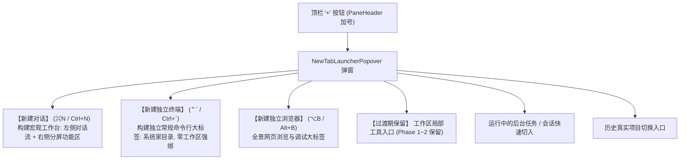
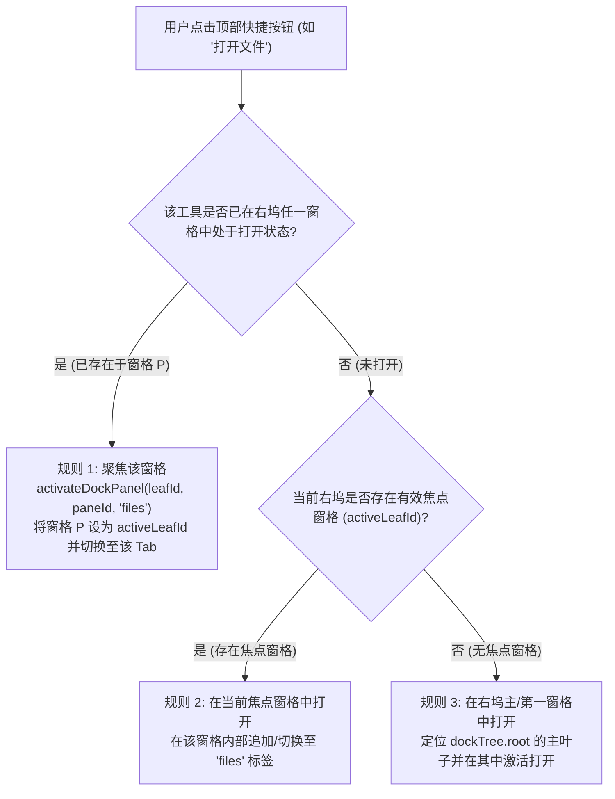
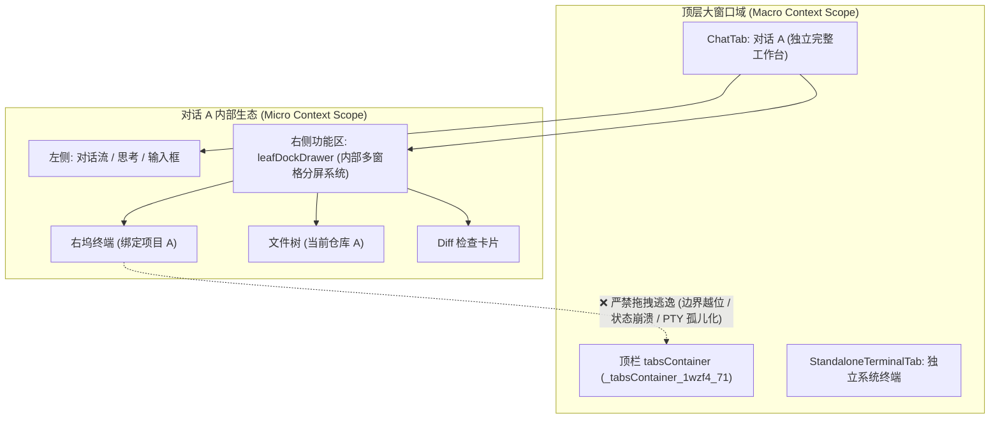
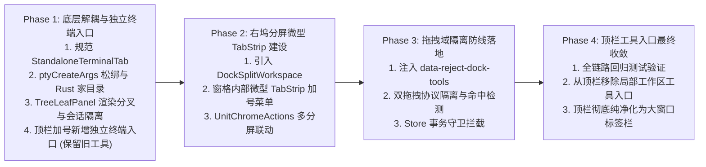

# 03-顶栏大窗口收敛与独立常规终端深度分析（修订版）

> **战役代号**：`dock-split-system`（右侧功能区分屏系统建设战役）  
> **报告类型**：架构调研与专项方案分析（第二轮·修订版，吸收审计 A 维度 3 与维度 5 裁决意见）  
> **产出日期**：2026-10-27  
> **核心议题**：顶栏大窗口标签体系收敛、独立常规终端（Standalone Terminal）机制设计、顶栏与右坞终端双轨边界、TreeLeafPanel 独立终端渲染路径分叉、effectiveSessionId 隔离防污染、UnitChromeActions 多分屏行为规范、右坞工具向顶栏拖拽逃逸的代码级立体防御、Phase 1 避免功能真空渐进迁移序列。  
> **权威协作遵循**：仓库根目录 `AGENTS.md`、`.agents/LOGIC_PLAN_NO_RETREAT.md`、`docs/dock-split-system/00-战役纪律与导引.md`、`docs/dock-split-system/plan-reviews/审计A-架构一致性与跨模块冲突.md`。

---

## 一、执行摘要与战役定位

### 1.1 战役背景与用户核心裁决

在多 Agent 协同工作区演进过程中，用户对窗口布局提出了清晰明确的顶层意志：

> **用户意志原文 1**：“顶栏有工具标签是正常的，不过可以改成不绑定工作区的常规 terminal。主要是看看应该如何实现吧。”  
> **用户意志原文 2**：“因为我们是按照对话分的大窗口，所以这些对话内的窗口是不能拖拽到 `class="_tabsContainer_1wzf4_71"` 里面去的。”

这两段裁决指明了当前架构中存在的两大核心断层：
1. **顶栏标签职责越位与路径强绑**：顶栏标签栏（即 CSS 类名 `_tabsContainer_1wzf4_71`，定义于 `PaneHeader.module.css:71`）当前承载的终端标签（`TerminalTab`）深度绑定了当前激活的工作区路径（`workspacePath`），导致其退化为项目专用终端，丧失了作为独立通用终端（如同 Windows Terminal / macOS iTerm2 中的独立 Tab）的纯粹性；同时在状态结构上残留了会话专属的右坞状态（`RightToolDockState`），造成概念混淆与视觉冗余。
2. **上下文层级（Context Scope）倒错**：桌面应用按照**对话（Session）**划分大窗口；右侧功能区（`leafDockDrawer`）承载的工具（文件树、差异比对、会话终端、浏览器等）是隶属于当前会话的**从属微观工具**。若缺乏物理级隔离，右坞内部工具一旦能被拖拽到顶栏，就会强行将“附属微观工具”升格为“顶层大窗口”，彻底破坏会话内部闭环，导致 PTY 生命周期错乱、布局反序列化崩溃以及用户心智模型坍塌。

### 1.2 本修订版核心更新（吸收架构审计 A 意见）

在第一轮方案审计中，`docs/dock-split-system/plan-reviews/审计A-架构一致性与跨模块冲突.md` 提出了关键的阻断性缺陷（维度 3）与交互遗漏（维度 5）：
- **审计 A 维度 3.1 冲突**：`TreeLeafPanel.tsx:490-502` 渲染右坞展开按钮的条件为 `isChatSurface && !isLeafDraft`，完全未检查独立终端状态。独立常规终端下用户依然能点击展开右坞按钮，从而强行唤起右坞抽屉，击穿“纯终端全景占满”的设计约束。
- **审计 A 维度 3.2 冲突**：`TreeLeafPanel.tsx:107-112`（`resolveLeafSessionId`）在 `activeTab.sessionId` 为 `undefined` 时，fallback 到全局激活的聊天会话 ID（`globalActiveSessionId`），导致 `effectiveSessionId` 被污染为当前聊天会话 ID，引发底层 `TerminalCard` 会话串味与 PTY 混淆。
- **审计 A 维度 5.2 遗漏**：`UnitChromeActions.tsx:109-112, 322-352` 在多分屏场景下的高亮失真与激活落点未定义问题。
- **实施路径防断崖要求**：Phase 1 若直接从顶栏删除局部工具入口，而右坞内部微型 TabStrip 加号菜单尚未就绪，将造成用户在 Phase 1~2 期间无法打开工作区工具的“功能真空”。

本修订版全面吸收上述裁决，将方案细化至物理级代码修改断言。

---

## 二、顶栏 `_tabsContainer_1wzf4_71` 现状解构与多态标签病理分析

### 2.1 顶栏物理 DOM 与 CSS 结构定位

顶栏标签容器物理挂载于 `PaneHeader.tsx`，对应类名即用户指出的 `_tabsContainer_1wzf4_71`：

```tsx
// apps/crish-desktop/src/components/binary-tree/PaneHeader.tsx:445-467
<div
  ref={setContainerRef}
  className={styles.tabsContainer} // 编译后即 ._tabsContainer_1wzf4_71
  style={paneTabStripVars(effectiveTabWidth)}
  data-locked={lockedTabWidth != null ? 'true' : 'false'}
  data-booted={booted ? 'true' : 'false'}
  data-tauri-drag-region={isTopRow ? '' : undefined}
  onScroll={handleScroll}
  onMouseLeave={handleHeaderMouseLeave}
  onKeyDown={handleTablistKeyDown}
  onDoubleClick={(e) => { ... }}
  role="tablist"
  aria-label="窗格会话标签"
>
  <div className={styles.tabsList} data-tauri-drag-region="false">
    {visibleTabs.map((tab) => (
      <PaneTabItem key={tab.tabId} tab={tab} ... />
    ))}
  </div>
  <div className={styles.launcherWrapper} ...>
    <NewTabLauncherPopover leafId={leaf.id} onBeforeOpen={clearLockedWidth} />
  </div>
</div>
```

对应 CSS 规则定义于 `apps/crish-desktop/src/components/binary-tree/PaneHeader.module.css:71-82`：
```css
.tabsContainer {
  flex: 1 1 auto;
  min-width: 0;
  height: 100%;
  display: flex;
  align-items: center;
  overflow-x: hidden;
  overflow-y: hidden;
  scrollbar-width: none;
  gap: var(--pane-tab-gap);
  padding-left: 2px;
}
```

### 2.2 顶栏当前承载的标签体系：`SessionTab` 多态

当前布局树模型中，顶栏叶子（`LayoutLeaf.tabs`）承载的数据类型统一定义于 `apps/crish-desktop/src/store/layout-tree/sessionTabModel.ts:46-77`：

```typescript
export type TabKind = 'chat' | 'terminal' | 'browser';

export interface BaseTab {
  tabId: string;
  title: string;
  workspaceKey: string;
  dock: RightToolDockState; // ⚠️ 历史遗留：所有顶栏 Tab 均携带了右坞状态
  sessionId?: string;
}

export interface ChatTab extends BaseTab {
  kind: 'chat';
  sessionId: string;
}

export interface TerminalTab extends BaseTab {
  kind: 'terminal';
  terminalKey: string;
  cwd: string;
  sessionId?: undefined;
}

export interface BrowserTab extends BaseTab {
  kind: 'browser';
  url: string;
  favicon?: string;
  sessionId?: undefined;
}

export type UnifiedTab = ChatTab | TerminalTab | BrowserTab;
export type SessionTab = UnifiedTab;
```

从类型系统可见，历史演进中为了实现统一序列化与多态渲染，将 `TerminalTab` 和 `BrowserTab` 作为 `SessionTab` 的子集并入顶栏。然而，这一设计在后续具体实现中埋下了严重的耦合病理。

---

### 2.3 核心病理 1：Store 构建层对当前工作区的强制绑定

在 `apps/crish-desktop/src/store/layout-tree/layoutTreeTerminalOps.ts:17-40` 中：

```typescript
export function createTerminalTabForStore(opts?: {
  tabId?: string;
  title?: string;
  workspaceKey?: string;
  terminalKey?: string;
  cwd?: string;
  dock?: Partial<RightToolDockState>;
}): TerminalTab {
  // ⚠️ 病灶 1：无差别从当前活动项目读取工作区路径
  const cwd = (opts?.cwd || getWorkspacePath() || '').trim();
  const activeProj = getActiveProject();
  const projName =
    activeProj?.name || (cwd ? cwd.split(/[/\\]/).filter(Boolean).pop() : '');
  // ⚠️ 病灶 2：标题被硬编码绑定为 Terminal: <项目名>
  const dynamicTitle = projName ? `Terminal: ${projName}` : 'Terminal';
  const title = opts?.title?.trim() || dynamicTitle;

  return createTerminalTab({
    tabId: opts?.tabId,
    title,
    workspaceKey: opts?.workspaceKey,
    terminalKey: opts?.terminalKey,
    cwd,
    dock: opts?.dock,
  });
}
```

**问题表现**：
- 当用户在顶栏加号点击“新建终端”时，`opts` 为空。`createTerminalTabForStore` 立即读取当前活动项目工作区 `getWorkspacePath()` 并将其注入 `cwd`；
- 标题自动命名为 `Terminal: <项目名>`（如 `Terminal: conex`）。
- 一旦用户在左侧项目列表切换了项目，或者试图在顶栏运行与当前项目毫无关系的系统命令（如清理临时文件、全局配置排查、拉取新仓库），该终端却固执地在特定项目的深层目录下启动。

---

### 2.4 核心病理 2：API 桥接层的“暴力清洗与强制覆盖”

即便在创建终端时试图传入独立的 `cwd`，在 API 传输层又遭遇了更为彻底的“暴力覆盖”。

审查 `apps/crish-desktop/src/api/ptyCreateArgs.ts:11-30`：
```typescript
export type NormalizedPtyCreateOptions = Omit<PtyCreateOptions, 'cwd'>;

export function normalizePtyCreateOptions(
  options: PtyCreateOptions
): NormalizedPtyCreateOptions | null {
  const sessionKey = (options.sessionKey || '').trim();
  if (!sessionKey) return null;
  return {
    sessionKey,
    cols: Math.max(1, Math.floor(Number(options.cols) || 80)),
    rows: Math.max(1, Math.floor(Number(options.rows) || 24)),
  };
}

export function createPtyCreateArgs(
  options: NormalizedPtyCreateOptions,
  readWorkspacePath: () => string
): NormalizedPtyCreateOptions & { cwd?: string } {
  // ⚠️ 病灶 3：完全抹掉入参，无条件注入 readWorkspacePath() (即 getWorkspacePath)
  const cwd = readWorkspacePath().trim() || undefined;
  return { ...options, ...(cwd ? { cwd } : {}) };
}
```

再看 `apps/crish-desktop/src/api/ptySessionApi.ts:253-255`：
```typescript
  const res = await invokeResult<unknown>('workbench_pty_create', () =>
    createPtyCreateArgs(options, getWorkspacePath)
  );
```

**穿透分析**：
- `normalizePtyCreateOptions` 直接使用 `Omit<PtyCreateOptions, 'cwd'>` 将传入的 `cwd` 参数**无条件丢弃**；
- `createPtyCreateArgs` 随后强制调用 `getWorkspacePath`，重新赋予 `cwd`；
- **这意味着在当前架构下，无论是顶层终端还是任何终端，前端根本无法指定任何非工作区目录！系统在底层机制上彻底剥夺了“常规独立终端”存在的可能。**

---

### 2.5 核心病理 3：Rust 内核层的级联回退链

进入 Rust 内核 `apps/agent-workbench/src-tauri/src/pty/session.rs:243-273`：
```rust
fn resolve_cwd(cwd: Option<&str>) -> PathBuf {
    if let Some(raw) = cwd.map(str::trim).filter(|s| !s.is_empty()) {
        let p = PathBuf::from(raw);
        if p.is_dir() {
            return p;
        }
        tracing::warn!(...);
    }
    // ⚠️ 病灶 4：当没有 cwd 时，优先回退到应用工作区根目录
    if let Ok(app) = crate::host_paths::app_dir() {
        let root = crate::host_paths::workspace_root(&app);
        if root.is_dir() {
            return root;
        }
    }
    // 只有在工作区不存在时才降级到家目录
    if let Some(home) = dirs::home_dir() {
        if home.is_dir() {
            return home;
        }
    }
    ...
}
```
由于前端 API 层（病理 2）必定传入当前工作区字符串，Rust 端永远命中了 `p.is_dir()` 分支；即便前端不传，Rust 端也会优先检查 `workspace_root`，只有在彻底没有工作区时才会降级到 `dirs::home_dir()`。整个链条从上到下全被“工作区”牢牢焊死。

---

### 2.6 核心病理 4：顶层标签多态中 `BaseTab.dock` 状态冗余导致的套娃隐患

审查 `apps/crish-desktop/src/store/layout-tree/sessionTabModel.ts:48-55`：
`BaseTab` 强制定义了 `dock: RightToolDockState`。

当在 `TreeLeafPanel.tsx` 渲染一个激活的 `TerminalTab` 时：
```tsx
// apps/crish-desktop/src/components/binary-tree/TreeLeafPanel.tsx:113-118
const dock = activeTab?.dock ?? leaf.dock ?? COLLAPSED_DOCK;
const dockOpen =
  isChatSurface &&
  !isLeafDraft &&
  dock.collapsed !== true &&
  Boolean(dock.activePanelId);
```
在渲染结构中（`TreeLeafPanel.tsx:388-440`）：
```tsx
<div className={styles.leafChatColumn}>
  {/* 渲染主视图：terminal */}
  <SlotOutlet ... entryKey="terminal" />
</div>
{dockOpen ? (
  <div className={styles.leafDockDrawer}>
    {/* ⚠️ 荒谬套娃：顶层终端右侧居然能拉出会话的右坞功能区！ */}
    <LeafToolTabStrip ... />
    <SlotOutlet ... entryKey={dock.activePanelId} />
  </div>
) : null}
```
**问题表现**：
一个大窗口全屏终端，本质应当是沉浸式的纯命令行环境。然而，因为其标签数据结构携带了 `dock` 状态，一旦触发快捷键或由于状态残留使 `dockOpen === true`，大终端右侧就会弹出一个二级抽屉，抽屉里又包含文件树、Diff、甚至右坞的小终端。这种“终端套终端”、“终端带会话工具抽屉”的设计在概念模型上极度荒谬。

---

### 2.7 核心病理 5：会话与终端 PTY 生命周期的状态机混淆与变量污染

在 `apps/crish-desktop/src/components/binary-tree/TreeLeafPanel.tsx:107-166`：
```typescript
const fallbackSessionId = resolveLeafSessionId(leaf, {
  isFocused: isActive,
  globalActiveSessionId,
});
const effectiveSessionId = tabResolution.sessionId ?? fallbackSessionId;

// 激活叶子逻辑
if (!isActive) {
  useLayoutTreeStore.getState().setActiveLeaf(leaf.id);
  const sessionStore = useSessionStore.getState();
  if (isPendingDraft(effectiveSessionId)) {
    ...
  } else {
    // ⚠️ 病灶 5：当 activeTab 是 TerminalTab 时，tabResolution.sessionId 是 terminalKey
    // 导致把 term_xxx 当作 sessionId 写入了 sessionStore！
    sessionStore.setActiveSessionId(effectiveSessionId);
  }
}
```
而一旦 `activeTab.sessionId` 为 `undefined`（如独立常规终端），`tabResolution.sessionId` 为空，代码将直接退回到 `fallbackSessionId`。在 `resolveLeafSessionId`（`treeLeafPanelModel.ts:81-104`）中，当前实现会将当前聚焦的全局聊天会话 ID（`globalActiveSessionId`）注入 `fallbackSessionId`！
结果：**独立常规终端被强行赋予了当前聊天会话的 ID**，底层 `TerminalCard` 通过 `useScopedSessionId` 绑定了错误会话，后端寻找会话记录引发空查；而在切换标签时，`workspaceShellTerminalBrowser.ts` 又在钩子中尝试 `killTerminalPty`，导致终端生命周期与会话生命周期产生相互践踏。

---

## 三、不绑定工作区的常规独立 Terminal（Standalone Terminal）架构设计

按照用户明确裁决：“顶栏有工具标签是正常的，不过可以改成不绑定工作区的常规terminal。 主要是看看应该如何实现吧”。

### 3.1 核心定位与原则

1. **顶层大窗口（Top-Level Window Tab）**：
   - 它是顶级主窗格标签，与 Chat 对话大窗口处于同级；
   - 用户可以像在 Windows Terminal、iTerm2、Alacritty 或 VS Code 中开独立标签一样，随时在顶栏新建一个或多个常规命令行窗口；
2. **彻底解耦工作区（Zero Workspace Binding）**：
   - 不依赖任何当前项目、工作区、对话会话；
   - 切换项目、删除项目、重置会话，对独立常规终端零影响；
3. **默认家目录与纯净环境（Clean Home Directory）**：
   - 默认启动路径为操作系统当前用户家目录（Windows 下 `%USERPROFILE%` 如 `C:\Users\orange`，macOS/Linux 下 `~`）；
   - 不注入任何项目特定的局部环境变量（如 `.venv`、`node_modules/.bin`），保持纯净的系统原生 shell 环境；
4. **纯终端全景界面（Drawer-Free Full Surface）**：
   - 独立常规终端大窗口**永久不显示右侧功能区抽屉**（`dockOpen` 永久为 `false`）；
   - 顶栏终端占据窗格的 100% 宽度，提供纯粹、沉浸的命令行体验。

---

### 3.2 数据模型解耦方案

我们应对 `sessionTabModel.ts` 进行清晰的模型分层与契约重构：

```typescript
// 规范化顶层大窗口标签联合类型
export type StandaloneTerminalTab = {
  kind: 'terminal';
  tabId: string;
  title: string;              // 默认为 "终端" 或 "Terminal"（不带项目名后缀）
  terminalKey: string;        // 命名规范：standalone:term_<tabId>
  isStandalone: true;         // 显式断言：独立常规终端标记
  cwd?: string;               // 可选自定义启动路径；若未提供则为 undefined，直通用户家目录
  // 彻底剔除 dock 状态字段，或者在类型上锁定为 undefined
  dock?: never;
  sessionId?: undefined;
};

export interface ChatTab extends BaseTab {
  kind: 'chat';
  sessionId: string;
}

export interface BrowserTab extends BaseTab {
  kind: 'browser';
  url: string;
  favicon?: string;
  sessionId?: undefined;
}

export type UnifiedTab = ChatTab | StandaloneTerminalTab | BrowserTab;
```

#### 工厂函数实现：`createStandaloneTerminalTab`
替换掉原有的 `createTerminalTabForStore` 强绑逻辑：
```typescript
export function createStandaloneTerminalTab(opts?: {
  tabId?: string;
  title?: string;
  cwd?: string;
}): StandaloneTerminalTab {
  const tabId = opts?.tabId?.trim() || mintTabId();
  const terminalKey = `standalone:${tabId}`;
  
  // 规范化标题：纯粹的“终端”，绝不拼接 projName
  const title = opts?.title?.trim() || '终端';

  return {
    kind: 'terminal',
    tabId,
    title,
    terminalKey,
    isStandalone: true,
    cwd: opts?.cwd?.trim() || undefined, // undefined 代表交由底层解析为用户家目录
  };
}
```

---

### 3.3 PTY 传输与执行链彻底松绑

#### 1. 改造 `ptyCreateArgs.ts`
消除“强制覆盖”逻辑，尊重传入的 `cwd`；仅在明确要求时才读取工作区：

```typescript
// apps/crish-desktop/src/api/ptyCreateArgs.ts
export type PtyCreateOptions = {
  sessionKey: string;
  cols: number;
  rows: number;
  cwd?: string;
  isStandalone?: boolean; // 新增：是否独立终端
};

export function createPtyCreateArgs(
  options: PtyCreateOptions,
  readWorkspacePath: () => string
): PtyCreateOptions {
  // 若显式为独立终端或已传入明确 cwd，绝对不调用 readWorkspacePath()！
  if (options.isStandalone || options.sessionKey.startsWith('standalone:')) {
    return {
      ...options,
      cwd: options.cwd || undefined, // 传递 undefined，让 Rust 层解析为 home_dir
    };
  }

  // 会话右坞终端：维持绑定工作区
  const cwd = options.cwd || readWorkspacePath().trim() || undefined;
  return { ...options, ...(cwd ? { cwd } : {}) };
}
```

#### 2. 改造 Rust 内核 `session.rs:243-273`
在 Rust 端的 `resolve_cwd` 中，若识别到独立终端标识或无工作区要求，直接解析为用户家目录：

```rust
// apps/agent-workbench/src-tauri/src/pty/session.rs
fn resolve_cwd(cwd: Option<&str>, is_standalone: bool) -> PathBuf {
    // 1. 若前端显式指定了有效目录，优先使用
    if let Some(raw) = cwd.map(str::trim).filter(|s| !s.is_empty()) {
        let p = PathBuf::from(raw);
        if p.is_dir() {
            return p;
        }
    }

    // 2. 独立常规终端：直接返回操作系统用户家目录 (~ / %USERPROFILE%)
    if is_standalone {
        if let Some(home) = dirs::home_dir() {
            if home.is_dir() {
                return home;
            }
        }
    }

    // 3. 关联会话终端：回退到工作区根目录
    if let Ok(app) = crate::host_paths::app_dir() {
        let root = crate::host_paths::workspace_root(&app);
        if root.is_dir() {
            return root;
        }
    }

    // 4. 最终兜底
    dirs::home_dir().unwrap_or_else(|| PathBuf::from("."))
}
```

---

### 3.4 PTY 会话模型与生命周期解耦

- **前缀命名空间隔离**：
  所有顶栏独立常规终端的 sessionKey 格式统一为 `standalone:term_<tabId>`。
  PTY 注册表（`ptyRegistry.ts`）据此前缀明确区分：
  - `standalone:*`：全局常规终端进程；
  - `session:<sessionId>:dock_term_<dockPaneId>`：会话所属右坞终端进程。
- **生命周期完全独立**：
  - **创建**：仅在用户主动触发“新建全局终端”时 spawn；
  - **切换**：用户在顶栏切换标签时，PTY 进程保持后台运行，状态与输出缓冲在内存环形队列（`ptyHistoryMap`）中持续累积，切换回来无损恢复；
  - **销毁**：**仅当**用户在顶栏点击该 Tab 的 `×` 关闭按钮（或在终端内部执行 `exit`）时，才触发 `killTerminalPty(tab.terminalKey)`；
  - **免疫干扰**：任何会话的清空历史、会话切换、草稿模式进入、工作区切换，**严禁向 `standalone:*` 发送任何 kill 信号**。
- **状态机隔离**：
  在 `TreeLeafPanel.tsx:145-166` 中，当检测到 `activeTab.isStandalone === true` 时，**短路阻止**调用 `sessionStore.setActiveSessionId(effectiveSessionId)`，防止污染 Chat 会话管理器的激活会话指针。

---

### 3.5 `TreeLeafPanel.tsx` 中 isStandalone 渲染路径分叉契约（消解审计 A 维度 3.1 冲突）

在第一轮架构审查中，审计 A 指出当前 `TreeLeafPanel.tsx:490-502` 存在严重的守卫遗漏：

```tsx
// TreeLeafPanel.tsx:490-502 当前代码
{isChatSurface && !isLeafDraft && (
  <Button
    type="button"
    variant="ghost"
    className={`${styles.topSidePanelBtn} top-action-btn top-side-panel-btn`}
    data-testid="top-quick-dock-btn"
    data-active={dockOpen ? 'true' : 'false'}
    aria-label={dockOpen ? '收起右侧工具栏' : '展开右侧工具栏'}
    onClick={handleToggleDock}
  >
    <AppIcon name="sidebar-right" size={16} aria-hidden />
  </Button>
)}
```

**病理分析**：
- `isChatSurface` 仅仅是全局布局配置（`chatMainSurface === 'chat'`），**它完全不检查当前激活标签是否为 `terminal`**！
- 即使当前激活的是 `StandaloneTerminalTab`，由于 `isChatSurface === true` 且 `!isLeafDraft`，右上角的 `topSidePanelBtn`（展开/收起右侧工具栏按钮）依然会被强行渲染在终端界面的右上角。
- 用户一旦误触该按钮，`handleToggleDock` 会强行调用 `updateLeafDock`，将右坞抽屉强行拉出，彻底击穿“独立常规终端 100% 全景无抽屉”的核心契约。

**必须在 `TreeLeafPanel.tsx` 实施以下修正（Phase 1 即刻落地）**：

1. **新增 `isStandaloneTab` 辅助断言**：
   ```typescript
   const isStandaloneTab =
     activeTab?.kind === 'terminal' &&
     (activeTab as StandaloneTerminalTab).isStandalone === true;
   ```

2. **修改右坞展开按钮渲染条件**：
   ```tsx
   {/* 修改前：isChatSurface && !isLeafDraft */}
   {/* 修改后：增加 !isStandaloneTab 物理拦截 */}
   {isChatSurface && !isLeafDraft && !isStandaloneTab && (
     <Button
       type="button"
       variant="ghost"
       className={`${styles.topSidePanelBtn} top-action-btn top-side-panel-btn`}
       data-testid="top-quick-dock-btn"
       data-active={dockOpen ? 'true' : 'false'}
       aria-label={dockOpen ? '收起右侧工具栏' : '展开右侧工具栏'}
       onClick={handleToggleDock}
     >
       <AppIcon name="sidebar-right" size={16} aria-hidden />
     </Button>
   )}
   ```

3. **修改 `dockOpen` 计算逻辑**：
   确保即使 Store 中残留了旧的 `dock.activePanelId`，在独立终端激活时也绝对不打开抽屉：
   ```typescript
   const dockOpen =
     isChatSurface &&
     !isLeafDraft &&
     !isStandaloneTab && // 🔒 刚性拦截：独立终端永久不展示右坞抽屉
     dock.collapsed !== true &&
     Boolean(dock.activePanelId);
   ```

4. **快捷按钮守卫**：
   在 `TreeLeafPanel.tsx:389-400` 中，已存在 `mainViewId === 'chat'` 限制；在 `UnitChromeActions.tsx` 内部任何触发抽屉展开的快捷逻辑上，统一增加 `!isStandaloneTab` 守卫，杜绝一切隐式唤醒抽屉的通道。

---

### 3.6 `effectiveSessionId` 对 Standalone Terminal 的特殊处理与隔离规范（消解审计 A 维度 3.2 冲突）

在 `TreeLeafPanel.tsx:107-112`：
```typescript
const fallbackSessionId = resolveLeafSessionId(leaf, {
  isFocused: isActive,
  globalActiveSessionId,
});
const effectiveSessionId = tabResolution.sessionId ?? fallbackSessionId;
```

**病理剖析**：
- 对于 `StandaloneTerminalTab`，其类型定义中明确 `sessionId?: undefined`。
- `tabResolution.sessionId` 为空。
- 代码走入 `fallbackSessionId = resolveLeafSessionId(leaf, { isFocused: isActive, globalActiveSessionId })`。
- 在 `apps/crish-desktop/src/components/binary-tree/treeLeafPanelModel.ts:81-104` 中：
  ```typescript
  export function resolveLeafSessionId(
    leaf: LayoutLeaf,
    options?: { isFocused?: boolean; globalActiveSessionId?: string | null; }
  ): string {
    const tabs = readLeafTabs(leaf);
    const activeTab = readActiveTab(leaf);
    if (activeTab?.sessionId) return activeTab.sessionId;
    if (activeTab?.terminalKey) return activeTab.terminalKey; // ⚠️ 旧逻辑将 terminalKey 冒充 sessionId
    if (tabs.length === 0) {
      const isFocused = options?.isFocused ?? false;
      const globalId = options?.globalActiveSessionId;
      if (isFocused && globalId && !isPendingDraftSessionId(globalId)) {
        return globalId; // ⚠️ 若 activeTab 没有 sessionId/terminalKey，强行 fallback 到全局聊天会话 ID！
      }
    }
    return mintDraftSessionId(leaf.id);
  }
  ```
- **危害后果**：
  若不进行拦截，`effectiveSessionId` 会被直接赋值为当前活跃的聊天会话 ID（`globalActiveSessionId`）。随后在 `TreeLeafPanel.tsx:372` 传给 `<LeafScopeProvider sessionId={effectiveSessionId}>`，下层的 `TerminalCard.tsx` 会误认为自己绑定了该 Chat 会话，触发错误的会话事件订阅与 PTY 绑定碰撞。

**实施修正规范**：
必须在 `resolveLeafSessionId`（`treeLeafPanelModel.ts`）与 `TreeLeafPanel.tsx` 中实施专属标识隔离：

```typescript
// apps/crish-desktop/src/components/binary-tree/treeLeafPanelModel.ts
export function resolveLeafSessionId(
  leaf: LayoutLeaf,
  options?: {
    isFocused?: boolean;
    globalActiveSessionId?: string | null;
  }
): string {
  const activeTab = readActiveTab(leaf);

  // 🔒 独立常规终端专属隔离分支（ACT-04）
  if (
    activeTab?.kind === 'terminal' &&
    (activeTab as { isStandalone?: boolean }).isStandalone === true
  ) {
    // 明确返回专属标识，严禁回退到 globalActiveSessionId
    return `standalone-${activeTab.tabId}`;
  }

  if (activeTab?.sessionId) {
    return activeTab.sessionId;
  }
  if (activeTab?.terminalKey) {
    return activeTab.terminalKey;
  }
  
  const tabs = readLeafTabs(leaf);
  if (tabs.length === 0) {
    const isFocused = options?.isFocused ?? false;
    const globalId = options?.globalActiveSessionId;
    if (isFocused && globalId && !isPendingDraftSessionId(globalId)) {
      return globalId;
    }
  }
  return mintDraftSessionId(leaf.id);
}
```

**专属标识作用域断言**：
- `standalone-${tab.tabId}` 仅作为 UI 树上的 LeafScope 局部隔离 Key 与 PTY 命名空间注册 Key（`standalone:term_{tabId}`）；
- 在 `useSessionStore` 事务中，任何形如 `standalone-*` 的 ID **绝不触发任何对话加载或持久化**，彻底隔绝会话污染。

---

## 四、顶栏加号 `NewTabLauncherPopover` 交互重构

审查现有加号弹窗 `apps/crish-desktop/src/components/binary-tree/NewTabLauncherPopover.tsx:281-337`：

```tsx
{/* Section 1: 核心操作区 */}
<div className={styles.section} role="menu" ...>
  <Button ... onClick={handleActionNewChat}>
    <AppIcon name="new-chat" size={15} />
    <span>新建对话</span>
    <span className={styles.shortcutHint}>⌘N</span>
  </Button>

  <Button ... onClick={handleActionNewTerminal}>
    <AppIcon name="terminal" size={15} />
    <span>新建终端</span>
    <span className={styles.shortcutHint}>⌃`</span>
  </Button>

  <Button ... onClick={handleActionNewBrowser}>
    <AppIcon name="globe" size={15} />
    <span>新建浏览器</span>
    <span className={styles.shortcutHint}>⌥B</span>
  </Button>
</div>
```

### 4.1 存在问题与用户心智割裂

1. 弹窗中的“新建终端”没有明确提示是“独立系统终端”还是“当前项目终端”，用户点击后发现打开了一个带着当前项目名的大窗口，产生了困惑；
2. 快捷键 `⌃\``（Ctrl+\`）在诸多 IDE（如 VS Code）中是“切换底部/侧边工作区终端”的快捷键，移用在此处容易产生心智混淆。

### 4.2 重构方案与操作分发

在顶栏加号弹窗中，明确将启动器定位为**“顶层大窗口创建总线”**，重塑核心操作区的视觉与语义心智：



#### 代码级改造调整点：
1. **文案强化**：
   - 将现有 `新建终端` 明确更名为 `新建独立终端` 或 `常规终端`（国际化 key: `launcher.newStandaloneTerminal`，描述：“全局系统终端，独立于会话”）；
2. **动作分发**：
   ```typescript
   // apps/crish-desktop/src/components/binary-tree/NewTabLauncherPopover.tsx
   const handleActionNewTerminal = useCallback(() => {
     setIsOpen(false);
     const shell = getCompositionRoot().shell as unknown as {
       addStandaloneTerminalTab?: (leafId: string) => void;
       addTerminalTab?: (leafId: string) => void;
     };
     // 优先调用独立终端接口
     if (typeof shell.addStandaloneTerminalTab === 'function') {
       shell.addStandaloneTerminalTab(leafId);
     } else if (typeof shell.addTerminalTab === 'function') {
       shell.addTerminalTab(leafId);
     }
   }, [leafId]);
   ```
3. **全键盘漫游保持**：
   `ArrowDown` / `ArrowUp` 漫游顺序保持：`[0: 新建对话] -> [1: 新建独立终端] -> [2: 新建浏览器] -> [3+: 运行中会话]`。默认聚焦于首项 `新建对话`，响应速度保持在 `<16ms`。

---

## 五、顶栏终端 vs 右坞终端的双轨矩阵与严格边界

为了彻底杜绝职责模糊与架构漂移，必须在全仓库范围内确立顶栏终端与右坞终端的**双轨矩阵（Dual-Track Matrix）**：

| 架构维度 | 顶栏常规终端（Top-Bar Standalone Terminal） | 右坞工作区终端（Right Dock Workspace Terminal） |
| :--- | :--- | :--- |
| **系统层级** | **顶级大窗口（Leaf / Pane 级别）**，与整个 Chat 对话大窗口平级并列 | **附属微观工具（Dock Widget 级别）**，隶属于某个 Chat 对话的右侧功能区 |
| **宿主容器** | `PaneHeader` 的 `styles.tabsContainer`（即 `_tabsContainer_1wzf4_71`） | `leafDockDrawer` 内部的右坞分屏窗格（`DockSplitWorkspace` / `DockPaneTabStrip`） |
| **所属归属** | **全局所有（Global）**，不属于任何特定会话或项目 | **会话所有（Session-Scoped）**，严格归属于特定 `sessionId` |
| **启动目录 (cwd)**| **操作系统用户家目录**（`~` / `%USERPROFILE%`，如 `C:\Users\orange`） | **当前项目工作区根目录**（`projectStore.getWorkspacePath()`） |
| **标题规范** | 纯净命名：`终端` 或 `Terminal`（可带纯数字递增序号） | 关联命名：`会话终端`、`Terminal: <项目名>` 或命令执行任务名 |
| **生命周期** | **长驻独立**：仅随顶栏标签关闭或 shell exit 销毁；会话重置/切换零影响 | **会话共生**：随当前会话的关闭、归档或右坞面板的关闭而销毁 |
| **右侧分屏能力** | **无右侧抽屉**：占用 100% 窗格宽度，禁用 `leafDockDrawer`，不提供二级右坞 | **具备完整的右坞二叉树分屏能力**：可上下/左右分屏，与文件树、Diff 协同 |
| **典型使用场景** | 开发者日常全局命令、`git clone` 新仓库、全局包管理、系统级监控排错 | 针对当前项目的构建与测试（`cargo check`、`npm test`）、AI 工具调用现场核查 |
| **PTY Key 规范** | `standalone:term_<tabId>` | `session:<sessionId>:dock_term_<dockPaneId>` |

---

## 六、顶栏与右坞多分屏联动：UnitChromeActions 行为定义（消解审计 A 维度 5.2 遗漏）

### 6.1 现有实现的问题与多分屏失真

在 `apps/crish-desktop/src/components/chat-card/UnitChromeActions.tsx:109-112, 322-352` 中：
```typescript
const isPreviewActive = dockOpen && dockPanelId === 'preview';
const isArtifactsActive = dockOpen && dockPanelId === 'files';
```
顶部快捷按钮（浏览器、文件树等）当前仅使用单一 `dockPanelId === 'preview'` 判断高亮状态。

**在右坞分屏（`DockLayoutTree`）下的两大缺陷**：
1. **高亮失真**：当右坞进行分屏（例如左半为 `files`，右半为 `preview`），两个工具同时处于可见且运行状态。此时若 `dockPanelId` 记录的是焦点窗格（如 `files`），顶部的“浏览器”快捷按钮将呈现灰色未激活态，与界面事实冲突。
2. **打开落点未定义**：在分屏状态下，用户点击 `UnitChromeActions` 的“打开文件”或“打开浏览器”按钮时，现有代码调用的是 `openToolInSession(sid, 'files')`。在多分屏树中，该面板究竟应该在当前聚焦窗格（`activeLeafId`）打开、还是在新分割窗格打开、还是若已存在则直接聚焦？现有设计属于完全遗漏的交互断层。

### 6.2 多分屏联动行为规范定义

针对上述缺陷，确立以下刚性行为定义（在 Phase 2/3 对齐方案 01/02 时实施）：

#### 1. 激活高亮判定契约
多分屏下，顶部快捷按钮高亮状态由“单一面板匹配”升级为“分屏树任意可见性匹配”：
```typescript
// 规范：只要该工具在右坞的分屏树中任意一个可见叶子窗格处于激活态，顶部按钮即判定为高亮
function isToolActiveInDock(
  dock: RightToolDockState,
  targetPanelId: string
): boolean {
  if (!dockOpen) return false;
  // 1. 若分屏树存在，遍历分屏树的所有活跃叶子
  if (dock.layout && dock.layout.root) {
    const activePanels = collectActivePanelsFromDockTree(dock.layout.root);
    return activePanels.includes(targetPanelId);
  }
  // 2. 扁平回退状态
  return (
    dock.activePanelId === targetPanelId ||
    (dock.openPanelIds && dock.openPanelIds.includes(targetPanelId))
  );
}
```

#### 2. 点击快捷按钮的打开与聚焦三级规则
用户点击 `UnitChromeActions` 顶部的“浏览器预览”或“打开文件”按钮时，严格执行以下**三级查找与聚焦规则**：



1. **规则 1（已存在即聚焦）**：若该工具已经在某个窗格中打开（无论是否是当前焦点窗格），直接将右坞焦点切换到该窗格，并将其 `activePanelId` 置为该工具，禁止重复开辟重复面板。
2. **规则 2（当前焦点窗格优先）**：若该工具尚未在右坞打开，且当前右坞存在有效的焦点窗格（`activeDockLeafId`），则在该焦点窗格中直接打开并激活该工具。
3. **规则 3（主窗格兜底）**：若当前无焦点窗格（例如右坞刚从收起状态展开），则在右坞主/第一窗格（`root` 左上或首个叶子）中激活打开。

---

## 七、右坞内部工具向顶栏逃逸的严格禁止论证与代码级防御方案

用户核心指令明确强调：
> “因为我们是按照对话分的大窗口，所以这些对话内的窗口是不能拖拽到 `class="_tabsContainer_1wzf4_71"` 里面去的。”

### 7.1 四大维度不可逆论证：为什么必须绝对禁止？



#### 维度一：大窗口模型 vs 局部工具模型的范畴论冲突（Category Mismatch）
- 顶栏 `_tabsContainer_1wzf4_71` 承载的是**宏观工作台实体（Macro Workstation Entity）**。每一个 ChatTab 内部包含完整的“左对话 + 右全套分屏功能区”生态体系；
- 右坞内部的工具（如右坞终端、文件浏览器、差异卡片）是**微观功能插件（Micro Functional Widget）**，它们在产生的第一刻起，就深植于该会话的局部状态中（例如当前选中的文件路径、当前的 diff 暂存区、当前会话的临时命令执行结果）；
- 若允许将右坞工具拖拽到顶栏，就会导致“局部微观插件”被强行包装为一个“顶级大窗口”。此时该大窗口该呈现什么？如果它没有右侧功能区，它就违背了会话大窗口的范式；如果它有右侧功能区，就会导致一个微观工具又套了一个分屏工具系统的荒诞逻辑。

#### 维度二：PTY 与视图生命周期的撕裂与僵尸进程风险（Lifecycle Decoupling Hazard）
- 右坞终端的 PTY 进程以 `session:<sessionId>:dock_term` 命名，与当前会话绑定；
- 如果被拖拽到顶栏变为顶层标签，其标识被迫变异为 `term_<tabId>`。这会导致旧的会话 PTY 失去归属，旧会话在关闭或重置时不知道是否该 kill 该 PTY；当顶栏关闭该标签时，原会话内部的分屏树却依然保留着对该终端的引用，最终必然导致内存泄漏与大量后台孤儿 PTY 僵尸进程。

#### 维度三：双层分屏树（Dual-Tree Architecture）的数据契约破坏
- 外层树（`LayoutTree`）：管理整个工作区的二叉多分屏叶子（`TreeLeafPanel`），其节点存储的是 `SessionTab[]`；
- 内层树（`DockLayoutTree`）：迁移并下沉到 `leafDockDrawer` 内部的右坞专属分屏二叉树，其节点存储的是 `DockLayoutNode`（`panelIds`, `splitDirection`, `splitRatio`）；
- 两棵树的契约结构完全不同。跨树拖拽意味着必须进行强制的异构类型转换（Type Casting Mutation），任何序列化与反序列化失败都将导致整个桌面的布局树损坏崩溃（Corrupted Layout）。

#### 维度四：用户心智模型的崩塌（Mental Model Disruption）
- 用户的心理预期是：在右坞内部可以自由上下、左右拖拽分屏，组织自己的专属工具台；
- 若无防线拦截，当用户在右坞分屏边缘调整面板位置时，一旦鼠标滑出右坞误触顶栏，面板瞬间脱离当前会话“飞”到了全局顶栏，当前对话的工具布局直接塌陷碎裂，带来不可逆的操作挫败感。

---

### 7.2 代码级立体防御体系设计

为了保证 100% 阻断逃逸，必须在**拖拽协议、DOM 命中判定、Store 事务层、视觉交互反馈**四个层面构建纵深防御：

#### 防线 1：拖拽数据协议隔离（Drag Protocol Brand Tagging）
建立显式的拖拽协议类型与载荷隔离，严禁通用混用：

```typescript
// 顶栏大窗口拖拽类型契约
export interface SessionTabDragPayload {
  readonly protocol: 'conex://drag-session-tab';
  readonly sourceLeafId: string;
  readonly tabId: string;
  readonly title: string;
}

// 右坞内部工具拖拽类型契约
export interface DockToolDragPayload {
  readonly protocol: 'conex://drag-dock-tool';
  readonly sessionId: string;
  readonly sourceDockPaneId: string;
  readonly toolPanelId: string;
}

export type AnyDragPayload = SessionTabDragPayload | DockToolDragPayload;

export function isSessionTabDrag(payload: unknown): payload is SessionTabDragPayload {
  return (
    typeof payload === 'object' &&
    payload !== null &&
    (payload as SessionTabDragPayload).protocol === 'conex://drag-session-tab'
  );
}
```

#### 防线 2：DOM 属性标记与落点检测物理排斥（消解 Pointer Capture 审计漏洞）
根据审计 A 维度 4.1，在 Pointer Capture 启用期间，目标 DOM 上的 `onPointerEnter` 无法被原生触发。因此落点判定必须在全局 `pointermove` 循环中通过 `document.elementFromPoint` 主动判定与短路：

1. 在 `PaneHeader.tsx:445` 的 `tabsContainer` 上增加刚性排斥标记：
   ```tsx
   <div
     ref={setContainerRef}
     className={styles.tabsContainer}
     data-drop-boundary="top-bar-session-strip"
     data-accept-protocol="conex://drag-session-tab"
     data-reject-dock-tools="true"
     ...
   >
   ```
2. 在右坞内部拖拽的命中检测循环（`DockToolDragContext`）中，主动对 `elementFromPoint(p.x, p.y)` 执行判定：
   - 一旦检测到指针悬停元素属于 `[data-reject-dock-tools="true"]` 或其子节点：
     - **立即将当前 dropTarget 置为 null**；
     - **绝不激活顶栏任何插入占位符**；
     - **指针样式强制设为 `cursor: not-allowed`**。

```typescript
// 右坞内部拖拽处理器中的落点防御守卫
function validateDockToolDropTarget(hitEl: Element | null): boolean {
  if (!hitEl) return false;
  // 刚性拦截：只要命中了顶栏标签栏或外层 PaneHeader，直接判定非法
  if (
    hitEl.closest('[data-reject-dock-tools="true"]') ||
    hitEl.closest('[data-pane-header="true"]') ||
    hitEl.closest(`.${styles.tabsContainer}`)
  ) {
    return false; // 🚫 物理级拒绝接受内部工具拖入
  }
  return Boolean(hitEl.closest('[data-leaf-dock-drawer]'));
}
```

#### 防线 3：Store 事务层刚性防线（Store Mutation Invariant Guard）
审查 `apps/crish-desktop/src/components/shell/sessionTabDropCommit.ts:23-51`：
```typescript
export function commitSessionTabDrop(input: {
  sourceLeafId: string;
  tabId: string;
  target: SessionTabDropTarget;
}): void {
  const { sourceLeafId, tabId, target } = input;
  // 守卫 1：确保待搬运的 tabId 真实存在于顶层 LayoutTree 的 SessionTab 集合中
  const root = useLayoutTreeStore.getState().tree.root;
  const rawTab = findTabById(root, tabId);
  if (!rawTab) {
    console.error(`[Security Guard] 拦截非法跨域拖入：tabId ${tabId} 不属于顶层会话树！`);
    return; // 拒绝执行任何树操作
  }

  // 守卫 2：严禁将右坞 panelId 当作 tabId 插入
  if (['files', 'diff', 'terminal', 'overview', 'preview', 'runtime'].includes(tabId)) {
    console.error(`[Security Guard] 拦截右坞内部工具 ${tabId} 逃逸至顶栏！`);
    return;
  }

  // 正常会话标签换位与拆分
  ...
}
```

#### 防线 4：视觉与交互反馈（Zero Visual Misleading）
当用户拖着右坞工具悬停在顶栏 `_tabsContainer_1wzf4_71` 上方时：
1. 顶栏现有的所有标签**绝对不发生挤压位移动画**（不触发 `shiftStripTabs`，位移偏移量为 0）；
2. 绝对不绘制任何蓝色的垂直插入光标或落点阴影；
3. 拖拽浮层（Ghost Pill）边框呈现警告色或半透明降低，直观告知用户：“此区域为对话大窗口标签栏，不可放置会话内部工具”。

---

## 八、分步改造计划与落地建议

### 8.1 总体迁移阶段总览

基于反退避与架构解耦原则，将顶栏大窗口收敛与独立常规终端的落地划分为四个安全阶段：



---

### 8.2 Phase 1 实施约束：避免功能真空与渐进迁移序列（核心铁律）

在实施顺序上，必须确立刚性的安全边界，**严禁发生“功能真空”**：

#### 1. 允许与禁止红线
- **Phase 1 允许**：在顶栏加号浮层（`NewTabLauncherPopover`）中**新增**“新建独立常规终端”选项；
- **Phase 1 禁止**：**删除**现有的“新建局部工作区终端”与“新建局部浏览器”选项。

#### 2. 避免功能真空根因分析
右坞内部的微型 TabStrip 加号菜单（在分屏各窗格内打开局部工具的入口，如 `DockPaneTabStrip` 的加号）是在 Phase 2 甚至 Phase 3 期间才完成开发。
**若在 Phase 1 盲目将局部工具从顶栏加号中删除，用户在 Phase 1~2 开发与联调期间将完全失去打开工作区终端和浏览器的操作路径，造成毁灭性的功能真空与可用性倒退！**

#### 3. 正确的渐进迁移时序表

| 阶段 | 顶栏加号入口状态 | 右坞内部工具入口状态 | 用户可用性断言 |
| :--- | :--- | :--- | :--- |
| **Phase 1（当前）** | 包含：新建对话、**新增常规独立终端**、暂存保留局部终端与浏览器 | 维持单开右坞现有 `LeafToolTabStrip` | 用户可尝鲜独立终端，原有工作区工具操作路径零受损 |
| **Phase 2** | 维持 Phase 1 状态 | 右坞各分屏窗格具备独立的微型 TabStrip 与内部新建菜单 | 用户已可在右坞各窗格直接打开局部终端与浏览器 |
| **Phase 3** | 维持 Phase 1 状态 | 具备完整的多分屏与域隔离拖拽能力 | 全功能现场验收跑通，双轨能力均已成熟 |
| **Phase 4（最终收口）** | **收敛移除局部工具入口**：仅保留“新建对话”、“新建独立终端”、“新建独立浏览器” | 成为打开局部工作区终端与浏览器的唯一合法入口 | 顶栏大窗口与右坞微观工具彻底分道扬镳，架构净收敛 |

---

### 8.3 各阶段详细实施规约

#### Phase 1：数据契约、PTY 解耦与 TreeLeafPanel 渲染分叉（底层安全打通）
1. 在 `sessionTabModel.ts` 中精化 `StandaloneTerminalTab` 类型，确保其不携带 `dock` 字段；
2. 修复 `apps/crish-desktop/src/api/ptyCreateArgs.ts:25-30`，禁止在独立终端模式下抹杀 `cwd`，允许直通 `undefined`；
3. 验证 Rust 端 `session.rs` 的 `resolve_cwd`，确保在独立终端模式下无缝解析并以 `dirs::home_dir()` 启动系统原生 PowerShell / Bash；
4. **实施 ACT-04 渲染分叉与会话隔离**：
   - 在 `TreeLeafPanel.tsx` 增加 `isStandaloneTab`，右坞展开按钮增加 `!isStandaloneTab` 守卫，`dockOpen` 增加 `!isStandaloneTab` 拦截；
   - 在 `resolveLeafSessionId`（`treeLeafPanelModel.ts`）增加独立终端分支，返回 `standalone-${tab.tabId}`，严禁 fallback 到全局聊天会话；
5. 在 `NewTabLauncherPopover.tsx` 新增“新建独立常规终端”入口，绑定 `createStandaloneTerminalTab`。

#### Phase 2：右坞分屏微型 TabStrip 建设与 UnitChromeActions 联动
1. 落地 `DockSplitWorkspace.tsx`，在每个分屏叶子顶部挂载微型 `DockPaneTabStrip`，集成窗格内部的新建工具加号菜单；
2. 实施 `UnitChromeActions.tsx` 在多分屏下的联动规范（激活高亮升级为分屏树可见性匹配，点击采用三级查找聚焦规则）；
3. 隔离 `sessionStore` 激活状态，确保切换标签不引起会话状态踩踏。

#### Phase 3：拖拽域隔离防线落地（物理级反逃逸门禁）
1. 在 `PaneHeader.tsx` 的 `tabsContainer` 挂载属性 `data-drop-boundary="top-bar-session-strip"` 与 `data-reject-dock-tools="true"`；
2. 在 `SessionTabDragContext.tsx` 与右坞拖拽管理器中实施双协议隔离（`conex://drag-session-tab` vs `conex://drag-dock-tool`）；
3. 在 `sessionTabDropCommit.ts` 增加防线断言，硬性阻断非顶层 `SessionTab` 进入顶栏标签列表。

#### Phase 4：顶栏工具入口最终收敛（纯净化收官）
1. 全面验收右坞内部微型 TabStrip 新建工具的能力；
2. 从 `NewTabLauncherPopover.tsx` 中正式移除局部工作区终端和浏览器入口；
3. 顶栏标签栏彻底纯化为顶层大窗口生成与管理总线。

---

## 九、确凿代码证据索引表

| 序号 | 关注模块 / 病理位置 | 涉及文件路径 | 行号范围 | 现状问题 / 改进关键点 |
| :---: | :--- | :--- | :--- | :--- |
| 1 | 顶栏标签容器类名 | `apps/crish-desktop/src/components/binary-tree/PaneHeader.module.css` | 71-82 | `.tabsContainer` 编译后即为 `_tabsContainer_1wzf4_71` |
| 2 | 顶栏标签栏与加号渲染 | `apps/crish-desktop/src/components/binary-tree/PaneHeader.tsx` | 445-520 | 渲染 `visibleTabs` 及 `NewTabLauncherPopover` |
| 3 | 标签数据模型与类型 | `apps/crish-desktop/src/store/layout-tree/sessionTabModel.ts` | 46-77, 217-249 | `BaseTab` 携带冗余 `dock`；`createTerminalTab` 需解耦 |
| 4 | 终端创建强绑工作区 | `apps/crish-desktop/src/store/layout-tree/layoutTreeTerminalOps.ts` | 17-40 | `cwd` 默认取 `getWorkspacePath()`；标题硬绑项目名 |
| 5 | API 层强制抹杀 cwd | `apps/crish-desktop/src/api/ptyCreateArgs.ts` | 11-30 | `Omit<..., 'cwd'>` 抹杀自定义路径并强绑 `readWorkspacePath()` |
| 6 | API 桥接调用工作区 | `apps/crish-desktop/src/api/ptySessionApi.ts` | 253-255 | 调用 `createPtyCreateArgs(options, getWorkspacePath)` |
| 7 | Rust 内核路径回退 | `apps/agent-workbench/src-tauri/src/pty/session.rs` | 243-273 | `resolve_cwd` 优先检查 `workspace_root`，后于 home_dir |
| 8 | 叶子面板渲染套娃与右坞按钮 | `apps/crish-desktop/src/components/binary-tree/TreeLeafPanel.tsx` | 113-118, 490-502 | 右坞展开按钮仅判断 `isChatSurface && !isLeafDraft`，遗漏独立终端拦截 |
| 9 | 叶子会话 ID 回退污染 | `apps/crish-desktop/src/components/binary-tree/TreeLeafPanel.tsx`<br/>`apps/crish-desktop/src/components/binary-tree/treeLeafPanelModel.ts` | 107-112<br/>81-104 | `resolveLeafSessionId` 在 `sessionId` 为空时 fallback 到 `globalActiveSessionId` 污染会话 |
| 10 | 顶部快捷按钮多分屏失真 | `apps/crish-desktop/src/components/chat-card/UnitChromeActions.tsx` | 109-112, 322-352 | `dockPanelId === 'preview'` 单值高亮失真，需升级为分屏树匹配与三级打开规则 |
| 11 | 顶栏标签拖拽上下文 | `apps/crish-desktop/src/components/shell/SessionTabDragContext.tsx` | 252-278 | 需增加 `data-reject-dock-tools` 与协议类型守卫 |
| 12 | 标签落点提交逻辑 | `apps/crish-desktop/src/components/shell/sessionTabDropCommit.ts` | 23-51 | 需在事务层断言排斥内部工具进入顶栏标签列表 |
| 13 | 顶栏加号启动器 | `apps/crish-desktop/src/components/binary-tree/NewTabLauncherPopover.tsx` | 281-337 | 核心操作重塑：“新建对话”与“新建全局独立终端”，Phase 1 保留局部工具 |
| 14 | 视图适配器映射 | `apps/crish-desktop/src/components/binary-tree/tabViewAdapter.ts` | 64-86 | `resolveTabView` 终端参数映射需支持独立终端与用户家目录启动 |

---
*报告修订完毕，遵循纯逻辑规划与反退避原则，为 dock-split-system 战役提供确凿的架构设计依据。*
