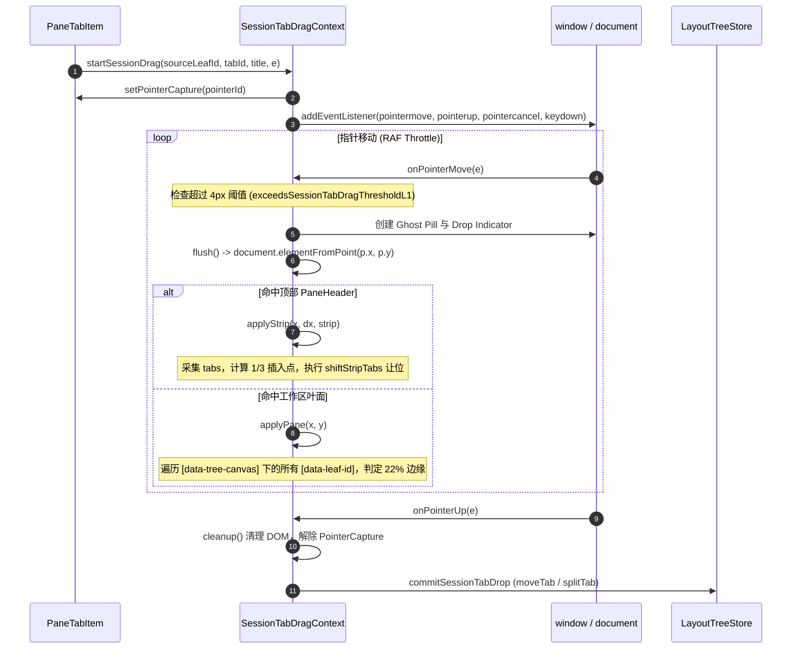
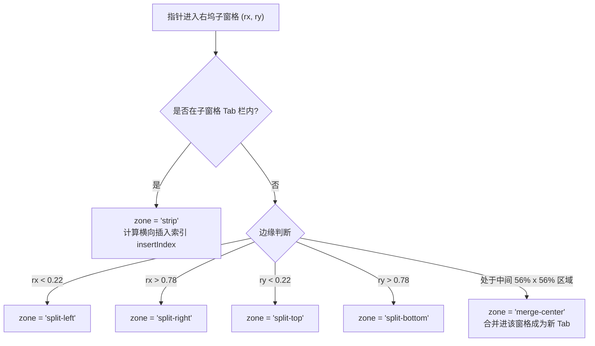
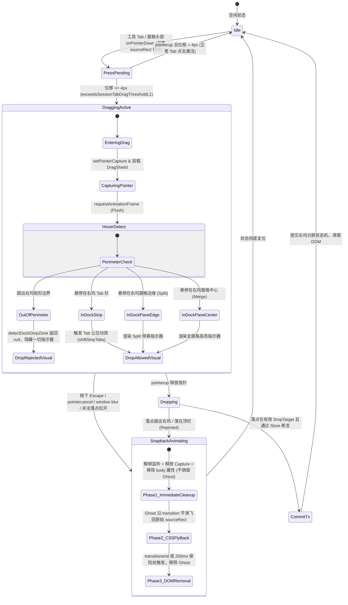

# 拖拽体系与域隔离防线深度分析与设计报告

> **战役代号**：`dock-split-system`  
> **任务编号**：04（分析阶段）  
> **归属路径**：`docs/dock-split-system/analysis/04-拖拽体系与域隔离防线.md`  
> **权威协作纪律遵循**：仓库根目录 `AGENTS.md`、`.agents/LOGIC_PLAN_NO_RETREAT.md`、`docs/dock-split-system/00-战役纪律与导引.md`。  

---

## 一、概述与核心意志

### 1.1 战役背景与用户核心红线

在多会话并排与复杂科研/开发工作流中，Conex/Crish 确立了**“以会话（Session-Unit）为顶层大窗口、功能区（Tool-Dock）在会话内部闭环”**的交互哲学。

用户针对拖拽交互明确下达了最高优先级的**刚性红线**：
> **“因为我们是按照对话分的大窗口，所以这些对话内的窗口是不能拖拽到 `class="_tabsContainer_1wzf4_71"` 里面去的。”**

用户期望在当前对话窗口内实现全部工具功能（左侧对话流，右侧具备完整的分屏系统，包含上下/左右分屏、Tab 拖拽换位、Sash 调节等），而无需跳出到全局外层；同时**严禁对话内部打开的工具面板或分屏子窗口逃逸到顶栏标签栏**。

### 1.2 本分析的核心使命

本报告旨在穿透现有拖拽机制的代码实现，剖析顶层大窗口（`PaneHeader`）与右侧功能区（`leafDockDrawer`）的交互边界，提出一套**右侧功能区专属拖拽体系（Dock Tool Drag System）**，并构筑**刚性跨域隔离防线（Domain Isolation Defense Line）**，实现：
1. **物理级切断逃逸**：彻底阻断功能区窗口向顶栏 `class="_tabsContainer_1wzf4_71"` 的拖拽可能；
2. **反向入侵隔离**：阻断顶栏大窗口向右侧功能区内部的非法嵌入；
3. **右坞内部自由分屏与重排**：在右侧功能区内实现 Tab 拖拽换位、边缘停靠上下/左右分屏、中心合并等完整 Dock 拖拽体验；
4. **终端与 Webview 防劫持**：在原生 ConPTY 终端与 Webview2 浏览器并存的高性能环境下，实现零丢帧、零指针捕获丢失的工业级手感。

---

## 二、现有拖拽架构深度解构与缺陷分析

### 2.1 现有实现全景

当前仓库中涉及拖拽的核心代码分布如下：

| 文件路径 | 职责定位 | 现状与问题 |
| :--- | :--- | :--- |
| `apps/crish-desktop/src/components/shell/SessionTabDragContext.tsx` | 会话大标签（Session Tab）拖拽生产控制器 | 全局单例 Context；直接操作顶层布局树 `useLayoutTreeStore`；探测全文档 `[data-tree-canvas]` |
| `apps/crish-desktop/src/components/shell/sessionTabDropCommit.ts` | 会话 Tab 落点提交事务 | 仅是顶层提交入口之一，其他入口还包括 `layoutTreeStore.ts:commitDrop()` 与 store 直接暴露的算子 |
| `apps/crish-desktop/src/components/shell/sessionTabDragFeel.ts` | 拖拽阈值（4px）、插入滞后（1/3）与 22% 边缘几何检测 | 纯几何数学函数，但参数面向全屏 Pane |
| `apps/crish-desktop/src/hooks/useTreeDrag.ts` | 历史二叉树拖拽 Hook | 已被维 06 改造为空操作（no-op），保留类型防止编译中断 |
| `apps/crish-desktop/src/store/layout-tree/dropDetection.ts` | 旧自适应 DropZone 检测算法 | 包含 `isUnitScopedDropAllowed`，但处于树模型层，未在 DOM 拖拽流中形成硬隔离 |
| `apps/crish-desktop/src/components/binary-tree/PaneHeader.tsx` | 窗格顶栏组件（包含 `_tabsContainer_1wzf4_71`） | 通过 CSS Modules 编译产生 `_tabsContainer_1wzf4_71`；在 W3C 指针捕获下其挂载事件无法阻断跨域拖拽 |
| `apps/crish-desktop/src/components/binary-tree/LeafToolTabStrip.tsx` | 右坞工具标签栏 | 当前仅支持点击切换与关闭，`onPointerDown` 直接 `stopPropagation`，**完全缺失拖拽能力** |

### 2.2 `SessionTabDragContext` 事件链路与落点判定机制剖析

在 `SessionTabDragContext.tsx` 中，会话 Tab 的拖拽生命周期如下：



### 2.3 核心缺陷：为什么右坞工具必须独立，且存在逃逸与互串隐患？

1. **落点探测全局穿透（Global `elementFromPoint` Trap）**：
   `SessionTabDragContext.tsx` 第 252-262 行：
   ```typescript
   const hit = document.elementFromPoint(p.x, p.y);
   const toolStrip = hit ? hit.closest('[data-leaf-tool-tab-strip]') : null;
   const stripWrap = !toolStrip && hit ? hit.closest('[data-pane-header="true"]') : null;
   const strip = stripWrap ? stripWrap.querySelector('[role="tablist"]') : null;
   ```
   如果右坞内的 Tab 也复用这套逻辑或未做类型鉴权：当用户拖动右坞内的工具 Tab 靠近顶栏时，`document.elementFromPoint` 抓取到的正是顶栏 `[data-pane-header="true"]` 内部的 `[role="tablist"]`（即 `class="_tabsContainer_1wzf4_71"`）。这会导致顶栏会话标签开始让位，一旦松手，工具面板 ID 将被当作 `tabId` 注入顶层 `moveTab`，导致会话树严重损坏！

2. **树级叶面扫描未排除右坞（Unscoped `querySelectorAll`）**：
   `SessionTabDragContext.tsx` 第 197-201 行：
   ```typescript
   const leaves = Array.from(
     document.querySelectorAll<HTMLElement>(
       '[data-tree-canvas="true"] [data-leaf-id]'
     )
   );
   ```
   顶栏大标签在拖拽时，`applyPane` 遍历了整个画布的所有 `[data-leaf-id]`。而右侧功能区 `leafDockDrawer` 位于 `TreeLeafPanel` 内部，当用户拖动顶层会话 Tab 经过右坞上方时，由于 `detectPaneDropRegion` 判定命中该 Leaf 的边界，系统会误把右坞所在的区域当作该会话的主内容区，触发会话的错误分屏或合并。

3. **右坞缺乏自身的拖拽分屏状态机**：
   当前右坞的标签栏 `LeafToolTabStrip.tsx`（368-371 行）仅执行：
   ```typescript
   onPointerDown={(e) => {
     // 工具 tab 不再切会话树；顺序走 updateTabDock
     e.stopPropagation();
   }}
   ```
   它没有任何拖拽源数据结构、没有拖拽位移判定，更没有边缘停靠（Split DropZone）判定。因此必须全新构建一套专属的拖拽体系。

---

## 三、右侧功能区专属拖拽体系架构（Dock Tool Drag System）

为了彻底隔离两套体系，我们设计独立的 **`DockToolDragProvider`** 与 **`useDockDrag`** 引擎，专供右坞使用。

### 3.1 核心数据结构与契约定义（TypeScript 判别联合类型）

系统运行在单一 Webview2 渲染进程内，完全通过 JavaScript 内存上下文共享状态，没有任何网络协议栈路由。所谓“协议 URL 字符串”（如 `conex://...` 或 MIME 字符串）只是普通的内存字面量，不具备任何物理隔离效力。

**真正具备不可伪造隔离效力的是 TypeScript 判别联合类型（Discriminated Union）**。我们将顶层会话拖拽源与右坞工具拖拽源从类型根基上彻底隔离，使用 `kind` 字段进行判别：

```typescript
/** 顶层会话大窗口拖拽载荷 */
export interface SessionTabDragSource {
  readonly kind: 'session-tab';
  tabId: string;
  leafId: string;
  title: string;
  /** 是否为顶栏全局独立常规终端（合法顶层 Tab） */
  isStandalone?: boolean;
}

/** 右坞工具专属拖拽载荷 */
export interface DockToolDragSource {
  readonly kind: 'dock-tool';
  /** 归属会话 ID（与所属 Session 强绑定，严禁跨会话窜放） */
  sourceSessionId: string;
  /** 归属会话标签 ID */
  sourceSessionTabId: string;
  /** 源右坞子窗格 ID（在右坞分屏树中的 LeafId） */
  sourceDockLeafId: string;
  /** 面板 ID（如 'terminal-1', 'preview', 'files', 'diff' 等） */
  panelId: string;
  /** 面板展示标题 */
  title: string;
  /** 面板图标名称 */
  iconName?: string;
}

/** 统一拖拽源联合类型 */
export type DragSourcePayload = SessionTabDragSource | DockToolDragSource;

/** 右坞落点判定目标 */
export type DockDropZoneType =
  | 'strip'          // 标签栏内部排序插空
  | 'split-left'     // 当前子窗格左侧切分
  | 'split-right'    // 当前子窗格右侧切分
  | 'split-top'      // 当前子窗格上方切分
  | 'split-bottom'   // 当前子窗格下方切分
  | 'merge-center';  // 当前子窗格中心合并（成为新 Tab）

export interface DockDropTarget {
  targetDockLeafId: string;
  targetSessionId: string;
  zone: DockDropZoneType;
  /** 当 zone === 'strip' 时的插入位置下标 */
  insertIndex?: number;
  /** 视觉指示器几何包围盒（视口绝对坐标） */
  indicatorRect: {
    left: number;
    top: number;
    width: number;
    height: number;
  };
}
```

所有提交路径（`commitDockDrop`、`commitDrop`、`moveTab`、`splitTab`）均在入口处进行强制 `kind` 断言，类型不匹配直接拦截报错。

### 3.2 右坞专属落点检测算法（`detectDockDropZone`）

落点检测必须**严格限定在当前右坞容器内部**，坚决不向全局 `document.body` 或外层 `[data-tree-canvas]` 扩散。

#### 1. 物理硬围栏作用域（Physical Perimeter Scope）
检测只在宿主右坞元素 `[data-leaf-dock-drawer="true"][data-session-tab-id="..."]` 内执行。如果当前指针位置 `(clientX, clientY)` 离开当前右坞的 DOM 边界，**立即判定为 Out of Bounds（返回 `null`），绝对不执行全局 `elementFromPoint` 探测**。

#### 2. 自适应分区权重（22% 边缘分割 + 中心合并）
针对右坞内部各分屏子窗格（`DockPaneLeaf`），计算指针相对于窗格的归一化坐标：
- 窗格宽 $W$、高 $H$；
- 边缘分割阈值 $E_{ratio} = 0.22$（与会话分屏体验平齐，支持高宽比自适应）；
- 归一化相对位置：$r_x = \frac{x - \text{rect.left}}{W}$，$r_y = \frac{y - \text{rect.top}}{H}$；



#### 3. 窄窗格/极端分屏下的自适应保底
当右坞经历多重分屏，导致某些子窗格宽度 $< 200\text{px}$ 或高度 $< 150\text{px}$ 时：
- 强制收缩边缘分割阈值到绝对像素（例如最小保留 $36\text{px}$ 边缘），确保中心区域不会被完全挤压消失；
- 当窗格尺寸极小时，优先判定为 `merge-center`，防止用户因手抖在极小空间内误触发更细碎的二度切分。

### 3.3 状态机时序（Dock Drag State Machine 与双阶段 Snapback）



---

## 四、刚性跨域隔离防线设计（Defense in Depth：全立体防御矩阵）

为了绝对守住用户**“对话内的窗口绝不能拖拽到 `class="_tabsContainer_1wzf4_71"` 里面去”**的钢铁意志，必须在架构上构筑**全立体纵深防御体系（Defense in Depth）**：

```
┌────────────────────────────────────────────────────────────────────────────────────────┐
│                               顶层会话大窗口空间 (Session Tree)                         │
│                                                                                        │
│   顶栏 _tabsContainer_1wzf4_71 (PaneHeader.tsx)                                        │
│   ▲                                                                                    │
│   │ 【防线 2：探测物理硬围栏】detectDockDropZone 出界即 return null，绝不扫描顶栏         │
│   │                                                                                    │
│   ┼────────────────────── 物理真空隔离带 (Out-of-Bounds Deadzone) ────────────────────┼
│   │                                                                                    │
│   ▼ 【防线 3：底层 Store 内核硬断言】moveTab / splitTab 入口强制 assertIsSessionLevelTab  │
├──────────────────────────────────────────┬─────────────────────────────────────────────┤
│                                          │                                             │
│       主对话流交互区                      │        右侧功能区分屏系统 (Right Tool Dock) │
│       (Chat Leaf Column)                 │        (leafDockDrawer)                     │
│                                          │                                             │
│                                          │   【防线 1：TypeScript 判别联合类型】        │
│                                          │   SessionTabDragSource vs DockToolDragSource│
│                                          │   编译期不可混淆，运行期入口强制 kind 校验  │
│                                          │                                             │
│                                          │   【防线 4：双向与跨会话隔离】               │
│                                          │   顶栏 Tab 禁入右坞，A 会话右坞禁入 B 会话   │
└──────────────────────────────────────────┴─────────────────────────────────────────────┘
```

### 4.1 防线 1：数据契约与 TypeScript 判别联合类型（Type Authentication Guard）

- **完全独立的 Controller 双轨制**：
  绝不在 `SessionTabDragContext` 中添加各种 `if (isDock)` 补丁。右坞拖拽由全新独立的 `DockToolDragContext` 驱动；顶栏会话由 `SessionTabDragContext` 驱动。
- **判别联合类型硬性隔离**：
  弃用任何基于协议字符串的虚假隔离，改用不可伪造的判别联合类型：
  - 顶栏拖拽：`kind: 'session-tab'`；
  - 右坞拖拽：`kind: 'dock-tool'`；
  - 统一联合类型 `DragSourcePayload = SessionTabDragSource | DockToolDragSource`；
- **全提交路径强制类型断言**：
  所有会话级布局树提交函数（`commitSessionTabDrop`、`layoutTreeStore.commitDrop`、`moveTab`、`splitTab`）必须在函数入口执行判别谓词：
  ```typescript
  if (source.kind !== 'session-tab') {
    throw new Error(`[SECURITY_VIOLATION] 非法拖拽源试图提交至顶层会话树: ${source.kind}`);
  }
  ```
  类型不匹配直接抛出异常并拒绝执行。

### 4.2 防线 2：`detectDockDropZone` 内部物理硬围栏（Physical Perimeter Guard）

针对用户指认的顶栏标签栏 `class="_tabsContainer_1wzf4_71"`（即 `PaneHeader.tsx` 的 `styles.tabsContainer`），构筑基于探测器内部物理硬围栏的刚性拒收机制。

#### 1. 为什么“顶栏 DOM 挂载门锁”是无效死代码？
一旦右坞拖拽启动时调用了 `e.currentTarget.setPointerCapture(pointerId)`，依据 **W3C Pointer Events 标准规范**：
> 操作系统与渲染引擎会将后续所有的指针事件（包括 `pointermove`、`pointerenter`、`pointerover`、`pointerleave`）全部、强制、唯一地派发给调用捕获的源元素自身！

底层的任何其他 DOM 节点（包括顶栏的 `tabsContainer`）**在物理层面上根本不会收到任何 Pointer 事件**！因此，在 `PaneHeader.tsx` 的 `tabsContainer` 上挂载 `onPointerEnter` / `onPointerMove` 是调用次数恒等于 0 的死代码，根本无法起到阻断作用。

#### 2. 真实有效的防线 2：`detectDockDropZone` 内部物理硬围栏
正确的实现是将跨域防线彻底内聚到 `detectDockDropZone` 命中检测算法内部：
1. **入口物理硬围栏校验**：函数入口首先读取当前所属右坞容器（`[data-leaf-dock-drawer="true"]`）的 `getBoundingClientRect()`；
2. **指针越界即刻熔断**：若当前指针坐标 `(clientX, clientY)` 超出此矩形范围（即便仅超出 1px），**立即 `return null`**；
3. **彻底切断全局穿透**：越界后**绝对不执行任何 `elementFromPoint` 全局扫描**，顶栏和对话区绝对无法生成任何 DropZone；
4. **顶栏视觉零侵扰**：顶栏会话标签栏不会被唤醒，绝不调用 `shiftStripTabs`，指示器保持不可见。

#### 3. 全局状态标记安全清理（防止死锁）
若在 `document.body` 挂载 `data-drag-domain="dock-tool"` 或状态类名，其清理逻辑必须**同时在 `pointerup`、`pointercancel`、`blur` 三个事件中执行**。无论遇到系统弹窗、Alt+Tab 切换还是手势中断，均在下一微任务内彻底清空，防止标记残留导致顶栏正常交互死锁。

### 4.3 防线 3：底层 Store 内核事务硬断言与全路径拦截（Kernel Transaction Guard）

无论上层 UI 层的防线如何严密，系统的**终极安全屏障必须由底层 Store 内核算子提供**。

#### 1. 现有仓库多条提交路径全覆盖
经实地代码核查，现有仓库中存在多条可触发大窗口移动与切分的提交链路：
- 链路 1：`SessionTabDragContext.tsx` $\rightarrow$ `sessionTabDropCommit.ts`（`commitSessionTabDrop`）
- 链路 2：`apps/crish-desktop/src/store/layout-tree/layoutTreeStore.ts:commitDrop()`
- 链路 3：直接调用 `useLayoutTreeStore.getState().moveTab(...)`
- 链路 4：直接调用 `useLayoutTreeStore.getState().splitTab(...)`

如果断言仅加在 `sessionTabDropCommit.ts` 包装函数上，链路 2、3、4 将直接绕过防御。

#### 2. 断言直接下沉至 Store 核心算子
断言必须直接植入底层核心算子 `layoutTreeMoveRemove.ts`（`moveTab`）与 `layoutTreeInsert.ts`（`splitTab`）的入口处：
```typescript
export function assertIsSessionLevelTab(tab: unknown): asserts tab is LeafSessionTab {
  if (!tab || typeof tab !== 'object') throw new Error('ERR_INVALID_TAB');
  const t = tab as LeafSessionTab;
  // 顶层合法标签：真会话标签 或 显式标记为 Standalone 的全局独立常规终端
  const isAllowed = isChatTab(t) || (t.kind === 'terminal' && t.isStandalone === true);
  if (!isAllowed) {
    throw new Error(`[SECURITY_VIOLATION] 非顶层会话标签严禁进入大窗口布局树: ${JSON.stringify(t)}`);
  }
}
```

#### 3. 精确放行顶栏全局独立终端（Standalone Terminal）
`assertIsSessionLevelTab` 谓词必须满足两项刚性判定：
- **精确放行**：对 `isStandalone === true` 的顶栏全局独立常规终端予以放行，允许其在顶栏内部合法拖拽换位与切分；
- **刚性拦截**：对 `kind === 'dock-tool'` 的右坞工具面板予以绝对拦截，任何试图将右坞工具 ID 写入顶层二叉树的操作均被抛出异常并阻断。

### 4.4 防线 4：双向防线与跨会话右坞隔离

#### 1. 反向隔离：顶层会话 Tab 严禁渗入右坞
在 `SessionTabDragContext.tsx` 的 `applyPane` 中注入刚性门禁：
```typescript
const applyPane = (x: number, y: number): boolean => {
  const hit = document.elementFromPoint(x, y);
  // 若指针位于任何右坞内部，立刻短路返回 false，绝不触发会话分屏
  if (hit?.closest('[data-leaf-dock-drawer="true"]')) {
    return false;
  }
  // ... 正常遍历主聊天窗格
};
```

#### 2. 跨会话隔离：Session A 右坞工具绝不进 Session B 右坞
在多分屏场景下，不同会话的右坞处于各自独立的数据闭环中。跨会话拖拽校验断言：
```typescript
if (source.sourceSessionId !== targetDockSessionId) {
  // 跨会话右坞拖拽，直接阻断
  return null;
}
```

---

## 五、Webview（浏览器）与终端（xterm）防劫持体系

右侧功能区是工具面板的核心宿主，其中 Webview2 浏览器与 ConPTY 终端具有极强的鼠标事件吸收效应。为此构筑四重防劫持保障：

### 5.1 第一重：显式调用 `setPointerCapture`
在源 Tab 或窗格的 `onPointerDown` 中同步调用：
```typescript
try {
  e.currentTarget.setPointerCapture(pointerId);
} catch {
  // 降级由 window 全局事件接管
}
```
确保无论指针移动速度多快，操作系统均优先将指针事件推送到宿主元素。

### 5.2 第二重：全局 CSS 穿透切断（`pointer-events: none`）
在全局样式中声明针对正在拖拽状态的硬性穿透屏蔽：
```css
body.is-dock-dragging iframe,
body.is-dock-dragging webview,
body.is-dock-dragging [data-webview-container],
body.is-dock-dragging .xterm,
body.is-dock-dragging .xterm-screen,
body.is-dock-dragging .xterm-helpers {
  pointer-events: none !important;
  user-select: none !important;
}
```

### 5.3 第三重：全覆盖透明防劫持遮罩层（Drag Shield Overlay）
当 `isDragging === true` 时，在右坞最顶层挂载全尺寸透明 `div`：
```tsx
{isDragging && (
  <div 
    className={styles.dockDragShield}
    data-tauri-drag-region="false"
    style={{
      position: 'absolute',
      inset: 0,
      zIndex: 9999,
      pointerEvents: 'none',
      cursor: dropTarget ? 'grabbing' : 'no-drop'
    }}
  />
)}
```

### 5.4 第四重：异常中断保险丝（Failsafe Fuses）
设置三道自愈保险丝：
1. `window.addEventListener('blur', forceCleanup)`：窗口失焦强制复位；
2. `window.addEventListener('keydown', (e) => e.key === 'Escape' && forceCleanup())`：Esc 键安全脱困；
3. `pointercancel` 监听：操作系统手势介入时强制复位。

---

## 六、视觉反馈与手感体验设计（Visual Feedback & Feel）

遵循仓库《反过度设计红线》与 UI 规范，保持克制、优雅，禁止粗暴的硬黑边框。

### 6.1 专属 Ghost Pill（随身悬浮胶囊）
- 结构：包含工具图标 + 工具标题 + 微型半透明卡片；
- 样式：采用柔和毛玻璃（`backdrop-filter: blur(8px)`），背景 `color-mix(in srgb, var(--bg-surface) 85%, transparent)`，边框 `1px solid var(--border-color)`，微轻量阴影；
- 尺寸锁定：继承被拖拽 Tab 的原始高宽，抓取无跳动。

### 6.2 窗格分割预览框（Split Preview Indicator）
边缘分割指示器采用与主界面设计 Token 一致的柔和主色遮罩，过渡时间为 120ms 缓动，避免临界区频闪。

### 6.3 失败回弹动效：正确的两阶段 Snapback 状态机

在之前的初步设计中，伪代码在 `onPointerUp` 第一行就同步调用了 `cleanup()` 并直接 `remove()` 了 Ghost DOM，导致所谓的 180ms CSS 回弹动画根本没有宿主节点可以执行，直接沦为突兀消失。

**必须修正为确定性的两阶段 Snapback 状态机**：

1. **拖拽启动采集（Snapshot Acquisition）**：
   在 `pointerdown` 触发时，**立即采集源 Tab 的 `getBoundingClientRect()` 快照**（记录原始屏幕起点 `(sourceRect.left, sourceRect.top)`），并以此创建 Ghost 浮层 DOM。
2. **非法落点释放（Drop Rejection on PointerUp）**：
   当用户在非法区域（顶栏、非右坞区域）松开指针时：
   - **第一阶段（立即解绑）**：解绑 `pointermove` 与 `pointerup` 监听，解除 `pointerCapture`，清理 `document.body` 上的 `data-drag-domain` 标记，**绝对不销毁 Ghost DOM**；
   - **第二阶段（CSS 平滑过渡）**：为 Ghost DOM 注入平滑过渡样式，驱动其从当前指针位置平滑飞向原始快照坐标：
     ```typescript
     ghostEl.style.transition = 'transform 180ms cubic-bezier(0.175, 0.885, 0.32, 1.15), opacity 180ms ease';
     ghostEl.style.transform = `translate3d(${sourceRect.left}px, ${sourceRect.top}px, 0) scale(0.96)`;
     ghostEl.style.opacity = '0.3';
     ```
   - **第三阶段（双重保险销毁）**：
     监听 `transitionend` 事件，在动画结束时从 DOM 中安全移除 Ghost，并将 `isDragging` 复位为 `false`；
     同时配合 **250ms 保险丝定时器（Fuse Timer）** 兜底，防止因窗口失焦或动画取消导致 `transitionend` 丢失而产生孤儿 DOM 节点。

---

## 七、架构落地与伪代码实现方案

### 7.1 文件架构规划

```
apps/crish-desktop/src/
├── components/
│   ├── binary-tree/
│   │   ├── PaneHeader.tsx                 <-- 无需挂载伪事件门锁（依托防线 2 围栏与防线 3 Store 断言）
│   │   ├── LeafToolTabStrip.tsx           <-- 接入 onDragStart 启动右坞 Tab 拖拽
│   │   └── LeafDockDrawer.tsx             <-- 宿主 Provider 挂载与 DropZone 容器
│   └── dock-split/                        <-- 新增右坞专属分屏与拖拽模块
│       ├── DockToolDragContext.tsx        <-- 右坞拖拽上下文与两阶段 Snapback 管理
│       ├── dockToolDragFeel.ts            <-- detectDockDropZone 内部物理硬围栏与边缘计算
│       ├── dockToolDropCommit.ts          <-- 右坞分屏事务提交（dockSplit / dockMoveTab）
│       ├── dockToolDragDom.ts             <-- Ghost Pill、Indicator 与让位动效管理
│       └── DockDragShield.tsx             <-- Webview / 终端全覆盖防劫持遮罩
└── store/layout-tree/
    ├── layoutTreeMoveRemove.ts            <-- moveTab 入口植入 assertIsSessionLevelTab
    └── layoutTreeInsert.ts                <-- splitTab 入口植入 assertIsSessionLevelTab
```

### 7.2 核心伪代码：`DockToolDragContext.tsx`

```typescript
import React, { createContext, useContext, useCallback, useRef, useState, useMemo } from 'react';
import type { DockToolDragSource, DockDropTarget } from './dockDragTypes';
import { detectDockDropZone } from './dockToolDragFeel';
import { commitDockDrop } from './dockToolDropCommit';
import { createDockGhost, posDockIndicator, removeDockElements } from './dockToolDragDom';

interface UseDockDragResult {
  isDragging: boolean;
  startDockDrag: (source: Omit<DockToolDragSource, 'kind'>, e: React.PointerEvent) => void;
}

const DockDragContext = createContext<UseDockDragResult | null>(null);

export const DockToolDragProvider: React.FC<{
  sessionId: string;
  dockDrawerRef: React.RefObject<HTMLDivElement | null>;
  children: React.ReactNode;
}> = ({ sessionId, dockDrawerRef, children }) => {
  const [isDragging, setIsDragging] = useState(false);
  const activeDragRef = useRef<{
    source: DockToolDragSource;
    dropTarget: DockDropTarget | null;
  } | null>(null);

  const startDockDrag = useCallback((sourceInput: Omit<DockToolDragSource, 'kind'>, e: React.PointerEvent) => {
    if (e.button !== 0) return;
    const source: DockToolDragSource = { ...sourceInput, kind: 'dock-tool' };

    const pointerId = e.pointerId;
    const startX = e.clientX;
    const startY = e.clientY;
    
    // 关键修正 1：在抓取瞬间采集源 Tab 原始几何快照，供 Snapback 使用
    const sourceEl = e.currentTarget as HTMLElement;
    const sourceRect = sourceEl.getBoundingClientRect();

    let dragging = false;
    let ghostEl: HTMLElement | null = null;
    let indicatorEl: HTMLElement | null = null;
    let rafId = 0;

    try {
      sourceEl.setPointerCapture(pointerId);
    } catch { /* 容错 */ }

    const onPointerMove = (me: PointerEvent) => {
      if (me.pointerId !== pointerId) return;
      const dx = me.clientX - startX;
      const dy = me.clientY - startY;

      if (!dragging && Math.abs(dx) + Math.abs(dy) >= 4) {
        dragging = true;
        setIsDragging(true);
        document.body.classList.add('is-dock-dragging');
        document.body.setAttribute('data-drag-domain', 'dock-tool');
        ghostEl = createDockGhost(source.title, source.iconName, sourceRect);
        indicatorEl = document.createElement('div');
        indicatorEl.className = 'dock-drop-indicator';
        document.body.appendChild(indicatorEl);
      }

      if (!dragging) return;

      if (ghostEl) {
        ghostEl.style.transform = `translate3d(${me.clientX}px, ${me.clientY}px, 0)`;
      }

      if (!rafId) {
        rafId = requestAnimationFrame(() => {
          rafId = 0;
          const drawer = dockDrawerRef.current;
          if (!drawer) return;

          // 核心调用：在右坞边界内检测，超出物理边界自动返回 null，绝不扫描顶栏
          const target = detectDockDropZone({ x: me.clientX, y: me.clientY }, drawer, source);
          activeDragRef.current = { source, dropTarget: target };

          if (target && indicatorEl) {
            posDockIndicator(indicatorEl, target.indicatorRect, target.zone);
          } else if (indicatorEl) {
            indicatorEl.style.display = 'none';
          }
        });
      }
    };

    // 立即解除监听与 Capture（不直接移除 Ghost）
    const detachListeners = () => {
      if (rafId) cancelAnimationFrame(rafId);
      window.removeEventListener('pointermove', onPointerMove);
      window.removeEventListener('pointerup', onPointerUp);
      window.removeEventListener('pointercancel', handleCancel);
      window.removeEventListener('blur', handleCancel);
      try {
        sourceEl.releasePointerCapture(pointerId);
      } catch { /* 容错 */ }
      document.body.classList.remove('is-dock-dragging');
      document.body.removeAttribute('data-drag-domain');
      if (indicatorEl) {
        indicatorEl.remove();
        indicatorEl = null;
      }
    };

    // 彻底销毁 Ghost DOM
    const finalizeCleanup = () => {
      detachListeners();
      if (ghostEl) {
        ghostEl.remove();
        ghostEl = null;
      }
      setIsDragging(false);
      activeDragRef.current = null;
    };

    // 关键修正 2：双阶段 Snapback 动画控制器
    const triggerSnapbackAndCleanup = () => {
      detachListeners();
      if (!ghostEl) {
        finalizeCleanup();
        return;
      }

      // 执行 CSS 回弹动画
      ghostEl.style.transition = 'transform 180ms cubic-bezier(0.175, 0.885, 0.32, 1.15), opacity 180ms ease';
      ghostEl.style.transform = `translate3d(${sourceRect.left}px, ${sourceRect.top}px, 0) scale(0.96)`;
      ghostEl.style.opacity = '0.3';

      let cleaned = false;
      const doFinal = () => {
        if (cleaned) return;
        cleaned = true;
        finalizeCleanup();
      };

      ghostEl.addEventListener('transitionend', doFinal, { once: true });
      // 250ms 保险丝定时器兜底
      setTimeout(doFinal, 250);
    };

    const handleCancel = () => {
      triggerSnapbackAndCleanup();
    };

    const onPointerUp = (me: PointerEvent) => {
      if (me.pointerId !== pointerId) return;
      const current = activeDragRef.current;

      if (!dragging || !current?.dropTarget) {
        // 无效落点 / 落在顶栏 / 越界：触发 Spring Snapback，不提交事务
        triggerSnapbackAndCleanup();
        return;
      }

      finalizeCleanup();
      // 仅提交右坞分屏状态机，绝不碰全局 layoutTree
      commitDockDrop(current.source, current.dropTarget);
    };

    window.addEventListener('pointermove', onPointerMove);
    window.addEventListener('pointerup', onPointerUp);
    window.addEventListener('pointercancel', handleCancel);
    window.addEventListener('blur', handleCancel);
  }, [sessionId, dockDrawerRef]);

  const value = useMemo(() => ({ isDragging, startDockDrag }), [isDragging, startDockDrag]);

  return (
    <DockDragContext.Provider value={value}>
      {children}
    </DockDragContext.Provider>
  );
};
```

### 7.3 核心实现：`detectDockDropZone` 内部物理硬围栏

跨域隔离防线 2 完全内聚于 `detectDockDropZone` 函数入口：

```typescript
// apps/crish-desktop/src/components/dock-split/dockToolDragFeel.ts

export function detectDockDropZone(
  p: { x: number; y: number },
  dockDrawerEl: HTMLElement,
  source: DockToolDragSource
): DockDropTarget | null {
  // 刚性防线 2：物理硬围栏 — 指针必须在当前所属右坞的 bounding rect 之内
  const dockRect = dockDrawerEl.getBoundingClientRect();
  if (
    p.x < dockRect.left ||
    p.x > dockRect.right ||
    p.y < dockRect.top ||
    p.y > dockRect.bottom
  ) {
    // 越界立即返回 null，物理级切断对顶栏与外部任何 DOM 的扫描
    return null;
  }

  // 严格在 dockDrawerEl 内部寻找子窗格并计算分屏/Tab，绝不向外扩散
  return calculateInnerDockDrop(p, dockDrawerEl, source);
}
```

### 7.4 核心实现：底层 Store 内核事务硬断言

```typescript
// apps/crish-desktop/src/store/layout-tree/layoutTreeMoveRemove.ts 与 layoutTreeInsert.ts

export function assertIsSessionLevelTab(tab: unknown): asserts tab is LeafSessionTab {
  if (!tab || typeof tab !== 'object') {
    throw new Error('[SECURITY_VIOLATION] 非法 Tab 数据格式');
  }
  const t = tab as LeafSessionTab;
  
  // 顶层合法标签仅允许：真会话标签 或 显式标记为 Standalone 的全局独立常规终端
  const isAllowed = isChatTab(t) || (t.kind === 'terminal' && t.isStandalone === true);
  
  if (!isAllowed) {
    throw new Error(
      `[SECURITY_VIOLATION] 右坞工具面板严禁逃逸进入大窗口布局树: ${JSON.stringify(t)}`
    );
  }
}

// 在 moveTab 算子入口处：
export function moveTab(tree: LayoutTree, srcLeafId: string, tabId: string, dstLeafId: string, insertIdx: number): LayoutTree {
  const src = requireChatLeaf(tree.root, srcLeafId);
  const targetTab = src.tabs.find((t) => t.tabId === tabId);
  if (targetTab) {
    // 刚性断言守卫
    assertIsSessionLevelTab(targetTab);
  }
  // ... 执行正常的移动逻辑
}

// 在 splitTab 算子入口处：
export function splitTab(tree: LayoutTree, srcLeafId: string, tabId: string, direction: SplitDirection): LayoutTree {
  const src = requireChatLeaf(tree.root, srcLeafId);
  const targetTab = src.tabs.find((t) => t.tabId === tabId);
  if (targetTab) {
    // 刚性断言守卫
    assertIsSessionLevelTab(targetTab);
  }
  // ... 执行正常的切分逻辑
}
```

---

## 八、触控设备与键盘操作的补充防护

针对审计报告 C 中提出的触控手势劫持与键盘快捷键绕过 Pointer 防线的警告，构筑补充防御措施：

### 8.1 移动触控设备 `touch-action: none` 刚性声明

在 Windows 触控笔记本（Surface 等）或触控板上，用户的输入类型为 `e.pointerType === 'touch'`。浏览器默认手势识别引擎在用户手指移动时会启动页面滚动，并向源元素派发 `pointercancel`，导致拖拽被瞬间中断。

**防护口径**：
1. **显式 CSS 声明**：右坞 Tab 元素（`MicroPaneTabStrip` 中的 Tab 胶囊）及内部分屏 Sash（`DockResizeSash`）必须在样式中显式声明：
   ```css
   .dockToolTabItem,
   .dockResizeSash {
     touch-action: none !important;
     user-select: none !important;
     -webkit-user-drag: none;
   }
   ```
   物理阻断浏览器原生滚动引擎对手势的介入；
2. **触控死区防抖**：触屏输入时，拖拽判定阈值由鼠标的 4px 适度放宽至 8px，防止手指点击时的微小颤抖误触拖拽。

### 8.2 键盘分屏操作绕过 Pointer 防线的 Store 内核保障

全键盘分屏交互动作（如 `Ctrl+Shift+\` 向右分屏、`Ctrl+Shift+-` 向下分屏）完全绕过鼠标 Pointer 事件流，无法被防线 2（落点探测器）感知。

**防护口径**：
- **键盘操作的安全终极托底是防线 3（Store 内核硬断言）**；
- 无论用户通过鼠标拖放、触屏滑动还是键盘快捷键触发分屏与移动，所有状态机流向最终均必须收敛至 `moveTab` / `splitTab` / `dockMoveTab` / `dockSplitTab` 核心算子；
- 结论：**Pointer 事件层防线只是用户体验层辅助，防线的终极绝对保障是 Store 核心算子的类型守卫，确保任何输入模式下的绝对安全**。

---

## 九、立体化验证断言矩阵（魔鬼测试用例设计）

遵循仓库《立体验证纪律》（`AGENTS.md` §7.1），杜绝打补丁与假验收，必须在实施后跑通以下测试集：

### 9.1 跨域逃逸刚性阻断测试集（针对 `_tabsContainer_1wzf4_71`）
- **Test-01：右坞 Tab 拖动至顶栏释放**  
  *用例*：模拟从右坞拖动 Terminal Tab，坐标移动至顶栏 `styles.tabsContainer` 内松手。  
  *断言*：
  1. `PaneHeader` 的 `tabs` 列表长度不变，不追加任何项；
  2. 顶栏不产生任何 `is-dragging` 让位样式；
  3. `useLayoutTreeStore.getState()` 的树结构零变更；
  4. 触发 Ghost 回弹动画（平滑飞回源坐标并在 180ms 后安全移除）。
- **Test-02：右坞 Tab 在顶栏持续悬停**  
  *用例*：拖动右坞 Tab 在顶栏 `tabsContainer` 内部左右连续横划。  
  *断言*：`detectDockDropZone` 恒返回 `null`，`shiftStripTabs` 调用次数为 0，指示器 DOM 保持不可见，顶栏标签绝对不让位。

### 9.2 反向隔离测试集
- **Test-03：顶栏 Session Tab 拖入右坞功能区**  
  *用例*：拖动顶层会话 Tab，移动至右坞分屏面板上方。  
  *断言*：
  1. `applyPane` 严格返回 false；
  2. 右坞内部绝不渲染任何会话分屏阴影蓝框；
  3. 松手时不触发 `splitTab`。

### 9.3 跨会话隔离测试集
- **Test-04：双分屏下跨会话右坞拖放阻断**  
  *用例*：在并排的会话 A 与会话 B 中，将 A 右坞的工具 Tab 拖入 B 的右坞中。  
  *断言*：`detectDockDropZone` 返回 null，指示器隐藏，松手不产生跨会话搬移。

### 9.4 防劫持与极端环境测试集
- **Test-05：Webview2 / iframe 掠过测试**  
  *用例*：在右坞打开浏览器预览页面，拖动工具 Tab 快速掠过 Webview 视口。  
  *断言*：`pointermove` 高频连续触发，不发生指针事件丢失，遮罩层处于激活状态。
- **Test-06：xterm.js 掠过与选区互斥测试**  
  *用例*：在右坞打开终端，拖动工具 Tab 掠过终端文字区域并松手。  
  *断言*：终端内部不产生任何文本选中高亮，拖拽事件准确捕获并完成落点判定。
- **Test-07：Escape 键、Alt+Tab 与失焦异常中断恢复**  
  *用例*：拖拽进行中模拟按 Escape 键或触发 `window.blur`。  
  *断言*：DOM 中的 `is-dock-dragging` 类与 Ghost/Indicator 节点在下一微任务内 100% 彻底清理，无内存泄漏与死锁。

### 9.5 触控手势与键盘快捷操作测试集
- **Test-08：触控设备拖拽与 `touch-action` 验证**  
  *用例*：以 touch 输入模式模拟按住右坞 Tab 移动 20px。  
  *断言*：系统不派发 `pointercancel`，正常进入拖拽状态机。
- **Test-09：键盘快捷键跨域越界拦截**  
  *用例*：通过快捷键直接对右坞工具调用顶层 `moveTab` / `splitTab`。  
  *断言*：`assertIsSessionLevelTab` 抛出 `SECURITY_VIOLATION`，大窗口布局树拒绝写入。

---

## 十、总结与协同对接建议

1. **核心红线绝对守住**：  
   通过本案修正后的**“TypeScript 判别联合类型 + 探测器物理硬围栏 + Store 内核断言 + 两阶段 Snapback”**全立体防线，顶栏 `class="_tabsContainer_1wzf4_71"` 彻底免疫来自右坞功能区的一切拖拽干扰，完美兑现用户的核心诉求。
2. **与 Agent 01（模型）协同点**：  
   拖拽引擎落点提交 `commitDockDrop` 最终调用的 API（`dockSplitTab` / `dockMoveTab`），与 Agent 01 产出的 `DockLayoutTree` 数据契约严格保持签名一致。
3. **与 Agent 02（渲染）协同点**：  
   `DockToolDragProvider` 将直接挂载在 Agent 02 改造后的 `LeafDockDrawer` 容器外围，其 DOM 引用 `dockDrawerRef` 作为物理硬围栏判定的唯一几何基准点。
4. **与 Agent 05（运行时）协同点**：  
   拖拽过程中的 Webview 与 ConPTY 防劫持遮罩（`DockDragShield`），由 Agent 05 确认其在进程生命周期内的安全性，确保 pointer-events 恢复后终端 I/O 零延迟。
