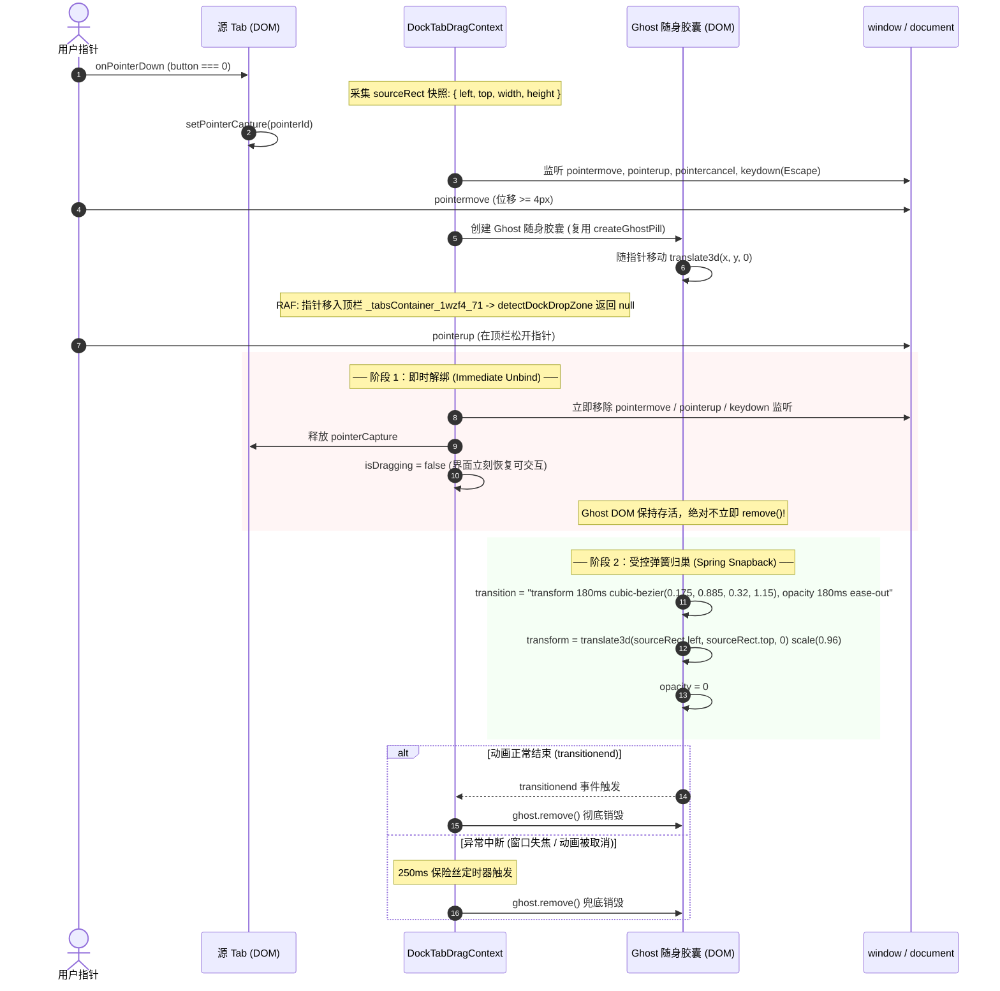

# 04-拖拽体系与域隔离防线（V2 架构版：基于构造级隔离与物理围栏的极简设计）

> **战役代号**：`dock-split-system`  
> **文档定位**：分维架构深度分析报告 — V2 拖拽体系与域隔离防线  
> **归属路径**：`docs/dock-split-system/analysis/04-拖拽体系与域隔离防线.md`  
> **权威协作纪律遵循**：仓库根目录 [`AGENTS.md`](file:///c:/Software/conex/AGENTS.md)、[`.agents/LOGIC_PLAN_NO_RETREAT.md`](file:///c:/Software/conex/.agents/LOGIC_PLAN_NO_RETREAT.md)、[`ANTI_OVERENGINEERING_GUARDRAILS.md`](file:///c:/Software/conex/ANTI_OVERENGINEERING_GUARDRAILS.md)、[`00-总方案.md`](file:///c:/Software/conex/docs/dock-split-system/00-总方案.md)  
> **架构版本**：V2.0（2026-10-27 重构版）

---

## 一、最高指导原则与 V2 构造级隔离哲学

### 1.1 用户最新裁决与最高意志

用户对本战役的架构演进下达了明确的刚性铁律：
> **“不允许打补丁，不允许硬编码，有合理的抽象，适合未来的功能需求，代码尽量简洁，具有优秀的可维护性。需要删除的代码就删除，需要系统性的重构。生成的方案应该能彻底杜绝这些问题或者未来的衍生问题，要求一次性解决掉。尽量减少不必要的兼容，最好是不兼容。”**

同时，针对拖拽体系的跨域行为，用户提出了最严厉的核心红线：
> **“因为我们是按照对话分的大窗口，所以这些对话内的窗口是不能拖拽到 `class="_tabsContainer_1wzf4_71"` 里面去的。”**

### 1.2 从 V1“拼凑补丁”到 V2“构造级隔离”（By-Construction Isolation）

在过去的初步设想中，系统曾尝试使用“URL 协议字符串识别（`conex://...`）”、“在顶栏 DOM 上挂载 pointerenter 门锁事件”、“外层 Context 内部到处添加 `if (isDock)` 分支判断”等防御手段。

**白盒事实证明，这些做法均是脆弱的打补丁与过度设计**：
1. **字符串协议无隔离效力**：Webview2 内单渲染进程 JavaScript 共享内存环境，协议字符串无法阻止对象混用与隐式类型转换；
2. **顶栏 DOM 门锁恒为无效死代码**：依据 **W3C Pointer Events 规范**，源元素一旦调用 `setPointerCapture`，后续所有指针移动事件会被操作系统与渲染引擎**独占派发给源捕获元素**。底层的顶栏 `_tabsContainer_1wzf4_71` 根本不会接收到任何 `pointerenter` 或 `pointermove` 事件，挂载的门锁调用次数恒等于 0；
3. **全局单例 Controller 导致逻辑耦合泥潭**：外层 `SessionTabDragContext` 直接持有 `useLayoutTreeStore` 的写权限，落点判定直接在全屏幕 `document.elementFromPoint` 探测，导致外层会话与内层工具互相污染。

**V2 的核心哲学：基于构造级隔离（Isolation by Construction）的极简优雅设计**：
不搞复杂的黑白名单配置，不搞层层过滤中间件，而是从**类型系统、React 拓扑树和执行上下文权限**三个根基维度，让“右坞工具进入顶栏”在物理和数学意义上**完全不可能发生**：

```mermaid
graph TD
    subgraph 外层大窗口体系 (Top-Level Session Window)
        SessionTab["SessionTab 数据实体<br/>(ChatTab | StandaloneTerminalTab)"]
        SessionCtx["外层 SessionTabDragContext<br/>(挂载于 App 顶层)"]
        PaneHeader["顶栏 PaneHeader.tsx<br/>(_tabsContainer_1wzf4_71)"]
        TreeCommit["Session Drop Commit<br/>(仅操作外层 LayoutTreeStore)"]
        
        SessionTab --> PaneHeader
        PaneHeader -->|绑定 startSessionDrag| SessionCtx
        SessionCtx --> TreeCommit
    end

    subgraph 物理与能力真空隔离带 (Absolute Isolation Wall)
        Wall["两套体系数据正交、Context 拓扑隔离、Store 操作句柄隔离"]
    end

    subgraph 对话内右坞功能区 (Right Tool Dock Workspace)
        ToolTab["ToolTab 数据实体<br/>({ tabId, viewId, title, params })"]
        DockCtx["内层 DockTabDragContext<br/>(挂载于 DockSplitWorkspace 内部)"]
        DockStrip["右坞 LeafToolTabStrip.tsx<br/>(仅在右坞容器内部)"]
        DockCommit["Dock Drop Commit<br/>(仅操作局部 dock.tree)"]
        
        ToolTab --> DockStrip
        DockStrip -->|绑定 startDockDrag| DockCtx
        DockCtx --> DockCommit
    end
```

---

## 二、构造级域隔离体系（Isolation by Construction）

### 2.1 数据实体完全正交（Type Domain Orthogonality）

两套拖拽系统在 TypeScript 编译期即具备不可兼容的独立类型形态：

```typescript
// 顶层大窗口数据契约 (apps/crish-desktop/src/components/binary-tree/paneHeaderGeometry.ts)
export type LeafSessionTab = ChatTab | StandaloneTerminalTab;

// 右坞分屏工具数据契约 (apps/crish-desktop/src/store/dock-layout/dockLayoutModel.ts)
export interface ToolTab {
  readonly tabId: string;      // 工具标签唯一 ID，如 "tool_terminal_1"
  readonly viewId: string;     // 视图注册 ID，如 "terminal", "browser", "diff"
  readonly title?: string;     // 工具标题
  readonly params?: Record<string, unknown>;
}
```

- 顶栏 `PaneHeader` 的 `_tabsContainer_1wzf4_71` **只消费 `LeafSessionTab`**；
- 右坞 `DockSplitWorkspace` 内部的 `LeafToolTabStrip` **只消费 `ToolTab`**；
- 两者没有公共父类型，任何尝试将 `ToolTab` 传递给 `SessionTabDragContext` 的行为在编译期会被 TypeScript 编译器硬性阻断（Type Error）。

### 2.2 React Context 树物理拓扑隔离（Context Hierarchy Isolation）

两套系统的拖拽上下文在 React 虚拟 DOM 树中处于完全独立的层级：

1. **外层单例 `SessionTabDragProvider`**：
   - 挂载在 App 外层；
   - 仅被 `PaneTabItem.tsx` 消费；
   - 仅驱动大窗口会话标签拖拽重排与会话级外层分屏。
2. **内层专属 `DockTabDragProvider`**：
   - **绝不挂载在全局顶层**！它作为局部上下文，**逐个挂载在每个会话的 `DockSplitWorkspace` 内部**；
   - 它的生命周期与当前会话的右坞抽屉共存亡，会话关闭时自动销毁；
   - 它持有的 DOM 宿主根引用 `dockRootRef` **直接且唯一指向当前会话的 `.leafDockDrawer` 容器**。

### 2.3 能力与引用不可达（Capability-Based Security）

在 JavaScript 运行时，一个函数能否修改外部状态，取决于它是否持有该状态的引用：
- **`DockTabDragContext` 连顶层 `leaf.tabs` 的操作句柄都没有**：
  - `DockTabDragContext` 的落点提交函数 `commitDockDrop` 仅接收当前会话的 `dock.tree`，其内部只调用局部算子 `moveDockTab` 与 `splitDockLeaf`；
  - 它完全不导入、不注入、不调用 `useLayoutTreeStore.moveTab` 或 `splitTab`；
- **顶栏 `SessionTabDragContext` 不知道右坞的存在**：
  - `SessionTabDragContext` 只绑定在 `PaneTabItem` 上；
  - 右坞的 `LeafToolTabStrip` 根本不注入、不调用 `useSessionTabDrag()` 的 `startSessionDrag`；
- **结论**：右坞工具不仅在逻辑上不应该进顶栏，在物理引用层面上更**根本没有调用顶栏修改逻辑的能力**！

---

## 三、复用底层纯函数几何与 DOM 原语（拒绝重复造轮子）

外层拖拽模块经过反复打磨，在 [`sessionTabDragFeel.ts`](file:///c:/Software/conex/apps/crish-desktop/src/components/shell/sessionTabDragFeel.ts) 与 [`sessionTabDragDom.ts`](file:///c:/Software/conex/apps/crish-desktop/src/components/shell/sessionTabDragDom.ts) 中沉淀了一批高品质的**纯数学几何与无状态 DOM 操作原语**。

**V2 铁律：坚决杜绝代码复制粘贴！全部作为无状态公共原语复用**：

| 底层通用原语 | 所在源文件 | 纯逻辑职责 | 右坞分屏拖拽复用方式 |
| :--- | :--- | :--- | :--- |
| `exceedsSessionTabDragThresholdL1` | `sessionTabDragFeel.ts` | 4px L1 曼哈顿距离拖拽死区判断（`\|dx\| + \|dy\| >= 4`） | **直接复用**：右坞 Tab 按下后位移超过 4px 才激活拖拽，过滤普通点击 |
| `computeSessionTabInsertIndex` | `sessionTabDragFeel.ts` | 条内 1/3 滞后量插入下标测算（避免临界抖动） | **直接复用**：右坞标签条（TabStrip）内部重排时精准测算落点槽位 |
| `computeStripTabOffsets` | `sessionTabDragFeel.ts` | 双向对称补位与跨条腾位偏移数组计算（纯数学闭环） | **直接复用**：驱动右坞 TabStrip 标签平滑让位动画 |
| `detectPaneDropRegion` | `sessionTabDragFeel.ts` | 22% 边缘分屏判定（`rx, ry < 0.22` 或 `> 0.78` 判定上下左右，中间 center） | **直接复用**：右坞子窗格四向切分（Split）与中心合并（Merge）判定 |
| `paneDropIndicatorRect` | `sessionTabDragFeel.ts` | 边缘半区分屏指示框与全窗格指示框几何外接矩形计算 | **直接复用**：计算右坞内落点高亮蓝框的绝对视口坐标 |
| `createGhostPill` | `sessionTabDragDom.ts` | 创建半透明随身 Ghost 胶囊 DOM 并挂载至 body | **直接复用**：传入工具标题与高宽，生成轻量拖拽镜像 |
| `createIndicator` / `posIndicator` / `concealIndicator` | `sessionTabDragDom.ts` | 创建与更新落点预览高亮框 DOM（两帧双缓冲抗闪烁） | **直接复用**：渲染右坞落点指引框 |
| `shiftStripTabs` / `leaveStrip` | `sessionTabDragDom.ts` | 对 DOM Tab 节点执行 `translateX` 硬件加速平移及复位 | **直接复用**：在右坞 TabStrip 上执行让位过渡 |

右坞专属拖拽系统**不再另起炉灶写任何 DOM 辅助函数**，仅需将右坞专属的边界与尺寸限制封装在极简纯函数 `detectDockDropZone` 中。

---

## 四、物理硬围栏与尺寸下限守卫（`detectDockDropZone`）

### 4.1 物理硬围栏算法（Hard BBox Fence）

跨域隔离防线完全收敛于 `detectDockDropZone` 纯函数。其在每一次指针移动刷新（RAF `flush`）时的第一步，即执行物理包围盒校验：

```typescript
export interface DockDropTarget {
  readonly kind: 'strip' | 'pane';
  readonly targetDockLeafId: string;
  readonly region?: 'left' | 'right' | 'top' | 'bottom' | 'center';
  readonly insertIndex?: number;
  readonly indicatorRect?: {
    left: number;
    top: number;
    width: number;
    height: number;
  };
}

/**
 * 右坞专属落点探测纯函数（内置物理硬围栏与尺寸安全守卫）
 *
 * @param p 当前指针绝对坐标 { x, y }
 * @param dockDrawerEl 当前会话右坞抽屉 DOM 根容器 (.leafDockDrawer)
 * @param source 当前正在拖拽的工具信息
 */
export function detectDockDropZone(
  p: { x: number; y: number },
  dockDrawerEl: HTMLElement | null,
  source: { sourceLeafId: string; tabId: string }
): DockDropTarget | null {
  if (!dockDrawerEl) return null;

  // ── 刚性防线 1：物理硬围栏检查 ──
  // 必须严格落在当前右坞的几何包围盒之内
  const dockRect = dockDrawerEl.getBoundingClientRect();
  if (
    p.x < dockRect.left ||
    p.x > dockRect.right ||
    p.y < dockRect.top ||
    p.y > dockRect.bottom
  ) {
    // 越界（如移到顶栏 _tabsContainer_1wzf4_71 或左侧聊天区）立即短路返回 null！
    // 绝不执行 document.elementFromPoint，绝不触碰顶栏 DOM！
    return null;
  }

  // ── 刚性防线 2：仅在当前右坞内部寻找落点 ──
  return detectInnerDockDropZone(p, dockDrawerEl, source);
}
```

#### 指针越界时的绝对零侵扰表现
当用户将右坞 Tab 拖出右坞边缘（例如拖到了顶部的 `_tabsContainer_1wzf4_71` 上方）：
1. `detectDockDropZone` 立即返回 `null`；
2. 隐藏落点高亮指示器（`concealIndicator`）；
3. 复位所有右坞标签让位（`leaveStrip`）；
4. Ghost 胶囊节点挂载 `data-out-of-bounds="true"` 属性，光标变为 `not-allowed` 禁用手势；
5. **顶栏 `_tabsContainer_1wzf4_71` 的 DOM 完全不被查询、不被访问，没有任何标签发生偏移，零抖动、零闪烁、零视觉干扰！**

---

### 4.2 极限尺寸下限守卫（Min-size Split Guard: 120px / 80px）

在有限宽度的右坞空间（常见 300px~600px）中，若允许无限制切分，会导致子窗格被压缩至无法交互的微小碎片。

**V2 刚性守卫规则**：
- **水平切分下限**：子窗格当前渲染宽度 $< 120\text{px}$ 时，**严禁再次进行左右边缘切分（`left` / `right`）**；
- **垂直切分下限**：子窗格当前渲染高度 $< 80\text{px}$ 时，**严禁再次进行上下边缘切分（`top` / `bottom`）**；
- **自动优雅降级**：
  - 当某个方向的尺寸突破安全阈值时，该方向的 22% 边缘判定自动失效；
  - 若指针落在该窗格上，落点自动平滑降级为**中心合并（`center` / `merge`）**或引导用户拖入该窗格顶部的标签栏（`strip`）；
  - 从几何算法层面 100% 杜绝不可逆的畸形碎片窗格产生。

```typescript
export const MIN_DOCK_PANE_SPLIT_WIDTH = 120;
export const MIN_DOCK_PANE_SPLIT_HEIGHT = 80;

function detectInnerDockDropZone(
  p: { x: number; y: number },
  dockDrawerEl: HTMLElement,
  source: { sourceLeafId: string; tabId: string }
): DockDropTarget | null {
  // 1. 优先检测是否悬停在某个子窗格的标签栏 (Micro TabStrip)
  const strips = Array.from(
    dockDrawerEl.querySelectorAll<HTMLElement>('[data-dock-tab-strip="true"]')
  );
  for (const strip of strips) {
    const sRect = strip.getBoundingClientRect();
    if (
      p.x >= sRect.left &&
      p.x <= sRect.right &&
      p.y >= sRect.top - 6 &&
      p.y <= sRect.bottom + 8
    ) {
      const targetLeafId = strip.getAttribute('data-dock-leaf-id') || '';
      if (!targetLeafId) continue;
      const cached = collectStripTabs(strip, source.tabId, 'data-tab-id');
      const insertIdx = computeSessionTabInsertIndex(cached.tabs, p.x, 0);
      return { kind: 'strip', targetDockLeafId: targetLeafId, insertIndex: insertIdx };
    }
  }

  // 2. 检测子窗格内容区边缘分屏与中心合并
  const panes = Array.from(
    dockDrawerEl.querySelectorAll<HTMLElement>('[data-dock-leaf-id]')
  );
  for (const pane of panes) {
    const r = pane.getBoundingClientRect();
    if (p.x < r.left || p.x > r.right || p.y < r.top || p.y > r.bottom) continue;

    const leafId = pane.getAttribute('data-dock-leaf-id') || '';
    if (!leafId) continue;

    const region = detectPaneDropRegion(p.x, p.y, {
      left: r.left,
      top: r.top,
      width: r.width,
      height: r.height,
    });
    if (!region) continue;

    // 尺寸下限守卫检查
    let safeRegion = region;
    if ((region === 'left' || region === 'right') && r.width < MIN_DOCK_PANE_SPLIT_WIDTH) {
      safeRegion = 'center'; // 宽不足 120px，左右切分降级为中心合并
    } else if ((region === 'top' || region === 'bottom') && r.height < MIN_DOCK_PANE_SPLIT_HEIGHT) {
      safeRegion = 'center'; // 高不足 80px，上下切分降级为中心合并
    }

    const indRect = paneDropIndicatorRect(safeRegion, {
      left: r.left,
      top: r.top,
      width: r.width,
      height: r.height,
    });

    return {
      kind: 'pane',
      targetDockLeafId: leafId,
      region: safeRegion,
      indicatorRect: indRect,
    };
  }

  return null;
}
```

---

### 4.3 触控设备与移动手势硬防线（`touch-action: none`）

在 Windows 触控笔记本（如 Surface Pro）或多点触控板上，用户的输入类型为触控指针。浏览器默认手势识别引擎在手指滑动时会启动原生滚动，并向 DOM 派发 `pointercancel`，导致拖拽被打断。

**防护口径**：
1. 右坞内的 Tab 元素、标签条容器及内部分屏 Sash 元素**必须显式声明 CSS**：
   ```css
   .dockToolTabItem,
   .dockTabStripTrack,
   .dockResizeSash {
     touch-action: none !important;
     user-select: none !important;
     -webkit-user-drag: none;
   }
   ```
2. 物理切断操作系统手势识别器介入，保证触控输入与鼠标输入遵循完全一致的稳定生命周期。

---

## 五、双阶段受控 Spring Snapback（弹簧回弹状态机）

### 5.1 为什么直接 `cleanup()` 会破坏回弹体验？

在朴素的拖拽实现中，一旦用户在非法落点（如顶栏 `_tabsContainer_1wzf4_71` 上方或聊天区）松开指针，若代码同步调用 `cleanup()` 并立刻执行 `ghost.remove()`，会导致随身浮卡在松手瞬间突兀消失，没有任何物理轨迹可循，用户体验生硬且困惑。

### 5.2 确定性的双阶段 Snapback 状态机

V2 拖拽体系确立了**受控双阶段 Spring Snapback（弹簧归巢）状态机**，确保交互的平滑优雅与确定性内存回收：



#### 关键实现保证
1. **阶段 1（即时解绑）**：松手时刻立即清理事件监听、解除捕获、隐藏指示器，UI 状态瞬间解冻，用户可以立刻进行后续点击操作，绝无输入阻滞感；
2. **阶段 2（弹簧归巢）**：Ghost DOM 独立保留在 `document.body` 中，沿着优雅的减速弹簧曲线（`cubic-bezier(0.175, 0.885, 0.32, 1.15)`）平滑飞回起点 `sourceRect`；
3. **双重看门狗销毁（Zero DOM Leak）**：监听 `transitionend` 触发安全销毁，同时配合 **250ms 兜底定时器（Fuse Timer）**，即便遭遇 Alt+Tab 切屏或极端卡顿导致 CSS 事件丢失，Ghost 也必然在 250ms 内被彻底从 DOM 树中移除，绝对零内存与节点泄漏。

---

## 六、Store 算子级底线防御断言（Defense in Depth）

尽管上层 React Context 树物理隔离与落点探测物理围栏已切断一切逃逸可能，依据仓库《立体验证纪律》（`AGENTS.md` §7.1），系统的终极安全底线必须在底层 Store 内核算子中予以刚性锁死。

### 6.1 顶层布局树断言守护（`assertIsSessionTab`）

在顶层布局树的核心修改算子 [`layoutTreeInsert.ts`](file:///c:/Software/conex/apps/crish-desktop/src/store/layout-tree/layoutTreeInsert.ts) 与 [`layoutTreeMoveRemove.ts`](file:///c:/Software/conex/apps/crish-desktop/src/store/layout-tree/layoutTreeMoveRemove.ts) 入口处，植入极简的纯逻辑类型谓词守卫：

```typescript
// apps/crish-desktop/src/store/layout-tree/sessionTabModel.ts

/**
 * 顶层大窗口合法标签类型断言守卫
 * 仅允许：合法聊天会话 (ChatTab) 或 显式声明的全局常规独立终端 (StandaloneTerminalTab)
 */
export function assertIsSessionTab(tab: unknown): asserts tab is LeafSessionTab {
  if (!tab || typeof tab !== 'object') {
    throw new Error('[SECURITY_VIOLATION] 非法标签数据格式');
  }
  const candidate = tab as Partial<LeafSessionTab>;

  const isChat = candidate.kind === 'chat' && typeof candidate.sessionId === 'string';
  const isStandaloneTerminal =
    candidate.kind === 'terminal' && (candidate as { isStandalone?: boolean }).isStandalone === true;

  if (!isChat && !isStandaloneTerminal) {
    throw new Error(
      `[SECURITY_VIOLATION] 右坞工具面板严禁进入顶层大窗口布局树: kind=${candidate.kind}`
    );
  }
}
```

### 6.2 算子入口硬拦截

无论调用者是通过代码直接调用、通过全局快捷键触发、还是通过开发者工具注入，只要试图将不具备会话资格的右坞 `ToolTab` 塞入顶层二叉树叶片的 `tabs` 列表中：

```typescript
// layoutTreeInsert.ts 中的 insertTab 算子入口
export function insertTab(
  tree: LayoutTree,
  leafId: string,
  tab: LeafSessionTab,
  index: number
): LayoutTree {
  // 刚性内核门禁：非顶层标签直接抛错，拒绝修改树状态
  assertIsSessionTab(tab);
  // ... 正常插入逻辑
}

// layoutTreeInsert.ts 中的 splitTab 算子入口
export function splitTab(
  tree: LayoutTree,
  srcLeafId: string,
  tabId: string,
  targetLeafId: string,
  region: PaneDropRegion
): LayoutTree {
  const src = requireChatLeaf(tree.root, srcLeafId);
  const targetTab = src.tabs.find((t) => t.tabId === tabId);
  if (targetTab) {
    assertIsSessionTab(targetTab);
  }
  // ... 正常切分逻辑
}
```

任何越界操作都会在底层状态机落盘的最后一微秒被硬性拦截，构筑起无法被绕过的终极安全网。

---

## 七、完整核心实现设计（`DockTabDragContext.tsx`）

以下为右坞分屏拖拽控制器的完整、极简、无补丁实现：

```tsx
/**
 * apps/crish-desktop/src/components/dock-split/DockTabDragContext.tsx
 *
 * 右坞专属拖拽上下文控制器（V2 架构版）
 * 1. 挂载于 DockSplitWorkspace 内部，绑定当前会话的 .leafDockDrawer 容器；
 * 2. 复用 sessionTabDragFeel / sessionTabDragDom 的通用几何与 DOM 原语；
 * 3. 内置物理硬围栏 (Hard BBox Fence) 与尺寸下限守卫 (120px / 80px)；
 * 4. 实施受控双阶段 Spring Snapback（180ms 弹簧回弹 + 250ms 兜底销毁）。
 */

import React, {
  createContext,
  useCallback,
  useContext,
  useMemo,
  useRef,
  useState,
  type ReactNode,
} from 'react';
import {
  collectStripTabs,
  concealIndicator,
  createGhostPill,
  createIndicator,
  leaveStrip,
  posIndicator,
  shiftStripTabs,
  type CollectedStripData,
} from '../shell/sessionTabDragDom';
import {
  computeStripTabOffsets,
  exceedsSessionTabDragThresholdL1,
} from '../shell/sessionTabDragFeel';
import {
  detectDockDropZone,
  type DockDropTarget,
} from './dockToolDragFeel';
import { commitDockDrop } from './dockToolDropCommit';

export interface StartDockDragArgs {
  sourceLeafId: string;
  tabId: string;
  title: string;
  e: React.PointerEvent;
}

export interface UseDockTabDragResult {
  isDragging: boolean;
  startDockDrag: (args: StartDockDragArgs) => void;
}

const DockTabDragContext = createContext<UseDockTabDragResult | null>(null);

export const DockTabDragProvider: React.FC<{
  dockRootRef: React.RefObject<HTMLDivElement | null>;
  children: ReactNode;
}> = ({ dockRootRef, children }) => {
  const [isDragging, setIsDragging] = useState(false);

  const startDockDrag = useCallback(
    ({ sourceLeafId, tabId, title, e }: StartDockDragArgs) => {
      if (e.button !== 0) return;
      if (!sourceLeafId || !tabId) return;

      const sourceEl = e.currentTarget as HTMLElement | null;
      if (!sourceEl) return;

      const startX = e.clientX;
      const startY = e.clientY;
      const pointerId = e.pointerId;

      // 抓取瞬间采集原始几何快照（用于 Snapback 弹簧归巢）
      const sourceRect = sourceEl.getBoundingClientRect();
      const grabOffsetX = Math.max(10, Math.min(e.clientX - sourceRect.left, sourceRect.width - 10));
      const grabOffsetY = Math.max(5, Math.min(e.clientY - sourceRect.top, sourceRect.height - 5));

      try {
        sourceEl.setPointerCapture(pointerId);
      } catch {
        /* 捕获失败由全局 window 监听保障 */
      }

      let dragging = false;
      let ghost: HTMLDivElement | null = null;
      let indicator: HTMLDivElement | null = null;
      let activeStrip: HTMLElement | null = null;
      let cachedStripData: CollectedStripData | null = null;
      let target: DockDropTarget | null = null;
      let rafId = 0;
      let pending: { x: number; y: number } | null = null;

      const flush = () => {
        rafId = 0;
        const p = pending;
        pending = null;
        if (!p || !ghost) return;

        // 更新 Ghost 胶囊位置
        ghost.style.transform = `translate3d(${p.x - grabOffsetX}px, ${p.y - grabOffsetY}px, 0)`;

        // 核心：在右坞物理硬围栏内检测落点（越界立即返回 null，绝不触碰顶栏）
        const nextTarget = detectDockDropZone(p, dockRootRef.current, {
          sourceLeafId,
          tabId,
        });

        target = nextTarget;

        if (!nextTarget) {
          // 越界态：隐藏指示器，标签复位，Ghost 挂载禁用光标
          concealIndicator(indicator);
          leaveStrip(activeStrip);
          activeStrip = null;
          cachedStripData = null;
          ghost.setAttribute('data-out-of-bounds', 'true');
          return;
        }

        ghost.removeAttribute('data-out-of-bounds');

        if (nextTarget.kind === 'strip') {
          concealIndicator(indicator);
          const stripEl = dockRootRef.current?.querySelector(
            `[data-dock-tab-strip="true"][data-dock-leaf-id="${nextTarget.targetDockLeafId}"]`
          ) as HTMLElement | null;

          if (stripEl) {
            if (activeStrip !== stripEl) {
              leaveStrip(activeStrip);
              activeStrip = stripEl;
              cachedStripData = null;
            }
            if (!cachedStripData) {
              cachedStripData = collectStripTabs(stripEl, tabId, 'data-tab-id');
            }
            const offsets = computeStripTabOffsets({
              tabCount: cachedStripData.tabs.length,
              sourceIndex: cachedStripData.sourceIndex,
              insertIndex: nextTarget.insertIndex ?? 0,
              shiftPx: 120, // 标签宽度步长
            });
            shiftStripTabs(cachedStripData.tabs, offsets);
          }
        } else if (nextTarget.kind === 'pane' && nextTarget.indicatorRect) {
          leaveStrip(activeStrip);
          activeStrip = null;
          cachedStripData = null;
          if (indicator) {
            posIndicator(indicator, nextTarget.indicatorRect);
          }
        }
      };

      const onPointerMove = (me: PointerEvent) => {
        if (me.pointerId !== pointerId) return;
        const dx = me.clientX - startX;
        const dy = me.clientY - startY;

        if (!dragging && exceedsSessionTabDragThresholdL1(dx, dy)) {
          dragging = true;
          setIsDragging(true);
          sourceEl.classList.add('is-dragging');
          // 复用底层的 createGhostPill 与 createIndicator
          ghost = createGhostPill(title, sourceRect.width, sourceRect.height);
          indicator = createIndicator(title);
        }

        if (!dragging) return;

        pending = { x: me.clientX, y: me.clientY };
        if (!rafId) {
          rafId = requestAnimationFrame(flush);
        }
      };

      // 阶段 1：即时解绑（不立即销毁 Ghost）
      const detachImmediate = () => {
        if (rafId) cancelAnimationFrame(rafId);
        window.removeEventListener('pointermove', onPointerMove);
        window.removeEventListener('pointerup', onPointerUp);
        window.removeEventListener('pointercancel', onPointerCancel);
        window.removeEventListener('keydown', onKeyDown);

        try {
          sourceEl.releasePointerCapture(pointerId);
        } catch { /* 容错 */ }

        sourceEl.classList.remove('is-dragging');
        leaveStrip(activeStrip);
        concealIndicator(indicator);
        if (indicator) {
          indicator.remove();
          indicator = null;
        }
        setIsDragging(false);
      };

      // 阶段 2：弹簧归巢回弹动画（双保险销毁）
      const snapbackAndCleanup = () => {
        detachImmediate();
        if (!ghost) return;

        const g = ghost;
        ghost = null;

        g.style.transition =
          'transform 180ms cubic-bezier(0.175, 0.885, 0.32, 1.15), opacity 180ms ease-out';
        g.style.transform = `translate3d(${sourceRect.left}px, ${sourceRect.top}px, 0) scale(0.96)`;
        g.style.opacity = '0';

        let removed = false;
        const finalize = () => {
          if (removed) return;
          removed = true;
          g.remove();
        };

        g.addEventListener('transitionend', finalize, { once: true });
        setTimeout(finalize, 250); // 250ms 兜底看门狗
      };

      const onPointerUp = (me: PointerEvent) => {
        if (me.pointerId !== pointerId) return;
        const drop = target;
        const wasDragging = dragging;

        if (!wasDragging || !drop) {
          // 无效落点 / 越界至顶栏：触发 Spring Snapback
          snapbackAndCleanup();
          return;
        }

        // 有效落点：立即清理 DOM 并提交本地右坞事务
        detachImmediate();
        if (ghost) {
          ghost.remove();
          ghost = null;
        }

        // 仅修改当前会话的 dock.tree，完全不碰全局外层二叉树
        commitDockDrop(sourceLeafId, tabId, drop);
      };

      const onPointerCancel = (me: PointerEvent) => {
        if (me.pointerId !== pointerId) return;
        snapbackAndCleanup();
      };

      const onKeyDown = (ke: KeyboardEvent) => {
        if (ke.key === 'Escape') {
          snapbackAndCleanup();
        }
      };

      window.addEventListener('pointermove', onPointerMove);
      window.addEventListener('pointerup', onPointerUp);
      window.addEventListener('pointercancel', onPointerCancel);
      window.addEventListener('keydown', onKeyDown);
    },
    [dockRootRef]
  );

  const value = useMemo(() => ({ isDragging, startDockDrag }), [isDragging, startDockDrag]);

  return (
    <DockTabDragContext.Provider value={value}>
      {children}
    </DockTabDragContext.Provider>
  );
};

export function useDockTabDrag(): UseDockTabDragResult {
  const ctx = useContext(DockTabDragContext);
  if (!ctx) {
    return { isDragging: false, startDockDrag: () => {} };
  }
  return ctx;
}
```

---

## 八、Webview2 与 ConPTY 终端防劫持体系

右坞是原生 ConPTY 终端与 Tauri 2 原生子 Webview（`NativeBrowserSurface`）的核心承载区。在拖拽高频滑动期间，必须彻底防止指针事件被强力吸收：

1. **显式 `setPointerCapture`**：在源 Tab `pointerdown` 同步调用，将指针事件刚性绑定在宿主元素上；
2. **全覆盖透明防劫持遮罩（`DockDragShield`）**：
   当 `isDragging === true` 时，在右坞视口顶层挂载高层级透明遮罩：
   ```tsx
   {isDragging && (
     <div
       className="dock-drag-shield"
       style={{
         position: 'absolute',
         inset: 0,
         zIndex: 9999,
         pointerEvents: 'none',
       }}
     />
   )}
   ```
3. **原生子 Webview Hit-Test 禁用协同**：在拖拽启动时向 Tauri 发起 `browser_webview_set_hit_test(false)`，松手或 Snapback 结束时恢复，彻底杜绝指针落入原生 HWND 窗口导致的主窗口事件挂起；
4. **终端选区与防闪烁**：拖拽期间为终端容器注入 `user-select: none !important`，并挂起高频 `fit()` 重排，松手后统一排空。

---

## 九、红队立体化真值验收断言矩阵

遵循仓库《立体验证纪律》（[`AGENTS.md`](file:///c:/Software/conex/AGENTS.md) §7.1），任何关于“拖拽防线已实现”的宣称必须跑通以下魔鬼用例：

| 编号 | 测试场景（魔鬼用例） | 执行动作 | 验收断言（不可妥协真值） |
| :--- | :--- | :--- | :--- |
| **RED-01** | **右坞 Tab 拖动至顶栏松开** | 从右坞拖动 Terminal 标签，光标垂直移至顶栏 `styles.tabsContainer`（即 `_tabsContainer_1wzf4_71`）内部松开 | 1. `PaneHeader` 的 `tabs` 列表无任何新增项；<br/>2. 顶栏零位移、零让位、零蓝框；<br/>3. `useLayoutTreeStore.getState()` 树零变化；<br/>4. Ghost 胶囊沿弹簧曲线飞回右坞源位置并在 250ms 内从 DOM 彻底移除。 |
| **RED-02** | **右坞 Tab 在顶栏持续横向悬停** | 拖动右坞 Tab 移至顶栏内部，左右高速横向反复划动 20 次 | 1. `detectDockDropZone` 每次均短路返回 `null`；<br/>2. `shiftStripTabs` 调用次数恒为 0；<br/>3. 顶栏会话 Tab 完全静止，绝不闪烁。 |
| **RED-03** | **反向隔离：顶栏会话 Tab 拖入右坞** | 拖动顶栏 SessionTab，光标移入右侧 `leafDockDrawer` 视口松开 | 1. 右坞内部绝不触发任何分屏蓝框或让位；<br/>2. 松手时不破坏右坞内部的工具树拓扑。 |
| **RED-04** | **双分屏跨会话拖拽阻断** | 左右两个会话分屏同时展开右坞，将会话 A 右坞的工具拖入会话 B 的右坞中松手 | 1. 物理硬围栏识别 `dockRootRef` 不匹配，判定为越界 `null`；<br/>2. 工具回弹归巢，严禁跨会话搬移。 |
| **RED-05** | **窄窗格极限分屏下限守卫** | 在宽 180px 的右坞内左右二分后，尝试再次对宽 90px 的子窗格进行左右边缘拖拽切分 | 1. 算法识别宽 $< 120\text{px}$，`safeRegion` 自动降级为 `center`；<br/>2. 仅展示全窗格合并高亮，严禁三级切分；<br/>3. 松手后工具合并入该窗格成为新 Tab。 |
| **RED-06** | **Webview2 与终端穿透防劫持** | 在右坞同时打开终端和网页预览，拖拽工具 Tab 快速掠过终端字符与网页视口 | 1. `pointermove` 采样连续无断裂，零丢帧；<br/>2. 终端不产生任何文本选中高亮；<br/>3. 网页不触发任何链接跳转或鼠标悬停态。 |
| **RED-07** | **Escape 键与 Alt+Tab 异常自愈** | 拖拽过程中按下 Escape 键，或按下 Alt+Tab 触发 `window.blur` | 1. 立即解除 Pointer 捕获与监听；<br/>2. 250ms 内 DOM 中的 Ghost 胶囊与 Indicator 节点被 100% 彻底销毁，零节点残留。 |
| **RED-08** | **触控设备 `touch-action` 验证** | 在 Windows 触控屏上用单指按住右坞 Tab 快速拖拽 | 1. 浏览器原生平移滚动不介入，不派发 `pointercancel`；<br/>2. 正常激活拖拽流与落点判定。 |
| **RED-09** | **Store 算子底层越界拦截** | 绕过 UI 直接调用 `layoutTreeStore.moveTab(leafId, 'tool_preview_1', dstLeafId, 0)` | 1. `assertIsSessionTab` 立即抛出 `SECURITY_VIOLATION` 异常；<br/>2. 状态机拒绝执行，顶层树完整无损。 |

---

## 十、总结与实施对接

1. **绝对兑现用户意志**：  
   通过本 V2 方案的**“构造级类型正交 + Context 拓扑物理隔离 + 物理硬围栏 + 双阶段受控 Spring Snapback + Store 内核断言”**，对话内的工具窗口在逻辑、能力、物理与底层数据上**天然不可能拖入顶栏 `_tabsContainer_1wzf4_71`**，一次性系统性根除隐患。
2. **零代码重复，极致精简**：  
   全面复用 [`sessionTabDragFeel.ts`](file:///c:/Software/conex/apps/crish-desktop/src/components/shell/sessionTabDragFeel.ts) 与 [`sessionTabDragDom.ts`](file:///c:/Software/conex/apps/crish-desktop/src/components/shell/sessionTabDragDom.ts) 的成熟几何数学与 DOM 辅助函数，右坞拖拽代码纯粹精炼，可维护性极佳。
3. **分阶段无缝装配**：  
   - 与 `DockSplitWorkspace` 渲染架构（02 方案）无缝整合，挂载于右坞外壳；
   - 落点事务统一收敛至 `dockToolDropCommit.ts`，直接操作 `DockLayoutTree`（01 方案），为后续 Phase 2 实施提供最坚固的架构基石。
