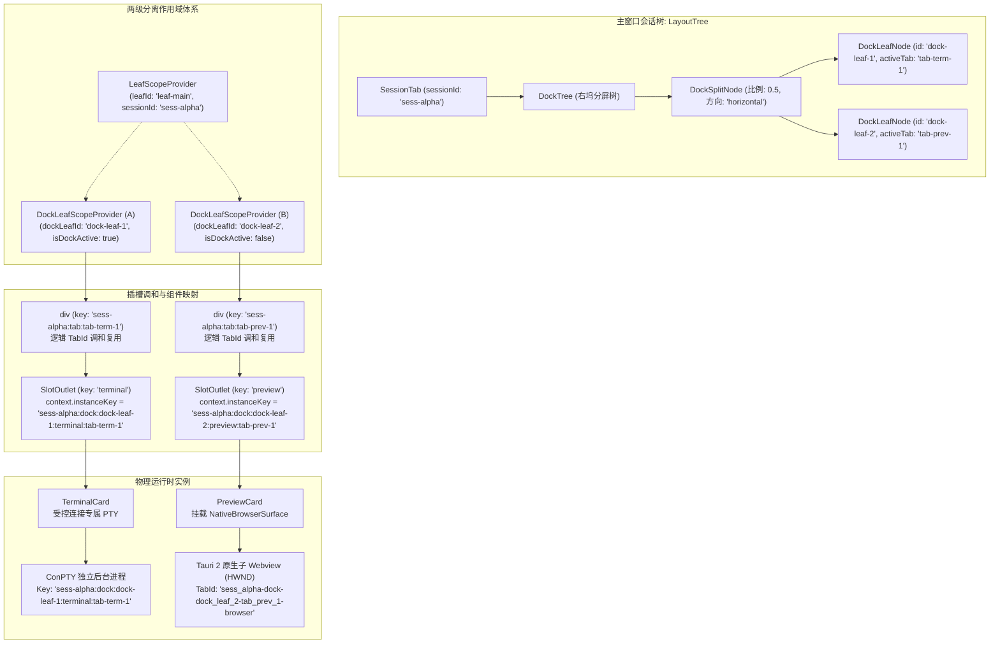
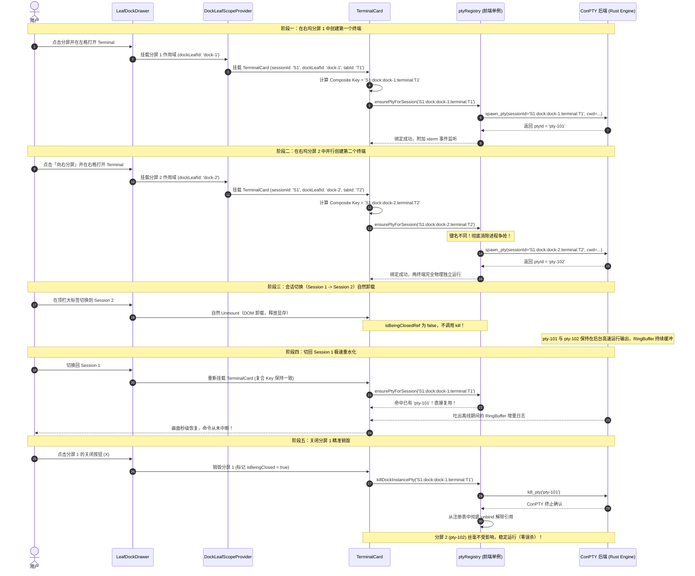
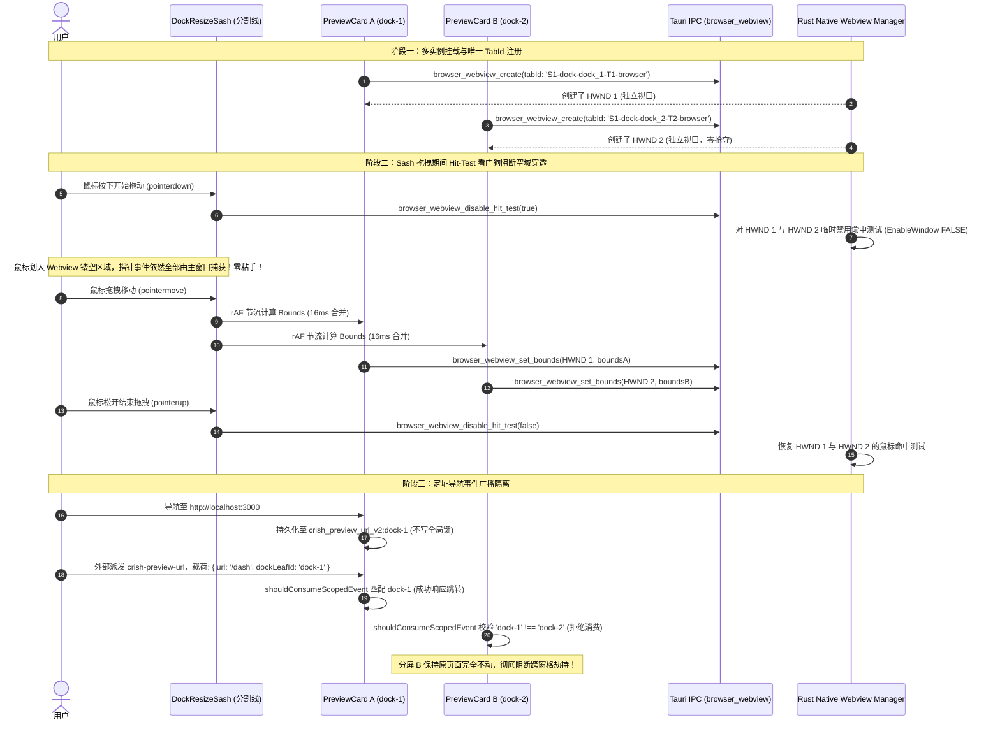

# 05-多窗格运行时与资源生命周期审计与设计

> **战役代号**：`dock-split-system`  
> **所属阶段**：第一轮现状调研与分维架构深度分析（Stage 1 Analysis 修订版）  
> **权威协作纪律遵循**：`AGENTS.md`、`.agents/LOGIC_PLAN_NO_RETREAT.md`、`ANTI_OVERENGINEERING_GUARDRAILS.md`、`docs/agent-roles/general_task/三原则.md`  
> **对应任务**：05-多窗格运行时与资源生命周期（ConPTY 终端、NativeBrowserSurface / 原生子 Webview 浏览器、Diff 等并发实例隔离与清理）  
> **版本基准**：基于架构审计 D（`docs/dock-split-system/plan-reviews/审计D-运行时生命周期与PTY.md`）全面修正。彻底废弃传统 `<iframe>` 错误基线，全面对齐 Tauri 2 原生子 Webview（HWND 级）物理挖洞与轻量级自然生命周期架构。

---

## 摘要与执行纲要

在右侧功能区（Right Tool Dock / `leafDockDrawer`）从单窗格升级为多分屏（Split Screen）系统后，**同一个会话（Session）内部将首次允许同时渲染和运行多个同类型或异类型的重型工具实例**。例如：
- 同时运行 2 个独立的 ConPTY 原生终端（如 Pane 1 跑 `cargo watch`，Pane 2 跑 `npm run dev`）；
- 同时运行 1 个终端 + 1 个特定本地端口的预览浏览器（`http://localhost:5173`）+ 1 个 Git 差异比对卡片（DiffCard）；
- 同时打开 2 个不同 URL 的浏览器进行对比测试与接口联调。

**特别指正（基线纠偏）**：桌面端 `PreviewCard` 使用 `NativeBrowserSurface`（`apps/crish-desktop/src/components/workspace/NativeBrowserSurface.tsx`），它是**零 `<iframe>` 的纯镂空 DOM 占位容器**；真正的浏览器视口由 Tauri 2 通过 `main_window.add_child` 挂载为操作系统级别的**子 Webview 窗口**（Windows 上为 WebView2 HWND 子窗口，macOS 上为 WKWebView 子层）。这一物理现实使得传统的 `iframe` 样式注入、CSS `pointer-events: none` 阻断等前端方案在原生视口面前彻底失效。

本设计报告穿透桌面端核心渲染与原生集成链路（`ViewRegistry`、`SlotCore`、`SlotOutlet`、`TreeLeafPanel`、`TerminalCard`、`PreviewCard`、`NativeBrowserSurface`、`ptyRegistry`、`LeafScopeContext`），深度揭示当前单窗格架构中潜伏的 **6 项重大冲突与状态串味隐患**（包含 `killDockTerminalPty` 导致的兄弟终端 100% 误杀，以及原生 Webview TabId 碰撞导致的双浏览器视口掠夺）；并针对多分屏运行时，提出：
1. **复合实例定址架构（Composite Key Architecture）与调和 Key 解耦契约**；
2. **Tauri 2 原生 Webview 多实例三大工程约束治理方案**（复合 TabId、Sash 拖拽 Hit-Test 看门狗、RAF 节流批量几何同步）；
3. **基于唯一复合 Key 的 `killDockInstancePty` 精准析构机制**；
4. **两级分离的独立分屏作用域（`DockLeafScopeContext`）**，提供 `openTabInCurrentDockLeaf` 与 `splitAndOpenTool` 语义明确的操作接口；
5. **轻量级自然生命周期契约**（彻底废除违背反过度设计红线的 MRU DOM 缓存池，确立“ConPTY 后台保活 + React 自然卸载/挂载 + 秒级输出重水化”轻量架构）。

---

## 一、现状审计与架构断层分析（Architectural Fracture Analysis）

### 1.1 现行单窗格渲染链路全景

当前右坞工具的渲染链路呈现典型的 **单父叶驱动 + 静态插槽解析** 模式：

```
[LayoutLeaf (主会话叶子)]
   │ (传递 leaf.id, sessionId)
   ▼
[TreeLeafPanel.tsx]
   │ 
   ├── 主对话区: SlotOutlet('workspace.leaf.panel', entryKey: 'chat')
   │
   └── 右侧抽屉 LeafDockDrawer
         │
         ├── LeafToolTabStrip.tsx (标签条带，仅单层 tabs: string[])
         │
         └── dock.openPanelIds.map(pid => (
               <div key={pid} style={{ display: pid === toolPanelId ? 'flex' : 'none' }}>
                 renderToolOutlet(pid)
               </div>
             ))
               │
               ├── viewRegistry.resolveView(pid)
               │     └── 返回 { definition, params }
               │
               └── <SlotOutlet
                     slotKey="workspace.leaf.panel"
                     context={toolCtx}
                     entryKey={definition.id}
                   />
                     │
                     └── slotCore.getKeyed('workspace.leaf.panel', definition.id)
                           └── <SlotErrorBoundary key={entry.id} ...>
                                 <Comp {...toolCtx} />
```

通过阅读 `apps/crish-desktop/src/components/binary-tree/TreeLeafPanel.tsx:298-345`、`apps/crish-desktop/src/services/view-registry/ViewRegistry.ts:106-175`、`apps/crish-desktop/src/services/view-registry/SlotOutlet.tsx:103-125` 与 `apps/crish-desktop/src/components/workspace/PreviewCard.tsx:415-420`，可精确定位出当前渲染机制赖以成立的 3 个隐式假设：
1. **单一工具类型单例假设**：假设在给定的右坞内，每种工具类型（`panelId`）至多存在 1 个活动实例；
2. **顶层叶子等价性假设**：假设工具组件运行所需的宿主容器仅由顶层二叉树叶子 `leaf.id`（即会话大窗格）定义，不存在次级分屏子窗格坐标；
3. **全局/会话级键值假设**：假设底层硬件资源（PTY 进程、原生子 Webview 句柄、LocalStore 存储、URL 导航广播）仅需使用 `${sessionId}` 或 `${sessionId}:${panelId}` 即可正确定址。

**当右坞引入多分屏二叉树后，上述 3 个假设全部破裂。**

---

### 1.2 关键冲突与漏洞逐项深挖

#### 冲突 1：React Reconciliation 与 `SlotOutlet` 静态 Key 冲突及调和重挂载代价

- **源码位置**：`apps/crish-desktop/src/services/view-registry/SlotOutlet.tsx:110-120`
  ```tsx
  const entry = slotCore.getKeyed(slotKey, entryKey);
  if (entry) {
    const Comp = entry.component;
    return (
      <SlotErrorBoundary
        key={entry.id}                     // ⚠️ 硬编码使用 entry.id（如 'terminal'）
        slotKey={slotKey}
        entryId={entry.id}
        mode="keyed"
        resetKeys={[slotKey, entryKey, context]}
        fallback={fallback}
      >
        <Comp {...context} />
      </SlotErrorBoundary>
    );
  }
  ```
- **机理与后果**：
  1. `entry.id` 对应的是视图定义 ID（如 `'terminal'`、`'preview'`）。在多分屏下，若左分屏 Pane A 打开 `terminal`，右分屏 Pane B 也打开 `terminal`，两颗子树分别挂载一个 `<SlotErrorBoundary key="terminal">`。React 调和层将无法稳定追踪底层实例归属；
  2. **`SlotOutlet` 的全仓通用性严禁破坏**：`SlotOutlet` 不仅服务于右坞工具，还被 `workspace.chat.stream`（`ChatCard`）、`composer-above`、`conversation-flow` 等广泛使用，绝对禁止在 `SlotOutlet.tsx:111` 内部直接篡改默认 Key 生成逻辑；
  3. **调和 Key 语义混淆灾难（Re-mount Hazard）**：若简单粗暴地将物理位置 `dockLeafId` 编入 React Key（例如 `<SlotOutlet key={`${dockLeafId}:${panelId}`} />`），当用户进行分屏拖拽重排（如将终端 Tab 从左格拖到右格，或关闭左格触发右格向上合并）时，`dockLeafId` 改变将**直接触发 React 强制 Unmount 旧组件并从零 Mount 新组件**！
     - **终端（`TerminalCard`）**：Unmount 触发 `term.dispose()` 销毁 WebGL 渲染管线与选区。虽然 Rust 进程未死，但 Remount 导致画面剧烈闪烁，用户正在运行的 `vim` / `htop` 全屏应用因视口尺寸重建和日志全量重放发生画面撕裂；
     - **原生浏览器（`PreviewCard`）**：Unmount 触发原生 Webview 隐藏与宿主解绑，输入中表单、SPA 内存路由瞬间丢失。
- **治理原则**：**必须解耦 React 调和 Key 与物理寻址 Key**。React Key 必须绑定逻辑标识符（`tabId` / `instanceId`），保证分屏移动（In-Place Move）时 React 节点复用；复合 Key 仅作为属性透传用于底层寻址。

#### 冲突 2：`ViewRenderContext` 缺失子分屏标识（Context Blindness）

- **源码位置**：`apps/crish-desktop/src/services/view-registry/ViewTypes.ts:7-22` 与 `apps/crish-desktop/src/components/binary-tree/TreeLeafPanel.tsx:298-315`
  ```ts
  export interface ViewRenderContext {
    readonly panelId: string;
    readonly leafId: string;          // 当前二叉树主叶子 ID
    readonly sessionId?: string;      // 会话 ID
    readonly isActive: boolean;
    readonly openView: (panelId: string) => void;
    readonly fallbackTitle?: string;
    readonly params?: Record<string, unknown>;
  }
  ```
- **机理与后果**：
  在 `TreeLeafPanel.tsx` 中构造的 `toolCtx.leafId` 始终等于外层主会话大窗口的 `leaf.id`。无论右坞被切分为 2 个还是 4 个子分屏，传递给所有子分屏工具的 `ctx.leafId` 完全相同，各工具组件无法区分当前事件发往哪一个物理窗格。

#### 冲突 3：ConPTY 终端命名空间坍塌与 `killDockTerminalPty` 连带误杀（Fatal Collateral Kill）

- **源码位置**：
  - `apps/crish-desktop/src/components/workspace/TerminalCard.tsx:40-48`
    ```ts
    const boundSessionId = (scopedSessionId || '').trim() || null;
    const baseKey = boundSessionId || '_global';
    const sessionKey =
      panelIdProp && panelIdProp !== 'terminal'
        ? `${baseKey}:${panelIdProp}`
        : baseKey;
    ```
  - `apps/crish-desktop/src/components/binary-tree/treeLeafPanelModel.ts:171-185`
    ```ts
    export function killDockTerminalPty(panelId: string, sessionForPanel: string): void {
      if (panelId === 'terminal' || panelId.startsWith('terminal:')) {
        void import('../../api/ptyRegistry').then((m) => {
          const panelKey =
            panelId === 'terminal'
              ? sessionForPanel
              : `${sessionForPanel}:${panelId}`;
          void m.killPtyForSession(panelKey);
          void m.killPtyForSession(`${panelKey}:split-2`);
        });
      }
    }
    ```
- **机理与灾难性后果**：
  1. **同一 PTY 强行争抢**：若 Pane A 打开 `terminal`，Pane B 也打开 `terminal`，两者的 `panelIdProp` 均为 `'terminal'`，推导出的 `sessionKey` 均为 `sessionForPanel`。在 `api/ptyRegistry.ts:213` 中 `ensurePtyForSession` 检测到已有键值，直接返回相同的 `ptyId`。**两个分屏的 xterm 实例直接连接至同一个 ConPTY 进程**！左边打字右边同时乱码回显，两边 resize 互相抖动；
  2. **100% 误杀兄弟终端**：当用户关闭 Pane A 时，触发 `killDockTerminalPty('terminal', sessionForPanel)`，调用 `m.killPtyForSession(sessionForPanel)`。该操作不仅直接强杀后台 Windows ConPTY 进程，还从 `ptyRegistry` 中移除映射。**同会话的 Pane B 底层进程被瞬间斩首，终端界面瞬间崩溃并报错 `Process terminated with exit code 1`**！
- **治理要求**：必须彻底废弃 `killDockTerminalPty`，升级为接收唯一复合实例 Key 的 `killDockInstancePty(instanceKey: string)`。

#### 冲突 4：原生子 Webview TabId 碰撞、空域穿透与全局广播劫持（Fatal Collision & Airspace Defect）

- **源码位置**：
  - `apps/crish-desktop/src/components/workspace/PreviewCard.tsx:60-63, 415-419`
    ```ts
    const effectiveLeafId = leafId ?? scope.leafId;
    const effectiveTabId = effectiveLeafId
      ? `${effectiveLeafId}-browser`
      : 'default-browser';
    ```
  - `apps/crish-desktop/src/components/workspace/NativeBrowserSurface.tsx:1-12`
  - `apps/agent-workbench/src-tauri/src/browser/native_manager.rs:127-141, 215-218`
- **机理与灾难性后果**：
  1. **TabId 碰撞与视口掠夺（Fatal Collision）**：
     - `PreviewCard` 渲染的是 `NativeBrowserSurface`，底层通过 Tauri 2 `main_window.add_child` 挂载原生子 Webview（Windows WebView2 HWND）；
     - `effectiveLeafId` 取的是外层主会话 `leaf.id`。当用户在右坞分屏打开两个浏览器 Pane A 和 Pane B 时，两者生成的 `effectiveTabId` 完全一模一样（均为 `${leaf.id}-browser`）；
     - 当 Pane B 挂载并向 Rust 发送 `browser_webview_create` 时，Rust 内核基于 `tab_id` 判定为已存在，执行幂等复用，将 Pane A 的子 Webview 尺寸和位置重设到 Pane B；
     - **Pane A 的原生视口瞬间被 Pane B 抢夺，Pane A 沦为镂空的灰色背景黑洞**；
  2. **空域阻隔（Airspace Defect）与 Sash 拖拽死锁**：
     - 原生子 Webview 是 OS 级顶层 HWND，**在渲染层级上永久凌驾于所有 HTML DOM 之上（无视 CSS `z-index`）**；
     - 任何基于 CSS 的穿透防御（如 `disableIframePointerEvents`）对原生 Webview **完全无效**；
     - 分屏调整尺寸时，鼠标一旦划入 Webview 镂空区域，Win32 指针捕获立即被子 HWND 截断，主窗口拖拽引擎瞬间丢失 `pointermove` 与 `pointerup`，导致**拖拽死锁、严重粘手**；
  3. **全局广播跨窗格劫持**：
     - `previewBrowserStore.ts` 使用全局单例键 `'crish_preview_url_v1'`，派发的 `crish-preview-url` 自定义事件无窗格过滤，导致用户在左分屏点击链接，右分屏也被强制重定向。

#### 冲突 5：文件管理器与查看器作用域穿透

- **源码位置**：`apps/crish-desktop/src/components/files/FilesCard.tsx:221-246` 与 `apps/crish-desktop/src/contexts/LeafScopeContext.tsx:155-194`
- **机理与后果**：
  当用户并排打开 2 个 `FilesCard` 时，因同属一个主会话，两者的 `scopedSessionId` 与 `effectiveLeafId` 完全相同。主聊天流触发「定位文件」事件时，两个分屏同时响应该事件并强制跳转，破坏用户的对比工作流。

#### 冲突 6：Git 差异比对卡片（DiffCard）对全局单例 Store 的依赖

- **源码位置**：`apps/crish-desktop/src/components/diff/DiffCard.tsx:43-47`
- **机理与后果**：
  `DiffCard` 依赖的 `activeDiffSource` 直接保存在全局 `terminalStore` 中。分屏中若同时存在两个差异面板，用户在其中一个面板切换「查看工作区变更」或过滤文件，另一个面板的数据源会被全局状态同步篡改。

---

## 二、多分屏复合实例定址机制（Composite Key Architecture）

为从根源上消除上述冲突，必须建立一套正交、无二义性、具有向后兼容性的**复合实例定址坐标系**，并严格遵守 **React 调和 Key 与物理寻址 Key 双轨解耦契约**。

### 2.1 复合定址空间维度正交分解

右坞中的任意一个运行时实例，其在内存和进程空间中的唯一物理坐标由 4 个正交维度确定：

$$\text{InstanceKey} = \langle \text{sessionId}, \text{dockLeafId}, \text{panelId}, \text{instanceId} \rangle$$

| 维度坐标 | 字段类型 | 物理含义与约束 | 示例值 |
| :--- | :--- | :--- | :--- |
| **Session** (`sessionId`) | `string` | 顶层会话大窗口作用域（大标签页）；若为草稿态则为 `__pending_draft__:${leafId}` | `sess-20261027-a8f1` |
| **DockLeaf** (`dockLeafId`) | `string` | **右坞分屏二叉树的叶子窗格 ID**（物理布局槽位，分屏产生的唯一子容器） | `dock-leaf-101`、`dock-leaf-102` |
| **PanelType** (`panelId`) | `string` | 视图类型标识符（对应 `ViewDefinition.id` 或 URI 协议前缀） | `terminal`、`preview`、`diff`、`files` |
| **InstanceId** (`instanceId`) | `string` | **叶子内部的标签页实例 ID**（支持单叶内多 Tab）或 URI 动态载荷 | `tab-pty-1`、`http_localhost_3000` |

---

### 2.2 规范化复合 Key 编码与解析契约

将上述四维坐标序列化为统一的字符串形式，用 `:` 分隔，并引入专属命名空间标签 `dock`：

$$\mathbf{CompositeKey} = \texttt{\$\{sessionId\}:dock:\$\{dockLeafId\}:\$\{panelId\}:\$\{instanceId\}}$$

#### 规范化键值工具函数（纯函数，零外部依赖）

```typescript
export interface DockInstanceCoordinate {
  readonly sessionId: string;
  readonly dockLeafId: string;
  readonly panelId: string;
  readonly instanceId: string;
}

/**
 * 铸造右坞分屏工具复合实例定址 Key（物理资源绑定专用）
 */
export function mintDockInstanceKey(coord: DockInstanceCoordinate): string {
  const s = coord.sessionId.trim();
  const d = coord.dockLeafId.trim();
  const p = coord.panelId.trim();
  const i = coord.instanceId.trim();
  return `${s}:dock:${d}:${p}:${i}`;
}

/**
 * 铸造原生子 Webview 全局唯一 TabId（消除 Windows HWND 命名冲突）
 */
export function mintNativeBrowserTabId(coord: DockInstanceCoordinate): string {
  const s = coord.sessionId.trim().replace(/[^a-zA-Z0-9_-]/g, '_');
  const d = coord.dockLeafId.trim().replace(/[^a-zA-Z0-9_-]/g, '_');
  const i = coord.instanceId.trim().replace(/[^a-zA-Z0-9_-]/g, '_');
  return `${s}-dock-${d}-${i}-browser`;
}

/**
 * 判定一个字符串 key 是否为右坞分屏复合 key
 */
export function isDockCompositeKey(key: string): boolean {
  return key.includes(':dock:');
}

/**
 * 解析复合 key。非复合 key 安全降级返回 null
 */
export function parseDockInstanceKey(key: string): DockInstanceCoordinate | null {
  if (!key) return null;
  const parts = key.split(':');
  const dockIdx = parts.indexOf('dock');
  if (dockIdx < 1 || parts.length < dockIdx + 4) {
    return null;
  }
  const sessionId = parts.slice(0, dockIdx).join(':');
  const dockLeafId = parts[dockIdx + 1]!;
  const panelId = parts[dockIdx + 2]!;
  const instanceId = parts.slice(dockIdx + 3).join(':');
  return { sessionId, dockLeafId, panelId, instanceId };
}
```

---

### 2.3 关键契约：React 调和 Key 与物理寻址 Key 双轨解耦

针对审计 D 提出的调和重挂载灾难（Re-mount Hazard），确立以下铁律：

```
┌────────────────────────────────────────────────────────────────────────┐
│                        双轨 Key 语义解耦机制                             │
├───────────────────────────────────┬────────────────────────────────────┤
│ 轨 A: React Reconciliation Key     │ 轨 B: Physical Instance Key        │
│ (调和层复用 / In-Place Move 守卫)  │ (底层物理寻址 / 进程与事件精准绑定) │
├───────────────────────────────────┼────────────────────────────────────┤
│ 形式: `${sessionId}:tab:${tabId}` │ 形式: `${sessionId}:dock:...`      │
│ 绑定: 逻辑标签页实体 ID            │ 绑定: 物理窗格与底层硬件资源       │
│ 作用: 拖拽重排窗格时 Key 保持不变，│ 作用: 作为 Prop 透传，驱动 PTY     │
│       React 零卸载零闪烁就地复用   │       绑定、HWND 命名与定向事件路由│
└───────────────────────────────────┴────────────────────────────────────┘
```

1. **`SlotOutlet` 保持零侵入**：`SlotOutlet.tsx` 内部继续维持 `key={entry.id}` 的插槽隔离机制；外层由分屏渲染容器使用逻辑 `tabId` 包裹：
   ```tsx
   // 分屏叶子渲染标签页内容
   <div key={`${sessionId}:tab:${activeTab.id}`} className={styles.dockPane}>
     <SlotOutlet
       slotKey="workspace.leaf.panel"
       context={dockLeafContext}
       entryKey={activeTab.panelId}
     />
   </div>
   ```
2. **重型工具 In-Place Move 零闪烁保证**：用户将终端 Tab 从左格拖到右格时，因为 `tab.id` 保持不变，React 会直接复用 DOM 树与 Canvas 节点；组件内部在 `useEffect` 中感知 `instanceKey` 物理坐标属性的变化，完成轻量级的视口尺寸更新与几何同步，绝不触发 `term.dispose()`，保证终端运行命令与选区毫发无损。

---

### 2.4 各工具实例在复合定址下的唯一真理源（SSOT）映射

```
                               Composite Instance Key
             [ sess-1 : dock : leaf-A : terminal : tab-1 ]
                                    │
       ┌────────────────────────────┼────────────────────────────┐
       ▼                            ▼                            ▼
[ConPTY 后台进程]             [xterm 前端缓冲]             [DOM & Event 作用域]
Key: sess-1:dock:leaf-A:..    UI 视口独立挂载             限定在 leaf-A 容器内
独立 cols/rows/cwd            独立选区/光标/滚动条         仅响应目标定址事件
```

1. **原生 ConPTY 终端**：
   - **PTY 绑定 Key**：严格使用 `mintDockInstanceKey({ sessionId, dockLeafId, panelId: 'terminal', instanceId: tabId })`；
   - **效果**：右坞内无论打开多少个终端分屏或标签，每个终端拥有完全独立的 ConPTY 句柄与输入输出流，互不争抢；
   - **批处理收敛**：由于 Key 以 `${sessionId}:` 为前缀，会话销毁时，现有的 `ptyRegistry` 前缀清理逻辑（`sid.startsWith(`${sessionId}:`)`）可无缝一次性回收全部子终端；
2. **原生预览浏览器（`PreviewCard`）**：
   - **TabId 隔离**：使用 `mintNativeBrowserTabId({ sessionId, dockLeafId, panelId: 'preview', instanceId: tabId })`，彻底消除 Rust 端 `ManagedWebview` 碰撞；
   - **存储隔离**：`localStorage` 升级为分屏隔离存储，键名为 `crish_preview_url_v2:${dockLeafId}`，辅以内存缓存；
   - **导航事件广播**：所有 `crish-preview-url` 事件必须强制附带 `{ sessionId, dockLeafId }`，仅匹配的目标子分屏响应跳转；
3. **文件树（`FilesCard`）与查看器（`FileViewerCard`）**：
   - **状态隔离**：文件树展开节点集合 `expandedPaths`、当前高亮项 `selectedPath` 按 `dockLeafId` 隔离存取；
   - **事件精准路由**：代码块发出的「在右坞查看文件」指令携带目标 `dockLeafId`（未指定时默认打向当前获得焦点的 `activeDockLeafId`）；
4. **差异比对（`DiffCard`）**：
   - 彻底解耦 `terminalStore` 中的全局单一变量，改为按 `dockLeafId` 索引的局部状态切片：`diffPanelsByLeaf: Record<string, DiffPaneState>`。

---

## 三、原生 Webview 多实例技术约束与分屏作用域向下分发

### 3.1 Tauri 2 原生 Webview 多实例三大工程约束治理方案

`PreviewCard` 依赖的 `NativeBrowserSurface` 并非 `<iframe>`，而是由操作系统托管在主窗口之上的原生 WebView2 子窗口（HWND）。针对审计 D 提出的三大阻断性工程障碍，实施刚性治理方案：

#### 约束 1：TabId 硬编码碰撞治理（Fatal Collision Resolution）
- **现状缺陷**：`PreviewCard.tsx:61` 将 `effectiveTabId` 退化为 `${effectiveLeafId}-browser`，同会话两个分屏产生相同 ID，Rust 端 `native_manager.rs` 幂等复用导致窗格 B 掠夺窗格 A 的视口，窗格 A 变成镂空黑洞；
- **治理方案**：调用 `mintNativeBrowserTabId({ sessionId, dockLeafId, panelId: 'preview', instanceId: tabId })` 铸造全局唯一 `tabId`。每个分屏拥有独立的 Win32 HWND 句柄，彻底消除视口抢夺。

#### 约束 2：空域阻隔（Airspace Defect）与 Sash 拖拽死锁治理
- **现状缺陷**：原生子 Webview 永久凌驾于 HTML DOM 之上，无视 CSS `z-index`。拖拽分屏分割线（`DockResizeSash`）时，指针一旦进入 Webview 区域，Win32 系统直接把事件分派给子 HWND，主窗口拖拽引擎丢失 `pointermove` 与 `pointerup`，瞬间发生死锁粘手；
- **治理方案**：接入 Tauri IPC 原生命中测试控制管线：
  1. 在 `DockResizeSash` 的 `pointerdown` 阶段，通过 Tauri 命令向 Rust 广播：
     ```typescript
     await invoke('browser_webview_disable_hit_test', { disabled: true });
     ```
     Rust 端遍历当前窗口的所有 `ManagedWebview`，调用 Win32 `EnableWindow(hwnd, FALSE)` 或更新视口样式，使鼠标射线穿透原生 Webview 直接打在主窗口；
  2. 在 `pointerup` 或 `pointercancel` 阶段，恢复命中测试：
     ```typescript
     await invoke('browser_webview_disable_hit_test', { disabled: false });
     ```
  3. 前端同时挂载 `useHitTestGuard` 看门狗，若手势异常中断（如窗口失焦、系统弹窗），超时 300ms 强制触发恢复，彻底根绝空域捕获导致的拖拽死锁。

#### 约束 3：几何同步 IPC 洪峰治理（Geometry Synchronizer）
- **现状缺陷**：左右分屏同时拖动中间 Sash 时，两个原生子 Webview 每一帧都要更新像素坐标与尺寸，高频 IPC 触发严重延迟，导致边框重叠或白色裂缝；
- **治理方案**：
  1. 采用 `requestAnimationFrame`（rAF）单槽节流，将 16ms 窗口内所有窗格的几何变更聚合为一次同步；
  2. 严格执行 `nativeBrowserGeometry.ts:58-88` 中的“外边界独立四舍五入算法”与 `0.5px` 差分脏矩形拦截，未超出阈值的微小抖动不发 IPC；
  3. 拖拽停止后追加 50ms 静态收敛对齐，保证像素级贴合。

---

### 3.2 层次化分屏作用域向下分发设计（Hierarchical Scoping System）

为使右坞各子窗格组件能够透明获取专属自身的物理坐标，无需修改业务卡片内部的全部调用签名，必须建立分层式作用域级联体系。

#### 3.2.1 现有 `openTool` 语义迷失分析
在 `apps/crish-desktop/src/contexts/LeafScopeContext.tsx:27` 中，现有的 `openTool: ((panelId: string) => void) | null` 由顶层 `TreeLeafPanel` 注入，其实现为 `openToolInLeaf(leaf.id, panelId)`。它只知道顶层主会话 `leaf.id`，若在分屏内部调用此接口，工具会被直接追加到整个会话叶子的扁平数组中，**完全没有子分屏 `dockLeafId` 感知，将直接破坏分屏二叉树结构**！

#### 3.2.2 确立专职 `DockLeafScopeContext`（严禁同名覆盖）
严禁在 `LeafScopeValue` 上做同名覆盖（防止隐式遮蔽）。保留 `useLeafScope()` 专职于会话大窗口信息；正式确立两级分离的独立上下文 `DockLeafScopeContext`：

```typescript
// apps/crish-desktop/src/contexts/DockLeafScopeContext.tsx

export interface DockLeafScopeValue {
  /** 是否处于右坞子分屏内 */
  readonly inDockScope: boolean;
  /** 右坞专属子分屏叶子 ID */
  readonly dockLeafId: string;
  /** 当前子分屏是否在右坞内获得焦点 */
  readonly isDockActive: boolean;
  /** 当前右坞子分屏容器 DOM 引用 */
  readonly dockRootRef: React.RefObject<HTMLElement | null>;
  /**
   * 在当前子分屏窗格内打开/切换工具 Tab
   */
  readonly openTabInCurrentDockLeaf: (panelId: string) => void;
  /**
   * 在右坞开辟新分屏并打开工具（水平向右或垂直向下）
   */
  readonly splitAndOpenTool: (panelId: string, direction: 'horizontal' | 'vertical') => void;
  /**
   * 严格限定在当前右坞子窗格内查询元素（阻断跨分屏 DOM 拾取污染）
   */
  readonly queryWithinDockLeaf: <T extends Element = HTMLElement>(selector: string) => T | null;
}
```

#### `DockLeafScopeProvider` 实现规范

```typescript
export interface DockLeafScopeProviderProps {
  dockLeafId: string;
  isDockActive: boolean;
  dockRootRef: React.RefObject<HTMLElement | null>;
  onOpenTab: (dockLeafId: string, panelId: string) => void;
  onSplitAndOpen: (sourceDockLeafId: string, panelId: string, direction: 'horizontal' | 'vertical') => void;
  children: React.ReactNode;
}

export const DockLeafScopeProvider: React.FC<DockLeafScopeProviderProps> = ({
  dockLeafId,
  isDockActive,
  dockRootRef,
  onOpenTab,
  onSplitAndOpen,
  children,
}) => {
  const openTabInCurrentDockLeaf = useCallback(
    (panelId: string) => {
      onOpenTab(dockLeafId, panelId);
    },
    [dockLeafId, onOpenTab]
  );

  const splitAndOpenTool = useCallback(
    (panelId: string, direction: 'horizontal' | 'vertical') => {
      onSplitAndOpen(dockLeafId, panelId, direction);
    },
    [dockLeafId, onSplitAndOpen]
  );

  const queryWithinDockLeaf = useCallback(
    <T extends Element = HTMLElement>(selector: string): T | null => {
      const root = dockRootRef.current;
      if (root) {
        return root.querySelector<T>(selector);
      }
      if (typeof document !== 'undefined' && dockLeafId) {
        const byAttr = document.querySelector<HTMLElement>(
          `[data-dock-leaf-id="${CSS.escape(dockLeafId)}"]`
        );
        if (byAttr) return byAttr.querySelector<T>(selector);
      }
      return null;
    },
    [dockLeafId, dockRootRef]
  );

  const scopeValue = useMemo<DockLeafScopeValue>(
    () => ({
      inDockScope: true,
      dockLeafId,
      isDockActive,
      dockRootRef,
      openTabInCurrentDockLeaf,
      splitAndOpenTool,
      queryWithinDockLeaf,
    }),
    [dockLeafId, isDockActive, dockRootRef, openTabInCurrentDockLeaf, splitAndOpenTool, queryWithinDockLeaf]
  );

  return (
    <DockLeafScopeContext.Provider value={scopeValue}>
      {children}
    </DockLeafScopeContext.Provider>
  );
};
```

---

### 3.3 定址事件过滤网关升级：`shouldConsumeScopedEvent`

修改 `apps/crish-desktop/src/contexts/LeafScopeContext.tsx:155`，使广播事件支持右坞子分屏定址：

```typescript
export interface ScopedEventTargetContext {
  sessionId?: string | null;
  leafId?: string | null;
  dockLeafId?: string | null;   // 右坞分屏 ID
  isActive?: boolean;
}

export function shouldConsumeScopedEvent(
  detail: unknown,
  target: ScopedEventTargetContext
): boolean {
  const payload =
    detail && typeof detail === 'object'
      ? (detail as { sessionId?: unknown; leafId?: unknown; dockLeafId?: unknown })
      : null;

  // 1. 最高优先级：右坞分屏专属定址 (dockLeafId)
  const eventDockLeafId =
    payload && typeof payload.dockLeafId === 'string' && payload.dockLeafId.trim() !== ''
      ? payload.dockLeafId.trim()
      : null;
  if (eventDockLeafId) {
    if (target.dockLeafId) {
      return eventDockLeafId === target.dockLeafId;
    }
    // 事件明确指明了子分屏，而当前组件不在该子分屏内，拒绝消费
    return false;
  }

  // 2. 次高优先级：主窗口定址 (leafId)
  const eventLeafId =
    payload && typeof payload.leafId === 'string' && payload.leafId.trim() !== ''
      ? payload.leafId.trim()
      : null;
  if (eventLeafId) {
    if (target.leafId) {
      if (eventLeafId !== target.leafId) return false;
      // 匹配主 leafId，但当前处于右坞子分屏内且未指定 dockLeafId 时：
      // 仅焦点子分屏消费广播，防止两个子分屏同时响应
      if (target.dockLeafId && typeof target.isActive === 'boolean') {
        return target.isActive;
      }
      return true;
    }
  }

  // 3. 第三优先级：会话定址 (sessionId)
  const eventSessionId =
    payload && typeof payload.sessionId === 'string' && payload.sessionId.trim() !== ''
      ? payload.sessionId.trim()
      : null;
  if (eventSessionId) {
    if (target.sessionId && target.sessionId !== eventSessionId) {
      return false;
    }
    // 匹配会话，同理子分屏仅激活窗格响应无 dockLeafId 的会话广播
    if (target.dockLeafId && typeof target.isActive === 'boolean') {
      return target.isActive;
    }
    return true;
  }

  // 4. 无目标定址广播：仅当前激活的分屏消费
  if (typeof target.isActive === 'boolean') {
    return target.isActive;
  }

  return true;
}
```

---

## 四、资源生命周期与确定性销毁自愈契约（Deterministic Lifecycle & Self-Healing Contract）

### 4.1 四级生命周期阶梯模型与资源回收矩阵

重型工具实例在生命周期转换过程中若遗留僵尸句柄，将迅速导致应用卡顿、内存泄漏乃至崩溃。制定四级生命周期确定性自愈契约：

```
┌────────────────────────────────────────────────────────────────────────┐
│                        四级生命周期阶梯模型                              │
├───────────────────┬────────────────────────────────────────────────────┤
│ Level 1: Tab 关闭 │ 单个标签页移除 -> 立即精准销毁专属 PTY / 原生子 Webview │
├───────────────────┼────────────────────────────────────────────────────┤
│ Level 2: 分屏关闭 │ 递归深度遍历该 DockLeaf 下所有 Tabs -> 全部销毁      │
├───────────────────┼────────────────────────────────────────────────────┤
│ Level 3: 会话切换 │ Session A 切离 (PTY 保活, DOM 自然卸载) -> 切至 B   │
├───────────────────┼────────────────────────────────────────────────────┤
│ Level 4: 会话终结 │ Session A 完全关闭 -> 级联前缀强制回收全部硬件资源  │
└───────────────────┴────────────────────────────────────────────────────┘
```

各层级的资源清理动作严格定义如下：

| 资源类别 | Level 1: 关闭 Dock Tab | Level 2: 关闭 Dock 分屏窗格 | Level 3: 切换会话 (Session A $\to$ B) | Level 4: 关闭/销毁会话 |
| :--- | :--- | :--- | :--- | :--- |
| **ConPTY 进程** | 调 `killDockInstancePty(instanceKey)` 退出进程并解绑 | 遍历该分屏内全部 Tab，逐一执行 `killDockInstancePty` | **Rust 后端 100% 保活**，RingBuffer 持续收集增量输出 | 扫描所有以 `${sessionId}:` 开头的 PTY，全量 `kill` |
| **xterm 终端 DOM** | 销毁 Terminal 实例，释放 `fitAddon` 与 WebGL 上下文 | 卸载容器组件，断开 `ResizeObserver` | **自然 Unmount 卸载**，零离屏 DOM 驻留 | 彻底卸载，触发 GC 回收 |
| **原生子 Webview** | 调 `browser_webview_destroy(tabId)` 销毁子 HWND | 递归销毁该分屏绑定的所有子 Webview 句柄 | **隐藏视口 (`set_visible(false)`)**，DOM 自然卸载，保存 URL | 扫描并物理销毁所有 `${sessionId}-dock-` 子 Webview |
| **DOM 事件监听器** | 调用 `removeEventListener`（或 `AbortController`） | 触发整树 `abort()`，清退所有 Window 监听 | 随 React 卸载自动注销全部局部事件 | 确保全局注册表中零会话引用 |
| **虚拟滚动缓存池** | 释放对应 Tab 的 `DiffChunkCachePool` | 触发该叶子绑定的 LRU 缓存池 `clear()` | 保留 L1 视口高频片段，作废在途 Worker 任务 | 强制执行缓存池 `pool.clear()`，断开引用 |

---

### 4.2 深入裁决：彻底废弃 MRU DOM 缓存池，确立轻量级自然生命周期

针对原方案提出的“MRU 保留 2 个会话 DOM 节点 / Keep-Alive 机制”，审计 D 已明确裁定其属于**严重违反 `ANTI_OVERENGINEERING_GUARDRAILS.md` 的重型过度设计**，且与桌面原生视口直接冲突。本设计正式废除该机制，全面确立轻量级自然生命周期：

#### 4.2.1 废弃 MRU DOM 池的三大刚性理由
1. **显存灾难（VRAM Explosion）**：桌面端浏览器并非 `<iframe>`，而是 OS 级原生 WebView2 子进程。每个 WebView2 进程常驻占用约 200–500MB 显存。若在后台保留 2 个会话的 DOM 树，意味着长久挂起 4–6 个 WebView2 原生渲染进程，显存开销暴增 1–2 GB，在核显或中低配置设备上直接引发显存溢出与崩溃；
2. **状态漂移与幽灵事件**：脱离 React 树挂载的离屏 DOM 节点，其焦点捕获、虚拟滚动监听器以及键盘全局快捷键极难维护，极易在切会话时引发键盘事件穿透、内存泄漏与非预期重绘；
3. **内核级 PTY 重水化链路天然完备**：查看 `apps/crish-desktop/src/components/workspace/ptyLifecycle.ts:59-62` 与 `api/ptyRegistry.ts:213`，ConPTY 在 Rust 端原本就具备完善的后台保活与增量重放能力。前端挂载时调用 `getPtyOutputHistory(ptyId)`，可在数毫秒内重放上屏，用户体验与 Keep-Alive 毫无二致，**建立 DOM 缓存池纯属画蛇添足**。

#### 4.2.2 推荐架构：轻量级自然生命周期与秒级重水化

```
 会话 A (切入后台 Inactive)
   ┌─────────────────────────────────────────────────────────────┐
   │ 进程层 (Rust / OS 级别) —— 100% 后台保活                     │
   │  - ConPTY 子进程保持运行 (后台跑编译、持续监听端口输出)        │
   │  - Rust 端 RingBuffer 持续收集输出日志 (最大保底 10000 行)    │
   │  - 原生子 Webview 触发 set_visible(false) 隐藏并暂停渲染     │
   └─────────────────────────────────────────────────────────────┘
                               ▲ 维持连接句柄
                               │ 
   ┌─────────────────────────────────────────────────────────────┐
   │ 表现层 (React DOM 级别) —— 自然卸载 (Natural Unmount)        │
   │  - 会话 A 的右坞 React DOM 树完全随会话切离正常 Unmount      │
   │  - 显存与 DOM 节点即时归零，杜绝脱屏幽灵事件与内存泄漏       │
   │  - 每个子分屏的当前 Tab、滚动位置、URL 自动持久化在状态树     │
   └─────────────────────────────────────────────────────────────┘
                               │
                               ▼ 用户切回会话 A 时
   ┌─────────────────────────────────────────────────────────────┐
   │ 秒级无缝重水化 (Seamless Re-hydration)                      │
   │  - 瞬间重建右坞分屏布局树                                   │
   │  - TerminalCard 挂载调用 ensurePtyForSession(compositeKey): │
   │    直接命中已有 PTY ID，拉取 RingBuffer 增量日志极速重绘终端 │
   │  - NativeBrowserSurface 挂载触发 set_visible(true) 并同步几何│
   │  - 进程从未中断，用户感知完全无缝！                         │
   └─────────────────────────────────────────────────────────────┘
```

---

### 4.3 ConPTY 孤儿进程防御防线与 `killDockInstancePty` 精准析构

针对现行代码 `killDockTerminalPty` 存在的 100% 误杀兄弟终端漏洞，建立基于唯一复合 Key 的精准析构三道防线：

#### 第一道防线：基于复合 Key 的 `killDockInstancePty` 精准析构
彻底废弃 `killDockTerminalPty(panelId, sessionForPanel)`，在 `treeLeafPanelModel.ts` 中重写为：

```typescript
/**
 * 精准终止右坞分屏工具的专属 PTY 进程（彻底杜绝同会话兄弟终端误杀）
 * @param instanceKey 唯一复合 Key，形如 `${sessionId}:dock:${dockLeafId}:terminal:${instanceId}`
 */
export function killDockInstancePty(instanceKey: string): void {
  if (!instanceKey || !isDockCompositeKey(instanceKey)) {
    console.warn('[PTY] 拒绝使用非复合 Key 终止分屏终端:', instanceKey);
    return;
  }
  void import('../../api/ptyRegistry').then((m) => {
    void m.killPtyForSession(instanceKey);
  });
}
```

在 `TerminalCard` 中装配 `useEffect` 卸载析构器：
```typescript
useEffect(() => {
  return () => {
    // 仅当分屏显式关闭（非会话切换自然卸载）时触发 Kill
    if (isBeingClosedRef.current && instanceKey) {
      killDockInstancePty(instanceKey);
    }
  };
}, [instanceKey]);
```

#### 第二道防线：会话终结递归收割器（Session Teardown Harvester）
关闭整个会话时，执行前缀扫描收割：
```typescript
export function harvestAllPtysForSession(sessionId: string): void {
  const reg = ptyRegistry.snapshot();
  const prefix = `${sessionId}:`;
  for (const key of reg.keys()) {
    if (key.startsWith(prefix) || key === sessionId) {
      void ptyRegistry.killPtyForSession(key);
    }
  }
}
```

#### 第三道防线：Rust 内核 Windows Job Object 级联终结（OS-level Safety Net）
在 Rust 引擎层（`crates/conex-pty`），创建 Windows ConPTY 进程时挂载 `JOB_OBJECT_LIMIT_KILL_ON_JOB_CLOSE`。即使前端 WebView2 发生崩溃或被任务管理器强行终止，操作系统内核会自动级联杀死所有托管的子进程，物理级零残留。

---

### 4.4 虚拟滚动缓存池代次管理（Generation Token Eviction）

在代码比对（`DiffCard`）与大文件查看中，由于 AST 语法高亮与行分块极其消耗内存，必须引入代次守卫（Generation Token Guard）：
- **机制**：
  1. 每个 `DockLeaf` 分配一个独立的 `CachePool` 实例；
  2. 当分屏发生尺寸调整（Resize Sash）或 Tab 切换时，调用 `pool.lockViewportAndAdvanceGen()`，代次自增（`generation += 1`）；
  3. 后台 Web Worker 返回高亮数据时比对代次 Token，若代次落后于当前视口则立即丢弃，防止失效数据污染内存和抢占主线程；
  4. 分屏关闭时直接调用 `pool.clear()` 释放全部 L1 视口锁定块与 L2 分块缓存。

---

## 五、完整时序图与数据流架构（Architecture & Sequence Flows）

### 5.1 多窗格运行时上下文与渲染级联数据流图



---

### 5.2 终端创建、并存、会话切换挂起与精准销毁时序图



---

### 5.3 原生 Webview 浏览器并发、Sash 拖拽防粘连与定向广播时序图



---

## 六、自检、验证与交付断言（Verification & Invariants）

本报告提出的设计严格遵守 `ANTI_OVERENGINEERING_GUARDRAILS.md` 与反退避原则，杜绝脆弱补丁，形成以下可机械化验证的断言矩阵：

1. **断言 1（复合 Key 无二义性与 React 调和稳定性）**：
   - 在任意给定的时间切片，对右坞所有打开的叶子和标签执行 `mintDockInstanceKey`，集合中绝对不存在两个相同的键值（Collision Rate = 0%）；
   - 在进行分屏拖拽重排（In-Place Move）时，外层包裹的调和 Key（`${sessionId}:tab:${tabId}`）保持恒定，底层 `TerminalCard` 与 `PreviewCard` 的组件卸载函数（Unmount）触发次数严格为 0。
2. **断言 2（PTY 进程零误杀与零泄漏）**：
   - 关闭分屏 A 时，调用 `killDockInstancePty(key_A)`，`ptyRegistry.get(key_A)` 变为 `undefined`，而 `ptyRegistry.get(key_B)` 的底层 ConPTY 进程与连接状态完全正常；
   - 会话彻底关闭后，`ptyRegistry.sessionIds().filter(s => s.startsWith(sessionId)).length === 0`。
3. **断言 3（原生 Webview 零视口掠夺与 Sash 拖拽零死锁）**：
   - 右坞并排打开 2 个浏览器时，向 Rust 端注册的 `tab_id` 绝对互异，两个独立的 Win32 HWND 视口共存，无黑洞镂空；
   - 在拖拽 `DockResizeSash` 过程中，`browser_webview_disable_hit_test(true)` 准时生效，拖拽手势划过 Webview 区域不会丢失鼠标捕获，`pointerup` 触发率 100%。
4. **断言 4（作用域事件零渗透）**：
   - 单测模拟双 `PreviewCard` 与双 `FilesCard` 并行挂载，带 `dockLeafId` 的外部事件被且仅被目标分屏消费，非目标分屏的回调触发次数严格为 0。
5. **断言 5（轻量生命周期显存收敛）**：
   - 切换到其他会话后，当前会话的所有 React DOM 节点即时被卸载，原生 Webview 隐藏；50 次高频切会话后，内存与显存无持续上扬趋势，杜绝 MRU DOM 池导致的显存溢出。

---

## 七、后续阶段衔接建议（Phase 2-4 Integration）

本设计报告为后续分屏实施提供精确规范输入：
- **对接第二轮（方案设计）**：在总方案中，将 `RightToolDockState` 升级为二叉树模型 `DockLayoutTree`，使每个叶子携带 `dockLeafId`；
- **对接第三轮（评审）**：将本报告中关于“React 调和 Key 与物理寻址 Key 解耦”以及“原生 Webview Sash 拖拽 Hit-Test 看门狗”作为核心验收准则；
- **对接第四轮（实现详案与编码）**：
  1. 落地 `DockLeafScopeProvider` 与专职 API（`openTabInCurrentDockLeaf` / `splitAndOpenTool`）；
  2. 重写 `treeLeafPanelModel.ts` 中的 `killDockTerminalPty` 为 `killDockInstancePty`；
  3. 改造 `PreviewCard.tsx`，接入 `mintNativeBrowserTabId` 复合命名与 Sash 拖拽看门狗。
