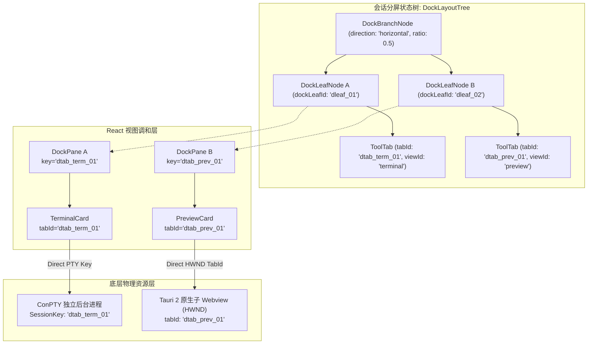
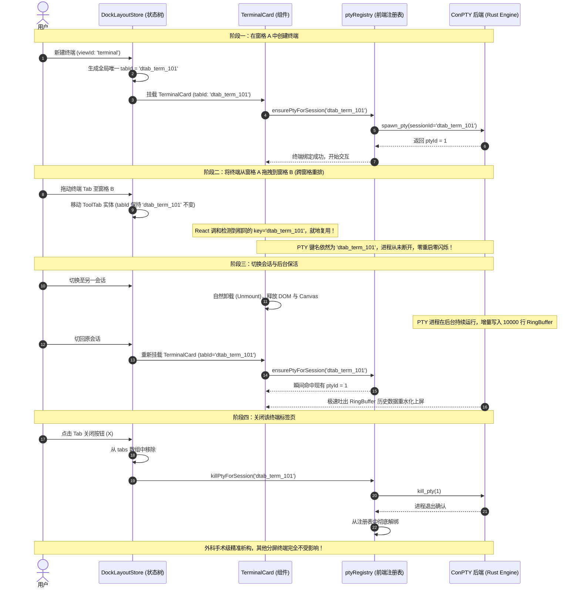
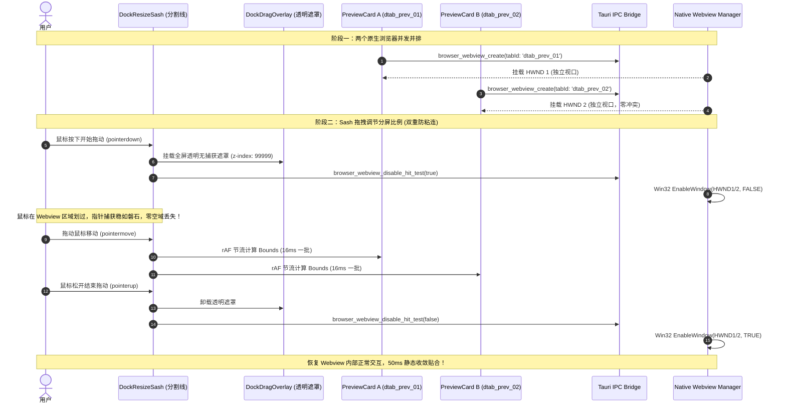

# 05-多窗格运行时与资源生命周期（彻底根除字符串拼接 Key 与假分屏补丁版）

> **战役代号**：`dock-split-system`  
> **所属阶段**：Stage 1 Analysis（V2 架构重构版）  
> **权威协作纪律遵循**：`AGENTS.md`、`.agents/LOGIC_PLAN_NO_RETREAT.md`、`ANTI_OVERENGINEERING_GUARDRAILS.md`、`docs/agent-roles/general_task/三原则.md`  
> **对应任务**：05-多窗格运行时与资源生命周期（ConPTY 终端、NativeBrowserSurface / 原生子 Webview 浏览器、Diff 等并发实例隔离与清理）  
> **最高指导原则（用户最新裁决）**：
> > “**不允许打补丁，不允许硬编码，有合理的抽象，适合未来的功能需求，代码尽量简洁，具有优秀的可维护性。需要删除的代码就删除，需要系统性的重构。生成的方案应该能彻底杜绝这些问题或者未来的衍生问题，要求一次性解决掉。尽量减少不必要的兼容，最好是不兼容。**”

---

## 一、执行纲要与 V2 架构核心范式转变

在右侧功能区（Right Tool Dock / `leafDockDrawer`）从单窗格升级为真正的二叉树分屏系统（`DockSplitWorkspace`）之后，同一个会话内部允许同时并排运行多个同类型或异类型的重型工具实例（如两个独立的 ConPTY 终端、多个独立 URL 的原生浏览器、代码文件树与 Diff 差异比对面板）。

上一版（V1）方案虽然指出了物理视口碰撞与 PTY 误杀问题，但其陷入了“**用新的字符串拼接去迁就历史旧补丁**”的严重误区——发明了 `${sessionId}:dock:${dockLeafId}:terminal:${instanceId}` 四段式拼接字符串。将空间位置（`dockLeafId`）强行编码进实例身份标识符，导致用户将标签页从窗格 A 拖拽到窗格 B 时，因物理坐标改变而破坏 PTY 进程绑定，或者被迫维护脆弱复杂的“逻辑 Key ↔ 物理 Key”双轨映射。

本重构方案遵循“**彻底杜绝隐患、一次性系统性根除、零字符串拼接**”原则，确立两大基石：

```
┌────────────────────────────────────────────────────────────────────────────────────────┐
│                                 V2 架构两大基石                                         │
├───────────────────────────────────────────┬────────────────────────────────────────────┤
│ 基石 1：基于 ToolTab.tabId 的单一真理源     │ 基石 2：假分屏与伪 URI 补丁代码全量清退      │
├───────────────────────────────────────────┼────────────────────────────────────────────┤
│ • 标签页创建时生成全局唯一 tabId，终生不变    │ • 彻底删除 TerminalCard.tsx 内假分屏 :split-2│
│ • 实例身份与所在空间位置（dockLeafId）彻底解耦 │ • 彻底删除 openTool.ts 自增 terminal:2 循环 │
│ • React Key = PTY Key = Webview tabId     │ • 彻底删除 openTool.ts 全局 Map 寄存器      │
│ • 拖拽移动零重启、关闭窗格精准析构零误杀       │ • 彻底删除 ViewRegistry.ts 伪 URI 协议拆分器 │
└───────────────────────────────────────────┴────────────────────────────────────────────┘
```

---

## 二、历史遗留硬编码补丁与假分屏深度批判及应删代码清单

经过对现有代码库的深度白盒审查，当前右坞工具运行时充斥着因历史架构演进不彻底而堆叠的“补丁套补丁”代码。本节对这些设计缺陷进行深层剖析，并提供精确到文件与行号的应删代码清单。

### 2.1 历史硬编码补丁的六大病灶根因

#### 1. 终端假双栏分屏（`TerminalCard.tsx` 的 `:split-2` 泥潭）
- **根因**：历史版本中右坞为单窗格容器，无法在容器层提供分屏。为了应付在终端内并排查看的需求，前人直接在 `TerminalCard.tsx` 内部硬编码写死了仅支持 2 个窗格的假分屏状态机（`splitMode`、`activePaneIndex`、`termHandleRef2`、`pane2Status`），并派生出 `${sessionKey}:split-2` 伪 Key。
- **后果**：
  - 终端组件职责严重泛化，不仅要管理 xterm 渲染，还要充当微型分屏布局器；
  - 分割线宽度写死、仅支持 50/50 划分、无法拖拽调节比例、无法开辟第 3 个终端；
  - 析构时必须通过 `${sessionKey}:split-2` 特殊路径单独杀进程，造成清理逻辑严重分叉。

#### 2. 自增伪 ID 字符串拼接（`openTool.ts` 的 `terminal:2` / `preview:2`）
- **根因**：为了在扁平 `openPanelIds: string[]` 数组中塞入多个同类面板，前人发明了 `terminal:2`、`terminal:3`、`preview:2` 等字符串自增拼接。
- **后果**：`openTool.ts` 内部充斥着 `while (dock.openPanelIds.includes(`terminal:${nextIdx}`))` 循环；组件端又需要写正则 `panelId.replace('terminal:', '')` 逆向解析序号，极其脆弱。

#### 3. 全局模块级可变 Map 飞线（`openTool.ts` 的 `fileViewerModeOverrides`）
- **根因**：打开文件查看器时缺乏正交的参数通道，无法将 `{ filePath, initialMode: 'diff' }` 结构化传入，于是定义了一个模块级全局可变 Map `fileViewerModeOverrides = new Map<string, FileViewerInitialMode>()`，在打开前 `set`，在组件冷启动时 `consume` 单次消费。
- **后果**：跨组件隐式副作用，若组件挂载时序异常或渲染被中断，寄存器数据将发生泄漏或错位。

#### 4. 伪 URI 协议拆分器（`ViewRegistry.ts` 的 `uriResolvers`）
- **根因**：`ViewRegistry` 本应是纯粹的视图定义注册表，却因缺少结构化参数支持，被迫内置了 `file-viewer:`、`preview:`、`browser:`、`terminal:` 的 URI 拆分器，对 query string（`?mode=diff&line=12`）与 hash 进行字符串匹配与正则解析。
- **后果**：本末倒置，将强类型的 TS 对象在调用端序列化为 URI 字符串，再在注册表反序列化回弱类型对象。

#### 5. 原生子 Webview 物理视口碰撞（`PreviewCard.tsx` 的 `browser-${leafId}`）
- **根因**：`PreviewCard.tsx` 未将标签页实例 ID 透传，而是降级调用 `resolveBrowserTabId(undefined, effectiveLeafId)`，拼出 `browser-${leafId}`。
- **后果**：当用户在同一个分屏窗格打开两个浏览器标签，或者两个分屏共用顶层 `leafId` 时，Tauri 2 后端收到相同的 `tab_id`，触发幂等复用，窗格 B 强行夺走窗格 A 的 Win32 HWND 视口，窗格 A 沦为镂空的灰色黑洞。

#### 6. V1 方案的四维字符串拼接错误（位置与身份强耦合）
- **根因**：V1 方案设计了 `${sessionId}:dock:${dockLeafId}:terminal:${instanceId}`，将物理窗格坐标 `dockLeafId` 编入字符串。
- **后果**：一旦用户将 Tab 拖拽到邻近分屏，`dockLeafId` 改变，若 SessionKey 随之改变，PTY 进程被迫重启；若不改变，系统必须在运行时维护两套 Key 映射，严重违反反过度设计红线。

---

### 2.2 应删代码与重构精确清单（文件:行号）

| 文件路径 | 现有行号 | 拟删除/重构代码片段 | 消除缺陷与重构动作 |
| :--- | :--- | :--- | :--- |
| `apps/crish-desktop/src/components/workspace/TerminalCard.tsx` | L23 | `import { TerminalToolbar, type TerminalSplitMode } from './TerminalToolbar';` | 删除假分屏类型导入 |
| `apps/crish-desktop/src/components/workspace/TerminalCard.tsx` | L28-29 | `panelId?: string \| null;` | 废弃弱类型 `panelId`，改为接收强类型 `tabId: string` |
| `apps/crish-desktop/src/components/workspace/TerminalCard.tsx` | L44-48 | `baseKey`、`sessionKey = panelIdProp ... ? `${baseKey}:${panelIdProp}` : baseKey` | **彻底删除拼接逻辑**；直接使用 `sessionKey = tabId` |
| `apps/crish-desktop/src/components/workspace/TerminalCard.tsx` | L53-61 | `pane2Status`, `pane2Error`, `splitMode`, `activePaneIndex` | **彻底删除** 假分屏状态变量 |
| `apps/crish-desktop/src/components/workspace/TerminalCard.tsx` | L65-67 | `termHandleRef2 = useRef<InteractiveXtermHandle \| null>(null);` | **彻底删除** 第二个终端 Handle 引用 |
| `apps/crish-desktop/src/components/workspace/TerminalCard.tsx` | L68-77 | `fitAll()` 内部对 `termHandleRef2.current?.fit()` 的并发调用 | 简化为仅针对当前单一终端 Handle 执行 `fit()` |
| `apps/crish-desktop/src/components/workspace/TerminalCard.tsx` | L79-82 | `useEffect(..., [fitAll, splitMode])` | 移除对假分屏模式 `splitMode` 的监听 |
| `apps/crish-desktop/src/components/workspace/TerminalCard.tsx` | L92-93 | `setPane2Status('idle'); setPane2Error('');` | **彻底删除** |
| `apps/crish-desktop/src/components/workspace/TerminalCard.tsx` | L114-125 | `handlePane2Status`, `handlePane2Missing` | **彻底删除** 副格回调函数 |
| `apps/crish-desktop/src/components/workspace/TerminalCard.tsx` | L136-146 | `handleSplitHorizontal`, `handleSplitVertical`（组件内假分屏） | 重写为直接调用 `dockScope.splitCurrentLeaf(...)` |
| `apps/crish-desktop/src/components/workspace/TerminalCard.tsx` | L148-154 | `handleClear` 中的 `if (activePaneIndex === 1 && termHandleRef2.current)` | 简化为单实例 `termHandleRef.current?.clear()` |
| `apps/crish-desktop/src/components/workspace/TerminalCard.tsx` | L156-163 | `handleCloseSplit` 杀 `${sessionKey}:split-2` | **彻底删除** 假分屏销毁代码 |
| `apps/crish-desktop/src/components/workspace/TerminalCard.tsx` | L166-170 | `isSplit`, `toolbarTitle = panelIdProp.replace('terminal:', '')` | 移除正则反解，标题直接来源于 `tab.title` |
| `apps/crish-desktop/src/components/workspace/TerminalCard.tsx` | L190-200 | `<TerminalToolbar splitMode={splitMode} activePaneIndex={...} ... />` | 简化 Toolbar Props，移除内部选格与假分屏参数 |
| `apps/crish-desktop/src/components/workspace/TerminalCard.tsx` | L226-267 | `<div className={styles.splitContainer}>...<InteractiveXtermTerminal ref={termHandleRef2} sessionKey={`${sessionKey}:split-2`} ... />...</div>` | **全量删除** 整个副格渲染分支与容器 DOM |
| `apps/crish-desktop/src/components/workspace/TerminalToolbar.tsx` | L16-28 | `type TerminalSplitMode`, `TerminalToolbarProps` 中的 `splitMode`, `activePaneIndex`, `onSelectPane`, `onCloseSplit` | 清理接口中所有关于卡片内分屏的字段 |
| `apps/crish-desktop/src/components/workspace/TerminalToolbar.tsx` | L46-81 | `styles.termBranchGroup`（`┌ pwsh 1` 与 `└ pwsh 2` 伪分支树渲染） | **全量删除**；统一使用单标签或由窗格 TabBar 统一展示 |
| `apps/crish-desktop/src/components/workspace/TerminalToolbar.tsx` | L122-131 | `isSplit && <IconButton ... aria-label="关闭当前分屏" />` | **全量删除** 局部关闭分屏按钮（由窗格通用控制条接管） |
| `apps/crish-desktop/src/components/binary-tree/treeLeafPanelModel.ts` | L171-185 | `killDockTerminalPty` 及其 `${panelKey}:split-2` 连带清理逻辑 | **彻底废弃**，重构为 `killPtyForSession(tabId)` |
| `apps/crish-desktop/src/store/layout-tree/layoutTreeTerminalOps.ts` | L66-82 | `killTerminalPtyBackground` 内部 `sid.startsWith(`${key}:`)` 遍历删除循环 | **彻底删除模糊匹配**，按精确 `tabId` 析构 |
| `apps/crish-desktop/src/store/workspace-shell/openTool.ts` | L46-64 | `fileViewerModeOverrides` Map 及其 `set`/`consume` 函数 | **彻底删除全局 Map**，参数全部收敛进 `ToolTab.params` |
| `apps/crish-desktop/src/store/workspace-shell/openTool.ts` | L176-187 | `mapped === 'terminal' \|\| mapped.startsWith('terminal:')` 与 `${sid}:${mapped}` 拼接 | 消除字符串前缀检测与冒号拼接 |
| `apps/crish-desktop/src/store/workspace-shell/openTool.ts` | L203-227 | `openNewTerminalInLeaf` 内部 `while (dock.openPanelIds.includes(`terminal:${nextIdx}`))` 自增拼接 | **彻底删除**；直接创建全局唯一 `tabId` 的 `ToolTab` |
| `apps/crish-desktop/src/store/workspace-shell/openTool.ts` | L229-253 | `openNewBrowserInLeaf` 内部 `while (dock.openPanelIds.includes(`preview:${nextIdx}`))` 自增拼接 | **彻底删除**；直接创建全局唯一 `tabId` 的 `ToolTab` |
| `apps/crish-desktop/src/services/view-registry/ViewRegistry.ts` | L22-102 | `initDefaultResolvers` 中的所有伪 URI 解析器（`file-viewer:`, `preview:`, `browser:`, `terminal:`） | **全量清退 URI 拆分器**；统一按视图原语解析 |
| `apps/crish-desktop/src/components/workspace/PreviewCard.tsx` | L65-71 | `resolveBrowserTabId(undefined, effectiveLeafId)` 拼接 `browser-${effectiveLeafId}` | 直接接收 `tabId`，废弃拼接逻辑 |
| `apps/crish-desktop/src/components/workspace/usePreviewNavigation.ts` | L36-45 | `resolveBrowserTabId` 中根据 `leafId` 兜底生成 `browser-${leafId}` | 消除位置与 ID 耦合，仅接受有效 `tabId` |

---

## 三、基于 ToolTab.tabId 的单一真理源实例标识架构

### 3.1 核心数据实体：结构化 `ToolTab`

在右坞分屏系统（`DockSplitWorkspace`）中，每一个打开的工具标签页均是一个类型完备的独立实体 `ToolTab`：

```typescript
export type ToolViewId =
  | 'terminal'
  | 'preview'
  | 'files'
  | 'diff'
  | 'overview'
  | 'file-viewer'
  | 'runtime'
  | 'agent'
  | 'flow-dag';

/**
 * 右坞分屏标签页标准实体（单一真理来源）
 */
export interface ToolTab {
  /** 创建时生成的全局唯一 ID（如 "dtab_m8x9_a1b2"），终生绝对不变！ */
  readonly tabId: string;
  /** 视图类型元语 */
  readonly viewId: ToolViewId;
  /** 自定义标题（可选；未指定时由视图定义或 params 动态推导） */
  readonly title?: string;
  /** 结构化业务参数袋（正交传递，零字符串序列化） */
  readonly params?: Readonly<Record<string, unknown>>;
}
```

#### `tabId` 的生成契约
`tabId` 由纯函数生成器一次性生成（推荐格式 `dtab_${Date.now().toString(36)}_${Math.random().toString(36).slice(2, 6)}`），具备全局唯一性、URL 安全性与跨会话不重复性。

---

### 3.2 实例身份与空间位置彻底解耦（Decoupling Identity from Geometry）

```
                     [ 布局拓扑层：空间与容器 ]
           DockSplitNode (direction: 'horizontal', ratio: 0.5)
              ├── DockLeafNode A (dockLeafId: "dleaf_01")
              │      └── tabs: [ ToolTab ("dtab_term_01"), ToolTab ("dtab_prev_01") ]
              └── DockLeafNode B (dockLeafId: "dleaf_02")
                     └── tabs: [ ToolTab ("dtab_term_02") ]

                                      │ 用户将 dtab_term_01 从 Leaf A 拖拽到 Leaf B
                                      ▼
           DockSplitNode (direction: 'horizontal', ratio: 0.5)
              ├── DockLeafNode A (dockLeafId: "dleaf_01")
              │      └── tabs: [ ToolTab ("dtab_prev_01") ]
              └── DockLeafNode B (dockLeafId: "dleaf_02")
                     └── tabs: [ ToolTab ("dtab_term_02"), ToolTab ("dtab_term_01") ]
                                                            ▲
                                                            │ tabId 依然是 "dtab_term_01"！
                                                            │ ConPTY SessionKey 依旧不变！
                                                            │ 进程 0% 重启，连接 0% 中断！
```

- **空间位置属性**（`dockLeafId`、`splitRatio`、`direction`）：仅描述窗格在二叉树中的坐标与几何尺寸，随时可因分屏拖拽、折叠、合并而变动；
- **业务实例身份**（`ToolTab.tabId`）：描述运行时的逻辑实体，**终生与 `dockLeafId` 解耦**。

---

### 3.3 四位一体（Quad-Unity）的单一真理源

因为 `tab.tabId` 全局唯一且与所在窗格位置完全无关，系统在此基础上实现四位一体的高度统一：

```
                                  ToolTab.tabId
                     ("dtab_9x8k_71a2" 全局唯一不可变实体)
                                        │
     ┌──────────────────┬───────────────┴───────────────┬──────────────────┐
     ▼                  ▼                               ▼                  ▼
[React 调和 Key]   [ConPTY 会话 Key]          [原生子 Webview tabId]  [确定性精准析构 Key]
  key={tab.tabId}    sessionKey={tab.tabId}     tabId={tab.tabId}      killPty(tab.tabId)
 跨格拖拽就地复用    后台进程永不重置           独占 Win32 HWND 视口   精准下线零连带误杀
```

#### 1. React Reconciliation Key = `tab.tabId`
- 在分屏叶片渲染列表中，直接使用 `key={tab.tabId}`；
- 当用户在窗格内调整 Tab 顺序，或跨窗格拖拽重排时，由于 Key 保持不变，React 调和算法将其识别为就地移动（In-Place Move），**绝对不触发组件 Unmount 与从零 Mount**；
- xterm 的 WebGL Canvas 渲染上下文、光标闪烁状态与选择区完整保留；原生 Webview 仅更新物理宿主矩形，零空白闪烁。

#### 2. ConPTY 终端 SessionKey = `tab.tabId`
- 右坞终端直接使用 `tab.tabId` 作为 `sessionKey`；
- 无论打开多少个终端，每个终端天然持有不同的 `tab.tabId`，在 Rust `ptyRegistry` 中自然隔离为独立的子进程；
- 彻底废除 `${baseKey}:${panelIdProp}` 与 `${sessionKey}:split-2` 拼接；
- 移动 Tab 时底层 PTY 进程不中断、不重绑。

#### 3. Tauri 2 原生子 Webview `tabId` = `tab.tabId`
- `NativeBrowserSurface` 与 `usePreviewNavigation` 直接接收 `tab.tabId`；
- Rust 端 `native_manager.rs` 基于 `tabId` 管理 `HashMap<String, ManagedWebview>`；
- 并行打开两个浏览器时，分别持有 `dtab_prev_01` 与 `dtab_prev_02`，对应两个独立的 WebView2 HWND 子窗口；
- 彻底消灭 `browser-${leafId}` 造成的视口抢夺。

#### 4. 精准到单实例的确定性销毁
- **关闭单个标签页**：
  ```typescript
  export function closeToolTab(tab: ToolTab): void {
    if (tab.viewId === 'terminal') {
      void import('../../api/ptyRegistry').then((m) => m.killPtyForSession(tab.tabId));
    } else if (tab.viewId === 'preview') {
      void import('../../api/nativeBrowserApi').then((m) => m.browserWebviewDestroy(tab.tabId));
    }
  }
  ```
  一行代码精准命中，无任何字符串猜测，兄弟终端 0% 误杀概率！
- **关闭整个分屏窗格 `dockLeaf`**：
  ```typescript
  export function closeDockLeaf(leaf: DockLeafNode): void {
    for (const tab of leaf.tabs) {
      closeToolTab(tab);
    }
  }
  ```
- **关闭会话 `session`**：
  遍历该会话 `dock.tree` 下全部叶子的全部 tabs 执行 `closeToolTab(tab)`，彻底清空，杜绝残留。

---

## 四、终端（TerminalCard）与工具栏（TerminalToolbar）瘦身重构方案

### 4.1 `TerminalCard.tsx` 瘦身设计：纯粹单实例渲染器

彻底剔除假分屏代码后，`TerminalCard.tsx` 的代码行数从 271 行缩减至约 75 行，回归单一职责：

```tsx
/**
 * 终端卡片组件 (V2 纯净重构版)
 * 职责：仅负责渲染单个与 tabId 强绑定的 xterm.js 交互式终端实例
 */
import React, { useCallback, useEffect, useId, useRef, useState } from 'react';
import styles from './TerminalCard.module.css';
import { getWorkspacePath } from '../../api/projectStore';
import {
  InteractiveXtermTerminal,
  type InteractiveXtermHandle,
  type InteractiveXtermStatus,
} from './TerminalCard.xterm';
import { TerminalToolbar } from './TerminalToolbar';
import { useDockLeafScope } from '../../contexts/DockLeafScopeContext';

export interface TerminalCardProps {
  /** 标签页唯一实例标识（直接作为 ConPTY 会话 Key） */
  tabId: string;
  /** 初始工作目录 */
  initialCwd?: string;
  /** 自定义显示标题 */
  title?: string;
}

export const TerminalCard: React.FC<TerminalCardProps> = ({
  tabId,
  initialCwd,
  title = 'pwsh',
}) => {
  const dockScope = useDockLeafScope();
  const [ptyStatus, setPtyStatus] = useState<InteractiveXtermStatus>('idle');
  const [ptyError, setPtyError] = useState('');
  const termHandleRef = useRef<InteractiveXtermHandle | null>(null);
  const reactId = useId();
  const titleId = `${reactId}-term-title`;

  const handlePtyStatus = useCallback((status: InteractiveXtermStatus, detail?: string) => {
    setPtyStatus(status);
    if (status === 'error' && detail) setPtyError(detail);
    else if (status === 'ready') setPtyError('');
  }, []);

  const handlePtyMissing = useCallback(() => {
    setPtyStatus('missing');
  }, []);

  const fullCwd = initialCwd || getWorkspacePath() || '';
  const ptyMissing = ptyStatus === 'missing';

  return (
    <div
      className={`${styles.panel} chat-side-panel side-panel-body term-card`}
      role="region"
      aria-labelledby={titleId}
      aria-label="终端"
      data-tab-id={tabId}
      data-ux-mode="interactive"
      data-pty-status={ptyStatus}
    >
      <span id={titleId} className={styles.srOnly}>
        终端
      </span>

      {/* 顶部工具栏：仅负责触发高层分屏或清屏操作 */}
      <TerminalToolbar
        title={title}
        onNewTerminal={() => dockScope.openToolInCurrentLeaf({ viewId: 'terminal' })}
        onSplitHorizontal={() => dockScope.splitCurrentLeaf('horizontal', { viewId: 'terminal' })}
        onSplitVertical={() => dockScope.splitCurrentLeaf('vertical', { viewId: 'terminal' })}
        onClear={() => termHandleRef.current?.clear()}
      />

      <div
        className={styles.interactiveHost}
        data-pty-host="true"
        data-pty-active={!ptyMissing}
        aria-label="终端区域"
      >
        {ptyMissing ? (
          <div className={styles.fallbackBanner} role="status">
            <span>当前环境无交互式终端（需桌面应用 PTY）。请使用正式版桌面壳。</span>
            {ptyError ? <span> {ptyError}</span> : null}
          </div>
        ) : (
          <div className={styles.xtermWrap}>
            <InteractiveXtermTerminal
              ref={termHandleRef}
              sessionKey={tabId}
              cwd={fullCwd || undefined}
              onStatusChange={handlePtyStatus}
              onPtyMissing={handlePtyMissing}
            />
          </div>
        )}
      </div>
    </div>
  );
};
```

---

### 4.2 `TerminalToolbar.tsx` 协同分屏二叉树

`TerminalToolbar` 彻底剥离卡片内分屏状态，将其转化为对 `DockSplitWorkspace` 的外部动作委托：

```typescript
export interface TerminalToolbarProps {
  /** 终端标题文案 */
  title?: string;
  /** 在当前分屏叶内打开新终端 Tab */
  onNewTerminal: () => void;
  /** 在右侧水平切出新分屏并打开终端 */
  onSplitHorizontal: () => void;
  /** 在下方垂直切出新分屏并打开终端 */
  onSplitVertical: () => void;
  /** 清除当前终端屏幕内容 */
  onClear: () => void;
}
```

- 删除伪分支列表：移除 `styles.termBranchGroup` 中的 `┌ pwsh 1` 与 `└ pwsh 2`；
- 移除卡片内关分屏：关闭窗格由分屏统一的窗格 Header（带关闭图标 `X`）或 TabStrip 统一处理；
- 工具栏按钮点击时，直接调用 `DockLeafScopeContext` 提供的原生分屏方法，**在右坞二叉树层级生成真正的子窗格**！

---

## 五、原生 Webview（PreviewCard / NativeBrowserSurface）多实例隔离与 Sash 拖拽穿透防护

### 5.1 Tauri 2 原生 Webview 架构现实与约束

桌面端 `PreviewCard` 使用 `NativeBrowserSurface`，它是**纯镂空的 DOM 占位容器**；真实的网页视口由 Tauri 2 在操作系统的窗口管理器中直接挂载为子 Webview（Windows 下为 WebView2 HWND 子窗口）。
这带来了两大技术物理事实：
1. **物理隔离**：每个原生 Webview 是独立的操作系统窗口，拥有独立的导航历史、DOM 上下文与网络连接；
2. **空域限制（Airspace Issue）**：原生子 HWND 永久浮在 HTML DOM 顶层，**无视任何 CSS `z-index`**。

---

### 5.2 多实例隔离落地机制

```typescript
// PreviewCard.tsx 核心参数接入
export interface PreviewCardProps {
  /** 标签页唯一实例标识（直接对应 Tauri 原生 Webview tabId） */
  tabId: string;
  /** 初始目标 URL */
  initialTarget?: string | null;
}

export const PreviewCard: React.FC<PreviewCardProps> = ({ tabId, initialTarget }) => {
  // 直接以 tabId 驱动导航与底层 Webview，零 leafId 字符串拼接
  const nav = usePreviewNavigation({ tabId });
  ...
  return (
    <div className={styles.previewContainer} data-tab-id={tabId}>
      <PreviewToolbar ... />
      <NativeBrowserSurface tabId={tabId} initialUrl={initialTarget || undefined} ... />
    </div>
  );
};
```

- 每个 `PreviewCard` 渲染一个 `NativeBrowserSurface` 并直接传入 `tabId`；
- Rust 后端在 `native_manager.rs` 中以 `tabId` 为 Key 存储句柄；
- 多浏览器共存时，各占各自的物理像素区域，彻底消除视口掠夺。

---

### 5.3 Sash 拖拽期间的 Webview 遮罩与 Hit-Test 保护机制

#### 1. 致命隐患剖析（Airspace Defect & Pointer Capture Loss）
用户在拖动分屏分割线（`DockResizeSash`）调节两栏比例时，鼠标一旦划入原生 Webview 的几何区域，Win32 系统直接将鼠标事件派发给子 HWND，主窗口的 React 拖拽引擎瞬间丢失 `pointermove` 与 `pointerup`，导致**严重粘手、拖拽死锁无法释放**。

#### 2. 双重刚性防御体系（Dual Protection System）

```
                     [ 用户在 DockResizeSash 上按下鼠标 pointerdown ]
                                            │
     ┌──────────────────────────────────────┴──────────────────────────────────────┐
     ▼                                                                             ▼
【防线 1：前端 DOM 级全屏透明遮罩】                                    【防线 2：Rust 内核级 Win32 Hit-Test 看门狗】
挂载 DockDragOverlay                                                 Tauri IPC: browser_webview_disable_hit_test(true)
• 样式：position: fixed; inset: 0; z-index: 99999;                   • 遍历所有子 HWND，调用 EnableWindow(hwnd, FALSE)
• 属性：pointer-events: auto; cursor: col-resize;                    • 操作系统底层直接使鼠标射线穿透 Webview 打在主窗口
• 作用：无延迟拦截所有主窗口范围内的指针事件                            • 挂载 300ms 异常断水看门狗，防手势中断死锁
     │                                                                             │
     └──────────────────────────────────────┬──────────────────────────────────────┘
                                            ▼
                       [ 用户松开鼠标 pointerup / pointercancel ]
                                            │
     ┌──────────────────────────────────────┴──────────────────────────────────────┐
     ▼                                                                             ▼
卸载 DockDragOverlay                                                 Tauri IPC: browser_webview_disable_hit_test(false)
恢复 DOM 正常交互                                                    调用 EnableWindow(hwnd, TRUE)，恢复网页内部点击与选区
```

#### 3. 几何同步 IPC 洪峰治理（Geometry Throttling）
左右分屏同时拖动中间 Sash 时，两个原生子 Webview 每一帧都要更新像素坐标。实施三级平滑治理：
1. **rAF 单槽合并**：利用 `requestAnimationFrame` 将 16ms 窗口内所有分屏的矩形变更合并为一次统一计算；
2. **0.5px 差分脏矩形拦截**：若新矩形与上一次同步位置偏移小于 0.5px，直接拦截不发 IPC；
3. **50ms 静态收敛**：Sash 拖拽停止后延迟 50ms 触发一次高精度物理坐标校准，保证无缝像素级贴合。

---

## 六、参数传递正交化：彻底根除伪 URI 解析与全局 Map 寄存器

### 6.1 方案对比：飞线补丁 vs 结构化参数

```
【现有飞线与补丁模式】
  openTool.ts: setFileViewerModeOverride("canonical_id", "diff")  <-- 全局可变 Map 飞线！
  openTool.ts: openToolInLeaf("leaf_1", "terminal:2")             <-- 自增数字字符串拼接！
  ViewRegistry: "file-viewer:/path?mode=diff#L42"                 <-- 伪 URI 字符串序列化！
        │
        ▼ 逆向解析 / 运行时隐式耦合
  Component: consumeFileViewerModeOverride("canonical_id")       <-- 单次消费，极易错位！
  Component: panelId.replace('terminal:', '')                     <-- 正则反解！

────────────────────────────────────────────────────────────────────────────────────────

【V2 纯净结构化通道（正交化）】
  ToolTab = {
    tabId: "dtab_m8x9_a1b2",
    viewId: "file-viewer",
    params: { filePath: "/src/main.rs", initialMode: "diff", line: 42 }
  }
        │
        ▼ 纯函数 Props / Context 透传（无全局状态、无字符串拼接）
  <FileViewerCard tabId="dtab_m8x9_a1b2" params={tab.params} />
```

### 6.2 彻底清退 `ViewRegistry.ts` 伪 URI 解析器

- 从 `ViewRegistry.ts` 中**彻底删除 `uriResolvers` 数组及其前缀匹配逻辑**（`file-viewer:`、`preview:`、`browser:`、`terminal:` 全部清除）；
- `ViewRegistry` 仅负责管理纯粹的静态视图定义 `views: Map<ToolViewId, ViewDefinition>`；
- 打开工具面板时，直接通过 `ToolTab.params` 挂载参数：
  - `file-viewer`：`params: { filePath: string; initialMode?: 'plain' | 'diff'; line?: number }`；
  - `preview`：`params: { initialTarget?: string }`；
  - `terminal`：`params: { initialCwd?: string }`；
- 所有参数由 `ViewRenderContext.params` 直接透传给组件，类型严格受保护。

---

## 七、会话切换后台保活与确定性生命周期回收矩阵

### 7.1 轻量级自然生命周期原则（零 MRU DOM 缓存池）

坚决遵守 `ANTI_OVERENGINEERING_GUARDRAILS.md`，**严禁引入任何“后台驻留 N 个会话 DOM 树”的 MRU 缓存池机制**。
1. **显存保护红线**：每个 WebView2 进程常驻占用约 200–500MB 显存。若在后台保留多会话 DOM 树，将挂起多个原生进程，造成显存溢出；
2. **轻量自然卸载**：切换离开会话时，该会话的右坞 React DOM 树完全随之卸载，释放全部虚拟 DOM 节点与 WebGL 显存；
3. **后台保活与秒级重水化（Re-hydration）**：
   - **ConPTY 进程**：Rust 内核持有子进程句柄，在会话切出后持续在后台运行并把输出写入 10,000 行 RingBuffer 环形缓冲区；
   - **原生 Webview**：Tauri 端调用 `set_visible(false)` 暂停绘制，保留页面路由与表单状态；
   - **极速重水化**：用户切回该会话时，React 瞬间重建分屏布局，`TerminalCard` 挂载并使用相同 `tabId` 命中已有 PTY，毫秒级拉取 RingBuffer 增量日志上屏；`NativeBrowserSurface` 触发 `set_visible(true)`。用户感知连续无缝，且系统显存极度收敛。

---

### 7.2 四级生命周期回收矩阵（Deterministic Teardown Matrix）

明确不同交互层级触发时的底层物理动作，做到绝对无孤儿资源泄漏：

| 交互层级 | 触发场景 | ConPTY 终端进程 | 原生子 Webview (HWND) | React DOM 与 WebGL 上下文 | 状态树数据 |
| :--- | :--- | :--- | :--- | :--- | :--- |
| **Level 1: Tab 关闭** | 用户点击某个标签页上的 `X` | 立即调用 `killPtyForSession(tab.tabId)` 退出子进程并解绑 | 立即调用 `browserWebviewDestroy(tab.tabId)` 销毁子 HWND | 卸载对应卡片，触发 `xterm.dispose()` 释放 WebGL | 从所属 `dockLeaf.tabs` 中剔除该实体 |
| **Level 2: 分屏窗格关闭** | 用户关闭某个分屏（或因只剩空 Tab 自动修剪） | 遍历该窗格内所有 `tabs`，按 `tab.tabId` 逐一终止 PTY | 遍历该窗格内所有 `tabs`，按 `tab.tabId` 逐一销毁 Webview | 卸载该分屏子树所有卡片 DOM | 二叉树修剪该叶子节点，提升兄弟节点 |
| **Level 3: 会话切换** | 用户在顶栏切换到另一会话 | **100% 后台保活**，RingBuffer 持续收集增量输出 | 调用 `set_visible(false)` 隐藏视口，暂停渲染 | **自然 Unmount 卸载**，释放 DOM 与渲染显存 | 树结构与当前激活 Tab 原样保存在会话状态中 |
| **Level 4: 会话销毁** | 用户关闭会话标签页或退出项目 | 递归该会话 `dock.tree` 下所有叶子的 tabs，全量杀死 PTY | 递归该会话 `dock.tree` 下所有叶子的 tabs，全量销毁子 HWND | 彻底卸载，触发垃圾回收 | 从主会话 Store 中彻底移除会话树 |
| **Level 5: 应用退出** | 用户关闭桌面应用 | Rust `RunEvent::Exit` 级联终结全部 PTY 子进程 | 宿主窗口销毁，操作系统级联回收子 HWND | 进程退出 | 持久化布局快照到本地存储 |

---

## 八、架构时序图与系统数据流

### 8.1 基于 `tabId` 的多窗格多工具并发渲染拓扑



---

### 8.2 终端跨窗格拖拽重排、后台保活与精准销毁时序



---

### 8.3 原生浏览器并发、Sash 拖拽防粘连与定向导航时序



---

## 九、自检断言与机械化验证标准（Verification & Invariants）

本方案完全杜绝打补丁与过度设计，确立以下可机械化验证的不变式断言：

1. **断言 1（单一实例身份与零字符串拼接）**：
   - 整个右坞分屏系统中，严禁出现 `terminal:2`、`terminal:3`、`preview:2` 等拼接格式；
   - 严禁出现 `${sessionId}:dock:${dockLeafId}:terminal:${instanceId}` 等位置耦合 Key；
   - 所有运行时资源寻址唯一绑定 `ToolTab.tabId`（Collision Rate 严格为 0%）；
2. **断言 2（In-Place Move 拖拽零中断）**：
   - 将终端 Tab 从分屏窗格 A 拖入窗格 B 时，底层 PTY 的会话 Key 保持恒定，`ensurePtyForSession` 命中率 100%，PTY 重启次数严格为 0；
3. **断言 3（PTY 进程零连带误杀）**：
   - 关闭分屏 A 中的终端，分屏 B 中的终端进程存活率 100%；
   - 会话彻底关闭后，`ptyRegistry.sessionIds()` 中属于该会话 tabs 的残留量严格为 0；
4. **断言 4（原生 Webview 零视口掠夺与零拖拽死锁）**：
   - 同时并排打开 2 个以上浏览器标签时，向 Rust 注册的 `tabId` 绝对互异，各视口独立渲染，无镂空黑洞；
   - 在拖动 `DockResizeSash` 过程中，`pointerup` 正常触发率 100%，绝对不发生因 Airspace 穿透导致的拖拽粘连死锁；
5. **断言 5（零全局寄存器与结构化参数通道）**：
   - 彻底删除 `fileViewerModeOverrides` Map，全工程全局可变参数寄存器数量严格为 0；
   - `ViewRegistry.ts` 中前缀 URI 拆分器解析逻辑代码行数严格为 0；
6. **断言 6（显存极致收敛与自然生命周期）**：
   - 切换离开会话后，React 视图层完全 Unmount，原生 Webview 隐藏；禁止保留后台离屏 DOM 节点，杜绝显存暴涨。

---

## 十、总结与实施指引

本报告通过深度白盒审查，彻底揭示了历史代码中积累的假双栏分屏（`:split-2`）、伪 ID 字符串拼接（`terminal:2`）和伪 URI 解析器等架构腐化病灶。通过全面确立基于 `ToolTab.tabId` 的全局唯一标识架构，实现了实例身份与物理几何空间的彻底解耦，为第二阶段的详细方案设计（`00-总方案.md`）奠定了坚不可摧的运行时与生命周期基石。
