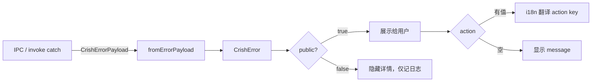

# 错误处理指南

> 本文是 `@crish/shared-types` 错误系统的权威开发指南，与 `ARCHITECTURE.md` §3（错误系统）保持一致。
> 类型真源：`packages/shared-types/src/errors/`。
> 设计依据：`analysis/iterative-repair/v2/03-ERROR-MIGRATION.md`，遵守 `ANTI_OVERENGINEERING_GUARDRAILS.md`（不使用任何 emoji）。

---

## 1. CrishError

`CrishError` 是全仓统一的错误基类，扩展 `Error`，携带结构化元数据。类型真源：`packages/shared-types/src/errors/classes.ts`。

```ts
export class CrishError extends Error {
  readonly code: CrishErrorCode | string;
  readonly category: CrishErrorCategory;
  readonly retryable: boolean;
  readonly public: boolean;
  readonly action: string;
  readonly metadata?: JsonObject | undefined;
  readonly cause?: CrishError | undefined;

  constructor(
    message: string,
    code: CrishErrorCode | string,
    category: CrishErrorCategory,
    retryable: boolean,
    metadata?: JsonObject,
    options?: { cause?: CrishError; public?: boolean; action?: string }
  );
}
```

### 1.1 字段语义

| 字段 | 类型 | 说明 |
| --- | --- | --- |
| `code` | `CrishErrorCode \| string` | 错误码，`domain.reason` 格式（见 §3） |
| `category` | `CrishErrorCategory` | 故障类别（见 §4） |
| `retryable` | `boolean` | 是否可重试 |
| `public` | `boolean` | 是否对终端用户可见（默认从注册表推导） |
| `action` | `string` | 用户可执行动作的 i18n key（如 `action.provider.check_api_key`） |
| `metadata` | `JsonObject?` | 结构化附加数据 |
| `cause` | `CrishError?` | 递归因果链（最多 8 层，见 §6） |

`public` 与 `action` 默认从 `CRISH_ERROR_REGISTRY` 推导；旧码（不在注册表内）回退到 `common.unknown` 的元信息。

### 1.2 构造示例

```ts
import { CrishError } from '@crish/shared-types';

// 基本构造
throw new CrishError(
  'API key invalid',
  'provider.auth',
  'security',
  false,
  { endpoint: 'https://api.example.com' },
);

// 带因果链
throw new CrishError(
  'Failed to fetch user profile',
  'provider.server',
  'transient',
  true,
  { userId: '123' },
  { cause: originalError, public: true, action: 'action.provider.retry' },
);
```

### 1.3 兼容性

`code` 字段接受新 `CrishErrorCode` 或旧裸 `string`，共存阶段旧调用继续工作：

```ts
// 旧调用（兼容）
new CrishError('tool failed', 'TOOL_ERROR', 'permanent', false);
// 新调用（推荐）
new CrishError('tool failed', 'tool.execution_failed', 'transient', true);
```

---

## 2. CrishResult ADT

`CrishResult<T, E>` 是不可变判别联合，用于值/错误二分场景。类型真源：`packages/shared-types/src/errors/result.ts`。

```ts
export type CrishResult<T, E extends CrishError = CrishError> =
  | { readonly ok: true; readonly value: T }
  | { readonly ok: false; readonly error: E };
```

`readonly` 字段避免误改。

### 2.1 构造与提取

```ts
import { ok, err, getOrThrow, unwrapOr } from '@crish/shared-types';

const r1 = ok(42);              // CrishResult<number, never>
const r2 = err(new CrishError('not found', 'session.not_found', 'permanent', false)); // CrishResult<never, CrishError>

getOrThrow(r1);                 // 42（err 分支抛错）
unwrapOr(r2, 0);                // 0（err 分支返回 fallback）
```

### 2.2 转换

```ts
import { mapResult, flatMapResult, mapErr } from '@crish/shared-types';

// map：仅转换 ok 分支
const doubled = mapResult(ok(2), (n) => n * 2); // ok(4)

// flatMap：链式（错误会传播）
const chained = flatMapResult(ok(2), (n) =>
  n > 0 ? ok(n + 1) : err(new CrishError('non-positive', 'common.unknown', 'permanent', false))
);

// mapErr：仅转换 err 分支
const mapped = mapErr(r2, (e) => new CrishError(e.message, 'common.unknown', 'permanent', false));
```

### 2.3 模式匹配与守卫

```ts
import { match, isOk, isErr } from '@crish/shared-types';

const msg = match(r2, {
  ok: (v) => `value: ${v}`,
  err: (e) => `error: ${e.code}`,
});

if (isOk(r1)) {
  r1.value; // number
}
if (isErr(r2)) {
  r2.error; // CrishError
}
```

### 2.4 Promise 互转

```ts
import { fromPromise, promiseResult } from '@crish/shared-types';

// Promise → CrishResult（rejected 用 common.unknown 包装）
const result = await fromPromise(fetchData());

// CrishResult → Promise（ok 解包为 resolved，err 转为 rejected）
try {
  const value = await promiseResult(result);
} catch (e) {
  // e 是 CrishError
}
```

`fromPromise` 用于必须返回 `CrishResult` 的边界；`promiseResult` 用于必须 throw 的边界（如 React 事件处理器）。

---

## 3. Error Codes

错误码格式为 `domain.reason`，正则 `/^[a-z_]+\.[a-z_]+$/`。类型真源：`packages/shared-types/src/errors/codes.ts`。

**实测规模**：67 正式码 + 10 reserved 码 = 77 码 / 20 域。

### 3.1 域清单（20 域）

| 域 | 正式码 | reserved | 典型码 |
| --- | --- | --- | --- |
| `config` | 3 | 0 | `config.invalid`, `config.missing`, `config.parse_failed` |
| `session` | 6 | 0 | `session.not_found`, `session.invalid_state` |
| `agent` | 0 | 3 | `agent.max_turns_reached`, `agent.no_progress` |
| `runtime` | 4 | 0 | `runtime.timeout`, `runtime.aborted` |
| `provider` | 17 | 0 | `provider.rate_limit`, `provider.auth`, `provider.timeout` |
| `context` | 2 | 1 | `context.length_exceeded`, `context.compaction_failed` |
| `tool` | 5 | 0 | `tool.not_found`, `tool.path_escape`, `tool.execution_failed` |
| `mcp` | 3 | 0 | `mcp.connection_failed`, `mcp.server_not_found` |
| `store` | 4 | 0 | `store.write_failed`, `store.corrupted` |
| `subagent` | 2 | 1 | `subagent.depth_exceeded`, `subagent.deadlock_detected` |
| `plugin` | 3 | 0 | `plugin.not_found`, `plugin.permission_denied` |
| `approval` | 0 | 2 | `approval.timeout`, `approval.rejected` |
| `event_store` | 4 | 0 | `event_store.append_failed`, `event_store.read_failed` |
| `artifact` | 2 | 0 | `artifact.not_found`, `artifact.invalid_uri` |
| `run` | 3 | 0 | `run.not_found`, `run.invalid_state` |
| `network` | 1 | 1 | `network.unreachable`, `network.daemon_dead` |
| `telemetry` | 1 | 2 | `telemetry.export_failed`, `log.write_failed` |
| `common` | 3 | 0 | `common.unknown`, `common.unsupported` |
| `security` | 1 | 0 | `security.ssrf_rejected` |
| `goal` | 3 | 0 | `goal.stalled`, `goal.loop_detected`, `goal.max_rounds` |

### 3.2 工具函数

```ts
import { domainOf, isCrishErrorCode, CRISH_ERROR_DOMAINS } from '@crish/shared-types';

domainOf('provider.rate_limit');   // 'provider'
isCrishErrorCode('tool.not_found'); // true
isCrishErrorCode('TOOL_ERROR');     // false（旧裸码）
CRISH_ERROR_DOMAINS;                // 20 个域的 readonly 数组
```

### 3.3 元信息注册表

`CRISH_ERROR_REGISTRY` 为 77 个码提供 `CrishErrorInfo`（`title` / `category` / `retryable` / `public` / `action`）。类型真源：`packages/shared-types/src/errors/info.ts`。

注册表在 `CrishError` 构造时被自动查询：旧码（不在注册表内）回退到 `common.unknown` 的元信息，`public` 与 `action` 字段据此填充。`CrishError` 实例上的 `public` / `action` 即为查询结果。

```ts
import { CrishError } from '@crish/shared-types';

const error = new CrishError('rate limited', 'provider.rate_limit', 'transient', true);
// error.public === true（来自注册表）
// error.action === 'action.provider.wait_retry'（来自注册表）
```

`getErrorInfo(code)` / `codesByDomain(domain)` / `CRISH_ERROR_REGISTRY` 定义在 `packages/shared-types/src/errors/info.ts`，供内部使用（按域聚合、路由、诊断面板）。如需在新模块引用，从该文件直接 import，或通过 `CrishError` 实例字段读取已查询好的元信息。

---

## 4. Error Categories

4 类故障类别，决定重试策略与用户提示。类型真源：`packages/shared-types/src/errors/codes.ts`。

| 类别 | 语义 | 重试策略 | 典型域 |
| --- | --- | --- | --- |
| `transient` | 暂时性故障 | 可重试（指数退避） | `provider.network`, `runtime.timeout`, `store.write_failed` |
| `permanent` | 永久性故障 | 不可重试，需修改输入/配置 | `session.not_found`, `config.invalid`, `provider.quota` |
| `security` | 安全相关 | 不可重试，需重新鉴权/授权 | `provider.auth`, `tool.path_escape`, `plugin.permission_denied` |
| `protocol` | 协议违规 | 不可重试，需修正请求 | `provider.schema`, `mcp.protocol_violation`, `run.invalid_state` |

**重试决策**：优先读 `retryable` 字段（注册表权威值），而非自行推断 `category`。

---

## 5. Usage Strategy

依据 `result.ts` 设计约束，`CrishResult` 与 `throw` 并存，按场景选择：

| 场景 | 推荐方式 | 理由 |
| --- | --- | --- |
| 公共 API 边界 | 返回 `CrishResult` | 调用方需显式处理错误，不漏接 |
| 异步流式 | 返回 `CrishResult` | 流错误不应中断整条管道 |
| 状态机转移 | 返回 `CrishResult` | 转移失败是预期路径，非异常 |
| 工具执行 | 返回 `CrishResult` | 工具失败应被 Agent 优雅处理 |
| 审批决策 | 返回 `CrishResult` | 拒绝是正常分支 |
| 内部辅助函数 | `throw` | 深层错误向上冒泡，避免层层包装 |
| 入参校验 | `throw` | 编程错误，应快速失败 |
| 不可恢复错误 | `throw` | 如状态机非法转换 |

### 5.1 推荐：API 边界返回 CrishResult

```ts
import { ok, err, type CrishResult } from '@crish/shared-types';
import { CrishError } from '@crish/shared-types';

async function loadSession(id: string): Promise<CrishResult<Session, CrishError>> {
  if (!id) {
    return err(new CrishError('session id required', 'session.invalid_session', 'permanent', false));
  }
  const data = await fromPromise(readFile(id));
  if (!data.ok) {
    return err(new CrishError('session read failed', 'session.storage_failed', 'transient', true, { id }, { cause: data.error }));
  }
  return ok(parseSession(data.value));
}
```

### 5.2 不推荐：内部辅助层层返回 CrishResult

```ts
// 反例：内部辅助函数不应返回 CrishResult
function parseField(raw: unknown): CrishResult<string, CrishError> { ... }

// 推荐：直接 throw，让上层边界统一捕获
function parseField(raw: unknown): string {
  if (typeof raw !== 'string') throw new CrishError('field must be string', 'common.unknown', 'permanent', false);
  return raw;
}
```

---

## 6. Serialization

跨进程序列化（TS ↔ Rust ↔ 前端）使用 `CrishErrorPayload`。类型真源：`packages/shared-types/src/errors/serialize.ts`。

### 6.1 Payload 结构

```ts
export interface CrishErrorPayload {
  readonly code: CrishErrorCode;
  readonly message: string;
  readonly category: CrishErrorCategory;
  readonly retryable: boolean;
  readonly public: boolean;
  readonly action: string;
  readonly metadata?: JsonObject | undefined;
  readonly cause?: CrishErrorPayload | undefined; // 递归因果链，最多 8 层
  readonly stack?: string | undefined;            // 仅开发环境，生产置空
  readonly timestamp: number;                     // epoch ms
}

export const CRISH_ERROR_CAUSE_MAX_DEPTH = 8;
```

### 6.2 转换函数

```ts
import { toErrorPayload, fromErrorPayload, fromUnknownError, codeFromHttpStatus } from '@crish/shared-types';

// CrishError → Payload（自动截断 cause 链到 8 层）
const payload = toErrorPayload(error);

// Payload → CrishError（前端 invoke catch 后还原）
const restored = fromErrorPayload(payload);

// 任意值 → Payload（兜底，未知错误用 common.unknown）
const safe = fromUnknownError(someUnknownValue);

// HTTP 状态码 → CrishErrorCode（静态映射表）
const code = codeFromHttpStatus(429); // 'provider.rate_limit'
```

**stack 处理**：`toErrorPayload` 仅在 `process.env.NODE_ENV !== 'production'` 时保留 stack，生产环境置空。

### 6.3 HTTP 状态码映射

`HTTP_STATUS_TO_CODE` 静态映射表（替代 if-else 分支，从结构上消除死代码模式）：

| HTTP 状态 | CrishErrorCode |
| --- | --- |
| 400 / 413 / 422 | `provider.schema` |
| 401 / 403 | `provider.auth` |
| 402 | `provider.quota` |
| 404 / 405 / 415 | `provider.endpoint_unavailable` |
| 429 | `provider.rate_limit` |
| 500 / 502 / 503 / 504 / 520-524 | `provider.server` |
| 其它 | `common.unknown` |

---

## 7. Migration Guide

旧错误码通过 `migrateErrorCode` 迁移到新 `CrishErrorCode`。类型真源：`packages/shared-types/src/errors/normalize.ts`。

### 7.1 迁移函数

```ts
import { migrateErrorCode, normalizeCrishError, isCrishError } from '@crish/shared-types';

// SessionErrorCode → 新码
migrateErrorCode('not_found');              // 'session.not_found'
migrateErrorCode('invalid_state');          // 'session.invalid_state'

// ProviderErrorKind → 新码（注意连字符）
migrateErrorCode('rate-limit');             // 'provider.rate_limit'
migrateErrorCode('gateway-challenge');      // 'provider.gateway_challenge'

// ErrorDomain 枚举 → 新码
migrateErrorCode('RATE_LIMIT');             // 'provider.rate_limit'
migrateErrorCode('USER_ABORT');             // 'runtime.aborted'

// TOOL_ERROR 按 context.kind 拆分（49 处 → 4 码）
migrateErrorCode('TOOL_ERROR', { kind: 'path' });       // 'tool.path_escape'
migrateErrorCode('TOOL_ERROR', { kind: 'input' });      // 'tool.invalid_input'
migrateErrorCode('TOOL_ERROR', { kind: 'not_found' });  // 'tool.not_found'
migrateErrorCode('TOOL_ERROR', { kind: 'execution' });  // 'tool.execution_failed'

// 未知码兜底
migrateErrorCode('SOME_UNKNOWN_CODE');      // 'common.unknown'
```

### 7.2 标准化任意错误

```ts
import { normalizeCrishError, isCrishError } from '@crish/shared-types';

// 任意值 → CrishError
const e1 = normalizeCrishError(new Error('boom'));      // common.unknown
const e2 = normalizeCrishError('string error');          // common.unknown
const e3 = normalizeCrishError(existingCrishError);      // 原样返回

// 类型守卫
if (isCrishError(value)) {
  value.code; // CrishErrorCode | string
}
```

### 7.3 已废弃适配层

以下子类为共存阶段保留，删除阶段（Round 12）移除，统一用 `CrishError`：

| 废弃类 | 替代用法 |
| --- | --- |
| `ProviderError` | `new CrishError(msg, 'provider.*', 'transient'\|'protocol'\|'security', retryable)` |
| `PermissionError` | `new CrishError(msg, 'plugin.permission_denied'\|'tool.path_escape', 'security', false)` |
| `SessionError` | `new CrishError(msg, 'session.*', 'permanent'\|'transient', retryable)` |
| `ProtocolError` | `new CrishError(msg, '*.invalid_*'\|'*.protocol_violation', 'protocol', false)` |

```ts
// 已废弃（@deprecated）
import { ProviderError } from '@crish/shared-types';
throw new ProviderError('rate limited', 'rate-limit', true);

// 推荐
import { CrishError } from '@crish/shared-types';
throw new CrishError('rate limited', 'provider.rate_limit', 'transient', true);
```

---

## 8. Frontend Translation

前端通过 `CrishErrorPayload` 接收错误，依据 `code` / `action` / `public` 决定展示策略。

### 8.1 处理流程



### 8.2 前端示例

```ts
import { fromErrorPayload, type CrishErrorPayload } from '@crish/shared-types';

// Tauri invoke 错误处理
try {
  await invoke('run_agent', { input });
} catch (raw) {
  const payload = raw as CrishErrorPayload;
  const error = fromErrorPayload(payload);

  if (error.public) {
    // 对用户可见：翻译 action key，附带可重试按钮
    const actionText = i18n.t(error.action); // 如 action.provider.check_api_key
    showToast({ message: error.message, action: actionText, retryable: error.retryable });
  } else {
    // 对用户不可见：仅记录日志
    logger.warn('operation failed', { code: error.code, message: error.message });
    showToast({ message: '操作失败，请稍后重试' });
  }
}
```

### 8.3 重试策略

依据 `retryable` 与 `category` 决定是否自动重试：

```ts
function shouldAutoRetry(error: CrishError, attempt: number): boolean {
  if (!error.retryable) return false;
  if (attempt >= 3) return false;
  // transient：指数退避；security：不自动重试（需用户介入）
  return error.category === 'transient';
}

function backoffMs(attempt: number): number {
  return Math.min(1000 * 2 ** attempt, 30_000);
}
```

---

## 9. 参考

- 架构总览：[`../ARCHITECTURE.md`](../ARCHITECTURE.md) §3
- 迁移设计：[`../analysis/iterative-repair/v2/03-ERROR-MIGRATION.md`](../analysis/iterative-repair/v2/03-ERROR-MIGRATION.md)
- 插件开发：[`./plugin-development.md`](./plugin-development.md)
- 子代理开发：[`./subagent-development.md`](./subagent-development.md)
- 守卫约束：[`../ANTI_OVERENGINEERING_GUARDRAILS.md`](../ANTI_OVERENGINEERING_GUARDRAILS.md)
