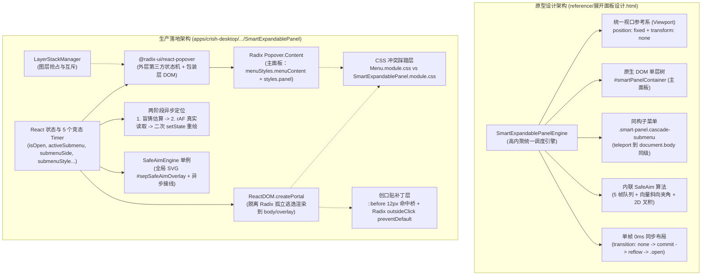
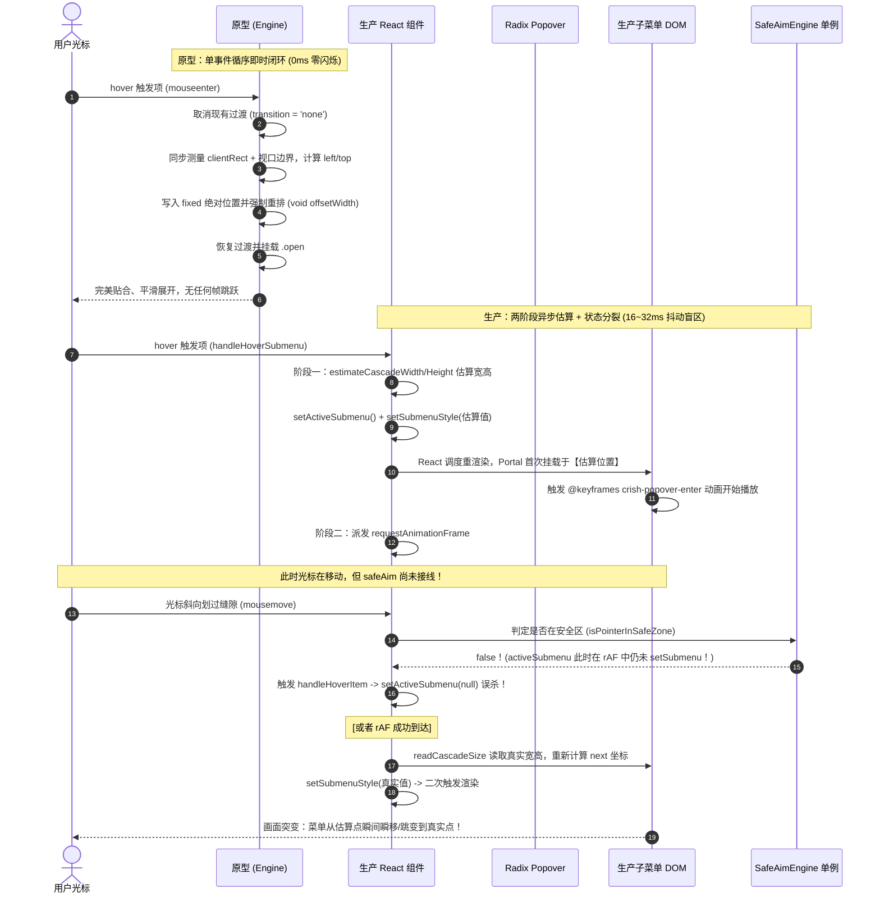

# 原型设计 vs 生产落地：SmartExpandablePanel 架构断层与失真根因深度分析

> **分析基准**：
> - **原型设计**：`reference/展开面板设计.html`（v22.0 Pruned Natural Height & Flawless Submenu Engine，重点行 1100–1900）
> - **生产实现**：`apps/crish-desktop/src/components/ui/SmartExpandablePanel/`（核心组件、子菜单、定位引擎、安全轨迹引擎及样式体系）
> - **生成日期**：2026-10-25
> - **结论摘要**：桌面端级联展开面板频发的“跳变闪烁、二级菜单易碎断触、坐标漂移、边缘挤压切断”并非局部细节 bug，而是**设计哲学与运行时架构的根本性断层**——原型是一套**全生命周期高内聚、单坐标系单线程同步布局的轻量级原生引擎**；而生产落地时却错误套上了 `@radix-ui/react-popover` 壳，强行把二级子菜单剥离为独立的 `ReactDOM.createPortal`，并在中间堆砌了双层 CSS Module 冲突、两阶段异步估算与 rAF 校准跳变、5 个相互竞态的定时器，以及 12px 伪元素盲猜补丁，最终导致架构严重失真。

---

## 一、双侧架构对比拓扑图

### 1.1 总体架构对比



### 1.2 展开二级子菜单时钟与时序对比



---

## 二、七大核心架构断层深度剖析

### 断层 1：宿主生命周期割裂——外层 Radix Popover 与逃逸 Portal 子菜单的次元壁

#### 1. 原型规范设计 (`reference/展开面板设计.html:304-322, 1638-1653`)
* **单宿主同构**：主面板 `#mainPanel` 与所有级联子菜单共用同一个全局视口坐标空间。主面板容器 `#smartPanelContainer` 在 `.open` 时强制应用 `transform: none`：
  ```css
  /* reference/展开面板设计.html:317-322 */
  .smart-panel-container.open {
    opacity: 1;
    visibility: visible;
    pointer-events: auto;
    transform: none; /* 彻底清除 transform，防止其为子元素创建新的 Containing Block */
  }
  ```
* 子菜单只需在展开时调用 `document.body.appendChild(submenu)`（`html:1643`），主菜单与子菜单在 DOM 树中处于完全平级的兄弟关系，事件冒泡与全局捕获行为完全透明可控。

#### 2. 生产落地现状 (`SmartExpandablePanel.tsx:361-396, SmartPanelCascadeSubmenu.tsx:42-68`)
* **生硬包裹 Radix Popover**：
  主面板使用 `@radix-ui/react-popover` 实现（`SmartExpandablePanel.tsx:361`），Radix 会在 DOM 根节点动态生成 `[data-radix-popper-content-wrapper]` 容器，内部注入 Floating UI 计算出的绝对定位与 CSS 3D 变换。
* **二级子菜单被逐出家门**：
  Radix Popover 并不支持层级级联子菜单（Radix 的级联能力属于 `@radix-ui/react-menu`），因此现有代码在 `SmartPanelCascadeSubmenu.tsx:42` 处通过 `ReactDOM.createPortal(..., container)` 强行将子菜单渲染到 `dialogOverlay ?? document.body`。
* **引发的灾难性断裂**：
  1. **坐标参考系断裂**：主面板位于 Radix 的 Popper Wrapper 内部，受到 Radix 的 `collisionPadding`、`avoidCollisions` 与变换矩阵约束；而子菜单孤零零位于 `document.body`，两者测量 `getBoundingClientRect()` 时存在瞬态时间差（如 Radix 入场过渡尚未完成 `scale(0.93)` 时，读取的 `panelRect.right` 根本不是最终物理位置）。
  2. **事件与焦点断裂**：用户点击子菜单项或在主子菜单间移出时，Radix 的全局点击监听器会将其视为“外部点击”（Outside Pointer Down）。为了防止主菜单被 Radix 静默关闭，不得不写出如下极其脆弱的事件拦截代码：
     ```tsx
     // SmartExpandablePanel.tsx:377-388
     onPointerDownOutside={(e) => {
       const target = e.detail.originalEvent.target as Node | null;
       const triggerEl = anchor?.current ?? triggerRef.current;
       if (
         (triggerEl && target && triggerEl.contains(target)) ||
         (cascadeSubmenuRef.current &&
           target &&
           cascadeSubmenuRef.current.contains(target))
       ) {
         e.preventDefault(); // 强行拦截 Radix 的卸载逻辑！
       }
     }}
     ```
  3. **层级管理器冲突**：同时接入了 `useLayerRegistration`（`SmartExpandablePanel.tsx:187, 198`），主菜单是 `'dropdown-menu'`，子菜单是 `'cascade-submenu'`，与 Radix 的内部图层争夺焦点管理权。

---

### 断层 2：几何契约与样式踩踏——`Menu.module.css` 与 `SmartExpandablePanel.module.css` 的双层打架

#### 1. 原型规范设计 (`reference/展开面板设计.html:15-50, 337-351, 756-775`)
* **同心圆角几何契约 (Concentric Curvature System)**：
  ```css
  --panel-outer-radius: 16px;
  --panel-padding: 6px;
  --panel-inner-radius: calc(var(--panel-outer-radius) - var(--panel-padding)); /* 10px */
  --item-radius: calc(var(--panel-inner-radius) - 2px); /* 8px */
  ```
* **主子面板 100% 共享样式类**：
  主面板是 `<div class="smart-panel" id="mainPanel">`；
  子菜单是 `<div class="smart-panel cascade-submenu">`。
  两者在底色、发丝边框、弥散投影、内衬 Padding（6px）、子项间距（2px）、毛玻璃（28px）上完全一致，子菜单仅额外附加 `position: fixed` 与 `z-index: 2010`。

#### 2. 生产落地现状 (`SmartExpandablePanel.tsx:356-358, SmartPanelCascadeSubmenu.tsx:45`)
生产代码同时引入了通用的老旧菜单样式与专用样式：
```tsx
// SmartExpandablePanel.tsx:356
const panelClasses = [menuStyles.menuContent, styles.panel, className].filter(Boolean).join(' ');

// SmartPanelCascadeSubmenu.tsx:45
className={`${menuStyles.menuContent} ${styles.cascadeSubmenu}`}
```
在同一个 DOM 节点上同时挂载两个 CSS Module 类名，引发了极其严重的**样式踩踏矩阵**：

| 属性 / 表现 | `Menu.module.css (.menuContent)` | `SmartExpandablePanel.module.css (.panel / .cascadeSubmenu)` | 运行时冲突后果 |
| :--- | :--- | :--- | :--- |
| **最小宽度 (`min-width`)** | `180px` (Menu:12) | `160px` (SEP:333) | 子菜单短项无法收缩至 160px，破坏紧凑美感 |
| **最大宽度 (`max-width`)** | `min(340px, calc(100vw - 16px))` | `min(280px, calc(100vw - 24px))` | CSS 打包合并顺序决定胜负，宽度上限不可控漂移 |
| **高度与滚动条** | `max-height: 640px; overflow-y: auto;` (Menu:15-20) | `height: auto; max-height: 760px; overflow-y: auto;` (SEP:335-337) | **双滚动条**：外层容器滚动与内层列表容器 `.listContainer` 滚动打架，滚轮断触 |
| **子项间隙 (`gap`)** | `gap: 2px;` (Menu:32) | `gap: var(--sep-item-gap, 4px);` (SEP:347) | 列表条目间距忽大忽小，视觉不均匀 |
| **底色与投影** | `background: var(--bg-elevated); box-shadow: var(--shadow-lg);` | `background: var(--sep-bg-panel-solid); box-shadow: var(--sep-shadow);` | 丢失原型温润的 CMYK 10% 黄底发丝光影，退化为冷冰冰的阴影 |
| **入场动画** | `[data-state='open'] { animation: crish-popover-enter; }` | 无条件 `animation: crish-popover-enter forwards;` | Portal 子菜单没有 Radix `data-state` 属性，动画机制相互扭曲 |
| **变换原点 (`transform-origin`)**| `var(--radix-popover-content-transform-origin, top center)` | `transformOrigin: placed.transformOrigin (top left/right)` | 弹出缩放原点错乱，子菜单缩放展开时从错误位置向外跳变 |

---

### 断层 3：定位与时序失真——单帧同步布局 vs 两阶段异步估算+rAF重绘的跳变闪烁

#### 1. 原型规范设计 (`reference/展开面板设计.html:1680-1740`)
原型打开子菜单完全在**单次同步事件循环**中执行完毕，过程严格如下：
```javascript
// reference/展开面板设计.html:1680-1740
// 1. 禁用过渡动画，消除测量期间的位置突变
submenu.style.transition = 'none';
submenu.style.display = 'flex';
submenu.style.visibility = 'hidden';

// 2. 同步读取真实精确尺寸 (准确率 100%)
const parentRect = item.getBoundingClientRect();
const submenuWidth = submenu.offsetWidth || 230;
const submenuHeight = submenu.offsetHeight || 180;

// 3. 计算最佳吸附侧（支持向左展开的方向继承 dirX）
...

// 4. 写入固定绝对坐标
submenu.style.position = 'fixed';
submenu.style.top = `${subTop}px`;
submenu.style.left = `${subLeft}px`;

// 5. 关键：强制触发同步重排 (Reflow)，立即使几何位置在 GPU 中生效
void submenu.offsetWidth;

// 6. 恢复过渡并展开
submenu.style.transition = '';
submenu.style.visibility = 'visible';
submenu.classList.add('open');
```
整个流程耗时 <0.2ms，**在同一个渲染帧内一次性交付最终位置**，视觉上零抖动、零跳跃。

#### 2. 生产落地现状 (`SmartExpandablePanel.tsx:239-278`)
生产中由于受限于 React 的状态驱动模式与解耦失当，设计了所谓的“两阶段定位算法”：
```typescript
// 第一阶段：盲猜估算 (SmartExpandablePanel.tsx:244-257)
const estWidth = estimateCascadeWidth(item.children);   // 纯按字数盲猜：12 + 24 + maxLen * 13 + 24
const estHeight = estimateCascadeHeight(item.children); // 纯按行数盲猜：12 + N * 36
const placed = placeCascadeSubmenu(panelRect, itemRect.top, estWidth, estHeight, vw, vh);

setActiveSubmenu(item);
setSubmenuSide(placed.side);
setSubmenuStyle(cascadeStyle(placed)); // 带着估算值触发 React re-render

// 第二阶段：异步 rAF 校准 (SmartExpandablePanel.tsx:260-278)
requestAnimationFrame(() => {
  const sub = cascadeSubmenuRef.current;
  const panel = contentRef.current;
  if (!sub || !panel) return;
  const box = readCascadeSize(sub, estHeight, curVw, curVh); // 读真实 DOM
  const next = placeCascadeSubmenu(panel.getBoundingClientRect(), itemRect.top, box.width, box.height, curVw, curVh);
  setSubmenuSide(next.side);
  setSubmenuStyle(cascadeStyle(next)); // 第二次触发 React re-render！
  safeAim.setSubmenu(el, sub, next.side);
});
```
**严重缺陷**：
1. **帧跳变（Jank / Flashing）**：第一阶段设置的位置与真实尺寸常常偏差数十像素。浏览器在第 0 帧渲染了估算位置的子菜单，并触发了 CSS `crish-popover-enter` 展开动画；16ms 后的第 1 帧或第 2 帧，rAF 读出真实尺寸并重新 `setState`，子菜单在用户眼皮底下发生**剧烈二次瞬移**。
2. **翻转方向振荡**：若估算高度认为右侧能放下，而真实高度放不下时，第一阶段向右展开，第二阶段在 rAF 里突然向左翻转，产生极度劣质的视觉抽搐。

---

### 断层 4：Safe-Aim 轨迹保护的脱节——全局单例延迟接线导致的 16-32ms 盲区与误杀

#### 1. 原型规范设计 (`reference/展开面板设计.html:1792-1825`)
* 原型的防误触三角区直接作为 Engine 的核心成员方法运行：
  - 维持 5 帧鼠标物理坐标队列 `mouseLocs`；
  - 精确计算 `deltaX` 与 `deltaY`；
  - 检查光标水平向移动分量是否占优：`Math.abs(deltaX) > Math.abs(deltaY) * 0.5`；
  - 使用 2D 叉积 `isPointInTriangle` 进行几何判定；
  - 一旦命中安全区，直接启动防抖定时器并拦截其他 Item 的切换：
    ```javascript
    // reference/展开面板设计.html:1811-1816
    clearTimeout(this.submenuAimTimeout);
    this.submenuAimTimeout = setTimeout(() => {
      this.evaluateAndOpenSubmenu(item);
      if (hasCascade) this.activeSubmenuItem = item;
    }, 160);
    return; // 立即返回，严禁关闭或重置当前子菜单
    ```

#### 2. 生产落地现状 (`SmartExpandablePanel.tsx:277-290, SafeAimEngine.ts:33-75`)
生产中将 SafeAim 抽象为一个全局单例 `SafeAimEngine.getInstance()`，但生命周期脱节：
1. **16~32ms 致命时间黑洞**：
   观察 `SmartExpandablePanel.tsx:277`：
   `safeAim.setSubmenu(el, sub, next.side)` 被放置在 `requestAnimationFrame` 回调内部！
   当用户鼠标划过触发项的一瞬间，子菜单并未同步注册到 `SafeAimEngine`。
   此时如果用户的鼠标习惯性地快速斜向切入子菜单，在这 1~2 个渲染帧的时间窗口内，`safeAim.activeSubmenu` 仍然是旧值或 `null`！
2. **划过相邻项立即误杀**：
   在 rAF 尚未执行前，光标经过了下一个非级联菜单项，触发 `handleHoverItem`（`SmartExpandablePanel.tsx:298-320`）：
   ```typescript
   // SmartExpandablePanel.tsx:307
   if (safeAim.isPointerInSafeZone(mousePos, submenuSide)) {
     // 由于 safeAim.activeSubmenu 为空或仍是上一个，判定失败直接返回 false！
   }
   setActiveSubmenu(null); // 立即被无情关闭！
   safeAim.clearSubmenu();
   ```
   **这就是用户反馈“为什么我手速一快，二级菜单就闪退关掉”的根本技术成因！**
3. **全局单例污染**：`SafeAimEngine.getInstance()` 是进程级单例，当界面中存在多个菜单（例如 ChatHeaderMore 菜单、工具栏选择器菜单、右键上下文菜单）时，各组件相互覆盖全局单例的 `activeSubmenu`，造成跨组件幽灵碰撞。

---

### 断层 5：多定时器泥潭与状态爆炸——5 套独立 Timeout 的竞态灾难

在 `SmartExpandablePanel.tsx` 内部，充斥着大量用于“打补丁”的独立定时器句柄：
1. `safeAimTimeoutRef`（`SmartExpandablePanel.tsx:65`）：300ms 安全区退出延时；
2. `hoverItemTimerRef`（`SmartExpandablePanel.tsx:66`）：150ms 菜单项 hover 延时切换；
3. `hoverOpenTimerRef`（`SmartExpandablePanel.tsx:67`）：150ms 触发展开延时；
4. `hoverCloseTimerRef`（`SmartExpandablePanel.tsx:68`）：250ms 移出关闭延时；
5. `SafeAimEngine.timeoutMs`（`SafeAimEngine.ts:55`）：内部维护的 300ms 安全区熔断机制。

**竞态泥潭分析**：
* 5 个定时器由不同的事件处理函数（`handleContentMouseLeave`、`handleHoverSubmenu`、`handleHoverItem`、`handleSubmenuPointerLeave`）分别创建并尝试清除。
* 只要用户的鼠标轨迹稍微出现“抖动 -> 移入安全区 -> 移出 -> 快速返回”，定时器清除次序错乱，前一个已经失效的 `hoverCloseTimerRef` 就会在 250ms 后强行执行 `handleOpenChange(false)`，直接无预警关闭整个面板！
* 原型中只有唯一一个 `submenuAimTimeout = 160ms`，逻辑清晰无互锁，生产代码却用 5 个定时器形成了混乱的分布式状态机。

---

### 断层 6：伪自适应与死代码断层——`PositionEngine` 核心能力在组件内实际被架空

在代码库中，开发者编写了一个体积多达 388 行的 `PositionEngine.ts`，宣称复刻了原型的全部特性：
* 包含 `measureNaturalHeight`（自然高度测量）；
* 包含 `calculateTriggerPosition`（带 32px `hysteresisY` 的触发器吸附翻转算法）；
* 包含 `calculatePointPosition`（右键光标绝对定位）。

**惊人的现实断层**：
在核心组件 `SmartExpandablePanel.tsx` 中：
* `PositionEngine` 类的实例化与方法调用**完全为 0**！
* 主面板的位置完全交给了 Radix Popover 内部黑盒处理，`PositionEngine.ts` 中的迟滞回线缓冲（Hysteresis）、自然高度剔除裁剪、容器边界约束（`useContainerBoundary`）全部沦为**死代码**！
* `SmartExpandablePanel.tsx` 仅仅从 `PositionEngine.ts` 中引入了 `estimateCascadeWidth`、`estimateCascadeHeight` 和 `placeCascadeSubmenu` 这几个纯函数用于子菜单计算！
* 这意味着原型中极其精妙的“面板紧凑自适应高度、无多余留白、不过顶不压底”的核心能力，在生产主面板上**根本没有接入**！

---

### 断层 7：创口贴式的补丁体系——`::before` 12px 盲猜命中桥与 Radix 事件截流

#### 1. 12px 跨面板透明命中桥 (`SmartExpandablePanel.module.css:380-397`)
```css
/* 跨面板透明安全命中桥（Hit Bridge）：覆盖主子面板间 4px 缝隙，防止光标移动瞬态断触 */
.cascadeSubmenu::before {
  content: '';
  position: absolute;
  top: -8px;
  bottom: -8px;
  width: 12px;
  pointer-events: auto;
}
.cascadeSubmenu[data-side='right']::before { left: -8px; }
.cascadeSubmenu[data-side='left']::before { right: -8px; }
```
* **定性**：典型的**反模式补丁（Anti-Pattern Patch）**。
* **根因剖析**：由于 SafeAim 算法由于 rAF 延迟未能及时接管主面板与子菜单之间的 4px 物理缝隙，导致鼠标经过缝隙时主菜单触发 `mouseleave` 关门。开发者没有修复生命周期与时序断层，而是通过给子菜单增加一个看不见的 12px 宽透明伪元素来“物理遮挡”缝隙。
* **带来的新灾难**：
  这个 12px 的伪元素向外探出（`left: -8px`），它会**不可见地覆盖住主面板右侧边缘的条目操作区**（例如快捷键文本、删除小图标或展开箭头），导致用户在主面板边缘点击时，事件被子菜单的 `::before` 吞噬！

---

## 三、架构断层对照矩阵

| 架构维度 | 原型设计 (`reference/展开面板设计.html`) | 生产当前落地 (`SmartExpandablePanel`) | 架构断层定性 | 缺陷表现与隐患 |
| :--- | :--- | :--- | :--- | :--- |
| **整体拓扑** | 单一高内聚原生 Engine 调度器 | Radix Popover 外壳 + 独立 React Portal 子菜单 | **生命周期双轨割裂** | 主子菜单状态脱节，OutsideClick 误伤关闭 |
| **坐标参考系** | 共享全局 Viewport 视口坐标 (`transform: none`) | 主菜单在 Radix Popper Wrapper，子菜单在 Body | **参考系断裂** | 入场动画期间测量偏差数十像素，产生偏移 |
| **样式与类名** | 主子共用 `.smart-panel`，统一同心圆角契约 | 同时挂载 `menuStyles.menuContent` 与 `styles.cascadeSubmenu` | **CSS 双源踩踏** | min/max 尺寸不可控、双滚动条、投影色彩降级 |
| **排版时序** | 单帧 0ms 同步计算，`void reflow` 后即时挂载 `.open` | 两阶段：先粗暴估算挂载，rAF 读真实尺寸后二次 `setState` | **异步跳变时序病** | 子菜单入场瞬间发生剧烈视觉位移（Jank） |
| **防误触保护** | 随 Hover 事件同步调度，160ms 极简防抖三角区 | 全局单例 `SafeAimEngine`，在 rAF 回调内延迟绑定 | **时序黑洞与单例污染** | 快速滑向子菜单时有 16~32ms 盲区，被相邻项误杀 |
| **防抖与关闭** | 仅维护一个 `submenuAimTimeout`，逻辑清晰收敛 | 5 个分散的 `setTimeout` 句柄，竞态交织 | **状态机爆炸** | 连续移动时定时器冲突，面板莫名暴毙关闭 |
| **高度自适应** | `getPrunedNaturalHeight` 纯净自然高度紧凑贴合 | `PositionEngine` 核心方法被架空，死守固定 600px/760px | **自适应退化 / 死代码** | 短列表留白空洞，长列表过顶被视口切断 |
| **缝隙衔接** | 基于连续向量夹角计算，完全不依赖 DOM 占位 | 依靠 CSS `::before` 12px 盲猜透明桥进行遮盖 | **劣质补丁** | 隐形遮挡主菜单右侧操作项与图标，阻碍交互 |
| **滚轮隔离** | `handlePanelWheel` 拦截外溢，边界阻断与内部接力 | 单纯调用 `e.stopPropagation()` | **隔离失效** | 滚轮滚到边界时外部对话流仍然产生连带滚动 |

---

## 四、从原型到落地：“丢了什么”与“多加了什么劣质胶水”

### 4.1 彻底丢掉的核心资产 (Lost Assets)
1. **丢失了“视口绝对直连”的坐标简洁性**：
   原型中主菜单和子菜单都是纯粹的 `position: fixed`，没有任何中间父层加注 `transform`，使得 `rect.left`、`rect.top`、`subLeft`、`subTop` 的几何关系如水晶般透明。
2. **丢失了单帧同步完成的排版控制权**：
   原型敢于在一次鼠标移入事件中完成测量与位置提交，利用原生重排保证首帧即正确；生产代码陷入 React “render 阶段不能读 DOM，commit 阶段只能异步 rAF” 的教条，引入了双重渲染抖动。
3. **丢失了单一几何契约的优雅性**：
   原型只维护一套 `--panel-outer-radius (16px)`、`--panel-padding (6px)`、`--item-radius (8px)` 的同心计算，主子菜单如同孪生；生产中子菜单与主菜单的 CSS 互相排斥。
4. **丢失了真正的自然高度自适应 (Pruned Natural Height)**：
   原型彻底解决了菜单内部的空白与长条列表多余空白；生产代码退化为定死 `max-height` 与硬性滚动条。

### 4.2 滥加的劣质胶水层 (Superfluous Low-Quality Glue)
1. **`@radix-ui/react-popover` 沉重外壳**：
   Radix Popover 是为了简单的 Tooltip 或单层弹出层设计的，面对需要级联悬浮、三角轨迹穿透的复杂桌面级面板，不仅毫无帮助，其内部自作主张的 Popper Wrapper 和 Outside Pointer Down 反而成了最大绊脚石。
2. **孤立的 `ReactDOM.createPortal` 逃逸节点**：
   为了逃出 Radix 的限制而打的补丁，制造了跨 DOM 树的通信地狱。
3. **`Menu.module.css` 的冗余兼容注入**：
   为了所谓的“复用既有菜单样式”，无脑叠加 `.menuContent`，造成与专门的 `SmartExpandablePanel.module.css` 几十处属性重叠互踩。
4. **粗糙的估算函数 (`estimateCascadeWidth/Height`)**：
   试图用中文字数估算像素宽度，用行数乘以 36px 估算高度，带来了不可靠的中间态与二次重绘。
5. **多达 5 处的异步 Timeout 定时器**：
   用于弥补状态不同步带来的缝隙，最终变成了互锁竞态的定时炸弹。
6. **`::before` 12px 隐形命中桥**：
   用伪元素侵占真实 DOM 空间的魔术贴代码。

---

## 五、重构与架构净收敛指南

根据本仓库《通用协作纪律》第 7 条“严禁补丁、绕过与作弊，穿透表象找到架构断层”的要求，后续重构应坚决实施**架构净收敛**：

1. **废黜 `@radix-ui/react-popover` 依赖**：
   面板不再包裹 Radix Popover，回归纯原生受控的悬浮面板架构，主面板与所有级联子菜单统一使用一致的 Portal 挂载机制（或统一挂载于全局专用 Overlay 容器）。
2. **单真理源（SSOT）视口坐标系**：
   主面板和所有子菜单均基于统一 Viewport 坐标系统，彻底清除 Popper Wrapper 的 3D 变换干扰，确保主菜单与各级子菜单处于完全相同的笛卡尔坐标平面。
3. **消除两阶段估算，回归单帧原子布局**：
   子菜单在初次挂载时保持 `visibility: hidden; display: flex; transition: none`，在同一次 layout effect 中同步完成真实 DOM 测量并一次性写入 `left/top`，通过原生 reflow 激活平滑展开过渡，彻底根除 16~32ms 跳变闪烁。
4. **CSS 模块彻底剥离归一**：
   完全清退 `menuStyles.menuContent` 的混合注入，让 `SmartExpandablePanel` 独占一套纯净的、完整复刻原型 `--panel-outer-radius / --panel-padding` 的样式契约，绝不再与其他旧菜单样式产生任何依赖绑定。
5. **重构内联高内聚 SafeAim 保护**：
   废除脆弱的全局单例 `SafeAimEngine` 与伪元素 `::before` 命中桥，让三角区算法直接与组件的 Hover 状态机紧密内聚，实现零延迟、同步生效的防误触保护。
6. **清退冗余定时器**：
   将 5 个分散的 Timeout 收敛为单个基于状态机事件的微防抖控制器，彻底消除竞态与意外关闭。
