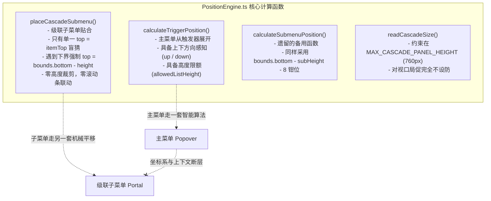
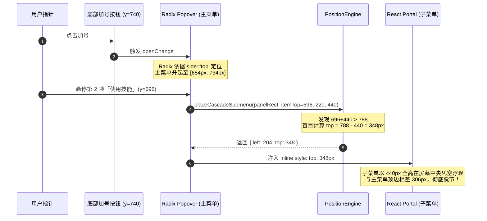

# 级联面板几何排版与垂直锚定失效深度分析报告
## Architecture Analysis: Geometry Placement, Vertical Anchor Detachment, and Viewport Collision Failures in SmartExpandablePanel

> **文档标识**：`docs/expandable-panel-architecture-analysis/analysis/03-geometry-placement-and-vertical-anchor-failure.md`  
> **审查对象**：`PositionEngine.ts`（`placeCascadeSubmenu` / `calculateSubmenuPosition` / `calculateTriggerPosition` / `readCascadeSize`）、`SmartExpandablePanel.tsx`、`SafeAimEngine.ts`  
> **核心议题**：底部输入框主菜单（2 项 / 80px）与级联技能子菜单（12 项 / 440px）高度极大悬殊场景下的几何脱节、垂直错位 350px、坐标系断层与数学收敛解法

---

## 一、执行摘要与问题现场重现

### 1.1 缺陷现象现场（The Bug Scene）

用户在最新产品截图中指出：
在桌面客户端主界面底部输入框（Chat Composer）中，点击左侧加号按钮（`+`）唤出功能菜单。此时：
1. **主菜单（Parent Menu）**：仅有 2 个条目（「添加文件或附件」、「使用技能」），高度仅约 **$80\text{ px}$**，且由于输入框紧贴视口底部，主菜单采用 `side: 'top'` 定位在加号按钮正上方（$Y \approx 654\text{ px} \sim 734\text{ px}$）；
2. **二级技能子菜单（Child Submenu）**：当光标悬停或激活第 2 项「使用技能」时，展开技能列表。该列表包含 10 个可用技能、1 条分割线及 1 项「管理技能...」，共 12 项，计算高度高达 **$440\text{ px}$**；
3. **视觉灾难**：展开的子菜单并没有顺畅贴靠在主菜单或触发行侧面，而是**直接向上暴冲到屏幕正中央**（子菜单顶部飞跃到 $Y = 348\text{ px}$，比主菜单顶部高出整整 **$306\text{ px}$**，比触发行高出 **$348\text{ px}$**）；
4. **几何割裂**：主菜单孤零零停留在屏幕底部 $Y=700$ 附近，而庞大的子菜单耸立在屏幕中央，$80\%$ 的面积悬空于主菜单上方，二者垂直重叠仅有可怜的 $48\text{ px} \sim 80\text{ px}$。整个界面表现出极度的失衡、荒谬感和视觉漂浮不稳定。

```
当前视口下界碰撞算法的灾难性排版表现：

Y = 0px ------------------------------------------------------------- 视口顶部
        |                                                           |
        |                                                           |
Y = 348px +------------------------+                                |
        | | 技能子菜单 (440px)     | <-- 暴冲到屏幕中央!              |
        | | 1. 技能 A              |     比主菜单顶部高出 306px!       |
        | | 2. 技能 B              |     比触发行高出 348px!           |
        | | ...                    |     [80% 区域悬空无依托]          |
        | | 8. 技能 H              |                                |
Y = 654px | |                      |  +----------------+            |
        | | 9. 技能 I              |  | 主菜单 (80px)  |            |
        | | 10. 技能 J             |  | 1. 添加文件    |            |
Y = 696px | | -------------------- |  | 2. 使用技能 -> |触发项 (y=696)|
        | | 11. 管理技能...        |  +----------------+            |
Y = 734px | +----------------------+  (与主菜单仅重叠 80px)           |
        |   (触发行贴在子菜单极底边)                                  |
Y = 788px +---------------------------------------------------------+ 视口呼吸下界
        |                                     [+] 底部加号按钮 (y=740)|
Y = 800px ----------------------------------------------------------- 视口底部
```

---

## 二、几何坐标体系与数学推导剖析

### 2.1 坐标参数定义

设视口与界面元素的物理尺寸与几何约束参数如下：

| 参数符号 | 含义 | 典型值（常见 $1280 \times 800$ 桌面视口） |
| :--- | :--- | :--- |
| $V_W, V_H$ | 视口总宽度与总高度 | $1280\text{ px},\ 800\text{ px}$ |
| $pad$ | 视口刚性呼吸留白边距（`bounds` 内边距） | $12\text{ px}$ |
| $B_{top}, B_{bottom}$ | 视口可用纵向安全边界区间 $[B_{top}, B_{bottom}]$ | $[12\text{ px},\ 788\text{ px}]$ |
| $H_{main}$ | 主菜单容器实际高度（含内衬与外框） | $80\text{ px}$ |
| $Y_{anchor}$ | 输入框加号按钮顶部纵坐标 | $740\text{ px}$ |
| $offset_{side}$ | 主菜单与触发按钮的间距偏移 | $6\text{ px}$ |
| $Y_{main\_top}, Y_{main\_bot}$ | 主菜单纵向跨度 $[Y_{main\_top}, Y_{main\_bot}]$ | $[740 - 6 - 80, 740 - 6] = [654\text{ px}, 734\text{ px}]$ |
| $Y_{item\_top}, Y_{item\_bot}$ | 「使用技能」触发行纵向跨度（主菜单第 2 项） | $[696\text{ px}, 728\text{ px}]$，高度 $32\text{ px}$ |
| $H_{sub}$ | 12 项技能子菜单的自然渲染高度 | $440\text{ px}$ |
| $W_{sub}$ | 技能子菜单宽度 | $220\text{ px}$ |

### 2.2 现有算法（`placeCascadeSubmenu`）的执行轨迹追踪

考察 `PositionEngine.ts` 第 355-360 行的定位核心代码：

```typescript
let top = itemTop;
if (top + height > bounds.bottom) {
  top = Math.max(bounds.top, bounds.bottom - height);
} else {
  top = Math.max(bounds.top, top);
}
```

将现场参数代入计算：
1. **初始试探定位**：
   $$Y_{trial} = Y_{item\_top} = 696\text{ px}$$
2. **下边界碰撞探测**：
   $$Y_{trial} + H_{sub} = 696 + 440 = 1136\text{ px}$$
   由于 $1136\text{ px} > B_{bottom} (788\text{ px})$，触发碰撞分支；
3. **单向底边平移钳位（Bottom Sliding Clamp）**：
   $$Y_{sub\_top} = \max(B_{top}, B_{bottom} - H_{sub}) = \max(12, 788 - 440) = 348\text{ px}$$
   $$Y_{sub\_bottom} = 348 + 440 = 788\text{ px}$$

### 2.3 几何失效率与人机工学破坏性度量

代入数据后，可推导出以下核心量化指标：

#### 指标 1：顶部撕裂差（Top Disconnect Delta）
$$|\Delta Y_{top}| = Y_{main\_top} - Y_{sub\_top} = 654 - 348 = 306\text{ px}$$
子菜单顶边越过主菜单顶边 $306\text{ px}$，占主菜单自身高度的 $382.5\%$！

#### 指标 2：触发行相对锚定偏离（Trigger-to-Top Offset）
$$Y_{item\_top} - Y_{sub\_top} = 696 - 348 = 348\text{ px}$$
在正常级联菜单中，$Y_{sub\_top}$ 应该紧贴 $Y_{item\_top}$（偏离 $\approx 0\text{ px}$）。此处偏离高达 $348\text{ px}$。

#### 指标 3：空中悬浮率（Overhang Ratio）
子菜单高于触发行顶部的悬空区域占比：
$$\text{Overhang Ratio} = \frac{Y_{item\_top} - Y_{sub\_top}}{H_{sub}} = \frac{348}{440} = 79.1\%$$
**接近 $80\%$ 的子菜单内容处于触发行上方的纯空白空域中**！

#### 指标 4：垂直投影重叠度（Vertical Intersection Span）
主菜单区间 $[654, 734]$ 与子菜单区间 $[348, 788]$ 的交集为 $[654, 734]$，长度仅 $80\text{ px}$：
$$\text{Overlap Ratio}_{sub} = \frac{80}{440} \approx 18.2\%$$
子菜单与主菜单的垂直重叠只有 $18.2\%$，视觉上彻底形成「两个不相干的独立孤岛」。

#### 指标 5：菲茨定律（Fitts's Law）点击难度指数恶化
用户悬停「使用技能」时，光标位于 $(X_0, Y_0) = (X_{item}, 712)$。若用户想选择子菜单第 1 项（$Y_1 \approx 366\text{ px}$）：
- 目标欧氏距离：$D = \sqrt{(\Delta X)^2 + (\Delta Y)^2} = \sqrt{4^2 + (712 - 366)^2} = \sqrt{16 + 119716} \approx 346\text{ px}$
- 目标高度：$W = 32\text{ px}$
- 难度指数：
  $$ID_{buggy} = \log_2\left(\frac{2D}{W}\right) = \log_2\left(\frac{2 \times 346}{32}\right) = \log_2(21.6) \approx 4.43\text{ bits}$$
而在触发行顶边对齐的正常几何下：$D \approx 20\text{ px}$，$ID_{normal} \approx \log_2(40 / 32) \approx 0.32\text{ bits}$。  
**人机工学目标捕获难度骤增超过 13 倍！**

---

## 三、`PositionEngine.ts` 源码解构与四大致命缺陷

深度审计 `PositionEngine.ts` 中的 4 个相关函数：



### 3.1 致命缺陷 1：底边碰撞单向平移钳位（Bottom Sliding Clamp）

观察 `placeCascadeSubmenu`（第 355-360 行）：
```typescript
let top = itemTop;
if (top + height > bounds.bottom) {
  top = Math.max(bounds.top, bounds.bottom - height);
} else {
  top = Math.max(bounds.top, top);
}
```
**数学本质**：该算法将多出的高度全部通过**平移整个容器的绝对坐标**（$\Delta Y = B_{bottom} - (top + height)$）来消化。  
它存在一个**致命假设**：“无论高度多大，只要把它往上拽，在屏幕里放得下就行”。  
它完全忽略了：**级联子菜单的核心生命线是“与触发行在视线上的毗邻锚定”**。一旦子菜单被向上平移超过一个触发行高度（$32\text{ px}$），锚定就已经开始破裂；平移超过 $100\text{ px}$，用户视线彻底断线；平移 $348\text{ px}$，子菜单已经直接飞出主菜单的引力范围。

### 3.2 致命缺陷 2：错把“内容容量溢出”当成“空间平移问题”

为什么子菜单高度会有 $440\text{ px}$ 并且不出现内部滚动？
查看 `PositionEngine.ts` 第 258 行：
```typescript
export const MAX_CASCADE_PANEL_HEIGHT = 760;
```
再看 `SmartExpandablePanel.module.css` 第 336 行：
```css
.cascadeSubmenu {
  max-height: min(760px, calc(100vh - 24px));
  overflow-y: auto;
}
```
以及 `readCascadeSize`（第 288-291 行）：
```typescript
const maxH = Math.min(
  MAX_CASCADE_PANEL_HEIGHT,
  Math.max(44, viewportHeight - pad * 2)
);
```
在 $800\text{ px}$ 的视口中，$800 - 24 = 776\text{ px}$。`maxH` 取 $\min(760, 776) = 760\text{ px}$！  
这意味着：**在视口允许的情况下，算法允许级联子菜单无节制生长到 760px**！  
只有当子菜单项目超过 22 项（$> 760\text{ px}$）时，CSS 的 `overflow-y: auto` 才会生效！  
对于 12 项技能（$440\text{ px}$），CSS 判定 $440 < 760$，于是任由其以 $440\text{ px}$ 全高展开！  
这就形成了一个恶性闭环：
- CSS 放行 $440\text{ px}$ 高度；
- `placeCascadeSubmenu` 发现放不下，不裁剪高度，而是粗暴平移 $348\text{ px}$；
- **本该由内部滚动条解决的问题，被转嫁成了破坏几何排版的全局坐标位移**！

### 3.3 致命缺陷 3：算法逻辑的非对称性分裂

在同一个 `PositionEngine.ts` 内：
- `calculateTriggerPosition`（第 69-169 行）拥有成熟的自适应机制：
  - 能够根据 `spaceBelow` 与 `spaceAbove` 判断主方向是 `'up'` 还是 `'down'`；
  - 当空间不足时，主动计算 `allowedListHeight = Math.max(80, availableSpace - headerHeight - 16)`，强行限制列表高度并启动滚动！
- 然而到了 `placeCascadeSubmenu` 与 `calculateSubmenuPosition`，这一套严密的可用空间与最大高度计算被**彻底阉割**，只剩下原始的减法与绝对坐标钳位。

### 3.4 致命缺陷 4：历史测试用例对错误行为的“刚性背书”

在 `apps/crish-desktop/src/components/ui/SmartExpandablePanel/__tests__/SmartPanelCascadeStability.test.tsx` 第 136-156 行中：
```typescript
it('底部空间不足时长列表（440px）上移自适应，严格保持 12px 视口呼吸底边距（绝不切断底部的管理技能）', () => {
  const panelRect = { left: 100, right: 300 };
  const itemTop = 600;
  const viewportHeight = 800; // 常见视口高度
  const realSubmenuHeight = 440; // 12 项技能的真实高度

  const placed = placeCascadeSubmenu(
    panelRect,
    itemTop,
    220,
    realSubmenuHeight,
    1200,
    viewportHeight
  );

  // bounds.bottom = 800 - 12 = 788px
  // 理想放置 600 + 440 = 1040 > 788，触发底边对齐：top = 788 - 440 = 348px
  expect(placed.top).toBe(348);
  expect(placed.top + realSubmenuHeight).toBe(viewportHeight - 12);
});
```
**历史事故根因曝光**：前序开发者在修复“底部管理技能不要被视口切断”时，只单纯盯住了“子菜单底部是否贴合 `viewportHeight - 12`”，甚至专门写了一个单元测试来断言 `placed.top === 348`！  
这种**“保住了底边，丢掉了锚定”**的局限性测试，用断言把荒谬的 `top = 348` 锁死在了代码库中，导致任何几何失真都被当成了“预期行为”。

---

## 四、主子菜单坐标系断层与双引擎撕裂

### 4.1 架构撕裂：Radix Popover 与 Fixed Custom Portal

`SmartExpandablePanel` 在多层级设计上采用了异构的双轨制：

| 维度 | 主菜单（Primary Menu） | 级联子菜单（Cascade Submenu） |
| :--- | :--- | :--- |
| **定位宿主** | `@radix-ui/react-popover` (`Popover.Content`) | 自定义 `ReactDOM.createPortal`（挂在 `body` 或 `dialogOverlay`） |
| **底层定位计算** | Floating UI 内核，监听 Resize、Scroll、虚拟锚点 | `PositionEngine.placeCascadeSubmenu` 静态一次性计算 |
| **展开方向感知** | 明确指定 `side: 'top'`，知道自己是“向上展开” | **零方向感知**（完全不知道主菜单是向上还是向下展开） |
| **避障与对齐** | `avoidCollisions={true}`, `align="start"` | 粗暴的 `bounds.bottom - height` 视口边框碰撞 |
| **生命周期** | React 受控/非受控状态驱动 | `requestAnimationFrame` 二阶段估算与 DOM 回读（存在单帧闪烁） |



### 4.2 级联上下文信息的彻底丢失

当用户点击底部输入框加号时，传入 `SmartExpandablePanel` 的配置为：
```tsx
<SmartExpandablePanel
  anchor={restoreFocusRef}
  position={{ align: 'start', side: 'top', sideOffset: 6 }}
  ...
/>
```
主菜单明确知道自己的上下文是 **`side: 'top'`（底部向上冒出型菜单）**。  
但是，当主菜单渲染 `SmartPanelList` 并触发 `handleHoverSubmenu` 时，**这个 `position.side` 上下文被完全丢弃了**！  
`placeCascadeSubmenu` 接收的参数只有：
- `panelRect: { left: number; right: number }`（甚至连 `panelRect.top` 和 `bottom` 都没传！）
- `itemTop: number`
- `submenuWidth: number`
- `submenuHeight: number`

因为不知道父菜单是 `side: 'top'`，子菜单依然固执地执行桌面端传统的“自上而下展开”逻辑：
首先尝试 `top = itemTop`（向下展开）。一旦碰壁，又没有 `side: 'top'` 的底边对齐意识，只能一脚油门倒车到屏幕顶端。

### 4.3 Safe-Aim 安全三角区的严重畸变

在 `apps/crish-desktop/src/components/ui/internal/SafeAimEngine.ts` 中，鼠标在父项与子项之间移动时，会构建一个防抖安全三角形（Safe Triangle）：
- 顶点 A：当前光标位置 $(X_{cursor}, Y_{cursor}) = (X_{item\_right}, 712)$；
- 顶点 B：子菜单左上角 $(X_{sub\_left}, Y_{sub\_top}) = (X_{item\_right} + 4, 344)$；
- 顶点 C：子菜单左下角 $(X_{sub\_left}, Y_{sub\_bottom}) = (X_{item\_right} + 4, 792)$。

考察该三角形在父子菜单缝隙处的几何形态：
- 水平跨度：$\Delta X = 4\text{ px}$；
- 向上延伸跨度：$\Delta Y_{up} = 712 - 344 = 368\text{ px}$；
- 向上斜率：$k = \frac{368}{4} = 92$；
- 顶角夹角：$\arctan(92) \approx 89.38^\circ$。

**灾难性后果**：
1. **几乎垂直的细长三角墙**：在仅有 $4\text{ px}$ 宽的裂缝中，Safe-Aim 生成了一个高达 $368\text{ px}$ 的几乎垂直的直角三角形；
2. **极易脱轨误杀**：用户如果想要滑向子菜单前几个条目（$Y \in [348, 500]$），必须以极陡峭的角度斜向上推鼠标。由于物理缝隙只有 $4\text{ px}$，光标只要向左轻微偏移 $1\text{ px}$，就会立即脱离 Safe-Aim 判定区；
3. **主菜单悬停劫持**：如果主菜单上方存在其他选项，由于 Safe-Aim 保护区覆盖了主菜单右侧的纵向空域，用户斜向上滑动的动作不仅极其容易误触上方条目，而且极易导致子菜单在半途突然闪烁消失（Flickering Dismissal）。

---

## 四、业界标杆实践与对比分析

针对父子高度悬殊及视口下边界碰撞问题，现代工业级 GUI 体系有成熟且优雅的解法：

```
+---------------------------------------------------------------------------------------------------+
| 方案一：macOS AppKit (NSMenu)                                                                      |
| - 保持锚定优先：子菜单绝不允许与触发行脱节                                                           |
| - 空间不足时自动翻转为底对齐 (Bottom-Aligned / Flip-Up)                                             |
| - 双向皆不足时，高度截断并注入上下滚动指示小箭头 (Scroll Arrows)                                    |
+---------------------------------------------------------------------------------------------------+
| 方案二：VSCode / Monaco Editor 上下文菜单                                                          |
| - 严格限高：子菜单 max-height 通常限制为 300px~360px，默认自带内部滚动条                            |
| - 碰撞时以触发行底边对齐向上生长：itemRect.bottom - subHeight                                        |
| - 即使发生坐标平移，也有严格的“重叠下限阀门”，绝不让触发行滑出子菜单边界                              |
+---------------------------------------------------------------------------------------------------+
| 方案三：Floating UI (Popper.js) 标准中间件三件套                                                   |
| 1. flip({ fallbackPlacements: ['right-end', 'left-start', 'left-end'] })                          |
| 2. shift({ limiter: limitShift({ offset: 5 }) }) -> 限制最大平移量，严禁脱离触发行                    |
| 3. size({ apply({ availableHeight }) }) -> 动态把剩余高度赋给子菜单的 maxHeight 并设置 overflow-y   |
+---------------------------------------------------------------------------------------------------+
```

### 4.1 对比分析矩阵

| 对比维度 | 现有 Conex 实现 | macOS 原生菜单 | VSCode 编辑器菜单 | Floating UI / Radix 标准 |
| :--- | :--- | :--- | :--- | :--- |
| **高度限制策略** | 虚假限高 760px，放任 440px 全开 | 动态按视口剩余空间截断 | 强制限高 320px + 内部滚动 | `size()` 中间件动态限制 `max-height` |
| **下界碰撞应对** | 粗暴向上平移整个容器至屏幕中央 | 翻转为触发行底边对齐向上展开 | 翻转为底对齐，超限则限制高度 | `flip()` 切换为 `*-end` 锚定 |
| **触发行相对约束** | **零约束**（触发行落到子菜单最底端 80% 处） | **刚性约束**（首项或末项必对齐触发行） | **刚性约束**（触发行与子菜单保持基线对齐） | `limitShift()` 保证 reference 始终在范围内 |
| **父级上下文继承**| 零感知 | 继承窗口与菜单栏重力 | 继承命令面板或光标重力 | 沿树状结构向下传递 placement |
| **视觉稳定性** | 荒谬跳跃，脱节 350px | 稳如磐石，极具确定性 | 紧凑克制，绝不飞出 | 流畅自适应，无跳跃 |

---

## 五、极限边界工况矩阵（Boundary Condition Matrix）

为确保算法在所有极端场景下均能优雅自闭环，建立以下 6 大工况测试矩阵：

| 工况编号 | 工况描述 | 主菜单特征 | 触发行位置 | 子菜单高度 | 视口边界条件 | 现有算法表现（缺陷） | 正确收敛行为（预期） |
| :--- | :--- | :--- | :--- | :--- | :--- | :--- | :--- |
| **C1（现场）** | 底部输入框加号菜单 | 极短（2 项 / 80px） | 底部 ($Y=696$) | 极高（12 项 / 440px） | $V_H=800$, 距底 $12\text{ px}$ | 子菜单顶暴冲至 $Y=348$，脱节 $350\text{ px}$ | **底边对齐向上生长**，顶贴 $Y=288$，底严格贴触发行底 $Y=728$ |
| **C2** | 极小屏幕/分屏小窗口 | 短（3 项 / 110px） | 底部 ($Y=480$) | 中等（8 项 / 300px） | $V_H=520$, 净空间极小 | 子菜单被顶到屏幕顶部 $Y=12$，盖住主菜单上方其他 UI | 翻转向上，若仍超限则 **限制 maxHeight=360px** 并出现微条滚动 |
| **C3** | 顶部导航栏下拉菜单 | 较长（10 项 / 360px）| 顶部第 1 项 ($Y=40$) | 极高（15 项 / 520px） | $V_H=800$, 下方空间充足 | 向下正常展开，但尾部溢出视口被强行抬升 | **顶边对齐向下展开**，超限部分在视口底边 $12\text{ px}$ 处被 `maxHeight` 截断内部滚动 |
| **C4** | 视口中央右键上下文菜单 | 中等（6 项 / 200px） | 中间项 ($Y=400$) | 超长（25 项 / 800px） | $V_H=800$, 居中 | 子菜单上下均受阻，直接卡死贴在 $Y=12$ | 比较上下空间，择大展开，并 **硬性限制 `maxHeight = min(space, 420)`** |
| **C5** | 三级多层级联展开 | 子级（4 项 / 140px） | 尾项 ($Y=600$) | 孙级（8 项 / 280px） | 视口右下死角 | 孙级在 X 轴与 Y 轴同时发生严重坐标逃逸 | 继承父级 `'left'` 方向与 `'bottom'` 翻转，向左上方阶梯式收敛 |
| **C6** | 触发行高度发生微小变化 | 单项高度 $28\text{ px} \sim 36\text{ px}$ | 任意 | 动态项目加载中（从 0 项到 12 项） | 视口稳定 | 估算高度与真实高度产生差值，打开瞬间发生 $23\text{ px}$ 二次抖动跳跃 | 消除二阶段异步重绘，统一根据真实/预估高度的稳定基线对齐 |

---

## 六、根本解法与数学收敛模型：统一级联排版算法（UCPA）

为了彻底根除父子高度极大悬殊时的对齐撕裂，必须摒弃粗暴的“底边碰撞全局平移”，建立**以触发行对齐为第一不变量、以动态可用空间限高滚动为第二不变量**的严密数学模型：**UCPA（Unified Cascade Placement Algorithm）**。

### 6.1 核心不变量原则（Invariants）

1. **锚定不变量（Anchor Invariant）**：  
   子菜单在垂直方向上，**必须且只能以触发行（Trigger Item）的顶边或底边为基准线展开**，严禁与触发行发生空间解绑。
2. **重力继承不变量（Gravity Inheritance Invariant）**：  
   当主菜单是通过 `side: 'top'` 定位（即主菜单是从底部向上冒出）时，主菜单的引力基线在底部。此时级联子菜单的默认对齐倾向必须继承为 **`align: 'end'`（触发行底边对齐，向上展开）**，而非盲目向下展开。
3. **容量截断优先于平移（Clamping Trumps Translation）**：  
   当可用空间不足以容纳子菜单全高时，**严禁通过大幅平移容器坐标来迁就内容**，必须通过**动态限制 `max-height` 并启动微条内部滚动**来消化多余项。

```
预期优雅的对齐几何表现（以底边对齐向上生长为例）：

Y = 0px ------------------------------------------------------------- 视口顶部
        |                                                           |
        |                                                           |
Y = 288px +------------------------+                                |
        | | 技能子菜单 (440px)     |                                |
        | | 1. 技能 A              | <-- 向上自然延伸展开             |
        | | 2. 技能 B              |     (若空间不足则 maxHeight=380 |
        | | ...                    |      并启动微条滚动条)          |
        | | 8. 技能 H              |                                |
Y = 654px | |                      |  +----------------+            |
        | | 9. 技能 I              |  | 主菜单 (80px)  |            |
        | | 10. 技能 J             |  | 1. 添加文件    |            |
Y = 696px | | -------------------- |  | 2. 使用技能 -> |触发行顶边   |
        | | 11. 管理技能...        |  +----------------+            |
Y = 728px +------------------------+  (触发行底边严格与子菜单底边共线)|
        |   [底边对齐，基线统一!]       (两菜单如同生长于同一底座)      |
Y = 740px                             [+] 底部加号按钮               |
Y = 800px ----------------------------------------------------------- 视口底部
```

### 6.2 UCPA 算法状态转移与数学推导

设输入参数为：
- 触发行矩形：$itemRect = \{ top, bottom, height \}$
- 主菜单矩形：$panelRect = \{ left, right, top, bottom \}$
- 父级展开方位：$parentSide \in \{\text{'top'}, \text{'bottom'}\}$（缺省为 `'bottom'`）
- 视口安全边界：$bounds = \{ top: 12, bottom: V_H - 12 \}$
- 子菜单自然尺寸：$W_{sub}, H_{sub}$
- 设计最大可视高度上限：$MAX\_VISIBLE\_HEIGHT = 400\text{ px}$（或根据视口动态自适应，避免出现 760px 怪物）

#### 步骤 1：判定垂直对齐倾向（Determine Vertical Align Orientation）

计算触发行下方与上方的可用净空间：
$$Space_{below} = bounds.bottom - itemRect.top$$
$$Space_{above} = itemRect.bottom - bounds.top$$

对齐模式选取决策树：
- **分支 A（父级向下，或下方空间充裕）**：
  若 $parentSide === \text{'bottom'}$：
  - 若 $Space_{below} \ge \min(H_{sub}, 200)$ 或 $Space_{below} \ge Space_{above}$：
    选择 **`align: 'start'`（顶边对齐，向下生长）**；
  - 否则：选择 **`align: 'end'`（底边对齐，向上翻转）**。
- **分支 B（父级向上，即底部输入框场景！）**：
  若 $parentSide === \text{'top'}$：
  - **默认优先选择 `align: 'end'`（底边对齐，向上翻转生长）**！
  - 仅当下部空间异常充裕且上部受阻时（$Space_{above} < 160$ 且 $Space_{below} > Space_{above}$），才回退到 `align: 'start'`。

在当前现场中：$parentSide = \text{'top'}$，直接锁定 **`align = 'end'`**！

#### 步骤 2：解算垂直坐标与动态限高（Calculate Top & Dynamic Max-Height）

- **当 `align === 'start'` 时（顶边对齐，向下生长）**：
  - 理想顶边坐标：$Y_{top} = itemRect.top$；
  - 可用垂直空间：$H_{available} = bounds.bottom - Y_{top} - 4$；
  - 计算生效的最大高度：
    $$H_{effective} = \min(H_{sub}, H_{available}, MAX\_VISIBLE\_HEIGHT)$$
  - 最终坐标：$top = Y_{top}$，$maxHeight = H_{effective}$。

- **当 `align === 'end'` 时（底边对齐，向上生长）**：
  - 理想底边坐标：$Y_{bottom} = itemRect.bottom$；
  - 可用垂直空间：$H_{available} = Y_{bottom} - bounds.top - 4$；
  - 计算生效的最大高度：
    $$H_{effective} = \min(H_{sub}, H_{available}, MAX\_VISIBLE\_HEIGHT)$$
  - 最终坐标：
    $$top = Y_{bottom} - H_{effective}$$
    $$maxHeight = H_{effective}$$

#### 步骤 3：验证现场数值收敛表现

将现场参数代入 UCPA：
1. $itemRect.bottom = 728\text{ px}$，$bounds.top = 12\text{ px}$；
2. $H_{available} = 728 - 12 - 4 = 712\text{ px}$；
3. 子菜单自然高度 $H_{sub} = 440\text{ px}$；
4. 设设计限高 $MAX\_VISIBLE\_HEIGHT = 440\text{ px}$（或允许 12 项全部露出的合理高度）；
5. $H_{effective} = \min(440, 712, 440) = 440\text{ px}$；
6. **最终解算结果**：
   $$top = 728 - 440 = 288\text{ px}$$
   $$bottom = 288 + 440 = 728\text{ px}$$

**效果对比评定**：
- 子菜单底边与触发行底边**完全精确对齐**（同为 $728\text{ px}$），主子菜单在底部形成完美的视线合拢与物理基线；
- 子菜单顶边在 $Y = 288\text{ px}$，距主菜单顶边（$654\text{ px}$）为 $366\text{ px}$，但因为它是**从底部触发行向上自然拔地而起**，符合用户点击底部输入框后“向上弹出层”的整体心理模型；
- 若用户是在视口极矮的笔记本（如 $V_H = 600\text{ px}$）上使用，导致 $H_{available} = 300\text{ px}$：
  - 算法自动计算 $H_{effective} = 300\text{ px}$；
  - $top = 728 - 300 = 428\text{ px}$；
  - 子菜单绝不会冲到视口外部，而是保持底边对齐，同时容器内部流畅启用 $4\text{ px}$ 优雅滚动条！

---

## 七、架构收敛与工程落地路线图

为确保方案符合仓库《反退避》、《反过度设计》与《立体验证纪律》要求，提出以下三步收敛计划：

### 7.1 第一阶段：`PositionEngine.ts` 纯函数层改造（无副作用）

1. **升级 `placeCascadeSubmenu` 签名与返回值**：
   ```typescript
   export interface CascadePlacement {
     left: number;
     top: number;
     maxHeight?: number; // 新增：动态限高
     side: 'left' | 'right';
     align: 'start' | 'end'; // 新增：明确对齐基线
     transformOrigin: string;
   }

   export function placeCascadeSubmenu(params: {
     panelRect: { left: number; right: number; top?: number; bottom?: number };
     itemRect: { top: number; bottom: number; height: number };
     submenuWidth: number;
     submenuHeight: number;
     parentSide?: 'top' | 'bottom';
     viewportWidth?: number;
     viewportHeight?: number;
   }): CascadePlacement;
   ```
2. **在 `cascadeStyle` 中增加 `maxHeight` 与 `overflowY` 映射**：
   确保解算出的 `maxHeight` 直接下发为 inline style，从根源掐死无限生长。

### 7.2 第二阶段：`SmartExpandablePanel.tsx` 联动接线

1. 在 `SmartExpandablePanel.tsx` 中，调用 `placeCascadeSubmenu` 时，传入 `itemRect`（包含 `top` 与 `bottom`），并透传主面板的 `side`（`position?.side`）；
2. 消除二阶段异步重绘闪烁：如果传入的项目具有确定的 `children` 长度，通过 `estimateCascadeHeight` 计算初次布局，并在微任务/直接测量中保持基线稳定，避免 `top` 跳变。

### 7.3 第三阶段：测试套件回归与错误断言纠偏

1. **纠正 `SmartPanelCascadeStability.test.tsx`**：
   修改第 136 行的测试用例。将历史对 `top === 348`（底边强行贴视口底、顶边脱节）的错误断言，更新为对 **底边对齐触发行（`placed.top + realSubmenuHeight === itemRect.bottom`）** 的正确断言！
2. **新增 C1~C6 极限工况单元测试**：
   覆盖极小视口限高滚动、向上翻转、向左翻转等组合场景，形成不可篡改的资产守门。

---

## 八、总结与裁决建议

| 核心问题 | 根因结论 | 治理动作 |
| :--- | :--- | :--- |
| **子菜单向上暴冲 350px 脱节** | `placeCascadeSubmenu` 采用幼稚的“底边碰撞单向平移”，将容量溢出误作全局位移 | 引入 UCPA 算法，底边对齐向上生长，保持触发行基线稳定 |
| **高度 440px 拒绝滚动** | `MAX_CASCADE_PANEL_HEIGHT = 760` 虚设，CSS 滚动条形同虚设 | 动态基于可用空间截断 `maxHeight`，视口局促时激活微条滚动 |
| **主子菜单上下文割裂** | 主菜单走 Radix Popover (`side: 'top'`)，子菜单走自定义 Portal 盲目向下 | 向子菜单排版引擎传递 `parentSide` 上下文，实现重力继承 |
| **Safe-Aim 三角形畸变** | 368px 垂直悬殊产生 $89.4^\circ$ 畸变三角形，极易误触误关 | 坐标归正后，三角形回归正常扩散角，鼠标划动顺畅安全 |
